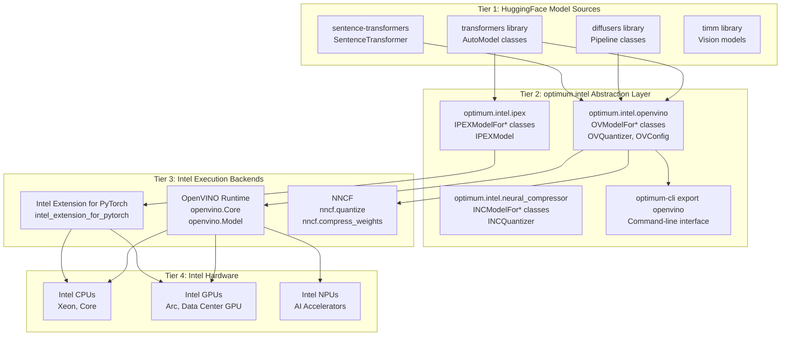
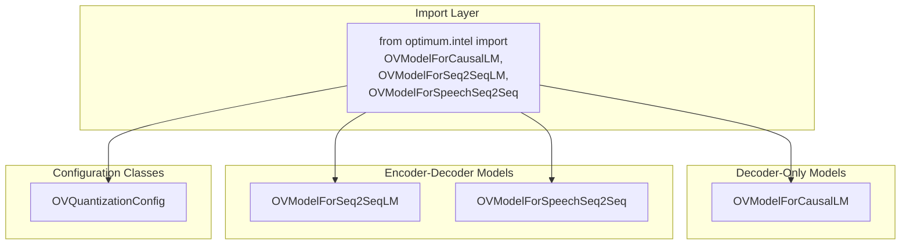

<!-- source: DeepWiki mcp.deepwiki.com · repo huggingface/optimum-intel · page 1 Overview · fetched 2026-10-26 -->

# Overview

<details>
<summary>Relevant source files</summary>

The following files were used as context for generating this wiki page:

- [README.md](README.md)
- [docs/source/_toctree.yml](docs/source/_toctree.yml)
- [docs/source/index.mdx](docs/source/index.mdx)
- [docs/source/installation.mdx](docs/source/installation.mdx)
- [optimum/intel/version.py](optimum/intel/version.py)
- [setup.py](setup.py)

</details>


**Optimum Intel** is an interface library that connects HuggingFace model libraries (Transformers, Diffusers, Sentence Transformers, and timm) with Intel's hardware optimization frameworks. It enables deployment and acceleration of deep learning models on Intel CPUs, GPUs, and NPUs through three backend integrations: **OpenVINO** (primary), **Intel Extension for PyTorch (IPEX)**, and **Neural Compressor** (deprecated).

This page provides a high-level view of the system architecture, backend capabilities, and core workflows. For detailed information about specific subsystems:
- System Architecture: see [System Architecture](#1.1)
- Installation: see [Installation and Setup](#1.2)
- Model export and conversion: see [Model Export and Conversion](#2.2)
- Quantization configuration and methods: see [Quantization System](#2.3)
- Model loading and inference: see [Model Loading and Inference](#2.4)
- Command-line tools: see [Command Line Interface](#6)

**Sources:** [README.md:7-9](), [docs/source/index.mdx:18-23]()

---

## Three-Tier System Architecture

Optimum Intel implements a three-tier architecture that separates model sources, optimization abstractions, and execution backends:



**Diagram: Three-tier architecture separating model sources, abstraction APIs, execution backends, and hardware targets**

**Sources:** [README.md:7-9](), [docs/source/index.mdx:20-22](), [setup.py:86-117]()

---

## Backend Capabilities and Status

Optimum Intel supports three Intel optimization backends with different feature sets and maintenance status:

| Backend | Status | Hardware Support | Model Export | Quantization | Key Classes | Use Case |
|---------|--------|------------------|--------------|--------------|-------------|----------|
| **OpenVINO** | ✅ Active (Primary) | CPU, GPU, NPU | ✅ PyTorch → IR | ✅ INT4/INT8/FP8/NF4<br/>AWQ/GPTQ/SmoothQuant | `OVModelForCausalLM`<br/>`OVQuantizer`<br/>`OVConfig` | Production deployment<br/>Cross-hardware inference<br/>Advanced quantization |
| **IPEX** | ✅ Active | CPU, GPU | ❌ PyTorch only | ⚠️ Limited | `IPEXModelForCausalLM`<br/>`IPEXModel` | PyTorch-native inference<br/>torch.compile integration |
| **Neural Compressor** | ⚠️ Deprecated | CPU | ❌ PyTorch only | ✅ PTQ, QAT | `INCQuantizer` | Legacy quantization<br/>Migration to OpenVINO recommended |

**Table: Backend comparison showing OpenVINO as the primary backend with the broadest feature support**

Key differences:
- **OpenVINO** converts models to Intermediate Representation (IR) format, providing the widest hardware coverage and most quantization options [README.md:9]().
- **IPEX** operates on native PyTorch models, offering seamless PyTorch integration but limited to CPU/GPU.
- **Neural Compressor** is deprecated [README.md:26-27](); users should migrate to OpenVINO's quantization capabilities using `nncf` [setup.py:36]().

**Sources:** [README.md:9](), [README.md:26-27](), [setup.py:36-37](), [docs/source/index.mdx:20-22]()

---

## Core Model Lifecycle Workflow

The typical workflow for using Optimum Intel follows a three-stage pipeline:

```mermaid
flowchart LR
    subgraph stage1["Stage 1: Model Acquisition"]
        hf_hub["HuggingFace Hub<br/>model_id or local path"]
        pytorch_model["PyTorch Model<br/>transformers.AutoModel"]
    end
    
    subgraph stage2["Stage 2: Export & Optimization"]
        export_cli["optimum-cli export openvino<br/>--model MODEL_ID"]
        ir_files["OpenVINO IR<br/>.xml / .bin files"]
        
        quant_config["OVQuantizationConfig<br/>dtype, dataset, num_samples"]
        quantizer["OVQuantizer.quantize"]
        nncf["NNCF Engine<br/>nncf.quantize"]
        optimized_ir["Optimized IR<br/>Quantized Weights"]
    end
    
    subgraph stage3["Stage 3: Inference"]
        load_model["OVModelForCausalLM.from_pretrained<br/>OVModelForSpeechSeq2Seq.from_pretrained"]
        compile["OpenVINO Compilation<br/>openvino.Core.compile_model"]
        inference["Inference Methods<br/>model.generate()<br/>pipeline()"]
    end
    
    hf_hub --> pytorch_model
    pytorch_model --> export_cli
    export_cli --> ir_files
    
    ir_files --> quant_config
    quant_config --> quantizer
    quantizer --> nncf
    nncf --> optimized_ir
    
    ir_files --> load_model
    optimized_ir --> load_model
    load_model --> compile
    compile --> inference
```



**Diagram: End-to-end workflow showing the three stages of model lifecycle: acquisition, optimization, and inference with concrete API entry points**

The workflow is flexible:
1. **Export** can happen via CLI (`optimum-cli export openvino` [README.md:35]()) or programmatically.
2. **Quantization** is optional; can be applied during loading using `OVQuantizationConfig` passed to `from_pretrained` [README.md:67-71]().
3. **Inference** uses the same API as HuggingFace Transformers but with `OVModelFor*` classes instead of `AutoModel*` [README.md:44-55]().

**Sources:** [README.md:35](), [README.md:44-55](), [README.md:67-76]()

---

## Primary Entry Points and Model Classes

Optimum Intel provides task-specific model classes that mirror HuggingFace's `AutoModel` hierarchy:



**Diagram: Primary model and configuration classes imported from the main optimum.intel namespace**

All `OVModelFor*` classes share a common interface:
- `from_pretrained(model_id, **kwargs)` - Load from Hub or local directory [README.md:51]().
- `save_pretrained(save_directory)` - Save model and configuration [README.md:75]().
- `generate(**kwargs)` - Text generation for language models [README.md:54]().

**Sources:** [README.md:47-51](), [README.md:67-75]()

---

## Quick Start Example

The following example demonstrates the typical workflow for loading and running an OpenVINO language model:

```python
from optimum.intel import OVModelForCausalLM
from transformers import AutoTokenizer, pipeline

model_id = "ov_TinyLlama_v1_1"
model = OVModelForCausalLM.from_pretrained(model_id)
tokenizer = AutoTokenizer.from_pretrained(model_id)

pipe = pipeline("text-generation", model=model, tokenizer=tokenizer)
results = pipe("Hey, how are you doing today?", max_new_tokens=100)
```

For quantizing a model:

```python
from optimum.intel import OVModelForSpeechSeq2Seq, OVQuantizationConfig

q_config = OVQuantizationConfig(dtype="int8", dataset="librispeech", num_samples=50)
q_model = OVModelForSpeechSeq2Seq.from_pretrained("openai/whisper-tiny", quantization_config=q_config)
q_model.save_pretrained("nncf_results")
```

**Sources:** [README.md:46-55](), [README.md:67-76]()

---

## Dependency Management and Installation

Optimum Intel uses a modular dependency system to handle various backends. The library can be installed with different backend combinations:

| Installation Command | Backends Enabled | Required Dependencies |
|---------------------|------------------|----------------------|
| `pip install "optimum-intel[openvino]"` | OpenVINO | `openvino>=2026.0`, `nncf`, `openvino-tokenizers` [setup.py:80]() |
| `pip install "optimum-intel[nncf]"` | NNCF (Quantization) | `nncf>=2.19.0` [setup.py:79]() |
| `pip install "optimum-intel[diffusers]"` | Diffusion Models | `diffusers` [setup.py:81]() |

**Important:** The extras `nncf`, `neural-compressor`, and `ipex` are deprecated and will be removed in a future release [README.md:26-27]().

**Sources:** [setup.py:29-40](), [setup.py:78-84](), [README.md:17-27](), [docs/source/installation.mdx:19-23]()

---

## Next Steps

For comprehensive information on using Optimum Intel, consult the following pages:

- **System Architecture** ([System Architecture](#1.1)) - Detailed three-tier architecture explanation.
- **Installation and Setup** ([Installation and Setup](#1.2)) - Installation options and environment configuration.
- **OpenVINO Integration** ([OpenVINO Integration](#2)) - Primary backend documentation.
- **Command Line Interface** ([Command Line Interface](#6)) - CLI tools and options.

**Sources:** [docs/source/_toctree.yml:1-28]()

---

