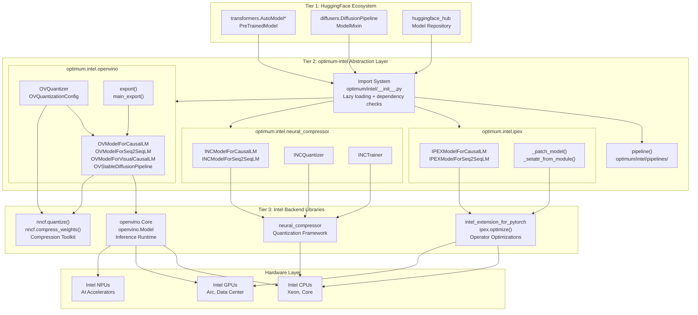
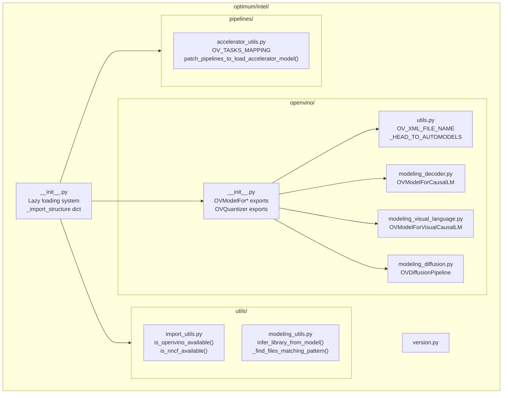
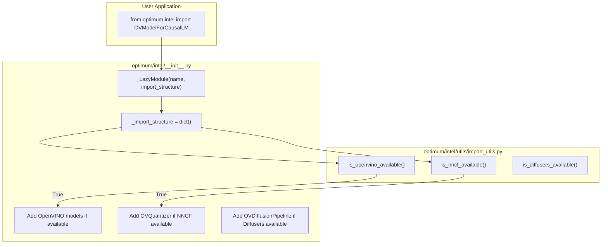
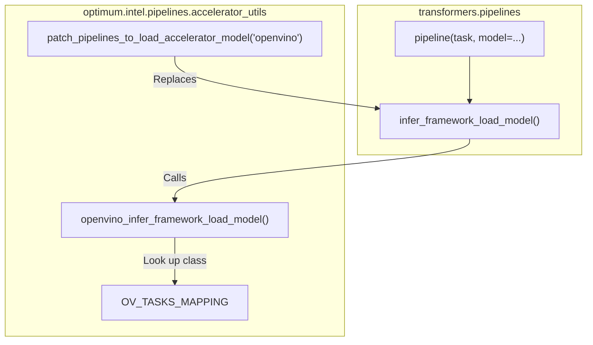

<!-- source: DeepWiki mcp.deepwiki.com · repo huggingface/optimum-intel · page 1.1 System Architecture · fetched 2026-10-26 -->

# System Architecture

Relevant source files

The following files were used as context for generating this wiki page:

- [optimum/intel/__init__.py](optimum/intel/__init__.py)
- [optimum/intel/openvino/__init__.py](optimum/intel/openvino/__init__.py)
- [optimum/intel/openvino/utils.py](optimum/intel/openvino/utils.py)
- [optimum/intel/pipelines/accelerator_utils.py](optimum/intel/pipelines/accelerator_utils.py)
- [optimum/intel/utils/__init__.py](optimum/intel/utils/__init__.py)
- [optimum/intel/utils/import_utils.py](optimum/intel/utils/import_utils.py)
- [optimum/intel/utils/modeling_utils.py](optimum/intel/utils/modeling_utils.py)
- [setup.py](setup.py)

This document explains the three-tier architecture of `optimum-intel`, showing how HuggingFace models flow through the optimum-intel abstraction layer to Intel backend libraries and ultimately to Intel hardware. It describes the relationship between the backends (OpenVINO, IPEX, Neural Compressor), the module organization, and the dependency management system that enables optional backend installation.

**Related Pages:**
- For OpenVINO model classes, see page 2.1
- For model export and conversion, see page 2.2  
- For quantization details, see page 2.3
- For IPEX implementation, see page 3
- For Neural Compressor (deprecated), see page 4

## Three-Tier Architecture

The `optimum-intel` system follows a three-tier architecture that bridges HuggingFace models to Intel hardware:

Title: Three-Tier Architecture Data Flow

**Key Flow Patterns:**

1. **HuggingFace → optimum-intel**: Models from `transformers` or `diffusers` are loaded through specialized model classes like `OVModelForCausalLM.from_pretrained()`. The library handles the conversion from PyTorch/Safetensors to backend-specific formats. [optimum/intel/openvino/__init__.py:83-83](), [optimum/intel/__init__.py:37-58]().

2. **optimum-intel → Intel Backends**: 
   - **OpenVINO**: Uses `openvino.convert_model` and `openvino.Core` for runtime execution. [optimum/intel/openvino/utils.py:31-31]().
   - **Quantization**: Interfaces with `nncf` (Neural Network Compression Framework) for post-training quantization and weight compression. [optimum/intel/openvino/__init__.py:58-66]().

3. **Intel Backends → Hardware**: The `openvino.Core` instance manages device discovery and model compilation for target hardware (CPU, GPU, NPU). [optimum/intel/openvino/utils.py:31-31]().

**Sources:** [optimum/intel/__init__.py:27-154](), [optimum/intel/openvino/__init__.py:69-125](), [optimum/intel/openvino/utils.py:31-31](), [setup.py:29-40]()

---

## Backend System Overview

The `optimum-intel` package provides three distinct backend systems, each with different optimization approaches:

| Backend | Status | Model Format | Key Classes | Module Path |
|---------|--------|--------------|-------------|-------------|
| **OpenVINO** | ⭐ Primary | IR (.xml/.bin) | `OVModelFor*`, `OVQuantizer` | `optimum.intel.openvino` |
| **IPEX** | Active | PyTorch | `IPEXModelFor*` | `optimum.intel.ipex` |
| **Neural Compressor** | ⚠️ Deprecated | PyTorch | `INCModelFor*`, `INCQuantizer` | `optimum.intel.neural_compressor` |

**Backend Characteristics:**

- **OpenVINO**: The primary backend. It exports models to the OpenVINO Intermediate Representation (IR). It supports the widest range of tasks including Causal LM, Seq2Seq, Diffusion, and Visual-Language models. [optimum/intel/openvino/utils.py:122-151](), [optimum/intel/openvino/__init__.py:69-120]().
- **IPEX (Intel Extension for PyTorch)**: Optimizes PyTorch models directly. It uses techniques like operator fusion and weight prepacking. [optimum/intel/utils/modeling_utils.py:79-86]().
- **NNCF Integration**: OpenVINO backend leverages NNCF for advanced quantization algorithms like AWQ and GPTQ. [optimum/intel/openvino/configuration.py:49-55](), [optimum/intel/openvino/__init__.py:58-66]().

**Sources:** [optimum/intel/openvino/__init__.py:1-125](), [optimum/intel/openvino/utils.py:122-151](), [setup.py:29-40]()

---

## Module Organization

The package follows a hierarchical module structure where each backend is a subpackage with its own models, configurations, and utilities.

### Package Structure

Title: Codebase Module Hierarchy

**Key Classes and Roles:**

- **OVBaseModel**: The base class for all OpenVINO-backed models, providing the core interface for inference and model management. [optimum/intel/pipelines/accelerator_utils.py:40-40]().
- **Import Utilities**: `optimum.intel.utils.import_utils` manages the complex matrix of optional dependencies (torch, openvino, nncf, diffusers). [optimum/intel/utils/import_utils.py:33-192]().
- **Task Mapping**: `_HEAD_TO_AUTOMODELS` defines the internal mapping between task heads and OpenVINO model classes. [optimum/intel/openvino/utils.py:122-151]().

**Sources:** [optimum/intel/openvino/utils.py:122-151](), [optimum/intel/utils/import_utils.py:1-192](), [optimum/intel/__init__.py:27-59]()

---

## Dependency Management and Import System

The package uses a `_LazyModule` pattern and a conditional `_import_structure` to handle optional backends. This ensures that users are only required to install the dependencies for the backend they intend to use.

Title: Dependency Check and Lazy Loading Flow

**Implementation Details:**

- **`_import_structure`**: A dictionary mapping submodules to the classes they export. It is dynamically updated based on the results of availability checks. [optimum/intel/__init__.py:27-59]().
- **Dummy Objects**: If a dependency is missing, the library maps the requested class to a dummy object (e.g., `utils.dummy_openvino_and_nncf_objects`) which raises a clear `ImportError` only when the user attempts to instantiate it. [optimum/intel/__init__.py:63-75]().
- **Version Enforcement**: The library enforces minimum versions for backends (e.g., OpenVINO >= 2025.4.0) during import to ensure compatibility. [optimum/intel/openvino/__init__.py:42-47]().

**Sources:** [optimum/intel/__init__.py:27-156](), [optimum/intel/utils/import_utils.py:194-212](), [optimum/intel/openvino/__init__.py:15-66]()

---

## API Integration Patterns

### Task Mapping and Pipeline Patching

The `optimum-intel` package integrates with the HuggingFace `transformers.pipeline` API by providing an accelerator patching mechanism.

Title: Pipeline Accelerator Integration

**Components:**

- **`OV_TASKS_MAPPING`**: Maps standard HuggingFace task strings (e.g., `"text-generation"`) to OpenVINO-specific classes (`OVModelForCausalLM`). [optimum/intel/pipelines/accelerator_utils.py:48-67]().
- **`patch_pipelines_to_load_accelerator_model`**: A context manager that replaces the default model loading function in `transformers` with one that can resolve and load OpenVINO models. [optimum/intel/pipelines/accelerator_utils.py:127-141]().
- **`get_openvino_model_class`**: Logic to determine the correct `OVModelFor*` class based on the task and model architecture (e.g., distinguishing between CTC and Seq2Seq for ASR). [optimum/intel/pipelines/accelerator_utils.py:70-96]().

**Sources:** [optimum/intel/pipelines/accelerator_utils.py:48-141](), [optimum/intel/openvino/utils.py:122-151]()

---

