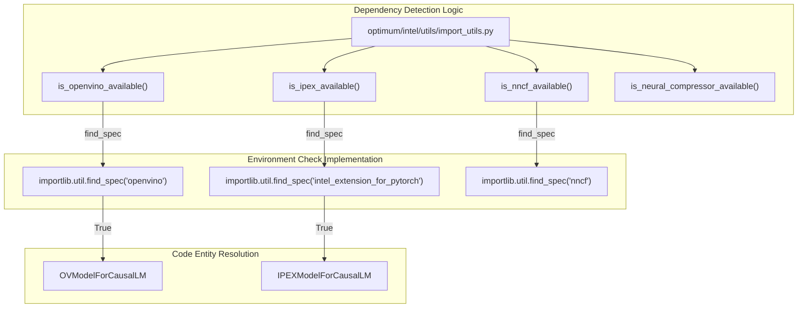
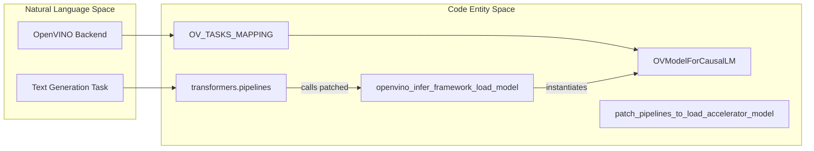
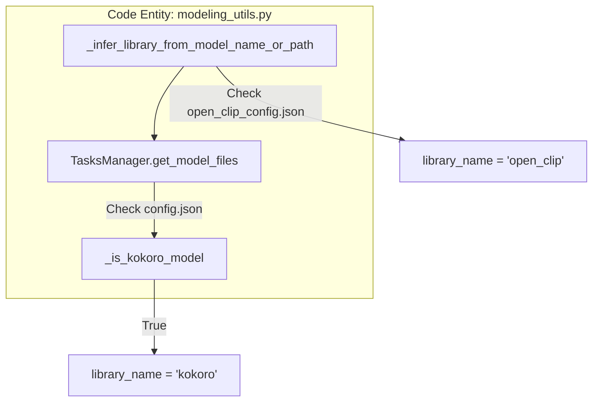

<!-- source: DeepWiki mcp.deepwiki.com · repo huggingface/optimum-intel · page 1.2 Installation and Setup · fetched 2026-10-26 -->

# Installation and Setup

<details>
<summary>Relevant source files</summary>

The following files were used as context for generating this wiki page:

- [README.md](README.md)
- [docs/source/_toctree.yml](docs/source/_toctree.yml)
- [docs/source/index.mdx](docs/source/index.mdx)
- [docs/source/installation.mdx](docs/source/installation.mdx)
- [optimum/intel/pipelines/accelerator_utils.py](optimum/intel/pipelines/accelerator_utils.py)
- [optimum/intel/utils/__init__.py](optimum/intel/utils/__init__.py)
- [optimum/intel/utils/import_utils.py](optimum/intel/utils/import_utils.py)
- [optimum/intel/utils/modeling_utils.py](optimum/intel/utils/modeling_utils.py)
- [setup.py](setup.py)

</details>


This document provides technical instructions for installing and configuring 🤗 Optimum Intel, the interface between Hugging Face libraries (`transformers`, `diffusers`, `sentence-transformers`, `timm`) and Intel optimization backends. The package primarily targets OpenVINO™, Intel® Extension for PyTorch (IPEX), and Intel® Neural Compressor (INC).

## Installation Overview

Optimum Intel is designed as a modular package where backends are installed as optional dependencies. The core requirements include `torch`, `transformers`, `optimum`, and `huggingface-hub`.

**Core Dependency Specification**
The `INSTALL_REQUIRE` list defines the baseline environment:
- `torch>=2.1` [setup.py:30]()
- `safetensors<0.8.0` [setup.py:31]()
- `optimum~=2.2.0` [setup.py:32]()
- `transformers>=4.45,<5.1` [setup.py:33]()
- `nncf>=2.19.0` [setup.py:36]()
- `openvino>=2026.0` [setup.py:37]()
- `openvino-tokenizers>=2026.0` [setup.py:38]()

### Backend Availability Logic
The codebase uses a utility system to detect available backends at runtime. This allows the package to fail gracefully or provide dummy objects when a specific dependency is missing.

**Dependency Detection and Mapping Architecture**


Sources: [setup.py:29-40](), [optimum/intel/utils/import_utils.py:63-85]()

## Standard Installation

### Prerequisites
It is recommended to use a virtual environment and ensure `pip` is up to date to handle complex dependency resolutions.

```bash
python -m pip install --upgrade pip
```
Sources: [docs/source/installation.mdx:28-30]()

### Backend-Specific Installation
Users should install the package with the specific "extra" corresponding to their target Intel hardware or optimization toolkit. These extras are defined in `setup.py` via `EXTRAS_REQUIRE`.

| Target Backend | Installation Command | Primary Use Case |
| :--- | :--- | :--- |
| **OpenVINO** | `pip install "optimum-intel[openvino]"` | Inference on Intel CPUs, GPUs, and NPUs. Includes `nncf` and `openvino-tokenizers`. |
| **Diffusers** | `pip install "optimum-intel[diffusers]"` | Support for Stable Diffusion and other diffusion pipelines. |
| **Quality** | `pip install "optimum-intel[quality]"` | Development tools: `black` and `ruff`. |
| **Tests** | `pip install "optimum-intel[tests]"` | Full suite for CI/CD including `pytest`, `accelerate`, and `timm`. |

**Deprecation Notice:** The `extras` for `openvino` (e.g., `pip install optimum-intel[openvino,nncf]`), `nncf`, `neural-compressor`, and `ipex` are **deprecated** and will be removed in a future release. [README.md:26-27](). Users are encouraged to use the consolidated `[openvino]` extra.

**Note:** The `--upgrade-strategy eager` flag is recommended to ensure `optimum-intel` and its sub-dependencies are moved to the latest compatible versions. [docs/source/installation.mdx:22-25]()

Sources: [setup.py:78-84](), [README.md:16-18](), [docs/source/installation.mdx:21-25]()

## Installation from Source

For access to the latest model support (e.g., new Visual-Language models or Kokoro TTS), installation from the `main` branch is often required. The versioning system in `setup.py` automatically appends the git commit hash to the version string for dev installs.

```bash
python -m pip install "optimum-intel[openvino]"@git+https://github.com/huggingface/optimum-intel.git
```
Sources: [setup.py:9-25](), [README.md:20-24](), [docs/source/installation.mdx:32-35]()

## Verification and Initialization

### Pipeline Integration Mapping
The package integrates with the `transformers.pipeline` API by patching the loading mechanism to use Intel-optimized model classes via `patch_pipelines_to_load_accelerator_model`.

**Task to Model Mapping Flow**


Sources: [optimum/intel/pipelines/accelerator_utils.py:48-67](), [optimum/intel/pipelines/accelerator_utils.py:100-124](), [optimum/intel/pipelines/accelerator_utils.py:127-141]()

### Verification Script
You can verify the installation by checking backend availability via the `optimum.intel.utils` module:

```python
from optimum.intel.utils import is_openvino_available, is_transformers_available

print(f"OpenVINO detected: {is_openvino_available()}")
print(f"Transformers detected: {is_transformers_available()}")

if is_openvino_available():
    from optimum.intel import OVModelForCausalLM
    print("OpenVINO Model classes ready.")
```
Sources: [optimum/intel/utils/__init__.py:15-28]()

## Model Discovery and Inference

The `modeling_utils.py` file provides logic to infer the correct library for a model and manage devices.

**Model Library Inference Logic**
The system detects if a model belongs to `transformers`, `diffusers`, `open_clip`, or `kokoro` to route it to the correct optimized class.


Sources: [optimum/intel/utils/modeling_utils.py:144-166](), [optimum/intel/utils/modeling_utils.py:168-187]()

For basic inference verification:
```python
from optimum.intel import OVModelForCausalLM
from transformers import AutoTokenizer

model_id = "helenai/gpt2-ov" # Example OpenVINO IR model
model = OVModelForCausalLM.from_pretrained(model_id)
tokenizer = AutoTokenizer.from_pretrained(model_id)
```
Sources: [README.md:46-52]()

---

