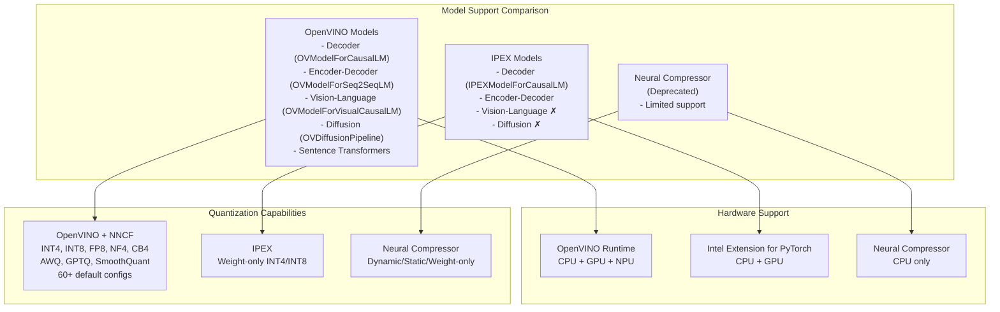
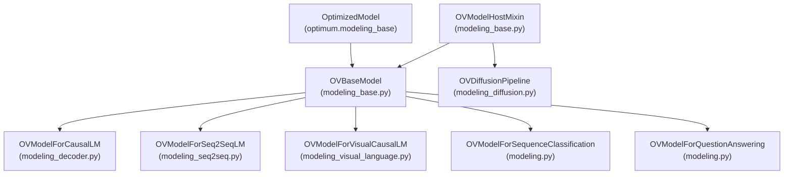
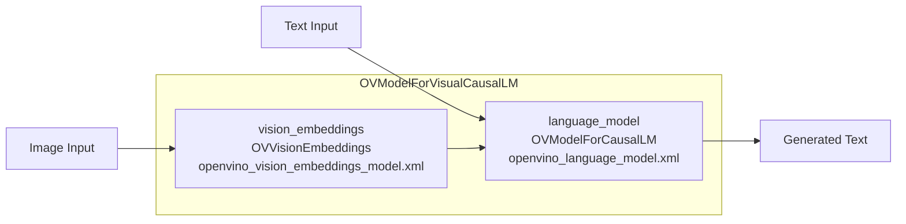

<!-- source: DeepWiki mcp.deepwiki.com · repo huggingface/optimum-intel · page 2 OpenVINO Integration · fetched 2026-10-26 -->

# OpenVINO Integration

Relevant source files

The following files were used as context for generating this wiki page:

- [docs/source/openvino/models.mdx](docs/source/openvino/models.mdx)
- [optimum/intel/__init__.py](optimum/intel/__init__.py)
- [optimum/intel/openvino/__init__.py](optimum/intel/openvino/__init__.py)
- [optimum/intel/openvino/modeling.py](optimum/intel/openvino/modeling.py)
- [optimum/intel/openvino/modeling_base.py](optimum/intel/openvino/modeling_base.py)
- [optimum/intel/openvino/utils.py](optimum/intel/openvino/utils.py)

This document introduces the OpenVINO backend integration in `optimum-intel`, which serves as the **primary and most comprehensive** optimization backend for running HuggingFace models on Intel hardware. OpenVINO provides a complete workflow from model export through quantization to optimized inference.

For information about the overall system architecture and how OpenVINO fits alongside other backends (IPEX, Neural Compressor), see [System Architecture](#1.1). For specific implementation details of model classes, export mechanisms, and quantization, refer to the child pages: [Model Classes and Task Coverage](#2.1), [Model Export and Conversion](#2.2), [Quantization System](#2.3), [Model Loading and Inference](#2.4), [Diffusion Models](#2.5), [Visual-Language Models](#2.6), and [Sequence-to-Sequence Models](#2.7).

## Overview and Capabilities

OpenVINO is the flagship backend of `optimum-intel`, offering three primary capabilities:

1. **Model Export**: Converting PyTorch/ONNX models to OpenVINO Intermediate Representation (IR) format [optimum/intel/openvino/modeling_base.py:30-31]().
2. **Quantization**: Compressing models using NNCF for INT4/INT8/FP8 weights and activations [optimum/intel/openvino/__init__.py:58-66]().
3. **Inference**: Executing optimized models on CPU, GPU, and NPU devices [optimum/intel/openvino/modeling.py:76-85]().

The OpenVINO integration is unique in providing:
- **Broadest model architecture support**: Including vision-language models (LLaVA, MiniCPM-V, Qwen2-VL, Phi3-Vision) via `OVModelForVisualCausalLM` [optimum/intel/openvino/__init__.py:92]().
- **Most comprehensive quantization options**: Support for data types like INT4, INT8, FP8, NF4, MXFP4, and CB4 through `OVWeightQuantizationConfig` [optimum/intel/openvino/configuration.py:118-135]().
- **Widest hardware coverage**: Native support for CPU, Discrete/Integrated GPU, and NPU (AI Accelerators) [optimum/intel/openvino/modeling.py:76-85]().
- **Stateful model support**: Efficient KV-cache management for text generation via internal state handling, reducing memory overhead [optimum/intel/openvino/utils.py:44]().

**Sources**: [optimum/intel/openvino/__init__.py:49-120](), [docs/source/openvino/models.mdx:10-183](), [optimum/intel/openvino/modeling_base.py:20-53]()

## Primary Backend Status

The following diagram illustrates how the OpenVINO integration compares to other backends in terms of feature parity and hardware support.

### Backend Capability Matrix

**Sources**: [optimum/intel/openvino/__init__.py:67-123](), [optimum/intel/__init__.py:27-154](), [optimum/intel/openvino/configuration.py:49-55]()

## Core Workflow

The OpenVINO integration follows a three-stage pipeline:

### Stage 1: Model Export
Models are converted from PyTorch (or ONNX) format to OpenVINO IR format consisting of `.xml` (model structure) and `.bin` (weights) files [optimum/intel/openvino/utils.py:41-48]().

- **Key Entry Point**: `optimum.exporters.openvino.main_export()` [optimum/intel/openvino/modeling_base.py:31]().
- **Utility Names**: `OV_XML_FILE_NAME`, `OV_ENCODER_NAME`, `OV_DECODER_NAME` [optimum/intel/openvino/utils.py:41-43]().

For details, see [Model Export and Conversion](#2.2).

### Stage 2: Quantization (Optional)
Models can be compressed using NNCF (Neural Network Compression Framework) to reduce size and improve inference speed [optimum/intel/openvino/__init__.py:58-66]().

- **Config Classes**: `OVWeightQuantizationConfig`, `OVQuantizationConfig`, and `OVMixedQuantizationConfig` [optimum/intel/openvino/configuration.py:49-55]().
- **Tooling**: Managed via `OVQuantizer` and `OVCalibrationDataset` [optimum/intel/openvino/__init__.py:66]().

For details, see [Quantization System](#2.3).

### Stage 3: Model Loading and Inference
Models are loaded using task-specific `OVModelFor*` classes that handle compilation and inference [optimum/intel/openvino/modeling.py:154-156]().

- **Model Loading**: Use `from_pretrained()` which utilizes the `OVModelHostMixin` for component management [optimum/intel/openvino/modeling_base.py:99-115]().
- **Runtime Config**: Properties like `PERFORMANCE_HINT` are passed via `ov_config` [optimum/intel/openvino/modeling.py:80-81]().

For details, see [Model Loading and Inference](#2.4).

## Model Class Hierarchy

All OpenVINO model classes follow a consistent interface pattern, mapping HuggingFace tasks to optimized OpenVINO implementations.

### Class Relationship Diagram

### Task-to-Class Mapping
| Task | Class | Module |
|------|-------|--------|
| `text-generation` | `OVModelForCausalLM` | `modeling_decoder.py` [optimum/intel/openvino/utils.py:125]() |
| `text2text-generation` | `OVModelForSeq2SeqLM` | `modeling_seq2seq.py` [optimum/intel/openvino/utils.py:126]() |
| `image-text-to-text` | `OVModelForVisualCausalLM` | `modeling_visual_language.py` [optimum/intel/openvino/utils.py:132]() |
| `stable-diffusion` | `OVStableDiffusionPipeline` | `modeling_diffusion.py` [optimum/intel/openvino/utils.py:135]() |
| `automatic-speech-recognition`| `OVModelForSpeechSeq2Seq` | `modeling_seq2seq.py` [optimum/intel/openvino/utils.py:147]() |

**Sources**: [optimum/intel/openvino/__init__.py:69-125](), [optimum/intel/openvino/utils.py:122-151](), [optimum/intel/openvino/modeling_base.py:52-113]()

## Multi-Component Models

Advanced architectures like Vision-Language Models (VLM) and Diffusion Pipelines consist of multiple sub-models loaded and compiled independently via `OVModelHostMixin`.

### Vision-Language Model Components

**Sources**: [optimum/intel/openvino/utils.py:46-47](), [optimum/intel/openvino/modeling_base.py:142-160]()

## Hardware Support and Device Configuration

OpenVINO supports a wide range of Intel hardware through a unified `device` parameter.

### Device Specification
- **CPU**: Default device for all models. Supports multi-threading and NUMA optimization.
- **GPU**: Supports Intel Arc, Data Center Flex/Max series, and Integrated Graphics [optimum/intel/openvino/modeling.py:76-77]().
- **NPU**: Low-power AI acceleration found in Intel Core Ultra processors [optimum/intel/openvino/modeling.py:76-77]().

### Runtime Configuration
The `ov_config` dictionary allows fine-tuning the OpenVINO Runtime:
- `PERFORMANCE_HINT`: Set to `LATENCY` (default) or `THROUGHPUT`.
- `CACHE_DIR`: Enables model compilation caching to speed up subsequent loads [optimum/intel/openvino/modeling_base.py:22-28]().

**Sources**: [optimum/intel/openvino/modeling_base.py:14-61](), [optimum/intel/openvino/modeling.py:67-85]()

## Key Advantages Over Other Backends

1. **Model Coverage**: Supports multimodal models (VLMs, Diffusion) that are not currently available in the IPEX backend [optimum/intel/openvino/utils.py:132-140]().
2. **Quantization Sophistication**: Deep integration with NNCF for advanced algorithms like AWQ, GPTQ, and SmoothQuant [optimum/intel/openvino/configuration.py:32-40]().
3. **Hardware Flexibility**: Unified API for CPU, GPU, and NPU.
4. **Stateful Optimization**: Drastically reduces memory overhead for LLMs by keeping KV-cache in device memory [optimum/intel/openvino/utils.py:44]().

For detailed information on specific subsystems:
- [Model Classes and Task Coverage](#2.1)
- [Model Export and Conversion](#2.2)
- [Quantization System](#2.3)
- [Model Loading and Inference](#2.4)
- [Diffusion Models](#2.5)
- [Visual-Language Models](#2.6)
- [Sequence-to-Sequence Models](#2.7)

---

