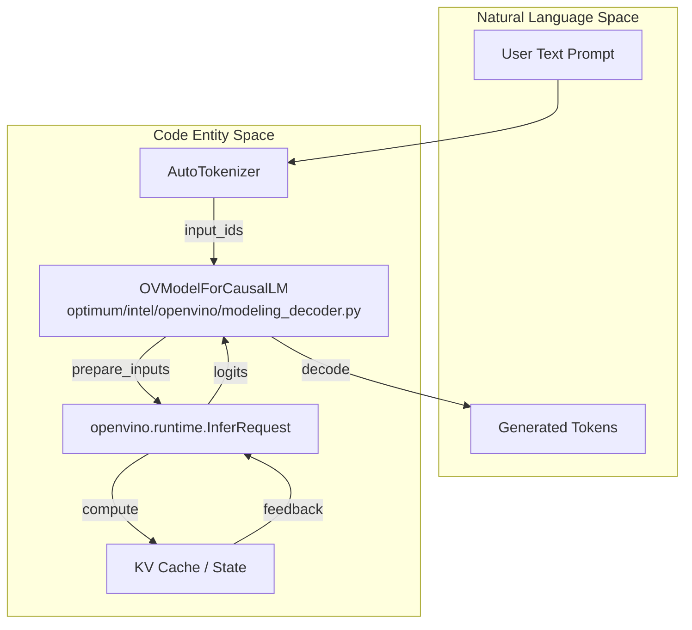
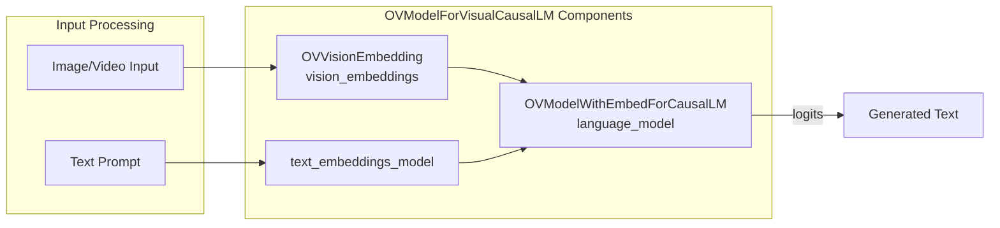

<!-- source: DeepWiki mcp.deepwiki.com · repo huggingface/optimum-intel · page 2.1 Model Classes and Task Coverage · fetched 2026-10-26 -->

# Model Classes and Task Coverage

Relevant source files

The following files were used as context for generating this wiki page:

- [optimum/intel/openvino/modeling.py](optimum/intel/openvino/modeling.py)
- [optimum/intel/openvino/modeling_base.py](optimum/intel/openvino/modeling_base.py)
- [optimum/intel/openvino/modeling_open_clip.py](optimum/intel/openvino/modeling_open_clip.py)
- [optimum/intel/openvino/modeling_sam.py](optimum/intel/openvino/modeling_sam.py)
- [optimum/intel/openvino/modeling_sentence_transformers.py](optimum/intel/openvino/modeling_sentence_transformers.py)
- [optimum/intel/openvino/modeling_text2speech.py](optimum/intel/openvino/modeling_text2speech.py)
- [optimum/intel/openvino/modeling_timm.py](optimum/intel/openvino/modeling_timm.py)
- [tests/openvino/test_modeling.py](tests/openvino/test_modeling.py)

This page documents the 87+ `OVModel*` classes in `optimum-intel`, organized by task type. These classes provide drop-in replacements for HuggingFace models while leveraging the Intel OpenVINO runtime for accelerated inference on CPUs, GPUs, and NPUs.

Each model class inherits from `OVBaseModel` and implements task-specific interfaces compatible with the Transformers library. The classes handle automatic model export, quantization, and device-optimized compilation.

## Model Class Hierarchy

### Inheritance Structure

The class hierarchy is designed to mirror the `transformers` library while injecting OpenVINO-specific logic for model loading and inference.

**Core Inheritance Hierarchy: Base Classes to Task-Specific Models**

```mermaid
graph TB
    subgraph "Base Layer"
        OptimizedModel["optimum.modeling_base.OptimizedModel"]
        OVBaseModel["OVBaseModel<br/>optimum/intel/openvino/modeling_base.py"]
        OptimizedModel --> OVBaseModel
    end
    
    subgraph "Intermediate Layer"
        OVModel["OVModel<br/>optimum/intel/openvino/modeling.py"]
        OVBaseDecoderModel["OVBaseDecoderModel<br/>optimum/intel/openvino/modeling_decoder.py"]
        OVBaseModel --> OVModel
        OVBaseModel --> OVBaseDecoderModel
    end
    
    subgraph "Text Models"
        OVModelForSequenceClassification["OVModelForSequenceClassification"]
        OVModelForTokenClassification["OVModelForTokenClassification"]
        OVModelForQuestionAnswering["OVModelForQuestionAnswering"]
        OVModelForMaskedLM["OVModelForMaskedLM"]
        OVModelForCausalLM["OVModelForCausalLM"]
        OVModelForFeatureExtraction["OVModelForFeatureExtraction"]
        
        OVModel --> OVModelForSequenceClassification
        OVModel --> OVModelForTokenClassification
        OVModel --> OVModelForQuestionAnswering
        OVModel --> OVModelForMaskedLM
        OVModel --> OVModelForFeatureExtraction
        OVBaseDecoderModel --> OVModelForCausalLM
    end
    
    subgraph "Vision Models"
        OVModelForImageClassification["OVModelForImageClassification"]
        OVModelForZeroShotImageClassification["OVModelForZeroShotImageClassification"]
        OVSamModel["OVSamModel"]
        
        OVModel --> OVModelForImageClassification
        OVModel --> OVModelForZeroShotImageClassification
        OVModelForFeatureExtraction --> OVSamModel
    end
    
    subgraph "Audio Models"
        OVModelForAudioClassification["OVModelForAudioClassification"]
        OVModelForAudioFrameClassification["OVModelForAudioFrameClassification"]
        OVModelForAudioXVector["OVModelForAudioXVector"]
        OVModelForCTC["OVModelForCTC"]
        
        OVModel --> OVModelForAudioClassification
        OVModel --> OVModelForAudioFrameClassification
        OVModel --> OVModelForAudioXVector
        OVModel --> OVModelForCTC
    end
    
    subgraph "Seq2Seq Models"
        OVModelForSeq2SeqLM["OVModelForSeq2SeqLM<br/>optimum/intel/openvino/modeling_seq2seq.py"]
        OVModelForSpeechSeq2Seq["OVModelForSpeechSeq2Seq"]
        OVModelForVision2Seq["OVModelForVision2Seq"]
        OVModelForPix2Struct["OVModelForPix2Struct"]
        
        OVBaseModel --> OVModelForSeq2SeqLM
        OVModelForSeq2SeqLM --> OVModelForSpeechSeq2Seq
        OVModelForSeq2SeqLM --> OVModelForVision2Seq
        OVModelForSeq2SeqLM --> OVModelForPix2Struct
    end
    
    subgraph "Multimodal Models"
        OVModelForVisualCausalLM["OVModelForVisualCausalLM<br/>optimum/intel/openvino/modeling_visual_language.py"]
        OVModelForTextToSpeechSeq2Seq["OVModelForTextToSpeechSeq2Seq"]
        
        OVBaseModel --> OVModelForVisualCausalLM
        OVBaseModel --> OVModelForTextToSpeechSeq2Seq
    end
```

Sources: [optimum/intel/openvino/modeling_base.py:52-53](), [optimum/intel/openvino/modeling.py:120-122](), [optimum/intel/openvino/modeling_decoder.py:114-118](), [optimum/intel/openvino/modeling_seq2seq.py:252-254](), [optimum/intel/openvino/modeling_visual_language.py:344-346](), [optimum/intel/openvino/modeling_text2speech.py:159-160]()

### Base Class Responsibilities

| Base Class | File Location | Primary Responsibilities |
|------------|---------------|--------------------------|
| `OVBaseModel` | `modeling_base.py` | Root class for OpenVINO models. Handles model loading via `from_pretrained`, device management, compilation, and IR serialization [optimum/intel/openvino/modeling_base.py:181-220](). |
| `OVModel` | `modeling.py` | Wrapper for single-file models; registers with Transformers `AutoModel` and handles standard `forward()` to `request()` mapping [optimum/intel/openvino/modeling.py:120-131](). |
| `OVBaseDecoderModel` | `modeling_decoder.py` | Base for causal language models. Supports stateful inference, KV-cache management, and `GenerationMixin` integration [optimum/intel/openvino/modeling_decoder.py:114-163](). |
| `OVModelForSeq2SeqLM` | `modeling_seq2seq.py` | Orchestrates separate `OVEncoder` and `OVDecoder` components for encoder-decoder architectures [optimum/intel/openvino/modeling_seq2seq.py:252-300](). |
| `OVModelForVisualCausalLM` | `modeling_visual_language.py` | Multi-modal component orchestration, managing `language_model`, `vision_embeddings`, and `text_embeddings` [optimum/intel/openvino/modeling_visual_language.py:344-411](). |
| `OVModelHostMixin` | `modeling_base.py` | Mixin for models containing multiple submodels (e.g., Diffusion, SAM). Manages submodel replacement and path mapping [optimum/intel/openvino/modeling_base.py:99-160](). |

Sources: [optimum/intel/openvino/modeling_base.py:99-160](), [optimum/intel/openvino/modeling.py:120-131](), [optimum/intel/openvino/modeling_decoder.py:114-163](), [optimum/intel/openvino/modeling_seq2seq.py:252-300]()

## Task-Specific Model Classes

### Text Understanding and Classification Models

These classes implement the standard `forward()` interface, returning Transformers-compatible output objects like `SequenceClassifierOutput`.

| Model Class | File Location | Supported Tasks |
|-------------|---------------|-----------------|
| `OVModelForSequenceClassification` | `modeling.py:154-192` | Sentiment analysis, text classification. |
| `OVModelForTokenClassification` | `modeling.py:228-266` | NER, POS tagging. |
| `OVModelForQuestionAnswering` | `modeling.py:302-340` | Extractive QA. |
| `OVModelForMaskedLM` | `modeling.py:374-412` | Fill-mask, MLM. |
| `OVModelForFeatureExtraction` | `modeling.py:448-461` | Embeddings, semantic similarity. |
| `OVSentenceTransformer` | `modeling_sentence_transformers.py:22-33` | Sentence embeddings via `sentence-transformers` [optimum/intel/openvino/modeling_sentence_transformers.py:29-33](). |

Sources: [optimum/intel/openvino/modeling.py:154-461](), [optimum/intel/openvino/modeling_sentence_transformers.py:22-33]()

### Generative Language Models

The `OVModelForCausalLM` class is optimized for text generation, supporting both stateful and stateless inference modes.

**OVModelForCausalLM: Text Generation Data Flow**

**Architecture Support Highlights:**
- **Stateful Models**: Uses OpenVINO's internal variable state to store KV caches, reducing data transfer between host and device [optimum/intel/openvino/modeling_decoder.py:155-158]().
- **KV Cache Management**: Automatically detects if a model supports KV caches and manages the `decoder_with_past` submodels [optimum/intel/openvino/modeling_decoder.py:161-163]().

Sources: [optimum/intel/openvino/modeling_decoder.py:114-216]()

### Sequence-to-Sequence Models

These models split the architecture into encoder and decoder components, often handled by `OVModelPart`.

| Model Class | Architecture | Task Coverage |
|-------------|--------------|---------------|
| `OVModelForSeq2SeqLM` | T5, BART, Marian | Translation, Summarization. |
| `OVModelForSpeechSeq2Seq` | Whisper | ASR, Speech Translation. |
| `OVModelForVision2Seq` | TrOCR, Donut | OCR, Document Understanding. |
| `OVModelForPix2Struct` | Pix2Struct | Visual Question Answering. |
| `OVModelForTextToSpeechSeq2Seq`| SpeechT5, Kokoro | Text-to-Audio/Speech [optimum/intel/openvino/modeling_text2speech.py:159-173](). |

Sources: [optimum/intel/openvino/modeling_seq2seq.py:252-450](), [optimum/intel/openvino/modeling_text2speech.py:159-173]()

### Vision and Audio Models

OpenVINO provides optimized classes for standard vision and audio backbones, including support for specialized libraries like `timm` and `open_clip`.

| Model Class | Base Class | Example Architectures |
|-------------|------------|-----------------------|
| `OVModelForImageClassification` | `OVModel` | ViT, ResNet, ConvNeXT |
| `OVSamModel` | `OVBaseModel` | Segment Anything Model (SAM) [optimum/intel/openvino/modeling_sam.py:74-110](). |
| `OVModelForAudioClassification` | `OVModel` | Wav2Vec2, HuBERT |
| `OVModelForCTC` | `OVModel` | Wav2Vec2 for ASR |
| `TimmForImageClassification` | `PreTrainedModel` | Any `timm` library model [optimum/intel/openvino/modeling_timm.py:93-114](). |
| `OVModelOpenCLIPForZeroShotImageClassification` | `OVModelOpenCLIPBase` | CLIP variants from `open_clip` [optimum/intel/openvino/modeling_open_clip.py:60-65](). |

Sources: [optimum/intel/openvino/modeling.py:463-584](), [optimum/intel/openvino/modeling_sam.py:74-110](), [optimum/intel/openvino/modeling_timm.py:93-114](), [optimum/intel/openvino/modeling_open_clip.py:60-65]()

### Multimodal (Vision-Language) Models

`OVModelForVisualCausalLM` coordinates multiple OpenVINO models (vision encoder, projector, and language model).

**Visual Language Component Mapping**

**Architecture Implementation Details:**
- **Components**: Often consists of a `language_model`, `vision_embeddings`, and `text_embeddings` [optimum/intel/openvino/modeling_visual_language.py:344-411]().
- **Input Modes**: Supports `LANGUAGE`, `VISION`, `SPEECH`, and `VISION_SPEECH` for multimodal inputs [optimum/intel/openvino/modeling_visual_language.py:67-71]().

Sources: [optimum/intel/openvino/modeling_visual_language.py:344-411]()

### Diffusion Models

OpenVINO provides high-level pipelines for Stable Diffusion and Flux architectures, managing multiple sub-components (UNet, VAE, Text Encoders).

| Model Class | Task | Components Managed |
|-------------|------|-------------------|
| `OVDiffusionPipeline` | Base Pipeline | UNet/Transformer, VAE, Text Encoders |
| `OVStableDiffusionPipeline` | Text-to-Image | UNet, VAE Decoder, Text Encoder |
| `OVStableDiffusionXLPipeline` | High-res T2I | UNet, VAE Decoder, 2x Text Encoders |
| `OVFluxPipeline` | Next-gen T2I | Transformer, VAE Decoder, 2x Text Encoders |

Sources: [tests/openvino/test_modeling.py:62-84]()

## Model Lifecycle: from_pretrained to Inference

The lifecycle of an OpenVINO model in `optimum-intel` involves several key steps:

1. **Discovery**: `from_pretrained` identifies if OpenVINO IR files (`.xml`) exist [optimum/intel/openvino/modeling_base.py:380-400]().
2. **Export (Optional)**: If `export=True`, it triggers `main_export` to convert PyTorch weights to OpenVINO IR [optimum/intel/openvino/modeling_base.py:415-420]().
3. **Reshape**: The model is reshaped to support dynamic or static dimensions [optimum/intel/openvino/modeling_base.py:112-113]().
4. **Compilation**: `core.compile_model` is called for the target device (e.g., "CPU", "GPU", "NPU") [optimum/intel/openvino/modeling_base.py:530-540]().
5. **Inference**: The `forward` method prepares inputs as `numpy` arrays and executes an `InferRequest` [optimum/intel/openvino/modeling.py:168-175]().

Sources: [optimum/intel/openvino/modeling_base.py:181-540](), [optimum/intel/openvino/modeling.py:120-131]()

---

