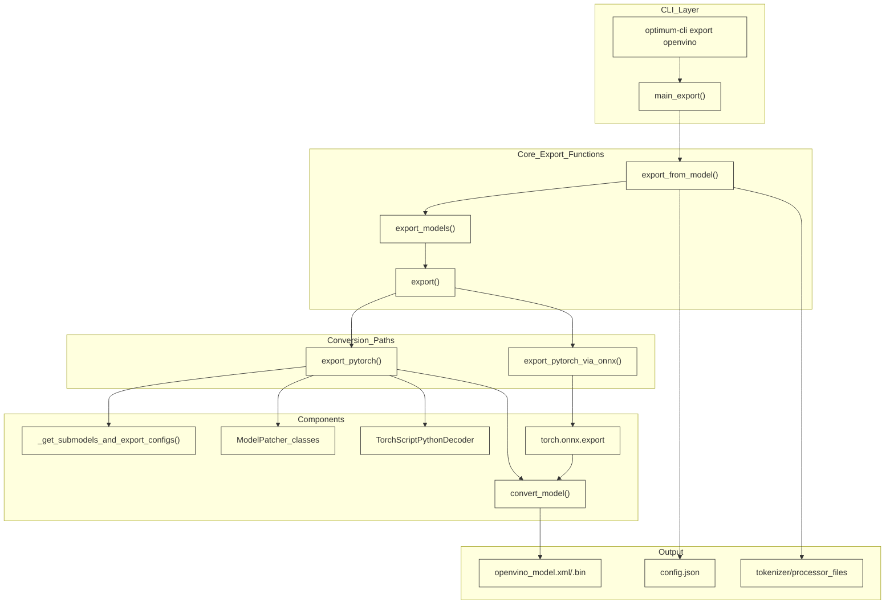
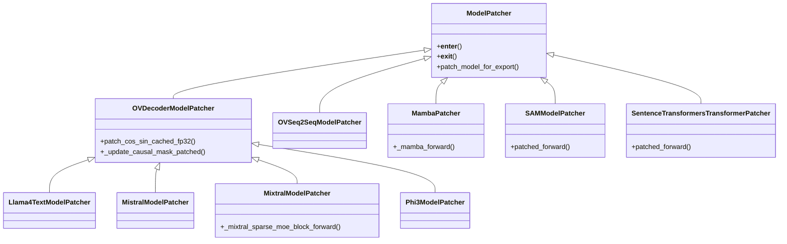
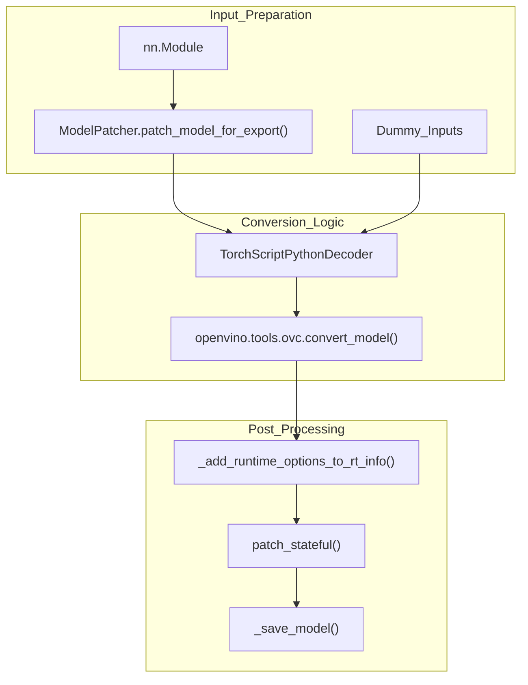

<!-- source: DeepWiki mcp.deepwiki.com · repo huggingface/optimum-intel · page 2.2 Model Export and Conversion · fetched 2026-10-26 -->

# Model Export and Conversion

<details>
<summary>Relevant source files</summary>

The following files were used as context for generating this wiki page:

- [optimum/exporters/openvino/__main__.py](optimum/exporters/openvino/__main__.py)
- [optimum/exporters/openvino/_traceable_cache.py](optimum/exporters/openvino/_traceable_cache.py)
- [optimum/exporters/openvino/_traceable_decorator.py](optimum/exporters/openvino/_traceable_decorator.py)
- [optimum/exporters/openvino/base.py](optimum/exporters/openvino/base.py)
- [optimum/exporters/openvino/config.py](optimum/exporters/openvino/config.py)
- [optimum/exporters/openvino/convert.py](optimum/exporters/openvino/convert.py)
- [optimum/exporters/openvino/input_generators.py](optimum/exporters/openvino/input_generators.py)
- [optimum/exporters/openvino/model_configs.py](optimum/exporters/openvino/model_configs.py)
- [optimum/exporters/openvino/model_patcher.py](optimum/exporters/openvino/model_patcher.py)
- [optimum/exporters/openvino/patching_utils.py](optimum/exporters/openvino/patching_utils.py)
- [optimum/exporters/openvino/stateful.py](optimum/exporters/openvino/stateful.py)
- [optimum/exporters/openvino/utils.py](optimum/exporters/openvino/utils.py)

</details>


This document explains how to convert Hugging Face models to OpenVINO format for optimized inference on Intel hardware. It covers the internal mechanics of the export process, the model patching system, and the architecture-specific configurations used in `optimum-intel`.

## Overview of the Export Process

The export process converts models from PyTorch to OpenVINO Intermediate Representation (IR) format. The `main_export` function in [optimum/exporters/openvino/__main__.py:178-358]() serves as the primary orchestrator, handling model loading, task inference, and coordinating the conversion pipeline.

**Export Function Call Flow**



Sources: [optimum/exporters/openvino/__main__.py:178-358](), [optimum/exporters/openvino/convert.py:678-777](), [optimum/exporters/openvino/convert.py:593-676](), [optimum/exporters/openvino/convert.py:145-228]()

## Export Methods

### Command Line Interface

The `main_export` function orchestrates the export process by performing the following steps:
1. **Task Inference**: Via `infer_task()`, it determines the model's task (e.g., `text-generation-with-past`) [optimum/exporters/openvino/__main__.py:74-139]().
2. **Library Detection**: Via `_infer_library_from_model_name_or_path()`, it identifies if the model is from `transformers`, `diffusers`, `timm`, or `open_clip` [optimum/exporters/openvino/__main__.py:41-44]().
3. **Model Loading**: Loads the PyTorch model using the appropriate library-specific loader [optimum/exporters/openvino/__main__.py:254-290]().
4. **Quantization Handling**: Checks for `GPTQ`, `AWQ`, or `mxfp4` configurations to apply appropriate weight compression during export [optimum/exporters/openvino/__main__.py:221-252]().

```bash
optimum-cli export openvino --model meta-llama/Llama-2-7b-chat-hf ./exported-model
```

Sources: [optimum/exporters/openvino/__main__.py:74-139](), [optimum/exporters/openvino/__main__.py:41-44](), [optimum/exporters/openvino/__main__.py:178-358]()

### Python API - export_from_model

The `export_from_model` function provides programmatic access. It handles the extraction of submodels for complex architectures like Encoder-Decoder or Diffusion models using `_get_submodels_and_export_configs` [optimum/exporters/openvino/convert.py:678-777]().

```python
from optimum.exporters.openvino import export_from_model
from transformers import AutoModelForCausalLM

model = AutoModelForCausalLM.from_pretrained("gpt2")
export_from_model(model, output="gpt2_ov/", task="text-generation")
```

Sources: [optimum/exporters/openvino/convert.py:678-777](), [optimum/exporters/openvino/convert.py:530-591]()

## Export Pipeline Architecture

The pipeline decomposes models into components and applies architecture-specific patches.

### Model Decomposition
For complex models, `optimum-intel` extracts submodels to be exported as separate IR files:
- **Encoder-Decoder**: Uses `_get_submodels_for_export_encoder_decoder` to separate the encoder and decoder components [optimum/exporters/openvino/convert.py:51]().
- **Diffusion**: Uses `get_diffusion_models_for_export` to extract the UNet/Transformer, VAE, and Text Encoders [optimum/exporters/openvino/convert.py:54]().
- **OpenCLIP**: Uses `_get_open_clip_submodels_fn_and_export_configs` for multimodal components [optimum/exporters/openvino/convert.py:40]().
- **Kokoro**: Uses `_get_kokoro_submodels_fn_and_export_configs` for specific Kokoro model components [optimum/exporters/openvino/convert.py:38]().

Sources: [optimum/exporters/openvino/convert.py:38-55](), [optimum/exporters/openvino/convert.py:530-591]()

### Model Patching System
The `ModelPatcher` class in [optimum/exporters/openvino/model_patcher.py:104]() is the base for architecture-specific modifications. These patches are necessary to make models compatible with OpenVINO's tracing or to optimize specific operations like RoPE or Attention masks.

**Patcher Class Hierarchy**



Key patching operations:
- **`OVDecoderModelPatcher`**: Patches RoPE (Rotary Positional Embeddings) to use FP32 for numeric stability and overrides causal mask updates [optimum/exporters/openvino/model_patcher.py:209-241]().
- **`MixtralModelPatcher`**: Overrides the sparse MoE block forward pass to ensure efficient routing during export [optimum/exporters/openvino/model_patcher.py:279-294]().
- **`MambaPatcher`**: Patches the Mamba forward pass for State Space Model (SSM) compatibility [optimum/exporters/openvino/model_patcher.py:1441-1500]().
- **`SAMModelPatcher`**: Provides a `patched_forward` method to handle different variants ("monolith" or "split") for SAM models, allowing separate export of vision encoder and prompt encoder/mask decoder components [optimum/exporters/openvino/model_patcher.py:113-182]().
- **`SentenceTransformersTransformerPatcher`**: Patches the forward pass for Sentence Transformers models [optimum/exporters/openvino/model_patcher.py:185]().
- **Attention Patching**: For specific architectures like `Gemma2` or `Phi-3`, the system may force specific attention implementations (e.g., `sdpa` or `eager`) to ensure export compatibility [optimum/exporters/openvino/__main__.py:60]().
- **Recurrent Attention**: Custom conversion rules like `convert_recurrent_attention_cell` are used for specific recurrent layers in Torch graphs [optimum/exporters/openvino/_ov_ops.py:25-113]().

Sources: [optimum/exporters/openvino/model_patcher.py:209-241](), [optimum/exporters/openvino/model_patcher.py:279-294](), [optimum/exporters/openvino/model_patcher.py:1441-1500](), [optimum/exporters/openvino/model_configs.py:132-205](), [optimum/exporters/openvino/__main__.py:60](), [optimum/exporters/openvino/_ov_ops.py:25-113](), [optimum/exporters/openvino/model_patcher.py:113-182](), [optimum/exporters/openvino/model_patcher.py:185]()

## Conversion Path: Direct PyTorch to IR

The default path uses the OpenVINO PyTorch frontend via `convert_model`.

**Direct Conversion Flow**



Key logic in `export_pytorch`:
1. **Patching**: Applies the `ModelPatcher` associated with the architecture [optimum/exporters/openvino/convert.py:347-350]().
2. **Input Generation**: Creates dummy inputs via `config.generate_dummy_inputs` [optimum/exporters/openvino/convert.py:353-356]().
3. **Runtime Options**: Sets metadata like `KV_CACHE_PRECISION` (defaulting to `f16` for non-quantized text-generation models) or `ACTIVATIONS_SCALE_FACTOR` into the IR's `rt_info` [optimum/exporters/openvino/convert.py:97-122]().
4. **Stateful Transformation**: For decoder models, `patch_stateful` converts explicit KV cache inputs/outputs into internal model states using `make_stateful` and `fuse_cache_reorder` [optimum/exporters/openvino/stateful.py:49-143]().

Sources: [optimum/exporters/openvino/convert.py:297-454](), [optimum/exporters/openvino/convert.py:97-122](), [optimum/exporters/openvino/stateful.py:49-143]()

## Supported Architectures and Configurations

Architectures are registered in [optimum/exporters/openvino/model_configs.py]() using the `TasksManager`. The library supports a wide range of models across `transformers`, `diffusers`, and `timm`.

| Model Family | Config Class | Patcher Class |
| :--- | :--- | :--- |
| **Llama** | `LlamaOpenVINOConfig` | `OVDecoderModelPatcher` |
| **Mixtral** | `MixtralOpenVINOConfig` | `MixtralModelPatcher` |
| **Phi-3** | `Phi3OpenVINOConfig` | `Phi3ModelPatcher` |
| **ChatGLM** | `ChatGLM2OpenVINOConfig` | `ChatGLMModelPatcher` |
| **Mamba** | `MambaOpenVINOConfig` | `MambaPatcher` |
| **Qwen2-VL** | `Qwen2VLOpenVINOConfig` | `Qwen2VLLanguageModelPatcher` |
| **SAM** | `SamOpenVINOConfig` | `SAMModelPatcher` |
| **Sentence Transformers** | `SentenceTransformersOpenVINOConfig` | `SentenceTransformersTransformerPatcher` |

Sources: [optimum/exporters/openvino/model_configs.py:554-566](), [optimum/exporters/openvino/model_configs.py:526-536](), [optimum/exporters/openvino/model_configs.py:438-450](), [optimum/exporters/openvino/model_configs.py:840-845](), [optimum/exporters/openvino/model_configs.py:195](), [optimum/exporters/openvino/model_configs.py:164](), [optimum/exporters/openvino/model_configs.py:167]()

## IR File Formats and Metadata

The export results in two primary files:
- **`openvino_model.xml`**: The XML representation of the model graph [optimum/exporters/openvino/utils.py:49]().
- **`openvino_model.bin`**: The binary file containing weights and biases.

During the save process (`_save_model`), the exporter embeds version information from `optimum-intel`, `openvino`, and `transformers` into the model's metadata to ensure traceability [optimum/exporters/openvino/convert.py:124-143](). It also handles `compress_to_fp16` logic if specified in the `OVConfig` [optimum/exporters/openvino/convert.py:131]().

Sources: [optimum/exporters/openvino/convert.py:124-143](), [optimum/exporters/openvino/utils.py:49-50](), [optimum/exporters/openvino/convert.py:131]()

---

