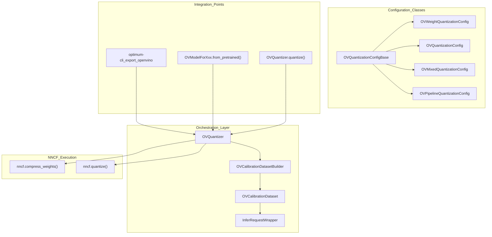
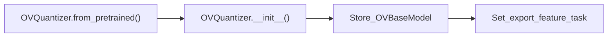
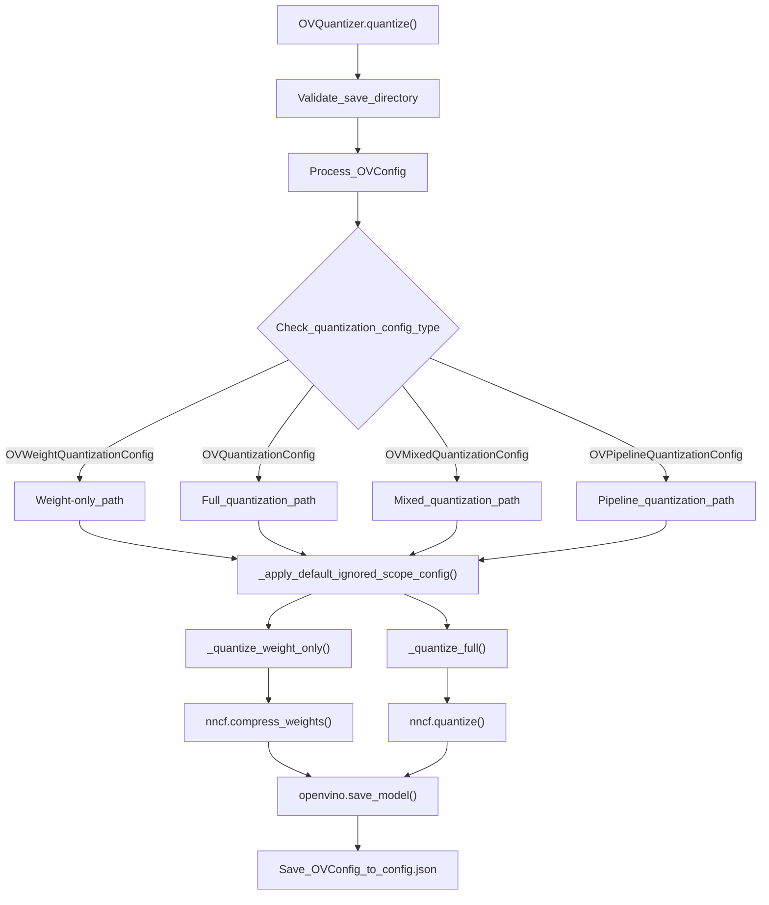

<!-- source: DeepWiki mcp.deepwiki.com · repo huggingface/optimum-intel · page 2.3 Quantization System · fetched 2026-10-26 -->

# Quantization System

Relevant source files

The following files were used as context for generating this wiki page:

- [docs/source/openvino/export.mdx](docs/source/openvino/export.mdx)
- [docs/source/openvino/inference.mdx](docs/source/openvino/inference.mdx)
- [docs/source/openvino/optimization.mdx](docs/source/openvino/optimization.mdx)
- [optimum/intel/openvino/configuration.py](optimum/intel/openvino/configuration.py)
- [optimum/intel/openvino/quantization.py](optimum/intel/openvino/quantization.py)
- [tests/openvino/test_quantization.py](tests/openvino/test_quantization.py)

The quantization system provides comprehensive model compression through the NNCF (Neural Network Compression Framework) backend. The system orchestrates quantization through the `OVQuantizer` class [optimum/intel/openvino/quantization.py:1208-1450]() and a hierarchy of configuration classes [optimum/intel/openvino/configuration.py:574-850](). It supports weight-only quantization, full quantization (weights + activations), hybrid quantization for diffusion models, and mixed-precision quantization.

The system integrates at three entry points: (1) CLI export via `optimum-cli export openvino`, (2) model loading via `from_pretrained(..., quantization_config=...)`, and (3) explicit quantization via `OVQuantizer.quantize()`.

## System Architecture

### Component Overview

The quantization system consists of three layers: configuration, orchestration, and execution.

**Diagram: Quantization System Architecture**

Sources: [optimum/intel/openvino/quantization.py:88-246](), [optimum/intel/openvino/configuration.py:545-850]()

## Configuration Classes

### OVQuantizationConfigBase

Base class for all quantization configurations [optimum/intel/openvino/configuration.py:574-640]():

| Parameter | Type | Description |
|-----------|------|-------------|
| `ignored_scope` | `Dict` | Nodes/patterns to exclude from quantization via `names` or `patterns` lists |
| `num_samples` | `int` | Number of calibration samples (default: 128 for weight-only, 200 for full) |
| `dataset` | `str` or `List[str]` | Dataset name or list of text samples for calibration |
| `tokenizer` | `str` | Tokenizer model ID for preprocessing |
| `processor` | `str` | Processor model ID for multimodal models |
| `trust_remote_code` | `bool` | Whether to trust remote code when loading |

### OVWeightQuantizationConfig

Weight-only quantization configuration [optimum/intel/openvino/configuration.py:642-715]():

| Parameter | Type | Default | Description |
|-----------|------|---------|-------------|
| `bits` | `int` | 4 | Quantization bit-width (4 or 8) |
| `sym` | `bool` | `True` | Symmetric vs asymmetric quantization |
| `group_size` | `int` | 128 | Group size for quantization (-1 = per-column) |
| `ratio` | `float` | 1.0 | Ratio of layers to quantize (0.0-1.0) |
| `all_layers` | `bool` | `None` | Whether to quantize embedding and lm_head layers |
| `quant_method` | `OVQuantizationMethod` | `DEFAULT` | Algorithm: DEFAULT, AWQ, or HYBRID |
| `awq` | `bool` | `False` | Enable Activation-Aware Weight Quantization |
| `scale_estimation` | `bool` | `False` | Enable scale estimation algorithm |
| `gptq` | `bool` | `False` | Enable GPTQ algorithm |
| `lora_correction` | `bool` | `False` | Enable LoRA correction algorithm |
| `backup_precision` | `str` | `"int8_asym"` | Backup precision: `none`, `int8_sym`, or `int8_asym` |

### OVQuantizationConfig

Full quantization (weights + activations) configuration [optimum/intel/openvino/configuration.py:717-759]():

| Parameter | Type | Default | Description |
|-----------|------|---------|-------------|
| `dtype` | `str` | `"int8"` | Data type: `int8`, `f8e4m3`, or `f8e5m2` |
| `smooth_quant_alpha` | `float` | -1 | SmoothQuant alpha parameter (-1 = auto-tune, 0.0-1.0 = fixed) |
| `weight_only` | `bool` | `False` | Whether to quantize only weights (activations remain fp32) |

### OVMixedQuantizationConfig

Mixed-precision quantization combining weight-only and full quantization [optimum/intel/openvino/configuration.py:761-811]():

| Parameter | Type | Description |
|-----------|------|-------------|
| `weight_quantization_config` | `OVWeightQuantizationConfig` | Configuration for weight compression |
| `full_quantization_config` | `OVQuantizationConfig` | Configuration for activation quantization |

Sources: [optimum/intel/openvino/configuration.py:574-850]()

## OVQuantizer Class

The `OVQuantizer` class [optimum/intel/openvino/quantization.py:1208-1677]() orchestrates the quantization process.

### Initialization

**Diagram: OVQuantizer Initialization Flow**

**Method**: `from_pretrained(model, task=None, **kwargs)` [optimum/intel/openvino/quantization.py:1258-1320]()

Accepts either an `OVBaseModel` instance or a path to load from. The `task` parameter defaults to `model.export_feature` if not provided.

### Quantization Workflow

**Diagram: Quantization Execution Path**

**Method**: `quantize(calibration_dataset=None, save_directory=None, **kwargs)` [optimum/intel/openvino/quantization.py:1321-1400]()

The main quantization entry point. Delegates to:
- `_quantize_weight_only()` [optimum/intel/openvino/quantization.py:1483-1570]() for weight compression.
- `_quantize_full()` [optimum/intel/openvino/quantization.py:1402-1481]() for full quantization.

Sources: [optimum/intel/openvino/quantization.py:1208-1677](), [tests/openvino/test_quantization.py:445-533]()

### Weight-Only Quantization Details

The `_quantize_weight_only()` method [optimum/intel/openvino/quantization.py:1483-1570]() performs weight compression:

1. Extracts parameters: `bits`, `sym`, `group_size`, `ratio`, `all_layers`, etc. [optimum/intel/openvino/quantization.py:1495-1510]().
2. Handles algorithm-specific parameters: `awq`, `scale_estimation`, `gptq`, `lora_correction` [optimum/intel/openvino/quantization.py:1520-1540]().
3. Prepares calibration dataset if needed (for data-aware algorithms) [optimum/intel/openvino/quantization.py:1515-1518]().
4. Calls `nncf.compress_weights()` with prepared parameters [optimum/intel/openvino/quantization.py:1545-1560]().

**Supported algorithms**:
- **AWQ**: Set `awq=True` or `quant_method=OVQuantizationMethod.AWQ` [optimum/intel/openvino/configuration.py:50-54]().
- **GPTQ**: Set `gptq=True` [optimum/intel/openvino/quantization.py:1525]().
- **Scale estimation**: Set `scale_estimation=True` [optimum/intel/openvino/quantization.py:1532]().
- **LoRA correction**: Set `lora_correction=True` [optimum/intel/openvino/quantization.py:1537]().

### Full Quantization Details

The `_quantize_full()` method [optimum/intel/openvino/quantization.py:1402-1481]() performs activation quantization:

1. Prepares calibration dataset (required for full quantization) [optimum/intel/openvino/quantization.py:1410-1420]().
2. Extracts parameters: `dtype`, `smooth_quant_alpha`, `weight_only` [optimum/intel/openvino/quantization.py:1425-1435]().
3. Applies SmoothQuant if `smooth_quant_alpha` is specified [optimum/intel/openvino/quantization.py:1440-1455]().
4. Calls `nncf.quantize()` with the calibration dataset [optimum/intel/openvino/quantization.py:1460-1475]().

Sources: [optimum/intel/openvino/quantization.py:1402-1570]()

## Calibration Dataset System

The `OVCalibrationDatasetBuilder` class [optimum/intel/openvino/quantization.py:234-1117]() handles calibration data preparation.

### Model-Specific Preparation Methods

| Model Type | Preparation Method | File Reference |
|------------|-------------------|----------------|
| `OVModelForCausalLM` | `_prepare_causal_lm_calibration_data()` | [optimum/intel/openvino/quantization.py:661-750]() |
| `OVModelForVisualCausalLM` | `_prepare_visual_causal_lm_calibration_data()` | [optimum/intel/openvino/quantization.py:877-1023]() |
| `_OVModelForWhisper` | `_prepare_speech_to_text_calibration_data()` | [optimum/intel/openvino/quantization.py:752-829]() |
| `OVDiffusionPipeline` | `_prepare_diffusion_calibration_data()` | [optimum/intel/openvino/quantization.py:1025-1074]() |
| `OVModelForSeq2SeqLM` | `_prepare_text_to_text_calibration_data()` | [optimum/intel/openvino/quantization.py:831-875]() |
| `OVSamModel` | `_prepare_sam_dataset()` | [optimum/intel/openvino/quantization.py:1105-1117]() |

### Predefined Datasets

The system includes predefined dataset mappings [optimum/intel/openvino/utils.py:153-251]():

- **wikitext2**: `Salesforce/wikitext` (wikitext-2-raw-v1) [optimum/intel/openvino/utils.py:155]().
- **gsm8k**: `openai/gsm8k` (main) [optimum/intel/openvino/utils.py:165]().
- **conceptual_captions**: `google-research-datasets/conceptual_captions` [optimum/intel/openvino/utils.py:215]().
- **librispeech**: `hf-internal-testing/librispeech_asr_dummy` [optimum/intel/openvino/utils.py:180]().

Sources: [optimum/intel/openvino/quantization.py:234-1117](), [optimum/intel/openvino/utils.py:153-251]()

## Quantization Data Types

### Weight-only formats (CLI: `--weight-format`)
- `int4`, `int8`: Standard integer formats [optimum/commands/export/openvino.py:70-75]().
- `nf4`: 4-bit NormalFloat [optimum/commands/export/openvino.py:70]().
- `mxfp4`: 4-bit Microscaling Float [optimum/commands/export/openvino.py:70]().
- `cb4`: 4-bit Codebook (16 fixed fp8 values in E4M3 format) [optimum/commands/export/openvino.py:70-73]().

### Full/Mixed quantization modes (CLI: `--quant-mode`)
- `int8`: Weights and activations to INT8 [optimum/commands/export/openvino.py:79]().
- `f8e4m3`, `f8e5m2`: FP8 activation quantization [optimum/commands/export/openvino.py:79]().
- `cb4_f8e4m3`: Codebook weight + FP8 activation mixed quantization [optimum/commands/export/openvino.py:79]().

Sources: [optimum/commands/export/openvino.py:68-84](), [optimum/intel/openvino/configuration.py:642-759]()

## Default Configurations

Optimum Intel provides optimized default configurations for over 60 models [optimum/intel/openvino/configuration.py:57-425]().

**Example Defaults**:
- `meta-llama/Llama-2-7b-hf`: 4-bit symmetric, group size 128, ratio 0.6 [optimum/intel/openvino/configuration.py:76]().
- `HuggingFaceH4/zephyr-7b-beta`: 4-bit symmetric, AWQ, ratio 0.8 [optimum/intel/openvino/configuration.py:69-75]().
- `databricks/dolly-v2-3b`: 4-bit asymmetric, scale estimation enabled [optimum/intel/openvino/configuration.py:58-65]().
- `Qwen/Qwen2.5-Coder-3B-Instruct`: 4-bit asymmetric, group size 64, ratio 1.0, scale estimation enabled, `dq_group_size=128` [optimum/intel/openvino/configuration.py:120-128]().

Sources: [optimum/intel/openvino/configuration.py:53-425]()

---

