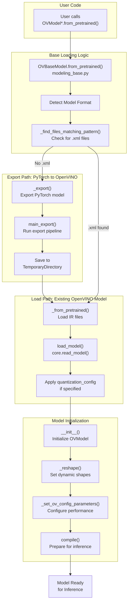
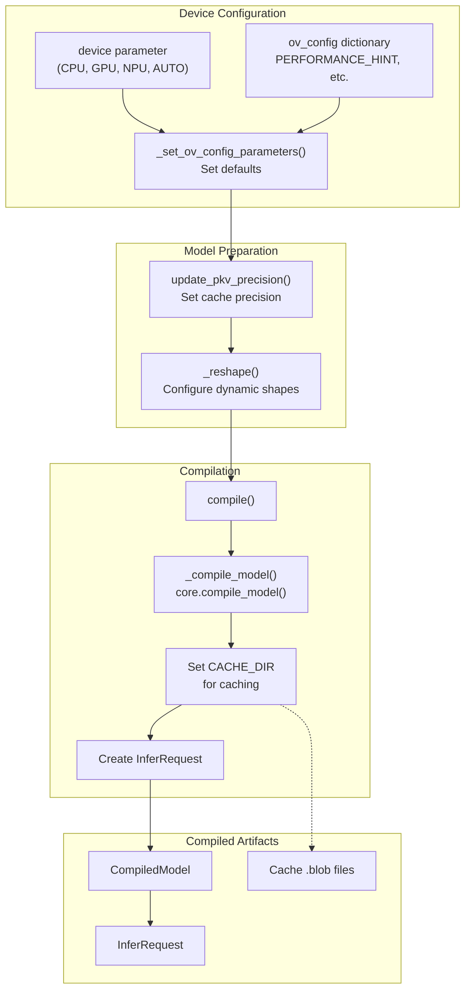
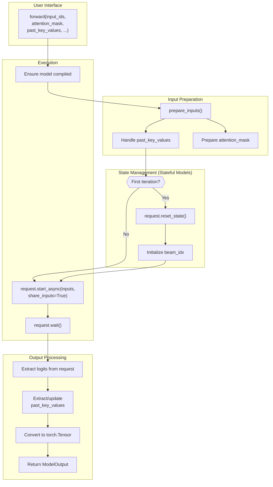

<!-- source: DeepWiki mcp.deepwiki.com · repo huggingface/optimum-intel · page 2.4 Model Loading and Inference · fetched 2026-10-26 -->

# Model Loading and Inference

Relevant source files

The following files were used as context for generating this wiki page:

- [optimum/intel/openvino/modeling.py](optimum/intel/openvino/modeling.py)
- [optimum/intel/openvino/modeling_base.py](optimum/intel/openvino/modeling_base.py)
- [optimum/intel/openvino/modeling_decoder.py](optimum/intel/openvino/modeling_decoder.py)
- [tests/openvino/test_modeling.py](tests/openvino/test_modeling.py)

This page documents the runtime behavior of OpenVINO models in `optimum-intel`, covering how models are loaded from pretrained sources, compiled for execution on Intel hardware, and used for inference. This includes device management, compilation strategies, request handling, and execution workflows.

For information about model export and conversion, see [Model Export and Conversion](#2.2). For quantization applied during or after loading, see [Quantization System](#2.3). For diffusion-specific loading and inference, see [Diffusion Models](#2.5).

## Model Loading Workflow

Models in `optimum-intel` are loaded through the `from_pretrained` class method, which supports loading from HuggingFace Hub, local directories, or on-the-fly export from PyTorch models. The system automatically detects whether a model is already in OpenVINO format or requires export.

### Loading Entry Points

The primary entry point for loading models is the `OVBaseModel.from_pretrained` method, which is inherited by task-specific classes like `OVModelForCausalLM` or `OVModelForSequenceClassification`.

**Sources:** [optimum/intel/openvino/modeling_base.py:181-226](), [optimum/intel/openvino/modeling_decoder.py:109-152](), [tests/openvino/test_modeling.py:129-131]()

### Key Loading Parameters

The `from_pretrained` method accepts multiple parameters that control loading behavior:

| Parameter | Type | Description | Default |
|-----------|------|-------------|---------|
| `model_id` | `str` or `Path` | HuggingFace model ID or local path | Required |
| `export` | `bool` | Force export even if OpenVINO model exists | `False` |
| `device` | `str` | Target device (CPU, GPU, NPU, AUTO) | `"CPU"` |
| `ov_config` | `Dict[str, str]` | OpenVINO compilation config | `None` |
| `compile` | `bool` | Compile model during loading | `True` |
| `compile_only` | `bool` | Load pre-compiled model only | `False` |
| `dynamic_shapes` | `bool` | Use dynamic input shapes | `True` |
| `use_cache` | `bool` | Enable KV-cache for generation | `True` |
| `stateful` | `bool` | Use stateful model variant | Auto-detected |
| `quantization_config` | `OVWeightQuantizationConfig` | Apply weight quantization | `None` |

**Sources:** [optimum/intel/openvino/modeling_base.py:181-205](), [optimum/intel/openvino/modeling_decoder.py:115-152](), [optimum/intel/openvino/modeling.py:70-85]()

### Model Format Detection

The loading system searches for OpenVINO IR files using a pattern-based approach. It recognizes specific filenames for different model parts defined in `optimum/intel/openvino/utils.py`.

| Component | Filename Variable | Value |
|-----------|-------------------|-------|
| Generic Model | `OV_XML_FILE_NAME` | `openvino_model.xml` |
| Encoder | `OV_ENCODER_NAME` | `openvino_encoder_model.xml` |
| Decoder | `OV_DECODER_NAME` | `openvino_decoder_model.xml` |
| Decoder w/ Past | `OV_DECODER_WITH_PAST_NAME` | `openvino_decoder_with_past_model.xml` |
| Language Model | `OV_LANGUAGE_MODEL_NAME` | `openvino_language_model.xml` |
| Vision Encoder | `OV_VISION_ENCODER_MODEL_NAME` | `openvino_vision_encoder.xml` |

**Sources:** [optimum/intel/openvino/utils.py:41-52](), [optimum/intel/utils/modeling_utils.py:155-243]()

## Device and Compilation Management

OpenVINO models are compiled for specific hardware devices using the `openvino.Core` instance. The compilation process optimizes the model graph for the target device.

### Compilation Workflow

**Sources:** [optimum/intel/openvino/modeling_base.py:354-379](), [optimum/intel/openvino/modeling_decoder.py:228-256]()

### Performance Configuration

The system automatically sets default OpenVINO configuration parameters to optimize for common use cases. For instance, `PERFORMANCE_HINT` defaults to `LATENCY` [tests/openvino/test_modeling.py:133-135](). Users can specify a `CACHE_DIR` in `ov_config` to enable persistent compilation caching, which stores `.blob` files to speed up subsequent loads [tests/openvino/test_modeling.py:138-148]().

**Sources:** [tests/openvino/test_modeling.py:133-148]()

## Inference Execution

The inference workflow transforms input tensors into model predictions. `OVModel` classes handle the conversion between PyTorch and OpenVINO data formats (NumPy-based).

### Forward Pass Architecture

**Sources:** [optimum/intel/openvino/modeling_decoder.py:550-605](), [optimum/intel/openvino/modeling_decoder.py:458-548]()

## KV-Cache Management

Generative models use key-value caching to avoid recomputing attention states. `optimum-intel` supports both **stateless** and **stateful** models.

### Stateful vs Stateless Models

A model is considered stateful if it contains internal states (sinks/sources) for KV-cache management, detected via `model_has_state` [optimum/exporters/openvino/stateful.py:47]().

| Feature | Stateless Models | Stateful Models |
|---------|------------------|-----------------|
| **Cache Location** | Managed by User (past_key_values) | Internal to OpenVINO Runtime |
| **Data Flow** | Cache is passed in/out of model | Cache remains in model memory |
| **Detection** | `self.stateful = False` | `model_has_state(self.model)` |
| **Input Handling** | Requires PKV inputs in every call | `reset_state()` called on new sequence |

**Sources:** [optimum/intel/openvino/modeling_decoder.py:154-158](), [optimum/exporters/openvino/stateful.py:46-48]()

### Cache Precision Management

The `update_pkv_precision()` function allows the model to adjust the precision of the KV-cache (e.g., to `f16` or `bf16`) based on the target device's `INFERENCE_PRECISION_HINT` [optimum/intel/openvino/modeling_decoder.py:228-256](). This is critical for memory-constrained environments.

**Sources:** [optimum/intel/openvino/modeling_decoder.py:228-256]()

## Special Loading Modes

### Compile-Only Mode

When `compile_only=True`, the model is loaded in a pre-compiled state using `openvino.CompiledModel`. This bypasses the intermediate `openvino.Model` representation, which is efficient for deployment but prevents further graph modifications like reshaping [tests/openvino/test_modeling.py:151-162]().

**Sources:** [optimum/intel/openvino/modeling_base.py:118-124](), [tests/openvino/test_modeling.py:151-162]()

### Sequential Models (Encoder-Decoder)

Classes like `OVModelForSeq2SeqLM` manage multiple sub-components. For example, a Whisper model for speech recognition involves an encoder and a decoder (optionally with a "with_past" variant). These models manage component-specific loading and inference logic [optimum/intel/openvino/modeling_base.py:148-160]().

**Sources:** [optimum/intel/openvino/modeling_base.py:148-160]()

## Performance Considerations

### Dynamic vs Static Shapes

By default, `optimum-intel` sets model dimensions to dynamic (`dynamic_shapes=True`) to maintain compatibility with varying input lengths in HuggingFace pipelines [optimum/intel/openvino/modeling.py:78-79]().

**Sources:** [optimum/intel/openvino/modeling.py:78-79]()

### Data Type Mapping

The system provides utilities to map between OpenVINO, NumPy, and PyTorch types to ensure seamless data flow during inference.

| Type | NumPy Mapping | PyTorch Mapping (`OV_TO_PT_TYPE`) |
|------|---------------------------------|-----------------------------------|
| `f32` | `np.float32` | `torch.float32` |
| `f16` | `np.float16` | `torch.float16` |
| `i64` | `np.int64` | `torch.int64` |
| `u8` | `np.uint8` | `torch.uint8` |

**Sources:** [optimum/intel/openvino/utils.py:93-96]()

---

