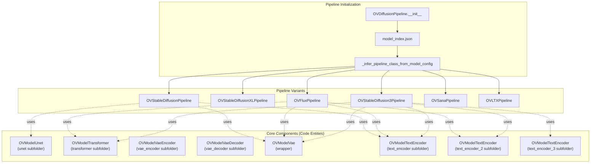
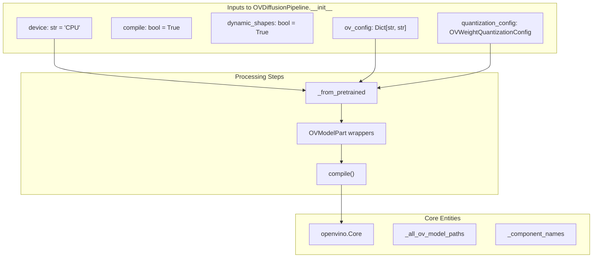

<!-- source: DeepWiki mcp.deepwiki.com · repo huggingface/optimum-intel · page 2.5 Diffusion Models · fetched 2026-10-26 -->

# Diffusion Models

<details>
<summary>Relevant source files</summary>

The following files were used as context for generating this wiki page:

- [notebooks/openvino/demos/quantized_generation_demo.ipynb](notebooks/openvino/demos/quantized_generation_demo.ipynb)
- [notebooks/openvino/sentence_transformer_quantization.ipynb](notebooks/openvino/sentence_transformer_quantization.ipynb)
- [notebooks/openvino/stable_diffusion_hybrid_quantization.ipynb](notebooks/openvino/stable_diffusion_hybrid_quantization.ipynb)
- [optimum/intel/openvino/modeling_diffusion.py](optimum/intel/openvino/modeling_diffusion.py)
- [optimum/intel/openvino/modeling_seq2seq.py](optimum/intel/openvino/modeling_seq2seq.py)
- [tests/openvino/test_diffusion.py](tests/openvino/test_diffusion.py)

</details>


Diffusion Models are generative AI systems that produce images or videos from text prompts. This page documents the OpenVINO integration for diffusion models in `optimum-intel`, covering the pipeline architecture, component structure, quantization strategies, and reshape capabilities.

## Purpose and Scope

The diffusion model implementation in `optimum-intel` provides OpenVINO-optimized inference for popular diffusion architectures including Stable Diffusion, Stable Diffusion XL, Stable Diffusion 3, Flux, Sana, and LTX-Video. The system decomposes diffusion pipelines into separately optimized components (denoising network, VAE, text encoders) and supports hybrid quantization strategies that balance quality and performance across different component types.

Sources: [optimum/intel/openvino/modeling_diffusion.py:140-144](), [optimum/intel/openvino/modeling_diffusion.py:158-295]()

## Pipeline Architecture

### Component-Based Design

Diffusion pipelines are decomposed into independently compiled OpenVINO models, allowing per-component optimization and selective quantization. The base class `OVDiffusionPipeline` manages these submodels.

**Pipeline Component Association**



Sources: [optimum/intel/openvino/modeling_diffusion.py:140-156](), [optimum/intel/openvino/modeling_diffusion.py:146-156]()

### Component Model Classes

Each pipeline component is represented as a separate `OVModelPart` subclass (or internal model reference) that handles compilation and inference:

| Component Class | Subfolder Name | Purpose |
|----------------|-------------------|---------|
| `OVModelUnet` | `unet` | Denoising network for SD, SDXL (U-Net architecture) |
| `OVModelTransformer` | `transformer` | Denoising network for SD3, Flux, Sana, LTX (DiT architecture) |
| `OVModelVaeDecoder` | `vae_decoder` | Latent-to-image decoding |
| `OVModelVaeEncoder` | `vae_encoder` | Image-to-latent encoding (for img2img, inpainting) |
| `OVModelTextEncoder` | `text_encoder` | CLIP or T5 text embedding |
| `OVModelVae` | N/A | Wrapper combining encoder and decoder |

Sources: [optimum/intel/openvino/modeling_diffusion.py:146-156](), [optimum/intel/openvino/modeling_diffusion.py:1189-1231]()

## Supported Architectures

### Architecture Comparison

Different diffusion architectures use different component combinations. The library supports a wide range of models through the `diffusers` integration.

| Architecture | Denoising Network | VAE | Text Encoders |
|-------------|-------------------|-----|---------------|
| **Stable Diffusion** | `unet` | Encoder + Decoder | `text_encoder` (CLIP) |
| **SD XL** | `unet` | Encoder + Decoder | `text_encoder`, `text_encoder_2` |
| **SD 3** | `transformer` | Encoder + Decoder | `text_encoder`, `text_encoder_2`, `text_encoder_3` |
| **Flux** | `transformer` | Encoder + Decoder | `text_encoder`, `text_encoder_2` |
| **Sana** | `transformer` | Encoder + Decoder | `text_encoder` (Gemma) |
| **LTX-Video** | `transformer` | Encoder + Decoder | `text_encoder` (T5) |

Sources: [optimum/intel/openvino/modeling_diffusion.py:82-130](), [optimum/intel/openvino/modeling_diffusion.py:146-156]()

## Loading and Initialization

### From Pretrained Models

The `OVDiffusionPipeline.from_pretrained()` method is the entry point for loading models. It can load exported OpenVINO IR files or export a PyTorch model on-the-fly.

```python
from optimum.intel import OVDiffusionPipeline

# Load and export to OpenVINO
pipeline = OVDiffusionPipeline.from_pretrained(
    "stabilityai/stable-diffusion-2-1",
    export=True,
    device="CPU"
)
```

Sources: [optimum/intel/openvino/modeling_diffusion.py:385-583]()

### Initialization Parameters

The `__init__` method of `OVDiffusionPipeline` accepts various OpenVINO-specific arguments to control hardware execution and model behavior.

**Initialization Data Flow**



Sources: [optimum/intel/openvino/modeling_diffusion.py:158-295](), [optimum/intel/openvino/modeling_base.py:62-178]()

## Reshape Capabilities

Diffusion models in OpenVINO support dynamic reshaping to change generation parameters (resolution, batch size) without re-exporting.

### Reshape Implementation

The `reshape()` method updates the input shapes for all sub-components (UNet/Transformer, VAE, Text Encoders) and clears existing inference requests to force recompilation.

```python
pipeline.reshape(
    batch_size=1,
    height=768,
    width=768,
    num_images_per_prompt=1
)
```

Sources: [optimum/intel/openvino/modeling_diffusion.py:858-900]()

## Quantization Strategies

### Hybrid Quantization Strategy

Traditional post-training 8-bit quantization can degrade diffusion quality. `optimum-intel` supports a **hybrid mode**:
1. **UNet/Transformer**: Hybrid quantization (weights in MatMul/Embedding, activations in other layers) or weight-only quantization. This facilitates accuracy preservation while reducing model size.
2. **Other Components**: Weight-only quantization to preserve accuracy.

Sources: [notebooks/openvino/stable_diffusion_hybrid_quantization.ipynb:14-17]()

### Weight-Only Quantization

For large models like SDXL or Flux, weight-only quantization (4-bit or 8-bit) is used to reduce memory footprint. This is configured via `OVWeightQuantizationConfig`.

```python
from optimum.intel import OVWeightQuantizationConfig

quantization_config = OVWeightQuantizationConfig(
    bits=4,
    sym=False,
    group_size=128,
    ratio=0.8
)
```

Sources: [notebooks/openvino/demos/quantized_generation_demo.ipynb:82-87]()

## Component Details

### Textual Inversion Support

The `OVTextualInversionLoaderMixin` allows loading textual inversion embeddings into OpenVINO text encoders using a `MatcherPass`.

1. New tokens are added to the `tokenizer`.
2. The `InsertTextEmbedding` transformation is registered to modify the text encoder graph.
3. The `openvino.Model` of the text encoder is modified to include the new embeddings.

Sources: [optimum/intel/openvino/loaders.py:39-75](), [optimum/intel/openvino/loaders.py:78-149]()

### VAE Wrapper

The `OVModelVae` class acts as a compatibility layer, wrapping `OVModelVaeEncoder` and `OVModelVaeDecoder` to match the standard `diffusers` VAE API.

Sources: [optimum/intel/openvino/modeling_diffusion.py:1189-1231]()

## Comparison of Pipeline Types

The library dispatches to specific subclasses based on the model architecture detected in the configuration.

| Class | Task | Architecture Specifics |
|-------|------|------------------------|
| `OVStableDiffusionPipeline` | Text-to-Image | Uses `unet`, `vae_decoder`, `text_encoder` |
| `OVStableDiffusionXLPipeline` | Text-to-Image | Uses `unet`, `vae_decoder`, `text_encoder`, `text_encoder_2` |
| `OVFluxPipeline` | Text-to-Image | Uses `transformer`, `vae_decoder`, `text_encoder`, `text_encoder_2` |
| `OVSanaPipeline` | Text-to-Image | Uses `transformer`, `vae_decoder`, `text_encoder` (Gemma) |
| `OVLTXPipeline` | Text-to-Video | Uses `transformer`, `vae_decoder`, `text_encoder` (T5) |

Sources: [optimum/intel/openvino/modeling_diffusion.py:146-156](), [optimum/intel/openvino/modeling_diffusion.py:968-1048]()

---

