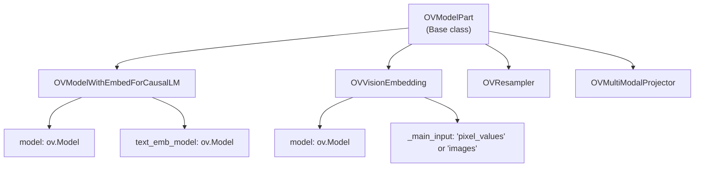

<!-- source: DeepWiki mcp.deepwiki.com · repo huggingface/optimum-intel · page 2.6 Visual-Language Models · fetched 2026-10-26 -->

# Visual-Language Models

<details>
<summary>Relevant source files</summary>

The following files were used as context for generating this wiki page:

- [docs/source/openvino/tutorials/notebooks.mdx](docs/source/openvino/tutorials/notebooks.mdx)
- [notebooks/openvino/README.md](notebooks/openvino/README.md)
- [notebooks/openvino/vision_language_quantization.ipynb](notebooks/openvino/vision_language_quantization.ipynb)
- [optimum/intel/openvino/modeling_visual_language.py](optimum/intel/openvino/modeling_visual_language.py)
- [tests/openvino/test_modeling.py](tests/openvino/test_modeling.py)
- [tests/openvino/test_seq2seq.py](tests/openvino/test_seq2seq.py)

</details>


This page documents OpenVINO's support for visual-language models (VLMs), also known as multimodal models. These models accept visual inputs (images, videos) or audio inputs along with text to perform tasks like image captioning, visual question answering, and multimodal dialogue.

## Purpose and Scope

Visual-language models combine specialized encoders (vision, audio) with language models to enable multimodal understanding. OpenVINO provides support for these models through the `OVModelForVisualCausalLM` class and related components. Unlike standard decoder models, VLMs require multiple model components that work together during inference.

This page covers:
- Component architecture and model classes
- Supported model architectures (LLaVA, MiniCPM-V, Qwen2-VL, Phi3-Vision, etc.)
- Model loading and multimodal preprocessing
- Multimodal inference and generation

Sources: [optimum/intel/openvino/modeling_visual_language.py:1-62](), [tests/openvino/test_modeling.py:78-78]()

## Architecture Overview

Visual-language models in OpenVINO use a multi-component architecture where each part is a separate OpenVINO model. The components are compiled independently and coordinated during inference.

**Component Architecture Diagram**

```mermaid
graph TB
    subgraph "OVModelForVisualCausalLM"
        VLM["OVModelForVisualCausalLM<br/>(Main Orchestrator)"]
        
        subgraph "Core Components"
            LM["language_model<br/>(OVModelWithEmbedForCausalLM)"]
            VIS["vision_embeddings<br/>(OVVisionEmbedding)"]
            TXT["text_embeddings<br/>(within language_model)"]
        end
        
        subgraph "Optional Components"
            RESAMP["resampler<br/>(OVResampler)"]
            PROJ["vision_projection<br/>(OVVisionProjection)"]
            MERGER["vision_embeddings_merger<br/>(OVVisionEmbedding)"]
            MM_PROJ["multi_modal_projector<br/>(OVMultiModalProjector)"]
            AUD_EMB["audio_embeddings<br/>(OVAudioEmbeddings)"]
            AUD_ENC["audio_encoder<br/>(OVAudioEncoder)"]
        end
    end
    
    subgraph "OpenVINO IR Files"
        LM_XML["openvino_language_model.xml"]
        TXT_XML["openvino_text_embeddings_model.xml"]
        VIS_XML["openvino_vision_embeddings_model.xml"]
        ADD_XML["openvino_&lt;part&gt;_model.xml"]
    end
    
    subgraph "Input Types"
        IMG["pixel_values<br/>(images)"]
        VID["pixel_values_videos<br/>(videos)"]
        AUD["audio_values<br/>(audio)"]
        TXT_IN["input_ids<br/>(text)"]
    end
    
    VLM --> LM
    VLM --> VIS
    LM --> TXT
    VLM -.-> RESAMP
    VLM -.-> PROJ
    VLM -.-> MERGER
    VLM -.-> MM_PROJ
    VLM -.-> AUD_EMB
    VLM -.-> AUD_ENC
    
    LM_XML --> LM
    TXT_XML --> TXT
    VIS_XML --> VIS
    ADD_XML -.-> RESAMP
    
    IMG --> VIS
    VID --> VIS
    AUD --> AUD_EMB
    TXT_IN --> TXT
```



Sources: [optimum/intel/openvino/modeling_visual_language.py:345-423](), [optimum/intel/openvino/modeling_visual_language.py:329-342]()

## OVModelForVisualCausalLM Class

The `OVModelForVisualCausalLM` class is the main entry point for visual-language models. It inherits from `OVBaseModel` and `GenerationMixin`, providing both standard model operations and text generation capabilities.

**Class Definition and Attributes**

| Attribute | Type | Description |
|-----------|------|-------------|
| `language_model` | `OVModelWithEmbedForCausalLM` | The causal language model with text embedding support |
| `vision_embeddings` | `OVVisionEmbedding` | Vision encoder that processes images/videos |
| `components` | `Dict` | Dictionary of all model components |
| `additional_parts` | `List[str]` | Model-specific optional components (e.g., resamplers) |
| `config` | `PretrainedConfig` | Model configuration |
| `generation_config` | `GenerationConfig` | Generation parameters |

The class uses the `export_feature = "image-text-to-text"` task identifier [optimum/intel/openvino/modeling_visual_language.py:348]().

**Model Type to Class Mapping**

Each model type maps to a specific class implementation in `MODEL_TYPE_TO_CLS_MAPPING` [optimum/intel/openvino/modeling_visual_language.py:1005-1030]():

| Model Type | Class |
|------------|-------|
| `llava` | `OVLlavaForVisualCausalLM` |
| `llava_next` | `OVLlavaNextForVisualCausalLM` |
| `minicpmv` | `OVMiniCPMVForVisualCausalLM` |
| `qwen2_vl` | `OVQwen2VLForVisualCausalLM` |
| `phi3_v` | `OVPhi3VForVisualCausalLM` |

Sources: [optimum/intel/openvino/modeling_visual_language.py:345-423](), [optimum/intel/openvino/modeling_visual_language.py:1005-1030]()

## Component Classes

Visual-language models consist of multiple component classes, each responsible for a specific part of the model pipeline. All components inherit from `OVModelPart` [optimum/intel/openvino/modeling_visual_language.py:41]().

**Component Class Hierarchy**



**MODEL_PARTS_CLS_MAPPING**

The `MODEL_PARTS_CLS_MAPPING` dictionary maps component names to their class implementations [optimum/intel/openvino/modeling_visual_language.py:329-342]():

| Component Name | Class | Purpose |
|----------------|-------|---------|
| `"language_model"` | `OVModelWithEmbedForCausalLM` | Causal LM with text embeddings |
| `"vision_embeddings"` | `OVVisionEmbedding` | Vision encoder |
| `"resampler"` | `OVResampler` | Resamples vision features (MiniCPM-V) |
| `"vision_projection"` | `OVVisionProjection` | Projects vision features |
| `"multi_modal_projector"` | `OVMultiModalProjector` | Multi-modal feature projection |
| `"audio_embeddings"` | `OVAudioEmbeddings` | Audio feature extraction |

Sources: [optimum/intel/openvino/modeling_visual_language.py:329-342](), [optimum/intel/openvino/modeling_visual_language.py:78-236]()

### OVModelWithEmbedForCausalLM

This component extends `OVModelForCausalLM` to handle both the language model and text embeddings as separate OpenVINO models.

- `embed_tokens(input_ids)`: Converts token IDs to embeddings using the `text_emb_request` [optimum/intel/openvino/modeling_visual_language.py:140-143]().
- `prepare_inputs(...)`: Prepares inputs for inference, calling `embed_tokens()` internally if `inputs_embeds` are not provided [optimum/intel/openvino/modeling_visual_language.py:145-210]().
- `forward(...)`: Runs inference with `inputs_embeds` instead of `input_ids` [optimum/intel/openvino/modeling_visual_language.py:212-236]().

Sources: [optimum/intel/openvino/modeling_visual_language.py:78-236]()

### OVVisionEmbedding

The vision embedding component processes visual inputs and outputs feature tensors. It automatically detects the main input name from the model, checking for `"images"`, `"hidden_states"`, or defaulting to `"pixel_values"` [optimum/intel/openvino/modeling_visual_language.py:253-261]().

Sources: [optimum/intel/openvino/modeling_visual_language.py:238-279]()

## Supported Models

OpenVINO supports a comprehensive list of visual-language model architectures, identified by their `model_type` in the config.

**Supported Model Architectures**

| Model Family | Model Types | Capabilities |
|--------------|-------------|--------------|
| **LLaVA** | `llava`, `llava_next` | Image + Text |
| **LLaVA-NeXT-Video** | `llava_next_video` | Video + Text |
| **MiniCPM-V** | `minicpmv` | Image + Text |
| **Qwen2-VL** | `qwen2_vl` | Image/Video + Text |
| **Phi3-Vision** | `phi3_v` | Image + Text |
| **InternVL2** | `internvl_chat` | Image + Text |
| **SmolVLM** | `smolvlm` | Image/Video + Text |

The complete list is maintained in `MODEL_TYPE_TO_CLS_MAPPING` [optimum/intel/openvino/modeling_visual_language.py:1005-1030]().

Sources: [optimum/intel/openvino/modeling_visual_language.py:67-72](), [optimum/intel/openvino/modeling_visual_language.py:1005-1030]()

## Model Loading

Visual-language models are loaded using the `from_pretrained()` method.

**Loading Workflow**

1. **Detect Model Type**: Identifies the architecture from the configuration.
2. **Load Components**: Loads the separate OpenVINO IR files for `language_model`, `text_embeddings`, `vision_embeddings`, and any additional parts like `resampler` [optimum/intel/openvino/modeling_visual_language.py:350-359]().
3. **Compilation**: Compiles each component model for the target device (CPU, GPU, NPU).

**Example Loading**

```python
from optimum.intel import OVModelForVisualCausalLM

# Load and export to OpenVINO
model = OVModelForVisualCausalLM.from_pretrained(
    "llava-hf/llava-1.5-7b-hf",
    export=True,
    device="CPU"
)
```

**File Structure**
Exported models contain multiple IR files [optimum/intel/openvino/modeling_visual_language.py:44-46]():
- `openvino_language_model.xml`
- `openvino_text_embeddings_model.xml`
- `openvino_vision_embeddings_model.xml`

Sources: [optimum/intel/openvino/modeling_visual_language.py:444-576](), [optimum/intel/openvino/modeling_visual_language.py:350-359]()

## Input Processing

Visual-language models require preprocessing of both visual and text inputs via the `preprocess_inputs()` method [optimum/intel/openvino/modeling_visual_language.py:578]().

**Preprocessing Pipeline**

1. **Call Processor**: Uses the `AutoProcessor` to convert images/videos and text into tensors.
2. **Extract Tensors**: Extracts `pixel_values`, `input_ids`, and `attention_mask`.
3. **Reshape**: Handles specific reshaping requirements for different architectures (e.g., LLaVA-NeXT's multi-image support).

```python
from transformers import AutoProcessor
from PIL import Image

processor = AutoProcessor.from_pretrained(model_id)
image = Image.open("image.jpg")
text = "What is in this image?"

# Preprocess inputs
inputs = model.preprocess_inputs(
    text=text,
    images=[image],
    processor=processor
)
```

Sources: [optimum/intel/openvino/modeling_visual_language.py:578-703](), [notebooks/openvino/vision_language_quantization.ipynb:108-109]()

## Inference and Generation

VLMs support autoregressive text generation using the `generate()` method.

**Text Generation**

```python
# Generate output IDs
output_ids = model.generate(**inputs, max_new_tokens=50)

# Decode output
generated_text = processor.batch_decode(output_ids, skip_special_tokens=True)
```

**Stateful KV-Cache**
VLMs use stateful KV-cache by default. The language model component manages its own internal state, which must be reset between independent sequences using `model.language_model.request.reset_state()` [optimum/intel/openvino/modeling_visual_language.py:164]().

**Device Management**
Models can be moved to different devices using `.to()` and recompiled using `compile()` [optimum/intel/openvino/modeling_visual_language.py:115-119]().

Sources: [optimum/intel/openvino/modeling_visual_language.py:705-781](), [optimum/intel/openvino/modeling_visual_language.py:115-126]()

## Export and Optimization

Models can be exported from PyTorch and optimized (e.g., weight quantization) during the export process.

**Quantization**
VLMs can be quantized using `OVWeightQuantizationConfig` for 4-bit or 8-bit weights [notebooks/openvino/vision_language_quantization.ipynb:181-204]().

```python
from optimum.intel import OVWeightQuantizationConfig, OVPipelineQuantizationConfig

# Export with 4-bit quantization
model = OVModelForVisualCausalLM.from_pretrained(
    model_id,
    export=True,
    quantization_config=OVWeightQuantizationConfig(bits=4, group_size=16)
)
```

For more granular control, `OVPipelineQuantizationConfig` allows applying different quantization settings to each component [notebooks/openvino/vision_language_quantization.ipynb:195-204]().

Sources: [notebooks/openvino/vision_language_quantization.ipynb:181-204](), [optimum/intel/openvino/modeling_visual_language.py:36-38]()

---

