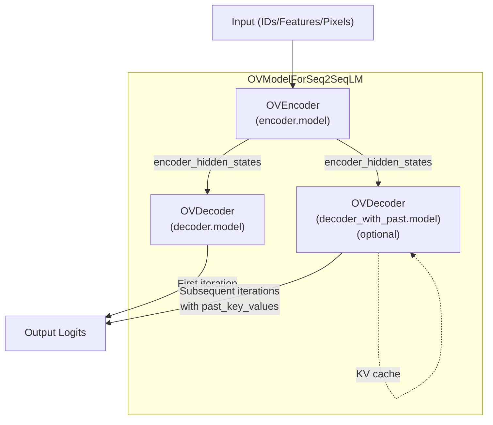
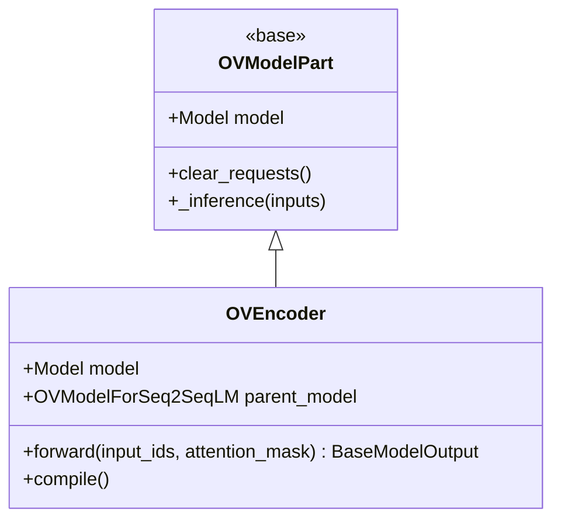
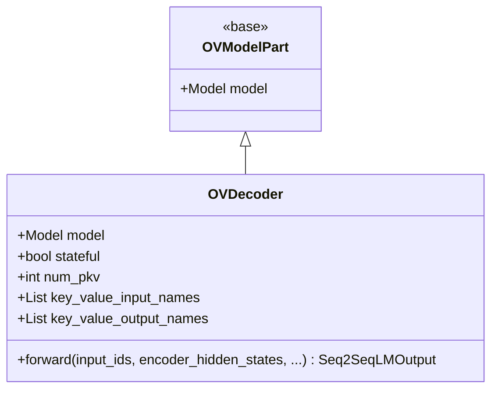
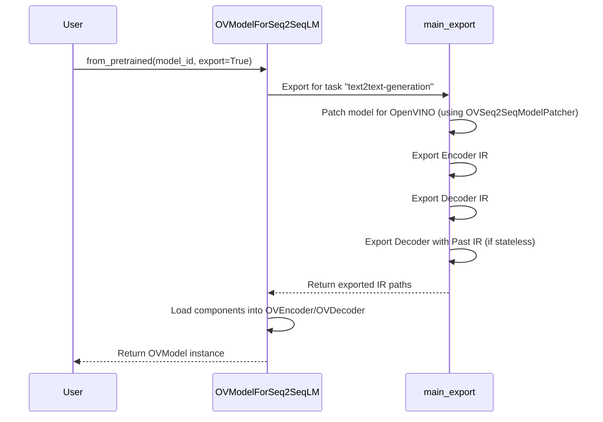

<!-- source: DeepWiki mcp.deepwiki.com · repo huggingface/optimum-intel · page 2.7 Sequence-to-Sequence Models · fetched 2026-10-26 -->

# Sequence-to-Sequence Models

Relevant source files

The following files were used as context for generating this wiki page:

- [optimum/intel/openvino/modeling_diffusion.py](optimum/intel/openvino/modeling_diffusion.py)
- [optimum/intel/openvino/modeling_sam.py](optimum/intel/openvino/modeling_sam.py)
- [optimum/intel/openvino/modeling_seq2seq.py](optimum/intel/openvino/modeling_seq2seq.py)
- [optimum/intel/openvino/modeling_text2speech.py](optimum/intel/openvino/modeling_text2speech.py)
- [optimum/intel/openvino/modeling_visual_language.py](optimum/intel/openvino/modeling_visual_language.py)
- [tests/openvino/test_seq2seq.py](tests/openvino/test_seq2seq.py)

This document covers sequence-to-sequence (encoder-decoder) architectures in the OpenVINO integration. These models consist of separate encoder and decoder components that work together to transform input sequences (text, audio, or images) into output token sequences.

For decoder-only language models (GPT, LLaMA, etc.), see [Model Loading and Inference](). For vision-language models that combine visual and language understanding, see [Visual-Language Models]().

## Overview

Sequence-to-sequence models in `optimum-intel` support encoder-decoder architectures for a variety of tasks:

- **Text-to-text generation**: Translation and summarization (T5, BART, MBART, Pegasus) [[optimum/intel/openvino/modeling_seq2seq.py:318-330]]()
- **Speech-to-text**: Automatic speech recognition (Whisper) [[optimum/intel/openvino/modeling_seq2seq.py:811-881]]()
- **Vision-to-text**: Image captioning and OCR (TrOCR, Donut, Pix2Struct) [[optimum/intel/openvino/modeling_seq2seq.py:1028-1100]]()
- **Text-to-speech**: Speech synthesis (SpeechT5, Kokoro TTS) [[optimum/intel/openvino/modeling_text2speech.py:159-173]]()

All seq2seq model classes inherit from `OVBaseModel` and implement `GenerationMixin` to provide high-level generation capabilities. [[optimum/intel/openvino/modeling_seq2seq.py:318-320]]()

**Sources**: [optimum/intel/openvino/modeling_seq2seq.py:1-61](), [optimum/intel/openvino/modeling_seq2seq.py:318-330](), [optimum/intel/openvino/modeling_seq2seq.py:811-881](), [optimum/intel/openvino/modeling_seq2seq.py:1028-1100](), [optimum/intel/openvino/modeling_text2speech.py:159-173]()

## Core Architecture

### Component Structure

Seq2seq models are typically composed of three OpenVINO model components to optimize for autoregressive generation:

**Diagram: Three-component structure of seq2seq models**

The components serve distinct roles in the data flow:
1. **Encoder** (`OVEncoder`): Processes the full input sequence once. [[optimum/intel/openvino/modeling_seq2seq.py:578-647]]()
2. **Decoder** (`OVDecoder`): Used for the first generation step (prefill) where no KV-cache exists. [[optimum/intel/openvino/modeling_seq2seq.py:650-677]]()
3. **Decoder with Past** (`OVDecoder`): An optimized version used for subsequent tokens, accepting `past_key_values` to avoid recomputing hidden states for previous tokens. [[optimum/intel/openvino/modeling_seq2seq.py:679-806]]()

**Sources**: [optimum/intel/openvino/modeling_seq2seq.py:318-392](), [optimum/intel/openvino/modeling_seq2seq.py:578-806]()

### OVEncoder Class

The `OVEncoder` class wraps the OpenVINO encoder IR:

**Diagram: OVEncoder class hierarchy**

Key implementation details:
- Inherits from `OVModelPart` for basic OpenVINO model hosting. [[optimum/intel/openvino/modeling_base.py:183-255]]()
- Accepts task-specific inputs (e.g., `input_ids` for text, `input_features` for audio). [[optimum/intel/openvino/modeling_seq2seq.py:617-647]]()
- Returns `last_hidden_state` which is passed to the decoder's cross-attention layers. [[optimum/intel/openvino/modeling_seq2seq.py:646-647]]()

**Sources**: [optimum/intel/openvino/modeling_seq2seq.py:578-647](), [optimum/intel/openvino/modeling_base.py:183-255]()

### OVDecoder Class

The `OVDecoder` class manages the autoregressive decoding process:

**Diagram: OVDecoder class hierarchy**

The decoder processes:
- `decoder_input_ids`: The tokens being generated.
- `encoder_hidden_states`: The fixed context from the encoder.
- `past_key_values`: (In stateless mode) The cached tensors from previous iterations. [[optimum/intel/openvino/modeling_seq2seq.py:679-806]]()

**Sources**: [optimum/intel/openvino/modeling_seq2seq.py:650-806]()

### Stateful vs Stateless Execution

OpenVINO seq2seq models support two cache management modes:

| Mode | Description | Requirements |
|------|-------------|--------------|
| **Stateful** | KV-cache is stored internally in OpenVINO `Variable` nodes via Sinks/ReadValue ops. [[optimum/exporters/openvino/stateful.py:1-40]]() | Transformers ≥4.47, `stateful=True` during export. |
| **Stateless** | KV-cache is passed as explicit inputs/outputs (`past_key_values` / `present`). [[optimum/intel/openvino/modeling_seq2seq.py:108-113]]() | Default for older models or when `stateful=False`. |

Stateful detection occurs during initialization by checking if the decoder model contains internal state sinks using `model_has_state`. [[optimum/intel/openvino/modeling_seq2seq.py:345-390]]() [[optimum/exporters/openvino/stateful.py:41]]()

**Sources**: [optimum/intel/openvino/modeling_seq2seq.py:345-390](), [optimum/exporters/openvino/stateful.py:1-41](), [optimum/intel/openvino/modeling_seq2seq.py:108-113]()

## Model Classes

### OVModelForSeq2SeqLM

Used for `text2text-generation` tasks. [[optimum/intel/openvino/modeling_seq2seq.py:318-577]]()

- **Architectures**: T5, BART, Marian, MBART, Pegasus, Blenderbot. [[tests/openvino/test_seq2seq.py:140-150]]()
- **Stateful Support**: T5, MT5, LongT5, and (with Transformers ≥4.52) BART, Marian, MBART. [[tests/openvino/test_seq2seq.py:171-175]]()

**Sources**: [optimum/intel/openvino/modeling_seq2seq.py:318-577](), [tests/openvino/test_seq2seq.py:140-175]()

### OVModelForSpeechSeq2Seq

Used for `automatic-speech-recognition` (ASR). [[optimum/intel/openvino/modeling_seq2seq.py:811-1025]]()

- **Architectures**: Whisper. [[tests/openvino/test_seq2seq.py:312-315]]()
- **Input**: `input_features` (mel spectrograms) instead of token IDs. [[optimum/intel/openvino/modeling_seq2seq.py:811-881]]()

**Sources**: [optimum/intel/openvino/modeling_seq2seq.py:811-1025](), [tests/openvino/test_seq2seq.py:312-315]()

### OVModelForVision2Seq

Used for `image-to-text` tasks. [[optimum/intel/openvino/modeling_seq2seq.py:1028-1239]]()

- **Architectures**: TrOCR, Donut, VisionEncoderDecoder. [[tests/openvino/test_seq2seq.py:418-422]]()
- **Input**: `pixel_values` (image tensors). [[optimum/intel/openvino/modeling_seq2seq.py:1028-1100]]()

**Sources**: [optimum/intel/openvino/modeling_seq2seq.py:1028-1239](), [tests/openvino/test_seq2seq.py:418-422]()

### OVModelForPix2Struct

Specialized for Pix2Struct document understanding models. [[optimum/intel/openvino/modeling_seq2seq.py:1242-1414]]()

- **Input**: `flattened_patches` of shape `(batch_size, seq_length, hidden_size)`. [[optimum/intel/openvino/modeling_seq2seq.py:161-166]]()

**Sources**: [optimum/intel/openvino/modeling_seq2seq.py:1242-1414](), [optimum/intel/openvino/modeling_seq2seq.py:161-166]()

### OVModelForTextToSpeechSeq2Seq

Supports text-to-speech models like SpeechT5 and Kokoro TTS. [[optimum/intel/openvino/modeling_text2speech.py:159-173]]()

- **Components**: Includes additional parts such as `OVTextToSpeechEncoder`, `OVTextToSpeechDecoder`, `OVTextToSpeechPostNet`, and `OVTextToSpeechVocoder` for generating raw audio waveforms from spectrograms. [[optimum/intel/openvino/modeling_text2speech.py:49-151]]()
- **Architecture**: `SpeechT5ForTextToSpeech` and Kokoro models are supported. For Kokoro, the configuration is loaded via `PretrainedConfig` since `AutoConfig` may not recognize the model type. [[optimum/intel/openvino/modeling_text2speech.py:165-171]]()

**Sources**: [optimum/intel/openvino/modeling_text2speech.py:49-173]()

## Loading and Exporting

### Model Export Flow

The `from_pretrained(..., export=True)` call triggers `main_export` to convert PyTorch weights to OpenVINO IR. [[optimum/intel/openvino/modeling_seq2seq.py:518-577]]()

**Diagram: Sequence-to-sequence export and load sequence**

**Sources**: [optimum/intel/openvino/modeling_seq2seq.py:518-577](), [optimum/intel/openvino/modeling_base.py:421-440]()

### File Naming Conventions

OpenVINO models are stored using the following naming pattern: [[optimum/intel/openvino/modeling_seq2seq.py:46-52]]()

| Component | Filename |
|-----------|----------|
| Encoder | `openvino_encoder_model.xml` |
| Decoder | `openvino_decoder_model.xml` |
| Decoder with Past | `openvino_decoder_with_past_model.xml` |

**Sources**: [optimum/intel/openvino/modeling_seq2seq.py:46-52]()

## Generation and Inference

### Generation Loop

The `generate()` method (inherited via `GenerationMixin`) orchestrates the loop between the encoder and decoder components. [[optimum/intel/openvino/modeling_seq2seq.py:318-320]]()

1. **Encoder Pass**: Input tokens/features are processed by `self.encoder`. [[optimum/intel/openvino/modeling_seq2seq.py:617-647]]()
2. **First Decoder Pass**: Uses `self.decoder` with `decoder_input_ids` and `encoder_hidden_states`. [[optimum/intel/openvino/modeling_seq2seq.py:650-677]]()
3. **Autoregressive Loop**: Subsequent tokens use `self.decoder_with_past` (stateless) or `self.decoder` (stateful) to produce logits and update `past_key_values`. [[optimum/intel/openvino/modeling_seq2seq.py:679-806]]()

**Sources**: [optimum/intel/openvino/modeling_seq2seq.py:318-320](), [optimum/intel/openvino/modeling_seq2seq.py:617-806]()

### Prepare Inputs for Generation

The `prepare_inputs_for_generation()` method (implemented in specific classes) handles the management of `past_key_values` and input slicing. [[optimum/intel/openvino/modeling_seq2seq.py:1004-1025]]()

- If `past_key_values` is present, `input_ids` is typically sliced to the last token. [[optimum/intel/openvino/modeling_seq2seq.py:1004-1025]]()
- It ensures `encoder_outputs` are correctly passed to the decoder. [[optimum/intel/openvino/modeling_seq2seq.py:1016-1018]]()

**Sources**: [optimum/intel/openvino/modeling_seq2seq.py:1004-1025]()

## Performance Optimization

### KV-Cache Efficiency

Enabling the KV-cache (`use_cache=True`) provides significant speedups by reducing the computation complexity of the decoder per token. [[tests/openvino/test_seq2seq.py:155]]()

- **T5**: Significant speedup noted with cache. [[tests/openvino/test_seq2seq.py:155]]()
- **Whisper**: Performance gains in speech-to-text generation. [[tests/openvino/test_seq2seq.py:316]]()

**Sources**: [tests/openvino/test_seq2seq.py:155](), [tests/openvino/test_seq2seq.py:316]()

### Dynamic Reshaping

By default, seq2seq models are initialized with dynamic shapes to support variable length inputs. [[optimum/intel/openvino/modeling_seq2seq.py:353-357]]()

The `reshape()` method is used to set these dimensions across all model components (encoder and decoders): [[optimum/intel/openvino/modeling_seq2seq.py:441-471]]()

**Sources**: [optimum/intel/openvino/modeling_seq2seq.py:353-357](), [optimum/intel/openvino/modeling_seq2seq.py:441-471]()

---

**Sources**:
- [optimum/intel/openvino/modeling_seq2seq.py:1-1414]()
- [optimum/intel/openvino/modeling_text2speech.py:1-173]()
- [optimum/intel/openvino/modeling_base.py:183-255]()
- [tests/openvino/test_seq2seq.py:130-316]()
- [optimum/exporters/openvino/stateful.py:1-41]()

---

