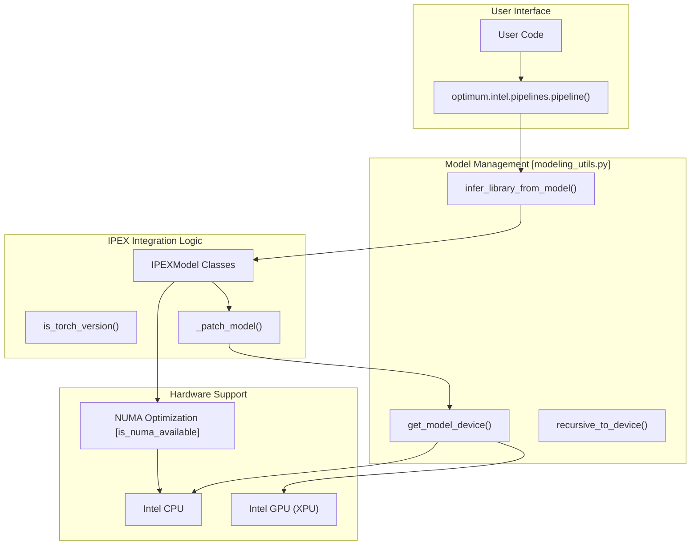
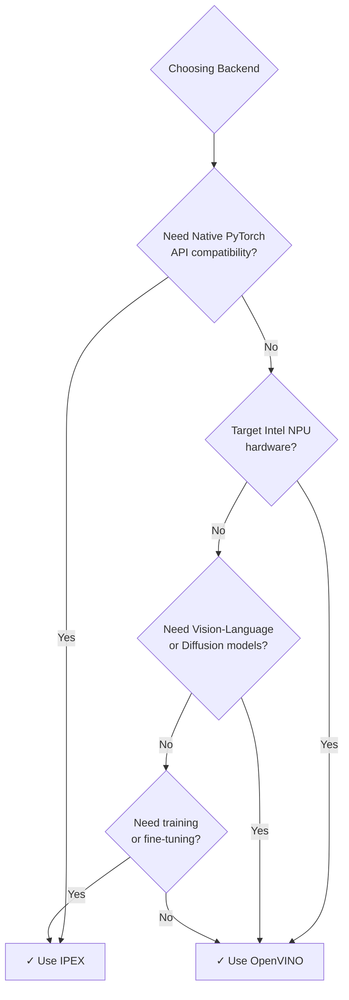

<!-- source: DeepWiki mcp.deepwiki.com · repo huggingface/optimum-intel · page 3 IPEX Integration · fetched 2026-10-26 -->

# IPEX Integration

Relevant source files

The following files were used as context for generating this wiki page:

- [optimum/intel/pipelines/accelerator_utils.py](optimum/intel/pipelines/accelerator_utils.py)
- [optimum/intel/utils/__init__.py](optimum/intel/utils/__init__.py)
- [optimum/intel/utils/import_utils.py](optimum/intel/utils/import_utils.py)
- [optimum/intel/utils/modeling_utils.py](optimum/intel/utils/modeling_utils.py)
- [setup.py](setup.py)

## Purpose and Scope

This document introduces the Intel Extension for PyTorch (IPEX) integration within `optimum-intel`, covering its purpose, capabilities, and when to use it compared to other backends. IPEX provides CPU and GPU optimizations for PyTorch models through model patching, custom operators, and runtime optimizations.

For detailed information about IPEX model classes and their usage, see [IPEX Model Classes](#3.1). For optimization techniques and performance tuning, see [Optimizations and Performance](#3.2). For the primary OpenVINO backend, see [OpenVINO Integration](#2).

**Sources:** [optimum/intel/utils/import_utils.py:54-61](), [optimum/intel/utils/modeling_utils.py:1-43]()

---

## What is Intel Extension for PyTorch (IPEX)

Intel Extension for PyTorch (IPEX) is a library that extends PyTorch with optimizations for Intel hardware. Unlike OpenVINO which requires model conversion to an intermediate representation (IR format), IPEX works directly with PyTorch models and maintains compatibility with the PyTorch API.

**Key Characteristics:**

| Aspect | IPEX Approach |
|--------|---------------|
| **Model Format** | Native PyTorch models (no conversion required) |
| **API Compatibility** | Full PyTorch and Transformers API compatibility |
| **Optimization Strategy** | Runtime patching + custom operators + `torch.compile` |
| **Hardware Support** | Intel CPUs and Intel GPUs (XPU) |
| **Primary Use Case** | When PyTorch API compatibility or training is required |

The `optimum-intel` package manages IPEX availability through its utility layer, checking for `torch` [optimum/intel/utils/import_utils.py:54-60]() and optional backend presence to ensure graceful degradation or helpful error messages.

**Sources:** [optimum/intel/utils/import_utils.py:54-61](), [setup.py:29-30]()

---

## Architecture Overview

The following diagram maps high-level system components to specific code entities within the `optimum.intel` utility and backend structure.

**Diagram: IPEX Integration and Utility Architecture**

The architecture leverages core utilities for device management and library inference:
1. **Model Management**: `infer_library_from_model` identifies the source library (e.g., `transformers`, `diffusers`, `open_clip`, or `kokoro`) to determine the appropriate patching strategy [optimum/intel/utils/modeling_utils.py:168-187]().
2. **Device Handling**: `get_model_device` and `recursive_to_device` ensure tensors are correctly placed on Intel CPUs or XPUs [optimum/intel/utils/modeling_utils.py:45-76]().
3. **Hardware Awareness**: Integration with `psutil` and `numa` libraries allows for performance tuning like core binding [optimum/intel/utils/import_utils.py:164-179]().

**Sources:** [optimum/intel/utils/modeling_utils.py:45-195](), [optimum/intel/utils/import_utils.py:158-180]()

---

## When to Use IPEX vs OpenVINO

**Diagram: Backend Selection Decision Tree**

### Comparison Matrix

| Feature | IPEX | OpenVINO |
|---------|------|----------|
| **Model Format** | PyTorch `.bin`/`.safetensors` | OpenVINO IR `.xml`/`.bin` |
| **API Compatibility** | Native PyTorch/Transformers | Optimum abstraction layer |
| **Conversion Required** | No | Yes (via export) |
| **Hardware Support** | Intel CPU, Intel GPU | Intel CPU, GPU, NPU |
| **Vision-Language Models** | ❌ Limited Support | ✓ Supported (`OVModelForVisualCausalLM`) |
| **Diffusion Models** | ❌ Limited Support | ✓ Supported (`OVDiffusionPipeline`) |
| **Training/Fine-tuning** | ✓ Supported | ❌ Inference only |

**Use IPEX when:**
- You need full PyTorch API compatibility without an export step.
- You are performing training or fine-tuning on Intel hardware.
- You want to utilize `torch.compile` optimizations.

**Use OpenVINO when:**
- You need maximum performance and advanced quantization (INT8/INT4/FP8).
- You are deploying Multimodal/VLM models like LLaVA or Qwen2-VL [optimum/intel/pipelines/accelerator_utils.py:56]().
- You are deploying Diffusion pipelines or Speech-to-Speech models [optimum/intel/pipelines/accelerator_utils.py:63]().
- You are targeting the Intel NPU.

**Sources:** [optimum/intel/pipelines/accelerator_utils.py:48-67](), [optimum/intel/utils/import_utils.py:63-78]()

---

## Key Features and Capabilities

### 1. Unified Model Loading
IPEX models follow the standard Hugging Face `from_pretrained` pattern. The `optimum-intel` utility layer handles file discovery and library inference to ensure the correct model class is instantiated [optimum/intel/utils/modeling_utils.py:88-141]().

### 2. Runtime Optimizations
IPEX provides specialized kernels for Intel architecture. `optimum-intel` supports these through:
- **Core Binding**: Utilities to bind processes to physical cores for reduced latency [optimum/intel/utils/import_utils.py:164-171]().
- **NUMA Awareness**: Optimization for multi-socket systems via `py-libnuma` [optimum/intel/utils/import_utils.py:164-170]().

### 3. Pipeline Integration
While IPEX focuses on the backend, `optimum-intel` provides a patching mechanism `patch_pipelines_to_load_accelerator_model` to allow `transformers.pipelines` to load accelerated models seamlessly [optimum/intel/pipelines/accelerator_utils.py:127-141](). Currently, the explicit mapping is defined for OpenVINO (`OV_TASKS_MAPPING`), but the infrastructure supports the pattern for hardware acceleration [optimum/intel/pipelines/accelerator_utils.py:48-67]().

**Sources:** [optimum/intel/utils/modeling_utils.py:88-141](), [optimum/intel/pipelines/accelerator_utils.py:127-141](), [optimum/intel/utils/import_utils.py:158-180]()

---

## Model Classes Overview

IPEX integration provides task-specific model classes that wrap PyTorch models with optimizations. These classes mirror the `OVModelFor*` hierarchy found in the OpenVINO backend but maintain PyTorch tensor compatibility.

For detailed usage and API reference, see [IPEX Model Classes](#3.1).

**Sources:** [optimum/intel/pipelines/accelerator_utils.py:48-67]()

---

