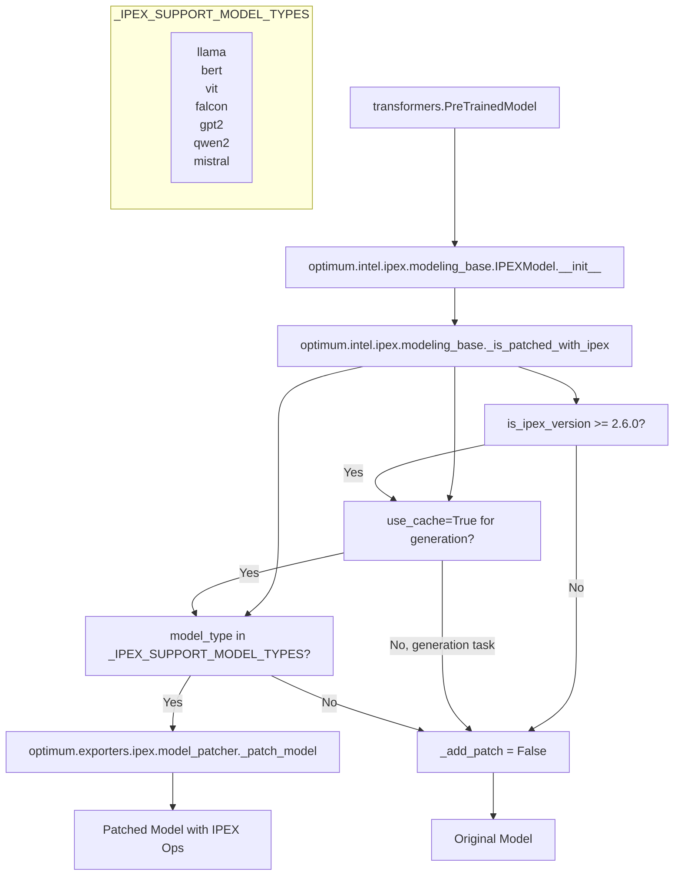
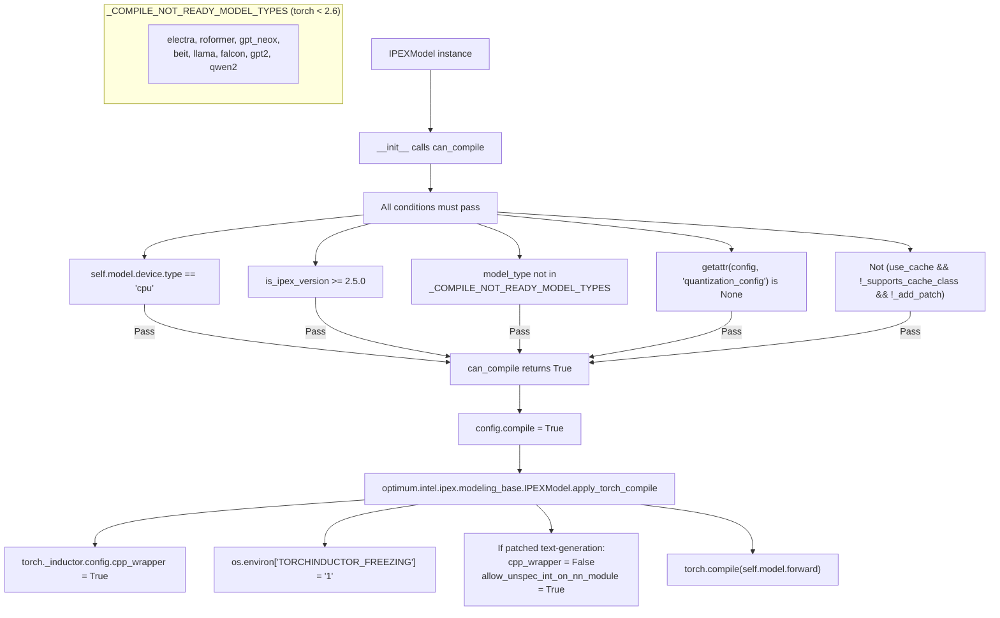
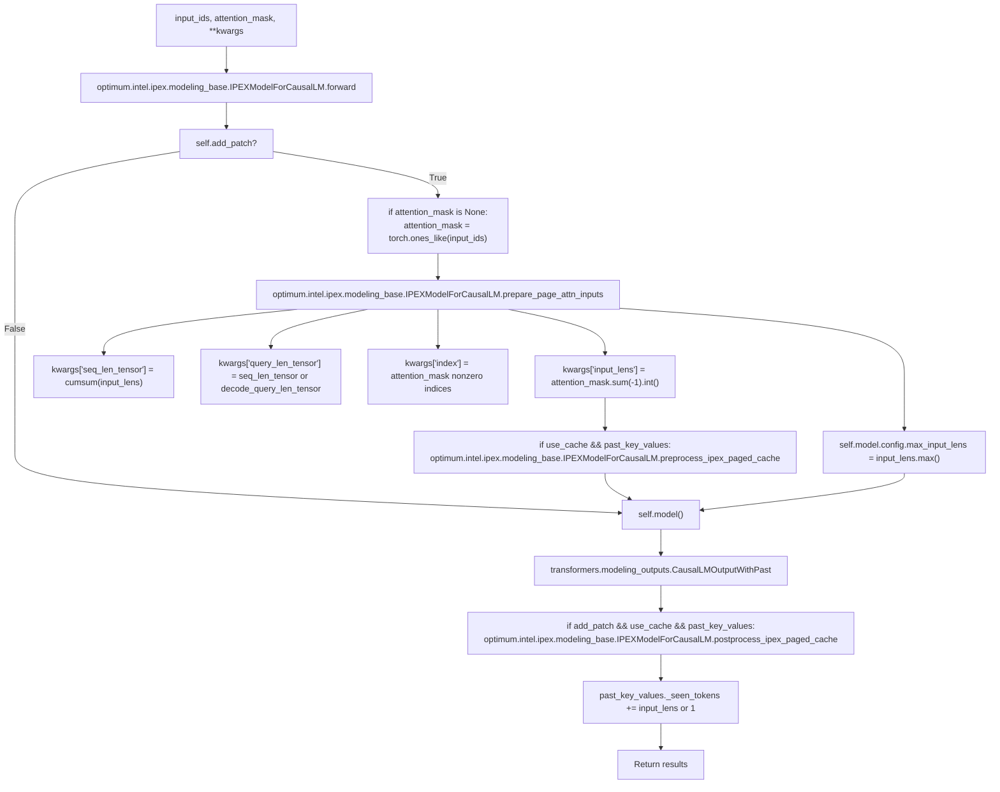
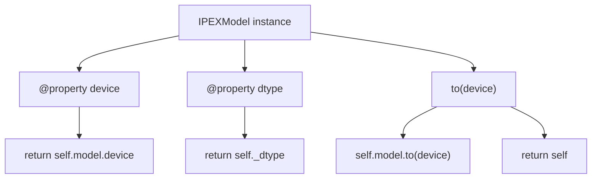

<!-- source: DeepWiki mcp.deepwiki.com · repo huggingface/optimum-intel · page 3.1 IPEX Model Classes · fetched 2026-10-26 -->

# IPEX Model Classes

<details>
<summary>Relevant source files</summary>

The following files were used as context for generating this wiki page:

- [optimum/intel/pipelines/accelerator_utils.py](optimum/intel/pipelines/accelerator_utils.py)
- [optimum/intel/utils/__init__.py](optimum/intel/utils/__init__.py)
- [optimum/intel/utils/import_utils.py](optimum/intel/utils/import_utils.py)
- [optimum/intel/utils/modeling_utils.py](optimum/intel/utils/modeling_utils.py)
- [setup.py](setup.py)

</details>


This document covers the IPEX (Intel Extension for PyTorch) model classes that provide optimized inference for Hugging Face transformers models on Intel hardware. These classes wrap PyTorch models with Intel-specific optimizations including model patching, `torch.compile` integration, and specialized caching mechanisms.

For information about IPEX text generation features and caching, see [Optimizations and Performance](#3.2). For broader IPEX integration topics, see [IPEX Integration](#3).

## Class Hierarchy and Architecture

The IPEX model classes follow a hierarchical structure that mirrors the Hugging Face transformers `AutoModel` classes while adding Intel-specific optimizations.

### Base Class Architecture

**Diagram: IPEXModel Class Inheritance Hierarchy**


Sources: `optimum/intel/ipex/modeling_base.py`, `optimum/intel/ipex/__init__.py`

### Task-to-Class Mapping

Each IPEX model class corresponds to a specific machine learning task and automatically loads the appropriate transformers model:

| IPEX Class | Auto Model Class | Export Feature | Output Name | Supported Architectures |
|------------|------------------|----------------|-------------|------------------------|
| `IPEXModel` | `AutoModel` | `feature-extraction` | `last_hidden_state` | albert, bert, distilbert, electra, roberta, roformer, xlm |
| `IPEXModelForCausalLM` | `AutoModelForCausalLM` | `text-generation` | N/A | bart, gpt_bigcode, blenderbot, bloom, codegen, falcon, gpt2, gpt_neo, gpt_neox, llama, mistral, mpt, opt, phi, qwen2 |
| `IPEXModelForSeq2SeqLM` | `AutoModelForSeq2SeqLM` | `text2text-generation` | N/A | t5 |
| `IPEXModelForSequenceClassification` | `AutoModelForSequenceClassification` | `text-classification` | `logits` | albert, bert, distilbert, electra, roberta, roformer, xlm |
| `IPEXModelForTokenClassification` | `AutoModelForTokenClassification` | `token-classification` | `logits` | albert, bert, distilbert, electra, roberta, roformer, xlm |
| `IPEXModelForMaskedLM` | `AutoModelForMaskedLM` | `fill-mask` | `logits` | albert, bert, distilbert, electra, roberta, roformer, xlm |
| `IPEXModelForImageClassification` | `AutoModelForImageClassification` | `image-classification` | N/A | beit, mobilenet_v2, mobilevit, resnet, vit |
| `IPEXModelForAudioClassification` | `AutoModelForAudioClassification` | `audio-classification` | N/A | unispeech, wav2vec2 |
| `IPEXModelForQuestionAnswering` | `AutoModelForQuestionAnswering` | `question-answering` | N/A | bert, distilbert, roberta |

Sources: `optimum/intel/ipex/modeling_base.py`

## Core Functionality

### Base IPEXModel Features

The `IPEXModel` base class provides core optimization features:

#### Model Patching System

**Diagram: Model Patching Decision Flow**



The patching system applies Intel-optimized operators for supported model architectures. The check is performed using:
- Model architecture type from `model.config.model_type` checked against `_IPEX_SUPPORT_MODEL_TYPES` [optimum/intel/ipex/modeling_base.py:63]().
- IPEX version requirements: `_IPEX_MINIMUM_VERSION_FOR_PATCHING = "2.6.0"` [optimum/exporters/ipex/modeling_utils.py:39]().
- Task compatibility: patching disabled for generation tasks when `use_cache=False` [optimum/intel/ipex/modeling_base.py:92-93]().
- Transformers version requirements: `4.45.0` or higher as per `setup.py` [setup.py:33]().

Sources: [optimum/intel/ipex/modeling_base.py:63-94](), [optimum/intel/ipex/modeling_base.py:159-160](), [optimum/exporters/ipex/model_patcher.py:174-182]()

#### Torch Compile Integration

**Diagram: torch.compile Eligibility Check**



The compile system automatically applies `torch.compile` optimizations when conditions are met. The minimum IPEX version is `2.5.0` defined in `_IPEX_MINIMUM_VERSION_FOR_COMPILE` [optimum/intel/ipex/modeling_base.py:65](). Configuration includes:
- `inductor_config.cpp_wrapper = True` for system-level optimization [optimum/intel/ipex/modeling_base.py:251]().
- Special handling for patched generation models: disables `cpp_wrapper` and allows unspecialized integers [optimum/intel/ipex/modeling_base.py:254-257]().
- Environment variable `TORCHINDUCTOR_FREEZING = "1"` for weight freezing [optimum/intel/ipex/modeling_base.py:252]().

Sources: [optimum/intel/ipex/modeling_base.py:65-76](), [optimum/intel/ipex/modeling_base.py:237-262](), [optimum/intel/ipex/modeling_base.py:167-168]()

### Generation Model Features

#### IPEXModelForCausalLM

The causal language modeling class extends the base with generation-specific optimizations:

**Diagram: IPEXModelForCausalLM Forward Pass with Paged Attention**



Key features:
- **IPEXPagedCache Integration**: Specialized cache defined in `optimum/exporters/ipex/cache_utils.py`.
- **Batch Processing**: Dynamic tensor creation for variable batch sizes using `decode_index` and `decode_query_len_tensor` [optimum/intel/ipex/modeling_base.py:343-345]().
- **Generation Method Support**: Limited to `_IPEX_EXPORTED_GENERATION_METHODS = ("sample", "greedy_search", "beam_sample", "beam_search", "assisted_generation")` [optimum/intel/ipex/modeling_base.py:64]().

Sources: [optimum/intel/ipex/modeling_base.py:298-399](), `optimum/exporters/ipex/cache_utils.py`

#### IPEXModelForSeq2SeqLM

The sequence-to-sequence class provides encoder-decoder model support with the following distinctions:

Key differences from `IPEXModelForCausalLM`:
- Configuration: `config.is_decoder = False`, `config.is_encoder_decoder = True` [optimum/intel/ipex/modeling_base.py:494-495]().
- Cache implementation: Uses `"static"` cache when `torch.compile` is enabled [optimum/intel/ipex/modeling_base.py:537-547]().
- Encoder access: Provides `get_encoder()` method for accessing the encoder component [optimum/intel/ipex/modeling_base.py:533-535]().

Sources: [optimum/intel/ipex/modeling_base.py:491-589]()

## Model Patching System

The patching system replaces standard PyTorch operations with Intel-optimized equivalents for supported architectures. All patches require IPEX >= 2.6.0.

### Architecture-Specific Patches

**Diagram: Model Patching Router and Optimizations**

```mermaid
graph TD
    ModelType["model.config.model_type"] --> Router["optimum.exporters.ipex.model_patcher._patch_model"]
    
    Router -->|"llama"| LlamaPatch["optimum.exporters.ipex.model_patcher._patch_llama_model"]
    Router -->|"falcon"| FalconPatch["optimum.exporters.ipex.model_patcher._patch_falcon_model"]
    Router -->|"gpt2"| GPT2Patch["optimum.exporters.ipex.model_patcher._patch_gpt2_model"]
    Router -->|"qwen2"| Qwen2Patch["optimum.exporters.ipex.model_patcher._patch_qwen2_model"]
    Router -->|"mistral"| MistralPatch["optimum.exporters.ipex.model_patcher._patch_mistral_model"]
    Router -->|"bert"| BertPatch["optimum.exporters.ipex.model_patcher._patch_bert_model"]
    Router -->|"vit"| VitPatch["optimum.exporters.ipex.model_patcher._patch_vit_model"]
    
    subgraph "LLaMA Patches"
        LlamaPatch --> LlamaForward["LlamaModel.forward -> _llama_model_forward"]
        LlamaPatch --> LlamaRMS["LlamaRMSNorm.forward -> _ipex_rms_layer_norm_forward"]
        LlamaPatch --> LlamaDecoder["LlamaDecoderLayer -> _IPEXLlamaDecoderLayer"]
    end
    
    subgraph "Falcon Patches"
        FalconPatch --> FalconForward["FalconForCausalLM.forward -> _falcon_for_causal_lm_forward"]
        FalconPatch --> FalconConfig["Add config.num_key_value_heads"]
        FalconPatch --> FalconDecoder["FalconDecoderLayer -> _IPEXFalconDecoderLayer"]
    end
    
    subgraph "GPT2 Patches"
        GPT2Patch --> GPT2Forward["GPT2LMHeadModel.forward -> _gpt2_lm_head_model_forward"]
        GPT2Patch --> GPT2Block["GPT2Block -> _IPEXGPT2Block"]
    end
    
    subgraph "BERT Patches"
        BertPatch --> BertIntermediate["BertIntermediate -> _IPEXIntermediate"]
    end
```



### IPEX Optimized Operations

The patching system introduces Intel-optimized operations from `intel_extension_for_pytorch.llm.modules` [optimum/exporters/ipex/modeling_utils.py:50-59]():

| Operation | Purpose | Used In |
|-----------|---------|---------|
| `PagedAttention` | Memory-efficient attention with paged KV cache | LLaMA, Falcon, GPT2, Qwen2, Mistral |
| `RMSNorm` | Optimized RMS normalization | LLaMA, Qwen2, Mistral [optimum/exporters/ipex/model_patcher.py:94,139,151]() |
| `RotaryEmbedding` | Optimized rotary position embeddings | LLaMA, Falcon, Qwen2 |
| `Linear2SiluMul` | Fused: 2 Linear layers + SiLU + Multiply | LLaMA, Qwen2 [optimum/exporters/ipex/model_patcher.py:91,134]() |
| `LinearAdd` | Fused: Linear + Add | LLaMA, Falcon, GPT2, Qwen2, Mistral |
| `LinearGelu` | Fused: Linear + GELU | BERT, ViT, Falcon |

Sources: [optimum/exporters/ipex/model_patcher.py:87-197](), [optimum/exporters/ipex/modeling_utils.py:43-66]()

## Usage Patterns

### Basic Model Loading

```python
from optimum.intel import IPEXModelForCausalLM

model = IPEXModelForCausalLM.from_pretrained("gpt2", torch_dtype=torch.bfloat16)
```

### Model Initialization Methods

IPEX models support multiple initialization patterns:

**1. from_pretrained()**: Loads from HuggingFace Hub or local directory [optimum/intel/ipex/modeling_base.py:171-202]().
```python
model = IPEXModelForCausalLM.from_pretrained("gpt2", use_cache=True)
```

**2. Direct initialization**: Wraps existing transformers model [optimum/intel/ipex/modeling_base.py:135-169]().
```python
from transformers import AutoModelForCausalLM
transformers_model = AutoModelForCausalLM.from_pretrained("gpt2")
ipex_model = IPEXModelForCausalLM(transformers_model, use_cache=True)
```

**3. Model reloading**: Save and reload optimized models [optimum/intel/ipex/modeling_base.py:264-282]().
```python
ipex_model.save_pretrained("./saved_model")
loaded_model = IPEXModelForCausalLM.from_pretrained("./saved_model")
```

The `from_pretrained()` method automatically:
- Loads the corresponding transformers model using `self.auto_model_class.from_pretrained()` [optimum/intel/ipex/modeling_base.py:182]().
- Applies patching via `_patch_model()` if architecture is supported [optimum/intel/ipex/modeling_base.py:160]().
- Configures `torch.compile` via `apply_torch_compile()` if conditions are met [optimum/intel/ipex/modeling_base.py:168]().
- Registers the model class with transformers `AutoConfig` [optimum/intel/ipex/modeling_base.py:163-165]().

Sources: [optimum/intel/ipex/modeling_base.py:135-282]()

### Device and Dtype Management

IPEX models handle device placement and data types through properties and methods:

**Diagram: Device and Dtype Properties**



The models support:
- **CPU**: Primary target platform.
- **Intel GPU (XPU)**: Through `torch.xpu` when available [optimum/intel/ipex/modeling_base.py:81]().
- **Automatic dtype detection**: From wrapped model's dtype or defaults to `torch.float32` [optimum/intel/ipex/modeling_base.py:151]().

Sources: [optimum/intel/ipex/modeling_base.py:151](), [optimum/intel/ipex/modeling_base.py:204-232](), [optimum/intel/utils/modeling_utils.py:45-63]()

### Sentence Transformers Integration

The `IPEXSentenceTransformer` class provides optimized inference for sentence embedding tasks by wrapping `IPEXModel` within the `sentence-transformers` framework.

- **Class**: `IPEXSentenceTransformer` defined in `optimum/intel/ipex/modeling_sentence_transformers.py`.
- **Requirement**: `sentence-transformers < 5.4.0` as per `setup.py` [setup.py:58]().
- **Backends**: Registered as an `"ipex"` backend for `Transformer` modules.

Sources: `optimum/intel/ipex/modeling_sentence_transformers.py`, `setup.py`

---

