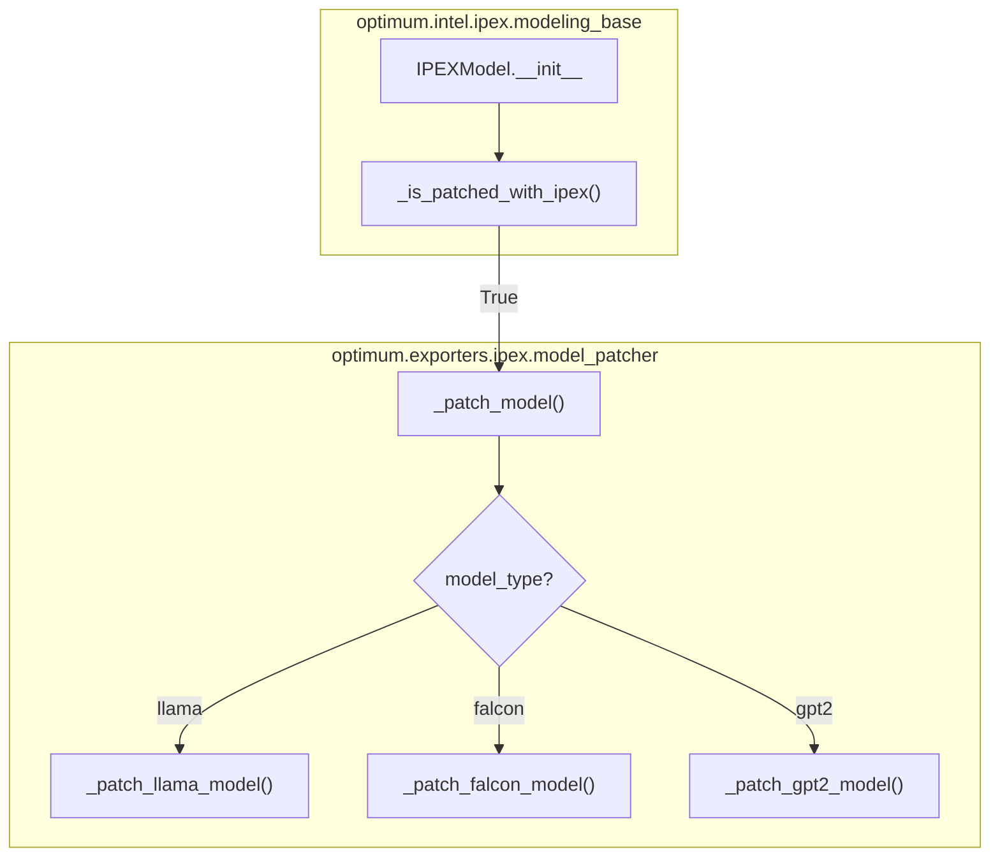
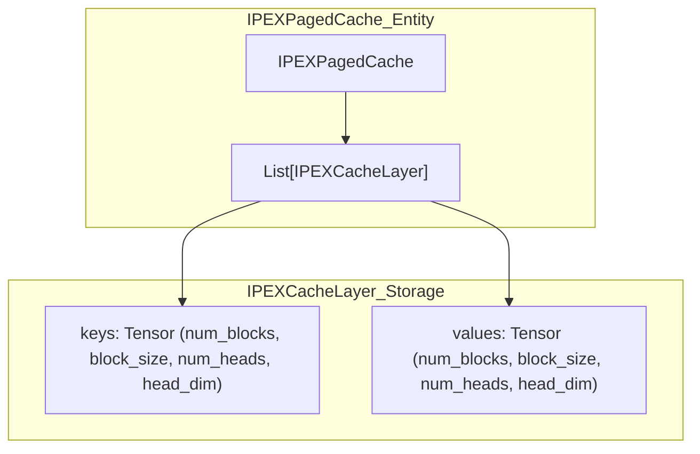
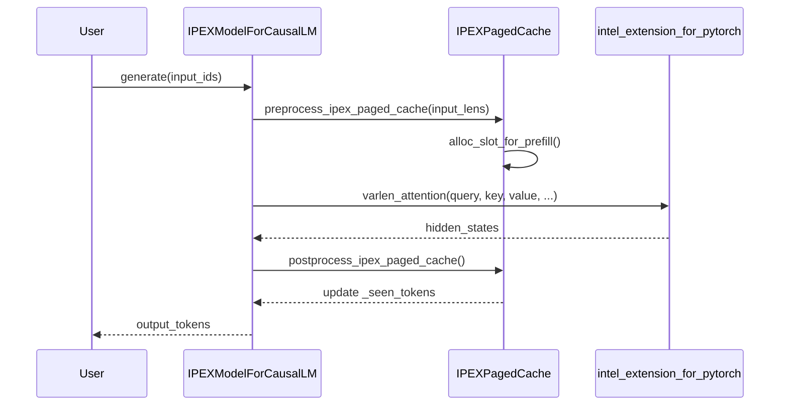

<!-- source: DeepWiki mcp.deepwiki.com · repo huggingface/optimum-intel · page 3.2 Optimizations and Performance · fetched 2026-10-26 -->

# Optimizations and Performance

Relevant source files

The following files were used as context for generating this wiki page:

- [setup.py](setup.py)

## Purpose and Scope

This document covers IPEX-specific optimizations for text generation and general model inference, with a particular focus on causal language models (`IPEXModelForCausalLM`). These optimizations include the IPEX model patching system, custom operators (PagedAttention, fused linear operations), weight prepacking, stateful inference, and performance tuning strategies like core binding and NUMA awareness.

The optimizations described here apply specifically to patched models (LLaMA, Falcon, GPT-2, Qwen2, Mistral, BERT, ViT) when `use_cache=True`. Non-patched models use standard PyTorch execution paths with basic IPEX optimizations.

---

## IPEX Model Patching System

The model patching system applies architecture-specific optimizations by replacing standard Transformers forward methods and decoder layers with IPEX-optimized implementations.

### Supported Architectures and Replacements

Patching is applied only to specific model architectures and requires minimum IPEX version 2.6.0 [optimum/exporters/ipex/model_patcher.py:39-43](), [optimum/exporters/ipex/model_patcher.py:175-176]().

| Architecture | Module Replacements | Forward Method Replacements |
|-------------|---------------------|----------------------------|
| **LLaMA** | `LlamaDecoderLayer` → `_IPEXLlamaDecoderLayer` `LlamaRMSNorm` → `_ipex_rms_layer_norm_forward` | `LlamaModel.forward` |
| **Falcon** | `FalconDecoderLayer` → `_IPEXFalconDecoderLayer` | `FalconModel.forward` `FalconForCausalLM.forward` |
| **GPT-2** | `GPT2Block` → `_IPEXGPT2Block` | `GPT2Model.forward` `GPT2LMHeadModel.forward` |
| **Qwen2** | `Qwen2DecoderLayer` → `_IPEXQwen2DecoderLayer` `Qwen2RMSNorm` → `_ipex_rms_layer_norm_forward` | `Qwen2Model.forward` |
| **Mistral** | `MistralDecoderLayer` → `_IPEXMistralDecoderLayer` `MistralRMSNorm` → `_ipex_rms_layer_norm_forward` | `MistralModel.forward` |
| **BERT** | `BertIntermediate` → `_IPEXIntermediate` | None |
| **ViT** | `ViTIntermediate` → `_IPEXIntermediate` | None |

**Sources:** [optimum/exporters/ipex/model_patcher.py:87-173](), [optimum/exporters/ipex/modeling_utils.py:43-59]()

### Patching Logic Flow

The patching process is triggered during `IPEXModel` initialization if `_is_patched_with_ipex` returns `True` [optimum/intel/ipex/modeling_base.py:154-160]().

**Model Patching Logic**

**Sources:** [optimum/intel/ipex/modeling_base.py:89-94](), [optimum/intel/ipex/modeling_base.py:154-160](), [optimum/exporters/ipex/model_patcher.py:174-197]()

---

## Custom Operators and Fusions

IPEX provides high-performance custom operators that fuse multiple standard PyTorch operations into a single kernel to reduce memory overhead and increase throughput.

### Fused Linear Operations

IPEX replaces standard `nn.Linear` layers with fused variants that combine linear projections with activation functions or residual additions [optimum/exporters/ipex/modeling_utils.py:50-59]().

| Fused Operator | Implementation | Used In |
|----------------|----------------|---------|
| `Linear2SiluMul` | Fuses two linears followed by SiLU and multiplication | LLaMA, Qwen2 MLP |
| `LinearAdd` | Fuses linear projection with a residual addition | LLaMA, Mistral, Qwen2 |
| `LinearGelu` | Fuses linear projection with GELU activation | Falcon, BERT, ViT |
| `LinearAddAdd` | Fuses linear with two subsequent additions | Falcon |

**Sources:** [optimum/exporters/ipex/modeling_utils.py:50-59](), [optimum/exporters/ipex/model_patcher.py:87-155]()

### RMSNorm and Rotary Embedding

- **RMSNorm**: Standard `LlamaRMSNorm` or `MistralRMSNorm` are replaced by `RMSNorm.apply_function` which utilizes Intel-optimized kernels [optimum/exporters/ipex/modeling_utils.py:95-96]().
- **Rotary Embedding**: IPEX provides a specialized `RotaryEmbedding` module that handles RoPE application efficiently during the attention forward pass [optimum/exporters/ipex/modeling_utils.py:58]().

---

## PagedAttention and KV Cache Management

`IPEXPagedCache` implements a memory-efficient key-value cache system that allocates memory in fixed-size blocks (pages) [optimum/exporters/ipex/cache_utils.py:110-133]().

### Cache Structure

The cache is organized into `IPEXCacheLayer` objects, one per model layer. It supports dynamic growth and avoids the need for contiguous memory allocation for the entire sequence [optimum/exporters/ipex/cache_utils.py:20-24]().

**Paged Cache Architecture**

### Allocation Strategy

- **Block Size**: Controlled by `OI_PAGED_ATTN_BLOCK_SIZE` environment variable, defaulting to 16 or 64 depending on sequence length [optimum/exporters/ipex/cache_utils.py:159-160]().
- **Prefill**: `alloc_slot_for_prefill` allocates multiple blocks for the initial prompt [optimum/exporters/ipex/cache_utils.py:231]().
- **Decode**: `alloc_slot_for_decode` allocates single slots for new tokens during autoregressive generation [optimum/exporters/ipex/cache_utils.py:255]().

**Sources:** [optimum/exporters/ipex/cache_utils.py:144-201](), [optimum/exporters/ipex/cache_utils.py:231-267]()

---

## Stateful Inference for Causal LM

`IPEXModelForCausalLM` manages the state of the generation process, specifically handling the interaction between the model forward pass and the paged cache [optimum/intel/ipex/modeling_base.py:321-338]().

### Forward Pass Execution

The forward pass is optimized to process only the necessary tokens using an `index` tensor, which selects non-padding tokens from the input batch [optimum/intel/ipex/modeling_base.py:375-380]().

**Stateful Inference Sequence**

**Sources:** [optimum/intel/ipex/modeling_base.py:340-398](), [optimum/exporters/ipex/modeling_utils.py:49]()

---

## Performance Tuning

### Core Binding and NUMA

For optimal performance on Intel CPUs, it is critical to bind execution threads to physical cores and manage memory local to the NUMA node.

- **`bind_cores_for_best_perf`**: A utility function that automatically configures thread affinity and environment variables like `OMP_NUM_THREADS` to match the hardware topology [optimum/intel/utils/modeling_utils.py:178-189]().
- **Weight Prepacking**: IPEX models automatically prepack weights into a format optimized for Intel instruction sets (AVX-512, AMX) during the first forward pass or during `ipex.optimize()`.
- **NUMA Support**: Availability is checked via `is_numa_available()` [optimum/intel/utils/import_utils.py:158-165]().

### torch.compile Integration

IPEX supports `torch.compile` using the IPEX backend for Inductor. This is enabled via `apply_torch_compile()` [optimum/intel/ipex/modeling_base.py:168](), [optimum/intel/ipex/modeling_base.py:249]().

- **Static Address Marking**: Paged cache tensors are marked with `torch._dynamo.mark_static_address` to allow Inductor to optimize memory access patterns [optimum/exporters/ipex/cache_utils.py:53-55]().
- **Freezing**: The environment variable `TORCHINDUCTOR_FREEZING` is set to "1" to enable constant folding and other graph-level optimizations [optimum/intel/ipex/modeling_base.py:261]().

**Sources:** [optimum/intel/ipex/modeling_base.py:237-262](), [optimum/exporters/ipex/cache_utils.py:51-55](), [optimum/intel/utils/modeling_utils.py:178-195](), [optimum/intel/utils/import_utils.py:158-165]()

---

