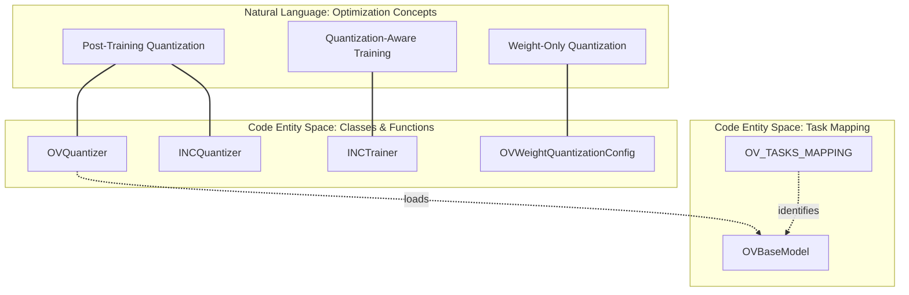
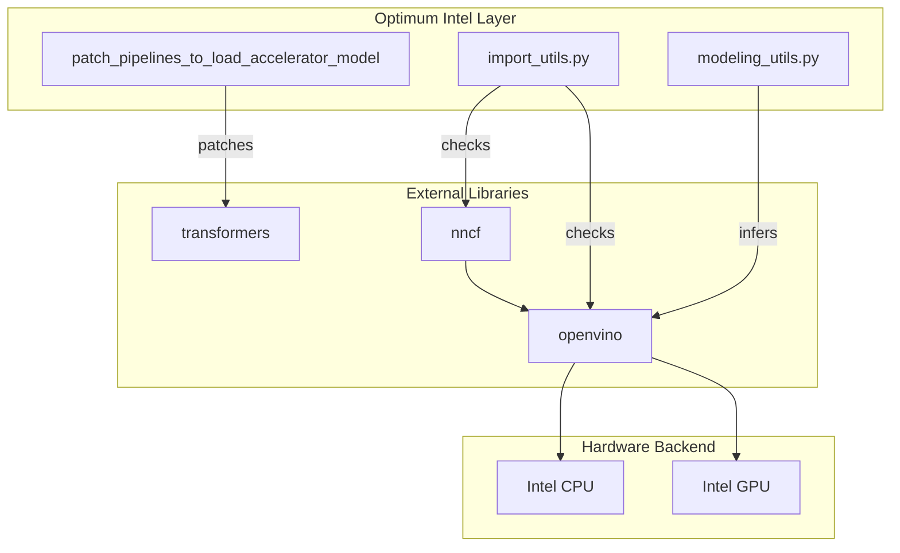

<!-- source: DeepWiki mcp.deepwiki.com · repo huggingface/optimum-intel · page 4 Neural Compressor Integration (Deprecated) · fetched 2026-10-26 -->

# Neural Compressor Integration (Deprecated)

Relevant source files

The following files were used as context for generating this wiki page:

- [optimum/intel/pipelines/accelerator_utils.py](optimum/intel/pipelines/accelerator_utils.py)
- [optimum/intel/utils/__init__.py](optimum/intel/utils/__init__.py)
- [optimum/intel/utils/import_utils.py](optimum/intel/utils/import_utils.py)
- [optimum/intel/utils/modeling_utils.py](optimum/intel/utils/modeling_utils.py)
- [setup.py](setup.py)

> [!WARNING]
> The Neural Compressor backend is deprecated and will be removed in a future release. Users are encouraged to migrate to the OpenVINO-based quantization system for Intel hardware optimization.
> Sources: [optimum/intel/openvino/__init__.py:42-47]()

This page documents the legacy integration with Intel Neural Compressor (INC). It provides tools for model compression, including quantization, pruning, and knowledge distillation, designed to reduce model size and improve inference performance on Intel CPUs and GPUs.

For details on post-training quantization, see [INCQuantizer and Quantization](#4.1). For training-time optimizations, see [INCTrainer and Compression](#4.2).

## Overview

Intel Neural Compressor provides a unified interface for multiple compression techniques. The `optimum-intel` integration maps these capabilities to Hugging Face workflows:

1.  **Post-Training Optimization**: Using `INCQuantizer` to apply quantization to pre-trained models without further training.
2.  **Training-Time Optimization**: Using `INCTrainer` to perform Quantization-Aware Training (QAT), pruning, or distillation.

The system relies on `nncf` (Neural Network Compression Framework) and `openvino` as primary backends for modern workflows, while the legacy INC components are maintained for backward compatibility.
Sources: [optimum/intel/utils/import_utils.py:63-86](), [setup.py:36-37]()

## Architecture Components

The integration bridges Hugging Face models with the Neural Compressor library through specialized quantizer and trainer classes.

### Code Entity Relationship
The following diagram associates natural language concepts with specific code entities used in the optimization and pipeline workflows.

Sources: [optimum/intel/pipelines/accelerator_utils.py:40-67](), [optimum/intel/utils/import_utils.py:79-86]()

### System Interaction
This diagram illustrates how `optimum-intel` components interact with the underlying optimization libraries and the import system.

Sources: [optimum/intel/utils/import_utils.py:63-86](), [optimum/intel/pipelines/accelerator_utils.py:127-135](), [optimum/intel/utils/modeling_utils.py:122-128]()

## Core Components Summary

The following table summarizes the key entities involved in the quantization and compression workflows.

| Component | Location | Role |
| :--- | :--- | :--- |
| `OVQuantizer` | [optimum/intel/openvino/quantization.py]() | Primary class for NNCF-based post-training quantization. |
| `INCQuantizer` | Legacy | (Deprecated) Post-training quantization using Intel Neural Compressor. |
| `INCTrainer` | Legacy | (Deprecated) Training-time compression including QAT and pruning. |
| `OV_TASKS_MAPPING` | [optimum/intel/pipelines/accelerator_utils.py:48-67]() | Mapping of Hugging Face tasks to OpenVINO model classes. |
| `is_nncf_available` | [optimum/intel/utils/import_utils.py:79-86]() | Utility to verify if NNCF is installed for quantization tasks. |

Sources: [optimum/intel/pipelines/accelerator_utils.py:48-67](), [optimum/intel/utils/import_utils.py:79-86]()

## Sub-pages

For deep technical details on specific workflows, refer to the following sub-pages:

### [INCQuantizer and Quantization](#4.1)
Documents the `INCQuantizer` API and its support for various post-training quantization modes (dynamic, static, weight-only). It covers the transition from legacy INC configurations to modern OpenVINO-based quantization.
Sources: [setup.py:78-80](), [optimum/intel/utils/import_utils.py:79-86]()

### [INCTrainer and Compression](#4.2)
Documents the `INCTrainer` for quantization-aware training, pruning, and distillation. It details the integration with the `transformers.Trainer` API and how compression callbacks manage the optimization process during training.

## Migration Path to OpenVINO

As the Neural Compressor integration is deprecated, users should transition to the OpenVINO backend for all quantization needs. OpenVINO utilizes NNCF (Neural Network Compression Framework) for high-performance quantization.

*   **For Post-Training Quantization**: Replace `INCQuantizer` with `OVQuantizer`.
*   **For Configuration**: Use OpenVINO-specific configuration classes for 4-bit and 8-bit quantization.
*   **For Inference**: Load the resulting models using `OVModelForCausalLM` or other task-specific classes defined in `OV_TASKS_MAPPING`.
*   **For Pipelines**: Use `patch_pipelines_to_load_accelerator_model("openvino")` to automatically use OpenVINO-optimized models in Hugging Face Pipelines.

For details on the modern system, see [Quantization System](#2.3).
Sources: [optimum/intel/pipelines/accelerator_utils.py:48-67](), [optimum/intel/pipelines/accelerator_utils.py:127-135](), [setup.py:36-37]()

---

