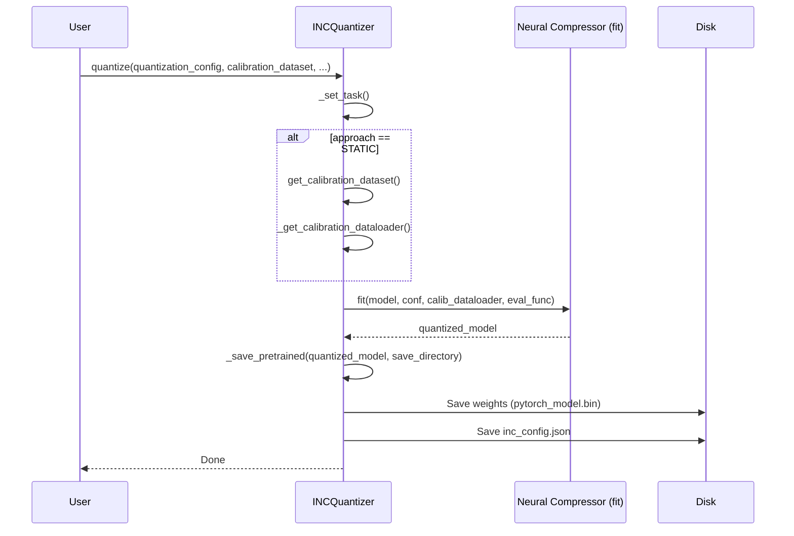
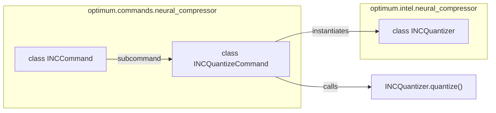

<!-- source: DeepWiki mcp.deepwiki.com · repo huggingface/optimum-intel · page 4.1 INCQuantizer and Quantization · fetched 2026-10-26 -->

# INCQuantizer and Quantization

<details>
<summary>Relevant source files</summary>

The following files were used as context for generating this wiki page:

- [optimum/intel/pipelines/accelerator_utils.py](optimum/intel/pipelines/accelerator_utils.py)
- [optimum/intel/utils/__init__.py](optimum/intel/utils/__init__.py)
- [optimum/intel/utils/import_utils.py](optimum/intel/utils/import_utils.py)
- [optimum/intel/utils/modeling_utils.py](optimum/intel/utils/modeling_utils.py)
- [setup.py](setup.py)

</details>


This document covers post-training quantization using the Intel Neural Compressor (INC) backend. It details the `INCQuantizer` API, the various post-training quantization (PTQ) modes (dynamic, static, and weight-only), and the configuration classes used to manage quantization metadata.

> [!WARNING]
> The `optimum.intel.neural_compressor` module is deprecated and will be removed in a future major release. Users are encouraged to migrate to OpenVINO or IPEX quantization workflows.
> **Sources:** [optimum/intel/neural_compressor/__init__.py:40-44]()

## INCQuantizer Class

The `INCQuantizer` class is the central orchestration entity for post-training quantization. It inherits from `OptimumQuantizer` and provides methods to load models, prepare calibration datasets, and execute the quantization process via the Neural Compressor engine.

### Class Architecture

The following diagram maps the Natural Language concept of "Quantization Orchestration" to the specific code entities in the `optimum-intel` and `neural-compressor` libraries.

```mermaid
graph TD
    subgraph "optimum.intel.neural_compressor.quantization"
        INCQuantizer["class INCQuantizer"]
        INCQuantizationMode["enum INCQuantizationMode"]
        WOQ["function _weight_only_quantization"]
    end

    subgraph "optimum.quantization_base"
        OptimumQuantizer["class OptimumQuantizer"]
    end

    subgraph "neural_compressor.quantization"
        fit["function fit()"]
    end

    OptimumQuantizer <|-- INCQuantizer
    INCQuantizer --> INCQuantizationMode
    INCQuantizer -- "invokes" --> fit
    INCQuantizer -- "utilizes" --> WOQ
```

**Sources:** [optimum/intel/neural_compressor/quantization.py:78-81](), [optimum/intel/neural_compressor/quantization.py:29](), [optimum/intel/neural_compressor/quantization.py:338]()

### Initialization and Task Inference

The quantizer accepts a PyTorch model and an optional task string. If the task is not provided, it is inferred from the model's configuration using the `TasksManager`.

| Parameter | Type | Description |
| :--- | :--- | :--- |
| `model` | `Union[PreTrainedModel, torch.nn.Module]` | The model to be quantized. |
| `eval_fn` | `Optional[Callable]` | Function for accuracy-driven strategy. Defaults to returning 1 if not provided. |
| `calibration_fn` | `Optional[Callable]` | Custom function for calibration. |
| `task` | `Optional[str]` | The task defining the model topology (e.g., `text-generation`). |

**Sources:** [optimum/intel/neural_compressor/quantization.py:83-114](), [optimum/intel/utils/modeling_utils.py:181-187]()

## Quantization Modes

Neural Compressor supports four primary modes, defined in the `INCQuantizationMode` enum:

1.  **DYNAMIC (`post_training_dynamic_quant`)**: Quantizes weights statically; activations are quantized dynamically during inference.
2.  **STATIC (`post_training_static_quant`)**: Quantizes both weights and activations statically based on calibration data.
3.  **WEIGHT_ONLY (`post_training_weight_only`)**: Specifically for Large Language Models (LLMs); quantizes weights to low-bit (INT4/INT8) while keeping activations in floating point.
4.  **AWARE_TRAINING (`quant_aware_training`)**: Quantization during the training loop, managed by `INCTrainer`.

**Sources:** [optimum/intel/neural_compressor/quantization.py:68-72]()

### Data Flow for Post-Training Quantization

The sequence below details how `INCQuantizer.quantize()` interacts with the underlying Neural Compressor engine to produce a quantized model and save it to disk.



**Sources:** [optimum/intel/neural_compressor/quantization.py:120-216]()

## Calibration and Data Loading

Static quantization requires a calibration phase to determine the dynamic range of activations.

### INCDataLoader
The `INCDataLoader` (at [optimum/intel/neural_compressor/utils.py:50]()) wraps a standard PyTorch `DataLoader`. It ensures that the data yielded is in the `(input, label)` format expected by the Neural Compressor engine. If `use_label` is true, it yields a tuple; otherwise, it yields the input directly.

### Calibration Dataset Selection
The `get_calibration_dataset()` method (at [optimum/intel/neural_compressor/quantization.py:247]()) facilitates loading datasets from the Hugging Face Hub or local paths. It handles shuffling, sampling (via `num_samples`), and preprocessing via a user-provided `preprocess_function`.

**Sources:** [optimum/intel/neural_compressor/quantization.py:247-306](), [optimum/intel/neural_compressor/utils.py:50-72]()

## Weight-Only Quantization (WOQ)

Weight-only quantization is implemented via the `_weight_only_quantization` function. This is the primary method for optimizing Large Language Models (LLMs) to 4-bit or 8-bit.

### Supported Algorithms and Configurations
The system supports several configurations from Neural Compressor:
- **RTN (Round-To-Nearest)**: Simple quantization using `RtnConfig`.
- **GPTQ**: Accurate quantization using `GPTQConfig`, which utilizes calibration data to minimize error.
- **AWQ (Activation-aware Weight Quantization)**: Uses activation statistics to protect salient weights.

### Implementation Detail
The function `_weight_only_quantization` (at [optimum/intel/neural_compressor/quantization.py:338]()) handles device detection (CPU vs. XPU), checks for minimum version requirements (INC >= 2.3.0), and applies the quantization config to the model. It supports both `neural_compressor.transformers.quantization.convert_to_quantized_model` for in-memory conversion and `save_low_bit` for storage-efficient formats.

**Sources:** [optimum/intel/neural_compressor/quantization.py:338-408](), [optimum/intel/neural_compressor/modeling_base.py:52](), [optimum/intel/utils/modeling_utils.py:45-63]()

## Configuration and Metadata

Quantization settings and metadata are managed through two primary classes:

### PostTrainingQuantConfig
This is the native Neural Compressor class used to define the quantization parameters (approach, backend, accuracy criterion, tuning criterion) passed to the `quantize` method.
**Sources:** [optimum/intel/neural_compressor/quantization.py:27]()

### INCConfig
This is an `optimum-intel` specific class that wraps quantization, pruning, and distillation metadata into a single `inc_config.json` file.

| Method | Role |
| :--- | :--- |
| `_create_quantization_config` | Maps INC internal approach strings (e.g., `post_training_static_quant`) to simplified metadata like `is_static`. |
| `_create_pruning_config` | Extracts approach, pattern, and sparsity from a `WeightPruningConfig`. |
| `_create_distillation_config` | Extracts teacher model info and temperature from a `DistillationConfig`. |

**Sources:** [optimum/intel/neural_compressor/configuration.py:35-51](), [optimum/intel/neural_compressor/configuration.py:54-92]()

## CLI Integration

The quantization process is also exposed via the `optimum-cli`. The `INCQuantizeCommand` class allows users to trigger dynamic quantization from the terminal.



**Sources:** [optimum/commands/neural_compressor/quantize.py:55-86](), [optimum/commands/neural_compressor/base.py:19-30]()

---

