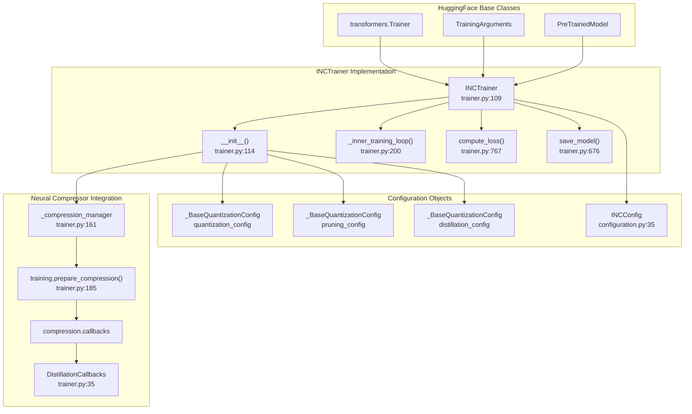
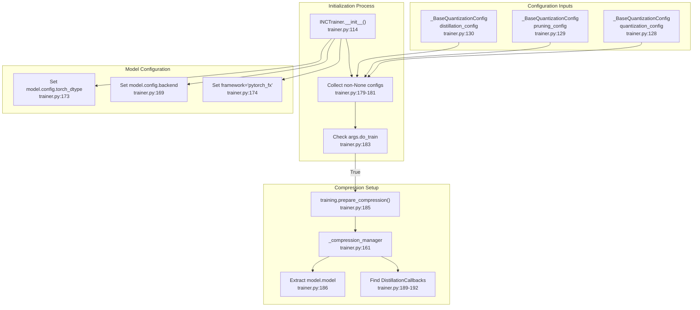

<!-- source: DeepWiki mcp.deepwiki.com · repo huggingface/optimum-intel · page 4.2 INCTrainer and Compression · fetched 2026-10-26 -->

# INCTrainer and Compression

Relevant source files

The following files were used as context for generating this wiki page:

- [optimum/intel/pipelines/accelerator_utils.py](optimum/intel/pipelines/accelerator_utils.py)
- [optimum/intel/utils/__init__.py](optimum/intel/utils/__init__.py)
- [optimum/intel/utils/import_utils.py](optimum/intel/utils/import_utils.py)
- [optimum/intel/utils/modeling_utils.py](optimum/intel/utils/modeling_utils.py)
- [setup.py](setup.py)

⚠️ **Deprecation Notice**: The Neural Compressor backend is deprecated in `optimum-intel`. For new projects, use the OpenVINO quantization system (see page 2.3) which provides comprehensive quantization support including weight-only, full quantization, and mixed precision. This documentation is maintained for legacy codebases using Neural Compressor.

This page documents the `INCTrainer` class and compression workflow for training models with Intel Neural Compressor (INC) optimizations. The trainer enables quantization-aware training (QAT), weight pruning, and knowledge distillation during fine-tuning.

## INCTrainer Architecture

### Class Hierarchy and Design

The `INCTrainer` class at [optimum/intel/neural_compressor/trainer.py:109]() extends `transformers.Trainer` to integrate Neural Compressor compression techniques during model training. It functions as a drop-in replacement for HuggingFace's standard trainer, adding support for optimization configurations.

**INCTrainer Class Definition and Integration:**

Sources: [optimum/intel/neural_compressor/trainer.py:109-198](), [optimum/intel/neural_compressor/configuration.py:35-93]()

The trainer accepts up to three optimization configurations and creates a `_compression_manager` via `neural_compressor.training.prepare_compression()` that orchestrates compression callbacks throughout the training lifecycle [optimum/intel/neural_compressor/trainer.py:185]().

## Core Training Components

### Initialization and Configuration

The `INCTrainer.__init__()` method at [optimum/intel/neural_compressor/trainer.py:114-198]() accepts standard `Trainer` parameters plus optimization configurations:

**Key Constructor Parameters:**

| Parameter | Type | Purpose |
|-----------|------|---------|
| `model` | `PreTrainedModel` or `torch.nn.Module` | Model to train and optimize |
| `args` | `TrainingArguments` | Standard HuggingFace training configuration |
| `quantization_config` | `_BaseQuantizationConfig` | Quantization-aware training settings |
| `pruning_config` | `_BaseQuantizationConfig` | Weight pruning configuration |
| `distillation_config` | `_BaseQuantizationConfig` | Knowledge distillation setup with teacher model |
| `task` | `str` | Task identifier (optional) |

**Optimization Configuration Flow:**

Sources: [optimum/intel/neural_compressor/trainer.py:114-198]()

The initialization process collects provided configurations, creates the compression manager if training is enabled, and updates the model configuration with optimization metadata such as `backend` and `framework` [optimum/intel/neural_compressor/trainer.py:169-174]().

### Training Loop Integration

The `_inner_training_loop()` method at [optimum/intel/neural_compressor/trainer.py:200-674]() overrides the base trainer to integrate compression callbacks at critical training stages:

**Compression Callback Integration Points:**

| Loop Point | Callback Trigger Site | Purpose |
|------------|----------------------|---------|
| Train Begin | [optimum/intel/neural_compressor/trainer.py:435]() | Initialize compression state |
| Epoch Begin | [optimum/intel/neural_compressor/trainer.py:473]() | Update epoch-level compression parameters |
| Step Begin | [optimum/intel/neural_compressor/trainer.py:520]() | Apply pruning masks or quantization simulation |
| Before Optimizer | [optimum/intel/neural_compressor/trainer.py:571]() | Process gradients for compression |
| After Optimizer | [optimum/intel/neural_compressor/trainer.py:577]() | Update weights based on compression constraints |
| Step End | [optimum/intel/neural_compressor/trainer.py:590]() | Post-step compression logging/updates |
| Epoch End | [optimum/intel/neural_compressor/trainer.py:608]() | Epoch-level compression cleanup |
| Train End | [optimum/intel/neural_compressor/trainer.py:672]() | Finalize optimized model weights |

Sources: [optimum/intel/neural_compressor/trainer.py:200-674]()

The compression manager's callbacks are invoked at strategic points to enable Neural Compressor to apply quantization simulation, pruning masks, and other optimizations dynamically during training.

## Optimization Techniques

### Quantization Aware Training (QAT)

Quantization aware training inserts fake quantization operations during training to simulate INT8 inference, allowing the model to adapt its weights for better post-quantization accuracy.

**Configuration and Usage:**

The trainer accepts a `_BaseQuantizationConfig` from Neural Compressor's configuration system. When QAT is enabled:

1. Model configuration is updated: `model.config.torch_dtype = "int8"` at [optimum/intel/neural_compressor/trainer.py:173]().
2. Backend is set: `model.config.backend = quantization_config.backend` at [optimum/intel/neural_compressor/trainer.py:169]().
3. Framework identifier: `model.config.framework = "pytorch_fx"` at [optimum/intel/neural_compressor/trainer.py:174]().

The `INCQuantizationMode` enum at [optimum/intel/neural_compressor/quantization.py:68-72]() defines `AWARE_TRAINING` as one of the primary supported modes.

Sources: [optimum/intel/neural_compressor/trainer.py:167-176](), [optimum/intel/neural_compressor/quantization.py:68-72]()

### Weight Pruning

Weight pruning progressively zeros out less important parameters during training to achieve model sparsity.

**Pruning Configuration in INCConfig:**

The `INCConfig` class at [optimum/intel/neural_compressor/configuration.py:66-79]() translates `WeightPruningConfig` into a serializable format, capturing:
- `approach`: Pruning type (e.g., magnitude) [optimum/intel/neural_compressor/configuration.py:70]().
- `pattern`: Pruning pattern (e.g., 4x1) [optimum/intel/neural_compressor/configuration.py:71]().
- `sparsity`: Target sparsity level [optimum/intel/neural_compressor/configuration.py:72]().

The pruning configuration is saved to `inc_config.json` at [optimum/intel/neural_compressor/trainer.py:737]() with the final achieved sparsity via `get_model_sparsity()` at [optimum/intel/neural_compressor/trainer.py:887-891]().

Sources: [optimum/intel/neural_compressor/configuration.py:66-79](), [optimum/intel/neural_compressor/trainer.py:737](), [optimum/intel/neural_compressor/trainer.py:887-891]()

### Knowledge Distillation

Knowledge distillation trains a smaller student model to mimic the outputs of a larger teacher model.

**Distillation Loss Computation:**

The `compute_loss()` method at [optimum/intel/neural_compressor/trainer.py:767-818]() incorporates distillation loss by comparing student and teacher logits:

1. **Logit Extraction**: Retrieves student logits and teacher logits (either from inputs or by running the teacher model) [optimum/intel/neural_compressor/trainer.py:797-805]().
2. **Loss Calculation**: Calls `compute_distillation_loss()` which applies temperature scaling and computes KL divergence [optimum/intel/neural_compressor/trainer.py:843-855]().
3. **Loss Weighting**: Combines base loss and distillation loss using weights defined in the configuration [optimum/intel/neural_compressor/trainer.py:809-811]().

The `INCConfig._create_distillation_config` method at [optimum/intel/neural_compressor/configuration.py:82-92]() handles the conversion of Neural Compressor `DistillationConfig` objects into the format expected by the HuggingFace configuration system.

Sources: [optimum/intel/neural_compressor/trainer.py:767-818](), [optimum/intel/neural_compressor/trainer.py:843-855](), [optimum/intel/neural_compressor/configuration.py:82-92]()

## Combined Optimization Workflows

### Multi-Technique Training

The trainer supports combining quantization, pruning, and distillation simultaneously. Multiple configurations are collected and passed to `neural_compressor.training.prepare_compression()` at [optimum/intel/neural_compressor/trainer.py:185]().

### Model Saving and Persistence

The `save_model()` method at [optimum/intel/neural_compressor/trainer.py:676-740]() extends the base trainer's saving logic to preserve compression configurations and metadata.

**Saved Artifacts:**

| Artifact | File Name | Source |
|----------|-----------|--------|
| Model weights | `pytorch_model.bin` | [optimum/intel/neural_compressor/trainer.py:701]() |
| INC configuration | `inc_config.json` | [optimum/intel/neural_compressor/trainer.py:737]() |
| Training arguments | `training_args.bin` | [optimum/intel/neural_compressor/trainer.py:726]() |

**INCConfig Structure:**

The `INCConfig` class at [optimum/intel/neural_compressor/configuration.py:35-93]() handles the serialization of optimization parameters. For example, `_create_distillation_config` extracts the teacher model path and temperature [optimum/intel/neural_compressor/configuration.py:82-92]().

Sources: [optimum/intel/neural_compressor/trainer.py:676-740](), [optimum/intel/neural_compressor/configuration.py:35-93]()

## Seq2Seq Training

Sequence-to-sequence models require special handling for generation tasks. The `INCSeq2SeqTrainer` at [optimum/intel/neural_compressor/trainer_seq2seq.py:30]() provides overrides for `evaluate()` and `predict()` to handle `max_length` and `num_beams` parameters correctly during generation [optimum/intel/neural_compressor/trainer_seq2seq.py:31-119]().

Sources: [optimum/intel/neural_compressor/trainer_seq2seq.py:30-119]()

---

