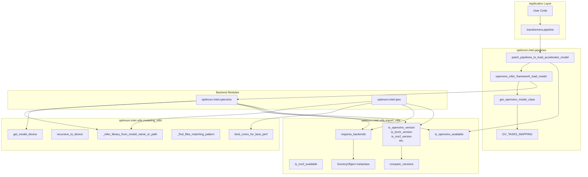
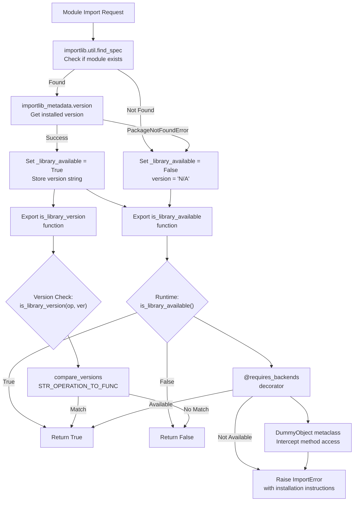
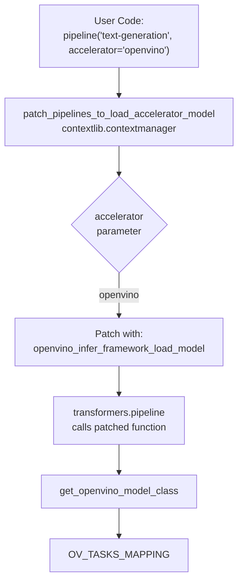

<!-- source: DeepWiki mcp.deepwiki.com · repo huggingface/optimum-intel · page 5 Utilities and Tools · fetched 2026-10-26 -->

# Utilities and Tools

Relevant source files

The following files were used as context for generating this wiki page:

- [optimum/intel/__init__.py](optimum/intel/__init__.py)
- [optimum/intel/openvino/__init__.py](optimum/intel/openvino/__init__.py)
- [optimum/intel/openvino/utils.py](optimum/intel/openvino/utils.py)
- [optimum/intel/pipelines/accelerator_utils.py](optimum/intel/pipelines/accelerator_utils.py)
- [optimum/intel/pipelines/pipeline_base.py](optimum/intel/pipelines/pipeline_base.py)
- [optimum/intel/utils/__init__.py](optimum/intel/utils/__init__.py)
- [optimum/intel/utils/import_utils.py](optimum/intel/utils/import_utils.py)
- [optimum/intel/utils/modeling_utils.py](optimum/intel/utils/modeling_utils.py)

This document provides an overview of the utility systems in `optimum-intel` that support the core backend integrations. These utilities handle cross-cutting concerns including dependency management, model transformation, and integration with the HuggingFace transformers pipeline API.

The utilities are organized into three main areas:

- **Dependency Management and Import System** ([Dependency Management and Import System](#5.1)): Library availability checking, version comparison, and graceful error handling via `import_utils.py`.
- **Model Utilities** ([Model Utilities](#5.2)): Device management, model transformation, performance optimization (e.g., `bind_cores_for_best_perf`), and special model loading in `modeling_utils.py`.
- **Pipeline Framework and Accelerators** ([Pipeline Framework and Accelerators](#5.3)): Integration with `transformers.pipeline` API via `patch_pipelines_to_load_accelerator_model` to enable seamless use of OpenVINO and IPEX models.

For information about backend-specific implementations, see [OpenVINO Integration](#2), [IPEX Integration](#3), and [Neural Compressor Integration (Deprecated)](#4).

## Utility System Architecture

The utility modules provide foundational functionality that all backends depend on. The architecture follows a layered approach where low-level utilities (import checking, device management) support higher-level functionality (pipeline integration).

**Utility System Components and Dependencies**

**Sources:** [optimum/intel/utils/import_utils.py:33-191](), [optimum/intel/utils/modeling_utils.py:45-187](), [optimum/intel/pipelines/accelerator_utils.py:48-141]()

## Import and Dependency System

The import system provides library availability detection and version checking across all `optimum-intel` backends. This enables conditional imports and graceful error handling when optional dependencies are not installed.

**Library Detection and Version Checking Flow**

**Sources:** [optimum/intel/utils/import_utils.py:33-118](), [optimum/intel/utils/import_utils.py:200-233]()

### Supported Libraries

The import system tracks availability and versions for the following libraries:

| Library | Detection Variable/Function | Purpose |
|---------|-------------------|---------|
| `transformers` | `_transformers_available` | Core HuggingFace models [optimum/intel/utils/import_utils.py:38]() |
| `torch` | `_torch_available` | PyTorch framework [optimum/intel/utils/import_utils.py:54]() |
| `openvino` | `_openvino_available` | OpenVINO runtime [optimum/intel/utils/import_utils.py:63]() |
| `nncf` | `_nncf_available` | Neural network compression [optimum/intel/utils/import_utils.py:79]() |
| `diffusers` | `_diffusers_available` | Generative models [optimum/intel/utils/import_utils.py:87]() |
| `open_clip` | `_open_clip_available` | OpenCLIP models [optimum/intel/utils/import_utils.py:96]() |
| `kokoro` | `_kokoro_available` | Kokoro TTS models [optimum/intel/utils/import_utils.py:112]() |
| `datasets` | `_datasets_available` | Dataset handling [optimum/intel/utils/import_utils.py:138]() |
| `accelerate` | `_accelerate_available` | Model acceleration [optimum/intel/utils/import_utils.py:155]() |
| `py-libnuma` | `_numa_available` | NUMA binding [optimum/intel/utils/import_utils.py:164]() |
| `psutil` | `_psutil_available` | System utilities [optimum/intel/utils/import_utils.py:173]() |

**Sources:** [optimum/intel/utils/import_utils.py:33-191]()

For more details on version comparison and the `DummyObject` pattern, see [Dependency Management and Import System](#5.1).

## Model Utilities

The `modeling_utils.py` module provides helper functions for device management, model transformation, performance optimization, and special model loading scenarios.

### Core Utility Functions

| Function | Purpose | Key Use Cases |
|----------|---------|---------------|
| `get_model_device(model)` | Determines device of model parameters [optimum/intel/utils/modeling_utils.py:45]() | Device-aware operations |
| `recursive_to_device(value, device)` | Recursively moves tensors to device [optimum/intel/utils/modeling_utils.py:66]() | Batch processing |
| `_find_files_matching_pattern(...)` | Finds model files by pattern [optimum/intel/utils/modeling_utils.py:88]() | Model discovery |
| `_is_kokoro_model(...)` | Detects Kokoro TTS models via config keys [optimum/intel/utils/modeling_utils.py:144]() | Architecture detection |
| `_infer_library_from_model_name_or_path(...)` | Identifies if model is `open_clip`, `kokoro`, or `transformers` [optimum/intel/utils/modeling_utils.py:168]() | Backend selection |

**Sources:** [optimum/intel/utils/modeling_utils.py:45-187]()

### Performance Optimization: Core Binding

Performance tuning utilities such as core binding (traditionally found in `modeling_utils.py`) automatically configure optimal CPU affinity and memory binding for inference workloads. This often involves detecting environment variables like `LOCAL_RANK` to calculate topology-aware core assignments.

For a deep dive into device management and file discovery, see [Model Utilities](#5.2).

## Pipeline Integration

The pipeline integration system enables seamless use of `optimum-intel` models with the HuggingFace `transformers.pipeline` API through a context manager that temporarily patches the framework loading mechanism.

**Pipeline Patching Architecture**

**Sources:** [optimum/intel/pipelines/accelerator_utils.py:127-141](), [optimum/intel/pipelines/pipeline_base.py:45-65]()

### Task-to-Model Mappings

The pipeline system maintains task-to-model class mappings for the OpenVINO backend via `OV_TASKS_MAPPING` [optimum/intel/pipelines/accelerator_utils.py:48]().

- **OpenVINO Mapping**: Maps tasks like `text-generation` to `OVModelForCausalLM`, `summarization` to `OVModelForSeq2SeqLM`, and `automatic-speech-recognition` to `OVModelForSpeechSeq2Seq` [optimum/intel/pipelines/accelerator_utils.py:48-67]().
- **Automatic Class Selection**: The `get_openvino_model_class` function handles complex logic, such as differentiating between `OVModelForCTC` and `OVModelForSpeechSeq2Seq` architectures for speech tasks by inspecting model configurations [optimum/intel/pipelines/accelerator_utils.py:70-96]().

For details on task mapping and accelerator patching, see [Pipeline Framework and Accelerators](#5.3).

---

