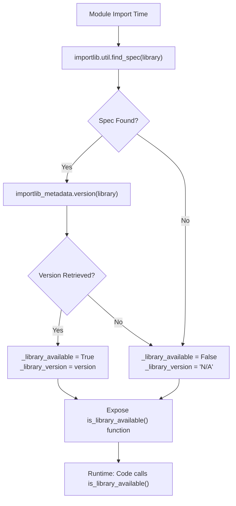
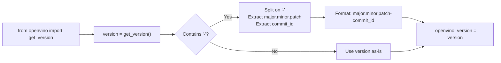
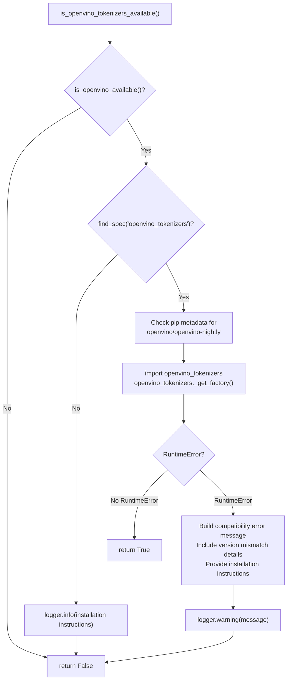
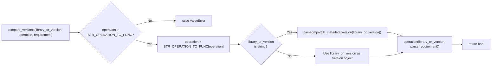
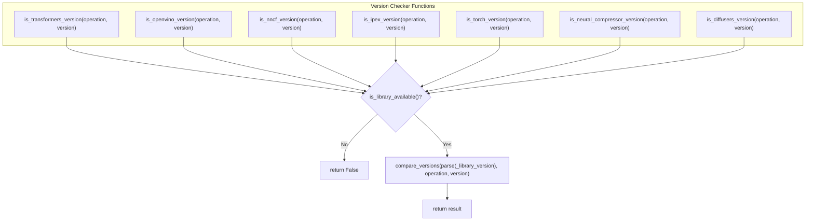
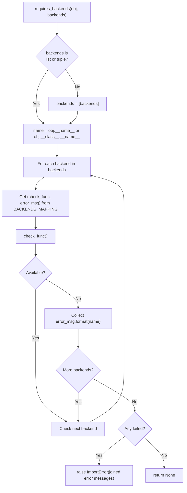
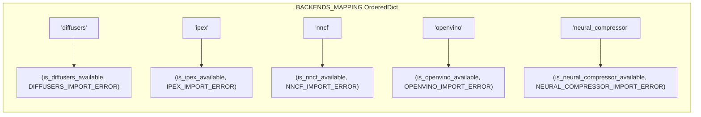
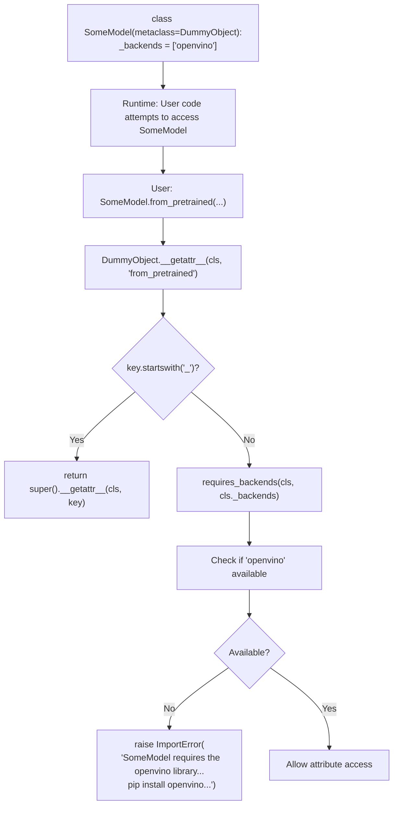
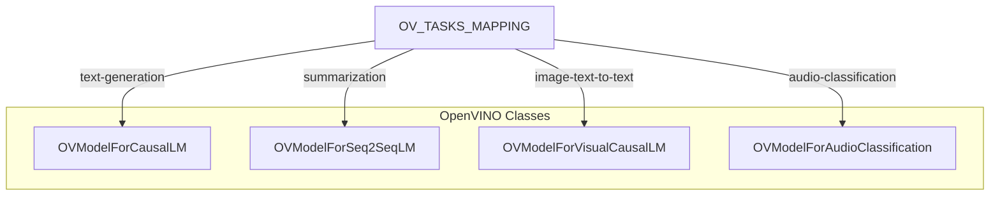

<!-- source: DeepWiki mcp.deepwiki.com · repo huggingface/optimum-intel · page 5.1 Dependency Management and Import System · fetched 2026-10-26 -->

# Dependency Management and Import System

<details>
<summary>Relevant source files</summary>

The following files were used as context for generating this wiki page:

- [optimum/intel/pipelines/accelerator_utils.py](optimum/intel/pipelines/accelerator_utils.py)
- [optimum/intel/utils/__init__.py](optimum/intel/utils/__init__.py)
- [optimum/intel/utils/dummy_openvino_and_diffusers_objects.py](optimum/intel/utils/dummy_openvino_and_diffusers_objects.py)
- [optimum/intel/utils/dummy_openvino_and_nncf_objects.py](optimum/intel/utils/dummy_openvino_and_nncf_objects.py)
- [optimum/intel/utils/dummy_openvino_and_sentence_transformers_objects.py](optimum/intel/utils/dummy_openvino_and_sentence_transformers_objects.py)
- [optimum/intel/utils/import_utils.py](optimum/intel/utils/import_utils.py)
- [optimum/intel/utils/modeling_utils.py](optimum/intel/utils/modeling_utils.py)

</details>


## Purpose and Scope

This document describes the dependency management and import system in `optimum-intel`, which provides centralized management of optional dependencies, version checking, and graceful degradation when required libraries are unavailable. The system is implemented primarily in [optimum/intel/utils/import_utils.py]() and handles detection of Intel optimization backends (OpenVINO, IPEX, Neural Compressor), HuggingFace ecosystem libraries (transformers, diffusers, tokenizers), and supporting utilities.

For information about how models use these utilities during loading, see [Model Loading and Inference](#2.4). For package structure and conditional imports, see [Package Structure](#7.1).

## Overview

The import system serves three primary functions:

1. **Library Detection**: Determines which optional dependencies are installed and their versions.
2. **Version Validation**: Compares installed versions against requirements using semantic versioning.
3. **Graceful Error Handling**: Provides clear error messages when required dependencies are missing or incompatible via the `DummyObject` pattern and `requires_backends` decorator.

This system enables `optimum-intel` to support multiple backends and optional features without forcing users to install all dependencies upfront.

**Sources**: [optimum/intel/utils/import_utils.py:1-570]()

## Library Detection System

### Detection Mechanism

Library detection uses a two-stage process implemented at module import time:

Title: Library Detection Flow


The detection happens in two phases:
1. **Spec Check**: Uses `importlib.util.find_spec()` to check if a package can be imported [optimum/intel/utils/import_utils.py:38-44]().
2. **Version Retrieval**: Uses `importlib_metadata.version()` to get the installed version, catching `PackageNotFoundError` if the package is importable but not properly installed [optimum/intel/utils/import_utils.py:40-44]().

**Sources**: [optimum/intel/utils/import_utils.py:25-200]()

### Tracked Libraries

The system tracks the following categories of dependencies:

| Category | Libraries | Availability Functions | Version Variables |
|----------|-----------|----------------------|-------------------|
| **Core HuggingFace** | transformers, tokenizers, diffusers, hub | `is_transformers_available()`, `is_tokenizers_available()`, `is_diffusers_available()`, `is_huggingface_hub_available()` | `_transformers_version`, `_tokenizers_version`, `_diffusers_version`, `_huggingface_hub_version` |
| **Intel Backends** | openvino, nncf, intel_extension_for_pytorch, neural_compressor | `is_openvino_available()`, `is_nncf_available()`, `is_ipex_available()`, `is_neural_compressor_available()` | `_openvino_version`, `_nncf_version`, `_ipex_version`, `_neural_compressor_version` |
| **ML Frameworks** | torch, datasets, timm, open_clip, sentence_transformers, langchain_huggingface, kokoro | `is_torch_available()`, `is_datasets_available()`, `is_timm_available()`, `is_open_clip_available()`, `is_sentence_transformers_available()`, `is_langchain_hf_available()`, `is_kokoro_available()` | `_torch_version`, `_datasets_version`, `_timm_version`, `_open_clip_version`, `_sentence_transformers_version`, `_langchain_hf_version`, `_kokoro_version` |
| **Utilities** | safetensors, accelerate, pillow, numa, psutil | `is_safetensors_available()`, `is_accelerate_available()`, `is_pillow_available()`, `is_numa_available()`, `is_psutil_available()` | `_safetensors_version`, `_accelerate_version` |

**Sources**: [optimum/intel/utils/import_utils.py:38-200]()

### Special Cases

#### OpenVINO Version Parsing

OpenVINO requires special version handling because development builds include commit hashes. The version string is normalized to avoid invalid formats that include multiple hyphens [optimum/intel/utils/import_utils.py:65-75]().

Title: OpenVINO Version Parsing


**Sources**: [optimum/intel/utils/import_utils.py:63-78]()

#### OpenVINO Tokenizers Compatibility Check

The `is_openvino_tokenizers_available()` function implements a complex compatibility check between OpenVINO and OpenVINO Tokenizers versions [optimum/intel/utils/import_utils.py:207-296](). It uses `@functools.lru_cache(1)` to cache the result since the check involves import attempts and is expensive.

Title: OpenVINO Tokenizers Compatibility Check


**Sources**: [optimum/intel/utils/import_utils.py:207-296]()

## Version Comparison System

### Compare Versions Function

The `compare_versions()` function provides semantic version comparison using the `packaging` library [optimum/intel/utils/import_utils.py:33-361]().

Title: Version Comparison Logic


Supported operations are defined in `STR_OPERATION_TO_FUNC` [optimum/intel/utils/import_utils.py:33]().

**Sources**: [optimum/intel/utils/import_utils.py:33-361]()

### Library-Specific Version Checkers

Specialized version comparison functions are provided for major dependencies, such as `is_transformers_version`, `is_openvino_version`, and `is_ipex_version` [optimum/intel/utils/import_utils.py:364-487]().

Title: Library-Specific Version Checkers


**Sources**: [optimum/intel/utils/import_utils.py:364-487]()

## Backend Requirement Enforcement

### The requires_backends Decorator

The `requires_backends()` function enforces dependency requirements by raising descriptive `ImportError` exceptions when required libraries are missing [optimum/intel/utils/import_utils.py:535-556]().

Title: requires_backends Enforcement Flow


**Sources**: [optimum/intel/utils/import_utils.py:535-556]()

### Backend Mapping Configuration

The `BACKENDS_MAPPING` OrderedDict maps backend names to their availability functions and error messages [optimum/intel/utils/import_utils.py:489-545]().

Title: Backend Mapping Structure


**Sources**: [optimum/intel/utils/import_utils.py:489-545]()

## Graceful Degradation with DummyObject

### DummyObject Metaclass Pattern

The `DummyObject` metaclass provides graceful error handling for classes that depend on unavailable backends [optimum/intel/utils/import_utils.py:559-570]().

Title: DummyObject Metaclass Error Handling


### Dummy Object Implementations

Dummy objects are used to represent classes when backends are missing, ensuring the user gets a helpful error message only when they try to use the class.

| Backend Requirements | File Path | Example Classes |
|----------------------|-----------|-----------------|
| OpenVINO + Diffusers | [optimum/intel/utils/dummy_openvino_and_diffusers_objects.py]() | `OVStableDiffusionPipeline`, `OVFluxPipeline`, `OVDiffusionPipeline`, `OVLTXPipeline` |
| OpenVINO + NNCF | [optimum/intel/utils/dummy_openvino_and_nncf_objects.py]() | `OVQuantizer`, `OVQuantizationConfig`, `OVWeightQuantizationConfig` |
| OpenVINO + Sentence Transformers | [optimum/intel/utils/dummy_openvino_and_sentence_transformers_objects.py]() | `OVSentenceTransformer` |
| Neural Compressor | [optimum/intel/utils/dummy_neural_compressor_objects.py]() | `INCModel`, `INCQuantizer`, `INCTrainer` |

**Sources**: [optimum/intel/utils/dummy_openvino_and_diffusers_objects.py:18-220](), [optimum/intel/utils/dummy_openvino_and_nncf_objects.py:18-78](), [optimum/intel/utils/dummy_openvino_and_sentence_transformers_objects.py:18-27](), [optimum/intel/utils/dummy_neural_compressor_objects.py:18-159]()

## Integration with Pipeline Framework

The dependency system is heavily used in the pipeline patching system to map tasks to backend-specific model classes.

Title: Task to Model Class Mapping


**Sources**: [optimum/intel/pipelines/accelerator_utils.py:48-67](), [optimum/intel/pipelines/accelerator_utils.py:70-96]()

## Error Message Templates

The system defines standardized error message templates for each backend, such as `OPENVINO_IMPORT_ERROR` and `IPEX_IMPORT_ERROR` [optimum/intel/utils/import_utils.py:489-532]().

Example template:
```python
OPENVINO_IMPORT_ERROR = """
{0} requires the openvino library but it was not found in your environment. 
You can install it with pip: `pip install openvino`. 
Please note that you may need to restart your runtime after installation.
"""
```

**Sources**: [optimum/intel/utils/import_utils.py:489-533]()

---

