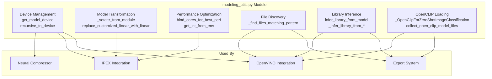
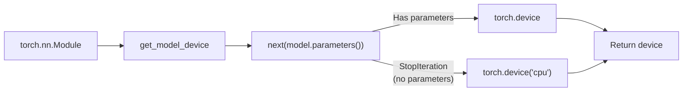
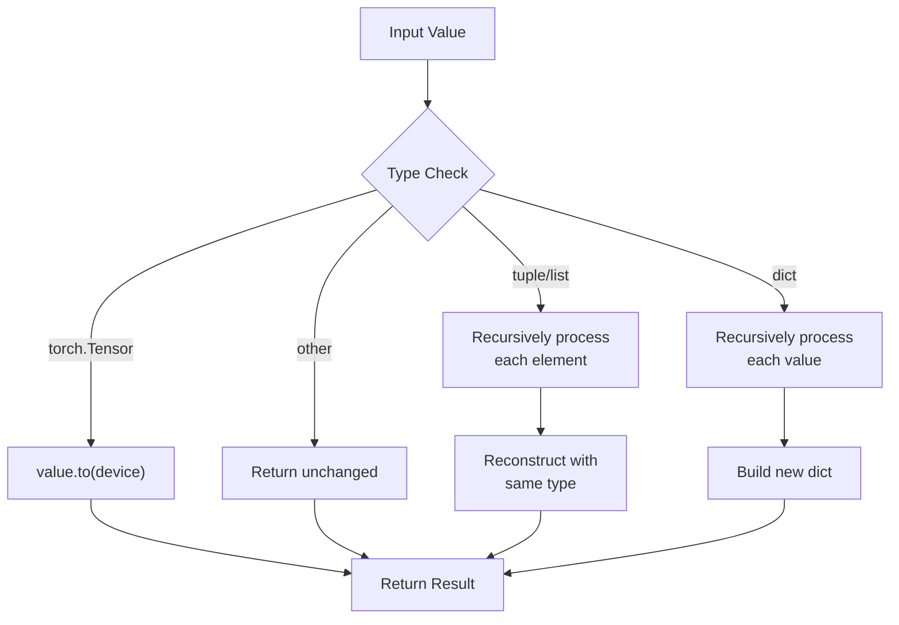
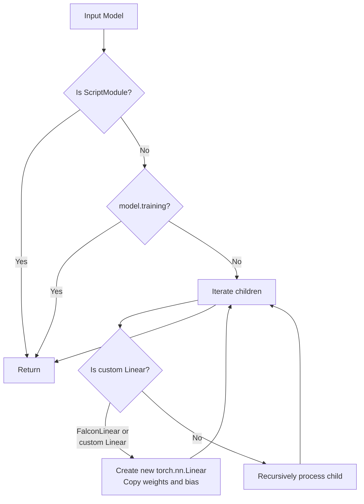
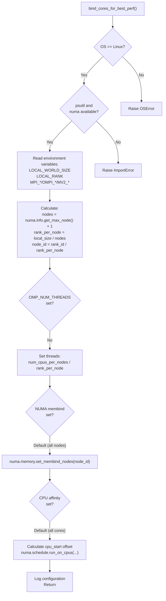
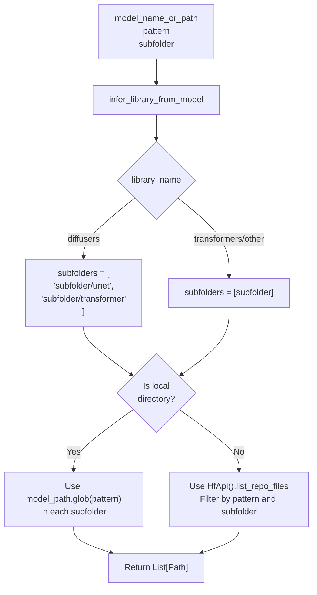
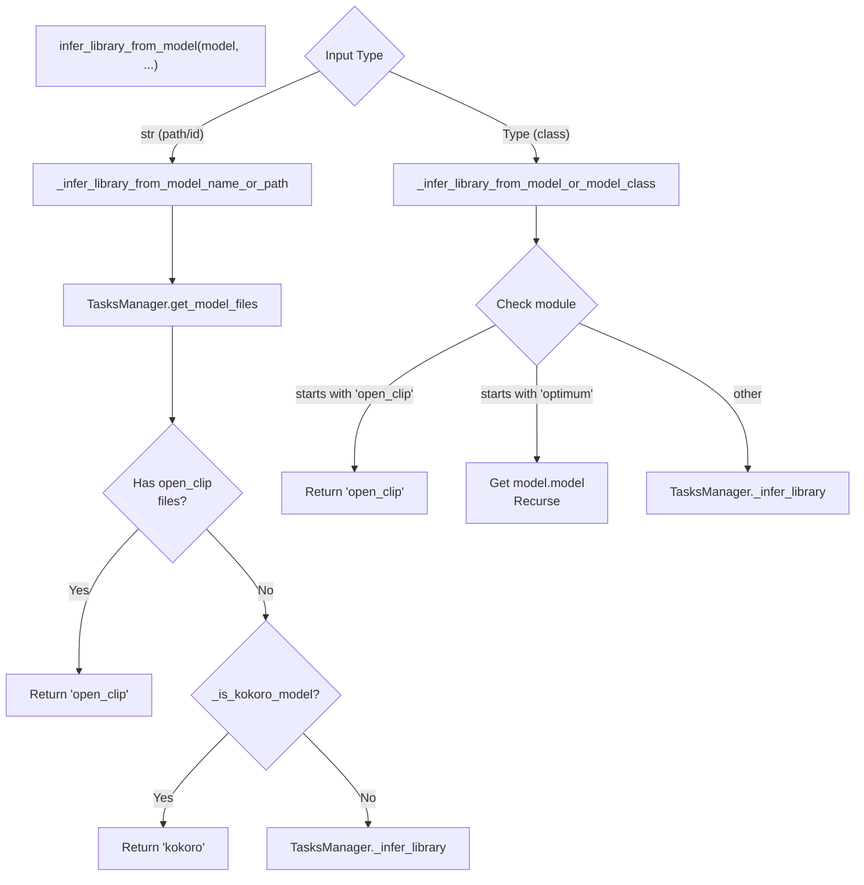
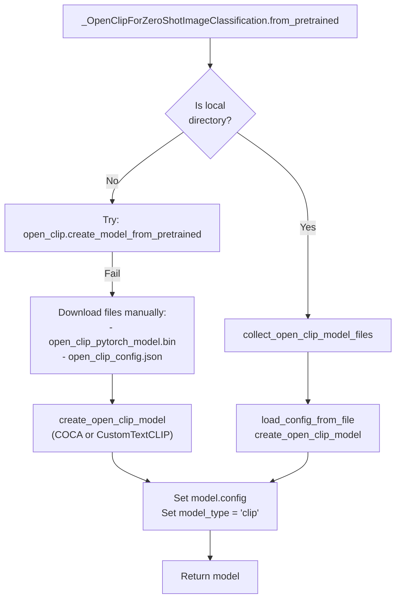

<!-- source: DeepWiki mcp.deepwiki.com · repo huggingface/optimum-intel · page 5.2 Model Utilities · fetched 2026-10-26 -->

# Model Utilities

Relevant source files

The following files were used as context for generating this wiki page:

- [optimum/intel/__init__.py](optimum/intel/__init__.py)
- [optimum/intel/openvino/__init__.py](optimum/intel/openvino/__init__.py)
- [optimum/intel/openvino/utils.py](optimum/intel/openvino/utils.py)
- [optimum/intel/pipelines/accelerator_utils.py](optimum/intel/pipelines/accelerator_utils.py)
- [optimum/intel/utils/__init__.py](optimum/intel/utils/__init__.py)
- [optimum/intel/utils/constant.py](optimum/intel/utils/constant.py)
- [optimum/intel/utils/import_utils.py](optimum/intel/utils/import_utils.py)
- [optimum/intel/utils/modeling_utils.py](optimum/intel/utils/modeling_utils.py)

This document describes the utility functions and classes in `modeling_utils.py` and related modules that provide essential infrastructure for model handling across the `optimum-intel` library. These utilities enable device management, model transformation, performance optimization through CPU core binding, library inference, file discovery, and specialized loading of OpenCLIP models.

For information about dependency checking and import management, see [Dependency Management and Import System](optimum/intel/utils/import_utils.py). For pipeline integration utilities, see [Pipeline Framework and Accelerators](optimum/intel/pipelines/accelerator_utils.py).

## Overview

The `modeling_utils.py` module provides cross-cutting utilities used by all backends (OpenVINO, IPEX, Neural Compressor) for common model operations. The module is organized into six functional areas:

**Purpose of modeling_utils.py**

| Utility Category | Primary Functions | Use Cases |
|-----------------|-------------------|-----------|
| Device Management | `get_model_device`, `recursive_to_device` | Determining model location, moving tensors |
| Model Transformation | `replace_customized_linear_with_linear`, `_setattr_from_module` | IPEX optimization, module attribute copying |
| Performance Optimization | `bind_cores_for_best_perf`, `get_int_from_env` | CPU core affinity, NUMA binding |
| File Discovery | `_find_files_matching_pattern` | Finding model files in repos/directories |
| Library Inference | `infer_library_from_model` | Detecting transformers/diffusers/open_clip/kokoro |
| OpenCLIP Support | `_OpenClipForZeroShotImageClassification` | Loading OpenCLIP models for export |

Sources: [optimum/intel/utils/modeling_utils.py:1-496]()

## Device Management

Device management utilities help determine where a model resides and move data structures to appropriate devices.

### get_model_device

The `get_model_device` function determines the device (CPU, GPU, etc.) where a PyTorch model's parameters are located [optimum/intel/utils/modeling_utils.py:45-63]().

**Implementation Details**

The function uses Python's iterator protocol to access the first parameter [optimum/intel/utils/modeling_utils.py:58-62](). This approach is efficient because it only accesses the first parameter rather than iterating through all parameters. If the model has no parameters (e.g., an empty container), it defaults to CPU [optimum/intel/utils/modeling_utils.py:62]().

Sources: [optimum/intel/utils/modeling_utils.py:45-63]()

### recursive_to_device

The `recursive_to_device` function recursively moves all tensors in nested data structures to a specified device, handling tuples, lists, dictionaries, and individual tensors [optimum/intel/utils/modeling_utils.py:66-76]().

The function preserves the original data structure type (tuple vs list) when reconstructing collections [optimum/intel/utils/modeling_utils.py:71]().

Sources: [optimum/intel/utils/modeling_utils.py:66-76]()

## Model Transformation

Model transformation utilities modify model structures for compatibility with specific backends or to copy attributes between modules.

### replace_customized_linear_with_linear

This function replaces custom linear layer implementations with standard `torch.nn.Linear` layers to ensure IPEX can recognize and optimize them [optimum/intel/utils/modeling_utils.py:144-166](). This is critical for models like Falcon that use custom linear layer classes [optimum/intel/utils/modeling_utils.py:153]().

The transformation specifically targets `FalconLinear` and `Linear` class names [optimum/intel/utils/modeling_utils.py:152-155](). It is only applied during inference (`not model.training`) and skips `torch.jit.ScriptModule` instances [optimum/intel/utils/modeling_utils.py:148-150]().

Sources: [optimum/intel/utils/modeling_utils.py:144-166]()

### _setattr_from_module

A utility function that copies all attributes and class methods from one module to another [optimum/intel/utils/modeling_utils.py:79-85](). It is used when wrapping modules to preserve original behavior while adding functionality.

Sources: [optimum/intel/utils/modeling_utils.py:79-85]()

## Performance Optimization

### bind_cores_for_best_perf

The `bind_cores_for_best_perf` function automatically configures thread count, CPU core affinity, and NUMA memory binding for multi-rank or multi-process inference scenarios [optimum/intel/utils/modeling_utils.py:178-245]().

The function supports multiple distributed frameworks by checking environment variables like `LOCAL_WORLD_SIZE`, `MPI_LOCALNRANKS`, and `OMPI_COMM_WORLD_LOCAL_SIZE` [optimum/intel/utils/modeling_utils.py:199-202](). It requires Linux and the `psutil` and `numa` libraries [optimum/intel/utils/modeling_utils.py:207-212]().

Sources: [optimum/intel/utils/modeling_utils.py:178-245]()

### get_int_from_env

A helper function that retrieves the first positive integer value from a list of environment variable names, returning a default if none are set [optimum/intel/utils/modeling_utils.py:169-175]().

Sources: [optimum/intel/utils/modeling_utils.py:169-175]()

## File Discovery and Naming

### File Discovery

The `_find_files_matching_pattern` function provides a unified interface for discovering files in either local directories or Hugging Face Hub repositories [optimum/intel/utils/modeling_utils.py:88-141]().

When the library is identified as `diffusers`, the function automatically expands search paths to include `unet` and `transformer` subfolders [optimum/intel/utils/modeling_utils.py:125-128]().

Sources: [optimum/intel/utils/modeling_utils.py:88-141]()

### OpenVINO File Constants

Standard filenames for OpenVINO IR components are defined to ensure consistency across model classes:

| Constant | Value | Description |
|----------|-------|-------------|
| `OV_XML_FILE_NAME` | `"openvino_model.xml"` | Standard model XML |
| `OV_ENCODER_NAME` | `"openvino_encoder_model.xml"` | Encoder component |
| `OV_DECODER_NAME` | `"openvino_decoder_model.xml"` | Decoder component |
| `OV_LANGUAGE_MODEL_NAME` | `"openvino_language_model.xml"` | VLM language model |
| `OV_VISION_ENCODER_MODEL_NAME` | `"openvino_vision_encoder.xml"` | Vision encoder component |
| `OV_TOKENIZER_NAME` | `"openvino_tokenizer{}.xml"` | OpenVINO GenAI Tokenizer |

Sources: [optimum/intel/openvino/utils.py:41-54]()

## Library Inference

Library inference functions determine whether a model belongs to `transformers`, `diffusers`, `open_clip`, or `kokoro` [optimum/intel/utils/modeling_utils.py:168-204]().

OpenCLIP models are identified by the presence of `open_clip_config.json` or `open_clip_pytorch_model.bin` [optimum/intel/utils/modeling_utils.py:178-179](). Kokoro TTS models are detected by checking for `istftnet` and `plbert` keys in the `config.json` [optimum/intel/utils/modeling_utils.py:144-166]().

Sources: [optimum/intel/utils/modeling_utils.py:144-204]()

## OpenCLIP Model Loading

The `_OpenClipForZeroShotImageClassification` class wraps OpenCLIP models in a HuggingFace-compatible interface [optimum/intel/utils/modeling_utils.py:308-495]().

The class supports `CoCa` and `CustomTextCLIP` architectures from the `open_clip` library [optimum/intel/utils/modeling_utils.py:447-451]().

Sources: [optimum/intel/utils/modeling_utils.py:308-495]()

## Task Mappings

The library maintains internal mappings from pipeline tasks to OpenVINO model classes. This is used by the `pipeline` patching system to load the correct `OVModelFor*` class based on the task name [optimum/intel/openvino/utils.py:122-151]().

| Task | OV Model Class |
|------|----------------|
| `text-generation` | `OVModelForCausalLM` |
| `text2text-generation` | `OVModelForSeq2SeqLM` |
| `image-text-to-text` | `OVModelForVisualCausalLM` |
| `automatic-speech-recognition` | `OVModelForSpeechSeq2Seq` |
| `feature-extraction` | `OVModelForFeatureExtraction` |
| `text-to-audio` | `OVModelForTextToSpeechSeq2Seq` |

Sources: [optimum/intel/openvino/utils.py:122-151](), [optimum/intel/pipelines/accelerator_utils.py:48-67]()

---

