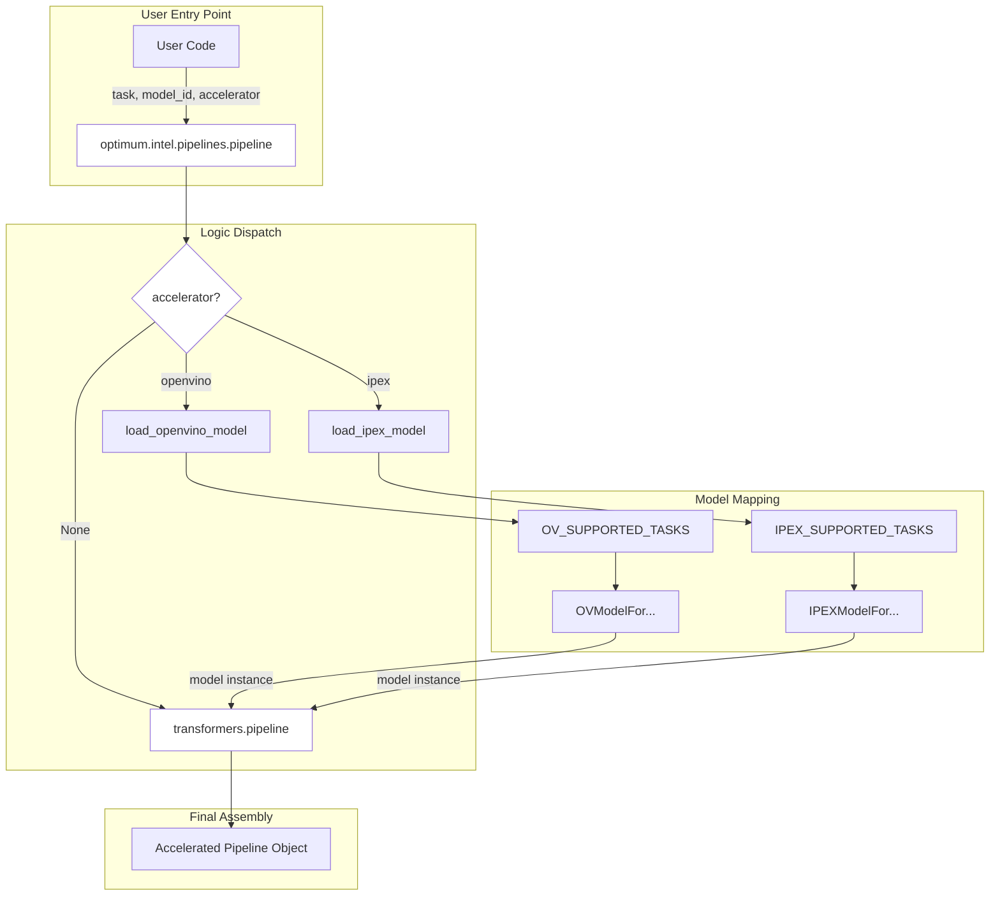
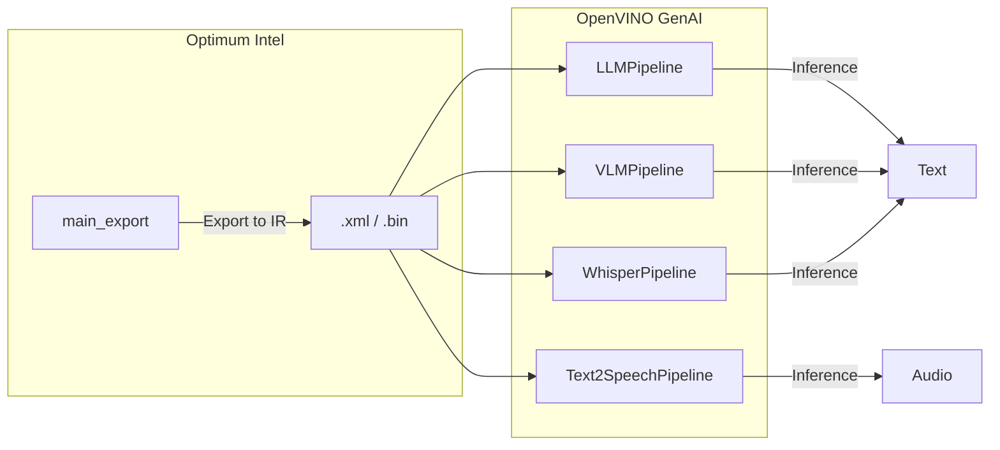

<!-- source: DeepWiki mcp.deepwiki.com · repo huggingface/optimum-intel · page 5.3 Pipeline Framework and Accelerators · fetched 2026-10-26 -->

# Pipeline Framework and Accelerators

Relevant source files

The following files were used as context for generating this wiki page:

- [optimum/intel/__init__.py](optimum/intel/__init__.py)
- [optimum/intel/openvino/__init__.py](optimum/intel/openvino/__init__.py)
- [optimum/intel/openvino/utils.py](optimum/intel/openvino/utils.py)
- [optimum/intel/pipelines/pipeline_base.py](optimum/intel/pipelines/pipeline_base.py)
- [tests/openvino/test_genai.py](tests/openvino/test_genai.py)

This page documents the pipeline integration framework in `optimum-intel`, which provides a unified entry point for Intel-accelerated inference using the familiar Hugging Face `transformers.pipeline` API. The framework abstracts the complexity of loading accelerator-specific model classes (OpenVINO and IPEX) and mapping tasks to optimized implementations. It also details the support for high-performance OpenVINO GenAI pipelines.

## Pipeline Framework Architecture

The framework serves as a bridge between the high-level task API and the underlying Intel backends. It primarily consists of a factory function `pipeline()` that mirrors the Transformers API while adding logic to handle Intel-specific model instantiation and hardware acceleration.

### Unified Pipeline Interface

The following diagram illustrates the data flow from a user's task request to the instantiation of an accelerated model.

**Pipeline Dispatch Flow**

**Sources**: [optimum/intel/pipelines/pipeline_base.py:45-65](), [optimum/intel/pipelines/pipeline_base.py:404-450]()

The `pipeline()` function in `optimum.intel` validates the requested task against supported configurations for the chosen accelerator. If `accelerator` is provided, it bypasses standard Transformers loading to use `OVBaseModel.from_pretrained` or `IPEXModel.from_pretrained` [optimum/intel/pipelines/pipeline_base.py:404-450]().

### Task-to-Model Mapping

The framework maintains internal mappings to ensure the correct model class is used for a specific task. These mappings are defined in `_HEAD_TO_AUTOMODELS` and are used during model export and loading [optimum/intel/openvino/utils.py:122-151]().

| Task | OpenVINO Mapping Class |
| :--- | :--- |
| `feature-extraction` | `OVModelForFeatureExtraction` |
| `text-generation` | `OVModelForCausalLM` |
| `text2text-generation` | `OVModelForSeq2SeqLM` |
| `text-classification` | `OVModelForSequenceClassification` |
| `token-classification` | `OVModelForTokenClassification` |
| `question-answering` | `OVModelForQuestionAnswering` |
| `fill-mask` | `OVModelForMaskedLM` |
| `image-classification` | `OVModelForImageClassification` |
| `image-text-to-text` | `OVModelForVisualCausalLM` |
| `audio-classification` | `OVModelForAudioClassification` |
| `automatic-speech-recognition` | `OVModelForSpeechSeq2Seq` |
| `stable-diffusion` | `OVStableDiffusionPipeline` |
| `text-to-audio` | `OVModelForTextToSpeechSeq2Seq` |

**Sources**: [optimum/intel/openvino/utils.py:122-151](), [optimum/intel/pipelines/pipeline_base.py:65-117]()

## Accelerator Integration and Patching

The framework includes a patching system, `patch_pipelines_to_load_accelerator_model`, which allows the standard `transformers.pipeline` to recognize and load IPEX/OpenVINO models automatically when the `accelerator` flag is set [optimum/intel/pipelines/pipeline_base.py:24]().

### OpenVINO Pipeline Support

When `accelerator="openvino"` is passed to the `pipeline()` factory, the system utilizes the task mapping to determine the appropriate `OVModelFor...` class. This integration supports a wide array of tasks including:
- **Multimodal**: `image-text-to-text` [optimum/intel/openvino/utils.py:132](), `visual-question-answering` [optimum/intel/pipelines/pipeline_base.py:112]().
- **Audio**: `automatic-speech-recognition` [optimum/intel/openvino/utils.py:147](), `text-to-audio` [optimum/intel/openvino/utils.py:150]().
- **Generative AI**: `stable-diffusion`, `flux`, `sana`, and `ltx-video` [optimum/intel/openvino/utils.py:135-149]().

## OpenVINO GenAI Pipeline Support

Beyond the standard `transformers.pipeline` integration, `optimum-intel` supports the high-performance `openvino-genai` pipelines. These are C++ based implementations optimized for minimal overhead and low latency.

### GenAI Pipeline Classes

The `openvino_genai` library provides specialized pipeline classes that interact with models exported via `optimum-intel`:
- `LLMPipeline`: For causal language models (e.g., Llama, Qwen) [tests/openvino/test_genai.py:25]().
- `VLMPipeline`: For vision-language models (e.g., LLaVA, Phi3-Vision) [tests/openvino/test_genai.py:27]().
- `WhisperPipeline`: For speech-to-text tasks [tests/openvino/test_genai.py:28]().
- `Text2SpeechPipeline`: For speech synthesis tasks [tests/openvino/test_genai.py:26]().

**GenAI Pipeline Interaction**

**Sources**: [tests/openvino/test_genai.py:24-30](), [tests/openvino/test_genai.py:52-58]()

### Supported Architectures
The GenAI pipelines support a vast range of architectures, including `gpt2`, `llama`, `mistral`, `qwen2`, `phi3`, and `gemma2` [tests/openvino/test_genai.py:127-182](). For VLMs, it supports mappings such as `llava`, `paligemma`, and `phi3_v` [tests/openvino/test_genai.py:59]().

## Transformers Integration Logic

The core logic for merging Intel accelerators with the `transformers` library resides in the `pipeline` function. It handles:
1. **Device Mapping**: While `device_map` is not supported for OpenVINO models, the `device` argument is used to specify the Intel hardware (e.g., "CPU", "GPU", "NPU") [optimum/intel/pipelines/pipeline_base.py:57-58]().
2. **Model Loading**: It uses `ov_infer_framework_load_model` internally by leaving the `framework` argument as `None` to trigger the OpenVINO-specific loading path [optimum/intel/pipelines/pipeline_base.py:53]().
3. **Auto-Configuration**: If `tokenizer`, `feature_extractor`, or `processor` are not provided, the pipeline attempts to load the required components automatically based on the model configuration [optimum/intel/pipelines/pipeline_base.py:77-80]().

**Sources**: [optimum/intel/pipelines/pipeline_base.py:15-65](), [optimum/intel/pipelines/pipeline_base.py:404-450](), [optimum/intel/openvino/utils.py:122-151]()

---

