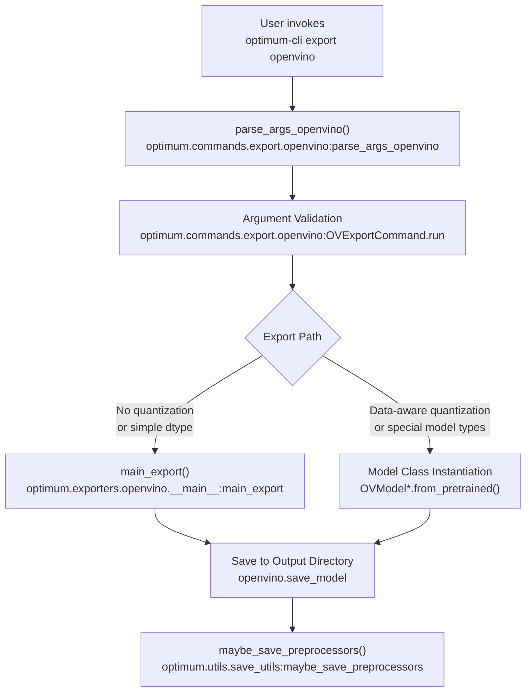
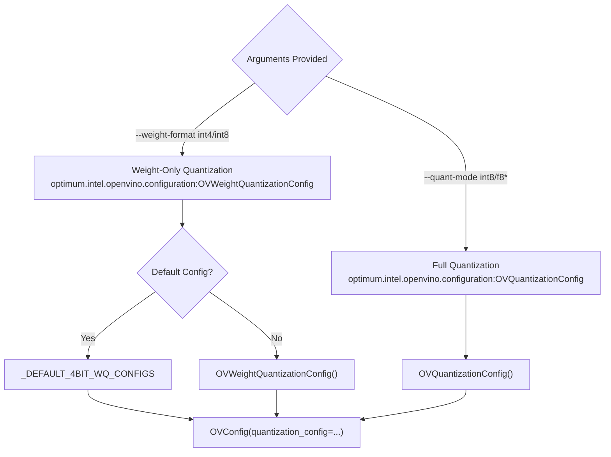
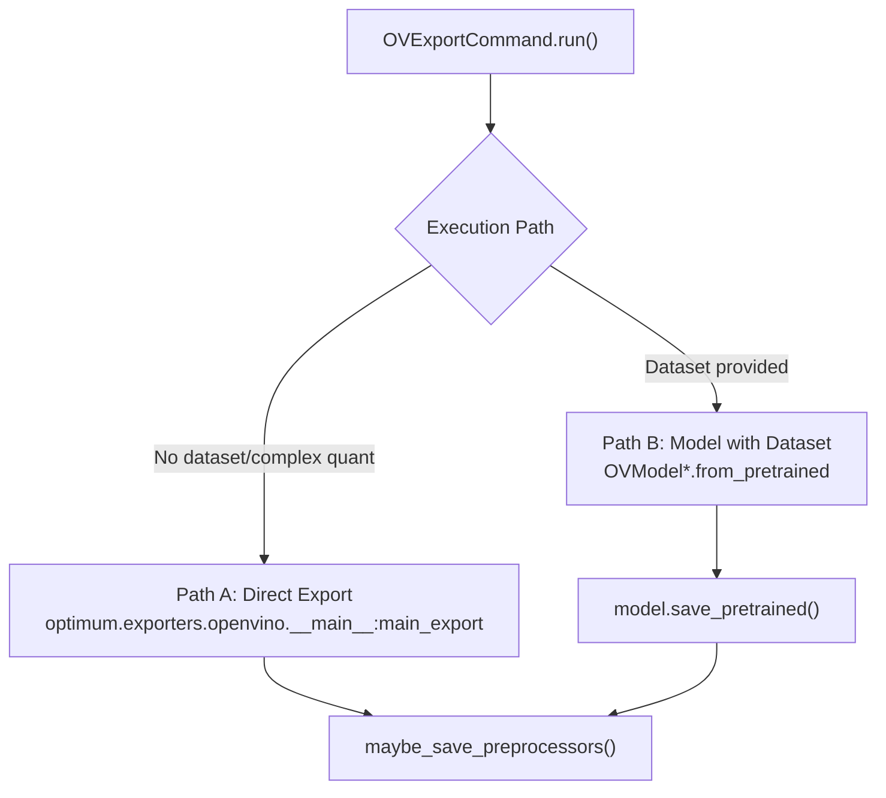

<!-- source: DeepWiki mcp.deepwiki.com · repo huggingface/optimum-intel · page 6 Command Line Interface · fetched 2026-10-26 -->

# Command Line Interface

<details>
<summary>Relevant source files</summary>

The following files were used as context for generating this wiki page:

- [docs/source/openvino/export.mdx](docs/source/openvino/export.mdx)
- [docs/source/openvino/inference.mdx](docs/source/openvino/inference.mdx)
- [docs/source/openvino/optimization.mdx](docs/source/openvino/optimization.mdx)
- [optimum/commands/export/openvino.py](optimum/commands/export/openvino.py)
- [optimum/commands/register/register_openvino.py](optimum/commands/register/register_openvino.py)
- [tests/openvino/test_exporters_cli.py](tests/openvino/test_exporters_cli.py)

</details>


The Command Line Interface (CLI) provides a streamlined way to export and optimize models for Intel hardware without writing Python code. The primary command `optimum-cli export openvino` converts HuggingFace models to OpenVINO Intermediate Representation (IR) format with optional quantization and compression.

For programmatic model loading and inference, see **2.1. Model Classes and Task Coverage**. For detailed quantization configuration options, see **2.3. Quantization System**.

## Command Structure

The CLI is implemented through the `OVExportCommand` class which provides the `optimum-cli export openvino` subcommand. This command orchestrates model export, optional quantization, and tokenizer conversion in a single operation.

Title: CLI Export Logic Flow


Sources: [optimum/commands/export/openvino.py:34-160](), [optimum/exporters/openvino/__main__.py:178-360](), [optimum/commands/register/register_openvino.py:15-22]()

## Required Arguments

| Argument | Type | Description |
|----------|------|-------------|
| `--model` / `-m` | `str` | Model ID on HuggingFace Hub or path on disk to load model from. |
| `output` | `Path` | Path indicating the directory where to store the generated OV model. |

The model argument accepts either a HuggingFace model ID (e.g., `meta-llama/Meta-Llama-3-8B`) or a path to a local model directory. The output directory will be created if it doesn't exist and will contain the exported `.xml` and `.bin` files.

Sources: [optimum/commands/export/openvino.py:36-41](), [docs/source/openvino/export.mdx:19-28]()

## Optional Arguments

### Model Configuration

| Argument | Default | Description |
|----------|---------|-------------|
| `--task` | `"auto"` | The task to export the model for. If not specified, the task will be auto-inferred. |
| `--framework` | `"pt"` | The framework to use for the export. Only PyTorch (`pt`) is currently supported. |
| `--library` | `None` | The library used to load the model: `transformers`, `diffusers`, `timm`, `sentence_transformers`, `open_clip`, `kokoro`. |
| `--trust-remote-code` | `False` | Allows to use custom code for the modeling hosted in the model repository. |
| `--variant` | `None` | If specified load weights from variant filename. |
| `--pad-token-id` | `None` | Override pad token ID for models requiring it. |
| `--cache_dir` | `HUGGINGFACE_HUB_CACHE` | Directory for caching downloaded models. |

The `--task` argument supports adding `-with-past` suffix for text generation models to enable KV-cache optimization. Supported tasks include `text-generation`, `image-classification`, `text-to-image`, `text-to-audio`, and more.

Sources: [optimum/commands/export/openvino.py:42-112](), [optimum/commands/export/openvino.py:86-91](), [docs/source/openvino/export.mdx:54-64]()

### Weight Quantization (Weight-Only Compression)

| Argument | Default | Choices | Description |
|----------|---------|---------|-------------|
| `--weight-format` | `None` | `fp32`, `fp16`, `int8`, `int4`, `mxfp4`, `nf4`, `cb4` | Data type for weight compression. `cb4` is codebook FP8 E4M3. |
| `--group-size` | `None` | `int` | Group size for quantization. `128` recommended, `-1` for per-column. |
| `--ratio` | `None` | `float` | Percentage of layers to quantize (0.0-1.0). Enables mixed precision if < 1.0. |
| `--sym` | `None` | flag | Whether to apply symmetric quantization. |
| `--all-layers` | `None` | flag | Include embeddings and last MatMul in INT4 quantization. |
| `--backup-precision` | `None` | `none`, `int8_sym`, `int8_asym` | Backup precision for mixed-precision compression. |

Weight-only quantization is applied when `--weight-format` is specified. For models with defined defaults in `_DEFAULT_4BIT_WQ_CONFIGS` or `_DEFAULT_8BIT_WQ_CONFIGS`, those settings are applied unless overridden.

Sources: [optimum/commands/export/openvino.py:68-156](), [optimum/intel/openvino/configuration.py:70-74]()

### Full Quantization (Activations + Weights)

| Argument | Default | Choices | Description |
|----------|---------|---------|-------------|
| `--quant-mode` | `None` | `int8`, `f8e4m3`, `f8e5m2`, `cb4_f8e4m3`, `int4_f8e4m3`, `int4_f8e5m2` | Precision mode for full model quantization. |
| `--smooth-quant-alpha` | `None` | `float` | SmoothQuant alpha parameter for activation distribution improvement. |

Full quantization modes starting with `int4_` or `cb4_` represent mixed precision schemes where weights and activations use different data types (e.g., `int4_f8e4m3` uses INT4 for weights and FP8 E4M3 for activations).

Sources: [optimum/commands/export/openvino.py:77-84](), [optimum/commands/export/openvino.py:269-276]()

### Data-Aware Quantization Options

| Argument | Default | Description |
|----------|---------|-------------|
| `--dataset` | `None` | Dataset for calibration. Supports `auto`, `wikitext2`, `c4`, `conceptual_captions`, `contextual`. |
| `--num-samples` | `None` | Maximum number of calibration samples. |
| `--sensitivity-metric` | `None` | Metric for layer sensitivity (e.g., `weight_quantization_error`). |
| `--awq` | `None` | Apply Activation-Aware Weight Quantization. |
| `--scale-estimation` | `None` | Apply scale estimation to minimize L2 error. |
| `--gptq` | `None` | Apply GPTQ algorithm for layer-wise weight optimization. |
| `--lora-correction` | `None` | Apply LoRA Correction algorithm using low-rank adaptation. |

Data-aware algorithms require a dataset to be specified. If `--dataset` is provided with a ratio less than 1.0, data-aware mixed precision assignment is applied.

Sources: [optimum/commands/export/openvino.py:113-121](), [optimum/commands/export/openvino.py:158-245]()

## Quantization Modes

The CLI supports three primary quantization workflows determined by the `--weight-format` and `--quant-mode` arguments. These map internally to NNCF-based configuration classes.

Title: Quantization Configuration Mapping


Sources: [optimum/intel/openvino/configuration.py:70-74](), [docs/source/openvino/optimization.mdx:79-157]()

## Export Execution Paths

The CLI follows different execution paths depending on model type and quantization requirements.

Title: Export Implementation Paths


### Path A: Direct Export (main_export)

This path is used when no data-aware quantization is required. The `main_export()` function handles the export directly without instantiating full model classes in the CLI process.

Sources: [optimum/exporters/openvino/__main__.py:178-360](), [optimum/commands/export/openvino.py:562-578]()

### Path B: Model Classes with Dataset

This path is used for models when data-aware quantization is needed (e.g., AWQ, GPTQ, or calibration). The CLI identifies the correct task-specific class (e.g., `OVModelForCausalLM`, `OVModelForVisualCausalLM`, or `OVStableDiffusionPipeline`) and uses the `quantization_config` parameter in `from_pretrained`.

Sources: [optimum/commands/export/openvino.py:451-560](), [docs/source/openvino/optimization.mdx:101-119]()

## Usage Examples

### Basic Model Export
Export a model to OpenVINO IR format without quantization:
```bash
optimum-cli export openvino --model meta-llama/Meta-Llama-3-8B ov_model/
```

### Weight-Only INT8 Quantization
Compress model weights to 8-bit integers:
```bash
optimum-cli export openvino -m TinyLlama/TinyLlama-1.1B-Chat-v1.0 --weight-format int8 ./save_dir
```

### Data-Aware INT4 Quantization
Apply 4-bit quantization with a calibration dataset:
```bash
optimum-cli export openvino -m TinyLlama/TinyLlama-1.1B-Chat-v1.0 --weight-format int4 --dataset wikitext2 ./save_dir
```

### Full INT8 Quantization
Quantize both weights and activations to INT8 using calibration data:
```bash
optimum-cli export openvino -m TinyLlama/TinyLlama-1.1B-Chat-v1.0 --quant-mode int8 --dataset wikitext2 ./save_dir
```

Sources: [docs/source/openvino/export.mdx:19-28](), [docs/source/openvino/optimization.mdx:79-157]()

## Output Files

After successful export, the output directory contains the model definition and weights, along with required metadata.

| File Pattern | Description |
|--------------|-------------|
| `openvino_model.xml` | OpenVINO IR XML (model graph). |
| `openvino_model.bin` | OpenVINO IR binary (weights). |
| `tokenizer.json` | Original tokenizer configuration. |
| `config.json` | Model configuration. |
| `preprocessor_config.json` | Preprocessor configuration (for vision/audio). |

Sources: [optimum/exporters/openvino/utils.py:41-41](), [docs/source/openvino/inference.mdx:19-33]()

---

