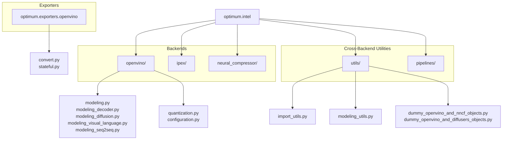
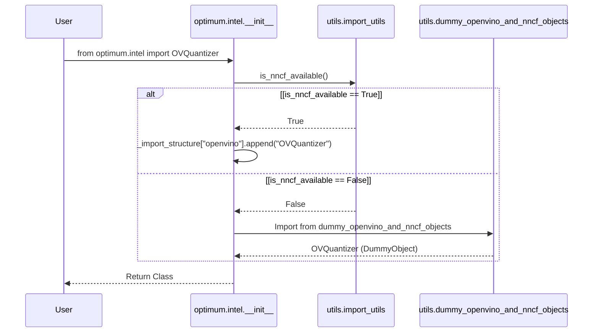

<!-- source: DeepWiki mcp.deepwiki.com · repo huggingface/optimum-intel · page 7.1 Package Structure · fetched 2026-10-26 -->

# Package Structure

Relevant source files

The following files were used as context for generating this wiki page:

- [optimum/exporters/openvino/__init__.py](optimum/exporters/openvino/__init__.py)
- [optimum/intel/__init__.py](optimum/intel/__init__.py)
- [optimum/intel/openvino/__init__.py](optimum/intel/openvino/__init__.py)
- [optimum/intel/openvino/utils.py](optimum/intel/openvino/utils.py)
- [pyproject.toml](pyproject.toml)
- [setup.py](setup.py)

This page documents the codebase organization of `optimum-intel`, explaining the module hierarchy, the conditional import system, and how different Intel hardware backends are integrated into a unified Hugging Face-compatible interface.

## Module Hierarchy

The `optimum-intel` package is organized by hardware backend. Each major Intel optimization technology (OpenVINO, IPEX, Neural Compressor) resides in its own sub-package under `optimum.intel`.

### Codebase Organization

The following diagram illustrates the relationship between the high-level package structure and the underlying implementation files.

**Code Entity Map: Package Hierarchy**

**Sources:** [optimum/intel/__init__.py:27-59](), [optimum/intel/openvino/__init__.py:49-125](), [optimum/exporters/openvino/__init__.py:15-20]()

### Backend Responsibilities

| Sub-package | Purpose | Key Components |
|:---|:---|:---|
| `openvino` | Integration with OpenVINO™ toolkit for CPU/GPU/NPU inference. | `OVModelForCausalLM`, `OVQuantizer`, `OVDiffusionPipeline`, `OVConfig` |
| `ipex` | Integration with Intel® Extension for PyTorch for CPU/GPU acceleration. | `IPEXModel`, `IPEXModelForCausalLM` |
| `neural_compressor` | (Deprecated) Integration with Intel® Neural Compressor for quantization. | `INCQuantizer`, `INCTrainer` |
| `utils` | Shared logic for dependency checking, device management, and dummy objects. | `is_openvino_available`, `DummyObject`, `bind_cores_for_best_perf` |
| `pipelines` | Overrides for `transformers.pipeline` to load optimized models. | `pipeline`, `_HEAD_TO_AUTOMODELS` |

**Sources:** [optimum/intel/__init__.py:62-154](), [optimum/intel/openvino/utils.py:122-151](), [optimum/intel/openvino/__init__.py:49-55]()

---

## Conditional Import System

`optimum-intel` uses a lazy-loading and conditional import system to ensure the package remains usable even if specific backend dependencies (like `openvino` or `nncf`) are not installed.

### Import Flow and Backend Checking

When a user imports from `optimum.intel`, the package checks for the availability of various libraries using `import_utils.py`. The `_import_structure` dictionary is dynamically updated based on available backends.

**Code Entity Map: Import Logic**

**Sources:** [optimum/intel/__init__.py:62-87](), [optimum/intel/openvino/__init__.py:58-67]()

### Dependency Verification Functions

The `import_utils.py` module defines flags and helper functions to check environment state:
- `is_openvino_available()`: Verified via `importlib.util.find_spec("openvino")`.
- `is_nncf_available()`: Verified via `importlib.util.find_spec("nncf")`.
- `is_diffusers_available()`: Verified via `importlib.util.find_spec("diffusers")`.
- `is_openvino_version(operation, version)`: Compares the installed OpenVINO version against a requirement string [optimum/intel/openvino/__init__.py:42-47]().

### Dummy Object Pattern

If a backend is missing, the package imports a `DummyObject`. These objects serve as placeholders that raise a descriptive `ImportError` only when the class is accessed, ensuring the rest of the library remains functional.

**Sources:** [optimum/intel/__init__.py:65-75](), [optimum/intel/openvino/__init__.py:58-66]()

---

## The OpenVINO Backend (`optimum.intel.openvino`)

The OpenVINO sub-package maps Hugging Face tasks to specific OpenVINO model classes and manages the lifecycle of OpenVINO Intermediate Representation (IR) files.

### Task to Model Mapping

The package maintains internal mappings between Hugging Face task strings and the corresponding `OVModel` implementation via `_HEAD_TO_AUTOMODELS`.

| Task | OV Class | File |
|:---|:---|:---|
| `text-generation` | `OVModelForCausalLM` | `modeling_decoder.py` |
| `text2text-generation` | `OVModelForSeq2SeqLM` | `modeling_seq2seq.py` |
| `image-text-to-text` | `OVModelForVisualCausalLM` | `modeling_visual_language.py` |
| `automatic-speech-recognition` | `OVModelForSpeechSeq2Seq` | `modeling_seq2seq.py` |
| `stable-diffusion` | `OVStableDiffusionPipeline` | `modeling_diffusion.py` |

**Sources:** [optimum/intel/openvino/utils.py:122-151](), [optimum/intel/openvino/__init__.py:69-92]()

### Internal File Naming Conventions

The OpenVINO backend uses standardized constants for exported IR files to ensure consistency across the loading and saving logic:
- `OV_XML_FILE_NAME`: "openvino_model.xml" [optimum/intel/openvino/utils.py:41]().
- `OV_ENCODER_NAME`: "openvino_encoder_model.xml" [optimum/intel/openvino/utils.py:42]().
- `OV_DECODER_NAME`: "openvino_decoder_model.xml" [optimum/intel/openvino/utils.py:43]().
- `OV_TOKENIZER_NAME`: "openvino_tokenizer{}.xml" [optimum/intel/openvino/utils.py:53]().
- `OV_LANGUAGE_MODEL_NAME`: "openvino_language_model.xml" [optimum/intel/openvino/utils.py:46]().

---

## Shared Utilities (`optimum.intel.utils`)

The `utils` directory contains logic used across all backends to maintain consistency with the Hugging Face ecosystem and Intel hardware optimizations.

### Key Utility Modules

1.  **`import_utils.py`**: The central authority for library availability, version comparisons, and backend-specific requirements [optimum/intel/openvino/__init__.py:18-25]().
2.  **`modeling_utils.py`**: Contains shared logic for device management, file discovery, and library inference (e.g., determining if a model is `diffusers` or `transformers` based).
3.  **`pipelines`**: Provides a unified `pipeline` entry point that integrates with the OpenVINO-optimized model classes [optimum/intel/__init__.py:28]().

**Sources:** [optimum/intel/__init__.py:19-24](), [optimum/intel/openvino/utils.py:36](), [optimum/intel/openvino/__init__.py:18-33]()

---

