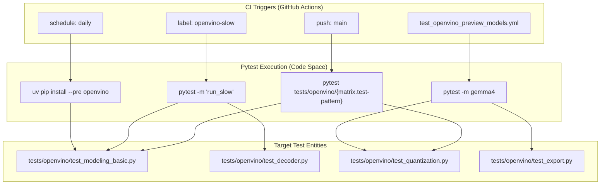
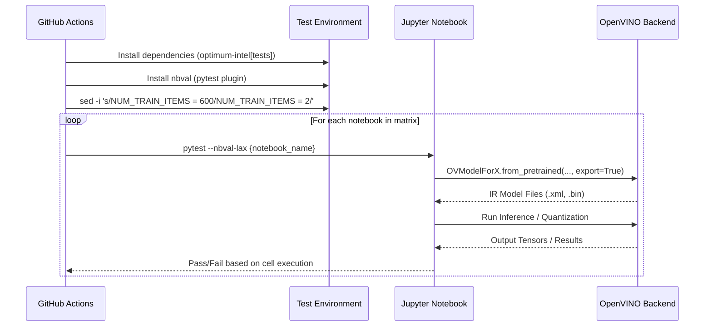

<!-- source: DeepWiki mcp.deepwiki.com · repo huggingface/optimum-intel · page 7.2 Testing Infrastructure · fetched 2026-10-26 -->

# Testing Infrastructure

Relevant source files

The following files were used as context for generating this wiki page:

- [.github/workflows/test_offline.yaml](.github/workflows/test_offline.yaml)
- [.github/workflows/test_openvino.yml](.github/workflows/test_openvino.yml)
- [.github/workflows/test_openvino_nightly.yml](.github/workflows/test_openvino_nightly.yml)
- [.github/workflows/test_openvino_notebooks.yml](.github/workflows/test_openvino_notebooks.yml)
- [.github/workflows/test_openvino_preview_models.yml](.github/workflows/test_openvino_preview_models.yml)
- [.github/workflows/test_openvino_slow.yml](.github/workflows/test_openvino_slow.yml)
- [.github/workflows/test_user_installation.yml](.github/workflows/test_user_installation.yml)
- [tests/openvino/test_decoder.py](tests/openvino/test_decoder.py)
- [tests/openvino/test_export.py](tests/openvino/test_export.py)
- [tests/openvino/test_modeling_basic.py](tests/openvino/test_modeling_basic.py)
- [tests/openvino/utils_tests.py](tests/openvino/utils_tests.py)

This document describes the continuous integration and testing infrastructure for `optimum-intel`, focusing on the GitHub Actions workflows that validate the OpenVINO, IPEX, and Neural Compressor backends across different configurations, dependency versions, and test suites.

## Overview

The testing infrastructure uses GitHub Actions to run comprehensive test suites across multiple dimensions:

- **Backends**: OpenVINO (primary), IPEX (Intel Extension for PyTorch), and INC (Intel Neural Compressor).
- **Test Categories**: Standard unit tests, slow tests (comprehensive), nightly tests (bleeding-edge), preview model validation, and notebook validation.
- **Dependency Matrices**: Multiple `transformers` versions (e.g., `4.45.0`, `4.57.6`, `latest`, `main`), `torch` versions, and `openvino` versions.
- **Operating Systems**: Ubuntu 22.04 (primary) and Windows 2022.
- **Test Patterns**: Organized by functionality (e.g., `*export*`, `*decoder*`, `*modeling*`, `*quantization*`).

## Workflow Architecture

The testing system consists of specialized workflows triggered by code changes, labels, or schedules.

### Workflow Hierarchy and Triggers

| Workflow File | Backend | Primary Triggers | Purpose |
|:---|:---|:---|:---|
| `test_openvino.yml` | OpenVINO | `push`, `pull_request` | Core validation across test patterns and stable/latest dependencies. |
| `test_openvino_slow.yml` | OpenVINO | `v*-release`, `openvino-slow` label | Comprehensive tests on Ubuntu/Windows including `@slow` markers. |
| `test_openvino_nightly.yml`| OpenVINO | Daily Cron, `openvino-nightly` label | Compatibility with OpenVINO Nightly and NNCF Develop branches. |
| `test_openvino_notebooks.yml`| OpenVINO | Weekly Cron, notebook changes | Validation of Jupyter notebook examples using `nbval`. |
| `test_openvino_preview_models.yml`| OpenVINO | `push`, `pull_request` | Validation of experimental models (e.g., Gemma 4, Qwen 3.5) with specific `transformers` versions. |
| `test_offline.yaml` | OpenVINO | `push`, `pull_request` | Ensures `optimum-cli export` and loading work without internet access. |
| `test_user_installation.yml`| OpenVINO | `push`, `pull_request` | Verifies the library can be installed and a basic export run in a clean environment. |

Sources: [.github/workflows/test_openvino.yml:1-12](), [.github/workflows/test_openvino_slow.yml:1-17](), [.github/workflows/test_openvino_nightly.yml:1-20](), [.github/workflows/test_openvino_notebooks.yml:1-14](), [.github/workflows/test_openvino_preview_models.yml:1-11](), [.github/workflows/test_offline.yaml:1-11](), [.github/workflows/test_user_installation.yml:1-12]()

### CI Trigger to Code Entity Mapping

The following diagram bridges the GitHub Actions trigger space to the specific test files and pytest markers executed in the codebase.

Sources: [.github/workflows/test_openvino.yml:31-40](), [.github/workflows/test_openvino_slow.yml:92-94](), [.github/workflows/test_openvino_nightly.yml:102-105](), [.github/workflows/test_openvino_preview_models.yml:63-72]()

## OpenVINO Test Infrastructure

OpenVINO testing covers model export, quantization, and inference across a vast array of architectures defined in the `MODEL_NAMES` registry [tests/openvino/utils_tests.py:153-282]().

### Matrix Testing Strategy

The OpenVINO workflows use a matrix strategy to ensure compatibility across `transformers` versions and functional areas.

**Test Patterns:**
- `*genai*`: Generative AI specific tests (OpenVINO GenAI integration).
- `*export*`: `OVModel` export and IR conversion. Validates `SUPPORTED_ARCHITECTURES` mapping [tests/openvino/test_export.py:70-136]().
- `*decoder*`: Causal language models (LLMs). Covers standard and SSM architectures like `mamba` or `falcon_mamba` [tests/openvino/test_decoder.py:49-109]().
- `*seq2seq*`: Encoder-decoder models (T5, Whisper).
- `*modeling*`: Core architecture and task-specific model classes.
- `*diffusion*`: Stable Diffusion, SDXL, Flux, and LTX-Video pipelines.
- `*quantization*`: NNCF-based weight and activation quantization.

**Dependency Matrix:**
- **Transformers**: `4.45.0`, `4.57.6`, and `latest` [.github/workflows/test_openvino.yml:41]().
- **OpenVINO**: `openvino-stable` and `openvino-nightly` (pre-releases) [.github/workflows/test_openvino_nightly.yml:42]().
- **NNCF**: `nncf-stable` and `nncf-develop` (main branch) [.github/workflows/test_openvino_nightly.yml:43-64]().

Sources: [.github/workflows/test_openvino.yml:30-41](), [.github/workflows/test_openvino_nightly.yml:40-54](), [tests/openvino/test_export.py:70-97](), [tests/openvino/test_decoder.py:49-109]()

### Preview Models Support Validation

The `test_openvino_preview_models.yml` workflow targets bleeding-edge models that often require specific (future) versions of `transformers`.

- **Gemma 4**: Validated with `transformers==5.5.0` [.github/workflows/test_openvino_preview_models.yml:65-66]().
- **Qwen 3.5**: Validated with `transformers>=5.2,<5.3` [.github/workflows/test_openvino_preview_models.yml:70-71]().

Sources: [.github/workflows/test_openvino_preview_models.yml:63-72]()

## Test Utilities and Registries

The testing infrastructure relies on a centralized utility module `tests/openvino/utils_tests.py` to manage model IDs and synthetic model generation.

### MODEL_NAMES Registry
A comprehensive dictionary mapping short architecture names to Hugging Face Hub IDs used for testing. This includes internal testing models to keep CI runs fast [tests/openvino/utils_tests.py:153-282]().

### Synthetic Model Generation
Functions like `_create_tiny_kokoro_model()` generate tiny, random-weighted models on the fly to test new or complex architectures (like Kokoro TTS) without requiring large Hub downloads [tests/openvino/utils_tests.py:31-142]().

### Verification Utilities
- `OPENVINO_DEVICE`: Defaults to "CPU" but can be overridden via environment variable [tests/openvino/utils_tests.py:151]().
- `F32_CONFIG`: Standard configuration for testing FP32 inference precision [tests/openvino/utils_tests.py:147]().

Sources: [tests/openvino/utils_tests.py:31-153]()

## Notebook Testing

Notebooks are tested as live documentation using `nbval` to ensure that user-facing examples remain functional.

**Tested Notebooks:**
- `optimum_openvino_inference.ipynb`: Basic loading and task usage.
- `question_answering_quantization.ipynb`: NNCF PTQ for BERT-like models.
- `sentence_transformer_quantization.ipynb`: Quantization for embedding models.
- `vision_language_quantization.ipynb`: Quantization for VLM (e.g., LLaVA).

Sources: [.github/workflows/test_openvino_notebooks.yml:28-34](), [.github/workflows/test_openvino_notebooks.yml:52-57](), [.github/workflows/test_openvino_notebooks.yml:60-64]()

## Offline Testing Strategy

The offline workflow (`test_offline.yaml`) ensures that the library can operate in air-gapped environments by pre-downloading models and then disabling network access.

**Workflow Logic:**
1. Download a tiny model using `hf download` [.github/workflows/test_offline.yaml:41]().
2. Set `HF_HUB_OFFLINE=1` [.github/workflows/test_offline.yaml:42]().
3. Execute `optimum-cli export openvino` [.github/workflows/test_offline.yaml:42]().
4. Run `pytest tests/openvino/test_modeling.py` to verify loading from local cache [.github/workflows/test_offline.yaml:47-48]().

Sources: [.github/workflows/test_offline.yaml:39-49]()

## Environment and Security

### Dependency Management
The infrastructure heavily utilizes `uv` for fast, reproducible dependency installation across all workflows [.github/workflows/test_openvino.yml:56-57]().

### Authentication
For tests requiring access to the Hugging Face Hub (e.g., gated models), the CI uses `HF_TOKEN` [.github/workflows/test_openvino.yml:24](). For pull requests from forks where secrets are unavailable, `tests/scripts/login_with_ci_token.py` provides a restricted token [.github/workflows/test_openvino.yml:86-87]().

Sources: [.github/workflows/test_openvino.yml:24-87](), [.github/workflows/test_openvino_nightly.yml:117-120]()

---

