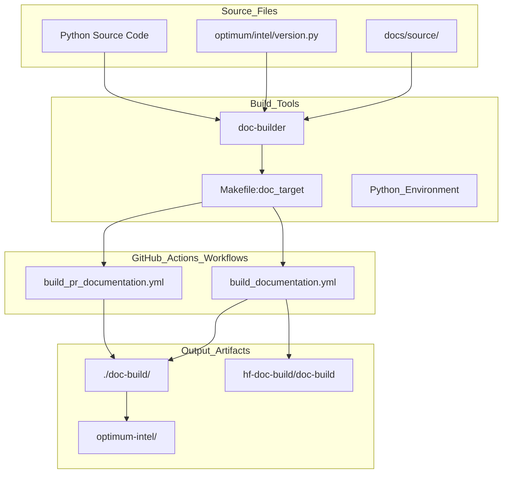
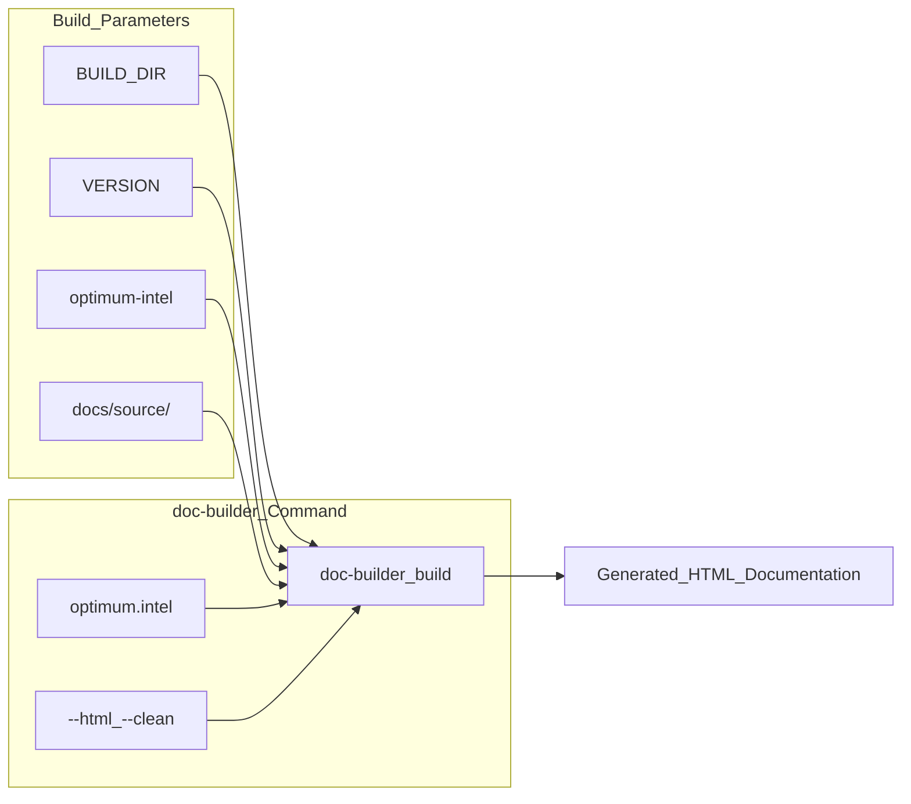
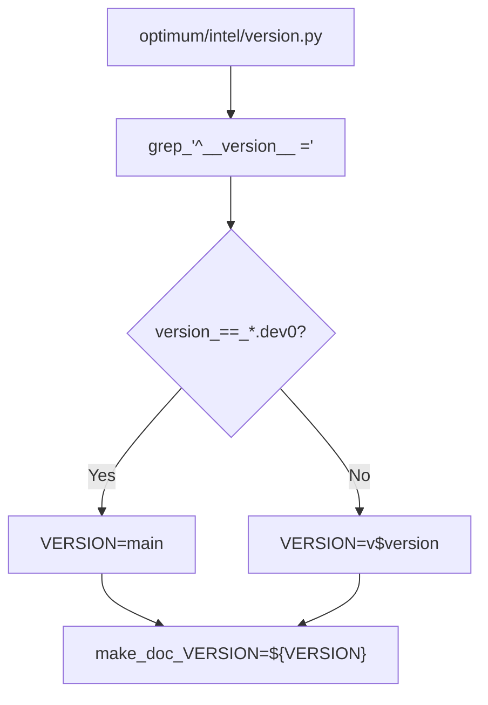
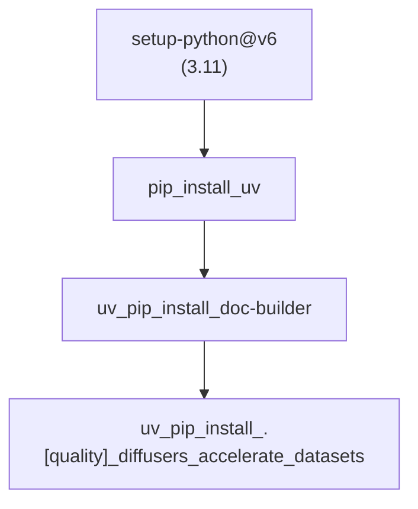

<!-- source: DeepWiki mcp.deepwiki.com · repo huggingface/optimum-intel · page 7.3 Documentation and Release Management · fetched 2026-10-26 -->

# Documentation and Release Management

<details>
<summary>Relevant source files</summary>

The following files were used as context for generating this wiki page:

- [.github/workflows/build_documentation.yml](.github/workflows/build_documentation.yml)
- [.github/workflows/build_pr_documentation.yml](.github/workflows/build_pr_documentation.yml)
- [docs/README.md](docs/README.md)
- [docs/source/openvino/reference.mdx](docs/source/openvino/reference.mdx)
- [docs/source/openvino/tutorials/diffusers.mdx](docs/source/openvino/tutorials/diffusers.mdx)
- [optimum/intel/version.py](optimum/intel/version.py)

</details>


This document covers the version management system, documentation building workflows, and release process for `optimum-intel`. The system uses Hugging Face's `doc-builder` tool for documentation generation and includes automated CI/CD workflows for both documentation publishing and package releases.

For information about testing infrastructure and CI/CD workflows, see page 7.2.

## Documentation Build Architecture

The documentation system consists of GitHub Actions workflows that orchestrate the build process using the `doc-builder` tool. The system handles both main branch documentation updates and pull request preview documentation.

Title: Documentation Infrastructure Data Flow


Sources: [.github/workflows/build_documentation.yml:1-67](), [.github/workflows/build_pr_documentation.yml:1-56](), [docs/README.md:21-35]()

## Documentation Build Process

The core documentation build process is defined in the `Makefile` and executed by GitHub Actions workflows. The build system requires specific environment variables and dependencies to generate the final documentation.

### Build Command Structure

The documentation build process uses the `doc-builder` command with specific parameters. Developers can also run this locally to inspect changes before committing [docs/README.md:38-44]().

Title: doc-builder Execution Parameters


The exact command executed via `make doc` is:
- `make doc BUILD_DIR=./doc-build VERSION=...` which triggers `doc-builder` for the `optimum.intel` package using files in `docs/source/` [docs/README.md:21-26]().

Sources: [docs/README.md:17-35](), [.github/workflows/build_documentation.yml:62]()

## Version Management System

The `optimum-intel` version is centrally managed in `optimum/intel/version.py`, which defines the `__version__` variable used throughout the codebase and for release management.

### Version String Format

The version follows semantic versioning with a development suffix pattern:

| Version Pattern | Example | Meaning |
|-----------------|---------|---------|
| `X.Y.Z.dev0` | `1.27.0.dev0` | Development version from main branch |
| `X.Y.Z` | `1.26.0` | Stable release version |

Sources: [optimum/intel/version.py:15]()

### Version-Based Documentation Routing

The build workflow determines where to publish documentation based on the version string found in the source code.

Title: Version Parsing Logic in build_documentation.yml


The version extraction logic:
1. Extracts `__version__` value from [optimum/intel/version.py:15]() using `grep` and `cut` [.github/workflows/build_documentation.yml:39]().
2. Checks for the `.dev0` suffix [.github/workflows/build_documentation.yml:41]().
3. Sets `VERSION=main` for development builds or `VERSION=v$version` for releases [.github/workflows/build_documentation.yml:43-45]().
4. Passes this to the `doc-builder` via the `Makefile` [.github/workflows/build_documentation.yml:62]().

Sources: [.github/workflows/build_documentation.yml:37-46](), [optimum/intel/version.py:15]()

## Documentation Workflows

### Main Documentation Workflow

The `build_documentation.yml` workflow handles updates for the main branch and releases. It pushes the generated documentation to the `hf-doc-build/doc-build` repository using the `HF_DOC_BUILD_TOKEN` secret [.github/workflows/build_documentation.yml:59-67]().

| Trigger | Branches | Purpose |
|---------|----------|---------|
| `push` | `main` | Update development documentation |
| `push` | `doc-builder*` | Test doc-builder updates |
| `push` | `v*-release` | Build release-specific documentation |
| `workflow_dispatch` | N/A | Manual trigger for any branch |

Sources: [.github/workflows/build_documentation.yml:3-9](), [.github/workflows/build_documentation.yml:63-67]()

### Pull Request Documentation

The `build_pr_documentation.yml` workflow provides preview documentation for pull requests. It builds the documentation with a version tag of `pr_{PR_NUMBER}` and uploads it as a GitHub artifact [.github/workflows/build_pr_documentation.yml:46-55]().

Key environment variables used in PR builds:
- `COMMIT_SHA`: The head SHA of the pull request [.github/workflows/build_pr_documentation.yml:20]().
- `PR_NUMBER`: The numeric ID of the PR [.github/workflows/build_pr_documentation.yml:21]().
- `PR_CLONE_URL`: The clone URL of the contributor's fork [.github/workflows/build_pr_documentation.yml:23]().

Sources: [.github/workflows/build_pr_documentation.yml:19-23](), [.github/workflows/build_pr_documentation.yml:46-55]()

## Documentation Specification

Documentation follows the Google style for docstrings but is written in Markdown/MDX [docs/README.md:48-51]().

### Content Organization
- **Navigation**: Controlled by `docs/source/_toctree.yml` [docs/README.md:61-65]().
- **Autodoc**: Classes are automatically documented using the `[[autodoc]]` directive, pointing to the internal module path (e.g., `openvino.modeling_decoder.OVModelForCausalLM`) [docs/source/openvino/reference.mdx:31]().
- **Internal Links**: Uses syntax like `[`XXXClass`]` or `[`~utils.ModelOutput`]` for cross-referencing [docs/README.md:121-132]().

### Docstring Requirements
Arguments must be defined using `Args:`, `Arguments:`, or `Parameters:` prefixes [docs/README.md:138-142]().

```markdown
Args:
    input_ids (`torch.LongTensor` of shape `(batch_size, sequence_length)`):
        Indices of input sequence tokens in the vocabulary.
```
Sources: [docs/README.md:154-162](), [docs/source/openvino/reference.mdx:19-34]()

## Build Environment Setup

Both workflows establish a Python 3.11 environment on Ubuntu 22.04 and install necessary dependencies using `uv`.

Title: Environment Setup and Dependencies


Sources: [.github/workflows/build_documentation.yml:31-54](), [.github/workflows/build_pr_documentation.yml:32-41]()

## Build Output Structure

The build process generates a structured output directory.

| File/Directory | Source Workflow | Purpose |
|------|---------|---------|
| `./doc-build/` | Both | Base directory for build output [.github/workflows/build_pr_documentation.yml:46]() |
| `optimum-intel/` | Both | Renamed from `optimum.intel` for HF doc hosting [.github/workflows/build_documentation.yml:63]() |
| `./doc-build/commit_sha` | PR Workflow | Tracks the commit built for the PR preview [.github/workflows/build_pr_documentation.yml:49]() |
| `./doc-build/pr_number` | PR Workflow | Tracks the PR ID for the preview [.github/workflows/build_pr_documentation.yml:50]() |

Sources: [.github/workflows/build_pr_documentation.yml:46-50](), [.github/workflows/build_documentation.yml:62-63]()

---

