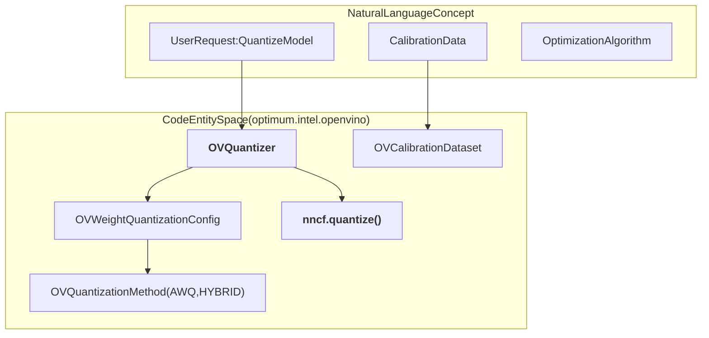
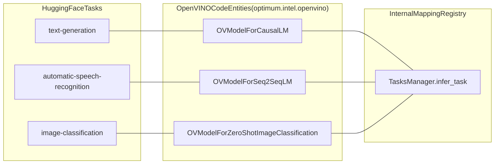

<!-- source: DeepWiki mcp.deepwiki.com · repo huggingface/optimum-intel · page 8 Glossary · fetched 2026-10-26 -->

# Glossary

Relevant source files

The following files were used as context for generating this wiki page:

- [optimum/exporters/openvino/__main__.py](optimum/exporters/openvino/__main__.py)
- [optimum/exporters/openvino/convert.py](optimum/exporters/openvino/convert.py)
- [optimum/intel/openvino/configuration.py](optimum/intel/openvino/configuration.py)
- [optimum/intel/openvino/modeling_decoder.py](optimum/intel/openvino/modeling_decoder.py)
- [optimum/intel/openvino/quantization.py](optimum/intel/openvino/quantization.py)
- [setup.py](setup.py)
- [tests/openvino/utils_tests.py](tests/openvino/utils_tests.py)

This glossary defines technical terms, architectural concepts, and domain-specific jargon used within the `optimum-intel` codebase. It serves as a reference for engineers to understand the mapping between high-level optimization concepts and their implementation in code.

## Core Optimization Concepts

### OpenVINO IR (Intermediate Representation)
The proprietary format used by the OpenVINO runtime to represent models. It consists of two files:
- `.xml`: Describes the network topology (graph structure).
- `.bin`: Contains the binary data for weights and biases.

In `optimum-intel`, the export process converts PyTorch/Transformers models into this format.
*   **Implementation**: `export()` function in [optimum/exporters/openvino/convert.py:148-183]() handles the conversion.
*   **Constants**: `OV_XML_FILE_NAME = "openvino_model.xml"` defined in [optimum/exporters/openvino/utils.py:67]().
*   **Sources**: [optimum/exporters/openvino/convert.py:148-183](), [optimum/exporters/openvino/utils.py:64-70]()

### NNCF (Neural Network Compression Framework)
A sub-library used by OpenVINO for post-training quantization (PTQ) and compression. `optimum-intel` uses NNCF to perform weight-only and full-model quantization.
*   **Integration**: Imported and checked via `is_nncf_available()` in [optimum/intel/utils/import_utils.py:79]().
*   **Usage**: Utilized within `OVQuantizer` to apply algorithms like AWQ or SmoothQuant.
*   **Sources**: [optimum/intel/utils/import_utils.py:79-86](), [optimum/intel/openvino/quantization.py:27-30]()

### IPEX (Intel Extension for PyTorch)
A library that provides optimizations for PyTorch on Intel hardware, including custom operators and weight prepacking.
*   **Integration**: The codebase provides `IPEXModel` variants to wrap optimized PyTorch models.
*   **Sources**: [setup.py:29-40](), [optimum/intel/utils/import_utils.py:1-60]()

---

## Model State & Memory

### Stateful vs. Stateless Models
Refers to how Key-Value (KV) caches are handled during inference in OpenVINO.
*   **Stateless**: The KV cache is passed as explicit inputs and outputs to the model in every iteration.
*   **Stateful**: The KV cache is managed internally by the OpenVINO runtime using "Variables" and "ReadValue/Assign" operations. This reduces memory overhead by avoiding the transfer of large tensors.
*   **Code Pointer**: `patch_stateful()` in [optimum/exporters/openvino/stateful.py:62]() converts a stateless model to a stateful one.
*   **Detection**: `model_has_state(self.model)` in [optimum/intel/openvino/modeling_decoder.py:158]().
*   **Sources**: [optimum/intel/openvino/modeling_decoder.py:155-158](), [optimum/exporters/openvino/stateful.py:27-31](), [optimum/exporters/openvino/convert.py:77-82]()

### KV Cache
The "Key-Value" cache stores the hidden states of previous tokens in transformer-based models to avoid redundant computations.
*   **Precision**: Can be configured via `KV_CACHE_PRECISION` (e.g., `f16`, `u8`) in [optimum/exporters/openvino/convert.py:124]().
*   **Management**: Handled in `OVBaseDecoderModel` via `key_value_input_names` [optimum/intel/openvino/modeling_decoder.py:161]().
*   **Sources**: [optimum/intel/openvino/modeling_decoder.py:160-162](), [optimum/exporters/openvino/convert.py:116-125]()

---

## Quantization Methods & Data Types

### Weight-Only Quantization (WOQ)
Quantizes only the weights of the model (typically to 4-bit or 8-bit) while keeping activations in higher precision.
*   **Config**: `OVWeightQuantizationConfig` in [optimum/intel/openvino/configuration.py:465]().
*   **Algorithms**: Supports **AWQ** (Activation-aware Weight Quantization) [optimum/intel/openvino/configuration.py:53]() and **GPTQ**.
*   **Sources**: [optimum/intel/openvino/configuration.py:50-54](), [optimum/intel/openvino/configuration.py:465-480]()

### Data Types Table

| Symbol | Definition | Implementation Pointer |
| :--- | :--- | :--- |
| **INT4/INT8** | 4-bit and 8-bit Integer types. | [optimum/intel/openvino/configuration.py:57-100]() |
| **NF4** | 4-bit NormalFloat, common in QLoRA. | [optimum/intel/openvino/configuration.py:465]() |
| **FP8 (E4M3/E5M2)** | 8-bit Floating Point variants. | [optimum/intel/openvino/configuration.py:560]() |
| **MXFP4** | Microscaling 4-bit format. | [optimum/exporters/openvino/__main__.py:57]() |
| **CB4** | Compressed 4-bit format. | [optimum/intel/openvino/configuration.py:510]() |

*Sources: [optimum/intel/openvino/configuration.py:57-150](), [optimum/exporters/openvino/__main__.py:56-59]()*

---

## Code Entity Mapping

### Natural Language Space to Code Entity Space: Quantization Flow
The following diagram maps the logical steps of quantization to the specific classes and functions in the codebase.

**Quantization Architecture**

*Sources: [optimum/intel/openvino/quantization.py:92-110](), [optimum/intel/openvino/configuration.py:50-54]()*

### Component Architecture: Pipeline Task Mapping
Maps high-level tasks to the corresponding OpenVINO model classes used within the pipeline accelerator.

**Task to Model Mapping**

*Sources: [optimum/exporters/openvino/__main__.py:75-130](), [optimum/intel/openvino/quantization.py:61-65]()*

---

## Utility Systems

### Model Patching
A mechanism to replace specific modules or functions in a PyTorch model with OpenVINO-compatible versions before export.
*   **Implementation**: `patch_stateful()` in [optimum/exporters/openvino/stateful.py:62]() modifies the model graph to include state-handling ops.
*   **Specific Fixes**: `patch_qwenvl_configs` in [optimum/exporters/openvino/utils.py:51]() handles specific model architecture adjustments.
*   **Sources**: [optimum/exporters/openvino/stateful.py:62-63](), [optimum/exporters/openvino/__main__.py:52]()

### OpenVINO GenAI Integration
Integration with the high-level C++ based OpenVINO GenAI library for optimized LLM and VLM pipelines.
*   **Usage**: Refers to `openvino-genai` requirement in [setup.py:68]().
*   **Special Models**: Supports models like **Eagle3** [optimum/exporters/openvino/convert.py:140]() and **Kokoro TTS** [tests/openvino/utils_tests.py:31]().
*   **Sources**: [setup.py:68](), [optimum/exporters/openvino/convert.py:140-142](), [tests/openvino/utils_tests.py:31-40]()

### Task Mapping
The system that maps a Hugging Face task to the appropriate OpenVINO model class.
*   **Function**: `infer_task()` in [optimum/exporters/openvino/__main__.py:75-176]().
*   **Sources**: [optimum/exporters/openvino/__main__.py:75-176]()

### Calibration Datasets
Datasets used during Post-Training Quantization to determine the dynamic range of activations.
*   **Class**: `OVCalibrationDataset` in [optimum/intel/openvino/quantization.py:92]().
*   **Predefined Sets**: `PREDEFINED_LANGUAGE_DATASETS`, `PREDEFINED_SD_DATASETS` referenced in [optimum/intel/openvino/configuration.py:34-41]().
*   **Sources**: [optimum/intel/openvino/quantization.py:92-110](), [optimum/intel/openvino/configuration.py:34-41]()

---
*Sources: [optimum/intel/openvino/quantization.py:1-110](), [optimum/intel/openvino/modeling_decoder.py:108-175](), [optimum/exporters/openvino/convert.py:148-183](), [optimum/intel/openvino/configuration.py:50-150](), [optimum/exporters/openvino/__main__.py:75-176]()*