# Page: Overview

# Overview

<details>
<summary>Relevant source files</summary>

The following files were used as context for generating this wiki page:

- [README.md](README.md)
- [docs/source/_toctree.yml](docs/source/_toctree.yml)
- [docs/source/index.mdx](docs/source/index.mdx)
- [docs/source/installation.mdx](docs/source/installation.mdx)
- [optimum/intel/version.py](optimum/intel/version.py)
- [setup.py](setup.py)

</details>


**Optimum Intel** is an interface library that connects HuggingFace model libraries (Transformers, Diffusers, Sentence Transformers, and timm) with Intel's hardware optimization frameworks. It enables deployment and acceleration of deep learning models on Intel CPUs, GPUs, and NPUs through three backend integrations: **OpenVINO** (primary), **Intel Extension for PyTorch (IPEX)**, and **Neural Compressor** (deprecated).

This page provides a high-level view of the system architecture, backend capabilities, and core workflows. For detailed information about specific subsystems:
- System Architecture: see [System Architecture](#1.1)
- Installation: see [Installation and Setup](#1.2)
- Model export and conversion: see [Model Export and Conversion](#2.2)
- Quantization configuration and methods: see [Quantization System](#2.3)
- Model loading and inference: see [Model Loading and Inference](#2.4)
- Command-line tools: see [Command Line Interface](#6)

**Sources:** [README.md:7-9](), [docs/source/index.mdx:18-23]()

---

## Three-Tier System Architecture

Optimum Intel implements a three-tier architecture that separates model sources, optimization abstractions, and execution backends:

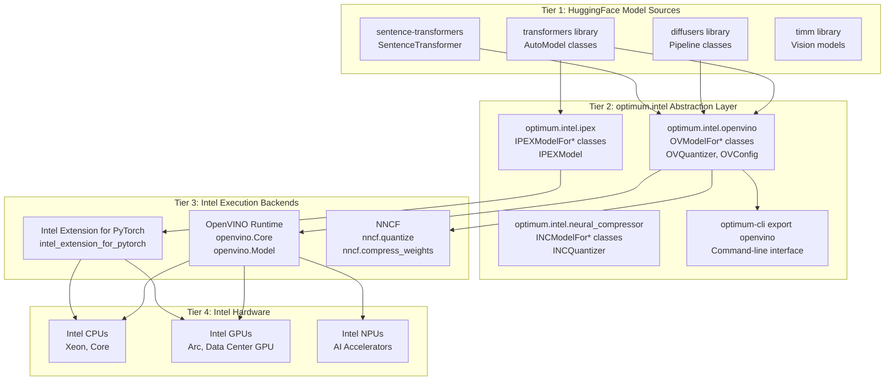

**Diagram: Three-tier architecture separating model sources, abstraction APIs, execution backends, and hardware targets**

**Sources:** [README.md:7-9](), [docs/source/index.mdx:20-22](), [setup.py:86-117]()

---

## Backend Capabilities and Status

Optimum Intel supports three Intel optimization backends with different feature sets and maintenance status:

| Backend | Status | Hardware Support | Model Export | Quantization | Key Classes | Use Case |
|---------|--------|------------------|--------------|--------------|-------------|----------|
| **OpenVINO** | ✅ Active (Primary) | CPU, GPU, NPU | ✅ PyTorch → IR | ✅ INT4/INT8/FP8/NF4<br/>AWQ/GPTQ/SmoothQuant | `OVModelForCausalLM`<br/>`OVQuantizer`<br/>`OVConfig` | Production deployment<br/>Cross-hardware inference<br/>Advanced quantization |
| **IPEX** | ✅ Active | CPU, GPU | ❌ PyTorch only | ⚠️ Limited | `IPEXModelForCausalLM`<br/>`IPEXModel` | PyTorch-native inference<br/>torch.compile integration |
| **Neural Compressor** | ⚠️ Deprecated | CPU | ❌ PyTorch only | ✅ PTQ, QAT | `INCQuantizer` | Legacy quantization<br/>Migration to OpenVINO recommended |

**Table: Backend comparison showing OpenVINO as the primary backend with the broadest feature support**

Key differences:
- **OpenVINO** converts models to Intermediate Representation (IR) format, providing the widest hardware coverage and most quantization options [README.md:9]().
- **IPEX** operates on native PyTorch models, offering seamless PyTorch integration but limited to CPU/GPU.
- **Neural Compressor** is deprecated [README.md:26-27](); users should migrate to OpenVINO's quantization capabilities using `nncf` [setup.py:36]().

**Sources:** [README.md:9](), [README.md:26-27](), [setup.py:36-37](), [docs/source/index.mdx:20-22]()

---

## Core Model Lifecycle Workflow

The typical workflow for using Optimum Intel follows a three-stage pipeline:

```mermaid
flowchart LR
    subgraph stage1["Stage 1: Model Acquisition"]
        hf_hub["HuggingFace Hub<br/>model_id or local path"]
        pytorch_model["PyTorch Model<br/>transformers.AutoModel"]
    end
    
    subgraph stage2["Stage 2: Export & Optimization"]
        export_cli["optimum-cli export openvino<br/>--model MODEL_ID"]
        ir_files["OpenVINO IR<br/>.xml / .bin files"]
        
        quant_config["OVQuantizationConfig<br/>dtype, dataset, num_samples"]
        quantizer["OVQuantizer.quantize"]
        nncf["NNCF Engine<br/>nncf.quantize"]
        optimized_ir["Optimized IR<br/>Quantized Weights"]
    end
    
    subgraph stage3["Stage 3: Inference"]
        load_model["OVModelForCausalLM.from_pretrained<br/>OVModelForSpeechSeq2Seq.from_pretrained"]
        compile["OpenVINO Compilation<br/>openvino.Core.compile_model"]
        inference["Inference Methods<br/>model.generate()<br/>pipeline()"]
    end
    
    hf_hub --> pytorch_model
    pytorch_model --> export_cli
    export_cli --> ir_files
    
    ir_files --> quant_config
    quant_config --> quantizer
    quantizer --> nncf
    nncf --> optimized_ir
    
    ir_files --> load_model
    optimized_ir --> load_model
    load_model --> compile
    compile --> inference
```

**Diagram: End-to-end workflow showing the three stages of model lifecycle: acquisition, optimization, and inference with concrete API entry points**

The workflow is flexible:
1. **Export** can happen via CLI (`optimum-cli export openvino` [README.md:35]()) or programmatically.
2. **Quantization** is optional; can be applied during loading using `OVQuantizationConfig` passed to `from_pretrained` [README.md:67-71]().
3. **Inference** uses the same API as HuggingFace Transformers but with `OVModelFor*` classes instead of `AutoModel*` [README.md:44-55]().

**Sources:** [README.md:35](), [README.md:44-55](), [README.md:67-76]()

---

## Primary Entry Points and Model Classes

Optimum Intel provides task-specific model classes that mirror HuggingFace's `AutoModel` hierarchy:

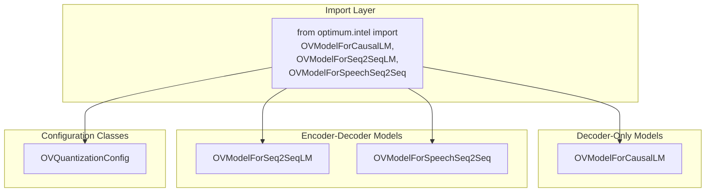

**Diagram: Primary model and configuration classes imported from the main optimum.intel namespace**

All `OVModelFor*` classes share a common interface:
- `from_pretrained(model_id, **kwargs)` - Load from Hub or local directory [README.md:51]().
- `save_pretrained(save_directory)` - Save model and configuration [README.md:75]().
- `generate(**kwargs)` - Text generation for language models [README.md:54]().

**Sources:** [README.md:47-51](), [README.md:67-75]()

---

## Quick Start Example

The following example demonstrates the typical workflow for loading and running an OpenVINO language model:

```python
from optimum.intel import OVModelForCausalLM
from transformers import AutoTokenizer, pipeline

model_id = "ov_TinyLlama_v1_1"
model = OVModelForCausalLM.from_pretrained(model_id)
tokenizer = AutoTokenizer.from_pretrained(model_id)

pipe = pipeline("text-generation", model=model, tokenizer=tokenizer)
results = pipe("Hey, how are you doing today?", max_new_tokens=100)
```

For quantizing a model:

```python
from optimum.intel import OVModelForSpeechSeq2Seq, OVQuantizationConfig

q_config = OVQuantizationConfig(dtype="int8", dataset="librispeech", num_samples=50)
q_model = OVModelForSpeechSeq2Seq.from_pretrained("openai/whisper-tiny", quantization_config=q_config)
q_model.save_pretrained("nncf_results")
```

**Sources:** [README.md:46-55](), [README.md:67-76]()

---

## Dependency Management and Installation

Optimum Intel uses a modular dependency system to handle various backends. The library can be installed with different backend combinations:

| Installation Command | Backends Enabled | Required Dependencies |
|---------------------|------------------|----------------------|
| `pip install "optimum-intel[openvino]"` | OpenVINO | `openvino>=2026.0`, `nncf`, `openvino-tokenizers` [setup.py:80]() |
| `pip install "optimum-intel[nncf]"` | NNCF (Quantization) | `nncf>=2.19.0` [setup.py:79]() |
| `pip install "optimum-intel[diffusers]"` | Diffusion Models | `diffusers` [setup.py:81]() |

**Important:** The extras `nncf`, `neural-compressor`, and `ipex` are deprecated and will be removed in a future release [README.md:26-27]().

**Sources:** [setup.py:29-40](), [setup.py:78-84](), [README.md:17-27](), [docs/source/installation.mdx:19-23]()

---

## Next Steps

For comprehensive information on using Optimum Intel, consult the following pages:

- **System Architecture** ([System Architecture](#1.1)) - Detailed three-tier architecture explanation.
- **Installation and Setup** ([Installation and Setup](#1.2)) - Installation options and environment configuration.
- **OpenVINO Integration** ([OpenVINO Integration](#2)) - Primary backend documentation.
- **Command Line Interface** ([Command Line Interface](#6)) - CLI tools and options.

**Sources:** [docs/source/_toctree.yml:1-28]()

---

# Page: System Architecture

# System Architecture

<details>
<summary>Relevant source files</summary>

The following files were used as context for generating this wiki page:

- [optimum/intel/__init__.py](optimum/intel/__init__.py)
- [optimum/intel/openvino/__init__.py](optimum/intel/openvino/__init__.py)
- [optimum/intel/openvino/utils.py](optimum/intel/openvino/utils.py)
- [optimum/intel/pipelines/accelerator_utils.py](optimum/intel/pipelines/accelerator_utils.py)
- [optimum/intel/utils/__init__.py](optimum/intel/utils/__init__.py)
- [optimum/intel/utils/import_utils.py](optimum/intel/utils/import_utils.py)
- [optimum/intel/utils/modeling_utils.py](optimum/intel/utils/modeling_utils.py)
- [setup.py](setup.py)

</details>


This document explains the three-tier architecture of `optimum-intel`, showing how HuggingFace models flow through the optimum-intel abstraction layer to Intel backend libraries and ultimately to Intel hardware. It describes the relationship between the backends (OpenVINO, IPEX, Neural Compressor), the module organization, and the dependency management system that enables optional backend installation.

**Related Pages:**
- For OpenVINO model classes, see page 2.1
- For model export and conversion, see page 2.2  
- For quantization details, see page 2.3
- For IPEX implementation, see page 3
- For Neural Compressor (deprecated), see page 4

## Three-Tier Architecture

The `optimum-intel` system follows a three-tier architecture that bridges HuggingFace models to Intel hardware:

Title: Three-Tier Architecture Data Flow
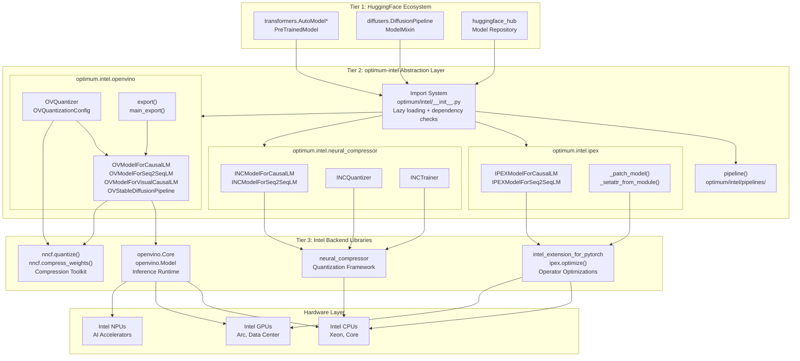

**Key Flow Patterns:**

1. **HuggingFace → optimum-intel**: Models from `transformers` or `diffusers` are loaded through specialized model classes like `OVModelForCausalLM.from_pretrained()`. The library handles the conversion from PyTorch/Safetensors to backend-specific formats. [optimum/intel/openvino/__init__.py:83-83](), [optimum/intel/__init__.py:37-58]().

2. **optimum-intel → Intel Backends**: 
   - **OpenVINO**: Uses `openvino.convert_model` and `openvino.Core` for runtime execution. [optimum/intel/openvino/utils.py:31-31]().
   - **Quantization**: Interfaces with `nncf` (Neural Network Compression Framework) for post-training quantization and weight compression. [optimum/intel/openvino/__init__.py:58-66]().

3. **Intel Backends → Hardware**: The `openvino.Core` instance manages device discovery and model compilation for target hardware (CPU, GPU, NPU). [optimum/intel/openvino/utils.py:31-31]().

**Sources:** [optimum/intel/__init__.py:27-154](), [optimum/intel/openvino/__init__.py:69-125](), [optimum/intel/openvino/utils.py:31-31](), [setup.py:29-40]()

---

## Backend System Overview

The `optimum-intel` package provides three distinct backend systems, each with different optimization approaches:

| Backend | Status | Model Format | Key Classes | Module Path |
|---------|--------|--------------|-------------|-------------|
| **OpenVINO** | ⭐ Primary | IR (.xml/.bin) | `OVModelFor*`, `OVQuantizer` | `optimum.intel.openvino` |
| **IPEX** | Active | PyTorch | `IPEXModelFor*` | `optimum.intel.ipex` |
| **Neural Compressor** | ⚠️ Deprecated | PyTorch | `INCModelFor*`, `INCQuantizer` | `optimum.intel.neural_compressor` |

**Backend Characteristics:**

- **OpenVINO**: The primary backend. It exports models to the OpenVINO Intermediate Representation (IR). It supports the widest range of tasks including Causal LM, Seq2Seq, Diffusion, and Visual-Language models. [optimum/intel/openvino/utils.py:122-151](), [optimum/intel/openvino/__init__.py:69-120]().
- **IPEX (Intel Extension for PyTorch)**: Optimizes PyTorch models directly. It uses techniques like operator fusion and weight prepacking. [optimum/intel/utils/modeling_utils.py:79-86]().
- **NNCF Integration**: OpenVINO backend leverages NNCF for advanced quantization algorithms like AWQ and GPTQ. [optimum/intel/openvino/configuration.py:49-55](), [optimum/intel/openvino/__init__.py:58-66]().

**Sources:** [optimum/intel/openvino/__init__.py:1-125](), [optimum/intel/openvino/utils.py:122-151](), [setup.py:29-40]()

---

## Module Organization

The package follows a hierarchical module structure where each backend is a subpackage with its own models, configurations, and utilities.

### Package Structure

Title: Codebase Module Hierarchy
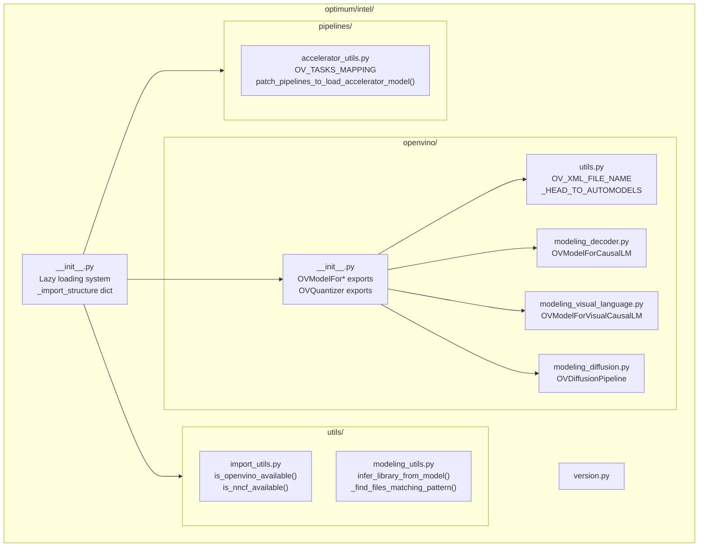

**Key Classes and Roles:**

- **OVBaseModel**: The base class for all OpenVINO-backed models, providing the core interface for inference and model management. [optimum/intel/pipelines/accelerator_utils.py:40-40]().
- **Import Utilities**: `optimum.intel.utils.import_utils` manages the complex matrix of optional dependencies (torch, openvino, nncf, diffusers). [optimum/intel/utils/import_utils.py:33-192]().
- **Task Mapping**: `_HEAD_TO_AUTOMODELS` defines the internal mapping between task heads and OpenVINO model classes. [optimum/intel/openvino/utils.py:122-151]().

**Sources:** [optimum/intel/openvino/utils.py:122-151](), [optimum/intel/utils/import_utils.py:1-192](), [optimum/intel/__init__.py:27-59]()

---

## Dependency Management and Import System

The package uses a `_LazyModule` pattern and a conditional `_import_structure` to handle optional backends. This ensures that users are only required to install the dependencies for the backend they intend to use.

Title: Dependency Check and Lazy Loading Flow
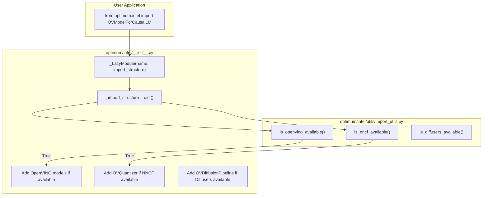

**Implementation Details:**

- **`_import_structure`**: A dictionary mapping submodules to the classes they export. It is dynamically updated based on the results of availability checks. [optimum/intel/__init__.py:27-59]().
- **Dummy Objects**: If a dependency is missing, the library maps the requested class to a dummy object (e.g., `utils.dummy_openvino_and_nncf_objects`) which raises a clear `ImportError` only when the user attempts to instantiate it. [optimum/intel/__init__.py:63-75]().
- **Version Enforcement**: The library enforces minimum versions for backends (e.g., OpenVINO >= 2025.4.0) during import to ensure compatibility. [optimum/intel/openvino/__init__.py:42-47]().

**Sources:** [optimum/intel/__init__.py:27-156](), [optimum/intel/utils/import_utils.py:194-212](), [optimum/intel/openvino/__init__.py:15-66]()

---

## API Integration Patterns

### Task Mapping and Pipeline Patching

The `optimum-intel` package integrates with the HuggingFace `transformers.pipeline` API by providing an accelerator patching mechanism.

Title: Pipeline Accelerator Integration
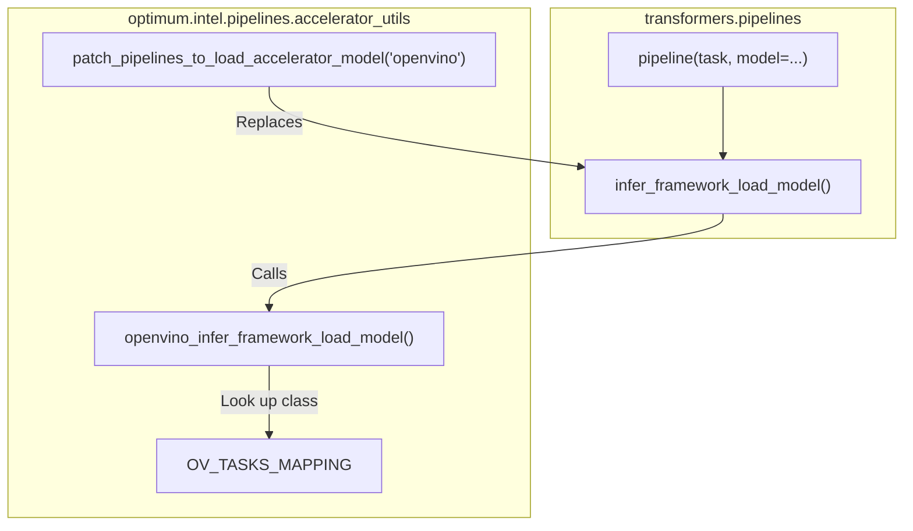

**Components:**

- **`OV_TASKS_MAPPING`**: Maps standard HuggingFace task strings (e.g., `"text-generation"`) to OpenVINO-specific classes (`OVModelForCausalLM`). [optimum/intel/pipelines/accelerator_utils.py:48-67]().
- **`patch_pipelines_to_load_accelerator_model`**: A context manager that replaces the default model loading function in `transformers` with one that can resolve and load OpenVINO models. [optimum/intel/pipelines/accelerator_utils.py:127-141]().
- **`get_openvino_model_class`**: Logic to determine the correct `OVModelFor*` class based on the task and model architecture (e.g., distinguishing between CTC and Seq2Seq for ASR). [optimum/intel/pipelines/accelerator_utils.py:70-96]().

**Sources:** [optimum/intel/pipelines/accelerator_utils.py:48-141](), [optimum/intel/openvino/utils.py:122-151]()

---

# Page: Installation and Setup

# Installation and Setup

<details>
<summary>Relevant source files</summary>

The following files were used as context for generating this wiki page:

- [README.md](README.md)
- [docs/source/_toctree.yml](docs/source/_toctree.yml)
- [docs/source/index.mdx](docs/source/index.mdx)
- [docs/source/installation.mdx](docs/source/installation.mdx)
- [optimum/intel/pipelines/accelerator_utils.py](optimum/intel/pipelines/accelerator_utils.py)
- [optimum/intel/utils/__init__.py](optimum/intel/utils/__init__.py)
- [optimum/intel/utils/import_utils.py](optimum/intel/utils/import_utils.py)
- [optimum/intel/utils/modeling_utils.py](optimum/intel/utils/modeling_utils.py)
- [setup.py](setup.py)

</details>


This document provides technical instructions for installing and configuring 🤗 Optimum Intel, the interface between Hugging Face libraries (`transformers`, `diffusers`, `sentence-transformers`, `timm`) and Intel optimization backends. The package primarily targets OpenVINO™, Intel® Extension for PyTorch (IPEX), and Intel® Neural Compressor (INC).

## Installation Overview

Optimum Intel is designed as a modular package where backends are installed as optional dependencies. The core requirements include `torch`, `transformers`, `optimum`, and `huggingface-hub`.

**Core Dependency Specification**
The `INSTALL_REQUIRE` list defines the baseline environment:
- `torch>=2.1` [setup.py:30]()
- `safetensors<0.8.0` [setup.py:31]()
- `optimum~=2.2.0` [setup.py:32]()
- `transformers>=4.45,<5.1` [setup.py:33]()
- `nncf>=2.19.0` [setup.py:36]()
- `openvino>=2026.0` [setup.py:37]()
- `openvino-tokenizers>=2026.0` [setup.py:38]()

### Backend Availability Logic
The codebase uses a utility system to detect available backends at runtime. This allows the package to fail gracefully or provide dummy objects when a specific dependency is missing.

**Dependency Detection and Mapping Architecture**

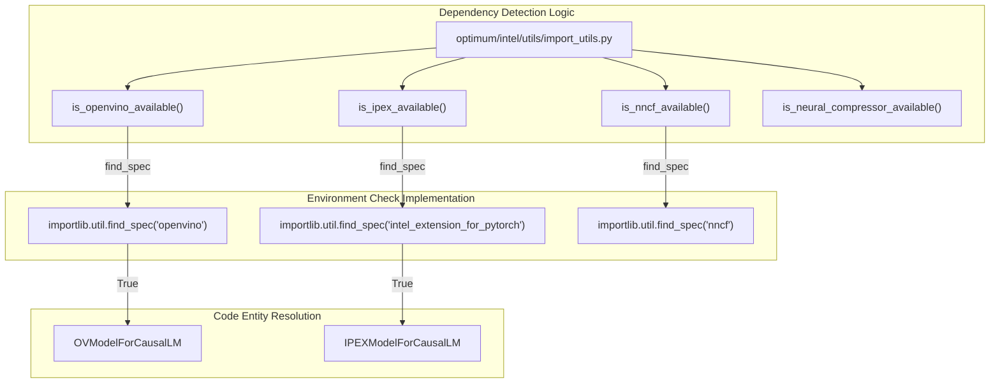
Sources: [setup.py:29-40](), [optimum/intel/utils/import_utils.py:63-85]()

## Standard Installation

### Prerequisites
It is recommended to use a virtual environment and ensure `pip` is up to date to handle complex dependency resolutions.

```bash
python -m pip install --upgrade pip
```
Sources: [docs/source/installation.mdx:28-30]()

### Backend-Specific Installation
Users should install the package with the specific "extra" corresponding to their target Intel hardware or optimization toolkit. These extras are defined in `setup.py` via `EXTRAS_REQUIRE`.

| Target Backend | Installation Command | Primary Use Case |
| :--- | :--- | :--- |
| **OpenVINO** | `pip install "optimum-intel[openvino]"` | Inference on Intel CPUs, GPUs, and NPUs. Includes `nncf` and `openvino-tokenizers`. |
| **Diffusers** | `pip install "optimum-intel[diffusers]"` | Support for Stable Diffusion and other diffusion pipelines. |
| **Quality** | `pip install "optimum-intel[quality]"` | Development tools: `black` and `ruff`. |
| **Tests** | `pip install "optimum-intel[tests]"` | Full suite for CI/CD including `pytest`, `accelerate`, and `timm`. |

**Deprecation Notice:** The `extras` for `openvino` (e.g., `pip install optimum-intel[openvino,nncf]`), `nncf`, `neural-compressor`, and `ipex` are **deprecated** and will be removed in a future release. [README.md:26-27](). Users are encouraged to use the consolidated `[openvino]` extra.

**Note:** The `--upgrade-strategy eager` flag is recommended to ensure `optimum-intel` and its sub-dependencies are moved to the latest compatible versions. [docs/source/installation.mdx:22-25]()

Sources: [setup.py:78-84](), [README.md:16-18](), [docs/source/installation.mdx:21-25]()

## Installation from Source

For access to the latest model support (e.g., new Visual-Language models or Kokoro TTS), installation from the `main` branch is often required. The versioning system in `setup.py` automatically appends the git commit hash to the version string for dev installs.

```bash
python -m pip install "optimum-intel[openvino]"@git+https://github.com/huggingface/optimum-intel.git
```
Sources: [setup.py:9-25](), [README.md:20-24](), [docs/source/installation.mdx:32-35]()

## Verification and Initialization

### Pipeline Integration Mapping
The package integrates with the `transformers.pipeline` API by patching the loading mechanism to use Intel-optimized model classes via `patch_pipelines_to_load_accelerator_model`.

**Task to Model Mapping Flow**

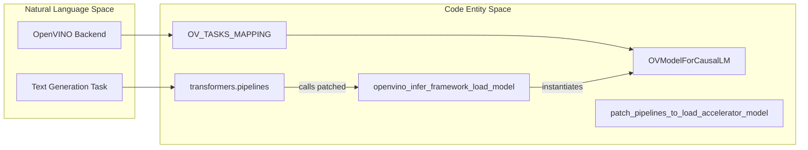
Sources: [optimum/intel/pipelines/accelerator_utils.py:48-67](), [optimum/intel/pipelines/accelerator_utils.py:100-124](), [optimum/intel/pipelines/accelerator_utils.py:127-141]()

### Verification Script
You can verify the installation by checking backend availability via the `optimum.intel.utils` module:

```python
from optimum.intel.utils import is_openvino_available, is_transformers_available

print(f"OpenVINO detected: {is_openvino_available()}")
print(f"Transformers detected: {is_transformers_available()}")

if is_openvino_available():
    from optimum.intel import OVModelForCausalLM
    print("OpenVINO Model classes ready.")
```
Sources: [optimum/intel/utils/__init__.py:15-28]()

## Model Discovery and Inference

The `modeling_utils.py` file provides logic to infer the correct library for a model and manage devices.

**Model Library Inference Logic**
The system detects if a model belongs to `transformers`, `diffusers`, `open_clip`, or `kokoro` to route it to the correct optimized class.

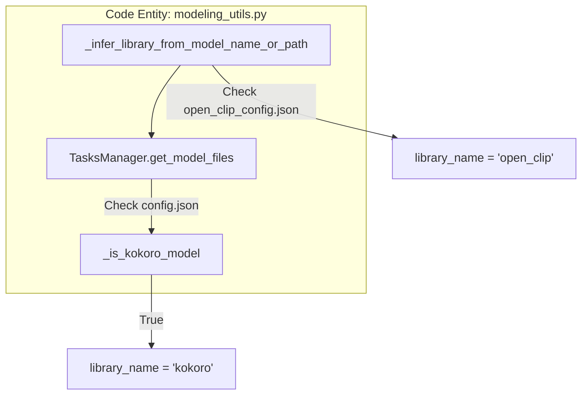
Sources: [optimum/intel/utils/modeling_utils.py:144-166](), [optimum/intel/utils/modeling_utils.py:168-187]()

For basic inference verification:
```python
from optimum.intel import OVModelForCausalLM
from transformers import AutoTokenizer

model_id = "helenai/gpt2-ov" # Example OpenVINO IR model
model = OVModelForCausalLM.from_pretrained(model_id)
tokenizer = AutoTokenizer.from_pretrained(model_id)
```
Sources: [README.md:46-52]()

---

# Page: OpenVINO Integration

# OpenVINO Integration

<details>
<summary>Relevant source files</summary>

The following files were used as context for generating this wiki page:

- [docs/source/openvino/models.mdx](docs/source/openvino/models.mdx)
- [optimum/intel/__init__.py](optimum/intel/__init__.py)
- [optimum/intel/openvino/__init__.py](optimum/intel/openvino/__init__.py)
- [optimum/intel/openvino/modeling.py](optimum/intel/openvino/modeling.py)
- [optimum/intel/openvino/modeling_base.py](optimum/intel/openvino/modeling_base.py)
- [optimum/intel/openvino/utils.py](optimum/intel/openvino/utils.py)

</details>


This document introduces the OpenVINO backend integration in `optimum-intel`, which serves as the **primary and most comprehensive** optimization backend for running HuggingFace models on Intel hardware. OpenVINO provides a complete workflow from model export through quantization to optimized inference.

For information about the overall system architecture and how OpenVINO fits alongside other backends (IPEX, Neural Compressor), see [System Architecture](#1.1). For specific implementation details of model classes, export mechanisms, and quantization, refer to the child pages: [Model Classes and Task Coverage](#2.1), [Model Export and Conversion](#2.2), [Quantization System](#2.3), [Model Loading and Inference](#2.4), [Diffusion Models](#2.5), [Visual-Language Models](#2.6), and [Sequence-to-Sequence Models](#2.7).

## Overview and Capabilities

OpenVINO is the flagship backend of `optimum-intel`, offering three primary capabilities:

1. **Model Export**: Converting PyTorch/ONNX models to OpenVINO Intermediate Representation (IR) format [optimum/intel/openvino/modeling_base.py:30-31]().
2. **Quantization**: Compressing models using NNCF for INT4/INT8/FP8 weights and activations [optimum/intel/openvino/__init__.py:58-66]().
3. **Inference**: Executing optimized models on CPU, GPU, and NPU devices [optimum/intel/openvino/modeling.py:76-85]().

The OpenVINO integration is unique in providing:
- **Broadest model architecture support**: Including vision-language models (LLaVA, MiniCPM-V, Qwen2-VL, Phi3-Vision) via `OVModelForVisualCausalLM` [optimum/intel/openvino/__init__.py:92]().
- **Most comprehensive quantization options**: Support for data types like INT4, INT8, FP8, NF4, MXFP4, and CB4 through `OVWeightQuantizationConfig` [optimum/intel/openvino/configuration.py:118-135]().
- **Widest hardware coverage**: Native support for CPU, Discrete/Integrated GPU, and NPU (AI Accelerators) [optimum/intel/openvino/modeling.py:76-85]().
- **Stateful model support**: Efficient KV-cache management for text generation via internal state handling, reducing memory overhead [optimum/intel/openvino/utils.py:44]().

**Sources**: [optimum/intel/openvino/__init__.py:49-120](), [docs/source/openvino/models.mdx:10-183](), [optimum/intel/openvino/modeling_base.py:20-53]()

## Primary Backend Status

The following diagram illustrates how the OpenVINO integration compares to other backends in terms of feature parity and hardware support.

### Backend Capability Matrix
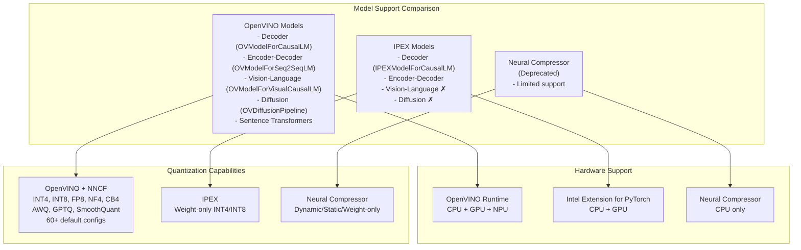

**Sources**: [optimum/intel/openvino/__init__.py:67-123](), [optimum/intel/__init__.py:27-154](), [optimum/intel/openvino/configuration.py:49-55]()

## Core Workflow

The OpenVINO integration follows a three-stage pipeline:

### Stage 1: Model Export
Models are converted from PyTorch (or ONNX) format to OpenVINO IR format consisting of `.xml` (model structure) and `.bin` (weights) files [optimum/intel/openvino/utils.py:41-48]().

- **Key Entry Point**: `optimum.exporters.openvino.main_export()` [optimum/intel/openvino/modeling_base.py:31]().
- **Utility Names**: `OV_XML_FILE_NAME`, `OV_ENCODER_NAME`, `OV_DECODER_NAME` [optimum/intel/openvino/utils.py:41-43]().

For details, see [Model Export and Conversion](#2.2).

### Stage 2: Quantization (Optional)
Models can be compressed using NNCF (Neural Network Compression Framework) to reduce size and improve inference speed [optimum/intel/openvino/__init__.py:58-66]().

- **Config Classes**: `OVWeightQuantizationConfig`, `OVQuantizationConfig`, and `OVMixedQuantizationConfig` [optimum/intel/openvino/configuration.py:49-55]().
- **Tooling**: Managed via `OVQuantizer` and `OVCalibrationDataset` [optimum/intel/openvino/__init__.py:66]().

For details, see [Quantization System](#2.3).

### Stage 3: Model Loading and Inference
Models are loaded using task-specific `OVModelFor*` classes that handle compilation and inference [optimum/intel/openvino/modeling.py:154-156]().

- **Model Loading**: Use `from_pretrained()` which utilizes the `OVModelHostMixin` for component management [optimum/intel/openvino/modeling_base.py:99-115]().
- **Runtime Config**: Properties like `PERFORMANCE_HINT` are passed via `ov_config` [optimum/intel/openvino/modeling.py:80-81]().

For details, see [Model Loading and Inference](#2.4).

## Model Class Hierarchy

All OpenVINO model classes follow a consistent interface pattern, mapping HuggingFace tasks to optimized OpenVINO implementations.

### Class Relationship Diagram
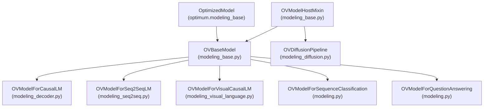

### Task-to-Class Mapping
| Task | Class | Module |
|------|-------|--------|
| `text-generation` | `OVModelForCausalLM` | `modeling_decoder.py` [optimum/intel/openvino/utils.py:125]() |
| `text2text-generation` | `OVModelForSeq2SeqLM` | `modeling_seq2seq.py` [optimum/intel/openvino/utils.py:126]() |
| `image-text-to-text` | `OVModelForVisualCausalLM` | `modeling_visual_language.py` [optimum/intel/openvino/utils.py:132]() |
| `stable-diffusion` | `OVStableDiffusionPipeline` | `modeling_diffusion.py` [optimum/intel/openvino/utils.py:135]() |
| `automatic-speech-recognition`| `OVModelForSpeechSeq2Seq` | `modeling_seq2seq.py` [optimum/intel/openvino/utils.py:147]() |

**Sources**: [optimum/intel/openvino/__init__.py:69-125](), [optimum/intel/openvino/utils.py:122-151](), [optimum/intel/openvino/modeling_base.py:52-113]()

## Multi-Component Models

Advanced architectures like Vision-Language Models (VLM) and Diffusion Pipelines consist of multiple sub-models loaded and compiled independently via `OVModelHostMixin`.

### Vision-Language Model Components
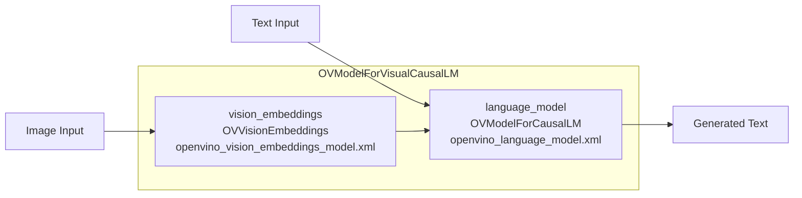

**Sources**: [optimum/intel/openvino/utils.py:46-47](), [optimum/intel/openvino/modeling_base.py:142-160]()

## Hardware Support and Device Configuration

OpenVINO supports a wide range of Intel hardware through a unified `device` parameter.

### Device Specification
- **CPU**: Default device for all models. Supports multi-threading and NUMA optimization.
- **GPU**: Supports Intel Arc, Data Center Flex/Max series, and Integrated Graphics [optimum/intel/openvino/modeling.py:76-77]().
- **NPU**: Low-power AI acceleration found in Intel Core Ultra processors [optimum/intel/openvino/modeling.py:76-77]().

### Runtime Configuration
The `ov_config` dictionary allows fine-tuning the OpenVINO Runtime:
- `PERFORMANCE_HINT`: Set to `LATENCY` (default) or `THROUGHPUT`.
- `CACHE_DIR`: Enables model compilation caching to speed up subsequent loads [optimum/intel/openvino/modeling_base.py:22-28]().

**Sources**: [optimum/intel/openvino/modeling_base.py:14-61](), [optimum/intel/openvino/modeling.py:67-85]()

## Key Advantages Over Other Backends

1. **Model Coverage**: Supports multimodal models (VLMs, Diffusion) that are not currently available in the IPEX backend [optimum/intel/openvino/utils.py:132-140]().
2. **Quantization Sophistication**: Deep integration with NNCF for advanced algorithms like AWQ, GPTQ, and SmoothQuant [optimum/intel/openvino/configuration.py:32-40]().
3. **Hardware Flexibility**: Unified API for CPU, GPU, and NPU.
4. **Stateful Optimization**: Drastically reduces memory overhead for LLMs by keeping KV-cache in device memory [optimum/intel/openvino/utils.py:44]().

For detailed information on specific subsystems:
- [Model Classes and Task Coverage](#2.1)
- [Model Export and Conversion](#2.2)
- [Quantization System](#2.3)
- [Model Loading and Inference](#2.4)
- [Diffusion Models](#2.5)
- [Visual-Language Models](#2.6)
- [Sequence-to-Sequence Models](#2.7)

---

# Page: Model Classes and Task Coverage

# Model Classes and Task Coverage

<details>
<summary>Relevant source files</summary>

The following files were used as context for generating this wiki page:

- [optimum/intel/openvino/modeling.py](optimum/intel/openvino/modeling.py)
- [optimum/intel/openvino/modeling_base.py](optimum/intel/openvino/modeling_base.py)
- [optimum/intel/openvino/modeling_open_clip.py](optimum/intel/openvino/modeling_open_clip.py)
- [optimum/intel/openvino/modeling_sam.py](optimum/intel/openvino/modeling_sam.py)
- [optimum/intel/openvino/modeling_sentence_transformers.py](optimum/intel/openvino/modeling_sentence_transformers.py)
- [optimum/intel/openvino/modeling_text2speech.py](optimum/intel/openvino/modeling_text2speech.py)
- [optimum/intel/openvino/modeling_timm.py](optimum/intel/openvino/modeling_timm.py)
- [tests/openvino/test_modeling.py](tests/openvino/test_modeling.py)

</details>


This page documents the 87+ `OVModel*` classes in `optimum-intel`, organized by task type. These classes provide drop-in replacements for HuggingFace models while leveraging the Intel OpenVINO runtime for accelerated inference on CPUs, GPUs, and NPUs.

Each model class inherits from `OVBaseModel` and implements task-specific interfaces compatible with the Transformers library. The classes handle automatic model export, quantization, and device-optimized compilation.

## Model Class Hierarchy

### Inheritance Structure

The class hierarchy is designed to mirror the `transformers` library while injecting OpenVINO-specific logic for model loading and inference.

**Core Inheritance Hierarchy: Base Classes to Task-Specific Models**

```mermaid
graph TB
    subgraph "Base Layer"
        OptimizedModel["optimum.modeling_base.OptimizedModel"]
        OVBaseModel["OVBaseModel<br/>optimum/intel/openvino/modeling_base.py"]
        OptimizedModel --> OVBaseModel
    end
    
    subgraph "Intermediate Layer"
        OVModel["OVModel<br/>optimum/intel/openvino/modeling.py"]
        OVBaseDecoderModel["OVBaseDecoderModel<br/>optimum/intel/openvino/modeling_decoder.py"]
        OVBaseModel --> OVModel
        OVBaseModel --> OVBaseDecoderModel
    end
    
    subgraph "Text Models"
        OVModelForSequenceClassification["OVModelForSequenceClassification"]
        OVModelForTokenClassification["OVModelForTokenClassification"]
        OVModelForQuestionAnswering["OVModelForQuestionAnswering"]
        OVModelForMaskedLM["OVModelForMaskedLM"]
        OVModelForCausalLM["OVModelForCausalLM"]
        OVModelForFeatureExtraction["OVModelForFeatureExtraction"]
        
        OVModel --> OVModelForSequenceClassification
        OVModel --> OVModelForTokenClassification
        OVModel --> OVModelForQuestionAnswering
        OVModel --> OVModelForMaskedLM
        OVModel --> OVModelForFeatureExtraction
        OVBaseDecoderModel --> OVModelForCausalLM
    end
    
    subgraph "Vision Models"
        OVModelForImageClassification["OVModelForImageClassification"]
        OVModelForZeroShotImageClassification["OVModelForZeroShotImageClassification"]
        OVSamModel["OVSamModel"]
        
        OVModel --> OVModelForImageClassification
        OVModel --> OVModelForZeroShotImageClassification
        OVModelForFeatureExtraction --> OVSamModel
    end
    
    subgraph "Audio Models"
        OVModelForAudioClassification["OVModelForAudioClassification"]
        OVModelForAudioFrameClassification["OVModelForAudioFrameClassification"]
        OVModelForAudioXVector["OVModelForAudioXVector"]
        OVModelForCTC["OVModelForCTC"]
        
        OVModel --> OVModelForAudioClassification
        OVModel --> OVModelForAudioFrameClassification
        OVModel --> OVModelForAudioXVector
        OVModel --> OVModelForCTC
    end
    
    subgraph "Seq2Seq Models"
        OVModelForSeq2SeqLM["OVModelForSeq2SeqLM<br/>optimum/intel/openvino/modeling_seq2seq.py"]
        OVModelForSpeechSeq2Seq["OVModelForSpeechSeq2Seq"]
        OVModelForVision2Seq["OVModelForVision2Seq"]
        OVModelForPix2Struct["OVModelForPix2Struct"]
        
        OVBaseModel --> OVModelForSeq2SeqLM
        OVModelForSeq2SeqLM --> OVModelForSpeechSeq2Seq
        OVModelForSeq2SeqLM --> OVModelForVision2Seq
        OVModelForSeq2SeqLM --> OVModelForPix2Struct
    end
    
    subgraph "Multimodal Models"
        OVModelForVisualCausalLM["OVModelForVisualCausalLM<br/>optimum/intel/openvino/modeling_visual_language.py"]
        OVModelForTextToSpeechSeq2Seq["OVModelForTextToSpeechSeq2Seq"]
        
        OVBaseModel --> OVModelForVisualCausalLM
        OVBaseModel --> OVModelForTextToSpeechSeq2Seq
    end
```

Sources: [optimum/intel/openvino/modeling_base.py:52-53](), [optimum/intel/openvino/modeling.py:120-122](), [optimum/intel/openvino/modeling_decoder.py:114-118](), [optimum/intel/openvino/modeling_seq2seq.py:252-254](), [optimum/intel/openvino/modeling_visual_language.py:344-346](), [optimum/intel/openvino/modeling_text2speech.py:159-160]()

### Base Class Responsibilities

| Base Class | File Location | Primary Responsibilities |
|------------|---------------|--------------------------|
| `OVBaseModel` | `modeling_base.py` | Root class for OpenVINO models. Handles model loading via `from_pretrained`, device management, compilation, and IR serialization [optimum/intel/openvino/modeling_base.py:181-220](). |
| `OVModel` | `modeling.py` | Wrapper for single-file models; registers with Transformers `AutoModel` and handles standard `forward()` to `request()` mapping [optimum/intel/openvino/modeling.py:120-131](). |
| `OVBaseDecoderModel` | `modeling_decoder.py` | Base for causal language models. Supports stateful inference, KV-cache management, and `GenerationMixin` integration [optimum/intel/openvino/modeling_decoder.py:114-163](). |
| `OVModelForSeq2SeqLM` | `modeling_seq2seq.py` | Orchestrates separate `OVEncoder` and `OVDecoder` components for encoder-decoder architectures [optimum/intel/openvino/modeling_seq2seq.py:252-300](). |
| `OVModelForVisualCausalLM` | `modeling_visual_language.py` | Multi-modal component orchestration, managing `language_model`, `vision_embeddings`, and `text_embeddings` [optimum/intel/openvino/modeling_visual_language.py:344-411](). |
| `OVModelHostMixin` | `modeling_base.py` | Mixin for models containing multiple submodels (e.g., Diffusion, SAM). Manages submodel replacement and path mapping [optimum/intel/openvino/modeling_base.py:99-160](). |

Sources: [optimum/intel/openvino/modeling_base.py:99-160](), [optimum/intel/openvino/modeling.py:120-131](), [optimum/intel/openvino/modeling_decoder.py:114-163](), [optimum/intel/openvino/modeling_seq2seq.py:252-300]()

## Task-Specific Model Classes

### Text Understanding and Classification Models

These classes implement the standard `forward()` interface, returning Transformers-compatible output objects like `SequenceClassifierOutput`.

| Model Class | File Location | Supported Tasks |
|-------------|---------------|-----------------|
| `OVModelForSequenceClassification` | `modeling.py:154-192` | Sentiment analysis, text classification. |
| `OVModelForTokenClassification` | `modeling.py:228-266` | NER, POS tagging. |
| `OVModelForQuestionAnswering` | `modeling.py:302-340` | Extractive QA. |
| `OVModelForMaskedLM` | `modeling.py:374-412` | Fill-mask, MLM. |
| `OVModelForFeatureExtraction` | `modeling.py:448-461` | Embeddings, semantic similarity. |
| `OVSentenceTransformer` | `modeling_sentence_transformers.py:22-33` | Sentence embeddings via `sentence-transformers` [optimum/intel/openvino/modeling_sentence_transformers.py:29-33](). |

Sources: [optimum/intel/openvino/modeling.py:154-461](), [optimum/intel/openvino/modeling_sentence_transformers.py:22-33]()

### Generative Language Models

The `OVModelForCausalLM` class is optimized for text generation, supporting both stateful and stateless inference modes.

**OVModelForCausalLM: Text Generation Data Flow**

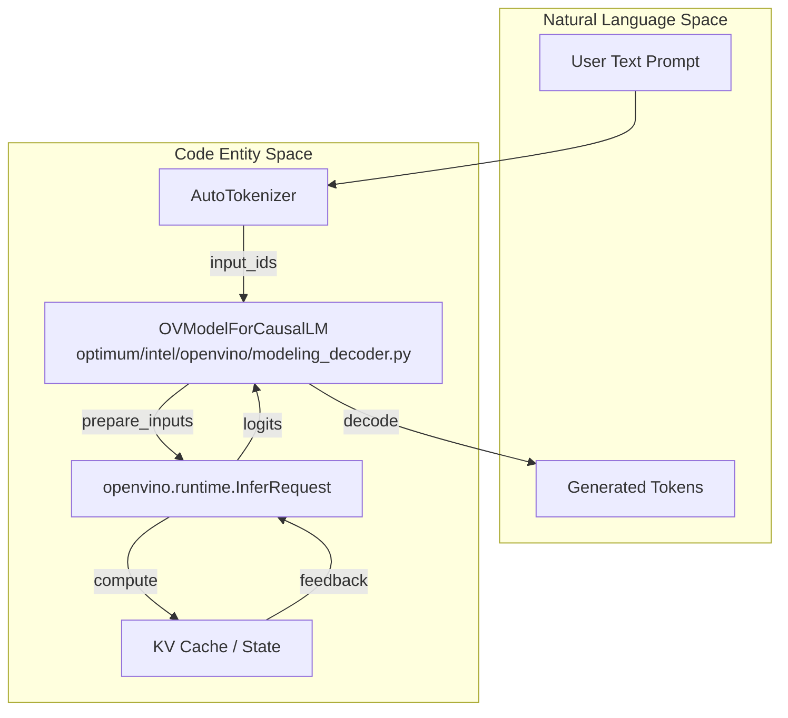

**Architecture Support Highlights:**
- **Stateful Models**: Uses OpenVINO's internal variable state to store KV caches, reducing data transfer between host and device [optimum/intel/openvino/modeling_decoder.py:155-158]().
- **KV Cache Management**: Automatically detects if a model supports KV caches and manages the `decoder_with_past` submodels [optimum/intel/openvino/modeling_decoder.py:161-163]().

Sources: [optimum/intel/openvino/modeling_decoder.py:114-216]()

### Sequence-to-Sequence Models

These models split the architecture into encoder and decoder components, often handled by `OVModelPart`.

| Model Class | Architecture | Task Coverage |
|-------------|--------------|---------------|
| `OVModelForSeq2SeqLM` | T5, BART, Marian | Translation, Summarization. |
| `OVModelForSpeechSeq2Seq` | Whisper | ASR, Speech Translation. |
| `OVModelForVision2Seq` | TrOCR, Donut | OCR, Document Understanding. |
| `OVModelForPix2Struct` | Pix2Struct | Visual Question Answering. |
| `OVModelForTextToSpeechSeq2Seq`| SpeechT5, Kokoro | Text-to-Audio/Speech [optimum/intel/openvino/modeling_text2speech.py:159-173](). |

Sources: [optimum/intel/openvino/modeling_seq2seq.py:252-450](), [optimum/intel/openvino/modeling_text2speech.py:159-173]()

### Vision and Audio Models

OpenVINO provides optimized classes for standard vision and audio backbones, including support for specialized libraries like `timm` and `open_clip`.

| Model Class | Base Class | Example Architectures |
|-------------|------------|-----------------------|
| `OVModelForImageClassification` | `OVModel` | ViT, ResNet, ConvNeXT |
| `OVSamModel` | `OVBaseModel` | Segment Anything Model (SAM) [optimum/intel/openvino/modeling_sam.py:74-110](). |
| `OVModelForAudioClassification` | `OVModel` | Wav2Vec2, HuBERT |
| `OVModelForCTC` | `OVModel` | Wav2Vec2 for ASR |
| `TimmForImageClassification` | `PreTrainedModel` | Any `timm` library model [optimum/intel/openvino/modeling_timm.py:93-114](). |
| `OVModelOpenCLIPForZeroShotImageClassification` | `OVModelOpenCLIPBase` | CLIP variants from `open_clip` [optimum/intel/openvino/modeling_open_clip.py:60-65](). |

Sources: [optimum/intel/openvino/modeling.py:463-584](), [optimum/intel/openvino/modeling_sam.py:74-110](), [optimum/intel/openvino/modeling_timm.py:93-114](), [optimum/intel/openvino/modeling_open_clip.py:60-65]()

### Multimodal (Vision-Language) Models

`OVModelForVisualCausalLM` coordinates multiple OpenVINO models (vision encoder, projector, and language model).

**Visual Language Component Mapping**

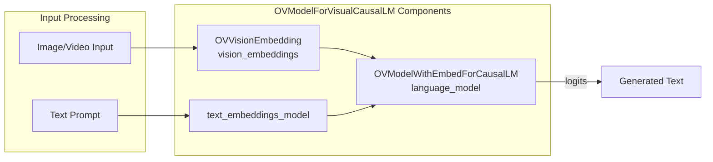

**Architecture Implementation Details:**
- **Components**: Often consists of a `language_model`, `vision_embeddings`, and `text_embeddings` [optimum/intel/openvino/modeling_visual_language.py:344-411]().
- **Input Modes**: Supports `LANGUAGE`, `VISION`, `SPEECH`, and `VISION_SPEECH` for multimodal inputs [optimum/intel/openvino/modeling_visual_language.py:67-71]().

Sources: [optimum/intel/openvino/modeling_visual_language.py:344-411]()

### Diffusion Models

OpenVINO provides high-level pipelines for Stable Diffusion and Flux architectures, managing multiple sub-components (UNet, VAE, Text Encoders).

| Model Class | Task | Components Managed |
|-------------|------|-------------------|
| `OVDiffusionPipeline` | Base Pipeline | UNet/Transformer, VAE, Text Encoders |
| `OVStableDiffusionPipeline` | Text-to-Image | UNet, VAE Decoder, Text Encoder |
| `OVStableDiffusionXLPipeline` | High-res T2I | UNet, VAE Decoder, 2x Text Encoders |
| `OVFluxPipeline` | Next-gen T2I | Transformer, VAE Decoder, 2x Text Encoders |

Sources: [tests/openvino/test_modeling.py:62-84]()

## Model Lifecycle: from_pretrained to Inference

The lifecycle of an OpenVINO model in `optimum-intel` involves several key steps:

1. **Discovery**: `from_pretrained` identifies if OpenVINO IR files (`.xml`) exist [optimum/intel/openvino/modeling_base.py:380-400]().
2. **Export (Optional)**: If `export=True`, it triggers `main_export` to convert PyTorch weights to OpenVINO IR [optimum/intel/openvino/modeling_base.py:415-420]().
3. **Reshape**: The model is reshaped to support dynamic or static dimensions [optimum/intel/openvino/modeling_base.py:112-113]().
4. **Compilation**: `core.compile_model` is called for the target device (e.g., "CPU", "GPU", "NPU") [optimum/intel/openvino/modeling_base.py:530-540]().
5. **Inference**: The `forward` method prepares inputs as `numpy` arrays and executes an `InferRequest` [optimum/intel/openvino/modeling.py:168-175]().

Sources: [optimum/intel/openvino/modeling_base.py:181-540](), [optimum/intel/openvino/modeling.py:120-131]()

---

# Page: Model Export and Conversion

# Model Export and Conversion

<details>
<summary>Relevant source files</summary>

The following files were used as context for generating this wiki page:

- [optimum/exporters/openvino/__main__.py](optimum/exporters/openvino/__main__.py)
- [optimum/exporters/openvino/_traceable_cache.py](optimum/exporters/openvino/_traceable_cache.py)
- [optimum/exporters/openvino/_traceable_decorator.py](optimum/exporters/openvino/_traceable_decorator.py)
- [optimum/exporters/openvino/base.py](optimum/exporters/openvino/base.py)
- [optimum/exporters/openvino/config.py](optimum/exporters/openvino/config.py)
- [optimum/exporters/openvino/convert.py](optimum/exporters/openvino/convert.py)
- [optimum/exporters/openvino/input_generators.py](optimum/exporters/openvino/input_generators.py)
- [optimum/exporters/openvino/model_configs.py](optimum/exporters/openvino/model_configs.py)
- [optimum/exporters/openvino/model_patcher.py](optimum/exporters/openvino/model_patcher.py)
- [optimum/exporters/openvino/patching_utils.py](optimum/exporters/openvino/patching_utils.py)
- [optimum/exporters/openvino/stateful.py](optimum/exporters/openvino/stateful.py)
- [optimum/exporters/openvino/utils.py](optimum/exporters/openvino/utils.py)

</details>


This document explains how to convert Hugging Face models to OpenVINO format for optimized inference on Intel hardware. It covers the internal mechanics of the export process, the model patching system, and the architecture-specific configurations used in `optimum-intel`.

## Overview of the Export Process

The export process converts models from PyTorch to OpenVINO Intermediate Representation (IR) format. The `main_export` function in [optimum/exporters/openvino/__main__.py:178-358]() serves as the primary orchestrator, handling model loading, task inference, and coordinating the conversion pipeline.

**Export Function Call Flow**

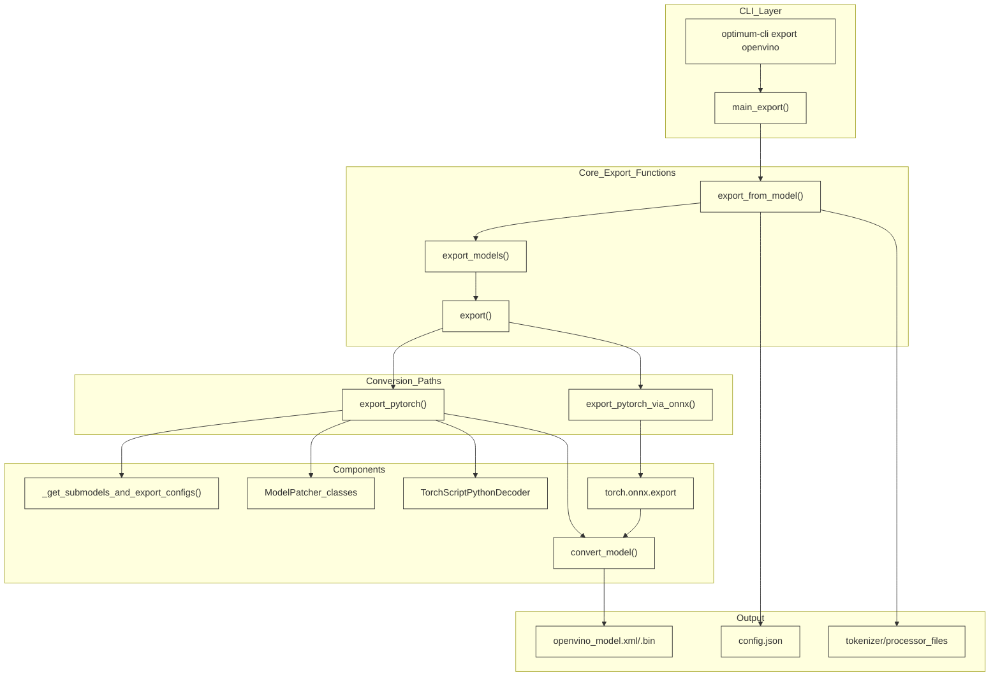

Sources: [optimum/exporters/openvino/__main__.py:178-358](), [optimum/exporters/openvino/convert.py:678-777](), [optimum/exporters/openvino/convert.py:593-676](), [optimum/exporters/openvino/convert.py:145-228]()

## Export Methods

### Command Line Interface

The `main_export` function orchestrates the export process by performing the following steps:
1. **Task Inference**: Via `infer_task()`, it determines the model's task (e.g., `text-generation-with-past`) [optimum/exporters/openvino/__main__.py:74-139]().
2. **Library Detection**: Via `_infer_library_from_model_name_or_path()`, it identifies if the model is from `transformers`, `diffusers`, `timm`, or `open_clip` [optimum/exporters/openvino/__main__.py:41-44]().
3. **Model Loading**: Loads the PyTorch model using the appropriate library-specific loader [optimum/exporters/openvino/__main__.py:254-290]().
4. **Quantization Handling**: Checks for `GPTQ`, `AWQ`, or `mxfp4` configurations to apply appropriate weight compression during export [optimum/exporters/openvino/__main__.py:221-252]().

```bash
optimum-cli export openvino --model meta-llama/Llama-2-7b-chat-hf ./exported-model
```

Sources: [optimum/exporters/openvino/__main__.py:74-139](), [optimum/exporters/openvino/__main__.py:41-44](), [optimum/exporters/openvino/__main__.py:178-358]()

### Python API - export_from_model

The `export_from_model` function provides programmatic access. It handles the extraction of submodels for complex architectures like Encoder-Decoder or Diffusion models using `_get_submodels_and_export_configs` [optimum/exporters/openvino/convert.py:678-777]().

```python
from optimum.exporters.openvino import export_from_model
from transformers import AutoModelForCausalLM

model = AutoModelForCausalLM.from_pretrained("gpt2")
export_from_model(model, output="gpt2_ov/", task="text-generation")
```

Sources: [optimum/exporters/openvino/convert.py:678-777](), [optimum/exporters/openvino/convert.py:530-591]()

## Export Pipeline Architecture

The pipeline decomposes models into components and applies architecture-specific patches.

### Model Decomposition
For complex models, `optimum-intel` extracts submodels to be exported as separate IR files:
- **Encoder-Decoder**: Uses `_get_submodels_for_export_encoder_decoder` to separate the encoder and decoder components [optimum/exporters/openvino/convert.py:51]().
- **Diffusion**: Uses `get_diffusion_models_for_export` to extract the UNet/Transformer, VAE, and Text Encoders [optimum/exporters/openvino/convert.py:54]().
- **OpenCLIP**: Uses `_get_open_clip_submodels_fn_and_export_configs` for multimodal components [optimum/exporters/openvino/convert.py:40]().
- **Kokoro**: Uses `_get_kokoro_submodels_fn_and_export_configs` for specific Kokoro model components [optimum/exporters/openvino/convert.py:38]().

Sources: [optimum/exporters/openvino/convert.py:38-55](), [optimum/exporters/openvino/convert.py:530-591]()

### Model Patching System
The `ModelPatcher` class in [optimum/exporters/openvino/model_patcher.py:104]() is the base for architecture-specific modifications. These patches are necessary to make models compatible with OpenVINO's tracing or to optimize specific operations like RoPE or Attention masks.

**Patcher Class Hierarchy**

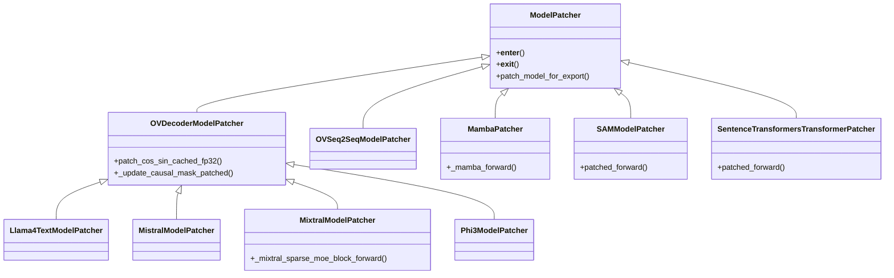

Key patching operations:
- **`OVDecoderModelPatcher`**: Patches RoPE (Rotary Positional Embeddings) to use FP32 for numeric stability and overrides causal mask updates [optimum/exporters/openvino/model_patcher.py:209-241]().
- **`MixtralModelPatcher`**: Overrides the sparse MoE block forward pass to ensure efficient routing during export [optimum/exporters/openvino/model_patcher.py:279-294]().
- **`MambaPatcher`**: Patches the Mamba forward pass for State Space Model (SSM) compatibility [optimum/exporters/openvino/model_patcher.py:1441-1500]().
- **`SAMModelPatcher`**: Provides a `patched_forward` method to handle different variants ("monolith" or "split") for SAM models, allowing separate export of vision encoder and prompt encoder/mask decoder components [optimum/exporters/openvino/model_patcher.py:113-182]().
- **`SentenceTransformersTransformerPatcher`**: Patches the forward pass for Sentence Transformers models [optimum/exporters/openvino/model_patcher.py:185]().
- **Attention Patching**: For specific architectures like `Gemma2` or `Phi-3`, the system may force specific attention implementations (e.g., `sdpa` or `eager`) to ensure export compatibility [optimum/exporters/openvino/__main__.py:60]().
- **Recurrent Attention**: Custom conversion rules like `convert_recurrent_attention_cell` are used for specific recurrent layers in Torch graphs [optimum/exporters/openvino/_ov_ops.py:25-113]().

Sources: [optimum/exporters/openvino/model_patcher.py:209-241](), [optimum/exporters/openvino/model_patcher.py:279-294](), [optimum/exporters/openvino/model_patcher.py:1441-1500](), [optimum/exporters/openvino/model_configs.py:132-205](), [optimum/exporters/openvino/__main__.py:60](), [optimum/exporters/openvino/_ov_ops.py:25-113](), [optimum/exporters/openvino/model_patcher.py:113-182](), [optimum/exporters/openvino/model_patcher.py:185]()

## Conversion Path: Direct PyTorch to IR

The default path uses the OpenVINO PyTorch frontend via `convert_model`.

**Direct Conversion Flow**

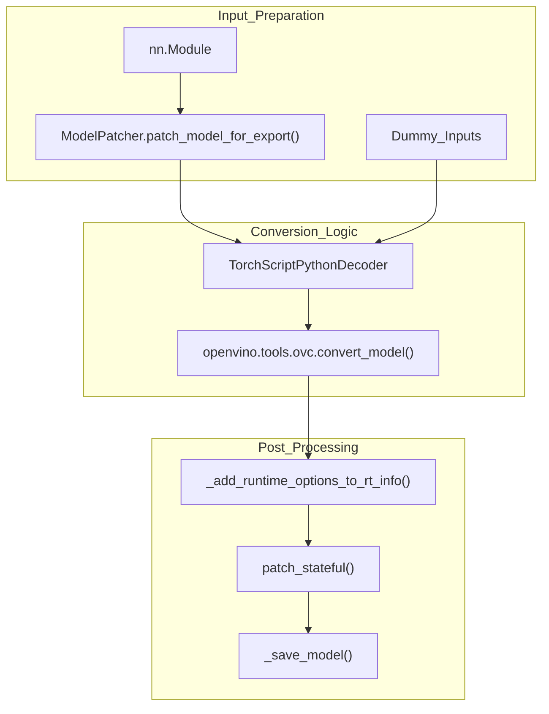

Key logic in `export_pytorch`:
1. **Patching**: Applies the `ModelPatcher` associated with the architecture [optimum/exporters/openvino/convert.py:347-350]().
2. **Input Generation**: Creates dummy inputs via `config.generate_dummy_inputs` [optimum/exporters/openvino/convert.py:353-356]().
3. **Runtime Options**: Sets metadata like `KV_CACHE_PRECISION` (defaulting to `f16` for non-quantized text-generation models) or `ACTIVATIONS_SCALE_FACTOR` into the IR's `rt_info` [optimum/exporters/openvino/convert.py:97-122]().
4. **Stateful Transformation**: For decoder models, `patch_stateful` converts explicit KV cache inputs/outputs into internal model states using `make_stateful` and `fuse_cache_reorder` [optimum/exporters/openvino/stateful.py:49-143]().

Sources: [optimum/exporters/openvino/convert.py:297-454](), [optimum/exporters/openvino/convert.py:97-122](), [optimum/exporters/openvino/stateful.py:49-143]()

## Supported Architectures and Configurations

Architectures are registered in [optimum/exporters/openvino/model_configs.py]() using the `TasksManager`. The library supports a wide range of models across `transformers`, `diffusers`, and `timm`.

| Model Family | Config Class | Patcher Class |
| :--- | :--- | :--- |
| **Llama** | `LlamaOpenVINOConfig` | `OVDecoderModelPatcher` |
| **Mixtral** | `MixtralOpenVINOConfig` | `MixtralModelPatcher` |
| **Phi-3** | `Phi3OpenVINOConfig` | `Phi3ModelPatcher` |
| **ChatGLM** | `ChatGLM2OpenVINOConfig` | `ChatGLMModelPatcher` |
| **Mamba** | `MambaOpenVINOConfig` | `MambaPatcher` |
| **Qwen2-VL** | `Qwen2VLOpenVINOConfig` | `Qwen2VLLanguageModelPatcher` |
| **SAM** | `SamOpenVINOConfig` | `SAMModelPatcher` |
| **Sentence Transformers** | `SentenceTransformersOpenVINOConfig` | `SentenceTransformersTransformerPatcher` |

Sources: [optimum/exporters/openvino/model_configs.py:554-566](), [optimum/exporters/openvino/model_configs.py:526-536](), [optimum/exporters/openvino/model_configs.py:438-450](), [optimum/exporters/openvino/model_configs.py:840-845](), [optimum/exporters/openvino/model_configs.py:195](), [optimum/exporters/openvino/model_configs.py:164](), [optimum/exporters/openvino/model_configs.py:167]()

## IR File Formats and Metadata

The export results in two primary files:
- **`openvino_model.xml`**: The XML representation of the model graph [optimum/exporters/openvino/utils.py:49]().
- **`openvino_model.bin`**: The binary file containing weights and biases.

During the save process (`_save_model`), the exporter embeds version information from `optimum-intel`, `openvino`, and `transformers` into the model's metadata to ensure traceability [optimum/exporters/openvino/convert.py:124-143](). It also handles `compress_to_fp16` logic if specified in the `OVConfig` [optimum/exporters/openvino/convert.py:131]().

Sources: [optimum/exporters/openvino/convert.py:124-143](), [optimum/exporters/openvino/utils.py:49-50](), [optimum/exporters/openvino/convert.py:131]()

---

# Page: Quantization System

# Quantization System

<details>
<summary>Relevant source files</summary>

The following files were used as context for generating this wiki page:

- [docs/source/openvino/export.mdx](docs/source/openvino/export.mdx)
- [docs/source/openvino/inference.mdx](docs/source/openvino/inference.mdx)
- [docs/source/openvino/optimization.mdx](docs/source/openvino/optimization.mdx)
- [optimum/intel/openvino/configuration.py](optimum/intel/openvino/configuration.py)
- [optimum/intel/openvino/quantization.py](optimum/intel/openvino/quantization.py)
- [tests/openvino/test_quantization.py](tests/openvino/test_quantization.py)

</details>


The quantization system provides comprehensive model compression through the NNCF (Neural Network Compression Framework) backend. The system orchestrates quantization through the `OVQuantizer` class [optimum/intel/openvino/quantization.py:1208-1450]() and a hierarchy of configuration classes [optimum/intel/openvino/configuration.py:574-850](). It supports weight-only quantization, full quantization (weights + activations), hybrid quantization for diffusion models, and mixed-precision quantization.

The system integrates at three entry points: (1) CLI export via `optimum-cli export openvino`, (2) model loading via `from_pretrained(..., quantization_config=...)`, and (3) explicit quantization via `OVQuantizer.quantize()`.

## System Architecture

### Component Overview

The quantization system consists of three layers: configuration, orchestration, and execution.

**Diagram: Quantization System Architecture**
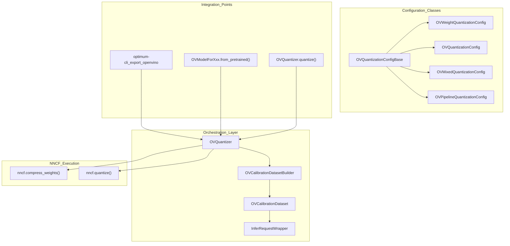

Sources: [optimum/intel/openvino/quantization.py:88-246](), [optimum/intel/openvino/configuration.py:545-850]()

## Configuration Classes

### OVQuantizationConfigBase

Base class for all quantization configurations [optimum/intel/openvino/configuration.py:574-640]():

| Parameter | Type | Description |
|-----------|------|-------------|
| `ignored_scope` | `Dict` | Nodes/patterns to exclude from quantization via `names` or `patterns` lists |
| `num_samples` | `int` | Number of calibration samples (default: 128 for weight-only, 200 for full) |
| `dataset` | `str` or `List[str]` | Dataset name or list of text samples for calibration |
| `tokenizer` | `str` | Tokenizer model ID for preprocessing |
| `processor` | `str` | Processor model ID for multimodal models |
| `trust_remote_code` | `bool` | Whether to trust remote code when loading |

### OVWeightQuantizationConfig

Weight-only quantization configuration [optimum/intel/openvino/configuration.py:642-715]():

| Parameter | Type | Default | Description |
|-----------|------|---------|-------------|
| `bits` | `int` | 4 | Quantization bit-width (4 or 8) |
| `sym` | `bool` | `True` | Symmetric vs asymmetric quantization |
| `group_size` | `int` | 128 | Group size for quantization (-1 = per-column) |
| `ratio` | `float` | 1.0 | Ratio of layers to quantize (0.0-1.0) |
| `all_layers` | `bool` | `None` | Whether to quantize embedding and lm_head layers |
| `quant_method` | `OVQuantizationMethod` | `DEFAULT` | Algorithm: DEFAULT, AWQ, or HYBRID |
| `awq` | `bool` | `False` | Enable Activation-Aware Weight Quantization |
| `scale_estimation` | `bool` | `False` | Enable scale estimation algorithm |
| `gptq` | `bool` | `False` | Enable GPTQ algorithm |
| `lora_correction` | `bool` | `False` | Enable LoRA correction algorithm |
| `backup_precision` | `str` | `"int8_asym"` | Backup precision: `none`, `int8_sym`, or `int8_asym` |

### OVQuantizationConfig

Full quantization (weights + activations) configuration [optimum/intel/openvino/configuration.py:717-759]():

| Parameter | Type | Default | Description |
|-----------|------|---------|-------------|
| `dtype` | `str` | `"int8"` | Data type: `int8`, `f8e4m3`, or `f8e5m2` |
| `smooth_quant_alpha` | `float` | -1 | SmoothQuant alpha parameter (-1 = auto-tune, 0.0-1.0 = fixed) |
| `weight_only` | `bool` | `False` | Whether to quantize only weights (activations remain fp32) |

### OVMixedQuantizationConfig

Mixed-precision quantization combining weight-only and full quantization [optimum/intel/openvino/configuration.py:761-811]():

| Parameter | Type | Description |
|-----------|------|-------------|
| `weight_quantization_config` | `OVWeightQuantizationConfig` | Configuration for weight compression |
| `full_quantization_config` | `OVQuantizationConfig` | Configuration for activation quantization |

Sources: [optimum/intel/openvino/configuration.py:574-850]()

## OVQuantizer Class

The `OVQuantizer` class [optimum/intel/openvino/quantization.py:1208-1677]() orchestrates the quantization process.

### Initialization

**Diagram: OVQuantizer Initialization Flow**
```mermaid
graph LR
    FromPretrained["OVQuantizer.from_pretrained()"]
    Init["OVQuantizer.__init__()"]
    StoreModel["Store_OVBaseModel"]
    SetTask["Set_export_feature_task"]
    
    FromPretrained --> Init
    Init --> StoreModel
    StoreModel --> SetTask
```

**Method**: `from_pretrained(model, task=None, **kwargs)` [optimum/intel/openvino/quantization.py:1258-1320]()

Accepts either an `OVBaseModel` instance or a path to load from. The `task` parameter defaults to `model.export_feature` if not provided.

### Quantization Workflow

**Diagram: Quantization Execution Path**
```mermaid
graph TB
    Quantize["OVQuantizer.quantize()"]
    ValidateInputs["Validate_save_directory"]
    ProcessOVConfig["Process_OVConfig"]
    CheckConfigType{"Check_quantization_config_type"}
    
    WeightOnly["Weight-only_path"]
    FullQuant["Full_quantization_path"]
    MixedQuant["Mixed_quantization_path"]
    PipelineQuant["Pipeline_quantization_path"]
    
    WeightOnlyExec["_quantize_weight_only()"]
    FullQuantExec["_quantize_full()"]
    
    CompressWeights["nncf.compress_weights()"]
    NNCFQuantize["nncf.quantize()"]
    
    ApplyDefaults["_apply_default_ignored_scope_config()"]
    SaveToDir["openvino.save_model()"]
    SaveConfig["Save_OVConfig_to_config.json"]
    
    Quantize --> ValidateInputs
    ValidateInputs --> ProcessOVConfig
    ProcessOVConfig --> CheckConfigType
    
    CheckConfigType -->|OVWeightQuantizationConfig| WeightOnly
    CheckConfigType -->|OVQuantizationConfig| FullQuant
    CheckConfigType -->|OVMixedQuantizationConfig| MixedQuant
    CheckConfigType -->|OVPipelineQuantizationConfig| PipelineQuant
    
    WeightOnly --> ApplyDefaults
    FullQuant --> ApplyDefaults
    MixedQuant --> ApplyDefaults
    PipelineQuant --> ApplyDefaults
    
    ApplyDefaults --> WeightOnlyExec
    ApplyDefaults --> FullQuantExec
    
    WeightOnlyExec --> CompressWeights
    FullQuantExec --> NNCFQuantize
    
    CompressWeights --> SaveToDir
    NNCFQuantize --> SaveToDir
    SaveToDir --> SaveConfig
```

**Method**: `quantize(calibration_dataset=None, save_directory=None, **kwargs)` [optimum/intel/openvino/quantization.py:1321-1400]()

The main quantization entry point. Delegates to:
- `_quantize_weight_only()` [optimum/intel/openvino/quantization.py:1483-1570]() for weight compression.
- `_quantize_full()` [optimum/intel/openvino/quantization.py:1402-1481]() for full quantization.

Sources: [optimum/intel/openvino/quantization.py:1208-1677](), [tests/openvino/test_quantization.py:445-533]()

### Weight-Only Quantization Details

The `_quantize_weight_only()` method [optimum/intel/openvino/quantization.py:1483-1570]() performs weight compression:

1. Extracts parameters: `bits`, `sym`, `group_size`, `ratio`, `all_layers`, etc. [optimum/intel/openvino/quantization.py:1495-1510]().
2. Handles algorithm-specific parameters: `awq`, `scale_estimation`, `gptq`, `lora_correction` [optimum/intel/openvino/quantization.py:1520-1540]().
3. Prepares calibration dataset if needed (for data-aware algorithms) [optimum/intel/openvino/quantization.py:1515-1518]().
4. Calls `nncf.compress_weights()` with prepared parameters [optimum/intel/openvino/quantization.py:1545-1560]().

**Supported algorithms**:
- **AWQ**: Set `awq=True` or `quant_method=OVQuantizationMethod.AWQ` [optimum/intel/openvino/configuration.py:50-54]().
- **GPTQ**: Set `gptq=True` [optimum/intel/openvino/quantization.py:1525]().
- **Scale estimation**: Set `scale_estimation=True` [optimum/intel/openvino/quantization.py:1532]().
- **LoRA correction**: Set `lora_correction=True` [optimum/intel/openvino/quantization.py:1537]().

### Full Quantization Details

The `_quantize_full()` method [optimum/intel/openvino/quantization.py:1402-1481]() performs activation quantization:

1. Prepares calibration dataset (required for full quantization) [optimum/intel/openvino/quantization.py:1410-1420]().
2. Extracts parameters: `dtype`, `smooth_quant_alpha`, `weight_only` [optimum/intel/openvino/quantization.py:1425-1435]().
3. Applies SmoothQuant if `smooth_quant_alpha` is specified [optimum/intel/openvino/quantization.py:1440-1455]().
4. Calls `nncf.quantize()` with the calibration dataset [optimum/intel/openvino/quantization.py:1460-1475]().

Sources: [optimum/intel/openvino/quantization.py:1402-1570]()

## Calibration Dataset System

The `OVCalibrationDatasetBuilder` class [optimum/intel/openvino/quantization.py:234-1117]() handles calibration data preparation.

### Model-Specific Preparation Methods

| Model Type | Preparation Method | File Reference |
|------------|-------------------|----------------|
| `OVModelForCausalLM` | `_prepare_causal_lm_calibration_data()` | [optimum/intel/openvino/quantization.py:661-750]() |
| `OVModelForVisualCausalLM` | `_prepare_visual_causal_lm_calibration_data()` | [optimum/intel/openvino/quantization.py:877-1023]() |
| `_OVModelForWhisper` | `_prepare_speech_to_text_calibration_data()` | [optimum/intel/openvino/quantization.py:752-829]() |
| `OVDiffusionPipeline` | `_prepare_diffusion_calibration_data()` | [optimum/intel/openvino/quantization.py:1025-1074]() |
| `OVModelForSeq2SeqLM` | `_prepare_text_to_text_calibration_data()` | [optimum/intel/openvino/quantization.py:831-875]() |
| `OVSamModel` | `_prepare_sam_dataset()` | [optimum/intel/openvino/quantization.py:1105-1117]() |

### Predefined Datasets

The system includes predefined dataset mappings [optimum/intel/openvino/utils.py:153-251]():

- **wikitext2**: `Salesforce/wikitext` (wikitext-2-raw-v1) [optimum/intel/openvino/utils.py:155]().
- **gsm8k**: `openai/gsm8k` (main) [optimum/intel/openvino/utils.py:165]().
- **conceptual_captions**: `google-research-datasets/conceptual_captions` [optimum/intel/openvino/utils.py:215]().
- **librispeech**: `hf-internal-testing/librispeech_asr_dummy` [optimum/intel/openvino/utils.py:180]().

Sources: [optimum/intel/openvino/quantization.py:234-1117](), [optimum/intel/openvino/utils.py:153-251]()

## Quantization Data Types

### Weight-only formats (CLI: `--weight-format`)
- `int4`, `int8`: Standard integer formats [optimum/commands/export/openvino.py:70-75]().
- `nf4`: 4-bit NormalFloat [optimum/commands/export/openvino.py:70]().
- `mxfp4`: 4-bit Microscaling Float [optimum/commands/export/openvino.py:70]().
- `cb4`: 4-bit Codebook (16 fixed fp8 values in E4M3 format) [optimum/commands/export/openvino.py:70-73]().

### Full/Mixed quantization modes (CLI: `--quant-mode`)
- `int8`: Weights and activations to INT8 [optimum/commands/export/openvino.py:79]().
- `f8e4m3`, `f8e5m2`: FP8 activation quantization [optimum/commands/export/openvino.py:79]().
- `cb4_f8e4m3`: Codebook weight + FP8 activation mixed quantization [optimum/commands/export/openvino.py:79]().

Sources: [optimum/commands/export/openvino.py:68-84](), [optimum/intel/openvino/configuration.py:642-759]()

## Default Configurations

Optimum Intel provides optimized default configurations for over 60 models [optimum/intel/openvino/configuration.py:57-425]().

**Example Defaults**:
- `meta-llama/Llama-2-7b-hf`: 4-bit symmetric, group size 128, ratio 0.6 [optimum/intel/openvino/configuration.py:76]().
- `HuggingFaceH4/zephyr-7b-beta`: 4-bit symmetric, AWQ, ratio 0.8 [optimum/intel/openvino/configuration.py:69-75]().
- `databricks/dolly-v2-3b`: 4-bit asymmetric, scale estimation enabled [optimum/intel/openvino/configuration.py:58-65]().
- `Qwen/Qwen2.5-Coder-3B-Instruct`: 4-bit asymmetric, group size 64, ratio 1.0, scale estimation enabled, `dq_group_size=128` [optimum/intel/openvino/configuration.py:120-128]().

Sources: [optimum/intel/openvino/configuration.py:53-425]()

---

# Page: Model Loading and Inference

# Model Loading and Inference

<details>
<summary>Relevant source files</summary>

The following files were used as context for generating this wiki page:

- [optimum/intel/openvino/modeling.py](optimum/intel/openvino/modeling.py)
- [optimum/intel/openvino/modeling_base.py](optimum/intel/openvino/modeling_base.py)
- [optimum/intel/openvino/modeling_decoder.py](optimum/intel/openvino/modeling_decoder.py)
- [tests/openvino/test_modeling.py](tests/openvino/test_modeling.py)

</details>


This page documents the runtime behavior of OpenVINO models in `optimum-intel`, covering how models are loaded from pretrained sources, compiled for execution on Intel hardware, and used for inference. This includes device management, compilation strategies, request handling, and execution workflows.

For information about model export and conversion, see [Model Export and Conversion](#2.2). For quantization applied during or after loading, see [Quantization System](#2.3). For diffusion-specific loading and inference, see [Diffusion Models](#2.5).

## Model Loading Workflow

Models in `optimum-intel` are loaded through the `from_pretrained` class method, which supports loading from HuggingFace Hub, local directories, or on-the-fly export from PyTorch models. The system automatically detects whether a model is already in OpenVINO format or requires export.

### Loading Entry Points

The primary entry point for loading models is the `OVBaseModel.from_pretrained` method, which is inherited by task-specific classes like `OVModelForCausalLM` or `OVModelForSequenceClassification`.

```mermaid
graph TB
    subgraph "User Code"
        USER["User calls<br/>OVModel*.from_pretrained()"]
    end
    
    subgraph "Base Loading Logic"
        FROM_PRETRAINED["OVBaseModel.from_pretrained()<br/>modeling_base.py"]
        DETECT["Detect Model Format"]
        FIND_FILES["_find_files_matching_pattern()<br/>Check for .xml files"]
        
        FROM_PRETRAINED --> DETECT
        DETECT --> FIND_FILES
    end
    
    subgraph "Load Path: Existing OpenVINO Model"
        FROM_PRETRAINED_INTERNAL["_from_pretrained()<br/>Load IR files"]
        LOAD_MODEL["load_model()<br/>core.read_model()"]
        APPLY_QUANT["Apply quantization_config<br/>if specified"]
        
        FROM_PRETRAINED_INTERNAL --> LOAD_MODEL
        LOAD_MODEL --> APPLY_QUANT
    end
    
    subgraph "Export Path: PyTorch to OpenVINO"
        EXPORT_METHOD["_export()<br/>Export PyTorch model"]
        MAIN_EXPORT["main_export()<br/>Run export pipeline"]
        SAVE_TEMP["Save to<br/>TemporaryDirectory"]
        
        EXPORT_METHOD --> MAIN_EXPORT
        MAIN_EXPORT --> SAVE_TEMP
        SAVE_TEMP --> FROM_PRETRAINED_INTERNAL
    end
    
    subgraph "Model Initialization"
        INIT["__init__()<br/>Initialize OVModel"]
        RESHAPE["_reshape()<br/>Set dynamic shapes"]
        SET_CONFIG["_set_ov_config_parameters()<br/>Configure performance"]
        COMPILE["compile()<br/>Prepare for inference"]
        
        APPLY_QUANT --> INIT
        INIT --> RESHAPE
        RESHAPE --> SET_CONFIG
        SET_CONFIG --> COMPILE
    end
    
    USER --> FROM_PRETRAINED
    FIND_FILES -->|".xml found"| FROM_PRETRAINED_INTERNAL
    FIND_FILES -->|"No .xml"| EXPORT_METHOD
    
    COMPILE --> READY["Model Ready<br/>for Inference"]
```

**Sources:** [optimum/intel/openvino/modeling_base.py:181-226](), [optimum/intel/openvino/modeling_decoder.py:109-152](), [tests/openvino/test_modeling.py:129-131]()

### Key Loading Parameters

The `from_pretrained` method accepts multiple parameters that control loading behavior:

| Parameter | Type | Description | Default |
|-----------|------|-------------|---------|
| `model_id` | `str` or `Path` | HuggingFace model ID or local path | Required |
| `export` | `bool` | Force export even if OpenVINO model exists | `False` |
| `device` | `str` | Target device (CPU, GPU, NPU, AUTO) | `"CPU"` |
| `ov_config` | `Dict[str, str]` | OpenVINO compilation config | `None` |
| `compile` | `bool` | Compile model during loading | `True` |
| `compile_only` | `bool` | Load pre-compiled model only | `False` |
| `dynamic_shapes` | `bool` | Use dynamic input shapes | `True` |
| `use_cache` | `bool` | Enable KV-cache for generation | `True` |
| `stateful` | `bool` | Use stateful model variant | Auto-detected |
| `quantization_config` | `OVWeightQuantizationConfig` | Apply weight quantization | `None` |

**Sources:** [optimum/intel/openvino/modeling_base.py:181-205](), [optimum/intel/openvino/modeling_decoder.py:115-152](), [optimum/intel/openvino/modeling.py:70-85]()

### Model Format Detection

The loading system searches for OpenVINO IR files using a pattern-based approach. It recognizes specific filenames for different model parts defined in `optimum/intel/openvino/utils.py`.

| Component | Filename Variable | Value |
|-----------|-------------------|-------|
| Generic Model | `OV_XML_FILE_NAME` | `openvino_model.xml` |
| Encoder | `OV_ENCODER_NAME` | `openvino_encoder_model.xml` |
| Decoder | `OV_DECODER_NAME` | `openvino_decoder_model.xml` |
| Decoder w/ Past | `OV_DECODER_WITH_PAST_NAME` | `openvino_decoder_with_past_model.xml` |
| Language Model | `OV_LANGUAGE_MODEL_NAME` | `openvino_language_model.xml` |
| Vision Encoder | `OV_VISION_ENCODER_MODEL_NAME` | `openvino_vision_encoder.xml` |

**Sources:** [optimum/intel/openvino/utils.py:41-52](), [optimum/intel/utils/modeling_utils.py:155-243]()

## Device and Compilation Management

OpenVINO models are compiled for specific hardware devices using the `openvino.Core` instance. The compilation process optimizes the model graph for the target device.

### Compilation Workflow

```mermaid
graph TB
    subgraph "Device Configuration"
        DEVICE_PARAM["device parameter<br/>(CPU, GPU, NPU, AUTO)"]
        OV_CONFIG["ov_config dictionary<br/>PERFORMANCE_HINT, etc."]
        AUTO_CONFIG["_set_ov_config_parameters()<br/>Set defaults"]
    end
    
    subgraph "Model Preparation"
        PKV_PRECISION["update_pkv_precision()<br/>Set cache precision"]
        RESHAPE_MODEL["_reshape()<br/>Configure dynamic shapes"]
    end
    
    subgraph "Compilation"
        COMPILE_METHOD["compile()"]
        COMPILE_MODEL["_compile_model()<br/>core.compile_model()"]
        CACHE_DIR["Set CACHE_DIR<br/>for caching"]
        CREATE_REQUEST["Create InferRequest"]
    end
    
    subgraph "Compiled Artifacts"
        COMPILED["CompiledModel"]
        REQUEST["InferRequest"]
        CACHE_BLOBS["Cache .blob files"]
    end
    
    DEVICE_PARAM --> AUTO_CONFIG
    OV_CONFIG --> AUTO_CONFIG
    AUTO_CONFIG --> PKV_PRECISION
    
    PKV_PRECISION --> RESHAPE_MODEL
    RESHAPE_MODEL --> COMPILE_METHOD
    
    COMPILE_METHOD --> COMPILE_MODEL
    COMPILE_MODEL --> CACHE_DIR
    CACHE_DIR --> CREATE_REQUEST
    
    CREATE_REQUEST --> COMPILED
    COMPILED --> REQUEST
    CACHE_DIR -.-> CACHE_BLOBS
```

**Sources:** [optimum/intel/openvino/modeling_base.py:354-379](), [optimum/intel/openvino/modeling_decoder.py:228-256]()

### Performance Configuration

The system automatically sets default OpenVINO configuration parameters to optimize for common use cases. For instance, `PERFORMANCE_HINT` defaults to `LATENCY` [tests/openvino/test_modeling.py:133-135](). Users can specify a `CACHE_DIR` in `ov_config` to enable persistent compilation caching, which stores `.blob` files to speed up subsequent loads [tests/openvino/test_modeling.py:138-148]().

**Sources:** [tests/openvino/test_modeling.py:133-148]()

## Inference Execution

The inference workflow transforms input tensors into model predictions. `OVModel` classes handle the conversion between PyTorch and OpenVINO data formats (NumPy-based).

### Forward Pass Architecture

```mermaid
graph TB
    subgraph "User Interface"
        FORWARD["forward(input_ids,<br/>attention_mask,<br/>past_key_values, ...)"]
    end
    
    subgraph "Input Preparation"
        PREPARE["prepare_inputs()"]
        PKV_HANDLE["Handle past_key_values"]
        ATTENTION["Prepare attention_mask"]
    end
    
    subgraph "State Management (Stateful Models)"
        CHECK_FIRST{{"First iteration?"}}
        RESET["request.reset_state()"]
        INIT_BEAM["Initialize beam_idx"]
    end
    
    subgraph "Execution"
        COMPILE_CHECK["Ensure model compiled"]
        START_ASYNC["request.start_async(inputs,<br/>share_inputs=True)"]
        WAIT["request.wait()"]
    end
    
    subgraph "Output Processing"
        EXTRACT["Extract logits from request"]
        PKV_OUT["Extract/update<br/>past_key_values"]
        TO_TORCH["Convert to torch.Tensor"]
        OUTPUT["Return ModelOutput"]
    end
    
    FORWARD --> COMPILE_CHECK
    COMPILE_CHECK --> PREPARE
    
    PREPARE --> PKV_HANDLE
    PREPARE --> ATTENTION
    
    PKV_HANDLE --> CHECK_FIRST
    CHECK_FIRST -->|"Yes"| RESET
    RESET --> INIT_BEAM
    CHECK_FIRST -->|"No"| START_ASYNC
    INIT_BEAM --> START_ASYNC
    
    START_ASYNC --> WAIT
    WAIT --> EXTRACT
    EXTRACT --> PKV_OUT
    PKV_OUT --> TO_TORCH
    TO_TORCH --> OUTPUT
```

**Sources:** [optimum/intel/openvino/modeling_decoder.py:550-605](), [optimum/intel/openvino/modeling_decoder.py:458-548]()

## KV-Cache Management

Generative models use key-value caching to avoid recomputing attention states. `optimum-intel` supports both **stateless** and **stateful** models.

### Stateful vs Stateless Models

A model is considered stateful if it contains internal states (sinks/sources) for KV-cache management, detected via `model_has_state` [optimum/exporters/openvino/stateful.py:47]().

| Feature | Stateless Models | Stateful Models |
|---------|------------------|-----------------|
| **Cache Location** | Managed by User (past_key_values) | Internal to OpenVINO Runtime |
| **Data Flow** | Cache is passed in/out of model | Cache remains in model memory |
| **Detection** | `self.stateful = False` | `model_has_state(self.model)` |
| **Input Handling** | Requires PKV inputs in every call | `reset_state()` called on new sequence |

**Sources:** [optimum/intel/openvino/modeling_decoder.py:154-158](), [optimum/exporters/openvino/stateful.py:46-48]()

### Cache Precision Management

The `update_pkv_precision()` function allows the model to adjust the precision of the KV-cache (e.g., to `f16` or `bf16`) based on the target device's `INFERENCE_PRECISION_HINT` [optimum/intel/openvino/modeling_decoder.py:228-256](). This is critical for memory-constrained environments.

**Sources:** [optimum/intel/openvino/modeling_decoder.py:228-256]()

## Special Loading Modes

### Compile-Only Mode

When `compile_only=True`, the model is loaded in a pre-compiled state using `openvino.CompiledModel`. This bypasses the intermediate `openvino.Model` representation, which is efficient for deployment but prevents further graph modifications like reshaping [tests/openvino/test_modeling.py:151-162]().

**Sources:** [optimum/intel/openvino/modeling_base.py:118-124](), [tests/openvino/test_modeling.py:151-162]()

### Sequential Models (Encoder-Decoder)

Classes like `OVModelForSeq2SeqLM` manage multiple sub-components. For example, a Whisper model for speech recognition involves an encoder and a decoder (optionally with a "with_past" variant). These models manage component-specific loading and inference logic [optimum/intel/openvino/modeling_base.py:148-160]().

**Sources:** [optimum/intel/openvino/modeling_base.py:148-160]()

## Performance Considerations

### Dynamic vs Static Shapes

By default, `optimum-intel` sets model dimensions to dynamic (`dynamic_shapes=True`) to maintain compatibility with varying input lengths in HuggingFace pipelines [optimum/intel/openvino/modeling.py:78-79]().

**Sources:** [optimum/intel/openvino/modeling.py:78-79]()

### Data Type Mapping

The system provides utilities to map between OpenVINO, NumPy, and PyTorch types to ensure seamless data flow during inference.

| Type | NumPy Mapping | PyTorch Mapping (`OV_TO_PT_TYPE`) |
|------|---------------------------------|-----------------------------------|
| `f32` | `np.float32` | `torch.float32` |
| `f16` | `np.float16` | `torch.float16` |
| `i64` | `np.int64` | `torch.int64` |
| `u8` | `np.uint8` | `torch.uint8` |

**Sources:** [optimum/intel/openvino/utils.py:93-96]()

---

# Page: Diffusion Models

# Diffusion Models

<details>
<summary>Relevant source files</summary>

The following files were used as context for generating this wiki page:

- [notebooks/openvino/demos/quantized_generation_demo.ipynb](notebooks/openvino/demos/quantized_generation_demo.ipynb)
- [notebooks/openvino/sentence_transformer_quantization.ipynb](notebooks/openvino/sentence_transformer_quantization.ipynb)
- [notebooks/openvino/stable_diffusion_hybrid_quantization.ipynb](notebooks/openvino/stable_diffusion_hybrid_quantization.ipynb)
- [optimum/intel/openvino/modeling_diffusion.py](optimum/intel/openvino/modeling_diffusion.py)
- [optimum/intel/openvino/modeling_seq2seq.py](optimum/intel/openvino/modeling_seq2seq.py)
- [tests/openvino/test_diffusion.py](tests/openvino/test_diffusion.py)

</details>


Diffusion Models are generative AI systems that produce images or videos from text prompts. This page documents the OpenVINO integration for diffusion models in `optimum-intel`, covering the pipeline architecture, component structure, quantization strategies, and reshape capabilities.

## Purpose and Scope

The diffusion model implementation in `optimum-intel` provides OpenVINO-optimized inference for popular diffusion architectures including Stable Diffusion, Stable Diffusion XL, Stable Diffusion 3, Flux, Sana, and LTX-Video. The system decomposes diffusion pipelines into separately optimized components (denoising network, VAE, text encoders) and supports hybrid quantization strategies that balance quality and performance across different component types.

Sources: [optimum/intel/openvino/modeling_diffusion.py:140-144](), [optimum/intel/openvino/modeling_diffusion.py:158-295]()

## Pipeline Architecture

### Component-Based Design

Diffusion pipelines are decomposed into independently compiled OpenVINO models, allowing per-component optimization and selective quantization. The base class `OVDiffusionPipeline` manages these submodels.

**Pipeline Component Association**

```mermaid
graph TB
    subgraph "Pipeline Initialization"
        INIT["OVDiffusionPipeline.__init__"]
        CONFIG["model_index.json"]
        DETECT["_infer_pipeline_class_from_model_config"]
    end
    
    subgraph "Core Components (Code Entities)"
        UNET["OVModelUnet<br/>(unet subfolder)"]
        TRANS["OVModelTransformer<br/>(transformer subfolder)"]
        
        VAE_ENC["OVModelVaeEncoder<br/>(vae_encoder subfolder)"]
        VAE_DEC["OVModelVaeDecoder<br/>(vae_decoder subfolder)"]
        VAE_WRAP["OVModelVae<br/>(wrapper)"]
        
        TE1["OVModelTextEncoder<br/>(text_encoder subfolder)"]
        TE2["OVModelTextEncoder<br/>(text_encoder_2 subfolder)"]
        TE3["OVModelTextEncoder<br/>(text_encoder_3 subfolder)"]
    end
    
    subgraph "Pipeline Variants"
        SD["OVStableDiffusionPipeline"]
        SDXL["OVStableDiffusionXLPipeline"]
        SD3["OVStableDiffusion3Pipeline"]
        FLUX["OVFluxPipeline"]
        SANA["OVSanaPipeline"]
        LTX["OVLTXPipeline"]
    end
    
    INIT --> CONFIG
    CONFIG --> DETECT
    DETECT --> SD
    DETECT --> SDXL
    DETECT --> SD3
    DETECT --> FLUX
    DETECT --> SANA
    DETECT --> LTX
    
    SD -.uses.-> UNET
    SD -.uses.-> VAE_WRAP
    SD -.uses.-> TE1
    
    FLUX -.uses.-> TRANS
    FLUX -.uses.-> VAE_WRAP
    FLUX -.uses.-> TE1
    FLUX -.uses.-> TE2
    
    SD3 -.uses.-> TRANS
    SD3 -.uses.-> VAE_WRAP
    SD3 -.uses.-> TE1
    SD3 -.uses.-> TE2
    SD3 -.uses.-> TE3
```

Sources: [optimum/intel/openvino/modeling_diffusion.py:140-156](), [optimum/intel/openvino/modeling_diffusion.py:146-156]()

### Component Model Classes

Each pipeline component is represented as a separate `OVModelPart` subclass (or internal model reference) that handles compilation and inference:

| Component Class | Subfolder Name | Purpose |
|----------------|-------------------|---------|
| `OVModelUnet` | `unet` | Denoising network for SD, SDXL (U-Net architecture) |
| `OVModelTransformer` | `transformer` | Denoising network for SD3, Flux, Sana, LTX (DiT architecture) |
| `OVModelVaeDecoder` | `vae_decoder` | Latent-to-image decoding |
| `OVModelVaeEncoder` | `vae_encoder` | Image-to-latent encoding (for img2img, inpainting) |
| `OVModelTextEncoder` | `text_encoder` | CLIP or T5 text embedding |
| `OVModelVae` | N/A | Wrapper combining encoder and decoder |

Sources: [optimum/intel/openvino/modeling_diffusion.py:146-156](), [optimum/intel/openvino/modeling_diffusion.py:1189-1231]()

## Supported Architectures

### Architecture Comparison

Different diffusion architectures use different component combinations. The library supports a wide range of models through the `diffusers` integration.

| Architecture | Denoising Network | VAE | Text Encoders |
|-------------|-------------------|-----|---------------|
| **Stable Diffusion** | `unet` | Encoder + Decoder | `text_encoder` (CLIP) |
| **SD XL** | `unet` | Encoder + Decoder | `text_encoder`, `text_encoder_2` |
| **SD 3** | `transformer` | Encoder + Decoder | `text_encoder`, `text_encoder_2`, `text_encoder_3` |
| **Flux** | `transformer` | Encoder + Decoder | `text_encoder`, `text_encoder_2` |
| **Sana** | `transformer` | Encoder + Decoder | `text_encoder` (Gemma) |
| **LTX-Video** | `transformer` | Encoder + Decoder | `text_encoder` (T5) |

Sources: [optimum/intel/openvino/modeling_diffusion.py:82-130](), [optimum/intel/openvino/modeling_diffusion.py:146-156]()

## Loading and Initialization

### From Pretrained Models

The `OVDiffusionPipeline.from_pretrained()` method is the entry point for loading models. It can load exported OpenVINO IR files or export a PyTorch model on-the-fly.

```python
from optimum.intel import OVDiffusionPipeline

# Load and export to OpenVINO
pipeline = OVDiffusionPipeline.from_pretrained(
    "stabilityai/stable-diffusion-2-1",
    export=True,
    device="CPU"
)
```

Sources: [optimum/intel/openvino/modeling_diffusion.py:385-583]()

### Initialization Parameters

The `__init__` method of `OVDiffusionPipeline` accepts various OpenVINO-specific arguments to control hardware execution and model behavior.

**Initialization Data Flow**

```mermaid
graph TB
    subgraph "Inputs to OVDiffusionPipeline.__init__"
        DEVICE["device: str = 'CPU'"]
        COMPILE["compile: bool = True"]
        DYNAMIC["dynamic_shapes: bool = True"]
        OV_CFG["ov_config: Dict[str, str]"]
        QUANT["quantization_config: OVWeightQuantizationConfig"]
    end
    
    subgraph "Core Entities"
        CORE["openvino.Core"]
        MODELS["_all_ov_model_paths"]
        SUBMODELS["_component_names"]
    end
    
    subgraph "Processing Steps"
        LOAD["_from_pretrained"]
        WRAP["OVModelPart wrappers"]
        COMP["compile()"]
    end
    
    DEVICE --> LOAD
    OV_CFG --> LOAD
    QUANT --> LOAD
    
    LOAD --> WRAP
    WRAP --> COMP
    COMP --> CORE
```

Sources: [optimum/intel/openvino/modeling_diffusion.py:158-295](), [optimum/intel/openvino/modeling_base.py:62-178]()

## Reshape Capabilities

Diffusion models in OpenVINO support dynamic reshaping to change generation parameters (resolution, batch size) without re-exporting.

### Reshape Implementation

The `reshape()` method updates the input shapes for all sub-components (UNet/Transformer, VAE, Text Encoders) and clears existing inference requests to force recompilation.

```python
pipeline.reshape(
    batch_size=1,
    height=768,
    width=768,
    num_images_per_prompt=1
)
```

Sources: [optimum/intel/openvino/modeling_diffusion.py:858-900]()

## Quantization Strategies

### Hybrid Quantization Strategy

Traditional post-training 8-bit quantization can degrade diffusion quality. `optimum-intel` supports a **hybrid mode**:
1. **UNet/Transformer**: Hybrid quantization (weights in MatMul/Embedding, activations in other layers) or weight-only quantization. This facilitates accuracy preservation while reducing model size.
2. **Other Components**: Weight-only quantization to preserve accuracy.

Sources: [notebooks/openvino/stable_diffusion_hybrid_quantization.ipynb:14-17]()

### Weight-Only Quantization

For large models like SDXL or Flux, weight-only quantization (4-bit or 8-bit) is used to reduce memory footprint. This is configured via `OVWeightQuantizationConfig`.

```python
from optimum.intel import OVWeightQuantizationConfig

quantization_config = OVWeightQuantizationConfig(
    bits=4,
    sym=False,
    group_size=128,
    ratio=0.8
)
```

Sources: [notebooks/openvino/demos/quantized_generation_demo.ipynb:82-87]()

## Component Details

### Textual Inversion Support

The `OVTextualInversionLoaderMixin` allows loading textual inversion embeddings into OpenVINO text encoders using a `MatcherPass`.

1. New tokens are added to the `tokenizer`.
2. The `InsertTextEmbedding` transformation is registered to modify the text encoder graph.
3. The `openvino.Model` of the text encoder is modified to include the new embeddings.

Sources: [optimum/intel/openvino/loaders.py:39-75](), [optimum/intel/openvino/loaders.py:78-149]()

### VAE Wrapper

The `OVModelVae` class acts as a compatibility layer, wrapping `OVModelVaeEncoder` and `OVModelVaeDecoder` to match the standard `diffusers` VAE API.

Sources: [optimum/intel/openvino/modeling_diffusion.py:1189-1231]()

## Comparison of Pipeline Types

The library dispatches to specific subclasses based on the model architecture detected in the configuration.

| Class | Task | Architecture Specifics |
|-------|------|------------------------|
| `OVStableDiffusionPipeline` | Text-to-Image | Uses `unet`, `vae_decoder`, `text_encoder` |
| `OVStableDiffusionXLPipeline` | Text-to-Image | Uses `unet`, `vae_decoder`, `text_encoder`, `text_encoder_2` |
| `OVFluxPipeline` | Text-to-Image | Uses `transformer`, `vae_decoder`, `text_encoder`, `text_encoder_2` |
| `OVSanaPipeline` | Text-to-Image | Uses `transformer`, `vae_decoder`, `text_encoder` (Gemma) |
| `OVLTXPipeline` | Text-to-Video | Uses `transformer`, `vae_decoder`, `text_encoder` (T5) |

Sources: [optimum/intel/openvino/modeling_diffusion.py:146-156](), [optimum/intel/openvino/modeling_diffusion.py:968-1048]()

---

# Page: Visual-Language Models

# Visual-Language Models

<details>
<summary>Relevant source files</summary>

The following files were used as context for generating this wiki page:

- [docs/source/openvino/tutorials/notebooks.mdx](docs/source/openvino/tutorials/notebooks.mdx)
- [notebooks/openvino/README.md](notebooks/openvino/README.md)
- [notebooks/openvino/vision_language_quantization.ipynb](notebooks/openvino/vision_language_quantization.ipynb)
- [optimum/intel/openvino/modeling_visual_language.py](optimum/intel/openvino/modeling_visual_language.py)
- [tests/openvino/test_modeling.py](tests/openvino/test_modeling.py)
- [tests/openvino/test_seq2seq.py](tests/openvino/test_seq2seq.py)

</details>


This page documents OpenVINO's support for visual-language models (VLMs), also known as multimodal models. These models accept visual inputs (images, videos) or audio inputs along with text to perform tasks like image captioning, visual question answering, and multimodal dialogue.

## Purpose and Scope

Visual-language models combine specialized encoders (vision, audio) with language models to enable multimodal understanding. OpenVINO provides support for these models through the `OVModelForVisualCausalLM` class and related components. Unlike standard decoder models, VLMs require multiple model components that work together during inference.

This page covers:
- Component architecture and model classes
- Supported model architectures (LLaVA, MiniCPM-V, Qwen2-VL, Phi3-Vision, etc.)
- Model loading and multimodal preprocessing
- Multimodal inference and generation

Sources: [optimum/intel/openvino/modeling_visual_language.py:1-62](), [tests/openvino/test_modeling.py:78-78]()

## Architecture Overview

Visual-language models in OpenVINO use a multi-component architecture where each part is a separate OpenVINO model. The components are compiled independently and coordinated during inference.

**Component Architecture Diagram**

```mermaid
graph TB
    subgraph "OVModelForVisualCausalLM"
        VLM["OVModelForVisualCausalLM<br/>(Main Orchestrator)"]
        
        subgraph "Core Components"
            LM["language_model<br/>(OVModelWithEmbedForCausalLM)"]
            VIS["vision_embeddings<br/>(OVVisionEmbedding)"]
            TXT["text_embeddings<br/>(within language_model)"]
        end
        
        subgraph "Optional Components"
            RESAMP["resampler<br/>(OVResampler)"]
            PROJ["vision_projection<br/>(OVVisionProjection)"]
            MERGER["vision_embeddings_merger<br/>(OVVisionEmbedding)"]
            MM_PROJ["multi_modal_projector<br/>(OVMultiModalProjector)"]
            AUD_EMB["audio_embeddings<br/>(OVAudioEmbeddings)"]
            AUD_ENC["audio_encoder<br/>(OVAudioEncoder)"]
        end
    end
    
    subgraph "OpenVINO IR Files"
        LM_XML["openvino_language_model.xml"]
        TXT_XML["openvino_text_embeddings_model.xml"]
        VIS_XML["openvino_vision_embeddings_model.xml"]
        ADD_XML["openvino_&lt;part&gt;_model.xml"]
    end
    
    subgraph "Input Types"
        IMG["pixel_values<br/>(images)"]
        VID["pixel_values_videos<br/>(videos)"]
        AUD["audio_values<br/>(audio)"]
        TXT_IN["input_ids<br/>(text)"]
    end
    
    VLM --> LM
    VLM --> VIS
    LM --> TXT
    VLM -.-> RESAMP
    VLM -.-> PROJ
    VLM -.-> MERGER
    VLM -.-> MM_PROJ
    VLM -.-> AUD_EMB
    VLM -.-> AUD_ENC
    
    LM_XML --> LM
    TXT_XML --> TXT
    VIS_XML --> VIS
    ADD_XML -.-> RESAMP
    
    IMG --> VIS
    VID --> VIS
    AUD --> AUD_EMB
    TXT_IN --> TXT
```

Sources: [optimum/intel/openvino/modeling_visual_language.py:345-423](), [optimum/intel/openvino/modeling_visual_language.py:329-342]()

## OVModelForVisualCausalLM Class

The `OVModelForVisualCausalLM` class is the main entry point for visual-language models. It inherits from `OVBaseModel` and `GenerationMixin`, providing both standard model operations and text generation capabilities.

**Class Definition and Attributes**

| Attribute | Type | Description |
|-----------|------|-------------|
| `language_model` | `OVModelWithEmbedForCausalLM` | The causal language model with text embedding support |
| `vision_embeddings` | `OVVisionEmbedding` | Vision encoder that processes images/videos |
| `components` | `Dict` | Dictionary of all model components |
| `additional_parts` | `List[str]` | Model-specific optional components (e.g., resamplers) |
| `config` | `PretrainedConfig` | Model configuration |
| `generation_config` | `GenerationConfig` | Generation parameters |

The class uses the `export_feature = "image-text-to-text"` task identifier [optimum/intel/openvino/modeling_visual_language.py:348]().

**Model Type to Class Mapping**

Each model type maps to a specific class implementation in `MODEL_TYPE_TO_CLS_MAPPING` [optimum/intel/openvino/modeling_visual_language.py:1005-1030]():

| Model Type | Class |
|------------|-------|
| `llava` | `OVLlavaForVisualCausalLM` |
| `llava_next` | `OVLlavaNextForVisualCausalLM` |
| `minicpmv` | `OVMiniCPMVForVisualCausalLM` |
| `qwen2_vl` | `OVQwen2VLForVisualCausalLM` |
| `phi3_v` | `OVPhi3VForVisualCausalLM` |

Sources: [optimum/intel/openvino/modeling_visual_language.py:345-423](), [optimum/intel/openvino/modeling_visual_language.py:1005-1030]()

## Component Classes

Visual-language models consist of multiple component classes, each responsible for a specific part of the model pipeline. All components inherit from `OVModelPart` [optimum/intel/openvino/modeling_visual_language.py:41]().

**Component Class Hierarchy**

```mermaid
graph TB
    BASE["OVModelPart<br/>(Base class)"]
    
    BASE --> LM_CLASS["OVModelWithEmbedForCausalLM"]
    BASE --> VIS_CLASS["OVVisionEmbedding"]
    BASE --> RESAMP_CLASS["OVResampler"]
    BASE --> MM_PROJ_CLASS["OVMultiModalProjector"]
    
    LM_CLASS --> LM_MODEL["model: ov.Model"]
    LM_CLASS --> TXT_EMB["text_emb_model: ov.Model"]
    
    VIS_CLASS --> VIS_MODEL["model: ov.Model"]
    VIS_CLASS --> VIS_INPUT["_main_input: 'pixel_values' or 'images'"]
```

**MODEL_PARTS_CLS_MAPPING**

The `MODEL_PARTS_CLS_MAPPING` dictionary maps component names to their class implementations [optimum/intel/openvino/modeling_visual_language.py:329-342]():

| Component Name | Class | Purpose |
|----------------|-------|---------|
| `"language_model"` | `OVModelWithEmbedForCausalLM` | Causal LM with text embeddings |
| `"vision_embeddings"` | `OVVisionEmbedding` | Vision encoder |
| `"resampler"` | `OVResampler` | Resamples vision features (MiniCPM-V) |
| `"vision_projection"` | `OVVisionProjection` | Projects vision features |
| `"multi_modal_projector"` | `OVMultiModalProjector` | Multi-modal feature projection |
| `"audio_embeddings"` | `OVAudioEmbeddings` | Audio feature extraction |

Sources: [optimum/intel/openvino/modeling_visual_language.py:329-342](), [optimum/intel/openvino/modeling_visual_language.py:78-236]()

### OVModelWithEmbedForCausalLM

This component extends `OVModelForCausalLM` to handle both the language model and text embeddings as separate OpenVINO models.

- `embed_tokens(input_ids)`: Converts token IDs to embeddings using the `text_emb_request` [optimum/intel/openvino/modeling_visual_language.py:140-143]().
- `prepare_inputs(...)`: Prepares inputs for inference, calling `embed_tokens()` internally if `inputs_embeds` are not provided [optimum/intel/openvino/modeling_visual_language.py:145-210]().
- `forward(...)`: Runs inference with `inputs_embeds` instead of `input_ids` [optimum/intel/openvino/modeling_visual_language.py:212-236]().

Sources: [optimum/intel/openvino/modeling_visual_language.py:78-236]()

### OVVisionEmbedding

The vision embedding component processes visual inputs and outputs feature tensors. It automatically detects the main input name from the model, checking for `"images"`, `"hidden_states"`, or defaulting to `"pixel_values"` [optimum/intel/openvino/modeling_visual_language.py:253-261]().

Sources: [optimum/intel/openvino/modeling_visual_language.py:238-279]()

## Supported Models

OpenVINO supports a comprehensive list of visual-language model architectures, identified by their `model_type` in the config.

**Supported Model Architectures**

| Model Family | Model Types | Capabilities |
|--------------|-------------|--------------|
| **LLaVA** | `llava`, `llava_next` | Image + Text |
| **LLaVA-NeXT-Video** | `llava_next_video` | Video + Text |
| **MiniCPM-V** | `minicpmv` | Image + Text |
| **Qwen2-VL** | `qwen2_vl` | Image/Video + Text |
| **Phi3-Vision** | `phi3_v` | Image + Text |
| **InternVL2** | `internvl_chat` | Image + Text |
| **SmolVLM** | `smolvlm` | Image/Video + Text |

The complete list is maintained in `MODEL_TYPE_TO_CLS_MAPPING` [optimum/intel/openvino/modeling_visual_language.py:1005-1030]().

Sources: [optimum/intel/openvino/modeling_visual_language.py:67-72](), [optimum/intel/openvino/modeling_visual_language.py:1005-1030]()

## Model Loading

Visual-language models are loaded using the `from_pretrained()` method.

**Loading Workflow**

1. **Detect Model Type**: Identifies the architecture from the configuration.
2. **Load Components**: Loads the separate OpenVINO IR files for `language_model`, `text_embeddings`, `vision_embeddings`, and any additional parts like `resampler` [optimum/intel/openvino/modeling_visual_language.py:350-359]().
3. **Compilation**: Compiles each component model for the target device (CPU, GPU, NPU).

**Example Loading**

```python
from optimum.intel import OVModelForVisualCausalLM

# Load and export to OpenVINO
model = OVModelForVisualCausalLM.from_pretrained(
    "llava-hf/llava-1.5-7b-hf",
    export=True,
    device="CPU"
)
```

**File Structure**
Exported models contain multiple IR files [optimum/intel/openvino/modeling_visual_language.py:44-46]():
- `openvino_language_model.xml`
- `openvino_text_embeddings_model.xml`
- `openvino_vision_embeddings_model.xml`

Sources: [optimum/intel/openvino/modeling_visual_language.py:444-576](), [optimum/intel/openvino/modeling_visual_language.py:350-359]()

## Input Processing

Visual-language models require preprocessing of both visual and text inputs via the `preprocess_inputs()` method [optimum/intel/openvino/modeling_visual_language.py:578]().

**Preprocessing Pipeline**

1. **Call Processor**: Uses the `AutoProcessor` to convert images/videos and text into tensors.
2. **Extract Tensors**: Extracts `pixel_values`, `input_ids`, and `attention_mask`.
3. **Reshape**: Handles specific reshaping requirements for different architectures (e.g., LLaVA-NeXT's multi-image support).

```python
from transformers import AutoProcessor
from PIL import Image

processor = AutoProcessor.from_pretrained(model_id)
image = Image.open("image.jpg")
text = "What is in this image?"

# Preprocess inputs
inputs = model.preprocess_inputs(
    text=text,
    images=[image],
    processor=processor
)
```

Sources: [optimum/intel/openvino/modeling_visual_language.py:578-703](), [notebooks/openvino/vision_language_quantization.ipynb:108-109]()

## Inference and Generation

VLMs support autoregressive text generation using the `generate()` method.

**Text Generation**

```python
# Generate output IDs
output_ids = model.generate(**inputs, max_new_tokens=50)

# Decode output
generated_text = processor.batch_decode(output_ids, skip_special_tokens=True)
```

**Stateful KV-Cache**
VLMs use stateful KV-cache by default. The language model component manages its own internal state, which must be reset between independent sequences using `model.language_model.request.reset_state()` [optimum/intel/openvino/modeling_visual_language.py:164]().

**Device Management**
Models can be moved to different devices using `.to()` and recompiled using `compile()` [optimum/intel/openvino/modeling_visual_language.py:115-119]().

Sources: [optimum/intel/openvino/modeling_visual_language.py:705-781](), [optimum/intel/openvino/modeling_visual_language.py:115-126]()

## Export and Optimization

Models can be exported from PyTorch and optimized (e.g., weight quantization) during the export process.

**Quantization**
VLMs can be quantized using `OVWeightQuantizationConfig` for 4-bit or 8-bit weights [notebooks/openvino/vision_language_quantization.ipynb:181-204]().

```python
from optimum.intel import OVWeightQuantizationConfig, OVPipelineQuantizationConfig

# Export with 4-bit quantization
model = OVModelForVisualCausalLM.from_pretrained(
    model_id,
    export=True,
    quantization_config=OVWeightQuantizationConfig(bits=4, group_size=16)
)
```

For more granular control, `OVPipelineQuantizationConfig` allows applying different quantization settings to each component [notebooks/openvino/vision_language_quantization.ipynb:195-204]().

Sources: [notebooks/openvino/vision_language_quantization.ipynb:181-204](), [optimum/intel/openvino/modeling_visual_language.py:36-38]()

---

# Page: Sequence-to-Sequence Models

# Sequence-to-Sequence Models

<details>
<summary>Relevant source files</summary>

The following files were used as context for generating this wiki page:

- [optimum/intel/openvino/modeling_diffusion.py](optimum/intel/openvino/modeling_diffusion.py)
- [optimum/intel/openvino/modeling_sam.py](optimum/intel/openvino/modeling_sam.py)
- [optimum/intel/openvino/modeling_seq2seq.py](optimum/intel/openvino/modeling_seq2seq.py)
- [optimum/intel/openvino/modeling_text2speech.py](optimum/intel/openvino/modeling_text2speech.py)
- [optimum/intel/openvino/modeling_visual_language.py](optimum/intel/openvino/modeling_visual_language.py)
- [tests/openvino/test_seq2seq.py](tests/openvino/test_seq2seq.py)

</details>


This document covers sequence-to-sequence (encoder-decoder) architectures in the OpenVINO integration. These models consist of separate encoder and decoder components that work together to transform input sequences (text, audio, or images) into output token sequences.

For decoder-only language models (GPT, LLaMA, etc.), see [Model Loading and Inference](). For vision-language models that combine visual and language understanding, see [Visual-Language Models]().

## Overview

Sequence-to-sequence models in `optimum-intel` support encoder-decoder architectures for a variety of tasks:

- **Text-to-text generation**: Translation and summarization (T5, BART, MBART, Pegasus) [[optimum/intel/openvino/modeling_seq2seq.py:318-330]]()
- **Speech-to-text**: Automatic speech recognition (Whisper) [[optimum/intel/openvino/modeling_seq2seq.py:811-881]]()
- **Vision-to-text**: Image captioning and OCR (TrOCR, Donut, Pix2Struct) [[optimum/intel/openvino/modeling_seq2seq.py:1028-1100]]()
- **Text-to-speech**: Speech synthesis (SpeechT5, Kokoro TTS) [[optimum/intel/openvino/modeling_text2speech.py:159-173]]()

All seq2seq model classes inherit from `OVBaseModel` and implement `GenerationMixin` to provide high-level generation capabilities. [[optimum/intel/openvino/modeling_seq2seq.py:318-320]]()

**Sources**: [optimum/intel/openvino/modeling_seq2seq.py:1-61](), [optimum/intel/openvino/modeling_seq2seq.py:318-330](), [optimum/intel/openvino/modeling_seq2seq.py:811-881](), [optimum/intel/openvino/modeling_seq2seq.py:1028-1100](), [optimum/intel/openvino/modeling_text2speech.py:159-173]()

## Core Architecture

### Component Structure

Seq2seq models are typically composed of three OpenVINO model components to optimize for autoregressive generation:

```mermaid
graph TB
    subgraph "OVModelForSeq2SeqLM"
        ENCODER["OVEncoder<br/>(encoder.model)"]
        DECODER["OVDecoder<br/>(decoder.model)"]
        DECODER_PAST["OVDecoder<br/>(decoder_with_past.model)<br/>(optional)"]
    end
    
    INPUT["Input (IDs/Features/Pixels)"] --> ENCODER
    ENCODER --> |"encoder_hidden_states"| DECODER
    ENCODER --> |"encoder_hidden_states"| DECODER_PAST
    
    DECODER --> |"First iteration"| OUTPUT["Output Logits"]
    DECODER_PAST --> |"Subsequent iterations<br/>with past_key_values"| OUTPUT
    
    DECODER_PAST -.-> |"KV cache"| DECODER_PAST
```

**Diagram: Three-component structure of seq2seq models**

The components serve distinct roles in the data flow:
1. **Encoder** (`OVEncoder`): Processes the full input sequence once. [[optimum/intel/openvino/modeling_seq2seq.py:578-647]]()
2. **Decoder** (`OVDecoder`): Used for the first generation step (prefill) where no KV-cache exists. [[optimum/intel/openvino/modeling_seq2seq.py:650-677]]()
3. **Decoder with Past** (`OVDecoder`): An optimized version used for subsequent tokens, accepting `past_key_values` to avoid recomputing hidden states for previous tokens. [[optimum/intel/openvino/modeling_seq2seq.py:679-806]]()

**Sources**: [optimum/intel/openvino/modeling_seq2seq.py:318-392](), [optimum/intel/openvino/modeling_seq2seq.py:578-806]()

### OVEncoder Class

The `OVEncoder` class wraps the OpenVINO encoder IR:

```mermaid
classDiagram
    class OVModelPart {
        <<base>>
        +Model model
        +clear_requests()
        +_inference(inputs)
    }
    class OVEncoder {
        +Model model
        +OVModelForSeq2SeqLM parent_model
        +forward(input_ids, attention_mask) BaseModelOutput
        +compile()
    }
    OVModelPart <|-- OVEncoder
```

**Diagram: OVEncoder class hierarchy**

Key implementation details:
- Inherits from `OVModelPart` for basic OpenVINO model hosting. [[optimum/intel/openvino/modeling_base.py:183-255]]()
- Accepts task-specific inputs (e.g., `input_ids` for text, `input_features` for audio). [[optimum/intel/openvino/modeling_seq2seq.py:617-647]]()
- Returns `last_hidden_state` which is passed to the decoder's cross-attention layers. [[optimum/intel/openvino/modeling_seq2seq.py:646-647]]()

**Sources**: [optimum/intel/openvino/modeling_seq2seq.py:578-647](), [optimum/intel/openvino/modeling_base.py:183-255]()

### OVDecoder Class

The `OVDecoder` class manages the autoregressive decoding process:

```mermaid
classDiagram
    class OVModelPart {
        <<base>>
        +Model model
    }
    class OVDecoder {
        +Model model
        +bool stateful
        +int num_pkv
        +List key_value_input_names
        +List key_value_output_names
        +forward(input_ids, encoder_hidden_states, ...) Seq2SeqLMOutput
    }
    OVModelPart <|-- OVDecoder
```

**Diagram: OVDecoder class hierarchy**

The decoder processes:
- `decoder_input_ids`: The tokens being generated.
- `encoder_hidden_states`: The fixed context from the encoder.
- `past_key_values`: (In stateless mode) The cached tensors from previous iterations. [[optimum/intel/openvino/modeling_seq2seq.py:679-806]]()

**Sources**: [optimum/intel/openvino/modeling_seq2seq.py:650-806]()

### Stateful vs Stateless Execution

OpenVINO seq2seq models support two cache management modes:

| Mode | Description | Requirements |
|------|-------------|--------------|
| **Stateful** | KV-cache is stored internally in OpenVINO `Variable` nodes via Sinks/ReadValue ops. [[optimum/exporters/openvino/stateful.py:1-40]]() | Transformers ≥4.47, `stateful=True` during export. |
| **Stateless** | KV-cache is passed as explicit inputs/outputs (`past_key_values` / `present`). [[optimum/intel/openvino/modeling_seq2seq.py:108-113]]() | Default for older models or when `stateful=False`. |

Stateful detection occurs during initialization by checking if the decoder model contains internal state sinks using `model_has_state`. [[optimum/intel/openvino/modeling_seq2seq.py:345-390]]() [[optimum/exporters/openvino/stateful.py:41]]()

**Sources**: [optimum/intel/openvino/modeling_seq2seq.py:345-390](), [optimum/exporters/openvino/stateful.py:1-41](), [optimum/intel/openvino/modeling_seq2seq.py:108-113]()

## Model Classes

### OVModelForSeq2SeqLM

Used for `text2text-generation` tasks. [[optimum/intel/openvino/modeling_seq2seq.py:318-577]]()

- **Architectures**: T5, BART, Marian, MBART, Pegasus, Blenderbot. [[tests/openvino/test_seq2seq.py:140-150]]()
- **Stateful Support**: T5, MT5, LongT5, and (with Transformers ≥4.52) BART, Marian, MBART. [[tests/openvino/test_seq2seq.py:171-175]]()

**Sources**: [optimum/intel/openvino/modeling_seq2seq.py:318-577](), [tests/openvino/test_seq2seq.py:140-175]()

### OVModelForSpeechSeq2Seq

Used for `automatic-speech-recognition` (ASR). [[optimum/intel/openvino/modeling_seq2seq.py:811-1025]]()

- **Architectures**: Whisper. [[tests/openvino/test_seq2seq.py:312-315]]()
- **Input**: `input_features` (mel spectrograms) instead of token IDs. [[optimum/intel/openvino/modeling_seq2seq.py:811-881]]()

**Sources**: [optimum/intel/openvino/modeling_seq2seq.py:811-1025](), [tests/openvino/test_seq2seq.py:312-315]()

### OVModelForVision2Seq

Used for `image-to-text` tasks. [[optimum/intel/openvino/modeling_seq2seq.py:1028-1239]]()

- **Architectures**: TrOCR, Donut, VisionEncoderDecoder. [[tests/openvino/test_seq2seq.py:418-422]]()
- **Input**: `pixel_values` (image tensors). [[optimum/intel/openvino/modeling_seq2seq.py:1028-1100]]()

**Sources**: [optimum/intel/openvino/modeling_seq2seq.py:1028-1239](), [tests/openvino/test_seq2seq.py:418-422]()

### OVModelForPix2Struct

Specialized for Pix2Struct document understanding models. [[optimum/intel/openvino/modeling_seq2seq.py:1242-1414]]()

- **Input**: `flattened_patches` of shape `(batch_size, seq_length, hidden_size)`. [[optimum/intel/openvino/modeling_seq2seq.py:161-166]]()

**Sources**: [optimum/intel/openvino/modeling_seq2seq.py:1242-1414](), [optimum/intel/openvino/modeling_seq2seq.py:161-166]()

### OVModelForTextToSpeechSeq2Seq

Supports text-to-speech models like SpeechT5 and Kokoro TTS. [[optimum/intel/openvino/modeling_text2speech.py:159-173]]()

- **Components**: Includes additional parts such as `OVTextToSpeechEncoder`, `OVTextToSpeechDecoder`, `OVTextToSpeechPostNet`, and `OVTextToSpeechVocoder` for generating raw audio waveforms from spectrograms. [[optimum/intel/openvino/modeling_text2speech.py:49-151]]()
- **Architecture**: `SpeechT5ForTextToSpeech` and Kokoro models are supported. For Kokoro, the configuration is loaded via `PretrainedConfig` since `AutoConfig` may not recognize the model type. [[optimum/intel/openvino/modeling_text2speech.py:165-171]]()

**Sources**: [optimum/intel/openvino/modeling_text2speech.py:49-173]()

## Loading and Exporting

### Model Export Flow

The `from_pretrained(..., export=True)` call triggers `main_export` to convert PyTorch weights to OpenVINO IR. [[optimum/intel/openvino/modeling_seq2seq.py:518-577]]()

```mermaid
sequenceDiagram
    participant User
    participant Class as OVModelForSeq2SeqLM
    participant Exporter as main_export
    
    User->>Class: from_pretrained(model_id, export=True)
    Class->>Exporter: Export for task "text2text-generation"
    Exporter->>Exporter: Patch model for OpenVINO (using OVSeq2SeqModelPatcher)
    Exporter->>Exporter: Export Encoder IR
    Exporter->>Exporter: Export Decoder IR
    Exporter->>Exporter: Export Decoder with Past IR (if stateless)
    Exporter-->>Class: Return exported IR paths
    Class->>Class: Load components into OVEncoder/OVDecoder
    Class-->>User: Return OVModel instance
```

**Diagram: Sequence-to-sequence export and load sequence**

**Sources**: [optimum/intel/openvino/modeling_seq2seq.py:518-577](), [optimum/intel/openvino/modeling_base.py:421-440]()

### File Naming Conventions

OpenVINO models are stored using the following naming pattern: [[optimum/intel/openvino/modeling_seq2seq.py:46-52]]()

| Component | Filename |
|-----------|----------|
| Encoder | `openvino_encoder_model.xml` |
| Decoder | `openvino_decoder_model.xml` |
| Decoder with Past | `openvino_decoder_with_past_model.xml` |

**Sources**: [optimum/intel/openvino/modeling_seq2seq.py:46-52]()

## Generation and Inference

### Generation Loop

The `generate()` method (inherited via `GenerationMixin`) orchestrates the loop between the encoder and decoder components. [[optimum/intel/openvino/modeling_seq2seq.py:318-320]]()

1. **Encoder Pass**: Input tokens/features are processed by `self.encoder`. [[optimum/intel/openvino/modeling_seq2seq.py:617-647]]()
2. **First Decoder Pass**: Uses `self.decoder` with `decoder_input_ids` and `encoder_hidden_states`. [[optimum/intel/openvino/modeling_seq2seq.py:650-677]]()
3. **Autoregressive Loop**: Subsequent tokens use `self.decoder_with_past` (stateless) or `self.decoder` (stateful) to produce logits and update `past_key_values`. [[optimum/intel/openvino/modeling_seq2seq.py:679-806]]()

**Sources**: [optimum/intel/openvino/modeling_seq2seq.py:318-320](), [optimum/intel/openvino/modeling_seq2seq.py:617-806]()

### Prepare Inputs for Generation

The `prepare_inputs_for_generation()` method (implemented in specific classes) handles the management of `past_key_values` and input slicing. [[optimum/intel/openvino/modeling_seq2seq.py:1004-1025]]()

- If `past_key_values` is present, `input_ids` is typically sliced to the last token. [[optimum/intel/openvino/modeling_seq2seq.py:1004-1025]]()
- It ensures `encoder_outputs` are correctly passed to the decoder. [[optimum/intel/openvino/modeling_seq2seq.py:1016-1018]]()

**Sources**: [optimum/intel/openvino/modeling_seq2seq.py:1004-1025]()

## Performance Optimization

### KV-Cache Efficiency

Enabling the KV-cache (`use_cache=True`) provides significant speedups by reducing the computation complexity of the decoder per token. [[tests/openvino/test_seq2seq.py:155]]()

- **T5**: Significant speedup noted with cache. [[tests/openvino/test_seq2seq.py:155]]()
- **Whisper**: Performance gains in speech-to-text generation. [[tests/openvino/test_seq2seq.py:316]]()

**Sources**: [tests/openvino/test_seq2seq.py:155](), [tests/openvino/test_seq2seq.py:316]()

### Dynamic Reshaping

By default, seq2seq models are initialized with dynamic shapes to support variable length inputs. [[optimum/intel/openvino/modeling_seq2seq.py:353-357]]()

The `reshape()` method is used to set these dimensions across all model components (encoder and decoders): [[optimum/intel/openvino/modeling_seq2seq.py:441-471]]()

**Sources**: [optimum/intel/openvino/modeling_seq2seq.py:353-357](), [optimum/intel/openvino/modeling_seq2seq.py:441-471]()

---

**Sources**:
- [optimum/intel/openvino/modeling_seq2seq.py:1-1414]()
- [optimum/intel/openvino/modeling_text2speech.py:1-173]()
- [optimum/intel/openvino/modeling_base.py:183-255]()
- [tests/openvino/test_seq2seq.py:130-316]()
- [optimum/exporters/openvino/stateful.py:1-41]()

---

# Page: IPEX Integration

# IPEX Integration

<details>
<summary>Relevant source files</summary>

The following files were used as context for generating this wiki page:

- [optimum/intel/pipelines/accelerator_utils.py](optimum/intel/pipelines/accelerator_utils.py)
- [optimum/intel/utils/__init__.py](optimum/intel/utils/__init__.py)
- [optimum/intel/utils/import_utils.py](optimum/intel/utils/import_utils.py)
- [optimum/intel/utils/modeling_utils.py](optimum/intel/utils/modeling_utils.py)
- [setup.py](setup.py)

</details>


## Purpose and Scope

This document introduces the Intel Extension for PyTorch (IPEX) integration within `optimum-intel`, covering its purpose, capabilities, and when to use it compared to other backends. IPEX provides CPU and GPU optimizations for PyTorch models through model patching, custom operators, and runtime optimizations.

For detailed information about IPEX model classes and their usage, see [IPEX Model Classes](#3.1). For optimization techniques and performance tuning, see [Optimizations and Performance](#3.2). For the primary OpenVINO backend, see [OpenVINO Integration](#2).

**Sources:** [optimum/intel/utils/import_utils.py:54-61](), [optimum/intel/utils/modeling_utils.py:1-43]()

---

## What is Intel Extension for PyTorch (IPEX)

Intel Extension for PyTorch (IPEX) is a library that extends PyTorch with optimizations for Intel hardware. Unlike OpenVINO which requires model conversion to an intermediate representation (IR format), IPEX works directly with PyTorch models and maintains compatibility with the PyTorch API.

**Key Characteristics:**

| Aspect | IPEX Approach |
|--------|---------------|
| **Model Format** | Native PyTorch models (no conversion required) |
| **API Compatibility** | Full PyTorch and Transformers API compatibility |
| **Optimization Strategy** | Runtime patching + custom operators + `torch.compile` |
| **Hardware Support** | Intel CPUs and Intel GPUs (XPU) |
| **Primary Use Case** | When PyTorch API compatibility or training is required |

The `optimum-intel` package manages IPEX availability through its utility layer, checking for `torch` [optimum/intel/utils/import_utils.py:54-60]() and optional backend presence to ensure graceful degradation or helpful error messages.

**Sources:** [optimum/intel/utils/import_utils.py:54-61](), [setup.py:29-30]()

---

## Architecture Overview

The following diagram maps high-level system components to specific code entities within the `optimum.intel` utility and backend structure.

```mermaid
graph TB
    subgraph "User Interface"
        USER["User Code"]
        PIPELINE["optimum.intel.pipelines.pipeline()"]
    end
    
    subgraph "Model Management [modeling_utils.py]"
        LOAD["infer_library_from_model()"]
        DEV["get_model_device()"]
        RECURSIVE["recursive_to_device()"]
    end
    
    subgraph "IPEX Integration Logic"
        IPEX_CHECK["is_torch_version()"]
        IPEX_PATCH["_patch_model()"]
        IPEX_MODEL["IPEXModel Classes"]
    end
    
    subgraph "Hardware Support"
        CPU["Intel CPU"]
        XPU["Intel GPU (XPU)"]
        NUMA["NUMA Optimization [is_numa_available]"]
    end
    
    USER --> PIPELINE
    PIPELINE --> LOAD
    LOAD --> IPEX_MODEL
    
    IPEX_MODEL --> IPEX_PATCH
    IPEX_PATCH --> DEV
    DEV --> CPU
    DEV --> XPU
    
    IPEX_MODEL --> NUMA
    NUMA --> CPU
```

**Diagram: IPEX Integration and Utility Architecture**

The architecture leverages core utilities for device management and library inference:
1. **Model Management**: `infer_library_from_model` identifies the source library (e.g., `transformers`, `diffusers`, `open_clip`, or `kokoro`) to determine the appropriate patching strategy [optimum/intel/utils/modeling_utils.py:168-187]().
2. **Device Handling**: `get_model_device` and `recursive_to_device` ensure tensors are correctly placed on Intel CPUs or XPUs [optimum/intel/utils/modeling_utils.py:45-76]().
3. **Hardware Awareness**: Integration with `psutil` and `numa` libraries allows for performance tuning like core binding [optimum/intel/utils/import_utils.py:164-179]().

**Sources:** [optimum/intel/utils/modeling_utils.py:45-195](), [optimum/intel/utils/import_utils.py:158-180]()

---

## When to Use IPEX vs OpenVINO

```mermaid
flowchart TD
    START{"Choosing Backend"}
    
    NEED_API{"Need Native PyTorch<br/>API compatibility?"}
    NEED_NPU{"Target Intel NPU<br/>hardware?"}
    NEED_VLM{"Need Vision-Language<br/>or Diffusion models?"}
    TRAINING{"Need training<br/>or fine-tuning?"}
    
    USE_IPEX["✓ Use IPEX"]
    USE_OV["✓ Use OpenVINO"]
    
    START --> NEED_API
    NEED_API -->|"Yes"| USE_IPEX
    NEED_API -->|"No"| NEED_NPU
    
    NEED_NPU -->|"Yes"| USE_OV
    NEED_NPU -->|"No"| NEED_VLM
    
    NEED_VLM -->|"Yes"| USE_OV
    NEED_VLM -->|"No"| TRAINING
    
    TRAINING -->|"Yes"| USE_IPEX
    TRAINING -->|"No"| USE_OV
```

**Diagram: Backend Selection Decision Tree**

### Comparison Matrix

| Feature | IPEX | OpenVINO |
|---------|------|----------|
| **Model Format** | PyTorch `.bin`/`.safetensors` | OpenVINO IR `.xml`/`.bin` |
| **API Compatibility** | Native PyTorch/Transformers | Optimum abstraction layer |
| **Conversion Required** | No | Yes (via export) |
| **Hardware Support** | Intel CPU, Intel GPU | Intel CPU, GPU, NPU |
| **Vision-Language Models** | ❌ Limited Support | ✓ Supported (`OVModelForVisualCausalLM`) |
| **Diffusion Models** | ❌ Limited Support | ✓ Supported (`OVDiffusionPipeline`) |
| **Training/Fine-tuning** | ✓ Supported | ❌ Inference only |

**Use IPEX when:**
- You need full PyTorch API compatibility without an export step.
- You are performing training or fine-tuning on Intel hardware.
- You want to utilize `torch.compile` optimizations.

**Use OpenVINO when:**
- You need maximum performance and advanced quantization (INT8/INT4/FP8).
- You are deploying Multimodal/VLM models like LLaVA or Qwen2-VL [optimum/intel/pipelines/accelerator_utils.py:56]().
- You are deploying Diffusion pipelines or Speech-to-Speech models [optimum/intel/pipelines/accelerator_utils.py:63]().
- You are targeting the Intel NPU.

**Sources:** [optimum/intel/pipelines/accelerator_utils.py:48-67](), [optimum/intel/utils/import_utils.py:63-78]()

---

## Key Features and Capabilities

### 1. Unified Model Loading
IPEX models follow the standard Hugging Face `from_pretrained` pattern. The `optimum-intel` utility layer handles file discovery and library inference to ensure the correct model class is instantiated [optimum/intel/utils/modeling_utils.py:88-141]().

### 2. Runtime Optimizations
IPEX provides specialized kernels for Intel architecture. `optimum-intel` supports these through:
- **Core Binding**: Utilities to bind processes to physical cores for reduced latency [optimum/intel/utils/import_utils.py:164-171]().
- **NUMA Awareness**: Optimization for multi-socket systems via `py-libnuma` [optimum/intel/utils/import_utils.py:164-170]().

### 3. Pipeline Integration
While IPEX focuses on the backend, `optimum-intel` provides a patching mechanism `patch_pipelines_to_load_accelerator_model` to allow `transformers.pipelines` to load accelerated models seamlessly [optimum/intel/pipelines/accelerator_utils.py:127-141](). Currently, the explicit mapping is defined for OpenVINO (`OV_TASKS_MAPPING`), but the infrastructure supports the pattern for hardware acceleration [optimum/intel/pipelines/accelerator_utils.py:48-67]().

**Sources:** [optimum/intel/utils/modeling_utils.py:88-141](), [optimum/intel/pipelines/accelerator_utils.py:127-141](), [optimum/intel/utils/import_utils.py:158-180]()

---

## Model Classes Overview

IPEX integration provides task-specific model classes that wrap PyTorch models with optimizations. These classes mirror the `OVModelFor*` hierarchy found in the OpenVINO backend but maintain PyTorch tensor compatibility.

For detailed usage and API reference, see [IPEX Model Classes](#3.1).

**Sources:** [optimum/intel/pipelines/accelerator_utils.py:48-67]()

---

# Page: IPEX Model Classes

# IPEX Model Classes

<details>
<summary>Relevant source files</summary>

The following files were used as context for generating this wiki page:

- [optimum/intel/pipelines/accelerator_utils.py](optimum/intel/pipelines/accelerator_utils.py)
- [optimum/intel/utils/__init__.py](optimum/intel/utils/__init__.py)
- [optimum/intel/utils/import_utils.py](optimum/intel/utils/import_utils.py)
- [optimum/intel/utils/modeling_utils.py](optimum/intel/utils/modeling_utils.py)
- [setup.py](setup.py)

</details>


This document covers the IPEX (Intel Extension for PyTorch) model classes that provide optimized inference for Hugging Face transformers models on Intel hardware. These classes wrap PyTorch models with Intel-specific optimizations including model patching, `torch.compile` integration, and specialized caching mechanisms.

For information about IPEX text generation features and caching, see [Optimizations and Performance](#3.2). For broader IPEX integration topics, see [IPEX Integration](#3).

## Class Hierarchy and Architecture

The IPEX model classes follow a hierarchical structure that mirrors the Hugging Face transformers `AutoModel` classes while adding Intel-specific optimizations.

### Base Class Architecture

**Diagram: IPEXModel Class Inheritance Hierarchy**

```mermaid
graph TD
    OptimizedModel["optimum.modeling_base.OptimizedModel"]
    GenerationMixin["transformers.GenerationMixin"]
    
    IPEXModel["optimum.intel.ipex.modeling_base.IPEXModel"]
    
    IPEXModelForCausalLM["optimum.intel.ipex.modeling_base.IPEXModelForCausalLM"]
    IPEXModelForSeq2SeqLM["optimum.intel.ipex.modeling_base.IPEXModelForSeq2SeqLM"]
    IPEXModelForSequenceClassification["optimum.intel.ipex.modeling_base.IPEXModelForSequenceClassification"]
    IPEXModelForTokenClassification["optimum.intel.ipex.modeling_base.IPEXModelForTokenClassification"]
    IPEXModelForMaskedLM["optimum.intel.ipex.modeling_base.IPEXModelForMaskedLM"]
    IPEXModelForImageClassification["optimum.intel.ipex.modeling_base.IPEXModelForImageClassification"]
    IPEXModelForAudioClassification["optimum.intel.ipex.modeling_base.IPEXModelForAudioClassification"]
    IPEXModelForQuestionAnswering["optimum.intel.ipex.modeling_base.IPEXModelForQuestionAnswering"]
    
    OptimizedModel --> IPEXModel
    IPEXModel --> IPEXModelForSequenceClassification
    IPEXModel --> IPEXModelForTokenClassification
    IPEXModel --> IPEXModelForMaskedLM
    IPEXModel --> IPEXModelForImageClassification
    IPEXModel --> IPEXModelForAudioClassification
    IPEXModel --> IPEXModelForQuestionAnswering
    
    IPEXModel --> IPEXModelForCausalLM
    IPEXModel --> IPEXModelForSeq2SeqLM
    GenerationMixin --> IPEXModelForCausalLM
    GenerationMixin --> IPEXModelForSeq2SeqLM
```

Sources: `optimum/intel/ipex/modeling_base.py`, `optimum/intel/ipex/__init__.py`

### Task-to-Class Mapping

Each IPEX model class corresponds to a specific machine learning task and automatically loads the appropriate transformers model:

| IPEX Class | Auto Model Class | Export Feature | Output Name | Supported Architectures |
|------------|------------------|----------------|-------------|------------------------|
| `IPEXModel` | `AutoModel` | `feature-extraction` | `last_hidden_state` | albert, bert, distilbert, electra, roberta, roformer, xlm |
| `IPEXModelForCausalLM` | `AutoModelForCausalLM` | `text-generation` | N/A | bart, gpt_bigcode, blenderbot, bloom, codegen, falcon, gpt2, gpt_neo, gpt_neox, llama, mistral, mpt, opt, phi, qwen2 |
| `IPEXModelForSeq2SeqLM` | `AutoModelForSeq2SeqLM` | `text2text-generation` | N/A | t5 |
| `IPEXModelForSequenceClassification` | `AutoModelForSequenceClassification` | `text-classification` | `logits` | albert, bert, distilbert, electra, roberta, roformer, xlm |
| `IPEXModelForTokenClassification` | `AutoModelForTokenClassification` | `token-classification` | `logits` | albert, bert, distilbert, electra, roberta, roformer, xlm |
| `IPEXModelForMaskedLM` | `AutoModelForMaskedLM` | `fill-mask` | `logits` | albert, bert, distilbert, electra, roberta, roformer, xlm |
| `IPEXModelForImageClassification` | `AutoModelForImageClassification` | `image-classification` | N/A | beit, mobilenet_v2, mobilevit, resnet, vit |
| `IPEXModelForAudioClassification` | `AutoModelForAudioClassification` | `audio-classification` | N/A | unispeech, wav2vec2 |
| `IPEXModelForQuestionAnswering` | `AutoModelForQuestionAnswering` | `question-answering` | N/A | bert, distilbert, roberta |

Sources: `optimum/intel/ipex/modeling_base.py`

## Core Functionality

### Base IPEXModel Features

The `IPEXModel` base class provides core optimization features:

#### Model Patching System

**Diagram: Model Patching Decision Flow**

```mermaid
graph TD
    Model["transformers.PreTrainedModel"] --> InitIPEXModel["optimum.intel.ipex.modeling_base.IPEXModel.__init__"]
    InitIPEXModel --> PatchCheck["optimum.intel.ipex.modeling_base._is_patched_with_ipex"]
    
    PatchCheck --> VersionCheck["is_ipex_version >= 2.6.0?"]
    PatchCheck --> CacheCheck["use_cache=True for generation?"]
    PatchCheck --> ArchCheck["model_type in _IPEX_SUPPORT_MODEL_TYPES?"]
    
    VersionCheck -->|Yes| CacheCheck
    VersionCheck -->|No| NoPatch["_add_patch = False"]
    
    CacheCheck -->|Yes| ArchCheck
    CacheCheck -->|No, generation task| NoPatch
    
    ArchCheck -->|Yes| DoPatch["optimum.exporters.ipex.model_patcher._patch_model"]
    ArchCheck -->|No| NoPatch
    
    DoPatch --> PatchedModel["Patched Model with IPEX Ops"]
    NoPatch --> OriginalModel["Original Model"]
    
    subgraph "_IPEX_SUPPORT_MODEL_TYPES"
        SupportedTypes["llama<br/>bert<br/>vit<br/>falcon<br/>gpt2<br/>qwen2<br/>mistral"]
    end
```

The patching system applies Intel-optimized operators for supported model architectures. The check is performed using:
- Model architecture type from `model.config.model_type` checked against `_IPEX_SUPPORT_MODEL_TYPES` [optimum/intel/ipex/modeling_base.py:63]().
- IPEX version requirements: `_IPEX_MINIMUM_VERSION_FOR_PATCHING = "2.6.0"` [optimum/exporters/ipex/modeling_utils.py:39]().
- Task compatibility: patching disabled for generation tasks when `use_cache=False` [optimum/intel/ipex/modeling_base.py:92-93]().
- Transformers version requirements: `4.45.0` or higher as per `setup.py` [setup.py:33]().

Sources: [optimum/intel/ipex/modeling_base.py:63-94](), [optimum/intel/ipex/modeling_base.py:159-160](), [optimum/exporters/ipex/model_patcher.py:174-182]()

#### Torch Compile Integration

**Diagram: torch.compile Eligibility Check**

```mermaid
graph TD
    Model["IPEXModel instance"] --> InitCheck["__init__ calls can_compile"]
    InitCheck --> AllChecks["All conditions must pass"]
    
    AllChecks --> DeviceCheck["self.model.device.type == 'cpu'"]
    AllChecks --> VersionCheck["is_ipex_version >= 2.5.0"]
    AllChecks --> ModelCheck["model_type not in<br/>_COMPILE_NOT_READY_MODEL_TYPES"]
    AllChecks --> QuantCheck["getattr(config, 'quantization_config') is None"]
    AllChecks --> CacheCheck["Not (use_cache && !_supports_cache_class && !_add_patch)"]
    
    DeviceCheck -->|Pass| Eligible["can_compile returns True"]
    VersionCheck -->|Pass| Eligible
    ModelCheck -->|Pass| Eligible
    QuantCheck -->|Pass| Eligible
    CacheCheck -->|Pass| Eligible
    
    Eligible --> SetConfig["config.compile = True"]
    SetConfig --> Apply["optimum.intel.ipex.modeling_base.IPEXModel.apply_torch_compile"]
    
    Apply --> ConfigInductor["torch._inductor.config.cpp_wrapper = True"]
    Apply --> ConfigEnv["os.environ['TORCHINDUCTOR_FREEZING'] = '1'"]
    Apply --> PatchedSpecial["If patched text-generation:<br/>cpp_wrapper = False<br/>allow_unspec_int_on_nn_module = True"]
    Apply --> Compile["torch.compile(self.model.forward)"]
    
    subgraph "_COMPILE_NOT_READY_MODEL_TYPES (torch < 2.6)"
        NotReady26["electra, roformer, gpt_neox,<br/>beit, llama, falcon, gpt2, qwen2"]
    end
```

The compile system automatically applies `torch.compile` optimizations when conditions are met. The minimum IPEX version is `2.5.0` defined in `_IPEX_MINIMUM_VERSION_FOR_COMPILE` [optimum/intel/ipex/modeling_base.py:65](). Configuration includes:
- `inductor_config.cpp_wrapper = True` for system-level optimization [optimum/intel/ipex/modeling_base.py:251]().
- Special handling for patched generation models: disables `cpp_wrapper` and allows unspecialized integers [optimum/intel/ipex/modeling_base.py:254-257]().
- Environment variable `TORCHINDUCTOR_FREEZING = "1"` for weight freezing [optimum/intel/ipex/modeling_base.py:252]().

Sources: [optimum/intel/ipex/modeling_base.py:65-76](), [optimum/intel/ipex/modeling_base.py:237-262](), [optimum/intel/ipex/modeling_base.py:167-168]()

### Generation Model Features

#### IPEXModelForCausalLM

The causal language modeling class extends the base with generation-specific optimizations:

**Diagram: IPEXModelForCausalLM Forward Pass with Paged Attention**

```mermaid
graph TD
    Input["input_ids, attention_mask, **kwargs"] --> Forward["optimum.intel.ipex.modeling_base.IPEXModelForCausalLM.forward"]
    Forward --> PatchCheck["self.add_patch?"]
    
    PatchCheck -->|True| CreateAttnMask["if attention_mask is None:<br/>attention_mask = torch.ones_like(input_ids)"]
    PatchCheck -->|False| ModelForward["self.model()"]
    
    CreateAttnMask --> PreparePageAttn["optimum.intel.ipex.modeling_base.IPEXModelForCausalLM.prepare_page_attn_inputs"]
    
    PreparePageAttn --> CalcInputLens["kwargs['input_lens'] = attention_mask.sum(-1).int()"]
    PreparePageAttn --> CalcSeqLen["kwargs['seq_len_tensor'] = cumsum(input_lens)"]
    PreparePageAttn --> CalcQueryLen["kwargs['query_len_tensor'] = seq_len_tensor or decode_query_len_tensor"]
    PreparePageAttn --> CalcIndex["kwargs['index'] = attention_mask nonzero indices"]
    PreparePageAttn --> SetMaxLen["self.model.config.max_input_lens = input_lens.max()"]
    
    CalcInputLens --> CachePreprocess["if use_cache && past_key_values:<br/>optimum.intel.ipex.modeling_base.IPEXModelForCausalLM.preprocess_ipex_paged_cache"]
    CachePreprocess --> ModelForward
    SetMaxLen --> ModelForward
    
    ModelForward --> Results["transformers.modeling_outputs.CausalLMOutputWithPast"]
    Results --> CachePostcheck["if add_patch && use_cache && past_key_values:<br/>optimum.intel.ipex.modeling_base.IPEXModelForCausalLM.postprocess_ipex_paged_cache"]
    
    CachePostcheck --> UpdateSeenTokens["past_key_values._seen_tokens += input_lens or 1"]
    UpdateSeenTokens --> Output["Return results"]
```

Key features:
- **IPEXPagedCache Integration**: Specialized cache defined in `optimum/exporters/ipex/cache_utils.py`.
- **Batch Processing**: Dynamic tensor creation for variable batch sizes using `decode_index` and `decode_query_len_tensor` [optimum/intel/ipex/modeling_base.py:343-345]().
- **Generation Method Support**: Limited to `_IPEX_EXPORTED_GENERATION_METHODS = ("sample", "greedy_search", "beam_sample", "beam_search", "assisted_generation")` [optimum/intel/ipex/modeling_base.py:64]().

Sources: [optimum/intel/ipex/modeling_base.py:298-399](), `optimum/exporters/ipex/cache_utils.py`

#### IPEXModelForSeq2SeqLM

The sequence-to-sequence class provides encoder-decoder model support with the following distinctions:

Key differences from `IPEXModelForCausalLM`:
- Configuration: `config.is_decoder = False`, `config.is_encoder_decoder = True` [optimum/intel/ipex/modeling_base.py:494-495]().
- Cache implementation: Uses `"static"` cache when `torch.compile` is enabled [optimum/intel/ipex/modeling_base.py:537-547]().
- Encoder access: Provides `get_encoder()` method for accessing the encoder component [optimum/intel/ipex/modeling_base.py:533-535]().

Sources: [optimum/intel/ipex/modeling_base.py:491-589]()

## Model Patching System

The patching system replaces standard PyTorch operations with Intel-optimized equivalents for supported architectures. All patches require IPEX >= 2.6.0.

### Architecture-Specific Patches

**Diagram: Model Patching Router and Optimizations**

```mermaid
graph TD
    ModelType["model.config.model_type"] --> Router["optimum.exporters.ipex.model_patcher._patch_model"]
    
    Router -->|"llama"| LlamaPatch["optimum.exporters.ipex.model_patcher._patch_llama_model"]
    Router -->|"falcon"| FalconPatch["optimum.exporters.ipex.model_patcher._patch_falcon_model"]
    Router -->|"gpt2"| GPT2Patch["optimum.exporters.ipex.model_patcher._patch_gpt2_model"]
    Router -->|"qwen2"| Qwen2Patch["optimum.exporters.ipex.model_patcher._patch_qwen2_model"]
    Router -->|"mistral"| MistralPatch["optimum.exporters.ipex.model_patcher._patch_mistral_model"]
    Router -->|"bert"| BertPatch["optimum.exporters.ipex.model_patcher._patch_bert_model"]
    Router -->|"vit"| VitPatch["optimum.exporters.ipex.model_patcher._patch_vit_model"]
    
    subgraph "LLaMA Patches"
        LlamaPatch --> LlamaForward["LlamaModel.forward -> _llama_model_forward"]
        LlamaPatch --> LlamaRMS["LlamaRMSNorm.forward -> _ipex_rms_layer_norm_forward"]
        LlamaPatch --> LlamaDecoder["LlamaDecoderLayer -> _IPEXLlamaDecoderLayer"]
    end
    
    subgraph "Falcon Patches"
        FalconPatch --> FalconForward["FalconForCausalLM.forward -> _falcon_for_causal_lm_forward"]
        FalconPatch --> FalconConfig["Add config.num_key_value_heads"]
        FalconPatch --> FalconDecoder["FalconDecoderLayer -> _IPEXFalconDecoderLayer"]
    end
    
    subgraph "GPT2 Patches"
        GPT2Patch --> GPT2Forward["GPT2LMHeadModel.forward -> _gpt2_lm_head_model_forward"]
        GPT2Patch --> GPT2Block["GPT2Block -> _IPEXGPT2Block"]
    end
    
    subgraph "BERT Patches"
        BertPatch --> BertIntermediate["BertIntermediate -> _IPEXIntermediate"]
    end
```

### IPEX Optimized Operations

The patching system introduces Intel-optimized operations from `intel_extension_for_pytorch.llm.modules` [optimum/exporters/ipex/modeling_utils.py:50-59]():

| Operation | Purpose | Used In |
|-----------|---------|---------|
| `PagedAttention` | Memory-efficient attention with paged KV cache | LLaMA, Falcon, GPT2, Qwen2, Mistral |
| `RMSNorm` | Optimized RMS normalization | LLaMA, Qwen2, Mistral [optimum/exporters/ipex/model_patcher.py:94,139,151]() |
| `RotaryEmbedding` | Optimized rotary position embeddings | LLaMA, Falcon, Qwen2 |
| `Linear2SiluMul` | Fused: 2 Linear layers + SiLU + Multiply | LLaMA, Qwen2 [optimum/exporters/ipex/model_patcher.py:91,134]() |
| `LinearAdd` | Fused: Linear + Add | LLaMA, Falcon, GPT2, Qwen2, Mistral |
| `LinearGelu` | Fused: Linear + GELU | BERT, ViT, Falcon |

Sources: [optimum/exporters/ipex/model_patcher.py:87-197](), [optimum/exporters/ipex/modeling_utils.py:43-66]()

## Usage Patterns

### Basic Model Loading

```python
from optimum.intel import IPEXModelForCausalLM

model = IPEXModelForCausalLM.from_pretrained("gpt2", torch_dtype=torch.bfloat16)
```

### Model Initialization Methods

IPEX models support multiple initialization patterns:

**1. from_pretrained()**: Loads from HuggingFace Hub or local directory [optimum/intel/ipex/modeling_base.py:171-202]().
```python
model = IPEXModelForCausalLM.from_pretrained("gpt2", use_cache=True)
```

**2. Direct initialization**: Wraps existing transformers model [optimum/intel/ipex/modeling_base.py:135-169]().
```python
from transformers import AutoModelForCausalLM
transformers_model = AutoModelForCausalLM.from_pretrained("gpt2")
ipex_model = IPEXModelForCausalLM(transformers_model, use_cache=True)
```

**3. Model reloading**: Save and reload optimized models [optimum/intel/ipex/modeling_base.py:264-282]().
```python
ipex_model.save_pretrained("./saved_model")
loaded_model = IPEXModelForCausalLM.from_pretrained("./saved_model")
```

The `from_pretrained()` method automatically:
- Loads the corresponding transformers model using `self.auto_model_class.from_pretrained()` [optimum/intel/ipex/modeling_base.py:182]().
- Applies patching via `_patch_model()` if architecture is supported [optimum/intel/ipex/modeling_base.py:160]().
- Configures `torch.compile` via `apply_torch_compile()` if conditions are met [optimum/intel/ipex/modeling_base.py:168]().
- Registers the model class with transformers `AutoConfig` [optimum/intel/ipex/modeling_base.py:163-165]().

Sources: [optimum/intel/ipex/modeling_base.py:135-282]()

### Device and Dtype Management

IPEX models handle device placement and data types through properties and methods:

**Diagram: Device and Dtype Properties**

```mermaid
graph TD
    IPEXModel["IPEXModel instance"]
    
    IPEXModel --> DeviceProp["@property device"]
    IPEXModel --> DtypeProp["@property dtype"]
    IPEXModel --> ToMethod["to(device)"]
    
    DeviceProp --> ReturnDevice["return self.model.device"]
    DtypeProp --> ReturnDtype["return self._dtype"]
    
    ToMethod --> TransferModel["self.model.to(device)"]
    ToMethod --> ReturnSelf["return self"]
```

The models support:
- **CPU**: Primary target platform.
- **Intel GPU (XPU)**: Through `torch.xpu` when available [optimum/intel/ipex/modeling_base.py:81]().
- **Automatic dtype detection**: From wrapped model's dtype or defaults to `torch.float32` [optimum/intel/ipex/modeling_base.py:151]().

Sources: [optimum/intel/ipex/modeling_base.py:151](), [optimum/intel/ipex/modeling_base.py:204-232](), [optimum/intel/utils/modeling_utils.py:45-63]()

### Sentence Transformers Integration

The `IPEXSentenceTransformer` class provides optimized inference for sentence embedding tasks by wrapping `IPEXModel` within the `sentence-transformers` framework.

- **Class**: `IPEXSentenceTransformer` defined in `optimum/intel/ipex/modeling_sentence_transformers.py`.
- **Requirement**: `sentence-transformers < 5.4.0` as per `setup.py` [setup.py:58]().
- **Backends**: Registered as an `"ipex"` backend for `Transformer` modules.

Sources: `optimum/intel/ipex/modeling_sentence_transformers.py`, `setup.py`

---

# Page: Optimizations and Performance

# Optimizations and Performance

<details>
<summary>Relevant source files</summary>

The following files were used as context for generating this wiki page:

- [setup.py](setup.py)

</details>


## Purpose and Scope

This document covers IPEX-specific optimizations for text generation and general model inference, with a particular focus on causal language models (`IPEXModelForCausalLM`). These optimizations include the IPEX model patching system, custom operators (PagedAttention, fused linear operations), weight prepacking, stateful inference, and performance tuning strategies like core binding and NUMA awareness.

The optimizations described here apply specifically to patched models (LLaMA, Falcon, GPT-2, Qwen2, Mistral, BERT, ViT) when `use_cache=True`. Non-patched models use standard PyTorch execution paths with basic IPEX optimizations.

---

## IPEX Model Patching System

The model patching system applies architecture-specific optimizations by replacing standard Transformers forward methods and decoder layers with IPEX-optimized implementations.

### Supported Architectures and Replacements

Patching is applied only to specific model architectures and requires minimum IPEX version 2.6.0 [optimum/exporters/ipex/model_patcher.py:39-43](), [optimum/exporters/ipex/model_patcher.py:175-176]().

| Architecture | Module Replacements | Forward Method Replacements |
|-------------|---------------------|----------------------------|
| **LLaMA** | `LlamaDecoderLayer` → `_IPEXLlamaDecoderLayer`<br/>`LlamaRMSNorm` → `_ipex_rms_layer_norm_forward` | `LlamaModel.forward` |
| **Falcon** | `FalconDecoderLayer` → `_IPEXFalconDecoderLayer` | `FalconModel.forward`<br/>`FalconForCausalLM.forward` |
| **GPT-2** | `GPT2Block` → `_IPEXGPT2Block` | `GPT2Model.forward`<br/>`GPT2LMHeadModel.forward` |
| **Qwen2** | `Qwen2DecoderLayer` → `_IPEXQwen2DecoderLayer`<br/>`Qwen2RMSNorm` → `_ipex_rms_layer_norm_forward` | `Qwen2Model.forward` |
| **Mistral** | `MistralDecoderLayer` → `_IPEXMistralDecoderLayer`<br/>`MistralRMSNorm` → `_ipex_rms_layer_norm_forward` | `MistralModel.forward` |
| **BERT** | `BertIntermediate` → `_IPEXIntermediate` | None |
| **ViT** | `ViTIntermediate` → `_IPEXIntermediate` | None |

**Sources:** [optimum/exporters/ipex/model_patcher.py:87-173](), [optimum/exporters/ipex/modeling_utils.py:43-59]()

### Patching Logic Flow

The patching process is triggered during `IPEXModel` initialization if `_is_patched_with_ipex` returns `True` [optimum/intel/ipex/modeling_base.py:154-160]().

**Model Patching Logic**
```mermaid
graph TD
    subgraph "optimum.intel.ipex.modeling_base"
        Init["IPEXModel.__init__"]
        CheckPatch["_is_patched_with_ipex()"]
    end

    subgraph "optimum.exporters.ipex.model_patcher"
        PatchModel["_patch_model()"]
        TypeSwitch{model_type?}
        PLlama["_patch_llama_model()"]
        PFalcon["_patch_falcon_model()"]
        PGPT2["_patch_gpt2_model()"]
    end

    Init --> CheckPatch
    CheckPatch -->|True| PatchModel
    PatchModel --> TypeSwitch
    TypeSwitch -->|llama| PLlama
    TypeSwitch -->|falcon| PFalcon
    TypeSwitch -->|gpt2| PGPT2
```

**Sources:** [optimum/intel/ipex/modeling_base.py:89-94](), [optimum/intel/ipex/modeling_base.py:154-160](), [optimum/exporters/ipex/model_patcher.py:174-197]()

---

## Custom Operators and Fusions

IPEX provides high-performance custom operators that fuse multiple standard PyTorch operations into a single kernel to reduce memory overhead and increase throughput.

### Fused Linear Operations

IPEX replaces standard `nn.Linear` layers with fused variants that combine linear projections with activation functions or residual additions [optimum/exporters/ipex/modeling_utils.py:50-59]().

| Fused Operator | Implementation | Used In |
|----------------|----------------|---------|
| `Linear2SiluMul` | Fuses two linears followed by SiLU and multiplication | LLaMA, Qwen2 MLP |
| `LinearAdd` | Fuses linear projection with a residual addition | LLaMA, Mistral, Qwen2 |
| `LinearGelu` | Fuses linear projection with GELU activation | Falcon, BERT, ViT |
| `LinearAddAdd` | Fuses linear with two subsequent additions | Falcon |

**Sources:** [optimum/exporters/ipex/modeling_utils.py:50-59](), [optimum/exporters/ipex/model_patcher.py:87-155]()

### RMSNorm and Rotary Embedding

- **RMSNorm**: Standard `LlamaRMSNorm` or `MistralRMSNorm` are replaced by `RMSNorm.apply_function` which utilizes Intel-optimized kernels [optimum/exporters/ipex/modeling_utils.py:95-96]().
- **Rotary Embedding**: IPEX provides a specialized `RotaryEmbedding` module that handles RoPE application efficiently during the attention forward pass [optimum/exporters/ipex/modeling_utils.py:58]().

---

## PagedAttention and KV Cache Management

`IPEXPagedCache` implements a memory-efficient key-value cache system that allocates memory in fixed-size blocks (pages) [optimum/exporters/ipex/cache_utils.py:110-133]().

### Cache Structure

The cache is organized into `IPEXCacheLayer` objects, one per model layer. It supports dynamic growth and avoids the need for contiguous memory allocation for the entire sequence [optimum/exporters/ipex/cache_utils.py:20-24]().

**Paged Cache Architecture**
```mermaid
graph TB
    subgraph "IPEXPagedCache_Entity"
        Cache["IPEXPagedCache"]
        Layers["List[IPEXCacheLayer]"]
    end

    subgraph "IPEXCacheLayer_Storage"
        K["keys: Tensor (num_blocks, block_size, num_heads, head_dim)"]
        V["values: Tensor (num_blocks, block_size, num_heads, head_dim)"]
    end

    Cache --> Layers
    Layers --> K
    Layers --> V
```

### Allocation Strategy

- **Block Size**: Controlled by `OI_PAGED_ATTN_BLOCK_SIZE` environment variable, defaulting to 16 or 64 depending on sequence length [optimum/exporters/ipex/cache_utils.py:159-160]().
- **Prefill**: `alloc_slot_for_prefill` allocates multiple blocks for the initial prompt [optimum/exporters/ipex/cache_utils.py:231]().
- **Decode**: `alloc_slot_for_decode` allocates single slots for new tokens during autoregressive generation [optimum/exporters/ipex/cache_utils.py:255]().

**Sources:** [optimum/exporters/ipex/cache_utils.py:144-201](), [optimum/exporters/ipex/cache_utils.py:231-267]()

---

## Stateful Inference for Causal LM

`IPEXModelForCausalLM` manages the state of the generation process, specifically handling the interaction between the model forward pass and the paged cache [optimum/intel/ipex/modeling_base.py:321-338]().

### Forward Pass Execution

The forward pass is optimized to process only the necessary tokens using an `index` tensor, which selects non-padding tokens from the input batch [optimum/intel/ipex/modeling_base.py:375-380]().

**Stateful Inference Sequence**
```mermaid
sequenceDiagram
    participant User
    participant Model as IPEXModelForCausalLM
    participant Cache as IPEXPagedCache
    participant IPEX as intel_extension_for_pytorch

    User->>Model: generate(input_ids)
    Model->>Cache: preprocess_ipex_paged_cache(input_lens)
    Cache->>Cache: alloc_slot_for_prefill()
    Model->>IPEX: varlen_attention(query, key, value, ...)
    IPEX-->>Model: hidden_states
    Model->>Cache: postprocess_ipex_paged_cache()
    Cache-->>Model: update _seen_tokens
    Model-->>User: output_tokens
```

**Sources:** [optimum/intel/ipex/modeling_base.py:340-398](), [optimum/exporters/ipex/modeling_utils.py:49]()

---

## Performance Tuning

### Core Binding and NUMA

For optimal performance on Intel CPUs, it is critical to bind execution threads to physical cores and manage memory local to the NUMA node.

- **`bind_cores_for_best_perf`**: A utility function that automatically configures thread affinity and environment variables like `OMP_NUM_THREADS` to match the hardware topology [optimum/intel/utils/modeling_utils.py:178-189]().
- **Weight Prepacking**: IPEX models automatically prepack weights into a format optimized for Intel instruction sets (AVX-512, AMX) during the first forward pass or during `ipex.optimize()`.
- **NUMA Support**: Availability is checked via `is_numa_available()` [optimum/intel/utils/import_utils.py:158-165]().

### torch.compile Integration

IPEX supports `torch.compile` using the IPEX backend for Inductor. This is enabled via `apply_torch_compile()` [optimum/intel/ipex/modeling_base.py:168](), [optimum/intel/ipex/modeling_base.py:249]().

- **Static Address Marking**: Paged cache tensors are marked with `torch._dynamo.mark_static_address` to allow Inductor to optimize memory access patterns [optimum/exporters/ipex/cache_utils.py:53-55]().
- **Freezing**: The environment variable `TORCHINDUCTOR_FREEZING` is set to "1" to enable constant folding and other graph-level optimizations [optimum/intel/ipex/modeling_base.py:261]().

**Sources:** [optimum/intel/ipex/modeling_base.py:237-262](), [optimum/exporters/ipex/cache_utils.py:51-55](), [optimum/intel/utils/modeling_utils.py:178-195](), [optimum/intel/utils/import_utils.py:158-165]()

---

# Page: Neural Compressor Integration (Deprecated)

# Neural Compressor Integration (Deprecated)

<details>
<summary>Relevant source files</summary>

The following files were used as context for generating this wiki page:

- [optimum/intel/pipelines/accelerator_utils.py](optimum/intel/pipelines/accelerator_utils.py)
- [optimum/intel/utils/__init__.py](optimum/intel/utils/__init__.py)
- [optimum/intel/utils/import_utils.py](optimum/intel/utils/import_utils.py)
- [optimum/intel/utils/modeling_utils.py](optimum/intel/utils/modeling_utils.py)
- [setup.py](setup.py)

</details>


> [!WARNING]
> The Neural Compressor backend is deprecated and will be removed in a future release. Users are encouraged to migrate to the OpenVINO-based quantization system for Intel hardware optimization.
> Sources: [optimum/intel/openvino/__init__.py:42-47]()

This page documents the legacy integration with Intel Neural Compressor (INC). It provides tools for model compression, including quantization, pruning, and knowledge distillation, designed to reduce model size and improve inference performance on Intel CPUs and GPUs.

For details on post-training quantization, see [INCQuantizer and Quantization](#4.1). For training-time optimizations, see [INCTrainer and Compression](#4.2).

## Overview

Intel Neural Compressor provides a unified interface for multiple compression techniques. The `optimum-intel` integration maps these capabilities to Hugging Face workflows:

1.  **Post-Training Optimization**: Using `INCQuantizer` to apply quantization to pre-trained models without further training.
2.  **Training-Time Optimization**: Using `INCTrainer` to perform Quantization-Aware Training (QAT), pruning, or distillation.

The system relies on `nncf` (Neural Network Compression Framework) and `openvino` as primary backends for modern workflows, while the legacy INC components are maintained for backward compatibility.
Sources: [optimum/intel/utils/import_utils.py:63-86](), [setup.py:36-37]()

## Architecture Components

The integration bridges Hugging Face models with the Neural Compressor library through specialized quantizer and trainer classes.

### Code Entity Relationship
The following diagram associates natural language concepts with specific code entities used in the optimization and pipeline workflows.

```mermaid
graph TB
    subgraph "Natural Language: Optimization Concepts"
        PTQ["Post-Training Quantization"]
        QAT["Quantization-Aware Training"]
        WOQ["Weight-Only Quantization"]
    end

    subgraph "Code Entity Space: Classes & Functions"
        OV_Q["OVQuantizer"]
        INC_Q["INCQuantizer"]
        INC_T["INCTrainer"]
        OV_WQ_CFG["OVWeightQuantizationConfig"]
    end

    subgraph "Code Entity Space: Task Mapping"
        OV_MAP["OV_TASKS_MAPPING"]
        OV_BASE["OVBaseModel"]
    end

    PTQ --- OV_Q
    PTQ --- INC_Q
    QAT --- INC_T
    WOQ --- OV_WQ_CFG
    OV_Q -. loads .-> OV_BASE
    OV_MAP -. identifies .-> OV_BASE

    linkStyle 0,1,2,3,4,5 stroke-width:2px;
```
Sources: [optimum/intel/pipelines/accelerator_utils.py:40-67](), [optimum/intel/utils/import_utils.py:79-86]()

### System Interaction
This diagram illustrates how `optimum-intel` components interact with the underlying optimization libraries and the import system.

```mermaid
graph TD
    subgraph "Optimum Intel Layer"
        ACCEL_PATCH["patch_pipelines_to_load_accelerator_model"]
        IMPORT_SYS["import_utils.py"]
        MODEL_UTILS["modeling_utils.py"]
    end

    subgraph "External Libraries"
        NNCF_LIB["nncf"]
        OV_LIB["openvino"]
        TRANSFORMERS["transformers"]
    end

    subgraph "Hardware Backend"
        CPU["Intel CPU"]
        GPU["Intel GPU"]
    end

    ACCEL_PATCH -- "patches" --> TRANSFORMERS
    IMPORT_SYS -- "checks" --> NNCF_LIB
    IMPORT_SYS -- "checks" --> OV_LIB
    MODEL_UTILS -- "infers" --> OV_LIB
    NNCF_LIB --> OV_LIB
    OV_LIB --> CPU
    OV_LIB --> GPU
```
Sources: [optimum/intel/utils/import_utils.py:63-86](), [optimum/intel/pipelines/accelerator_utils.py:127-135](), [optimum/intel/utils/modeling_utils.py:122-128]()

## Core Components Summary

The following table summarizes the key entities involved in the quantization and compression workflows.

| Component | Location | Role |
| :--- | :--- | :--- |
| `OVQuantizer` | [optimum/intel/openvino/quantization.py]() | Primary class for NNCF-based post-training quantization. |
| `INCQuantizer` | Legacy | (Deprecated) Post-training quantization using Intel Neural Compressor. |
| `INCTrainer` | Legacy | (Deprecated) Training-time compression including QAT and pruning. |
| `OV_TASKS_MAPPING` | [optimum/intel/pipelines/accelerator_utils.py:48-67]() | Mapping of Hugging Face tasks to OpenVINO model classes. |
| `is_nncf_available` | [optimum/intel/utils/import_utils.py:79-86]() | Utility to verify if NNCF is installed for quantization tasks. |

Sources: [optimum/intel/pipelines/accelerator_utils.py:48-67](), [optimum/intel/utils/import_utils.py:79-86]()

## Sub-pages

For deep technical details on specific workflows, refer to the following sub-pages:

### [INCQuantizer and Quantization](#4.1)
Documents the `INCQuantizer` API and its support for various post-training quantization modes (dynamic, static, weight-only). It covers the transition from legacy INC configurations to modern OpenVINO-based quantization.
Sources: [setup.py:78-80](), [optimum/intel/utils/import_utils.py:79-86]()

### [INCTrainer and Compression](#4.2)
Documents the `INCTrainer` for quantization-aware training, pruning, and distillation. It details the integration with the `transformers.Trainer` API and how compression callbacks manage the optimization process during training.

## Migration Path to OpenVINO

As the Neural Compressor integration is deprecated, users should transition to the OpenVINO backend for all quantization needs. OpenVINO utilizes NNCF (Neural Network Compression Framework) for high-performance quantization.

*   **For Post-Training Quantization**: Replace `INCQuantizer` with `OVQuantizer`.
*   **For Configuration**: Use OpenVINO-specific configuration classes for 4-bit and 8-bit quantization.
*   **For Inference**: Load the resulting models using `OVModelForCausalLM` or other task-specific classes defined in `OV_TASKS_MAPPING`.
*   **For Pipelines**: Use `patch_pipelines_to_load_accelerator_model("openvino")` to automatically use OpenVINO-optimized models in Hugging Face Pipelines.

For details on the modern system, see [Quantization System](#2.3).
Sources: [optimum/intel/pipelines/accelerator_utils.py:48-67](), [optimum/intel/pipelines/accelerator_utils.py:127-135](), [setup.py:36-37]()

---

# Page: INCQuantizer and Quantization

# INCQuantizer and Quantization

<details>
<summary>Relevant source files</summary>

The following files were used as context for generating this wiki page:

- [optimum/intel/pipelines/accelerator_utils.py](optimum/intel/pipelines/accelerator_utils.py)
- [optimum/intel/utils/__init__.py](optimum/intel/utils/__init__.py)
- [optimum/intel/utils/import_utils.py](optimum/intel/utils/import_utils.py)
- [optimum/intel/utils/modeling_utils.py](optimum/intel/utils/modeling_utils.py)
- [setup.py](setup.py)

</details>


This document covers post-training quantization using the Intel Neural Compressor (INC) backend. It details the `INCQuantizer` API, the various post-training quantization (PTQ) modes (dynamic, static, and weight-only), and the configuration classes used to manage quantization metadata.

> [!WARNING]
> The `optimum.intel.neural_compressor` module is deprecated and will be removed in a future major release. Users are encouraged to migrate to OpenVINO or IPEX quantization workflows.
> **Sources:** [optimum/intel/neural_compressor/__init__.py:40-44]()

## INCQuantizer Class

The `INCQuantizer` class is the central orchestration entity for post-training quantization. It inherits from `OptimumQuantizer` and provides methods to load models, prepare calibration datasets, and execute the quantization process via the Neural Compressor engine.

### Class Architecture

The following diagram maps the Natural Language concept of "Quantization Orchestration" to the specific code entities in the `optimum-intel` and `neural-compressor` libraries.

```mermaid
graph TD
    subgraph "optimum.intel.neural_compressor.quantization"
        INCQuantizer["class INCQuantizer"]
        INCQuantizationMode["enum INCQuantizationMode"]
        WOQ["function _weight_only_quantization"]
    end

    subgraph "optimum.quantization_base"
        OptimumQuantizer["class OptimumQuantizer"]
    end

    subgraph "neural_compressor.quantization"
        fit["function fit()"]
    end

    OptimumQuantizer <|-- INCQuantizer
    INCQuantizer --> INCQuantizationMode
    INCQuantizer -- "invokes" --> fit
    INCQuantizer -- "utilizes" --> WOQ
```

**Sources:** [optimum/intel/neural_compressor/quantization.py:78-81](), [optimum/intel/neural_compressor/quantization.py:29](), [optimum/intel/neural_compressor/quantization.py:338]()

### Initialization and Task Inference

The quantizer accepts a PyTorch model and an optional task string. If the task is not provided, it is inferred from the model's configuration using the `TasksManager`.

| Parameter | Type | Description |
| :--- | :--- | :--- |
| `model` | `Union[PreTrainedModel, torch.nn.Module]` | The model to be quantized. |
| `eval_fn` | `Optional[Callable]` | Function for accuracy-driven strategy. Defaults to returning 1 if not provided. |
| `calibration_fn` | `Optional[Callable]` | Custom function for calibration. |
| `task` | `Optional[str]` | The task defining the model topology (e.g., `text-generation`). |

**Sources:** [optimum/intel/neural_compressor/quantization.py:83-114](), [optimum/intel/utils/modeling_utils.py:181-187]()

## Quantization Modes

Neural Compressor supports four primary modes, defined in the `INCQuantizationMode` enum:

1.  **DYNAMIC (`post_training_dynamic_quant`)**: Quantizes weights statically; activations are quantized dynamically during inference.
2.  **STATIC (`post_training_static_quant`)**: Quantizes both weights and activations statically based on calibration data.
3.  **WEIGHT_ONLY (`post_training_weight_only`)**: Specifically for Large Language Models (LLMs); quantizes weights to low-bit (INT4/INT8) while keeping activations in floating point.
4.  **AWARE_TRAINING (`quant_aware_training`)**: Quantization during the training loop, managed by `INCTrainer`.

**Sources:** [optimum/intel/neural_compressor/quantization.py:68-72]()

### Data Flow for Post-Training Quantization

The sequence below details how `INCQuantizer.quantize()` interacts with the underlying Neural Compressor engine to produce a quantized model and save it to disk.

```mermaid
sequenceDiagram
    participant User
    participant INCQ as INCQuantizer
    participant INC as Neural Compressor (fit)
    participant Disk

    User->>INCQ: quantize(quantization_config, calibration_dataset, ...)
    INCQ->>INCQ: _set_task()
    alt approach == STATIC
        INCQ->>INCQ: get_calibration_dataset()
        INCQ->>INCQ: _get_calibration_dataloader()
    end
    INCQ->>INC: fit(model, conf, calib_dataloader, eval_func)
    INC-->>INCQ: quantized_model
    INCQ->>INCQ: _save_pretrained(quantized_model, save_directory)
    INCQ->>Disk: Save weights (pytorch_model.bin)
    INCQ->>Disk: Save inc_config.json
    INCQ-->>User: Done
```

**Sources:** [optimum/intel/neural_compressor/quantization.py:120-216]()

## Calibration and Data Loading

Static quantization requires a calibration phase to determine the dynamic range of activations.

### INCDataLoader
The `INCDataLoader` (at [optimum/intel/neural_compressor/utils.py:50]()) wraps a standard PyTorch `DataLoader`. It ensures that the data yielded is in the `(input, label)` format expected by the Neural Compressor engine. If `use_label` is true, it yields a tuple; otherwise, it yields the input directly.

### Calibration Dataset Selection
The `get_calibration_dataset()` method (at [optimum/intel/neural_compressor/quantization.py:247]()) facilitates loading datasets from the Hugging Face Hub or local paths. It handles shuffling, sampling (via `num_samples`), and preprocessing via a user-provided `preprocess_function`.

**Sources:** [optimum/intel/neural_compressor/quantization.py:247-306](), [optimum/intel/neural_compressor/utils.py:50-72]()

## Weight-Only Quantization (WOQ)

Weight-only quantization is implemented via the `_weight_only_quantization` function. This is the primary method for optimizing Large Language Models (LLMs) to 4-bit or 8-bit.

### Supported Algorithms and Configurations
The system supports several configurations from Neural Compressor:
- **RTN (Round-To-Nearest)**: Simple quantization using `RtnConfig`.
- **GPTQ**: Accurate quantization using `GPTQConfig`, which utilizes calibration data to minimize error.
- **AWQ (Activation-aware Weight Quantization)**: Uses activation statistics to protect salient weights.

### Implementation Detail
The function `_weight_only_quantization` (at [optimum/intel/neural_compressor/quantization.py:338]()) handles device detection (CPU vs. XPU), checks for minimum version requirements (INC >= 2.3.0), and applies the quantization config to the model. It supports both `neural_compressor.transformers.quantization.convert_to_quantized_model` for in-memory conversion and `save_low_bit` for storage-efficient formats.

**Sources:** [optimum/intel/neural_compressor/quantization.py:338-408](), [optimum/intel/neural_compressor/modeling_base.py:52](), [optimum/intel/utils/modeling_utils.py:45-63]()

## Configuration and Metadata

Quantization settings and metadata are managed through two primary classes:

### PostTrainingQuantConfig
This is the native Neural Compressor class used to define the quantization parameters (approach, backend, accuracy criterion, tuning criterion) passed to the `quantize` method.
**Sources:** [optimum/intel/neural_compressor/quantization.py:27]()

### INCConfig
This is an `optimum-intel` specific class that wraps quantization, pruning, and distillation metadata into a single `inc_config.json` file.

| Method | Role |
| :--- | :--- |
| `_create_quantization_config` | Maps INC internal approach strings (e.g., `post_training_static_quant`) to simplified metadata like `is_static`. |
| `_create_pruning_config` | Extracts approach, pattern, and sparsity from a `WeightPruningConfig`. |
| `_create_distillation_config` | Extracts teacher model info and temperature from a `DistillationConfig`. |

**Sources:** [optimum/intel/neural_compressor/configuration.py:35-51](), [optimum/intel/neural_compressor/configuration.py:54-92]()

## CLI Integration

The quantization process is also exposed via the `optimum-cli`. The `INCQuantizeCommand` class allows users to trigger dynamic quantization from the terminal.

```mermaid
graph LR
    subgraph "optimum.commands.neural_compressor"
        INCCommand["class INCCommand"]
        INCQuantizeCommand["class INCQuantizeCommand"]
    end

    subgraph "optimum.intel.neural_compressor"
        INCQuantizer_CLI["class INCQuantizer"]
    end

    INCCommand -- "subcommand" --> INCQuantizeCommand
    INCQuantizeCommand -- "instantiates" --> INCQuantizer_CLI
    INCQuantizeCommand -- "calls" --> QMethod["INCQuantizer.quantize()"]
```

**Sources:** [optimum/commands/neural_compressor/quantize.py:55-86](), [optimum/commands/neural_compressor/base.py:19-30]()

---

# Page: INCTrainer and Compression

# INCTrainer and Compression

<details>
<summary>Relevant source files</summary>

The following files were used as context for generating this wiki page:

- [optimum/intel/pipelines/accelerator_utils.py](optimum/intel/pipelines/accelerator_utils.py)
- [optimum/intel/utils/__init__.py](optimum/intel/utils/__init__.py)
- [optimum/intel/utils/import_utils.py](optimum/intel/utils/import_utils.py)
- [optimum/intel/utils/modeling_utils.py](optimum/intel/utils/modeling_utils.py)
- [setup.py](setup.py)

</details>


⚠️ **Deprecation Notice**: The Neural Compressor backend is deprecated in `optimum-intel`. For new projects, use the OpenVINO quantization system (see page 2.3) which provides comprehensive quantization support including weight-only, full quantization, and mixed precision. This documentation is maintained for legacy codebases using Neural Compressor.

This page documents the `INCTrainer` class and compression workflow for training models with Intel Neural Compressor (INC) optimizations. The trainer enables quantization-aware training (QAT), weight pruning, and knowledge distillation during fine-tuning.

## INCTrainer Architecture

### Class Hierarchy and Design

The `INCTrainer` class at [optimum/intel/neural_compressor/trainer.py:109]() extends `transformers.Trainer` to integrate Neural Compressor compression techniques during model training. It functions as a drop-in replacement for HuggingFace's standard trainer, adding support for optimization configurations.

**INCTrainer Class Definition and Integration:**

```mermaid
graph TB
    subgraph "HuggingFace Base Classes"
        TRAINER["transformers.Trainer"]
        TRAINING_ARGS["TrainingArguments"]
        PRETRAINED["PreTrainedModel"]
    end
    
    subgraph "INCTrainer Implementation"
        INC_TRAINER["INCTrainer<br/>trainer.py:109"]
        INIT["__init__()<br/>trainer.py:114"]
        INNER_LOOP["_inner_training_loop()<br/>trainer.py:200"]
        COMPUTE_LOSS["compute_loss()<br/>trainer.py:767"]
        SAVE_MODEL["save_model()<br/>trainer.py:676"]
    end
    
    subgraph "Configuration Objects"
        QUANT_CFG["_BaseQuantizationConfig<br/>quantization_config"]
        PRUNE_CFG["_BaseQuantizationConfig<br/>pruning_config"]
        DISTILL_CFG["_BaseQuantizationConfig<br/>distillation_config"]
        INC_CFG["INCConfig<br/>configuration.py:35"]
    end
    
    subgraph "Neural Compressor Integration"
        COMPRESSION_MGR["_compression_manager<br/>trainer.py:161"]
        PREPARE_COMP["training.prepare_compression()<br/>trainer.py:185"]
        CALLBACKS["compression.callbacks"]
        DISTILL_CALLBACK["DistillationCallbacks<br/>trainer.py:35"]
    end
    
    TRAINER --> INC_TRAINER
    TRAINING_ARGS --> INC_TRAINER
    PRETRAINED --> INC_TRAINER
    
    INC_TRAINER --> INIT
    INIT --> QUANT_CFG
    INIT --> PRUNE_CFG
    INIT --> DISTILL_CFG
    
    INIT --> COMPRESSION_MGR
    COMPRESSION_MGR --> PREPARE_COMP
    PREPARE_COMP --> CALLBACKS
    CALLBACKS --> DISTILL_CALLBACK
    
    INC_TRAINER --> INNER_LOOP
    INC_TRAINER --> COMPUTE_LOSS
    INC_TRAINER --> SAVE_MODEL
    INC_TRAINER --> INC_CFG
```

Sources: [optimum/intel/neural_compressor/trainer.py:109-198](), [optimum/intel/neural_compressor/configuration.py:35-93]()

The trainer accepts up to three optimization configurations and creates a `_compression_manager` via `neural_compressor.training.prepare_compression()` that orchestrates compression callbacks throughout the training lifecycle [optimum/intel/neural_compressor/trainer.py:185]().

## Core Training Components

### Initialization and Configuration

The `INCTrainer.__init__()` method at [optimum/intel/neural_compressor/trainer.py:114-198]() accepts standard `Trainer` parameters plus optimization configurations:

**Key Constructor Parameters:**

| Parameter | Type | Purpose |
|-----------|------|---------|
| `model` | `PreTrainedModel` or `torch.nn.Module` | Model to train and optimize |
| `args` | `TrainingArguments` | Standard HuggingFace training configuration |
| `quantization_config` | `_BaseQuantizationConfig` | Quantization-aware training settings |
| `pruning_config` | `_BaseQuantizationConfig` | Weight pruning configuration |
| `distillation_config` | `_BaseQuantizationConfig` | Knowledge distillation setup with teacher model |
| `task` | `str` | Task identifier (optional) |

**Optimization Configuration Flow:**

```mermaid
graph TD
    subgraph "Configuration Inputs"
        QAT_CONFIG["_BaseQuantizationConfig<br/>quantization_config<br/>trainer.py:128"]
        PRUNE_CONFIG["_BaseQuantizationConfig<br/>pruning_config<br/>trainer.py:129"]
        DISTILL_CONFIG["_BaseQuantizationConfig<br/>distillation_config<br/>trainer.py:130"]
    end
    
    subgraph "Initialization Process"
        INIT["INCTrainer.__init__()<br/>trainer.py:114"]
        COLLECT["Collect non-None configs<br/>trainer.py:179-181"]
        CHECK_TRAIN["Check args.do_train<br/>trainer.py:183"]
    end
    
    subgraph "Compression Setup"
        PREPARE["training.prepare_compression()<br/>trainer.py:185"]
        MANAGER["_compression_manager<br/>trainer.py:161"]
        EXTRACT_MODEL["Extract model.model<br/>trainer.py:186"]
        FIND_CALLBACK["Find DistillationCallbacks<br/>trainer.py:189-192"]
    end
    
    subgraph "Model Configuration"
        SET_DTYPE["Set model.config.torch_dtype<br/>trainer.py:173"]
        SET_BACKEND["Set model.config.backend<br/>trainer.py:169"]
        SET_FRAMEWORK["Set framework='pytorch_fx'<br/>trainer.py:174"]
    end
    
    QAT_CONFIG --> COLLECT
    PRUNE_CONFIG --> COLLECT
    DISTILL_CONFIG --> COLLECT
    
    INIT --> COLLECT
    COLLECT --> CHECK_TRAIN
    CHECK_TRAIN -->|True| PREPARE
    PREPARE --> MANAGER
    MANAGER --> EXTRACT_MODEL
    MANAGER --> FIND_CALLBACK
    
    INIT --> SET_DTYPE
    INIT --> SET_BACKEND
    INIT --> SET_FRAMEWORK
```

Sources: [optimum/intel/neural_compressor/trainer.py:114-198]()

The initialization process collects provided configurations, creates the compression manager if training is enabled, and updates the model configuration with optimization metadata such as `backend` and `framework` [optimum/intel/neural_compressor/trainer.py:169-174]().

### Training Loop Integration

The `_inner_training_loop()` method at [optimum/intel/neural_compressor/trainer.py:200-674]() overrides the base trainer to integrate compression callbacks at critical training stages:

**Compression Callback Integration Points:**

| Loop Point | Callback Trigger Site | Purpose |
|------------|----------------------|---------|
| Train Begin | [optimum/intel/neural_compressor/trainer.py:435]() | Initialize compression state |
| Epoch Begin | [optimum/intel/neural_compressor/trainer.py:473]() | Update epoch-level compression parameters |
| Step Begin | [optimum/intel/neural_compressor/trainer.py:520]() | Apply pruning masks or quantization simulation |
| Before Optimizer | [optimum/intel/neural_compressor/trainer.py:571]() | Process gradients for compression |
| After Optimizer | [optimum/intel/neural_compressor/trainer.py:577]() | Update weights based on compression constraints |
| Step End | [optimum/intel/neural_compressor/trainer.py:590]() | Post-step compression logging/updates |
| Epoch End | [optimum/intel/neural_compressor/trainer.py:608]() | Epoch-level compression cleanup |
| Train End | [optimum/intel/neural_compressor/trainer.py:672]() | Finalize optimized model weights |

Sources: [optimum/intel/neural_compressor/trainer.py:200-674]()

The compression manager's callbacks are invoked at strategic points to enable Neural Compressor to apply quantization simulation, pruning masks, and other optimizations dynamically during training.

## Optimization Techniques

### Quantization Aware Training (QAT)

Quantization aware training inserts fake quantization operations during training to simulate INT8 inference, allowing the model to adapt its weights for better post-quantization accuracy.

**Configuration and Usage:**

The trainer accepts a `_BaseQuantizationConfig` from Neural Compressor's configuration system. When QAT is enabled:

1. Model configuration is updated: `model.config.torch_dtype = "int8"` at [optimum/intel/neural_compressor/trainer.py:173]().
2. Backend is set: `model.config.backend = quantization_config.backend` at [optimum/intel/neural_compressor/trainer.py:169]().
3. Framework identifier: `model.config.framework = "pytorch_fx"` at [optimum/intel/neural_compressor/trainer.py:174]().

The `INCQuantizationMode` enum at [optimum/intel/neural_compressor/quantization.py:68-72]() defines `AWARE_TRAINING` as one of the primary supported modes.

Sources: [optimum/intel/neural_compressor/trainer.py:167-176](), [optimum/intel/neural_compressor/quantization.py:68-72]()

### Weight Pruning

Weight pruning progressively zeros out less important parameters during training to achieve model sparsity.

**Pruning Configuration in INCConfig:**

The `INCConfig` class at [optimum/intel/neural_compressor/configuration.py:66-79]() translates `WeightPruningConfig` into a serializable format, capturing:
- `approach`: Pruning type (e.g., magnitude) [optimum/intel/neural_compressor/configuration.py:70]().
- `pattern`: Pruning pattern (e.g., 4x1) [optimum/intel/neural_compressor/configuration.py:71]().
- `sparsity`: Target sparsity level [optimum/intel/neural_compressor/configuration.py:72]().

The pruning configuration is saved to `inc_config.json` at [optimum/intel/neural_compressor/trainer.py:737]() with the final achieved sparsity via `get_model_sparsity()` at [optimum/intel/neural_compressor/trainer.py:887-891]().

Sources: [optimum/intel/neural_compressor/configuration.py:66-79](), [optimum/intel/neural_compressor/trainer.py:737](), [optimum/intel/neural_compressor/trainer.py:887-891]()

### Knowledge Distillation

Knowledge distillation trains a smaller student model to mimic the outputs of a larger teacher model.

**Distillation Loss Computation:**

The `compute_loss()` method at [optimum/intel/neural_compressor/trainer.py:767-818]() incorporates distillation loss by comparing student and teacher logits:

1. **Logit Extraction**: Retrieves student logits and teacher logits (either from inputs or by running the teacher model) [optimum/intel/neural_compressor/trainer.py:797-805]().
2. **Loss Calculation**: Calls `compute_distillation_loss()` which applies temperature scaling and computes KL divergence [optimum/intel/neural_compressor/trainer.py:843-855]().
3. **Loss Weighting**: Combines base loss and distillation loss using weights defined in the configuration [optimum/intel/neural_compressor/trainer.py:809-811]().

The `INCConfig._create_distillation_config` method at [optimum/intel/neural_compressor/configuration.py:82-92]() handles the conversion of Neural Compressor `DistillationConfig` objects into the format expected by the HuggingFace configuration system.

Sources: [optimum/intel/neural_compressor/trainer.py:767-818](), [optimum/intel/neural_compressor/trainer.py:843-855](), [optimum/intel/neural_compressor/configuration.py:82-92]()

## Combined Optimization Workflows

### Multi-Technique Training

The trainer supports combining quantization, pruning, and distillation simultaneously. Multiple configurations are collected and passed to `neural_compressor.training.prepare_compression()` at [optimum/intel/neural_compressor/trainer.py:185]().

### Model Saving and Persistence

The `save_model()` method at [optimum/intel/neural_compressor/trainer.py:676-740]() extends the base trainer's saving logic to preserve compression configurations and metadata.

**Saved Artifacts:**

| Artifact | File Name | Source |
|----------|-----------|--------|
| Model weights | `pytorch_model.bin` | [optimum/intel/neural_compressor/trainer.py:701]() |
| INC configuration | `inc_config.json` | [optimum/intel/neural_compressor/trainer.py:737]() |
| Training arguments | `training_args.bin` | [optimum/intel/neural_compressor/trainer.py:726]() |

**INCConfig Structure:**

The `INCConfig` class at [optimum/intel/neural_compressor/configuration.py:35-93]() handles the serialization of optimization parameters. For example, `_create_distillation_config` extracts the teacher model path and temperature [optimum/intel/neural_compressor/configuration.py:82-92]().

Sources: [optimum/intel/neural_compressor/trainer.py:676-740](), [optimum/intel/neural_compressor/configuration.py:35-93]()

## Seq2Seq Training

Sequence-to-sequence models require special handling for generation tasks. The `INCSeq2SeqTrainer` at [optimum/intel/neural_compressor/trainer_seq2seq.py:30]() provides overrides for `evaluate()` and `predict()` to handle `max_length` and `num_beams` parameters correctly during generation [optimum/intel/neural_compressor/trainer_seq2seq.py:31-119]().

Sources: [optimum/intel/neural_compressor/trainer_seq2seq.py:30-119]()

---

# Page: Utilities and Tools

# Utilities and Tools

<details>
<summary>Relevant source files</summary>

The following files were used as context for generating this wiki page:

- [optimum/intel/__init__.py](optimum/intel/__init__.py)
- [optimum/intel/openvino/__init__.py](optimum/intel/openvino/__init__.py)
- [optimum/intel/openvino/utils.py](optimum/intel/openvino/utils.py)
- [optimum/intel/pipelines/accelerator_utils.py](optimum/intel/pipelines/accelerator_utils.py)
- [optimum/intel/pipelines/pipeline_base.py](optimum/intel/pipelines/pipeline_base.py)
- [optimum/intel/utils/__init__.py](optimum/intel/utils/__init__.py)
- [optimum/intel/utils/import_utils.py](optimum/intel/utils/import_utils.py)
- [optimum/intel/utils/modeling_utils.py](optimum/intel/utils/modeling_utils.py)

</details>


This document provides an overview of the utility systems in `optimum-intel` that support the core backend integrations. These utilities handle cross-cutting concerns including dependency management, model transformation, and integration with the HuggingFace transformers pipeline API.

The utilities are organized into three main areas:

- **Dependency Management and Import System** ([Dependency Management and Import System](#5.1)): Library availability checking, version comparison, and graceful error handling via `import_utils.py`.
- **Model Utilities** ([Model Utilities](#5.2)): Device management, model transformation, performance optimization (e.g., `bind_cores_for_best_perf`), and special model loading in `modeling_utils.py`.
- **Pipeline Framework and Accelerators** ([Pipeline Framework and Accelerators](#5.3)): Integration with `transformers.pipeline` API via `patch_pipelines_to_load_accelerator_model` to enable seamless use of OpenVINO and IPEX models.

For information about backend-specific implementations, see [OpenVINO Integration](#2), [IPEX Integration](#3), and [Neural Compressor Integration (Deprecated)](#4).

## Utility System Architecture

The utility modules provide foundational functionality that all backends depend on. The architecture follows a layered approach where low-level utilities (import checking, device management) support higher-level functionality (pipeline integration).

**Utility System Components and Dependencies**

```mermaid
graph TB
    subgraph "Application Layer"
        USER["User Code"]
        TRANSFORMERS["transformers.pipeline"]
    end
    
    subgraph "optimum.intel.pipelines"
        PATCH["patch_pipelines_to_load_accelerator_model"]
        OV_INFER["openvino_infer_framework_load_model"]
        GET_OV_CLASS["get_openvino_model_class"]
        OV_TASKS["OV_TASKS_MAPPING"]
    end
    
    subgraph "optimum.intel.utils.modeling_utils"
        GET_DEVICE["get_model_device"]
        RECURSIVE_TO_DEVICE["recursive_to_device"]
        BIND_CORES["bind_cores_for_best_perf"]
        FIND_FILES["_find_files_matching_pattern"]
        INFER_LIBRARY["_infer_library_from_model_name_or_path"]
    end
    
    subgraph "optimum.intel.utils.import_utils"
        IS_OV_AVAIL["is_openvino_available"]
        IS_NNCF_AVAIL["is_nncf_available"]
        COMPARE_VERSIONS["compare_versions"]
        REQUIRES_BACKENDS["requires_backends"]
        DUMMY_OBJECT["DummyObject metaclass"]
        VERSION_CHECKERS["is_openvino_version<br/>is_torch_version<br/>is_nncf_version<br/>etc."]
    end
    
    subgraph "Backend Modules"
        OV_MODELS["optimum.intel.openvino"]
        IPEX_MODELS["optimum.intel.ipex"]
    end
    
    USER --> TRANSFORMERS
    TRANSFORMERS --> PATCH
    
    PATCH --> OV_INFER
    
    OV_INFER --> GET_OV_CLASS
    
    GET_OV_CLASS --> OV_TASKS
    
    OV_INFER --> OV_MODELS
    
    OV_MODELS --> INFER_LIBRARY
    IPEX_MODELS --> INFER_LIBRARY
    
    OV_MODELS --> GET_DEVICE
    
    IPEX_MODELS --> BIND_CORES
    
    OV_MODELS --> IS_OV_AVAIL
    
    PATCH --> IS_OV_AVAIL
    
    OV_MODELS --> REQUIRES_BACKENDS
    IPEX_MODELS --> REQUIRES_BACKENDS
    
    REQUIRES_BACKENDS --> DUMMY_OBJECT
    
    OV_MODELS --> VERSION_CHECKERS
    IPEX_MODELS --> VERSION_CHECKERS
    
    VERSION_CHECKERS --> COMPARE_VERSIONS
```

**Sources:** [optimum/intel/utils/import_utils.py:33-191](), [optimum/intel/utils/modeling_utils.py:45-187](), [optimum/intel/pipelines/accelerator_utils.py:48-141]()

## Import and Dependency System

The import system provides library availability detection and version checking across all `optimum-intel` backends. This enables conditional imports and graceful error handling when optional dependencies are not installed.

**Library Detection and Version Checking Flow**

```mermaid
flowchart TD
    START["Module Import Request"]
    
    CHECK_SPEC["importlib.util.find_spec<br/>Check if module exists"]
    
    GET_VERSION["importlib_metadata.version<br/>Get installed version"]
    
    SET_AVAILABLE["Set _library_available = True<br/>Store version string"]
    
    SET_UNAVAILABLE["Set _library_available = False<br/>version = 'N/A'"]
    
    EXPORT_CHECKER["Export is_library_available<br/>function"]
    
    EXPORT_VERSION_CHECKER["Export is_library_version<br/>function"]
    
    RUNTIME_CHECK{"Runtime:<br/>is_library_available()"}
    
    VERSION_CHECK{"Version Check:<br/>is_library_version(op, ver)"}
    
    COMPARE["compare_versions<br/>STR_OPERATION_TO_FUNC"]
    
    RETURN_TRUE["Return True"]
    RETURN_FALSE["Return False"]
    
    REQUIRES_CHECK["@requires_backends<br/>decorator"]
    
    RAISE_ERROR["Raise ImportError<br/>with installation instructions"]
    
    DUMMY_CLASS["DummyObject metaclass<br/>Intercept method access"]
    
    START --> CHECK_SPEC
    CHECK_SPEC -->|Found| GET_VERSION
    CHECK_SPEC -->|Not Found| SET_UNAVAILABLE
    
    GET_VERSION -->|Success| SET_AVAILABLE
    GET_VERSION -->|PackageNotFoundError| SET_UNAVAILABLE
    
    SET_AVAILABLE --> EXPORT_CHECKER
    SET_UNAVAILABLE --> EXPORT_CHECKER
    
    SET_AVAILABLE --> EXPORT_VERSION_CHECKER
    
    EXPORT_CHECKER --> RUNTIME_CHECK
    EXPORT_VERSION_CHECKER --> VERSION_CHECK
    
    RUNTIME_CHECK -->|True| RETURN_TRUE
    RUNTIME_CHECK -->|False| RETURN_FALSE
    
    VERSION_CHECK --> COMPARE
    COMPARE -->|Match| RETURN_TRUE
    COMPARE -->|No Match| RETURN_FALSE
    
    RUNTIME_CHECK --> REQUIRES_CHECK
    REQUIRES_CHECK -->|Available| RETURN_TRUE
    REQUIRES_CHECK -->|Not Available| RAISE_ERROR
    
    REQUIRES_CHECK --> DUMMY_CLASS
    DUMMY_CLASS --> RAISE_ERROR
```

**Sources:** [optimum/intel/utils/import_utils.py:33-118](), [optimum/intel/utils/import_utils.py:200-233]()

### Supported Libraries

The import system tracks availability and versions for the following libraries:

| Library | Detection Variable/Function | Purpose |
|---------|-------------------|---------|
| `transformers` | `_transformers_available` | Core HuggingFace models [optimum/intel/utils/import_utils.py:38]() |
| `torch` | `_torch_available` | PyTorch framework [optimum/intel/utils/import_utils.py:54]() |
| `openvino` | `_openvino_available` | OpenVINO runtime [optimum/intel/utils/import_utils.py:63]() |
| `nncf` | `_nncf_available` | Neural network compression [optimum/intel/utils/import_utils.py:79]() |
| `diffusers` | `_diffusers_available` | Generative models [optimum/intel/utils/import_utils.py:87]() |
| `open_clip` | `_open_clip_available` | OpenCLIP models [optimum/intel/utils/import_utils.py:96]() |
| `kokoro` | `_kokoro_available` | Kokoro TTS models [optimum/intel/utils/import_utils.py:112]() |
| `datasets` | `_datasets_available` | Dataset handling [optimum/intel/utils/import_utils.py:138]() |
| `accelerate` | `_accelerate_available` | Model acceleration [optimum/intel/utils/import_utils.py:155]() |
| `py-libnuma` | `_numa_available` | NUMA binding [optimum/intel/utils/import_utils.py:164]() |
| `psutil` | `_psutil_available` | System utilities [optimum/intel/utils/import_utils.py:173]() |

**Sources:** [optimum/intel/utils/import_utils.py:33-191]()

For more details on version comparison and the `DummyObject` pattern, see [Dependency Management and Import System](#5.1).

## Model Utilities

The `modeling_utils.py` module provides helper functions for device management, model transformation, performance optimization, and special model loading scenarios.

### Core Utility Functions

| Function | Purpose | Key Use Cases |
|----------|---------|---------------|
| `get_model_device(model)` | Determines device of model parameters [optimum/intel/utils/modeling_utils.py:45]() | Device-aware operations |
| `recursive_to_device(value, device)` | Recursively moves tensors to device [optimum/intel/utils/modeling_utils.py:66]() | Batch processing |
| `_find_files_matching_pattern(...)` | Finds model files by pattern [optimum/intel/utils/modeling_utils.py:88]() | Model discovery |
| `_is_kokoro_model(...)` | Detects Kokoro TTS models via config keys [optimum/intel/utils/modeling_utils.py:144]() | Architecture detection |
| `_infer_library_from_model_name_or_path(...)` | Identifies if model is `open_clip`, `kokoro`, or `transformers` [optimum/intel/utils/modeling_utils.py:168]() | Backend selection |

**Sources:** [optimum/intel/utils/modeling_utils.py:45-187]()

### Performance Optimization: Core Binding

Performance tuning utilities such as core binding (traditionally found in `modeling_utils.py`) automatically configure optimal CPU affinity and memory binding for inference workloads. This often involves detecting environment variables like `LOCAL_RANK` to calculate topology-aware core assignments.

For a deep dive into device management and file discovery, see [Model Utilities](#5.2).

## Pipeline Integration

The pipeline integration system enables seamless use of `optimum-intel` models with the HuggingFace `transformers.pipeline` API through a context manager that temporarily patches the framework loading mechanism.

**Pipeline Patching Architecture**

```mermaid
graph TB
    USER_CODE["User Code:<br/>pipeline('text-generation', accelerator='openvino')"]
    
    CONTEXT_MGR["patch_pipelines_to_load_accelerator_model<br/>contextlib.contextmanager"]
    
    CHECK_ACCEL{"accelerator<br/>parameter"}
    
    PATCH_OV["Patch with:<br/>openvino_infer_framework_load_model"]
    
    CALL_PIPELINE["transformers.pipeline<br/>calls patched function"]
    
    GET_OV_CLASS["get_openvino_model_class"]
    
    LOOKUP_OV["OV_TASKS_MAPPING"]
    
    USER_CODE --> CONTEXT_MGR
    CONTEXT_MGR --> CHECK_ACCEL
    
    CHECK_ACCEL -->|openvino| PATCH_OV
    
    PATCH_OV --> CALL_PIPELINE
    
    CALL_PIPELINE --> GET_OV_CLASS
    
    GET_OV_CLASS --> LOOKUP_OV
```

**Sources:** [optimum/intel/pipelines/accelerator_utils.py:127-141](), [optimum/intel/pipelines/pipeline_base.py:45-65]()

### Task-to-Model Mappings

The pipeline system maintains task-to-model class mappings for the OpenVINO backend via `OV_TASKS_MAPPING` [optimum/intel/pipelines/accelerator_utils.py:48]().

- **OpenVINO Mapping**: Maps tasks like `text-generation` to `OVModelForCausalLM`, `summarization` to `OVModelForSeq2SeqLM`, and `automatic-speech-recognition` to `OVModelForSpeechSeq2Seq` [optimum/intel/pipelines/accelerator_utils.py:48-67]().
- **Automatic Class Selection**: The `get_openvino_model_class` function handles complex logic, such as differentiating between `OVModelForCTC` and `OVModelForSpeechSeq2Seq` architectures for speech tasks by inspecting model configurations [optimum/intel/pipelines/accelerator_utils.py:70-96]().

For details on task mapping and accelerator patching, see [Pipeline Framework and Accelerators](#5.3).

---

# Page: Dependency Management and Import System

# Dependency Management and Import System

<details>
<summary>Relevant source files</summary>

The following files were used as context for generating this wiki page:

- [optimum/intel/pipelines/accelerator_utils.py](optimum/intel/pipelines/accelerator_utils.py)
- [optimum/intel/utils/__init__.py](optimum/intel/utils/__init__.py)
- [optimum/intel/utils/dummy_openvino_and_diffusers_objects.py](optimum/intel/utils/dummy_openvino_and_diffusers_objects.py)
- [optimum/intel/utils/dummy_openvino_and_nncf_objects.py](optimum/intel/utils/dummy_openvino_and_nncf_objects.py)
- [optimum/intel/utils/dummy_openvino_and_sentence_transformers_objects.py](optimum/intel/utils/dummy_openvino_and_sentence_transformers_objects.py)
- [optimum/intel/utils/import_utils.py](optimum/intel/utils/import_utils.py)
- [optimum/intel/utils/modeling_utils.py](optimum/intel/utils/modeling_utils.py)

</details>


## Purpose and Scope

This document describes the dependency management and import system in `optimum-intel`, which provides centralized management of optional dependencies, version checking, and graceful degradation when required libraries are unavailable. The system is implemented primarily in [optimum/intel/utils/import_utils.py]() and handles detection of Intel optimization backends (OpenVINO, IPEX, Neural Compressor), HuggingFace ecosystem libraries (transformers, diffusers, tokenizers), and supporting utilities.

For information about how models use these utilities during loading, see [Model Loading and Inference](#2.4). For package structure and conditional imports, see [Package Structure](#7.1).

## Overview

The import system serves three primary functions:

1. **Library Detection**: Determines which optional dependencies are installed and their versions.
2. **Version Validation**: Compares installed versions against requirements using semantic versioning.
3. **Graceful Error Handling**: Provides clear error messages when required dependencies are missing or incompatible via the `DummyObject` pattern and `requires_backends` decorator.

This system enables `optimum-intel` to support multiple backends and optional features without forcing users to install all dependencies upfront.

**Sources**: [optimum/intel/utils/import_utils.py:1-570]()

## Library Detection System

### Detection Mechanism

Library detection uses a two-stage process implemented at module import time:

Title: Library Detection Flow
```mermaid
flowchart TD
    START["Module Import Time"] --> CHECK_SPEC["importlib.util.find_spec(library)"]
    CHECK_SPEC --> SPEC_EXISTS{"Spec Found?"}
    
    SPEC_EXISTS -->|Yes| GET_VERSION["importlib_metadata.version(library)"]
    SPEC_EXISTS -->|No| SET_FALSE["_library_available = False<br/>_library_version = 'N/A'"]
    
    GET_VERSION --> VERSION_SUCCESS{Version Retrieved?}
    VERSION_SUCCESS -->|Yes| SET_TRUE["_library_available = True<br/>_library_version = version"]
    VERSION_SUCCESS -->|No| SET_FALSE
    
    SET_TRUE --> EXPOSE["Expose is_library_available() function"]
    SET_FALSE --> EXPOSE
    
    EXPOSE --> RUNTIME["Runtime: Code calls is_library_available()"]
```

The detection happens in two phases:
1. **Spec Check**: Uses `importlib.util.find_spec()` to check if a package can be imported [optimum/intel/utils/import_utils.py:38-44]().
2. **Version Retrieval**: Uses `importlib_metadata.version()` to get the installed version, catching `PackageNotFoundError` if the package is importable but not properly installed [optimum/intel/utils/import_utils.py:40-44]().

**Sources**: [optimum/intel/utils/import_utils.py:25-200]()

### Tracked Libraries

The system tracks the following categories of dependencies:

| Category | Libraries | Availability Functions | Version Variables |
|----------|-----------|----------------------|-------------------|
| **Core HuggingFace** | transformers, tokenizers, diffusers, hub | `is_transformers_available()`, `is_tokenizers_available()`, `is_diffusers_available()`, `is_huggingface_hub_available()` | `_transformers_version`, `_tokenizers_version`, `_diffusers_version`, `_huggingface_hub_version` |
| **Intel Backends** | openvino, nncf, intel_extension_for_pytorch, neural_compressor | `is_openvino_available()`, `is_nncf_available()`, `is_ipex_available()`, `is_neural_compressor_available()` | `_openvino_version`, `_nncf_version`, `_ipex_version`, `_neural_compressor_version` |
| **ML Frameworks** | torch, datasets, timm, open_clip, sentence_transformers, langchain_huggingface, kokoro | `is_torch_available()`, `is_datasets_available()`, `is_timm_available()`, `is_open_clip_available()`, `is_sentence_transformers_available()`, `is_langchain_hf_available()`, `is_kokoro_available()` | `_torch_version`, `_datasets_version`, `_timm_version`, `_open_clip_version`, `_sentence_transformers_version`, `_langchain_hf_version`, `_kokoro_version` |
| **Utilities** | safetensors, accelerate, pillow, numa, psutil | `is_safetensors_available()`, `is_accelerate_available()`, `is_pillow_available()`, `is_numa_available()`, `is_psutil_available()` | `_safetensors_version`, `_accelerate_version` |

**Sources**: [optimum/intel/utils/import_utils.py:38-200]()

### Special Cases

#### OpenVINO Version Parsing

OpenVINO requires special version handling because development builds include commit hashes. The version string is normalized to avoid invalid formats that include multiple hyphens [optimum/intel/utils/import_utils.py:65-75]().

Title: OpenVINO Version Parsing
```mermaid
flowchart LR
    IMPORT["from openvino import get_version"] --> GET["version = get_version()"]
    GET --> CHECK{"Contains '-'?"}
    CHECK -->|Yes| PARSE["Split on '-'<br/>Extract major.minor.patch<br/>Extract commit_id"]
    CHECK -->|No| USE_RAW["Use version as-is"]
    PARSE --> FORMAT["Format: major.minor.patch-commit_id"]
    FORMAT --> STORE["_openvino_version = version"]
    USE_RAW --> STORE
```

**Sources**: [optimum/intel/utils/import_utils.py:63-78]()

#### OpenVINO Tokenizers Compatibility Check

The `is_openvino_tokenizers_available()` function implements a complex compatibility check between OpenVINO and OpenVINO Tokenizers versions [optimum/intel/utils/import_utils.py:207-296](). It uses `@functools.lru_cache(1)` to cache the result since the check involves import attempts and is expensive.

Title: OpenVINO Tokenizers Compatibility Check
```mermaid
flowchart TD
    CALL["is_openvino_tokenizers_available()"] --> CHECK_OV{"is_openvino_available()?"}
    CHECK_OV -->|No| RETURN_FALSE["return False"]
    CHECK_OV -->|Yes| CHECK_SPEC{"find_spec('openvino_tokenizers')?"}
    
    CHECK_SPEC -->|No| LOG_INFO["logger.info(installation instructions)"] --> RETURN_FALSE
    CHECK_SPEC -->|Yes| CHECK_METADATA["Check pip metadata for<br/>openvino/openvino-nightly"]
    
    CHECK_METADATA --> TRY_IMPORT["import openvino_tokenizers<br/>openvino_tokenizers._get_factory()"]
    TRY_IMPORT --> SUCCESS{RuntimeError?}
    
    SUCCESS -->|No RuntimeError| RETURN_TRUE["return True"]
    SUCCESS -->|RuntimeError| BUILD_MESSAGE["Build compatibility error message<br/>Include version mismatch details<br/>Provide installation instructions"]
    BUILD_MESSAGE --> LOG_WARN["logger.warning(message)"] --> RETURN_FALSE
```

**Sources**: [optimum/intel/utils/import_utils.py:207-296]()

## Version Comparison System

### Compare Versions Function

The `compare_versions()` function provides semantic version comparison using the `packaging` library [optimum/intel/utils/import_utils.py:33-361]().

Title: Version Comparison Logic
```mermaid
flowchart LR
    INPUT["compare_versions(library_or_version, operation, requirement)"]
    INPUT --> VALIDATE_OP{"operation in<br/>STR_OPERATION_TO_FUNC?"}
    
    VALIDATE_OP -->|No| RAISE["raise ValueError"]
    VALIDATE_OP -->|Yes| GET_OP["operation = STR_OPERATION_TO_FUNC[operation]"]
    
    GET_OP --> CHECK_TYPE{"library_or_version<br/>is string?"}
    CHECK_TYPE -->|Yes| GET_VERSION["parse(importlib_metadata.version(library_or_version))"]
    CHECK_TYPE -->|No| USE_VERSION["Use library_or_version as Version object"]
    
    GET_VERSION --> COMPARE["operation(library_or_version, parse(requirement))"]
    USE_VERSION --> COMPARE
    COMPARE --> RETURN["return bool"]
```

Supported operations are defined in `STR_OPERATION_TO_FUNC` [optimum/intel/utils/import_utils.py:33]().

**Sources**: [optimum/intel/utils/import_utils.py:33-361]()

### Library-Specific Version Checkers

Specialized version comparison functions are provided for major dependencies, such as `is_transformers_version`, `is_openvino_version`, and `is_ipex_version` [optimum/intel/utils/import_utils.py:364-487]().

Title: Library-Specific Version Checkers
```mermaid
graph TD
    subgraph "Version Checker Functions"
        CHECK_TF["is_transformers_version(operation, version)"]
        CHECK_OV["is_openvino_version(operation, version)"]
        CHECK_NNCF["is_nncf_version(operation, version)"]
        CHECK_IPEX["is_ipex_version(operation, version)"]
        CHECK_TORCH["is_torch_version(operation, version)"]
        CHECK_NC["is_neural_compressor_version(operation, version)"]
        CHECK_DIFF["is_diffusers_version(operation, version)"]
    end
    
    CHECK_TF --> AVAIL_CHECK{"is_library_available()?"}
    CHECK_OV --> AVAIL_CHECK
    CHECK_NNCF --> AVAIL_CHECK
    CHECK_IPEX --> AVAIL_CHECK
    CHECK_TORCH --> AVAIL_CHECK
    CHECK_NC --> AVAIL_CHECK
    CHECK_DIFF --> AVAIL_CHECK
    
    AVAIL_CHECK -->|No| RETURN_FALSE["return False"]
    AVAIL_CHECK -->|Yes| CALL_COMPARE["compare_versions(parse(_library_version), operation, version)"]
    CALL_COMPARE --> RETURN_RESULT["return result"]
```

**Sources**: [optimum/intel/utils/import_utils.py:364-487]()

## Backend Requirement Enforcement

### The requires_backends Decorator

The `requires_backends()` function enforces dependency requirements by raising descriptive `ImportError` exceptions when required libraries are missing [optimum/intel/utils/import_utils.py:535-556]().

Title: requires_backends Enforcement Flow
```mermaid
flowchart TD
    CALL["requires_backends(obj, backends)"]
    CALL --> NORMALIZE{"backends is<br/>list or tuple?"}
    
    NORMALIZE -->|No| WRAP["backends = [backends]"]
    NORMALIZE -->|Yes| GET_NAME
    WRAP --> GET_NAME["name = obj.__name__ or obj.__class__.__name__"]
    
    GET_NAME --> ITERATE["For each backend in backends"]
    ITERATE --> LOOKUP["Get (check_func, error_msg) from BACKENDS_MAPPING"]
    LOOKUP --> CHECK["check_func()"]
    
    CHECK --> AVAILABLE{Available?}
    AVAILABLE -->|No| COLLECT["Collect error_msg.format(name)"]
    AVAILABLE -->|Yes| NEXT["Check next backend"]
    
    COLLECT --> MORE{More backends?}
    MORE -->|Yes| NEXT
    MORE -->|No| ANY_FAILED{Any failed?}
    
    ANY_FAILED -->|Yes| RAISE["raise ImportError(joined error messages)"]
    ANY_FAILED -->|No| RETURN["return None"]
    NEXT --> ITERATE
```

**Sources**: [optimum/intel/utils/import_utils.py:535-556]()

### Backend Mapping Configuration

The `BACKENDS_MAPPING` OrderedDict maps backend names to their availability functions and error messages [optimum/intel/utils/import_utils.py:489-545]().

Title: Backend Mapping Structure
```mermaid
graph LR
    subgraph "BACKENDS_MAPPING OrderedDict"
        DIFF["'diffusers'"] --> DIFF_TUPLE["(is_diffusers_available, DIFFUSERS_IMPORT_ERROR)"]
        IPEX["'ipex'"] --> IPEX_TUPLE["(is_ipex_available, IPEX_IMPORT_ERROR)"]
        NNCF["'nncf'"] --> NNCF_TUPLE["(is_nncf_available, NNCF_IMPORT_ERROR)"]
        OV["'openvino'"] --> OV_TUPLE["(is_openvino_available, OPENVINO_IMPORT_ERROR)"]
        NC["'neural_compressor'"] --> NC_TUPLE["(is_neural_compressor_available, NEURAL_COMPRESSOR_IMPORT_ERROR)"]
    end
```

**Sources**: [optimum/intel/utils/import_utils.py:489-545]()

## Graceful Degradation with DummyObject

### DummyObject Metaclass Pattern

The `DummyObject` metaclass provides graceful error handling for classes that depend on unavailable backends [optimum/intel/utils/import_utils.py:559-570]().

Title: DummyObject Metaclass Error Handling
```mermaid
flowchart TD
    DEFINE["class SomeModel(metaclass=DummyObject):<br/>    _backends = ['openvino']"]
    DEFINE --> RUNTIME["Runtime: User code attempts to access SomeModel"]
    
    RUNTIME --> ACCESS["User: SomeModel.from_pretrained(...)"]
    ACCESS --> GETATTR["DummyObject.__getattr__(cls, 'from_pretrained')"]
    
    GETATTR --> CHECK_PRIVATE{"key.startswith('_')?"}
    CHECK_PRIVATE -->|Yes| SUPER["return super().__getattr__(cls, key)"]
    CHECK_PRIVATE -->|No| REQUIRES["requires_backends(cls, cls._backends)"]
    
    REQUIRES --> CHECK_AVAIL["Check if 'openvino' available"]
    CHECK_AVAIL --> NOT_AVAIL{Available?}
    
    NOT_AVAIL -->|No| RAISE["raise ImportError(<br/>  'SomeModel requires the openvino library...<br/>  pip install openvino...')"]
    NOT_AVAIL -->|Yes| ALLOW["Allow attribute access"]
```

### Dummy Object Implementations

Dummy objects are used to represent classes when backends are missing, ensuring the user gets a helpful error message only when they try to use the class.

| Backend Requirements | File Path | Example Classes |
|----------------------|-----------|-----------------|
| OpenVINO + Diffusers | [optimum/intel/utils/dummy_openvino_and_diffusers_objects.py]() | `OVStableDiffusionPipeline`, `OVFluxPipeline`, `OVDiffusionPipeline`, `OVLTXPipeline` |
| OpenVINO + NNCF | [optimum/intel/utils/dummy_openvino_and_nncf_objects.py]() | `OVQuantizer`, `OVQuantizationConfig`, `OVWeightQuantizationConfig` |
| OpenVINO + Sentence Transformers | [optimum/intel/utils/dummy_openvino_and_sentence_transformers_objects.py]() | `OVSentenceTransformer` |
| Neural Compressor | [optimum/intel/utils/dummy_neural_compressor_objects.py]() | `INCModel`, `INCQuantizer`, `INCTrainer` |

**Sources**: [optimum/intel/utils/dummy_openvino_and_diffusers_objects.py:18-220](), [optimum/intel/utils/dummy_openvino_and_nncf_objects.py:18-78](), [optimum/intel/utils/dummy_openvino_and_sentence_transformers_objects.py:18-27](), [optimum/intel/utils/dummy_neural_compressor_objects.py:18-159]()

## Integration with Pipeline Framework

The dependency system is heavily used in the pipeline patching system to map tasks to backend-specific model classes.

Title: Task to Model Class Mapping
```mermaid
graph TD
    TASK_MAP["OV_TASKS_MAPPING"]
    
    subgraph "OpenVINO Classes"
        OV_CAUSAL["OVModelForCausalLM"]
        OV_SEQ2SEQ["OVModelForSeq2SeqLM"]
        OV_VLM["OVModelForVisualCausalLM"]
        OV_AUDIO["OVModelForAudioClassification"]
    end
    
    TASK_MAP -->|"text-generation"| OV_CAUSAL
    TASK_MAP -->|"summarization"| OV_SEQ2SEQ
    TASK_MAP -->|"image-text-to-text"| OV_VLM
    TASK_MAP -->|"audio-classification"| OV_AUDIO
```

**Sources**: [optimum/intel/pipelines/accelerator_utils.py:48-67](), [optimum/intel/pipelines/accelerator_utils.py:70-96]()

## Error Message Templates

The system defines standardized error message templates for each backend, such as `OPENVINO_IMPORT_ERROR` and `IPEX_IMPORT_ERROR` [optimum/intel/utils/import_utils.py:489-532]().

Example template:
```python
OPENVINO_IMPORT_ERROR = """
{0} requires the openvino library but it was not found in your environment. 
You can install it with pip: `pip install openvino`. 
Please note that you may need to restart your runtime after installation.
"""
```

**Sources**: [optimum/intel/utils/import_utils.py:489-533]()

---

# Page: Model Utilities

# Model Utilities

<details>
<summary>Relevant source files</summary>

The following files were used as context for generating this wiki page:

- [optimum/intel/__init__.py](optimum/intel/__init__.py)
- [optimum/intel/openvino/__init__.py](optimum/intel/openvino/__init__.py)
- [optimum/intel/openvino/utils.py](optimum/intel/openvino/utils.py)
- [optimum/intel/pipelines/accelerator_utils.py](optimum/intel/pipelines/accelerator_utils.py)
- [optimum/intel/utils/__init__.py](optimum/intel/utils/__init__.py)
- [optimum/intel/utils/constant.py](optimum/intel/utils/constant.py)
- [optimum/intel/utils/import_utils.py](optimum/intel/utils/import_utils.py)
- [optimum/intel/utils/modeling_utils.py](optimum/intel/utils/modeling_utils.py)

</details>


This document describes the utility functions and classes in `modeling_utils.py` and related modules that provide essential infrastructure for model handling across the `optimum-intel` library. These utilities enable device management, model transformation, performance optimization through CPU core binding, library inference, file discovery, and specialized loading of OpenCLIP models.

For information about dependency checking and import management, see [Dependency Management and Import System](optimum/intel/utils/import_utils.py). For pipeline integration utilities, see [Pipeline Framework and Accelerators](optimum/intel/pipelines/accelerator_utils.py).

## Overview

The `modeling_utils.py` module provides cross-cutting utilities used by all backends (OpenVINO, IPEX, Neural Compressor) for common model operations. The module is organized into six functional areas:

```mermaid
graph TB
    subgraph "modeling_utils.py Module"
        DEVICE["Device Management<br/>get_model_device<br/>recursive_to_device"]
        TRANSFORM["Model Transformation<br/>_setattr_from_module<br/>replace_customized_linear_with_linear"]
        PERF["Performance Optimization<br/>bind_cores_for_best_perf<br/>get_int_from_env"]
        FILES["File Discovery<br/>_find_files_matching_pattern"]
        LIBRARY["Library Inference<br/>infer_library_from_model<br/>_infer_library_from_*"]
        OPENCLIP["OpenCLIP Loading<br/>_OpenClipForZeroShotImageClassification<br/>collect_open_clip_model_files"]
    end
    
    subgraph "Used By"
        OV["OpenVINO Integration"]
        IPEX["IPEX Integration"]
        INC["Neural Compressor"]
        EXPORT["Export System"]
    end
    
    DEVICE --> OV
    DEVICE --> IPEX
    DEVICE --> INC
    
    TRANSFORM --> IPEX
    
    PERF --> IPEX
    
    FILES --> EXPORT
    FILES --> OV
    
    LIBRARY --> EXPORT
    LIBRARY --> OV
    
    OPENCLIP --> EXPORT
    OPENCLIP --> OV
```

**Purpose of modeling_utils.py**

| Utility Category | Primary Functions | Use Cases |
|-----------------|-------------------|-----------|
| Device Management | `get_model_device`, `recursive_to_device` | Determining model location, moving tensors |
| Model Transformation | `replace_customized_linear_with_linear`, `_setattr_from_module` | IPEX optimization, module attribute copying |
| Performance Optimization | `bind_cores_for_best_perf`, `get_int_from_env` | CPU core affinity, NUMA binding |
| File Discovery | `_find_files_matching_pattern` | Finding model files in repos/directories |
| Library Inference | `infer_library_from_model` | Detecting transformers/diffusers/open_clip/kokoro |
| OpenCLIP Support | `_OpenClipForZeroShotImageClassification` | Loading OpenCLIP models for export |

Sources: [optimum/intel/utils/modeling_utils.py:1-496]()

## Device Management

Device management utilities help determine where a model resides and move data structures to appropriate devices.

### get_model_device

The `get_model_device` function determines the device (CPU, GPU, etc.) where a PyTorch model's parameters are located [optimum/intel/utils/modeling_utils.py:45-63]().

```mermaid
graph LR
    MODEL["torch.nn.Module"]
    FUNC["get_model_device"]
    PARAMS["next(model.parameters())"]
    DEVICE["torch.device"]
    DEFAULT["torch.device('cpu')"]
    
    MODEL --> FUNC
    FUNC --> PARAMS
    PARAMS -->|"Has parameters"| DEVICE
    PARAMS -->|"StopIteration<br/>(no parameters)"| DEFAULT
    
    DEVICE --> RETURN["Return device"]
    DEFAULT --> RETURN
```

**Implementation Details**

The function uses Python's iterator protocol to access the first parameter [optimum/intel/utils/modeling_utils.py:58-62](). This approach is efficient because it only accesses the first parameter rather than iterating through all parameters. If the model has no parameters (e.g., an empty container), it defaults to CPU [optimum/intel/utils/modeling_utils.py:62]().

Sources: [optimum/intel/utils/modeling_utils.py:45-63]()

### recursive_to_device

The `recursive_to_device` function recursively moves all tensors in nested data structures to a specified device, handling tuples, lists, dictionaries, and individual tensors [optimum/intel/utils/modeling_utils.py:66-76]().

```mermaid
graph TD
    INPUT["Input Value"]
    CHECK{Type Check}
    
    INPUT --> CHECK
    
    CHECK -->|"tuple/list"| ITERATE["Recursively process<br/>each element"]
    CHECK -->|"dict"| DICT["Recursively process<br/>each value"]
    CHECK -->|"torch.Tensor"| TENSOR["value.to(device)"]
    CHECK -->|"other"| RETURN["Return unchanged"]
    
    ITERATE --> RECONSTRUCT["Reconstruct with<br/>same type"]
    DICT --> BUILD["Build new dict"]
    TENSOR --> RESULT
    RETURN --> RESULT["Return Result"]
    RECONSTRUCT --> RESULT
    BUILD --> RESULT
```

The function preserves the original data structure type (tuple vs list) when reconstructing collections [optimum/intel/utils/modeling_utils.py:71]().

Sources: [optimum/intel/utils/modeling_utils.py:66-76]()

## Model Transformation

Model transformation utilities modify model structures for compatibility with specific backends or to copy attributes between modules.

### replace_customized_linear_with_linear

This function replaces custom linear layer implementations with standard `torch.nn.Linear` layers to ensure IPEX can recognize and optimize them [optimum/intel/utils/modeling_utils.py:144-166](). This is critical for models like Falcon that use custom linear layer classes [optimum/intel/utils/modeling_utils.py:153]().

```mermaid
graph TD
    MODEL["Input Model"]
    CHECK{Is ScriptModule?}
    TRAINING{model.training?}
    ITERATE["Iterate children"]
    LAYER_CHECK{Is custom Linear?}
    REPLACE["Create new torch.nn.Linear<br/>Copy weights and bias"]
    RECURSE["Recursively process child"]
    DONE["Return"]
    
    MODEL --> CHECK
    CHECK -->|Yes| DONE
    CHECK -->|No| TRAINING
    TRAINING -->|Yes| DONE
    TRAINING -->|No| ITERATE
    
    ITERATE --> LAYER_CHECK
    LAYER_CHECK -->|"FalconLinear or<br/>custom Linear"| REPLACE
    LAYER_CHECK -->|No| RECURSE
    
    REPLACE --> ITERATE
    RECURSE --> ITERATE
    ITERATE --> DONE
```

The transformation specifically targets `FalconLinear` and `Linear` class names [optimum/intel/utils/modeling_utils.py:152-155](). It is only applied during inference (`not model.training`) and skips `torch.jit.ScriptModule` instances [optimum/intel/utils/modeling_utils.py:148-150]().

Sources: [optimum/intel/utils/modeling_utils.py:144-166]()

### _setattr_from_module

A utility function that copies all attributes and class methods from one module to another [optimum/intel/utils/modeling_utils.py:79-85](). It is used when wrapping modules to preserve original behavior while adding functionality.

Sources: [optimum/intel/utils/modeling_utils.py:79-85]()

## Performance Optimization

### bind_cores_for_best_perf

The `bind_cores_for_best_perf` function automatically configures thread count, CPU core affinity, and NUMA memory binding for multi-rank or multi-process inference scenarios [optimum/intel/utils/modeling_utils.py:178-245]().

```mermaid
graph TB
    START["bind_cores_for_best_perf()"]
    OS_CHECK{OS == Linux?}
    DEPS_CHECK{psutil and<br/>numa available?}
    
    ENV_READ["Read environment variables:<br/>LOCAL_WORLD_SIZE<br/>LOCAL_RANK<br/>MPI_*/OMPI_*/MV2_*"]
    
    CALC["Calculate:<br/>nodes = numa.info.get_max_node() + 1<br/>rank_per_node = local_size / nodes<br/>node_id = rank_id / rank_per_node"]
    
    THREADS{OMP_NUM_THREADS<br/>set?}
    SET_THREADS["Set threads:<br/>num_cpus_per_nodes / rank_per_node"]
    
    MEMBIND{NUMA membind<br/>set?}
    SET_MEMBIND["numa.memory.set_membind_nodes(node_id)"]
    
    AFFINITY{CPU affinity<br/>set?}
    SET_AFFINITY["Calculate cpu_start offset<br/>numa.schedule.run_on_cpus(...)"]
    
    DONE["Log configuration<br/>Return"]
    
    START --> OS_CHECK
    OS_CHECK -->|No| ERROR["Raise OSError"]
    OS_CHECK -->|Yes| DEPS_CHECK
    DEPS_CHECK -->|No| ERROR2["Raise ImportError"]
    DEPS_CHECK -->|Yes| ENV_READ
    
    ENV_READ --> CALC
    CALC --> THREADS
    THREADS -->|No| SET_THREADS
    
    SET_THREADS --> MEMBIND
    MEMBIND -->|"Default (all nodes)"| SET_MEMBIND
    
    SET_MEMBIND --> AFFINITY
    AFFINITY -->|"Default (all cores)"| SET_AFFINITY
    
    SET_AFFINITY --> DONE
```

The function supports multiple distributed frameworks by checking environment variables like `LOCAL_WORLD_SIZE`, `MPI_LOCALNRANKS`, and `OMPI_COMM_WORLD_LOCAL_SIZE` [optimum/intel/utils/modeling_utils.py:199-202](). It requires Linux and the `psutil` and `numa` libraries [optimum/intel/utils/modeling_utils.py:207-212]().

Sources: [optimum/intel/utils/modeling_utils.py:178-245]()

### get_int_from_env

A helper function that retrieves the first positive integer value from a list of environment variable names, returning a default if none are set [optimum/intel/utils/modeling_utils.py:169-175]().

Sources: [optimum/intel/utils/modeling_utils.py:169-175]()

## File Discovery and Naming

### File Discovery

The `_find_files_matching_pattern` function provides a unified interface for discovering files in either local directories or Hugging Face Hub repositories [optimum/intel/utils/modeling_utils.py:88-141]().

```mermaid
graph TB
    INPUT["model_name_or_path<br/>pattern<br/>subfolder"]
    
    INFER["infer_library_from_model"]
    LIBRARY{library_name}
    
    SUBFOLDERS_DIFF["subfolders = [<br/>  'subfolder/unet',<br/>  'subfolder/transformer'<br/>]"]
    SUBFOLDERS_OTHER["subfolders = [subfolder]"]
    
    PATH_CHECK{Is local<br/>directory?}
    
    LOCAL["Use model_path.glob(pattern)<br/>in each subfolder"]
    REMOTE["Use HfApi().list_repo_files<br/>Filter by pattern and subfolder"]
    
    RESULT["Return List[Path]"]
    
    INPUT --> INFER
    INFER --> LIBRARY
    
    LIBRARY -->|"diffusers"| SUBFOLDERS_DIFF
    LIBRARY -->|"transformers/other"| SUBFOLDERS_OTHER
    
    SUBFOLDERS_DIFF --> PATH_CHECK
    SUBFOLDERS_OTHER --> PATH_CHECK
    
    PATH_CHECK -->|Yes| LOCAL
    PATH_CHECK -->|No| REMOTE
    
    LOCAL --> RESULT
    REMOTE --> RESULT
```

When the library is identified as `diffusers`, the function automatically expands search paths to include `unet` and `transformer` subfolders [optimum/intel/utils/modeling_utils.py:125-128]().

Sources: [optimum/intel/utils/modeling_utils.py:88-141]()

### OpenVINO File Constants

Standard filenames for OpenVINO IR components are defined to ensure consistency across model classes:

| Constant | Value | Description |
|----------|-------|-------------|
| `OV_XML_FILE_NAME` | `"openvino_model.xml"` | Standard model XML |
| `OV_ENCODER_NAME` | `"openvino_encoder_model.xml"` | Encoder component |
| `OV_DECODER_NAME` | `"openvino_decoder_model.xml"` | Decoder component |
| `OV_LANGUAGE_MODEL_NAME` | `"openvino_language_model.xml"` | VLM language model |
| `OV_VISION_ENCODER_MODEL_NAME` | `"openvino_vision_encoder.xml"` | Vision encoder component |
| `OV_TOKENIZER_NAME` | `"openvino_tokenizer{}.xml"` | OpenVINO GenAI Tokenizer |

Sources: [optimum/intel/openvino/utils.py:41-54]()

## Library Inference

Library inference functions determine whether a model belongs to `transformers`, `diffusers`, `open_clip`, or `kokoro` [optimum/intel/utils/modeling_utils.py:168-204]().

```mermaid
graph TB
    ENTRY["infer_library_from_model(model, ...)"]
    TYPE_CHECK{Input Type}
    
    TYPE_CHECK -->|"str (path/id)"| FROM_PATH["_infer_library_from_model_name_or_path"]
    TYPE_CHECK -->|"Type (class)"| FROM_CLASS["_infer_library_from_model_or_model_class"]
    
    FROM_PATH --> GET_FILES["TasksManager.get_model_files"]
    GET_FILES --> CHECK_OPENCLIP{Has open_clip<br/>files?}
    
    CHECK_OPENCLIP -->|Yes| OPENCLIP["Return 'open_clip'"]
    CHECK_OPENCLIP -->|No| CHECK_KOKORO{_is_kokoro_model?}
    
    CHECK_KOKORO -->|Yes| KOKORO["Return 'kokoro'"]
    CHECK_KOKORO -->|No| TASKS_MGR["TasksManager._infer_library"]
    
    FROM_CLASS --> MODULE_CHECK{Check module}
    
    MODULE_CHECK -->|"starts with 'open_clip'"| RESULT_OC["Return 'open_clip'"]
    MODULE_CHECK -->|"starts with 'optimum'"| UNWRAP["Get model.model<br/>Recurse"]
    MODULE_CHECK -->|"other"| TASKS_MGR2["TasksManager._infer_library"]
```

OpenCLIP models are identified by the presence of `open_clip_config.json` or `open_clip_pytorch_model.bin` [optimum/intel/utils/modeling_utils.py:178-179](). Kokoro TTS models are detected by checking for `istftnet` and `plbert` keys in the `config.json` [optimum/intel/utils/modeling_utils.py:144-166]().

Sources: [optimum/intel/utils/modeling_utils.py:144-204]()

## OpenCLIP Model Loading

The `_OpenClipForZeroShotImageClassification` class wraps OpenCLIP models in a HuggingFace-compatible interface [optimum/intel/utils/modeling_utils.py:308-495]().

```mermaid
graph TB
    START["_OpenClipForZeroShotImageClassification.from_pretrained"]
    
    IS_DIR{Is local<br/>directory?}
    
    LOCAL_COLLECT["collect_open_clip_model_files"]
    LOCAL_LOAD["load_config_from_file<br/>create_open_clip_model"]
    
    REMOTE_TRY["Try: open_clip.create_model_from_pretrained"]
    REMOTE_FALLBACK["Download files manually:<br/>- open_clip_pytorch_model.bin<br/>- open_clip_config.json"]
    
    CREATE["create_open_clip_model<br/>(COCA or CustomTextCLIP)"]
    
    SET_CONFIG["Set model.config<br/>Set model_type = 'clip'"]
    RETURN["Return model"]
    
    START --> IS_DIR
    IS_DIR -->|Yes| LOCAL_COLLECT
    LOCAL_COLLECT --> LOCAL_LOAD
    IS_DIR -->|No| REMOTE_TRY
    REMOTE_TRY -->|Fail| REMOTE_FALLBACK
    REMOTE_FALLBACK --> CREATE
    CREATE --> SET_CONFIG
    LOCAL_LOAD --> SET_CONFIG
    SET_CONFIG --> RETURN
```

The class supports `CoCa` and `CustomTextCLIP` architectures from the `open_clip` library [optimum/intel/utils/modeling_utils.py:447-451]().

Sources: [optimum/intel/utils/modeling_utils.py:308-495]()

## Task Mappings

The library maintains internal mappings from pipeline tasks to OpenVINO model classes. This is used by the `pipeline` patching system to load the correct `OVModelFor*` class based on the task name [optimum/intel/openvino/utils.py:122-151]().

| Task | OV Model Class |
|------|----------------|
| `text-generation` | `OVModelForCausalLM` |
| `text2text-generation` | `OVModelForSeq2SeqLM` |
| `image-text-to-text` | `OVModelForVisualCausalLM` |
| `automatic-speech-recognition` | `OVModelForSpeechSeq2Seq` |
| `feature-extraction` | `OVModelForFeatureExtraction` |
| `text-to-audio` | `OVModelForTextToSpeechSeq2Seq` |

Sources: [optimum/intel/openvino/utils.py:122-151](), [optimum/intel/pipelines/accelerator_utils.py:48-67]()

---

# Page: Pipeline Framework and Accelerators

# Pipeline Framework and Accelerators

<details>
<summary>Relevant source files</summary>

The following files were used as context for generating this wiki page:

- [optimum/intel/__init__.py](optimum/intel/__init__.py)
- [optimum/intel/openvino/__init__.py](optimum/intel/openvino/__init__.py)
- [optimum/intel/openvino/utils.py](optimum/intel/openvino/utils.py)
- [optimum/intel/pipelines/pipeline_base.py](optimum/intel/pipelines/pipeline_base.py)
- [tests/openvino/test_genai.py](tests/openvino/test_genai.py)

</details>


This page documents the pipeline integration framework in `optimum-intel`, which provides a unified entry point for Intel-accelerated inference using the familiar Hugging Face `transformers.pipeline` API. The framework abstracts the complexity of loading accelerator-specific model classes (OpenVINO and IPEX) and mapping tasks to optimized implementations. It also details the support for high-performance OpenVINO GenAI pipelines.

## Pipeline Framework Architecture

The framework serves as a bridge between the high-level task API and the underlying Intel backends. It primarily consists of a factory function `pipeline()` that mirrors the Transformers API while adding logic to handle Intel-specific model instantiation and hardware acceleration.

### Unified Pipeline Interface

The following diagram illustrates the data flow from a user's task request to the instantiation of an accelerated model.

**Pipeline Dispatch Flow**

```mermaid
graph TD
    subgraph "User Entry Point"
        USER["User Code"] -- "task, model_id, accelerator" --> PI["optimum.intel.pipelines.pipeline"]
    end
    
    subgraph "Logic Dispatch"
        PI --> CHECK_ACCEL{"accelerator?"}
        CHECK_ACCEL -- "openvino" --> OV_LOAD["load_openvino_model"]
        CHECK_ACCEL -- "ipex" --> IPEX_LOAD["load_ipex_model"]
        CHECK_ACCEL -- "None" --> TRANS_PI["transformers.pipeline"]
    end
    
    subgraph "Model Mapping"
        OV_LOAD --> OV_MAP["OV_SUPPORTED_TASKS"]
        IPEX_LOAD --> IPEX_MAP["IPEX_SUPPORTED_TASKS"]
        
        OV_MAP --> OV_CLS["OVModelFor..."]
        IPEX_MAP --> IPEX_CLS["IPEXModelFor..."]
    end
    
    subgraph "Final Assembly"
        OV_CLS -- "model instance" --> TRANS_PI["transformers.pipeline"]
        IPEX_CLS -- "model instance" --> TRANS_PI
        TRANS_PI --> RET["Accelerated Pipeline Object"]
    end

    style PI fill:#ffffff
    style CHECK_ACCEL fill:#ffffff
    style TRANS_PI fill:#ffffff
```
**Sources**: [optimum/intel/pipelines/pipeline_base.py:45-65](), [optimum/intel/pipelines/pipeline_base.py:404-450]()

The `pipeline()` function in `optimum.intel` validates the requested task against supported configurations for the chosen accelerator. If `accelerator` is provided, it bypasses standard Transformers loading to use `OVBaseModel.from_pretrained` or `IPEXModel.from_pretrained` [optimum/intel/pipelines/pipeline_base.py:404-450]().

### Task-to-Model Mapping

The framework maintains internal mappings to ensure the correct model class is used for a specific task. These mappings are defined in `_HEAD_TO_AUTOMODELS` and are used during model export and loading [optimum/intel/openvino/utils.py:122-151]().

| Task | OpenVINO Mapping Class |
| :--- | :--- |
| `feature-extraction` | `OVModelForFeatureExtraction` |
| `text-generation` | `OVModelForCausalLM` |
| `text2text-generation` | `OVModelForSeq2SeqLM` |
| `text-classification` | `OVModelForSequenceClassification` |
| `token-classification` | `OVModelForTokenClassification` |
| `question-answering` | `OVModelForQuestionAnswering` |
| `fill-mask` | `OVModelForMaskedLM` |
| `image-classification` | `OVModelForImageClassification` |
| `image-text-to-text` | `OVModelForVisualCausalLM` |
| `audio-classification` | `OVModelForAudioClassification` |
| `automatic-speech-recognition` | `OVModelForSpeechSeq2Seq` |
| `stable-diffusion` | `OVStableDiffusionPipeline` |
| `text-to-audio` | `OVModelForTextToSpeechSeq2Seq` |

**Sources**: [optimum/intel/openvino/utils.py:122-151](), [optimum/intel/pipelines/pipeline_base.py:65-117]()

## Accelerator Integration and Patching

The framework includes a patching system, `patch_pipelines_to_load_accelerator_model`, which allows the standard `transformers.pipeline` to recognize and load IPEX/OpenVINO models automatically when the `accelerator` flag is set [optimum/intel/pipelines/pipeline_base.py:24]().

### OpenVINO Pipeline Support

When `accelerator="openvino"` is passed to the `pipeline()` factory, the system utilizes the task mapping to determine the appropriate `OVModelFor...` class. This integration supports a wide array of tasks including:
- **Multimodal**: `image-text-to-text` [optimum/intel/openvino/utils.py:132](), `visual-question-answering` [optimum/intel/pipelines/pipeline_base.py:112]().
- **Audio**: `automatic-speech-recognition` [optimum/intel/openvino/utils.py:147](), `text-to-audio` [optimum/intel/openvino/utils.py:150]().
- **Generative AI**: `stable-diffusion`, `flux`, `sana`, and `ltx-video` [optimum/intel/openvino/utils.py:135-149]().

## OpenVINO GenAI Pipeline Support

Beyond the standard `transformers.pipeline` integration, `optimum-intel` supports the high-performance `openvino-genai` pipelines. These are C++ based implementations optimized for minimal overhead and low latency.

### GenAI Pipeline Classes

The `openvino_genai` library provides specialized pipeline classes that interact with models exported via `optimum-intel`:
- `LLMPipeline`: For causal language models (e.g., Llama, Qwen) [tests/openvino/test_genai.py:25]().
- `VLMPipeline`: For vision-language models (e.g., LLaVA, Phi3-Vision) [tests/openvino/test_genai.py:27]().
- `WhisperPipeline`: For speech-to-text tasks [tests/openvino/test_genai.py:28]().
- `Text2SpeechPipeline`: For speech synthesis tasks [tests/openvino/test_genai.py:26]().

**GenAI Pipeline Interaction**

```mermaid
graph LR
    subgraph "Optimum Intel"
        EXP["main_export"] -- "Export to IR" --> IR[".xml / .bin"]
    end
    
    subgraph "OpenVINO GenAI"
        IR --> LP["LLMPipeline"]
        IR --> VP["VLMPipeline"]
        IR --> WP["WhisperPipeline"]
        IR --> TSP["Text2SpeechPipeline"]
    end
    
    LP -- "Inference" --> OUT["Text"]
    VP -- "Inference" --> OUT
    WP -- "Inference" --> OUT
    TSP -- "Inference" --> AUDIO["Audio"]
```
**Sources**: [tests/openvino/test_genai.py:24-30](), [tests/openvino/test_genai.py:52-58]()

### Supported Architectures
The GenAI pipelines support a vast range of architectures, including `gpt2`, `llama`, `mistral`, `qwen2`, `phi3`, and `gemma2` [tests/openvino/test_genai.py:127-182](). For VLMs, it supports mappings such as `llava`, `paligemma`, and `phi3_v` [tests/openvino/test_genai.py:59]().

## Transformers Integration Logic

The core logic for merging Intel accelerators with the `transformers` library resides in the `pipeline` function. It handles:
1. **Device Mapping**: While `device_map` is not supported for OpenVINO models, the `device` argument is used to specify the Intel hardware (e.g., "CPU", "GPU", "NPU") [optimum/intel/pipelines/pipeline_base.py:57-58]().
2. **Model Loading**: It uses `ov_infer_framework_load_model` internally by leaving the `framework` argument as `None` to trigger the OpenVINO-specific loading path [optimum/intel/pipelines/pipeline_base.py:53]().
3. **Auto-Configuration**: If `tokenizer`, `feature_extractor`, or `processor` are not provided, the pipeline attempts to load the required components automatically based on the model configuration [optimum/intel/pipelines/pipeline_base.py:77-80]().

**Sources**: [optimum/intel/pipelines/pipeline_base.py:15-65](), [optimum/intel/pipelines/pipeline_base.py:404-450](), [optimum/intel/openvino/utils.py:122-151]()

---

# Page: Command Line Interface

# Command Line Interface

<details>
<summary>Relevant source files</summary>

The following files were used as context for generating this wiki page:

- [docs/source/openvino/export.mdx](docs/source/openvino/export.mdx)
- [docs/source/openvino/inference.mdx](docs/source/openvino/inference.mdx)
- [docs/source/openvino/optimization.mdx](docs/source/openvino/optimization.mdx)
- [optimum/commands/export/openvino.py](optimum/commands/export/openvino.py)
- [optimum/commands/register/register_openvino.py](optimum/commands/register/register_openvino.py)
- [tests/openvino/test_exporters_cli.py](tests/openvino/test_exporters_cli.py)

</details>


The Command Line Interface (CLI) provides a streamlined way to export and optimize models for Intel hardware without writing Python code. The primary command `optimum-cli export openvino` converts HuggingFace models to OpenVINO Intermediate Representation (IR) format with optional quantization and compression.

For programmatic model loading and inference, see **2.1. Model Classes and Task Coverage**. For detailed quantization configuration options, see **2.3. Quantization System**.

## Command Structure

The CLI is implemented through the `OVExportCommand` class which provides the `optimum-cli export openvino` subcommand. This command orchestrates model export, optional quantization, and tokenizer conversion in a single operation.

Title: CLI Export Logic Flow
```mermaid
graph TB
    USER["User invokes<br/>optimum-cli export openvino"]
    PARSE["parse_args_openvino()<br/>optimum.commands.export.openvino:parse_args_openvino"]
    VALIDATE["Argument Validation<br/>optimum.commands.export.openvino:OVExportCommand.run"]
    
    DECIDE{Export Path}
    
    DIRECT["main_export()<br/>optimum.exporters.openvino.__main__:main_export"]
    QUANTIZE["Model Class Instantiation<br/>OVModel*.from_pretrained()"]
    
    SAVE["Save to Output Directory<br/>openvino.save_model"]
    TOKENIZER["maybe_save_preprocessors()<br/>optimum.utils.save_utils:maybe_save_preprocessors"]
    
    USER --> PARSE
    PARSE --> VALIDATE
    VALIDATE --> DECIDE
    
    DECIDE -->|"No quantization<br/>or simple dtype"| DIRECT
    DECIDE -->|"Data-aware quantization<br/>or special model types"| QUANTIZE
    
    DIRECT --> SAVE
    QUANTIZE --> SAVE
    SAVE --> TOKENIZER
```

Sources: [optimum/commands/export/openvino.py:34-160](), [optimum/exporters/openvino/__main__.py:178-360](), [optimum/commands/register/register_openvino.py:15-22]()

## Required Arguments

| Argument | Type | Description |
|----------|------|-------------|
| `--model` / `-m` | `str` | Model ID on HuggingFace Hub or path on disk to load model from. |
| `output` | `Path` | Path indicating the directory where to store the generated OV model. |

The model argument accepts either a HuggingFace model ID (e.g., `meta-llama/Meta-Llama-3-8B`) or a path to a local model directory. The output directory will be created if it doesn't exist and will contain the exported `.xml` and `.bin` files.

Sources: [optimum/commands/export/openvino.py:36-41](), [docs/source/openvino/export.mdx:19-28]()

## Optional Arguments

### Model Configuration

| Argument | Default | Description |
|----------|---------|-------------|
| `--task` | `"auto"` | The task to export the model for. If not specified, the task will be auto-inferred. |
| `--framework` | `"pt"` | The framework to use for the export. Only PyTorch (`pt`) is currently supported. |
| `--library` | `None` | The library used to load the model: `transformers`, `diffusers`, `timm`, `sentence_transformers`, `open_clip`, `kokoro`. |
| `--trust-remote-code` | `False` | Allows to use custom code for the modeling hosted in the model repository. |
| `--variant` | `None` | If specified load weights from variant filename. |
| `--pad-token-id` | `None` | Override pad token ID for models requiring it. |
| `--cache_dir` | `HUGGINGFACE_HUB_CACHE` | Directory for caching downloaded models. |

The `--task` argument supports adding `-with-past` suffix for text generation models to enable KV-cache optimization. Supported tasks include `text-generation`, `image-classification`, `text-to-image`, `text-to-audio`, and more.

Sources: [optimum/commands/export/openvino.py:42-112](), [optimum/commands/export/openvino.py:86-91](), [docs/source/openvino/export.mdx:54-64]()

### Weight Quantization (Weight-Only Compression)

| Argument | Default | Choices | Description |
|----------|---------|---------|-------------|
| `--weight-format` | `None` | `fp32`, `fp16`, `int8`, `int4`, `mxfp4`, `nf4`, `cb4` | Data type for weight compression. `cb4` is codebook FP8 E4M3. |
| `--group-size` | `None` | `int` | Group size for quantization. `128` recommended, `-1` for per-column. |
| `--ratio` | `None` | `float` | Percentage of layers to quantize (0.0-1.0). Enables mixed precision if < 1.0. |
| `--sym` | `None` | flag | Whether to apply symmetric quantization. |
| `--all-layers` | `None` | flag | Include embeddings and last MatMul in INT4 quantization. |
| `--backup-precision` | `None` | `none`, `int8_sym`, `int8_asym` | Backup precision for mixed-precision compression. |

Weight-only quantization is applied when `--weight-format` is specified. For models with defined defaults in `_DEFAULT_4BIT_WQ_CONFIGS` or `_DEFAULT_8BIT_WQ_CONFIGS`, those settings are applied unless overridden.

Sources: [optimum/commands/export/openvino.py:68-156](), [optimum/intel/openvino/configuration.py:70-74]()

### Full Quantization (Activations + Weights)

| Argument | Default | Choices | Description |
|----------|---------|---------|-------------|
| `--quant-mode` | `None` | `int8`, `f8e4m3`, `f8e5m2`, `cb4_f8e4m3`, `int4_f8e4m3`, `int4_f8e5m2` | Precision mode for full model quantization. |
| `--smooth-quant-alpha` | `None` | `float` | SmoothQuant alpha parameter for activation distribution improvement. |

Full quantization modes starting with `int4_` or `cb4_` represent mixed precision schemes where weights and activations use different data types (e.g., `int4_f8e4m3` uses INT4 for weights and FP8 E4M3 for activations).

Sources: [optimum/commands/export/openvino.py:77-84](), [optimum/commands/export/openvino.py:269-276]()

### Data-Aware Quantization Options

| Argument | Default | Description |
|----------|---------|-------------|
| `--dataset` | `None` | Dataset for calibration. Supports `auto`, `wikitext2`, `c4`, `conceptual_captions`, `contextual`. |
| `--num-samples` | `None` | Maximum number of calibration samples. |
| `--sensitivity-metric` | `None` | Metric for layer sensitivity (e.g., `weight_quantization_error`). |
| `--awq` | `None` | Apply Activation-Aware Weight Quantization. |
| `--scale-estimation` | `None` | Apply scale estimation to minimize L2 error. |
| `--gptq` | `None` | Apply GPTQ algorithm for layer-wise weight optimization. |
| `--lora-correction` | `None` | Apply LoRA Correction algorithm using low-rank adaptation. |

Data-aware algorithms require a dataset to be specified. If `--dataset` is provided with a ratio less than 1.0, data-aware mixed precision assignment is applied.

Sources: [optimum/commands/export/openvino.py:113-121](), [optimum/commands/export/openvino.py:158-245]()

## Quantization Modes

The CLI supports three primary quantization workflows determined by the `--weight-format` and `--quant-mode` arguments. These map internally to NNCF-based configuration classes.

Title: Quantization Configuration Mapping
```mermaid
graph TD
    START{Arguments Provided}
    
    WO["Weight-Only Quantization<br/>optimum.intel.openvino.configuration:OVWeightQuantizationConfig"]
    FULL["Full Quantization<br/>optimum.intel.openvino.configuration:OVQuantizationConfig"]
    
    START -->|"--weight-format int4/int8"| WO
    START -->|"--quant-mode int8/f8*"| FULL
    
    WO --> DEFAULT_CHECK{Default Config?}
    DEFAULT_CHECK -->|"Yes"| DEFAULT["_DEFAULT_4BIT_WQ_CONFIGS"]
    DEFAULT_CHECK -->|"No"| PREPARE_WC["OVWeightQuantizationConfig()"]
    
    FULL --> PREPARE_Q["OVQuantizationConfig()"]
    
    DEFAULT --> CREATE_OV_CONFIG["OVConfig(quantization_config=...)"]
    PREPARE_WC --> CREATE_OV_CONFIG
    PREPARE_Q --> CREATE_OV_CONFIG
```

Sources: [optimum/intel/openvino/configuration.py:70-74](), [docs/source/openvino/optimization.mdx:79-157]()

## Export Execution Paths

The CLI follows different execution paths depending on model type and quantization requirements.

Title: Export Implementation Paths
```mermaid
graph TD
    ENTRY["OVExportCommand.run()"]
    
    PATH_DECISION{Execution Path}
    
    PATH_A["Path A: Direct Export<br/>optimum.exporters.openvino.__main__:main_export"]
    PATH_B["Path B: Model with Dataset<br/>OVModel*.from_pretrained"]
    
    SAVE["model.save_pretrained()"]
    PREPROC["maybe_save_preprocessors()"]
    
    ENTRY --> PATH_DECISION
    
    PATH_DECISION -->|"No dataset/complex quant"| PATH_A
    PATH_DECISION -->|"Dataset provided"| PATH_B
    
    PATH_A --> PREPROC
    PATH_B --> SAVE
    SAVE --> PREPROC
```

### Path A: Direct Export (main_export)

This path is used when no data-aware quantization is required. The `main_export()` function handles the export directly without instantiating full model classes in the CLI process.

Sources: [optimum/exporters/openvino/__main__.py:178-360](), [optimum/commands/export/openvino.py:562-578]()

### Path B: Model Classes with Dataset

This path is used for models when data-aware quantization is needed (e.g., AWQ, GPTQ, or calibration). The CLI identifies the correct task-specific class (e.g., `OVModelForCausalLM`, `OVModelForVisualCausalLM`, or `OVStableDiffusionPipeline`) and uses the `quantization_config` parameter in `from_pretrained`.

Sources: [optimum/commands/export/openvino.py:451-560](), [docs/source/openvino/optimization.mdx:101-119]()

## Usage Examples

### Basic Model Export
Export a model to OpenVINO IR format without quantization:
```bash
optimum-cli export openvino --model meta-llama/Meta-Llama-3-8B ov_model/
```

### Weight-Only INT8 Quantization
Compress model weights to 8-bit integers:
```bash
optimum-cli export openvino -m TinyLlama/TinyLlama-1.1B-Chat-v1.0 --weight-format int8 ./save_dir
```

### Data-Aware INT4 Quantization
Apply 4-bit quantization with a calibration dataset:
```bash
optimum-cli export openvino -m TinyLlama/TinyLlama-1.1B-Chat-v1.0 --weight-format int4 --dataset wikitext2 ./save_dir
```

### Full INT8 Quantization
Quantize both weights and activations to INT8 using calibration data:
```bash
optimum-cli export openvino -m TinyLlama/TinyLlama-1.1B-Chat-v1.0 --quant-mode int8 --dataset wikitext2 ./save_dir
```

Sources: [docs/source/openvino/export.mdx:19-28](), [docs/source/openvino/optimization.mdx:79-157]()

## Output Files

After successful export, the output directory contains the model definition and weights, along with required metadata.

| File Pattern | Description |
|--------------|-------------|
| `openvino_model.xml` | OpenVINO IR XML (model graph). |
| `openvino_model.bin` | OpenVINO IR binary (weights). |
| `tokenizer.json` | Original tokenizer configuration. |
| `config.json` | Model configuration. |
| `preprocessor_config.json` | Preprocessor configuration (for vision/audio). |

Sources: [optimum/exporters/openvino/utils.py:41-41](), [docs/source/openvino/inference.mdx:19-33]()

---

# Page: Development and Contributing

# Development and Contributing

<details>
<summary>Relevant source files</summary>

The following files were used as context for generating this wiki page:

- [.github/workflows/build_documentation.yml](.github/workflows/build_documentation.yml)
- [.github/workflows/build_pr_documentation.yml](.github/workflows/build_pr_documentation.yml)
- [.github/workflows/test_openvino.yml](.github/workflows/test_openvino.yml)
- [.github/workflows/test_openvino_slow.yml](.github/workflows/test_openvino_slow.yml)
- [Makefile](Makefile)

</details>


This page provides guidance for developers who want to contribute to the `optimum-intel` codebase. It covers setting up a development environment, code quality standards, running tests, building documentation, and the contribution workflow. 

For detailed information on specific topics, see:
- Package organization and module hierarchy: [Package Structure](#7.1)
- Test infrastructure and CI workflows: [Testing Infrastructure](#7.2)
- Documentation versioning and release management: [Documentation and Release Management](#7.3)

**Scope**: This page focuses on the development workflow, tooling, and contribution process. It provides an overview of testing and documentation systems, with links to detailed coverage in child pages.

---

## Development Environment Setup

To contribute to `optimum-intel`, you need to set up a development environment with the appropriate dependencies.

### Prerequisites

1. **Python 3.9+**: The project supports modern Python versions.
2. **Git**: For cloning the repository and managing changes.
3. **Virtual environment** (recommended): Use `venv`, `conda`, or `uv`.

### Installation for Development

The project uses `uv` for fast dependency management in CI workflows [.github/workflows/test_openvino.yml:56-57]().

```bash
# Clone the repository
git clone https://github.com/huggingface/optimum-intel.git
cd optimum-intel

# Install in editable mode with quality tools
pip install -e .[quality]

# Install backend-specific dependencies (optional)
pip install -e .[openvino,nncf]  # For OpenVINO and Quantization development
pip install -e .[ipex]           # For IPEX development
```

### Development Dependencies

The `[quality]` extra installs code quality tools:
- **black**: Code formatter [Makefile:24-28]()
- **ruff**: Fast Python linter [Makefile:25-29]()
- **pytest**: Testing framework [Makefile:33]()

For documentation development, install additional dependencies:
```bash
pip install git+https://github.com/huggingface/doc-builder
pip install .[quality] diffusers accelerate datasets
```

**Sources**: [Makefile:1-67](), [.github/workflows/test_openvino.yml:56-57](), [.github/workflows/build_pr_documentation.yml:38-42]()

---

## Code Quality and Style

The project uses automated tools to maintain code quality and consistent style across the codebase.

### Diagram: Code Quality Workflow

```mermaid
flowchart LR
    subgraph "Developer_Workflow"
        ["Edit_Code"] --> ["make_style_check"]
        ["make_style_check"] --> ["make_style"]
        ["make_style"] --> ["Git_Commit"]
    end
    
    subgraph "Style_Tools"
        ["black_--check_."]
        ["ruff_check_."]
        ["black_."]
        ["ruff_check_.--fix"]
    end
    
    subgraph "CI_Validation"
        ["Pull_Request"] --> ["Quality_Checks_Workflow"]
        ["Quality_Checks_Workflow"] --> ["Merge"]
    end
    
    ["make_style_check"] -.-> ["black_--check_."]
    ["make_style_check"] -.-> ["ruff_check_."]
    ["make_style"] -.-> ["black_."]
    ["make_style"] -.-> ["ruff_check_.--fix"]
```

### Style Commands

The [Makefile:1-67]() defines two primary style-related targets:

#### Check Style (Non-Destructive)
```bash
make style_check
```
This runs:
- `black --check .` [Makefile:24]()
- `ruff check .` [Makefile:25]()

#### Fix Style (Automatic Formatting)
```bash
make style
```
This runs:
- `black .` [Makefile:28]()
- `ruff check . --fix` [Makefile:29]()

**Sources**: [Makefile:22-30]()

---

## Running Tests

The project includes comprehensive test suites for each backend. Run tests locally before submitting pull requests.

### Basic Test Command

```bash
make test
```

This executes [Makefile:32-33](), which runs:
```bash
python -m pytest tests
```

### Test Organization and CI Triggers

Tests are organized by backend and functionality. CI workflows use matrix strategies to test across different `transformers` versions and test patterns [.github/workflows/test_openvino.yml:28-41]().

| Directory | Backend | CI Workflow |
|-----------|---------|-------------|
| `tests/openvino/` | OpenVINO | `OpenVINO - Test` [.github/workflows/test_openvino.yml:1]() |
| `tests/ipex/` | IPEX | `IPEX - Test` |
| `tests/openvino/` (slow) | OpenVINO | `OpenVINO - Slow Test` [.github/workflows/test_openvino_slow.yml:1]() |

### CI Matrix Testing

The OpenVINO CI runs a matrix of test patterns including:
- `*genai*` [.github/workflows/test_openvino.yml:33]()
- `*export*` [.github/workflows/test_openvino.yml:34]()
- `*decoder*` [.github/workflows/test_openvino.yml:35]()
- `*quantization*` [.github/workflows/test_openvino.yml:39]()

For details on test categorization and markers (like `run_slow`), see [Testing Infrastructure](#7.2).

**Sources**: [Makefile:31-33](), [.github/workflows/test_openvino.yml:28-41](), [.github/workflows/test_openvino_slow.yml:92-94]()

---

## Building Documentation

The project uses [doc-builder](https://github.com/huggingface/doc-builder) to generate documentation.

### Diagram: Documentation Build System

```mermaid
flowchart TB
    subgraph "Source_Files"
        ["docs/source/*.md"]
        ["optimum/intel/**/*.py"]
        ["optimum/intel/version.py"]
    end
    
    subgraph "Build_Commands"
        ["make_doc"]
        ["doc-builder_build"]
    end
    
    subgraph "Version_Logic"
        ["grep_VERSION"]
        ["VERSION=main"]
        ["VERSION=vX.Y.Z"]
    end
    
    subgraph "Deployment"
        ["doc-build-artifact"]
        ["hf-doc-build/doc-build"]
    end
    
    ["optimum/intel/version.py"] --> ["grep_VERSION"]
    ["grep_VERSION"] --> ["VERSION=main"]
    ["grep_VERSION"] --> ["VERSION=vX.Y.Z"]
    
    ["docs/source/*.md"] --> ["make_doc"]
    ["optimum/intel/**/*.py"] --> ["make_doc"]
    ["VERSION=main"] --> ["make_doc"]
    ["VERSION=vX.Y.Z"] --> ["make_doc"]
    
    ["make_doc"] --> ["doc-builder_build"]
    ["doc-builder_build"] --> ["doc-build-artifact"]
    ["doc-builder_build"] --> ["hf-doc-build/doc-build"]
```

### Local Documentation Build

To build documentation locally:

```bash
make doc BUILD_DIR=./doc-build VERSION=local
```

This command [Makefile:48-57]() uses `doc-builder` to process markdown files from `docs/source/` and docstrings from the `optimum.intel` package.

### CI Documentation Workflows

- **PR Preview**: `Build PR documentation` generates a preview for every pull request [.github/workflows/build_pr_documentation.yml:1-56]().
- **Official Build**: `Build documentation` pushes to the official Hugging Face doc repository [.github/workflows/build_documentation.yml:63-67]().

See [Documentation and Release Management](#7.3) for details on how versions are calculated from `optimum/intel/version.py` [.github/workflows/build_documentation.yml:36-46]().

**Sources**: [Makefile:48-58](), [.github/workflows/build_pr_documentation.yml:1-56](), [.github/workflows/build_documentation.yml:1-67]()

---

## Contribution Workflow

### Diagram: Pull Request Lifecycle

```mermaid
flowchart TD
    ["Create_Branch"] --> ["Write_Code_&_Tests"]
    ["Write_Code_&_Tests"] --> ["make_style"]
    ["make_style"] --> ["pytest_tests/openvino/..."]
    ["pytest_tests/openvino/..."] --> ["Push_to_GitHub"]
    ["Push_to_GitHub"] --> ["Open_Pull_Request"]
    
    subgraph "GitHub_Actions_CI"
        ["Quality_Checks"]
        ["OpenVINO_-_Test"]
        ["Build_PR_documentation"]
    end
    
    ["Open_Pull_Request"] --> ["Quality_Checks"]
    ["Open_Pull_Request"] --> ["OpenVINO_-_Test"]
    ["Open_Pull_Request"] --> ["Build_PR_documentation"]
    
    ["Quality_Checks"] & ["OpenVINO_-_Test"] & ["Build_PR_documentation"] --> ["Maintainer_Review"]
    ["Maintainer_Review"] --> ["Merge_to_main"]
```

1. **Fork and Clone**: Fork the repository and clone it locally.
2. **Branch**: Create a feature branch from `main`.
3. **Develop**: Implement changes and add tests.
4. **Validate**: Run `make style` [Makefile:27]() and `pytest` [Makefile:33]().
5. **Submit**: Push your branch and open a Pull Request.

**Sources**: [Makefile:20-33](), [.github/workflows/test_openvino.yml:9-11]()

---

## Release Process

The release process involves building distribution packages and uploading them to PyPI.

### Build and Upload

The [Makefile:36-46]() provides targets for release management:
- `make build_dist`: Cleans previous builds and runs `python -m build` [Makefile:40-43]().
- `make pypi_upload`: Uploads the generated artifacts to PyPI using `twine` [Makefile:45-46]().

### Clean Artifacts

Use `make clean` [Makefile:59-67]() to remove:
- `build/` and `dist/` directories.
- `.pytest_cache`, `.ruff_cache`, and `.mypy_cache`.
- `__pycache__` files.

**Sources**: [Makefile:36-67]()

---

# Page: Package Structure

# Package Structure

<details>
<summary>Relevant source files</summary>

The following files were used as context for generating this wiki page:

- [optimum/exporters/openvino/__init__.py](optimum/exporters/openvino/__init__.py)
- [optimum/intel/__init__.py](optimum/intel/__init__.py)
- [optimum/intel/openvino/__init__.py](optimum/intel/openvino/__init__.py)
- [optimum/intel/openvino/utils.py](optimum/intel/openvino/utils.py)
- [pyproject.toml](pyproject.toml)
- [setup.py](setup.py)

</details>


This page documents the codebase organization of `optimum-intel`, explaining the module hierarchy, the conditional import system, and how different Intel hardware backends are integrated into a unified Hugging Face-compatible interface.

## Module Hierarchy

The `optimum-intel` package is organized by hardware backend. Each major Intel optimization technology (OpenVINO, IPEX, Neural Compressor) resides in its own sub-package under `optimum.intel`.

### Codebase Organization

The following diagram illustrates the relationship between the high-level package structure and the underlying implementation files.

**Code Entity Map: Package Hierarchy**
```mermaid
graph TD
    ROOT["optimum.intel"]
    
    subgraph "Backends"
        OV["openvino/"]
        IPEX["ipex/"]
        INC["neural_compressor/"]
    end
    
    subgraph "Cross-Backend Utilities"
        UTILS["utils/"]
        PIPE["pipelines/"]
    end
    
    subgraph "Exporters"
        EXP["optimum.exporters.openvino"]
    end
    
    ROOT --> OV
    ROOT --> IPEX
    ROOT --> INC
    ROOT --> UTILS
    ROOT --> PIPE
    
    OV --> OV_MOD["modeling.py<br/>modeling_decoder.py<br/>modeling_diffusion.py<br/>modeling_visual_language.py<br/>modeling_seq2seq.py"]
    OV --> OV_QUAN["quantization.py<br/>configuration.py"]
    
    EXP --> EXP_CONV["convert.py<br/>stateful.py"]
    
    UTILS --> IMP["import_utils.py"]
    UTILS --> MOD_UT["modeling_utils.py"]
    UTILS --> DUMMY["dummy_openvino_and_nncf_objects.py<br/>dummy_openvino_and_diffusers_objects.py"]
```

**Sources:** [optimum/intel/__init__.py:27-59](), [optimum/intel/openvino/__init__.py:49-125](), [optimum/exporters/openvino/__init__.py:15-20]()

### Backend Responsibilities

| Sub-package | Purpose | Key Components |
|:---|:---|:---|
| `openvino` | Integration with OpenVINO™ toolkit for CPU/GPU/NPU inference. | `OVModelForCausalLM`, `OVQuantizer`, `OVDiffusionPipeline`, `OVConfig` |
| `ipex` | Integration with Intel® Extension for PyTorch for CPU/GPU acceleration. | `IPEXModel`, `IPEXModelForCausalLM` |
| `neural_compressor` | (Deprecated) Integration with Intel® Neural Compressor for quantization. | `INCQuantizer`, `INCTrainer` |
| `utils` | Shared logic for dependency checking, device management, and dummy objects. | `is_openvino_available`, `DummyObject`, `bind_cores_for_best_perf` |
| `pipelines` | Overrides for `transformers.pipeline` to load optimized models. | `pipeline`, `_HEAD_TO_AUTOMODELS` |

**Sources:** [optimum/intel/__init__.py:62-154](), [optimum/intel/openvino/utils.py:122-151](), [optimum/intel/openvino/__init__.py:49-55]()

---

## Conditional Import System

`optimum-intel` uses a lazy-loading and conditional import system to ensure the package remains usable even if specific backend dependencies (like `openvino` or `nncf`) are not installed.

### Import Flow and Backend Checking

When a user imports from `optimum.intel`, the package checks for the availability of various libraries using `import_utils.py`. The `_import_structure` dictionary is dynamically updated based on available backends.

**Code Entity Map: Import Logic**
```mermaid
sequenceDiagram
    participant User
    participant Init as optimum.intel.__init__
    participant ImportUtils as utils.import_utils
    participant Dummy as utils.dummy_openvino_and_nncf_objects
    
    User->>Init: from optimum.intel import OVQuantizer
    Init->>ImportUtils: is_nncf_available()
    alt [is_nncf_available == True]
        ImportUtils-->>Init: True
        Init->>Init: _import_structure["openvino"].append("OVQuantizer")
    else [is_nncf_available == False]
        ImportUtils-->>Init: False
        Init->>Dummy: Import from dummy_openvino_and_nncf_objects
        Dummy-->>Init: OVQuantizer (DummyObject)
    end
    Init-->>User: Return Class
```

**Sources:** [optimum/intel/__init__.py:62-87](), [optimum/intel/openvino/__init__.py:58-67]()

### Dependency Verification Functions

The `import_utils.py` module defines flags and helper functions to check environment state:
- `is_openvino_available()`: Verified via `importlib.util.find_spec("openvino")`.
- `is_nncf_available()`: Verified via `importlib.util.find_spec("nncf")`.
- `is_diffusers_available()`: Verified via `importlib.util.find_spec("diffusers")`.
- `is_openvino_version(operation, version)`: Compares the installed OpenVINO version against a requirement string [optimum/intel/openvino/__init__.py:42-47]().

### Dummy Object Pattern

If a backend is missing, the package imports a `DummyObject`. These objects serve as placeholders that raise a descriptive `ImportError` only when the class is accessed, ensuring the rest of the library remains functional.

**Sources:** [optimum/intel/__init__.py:65-75](), [optimum/intel/openvino/__init__.py:58-66]()

---

## The OpenVINO Backend (`optimum.intel.openvino`)

The OpenVINO sub-package maps Hugging Face tasks to specific OpenVINO model classes and manages the lifecycle of OpenVINO Intermediate Representation (IR) files.

### Task to Model Mapping

The package maintains internal mappings between Hugging Face task strings and the corresponding `OVModel` implementation via `_HEAD_TO_AUTOMODELS`.

| Task | OV Class | File |
|:---|:---|:---|
| `text-generation` | `OVModelForCausalLM` | `modeling_decoder.py` |
| `text2text-generation` | `OVModelForSeq2SeqLM` | `modeling_seq2seq.py` |
| `image-text-to-text` | `OVModelForVisualCausalLM` | `modeling_visual_language.py` |
| `automatic-speech-recognition` | `OVModelForSpeechSeq2Seq` | `modeling_seq2seq.py` |
| `stable-diffusion` | `OVStableDiffusionPipeline` | `modeling_diffusion.py` |

**Sources:** [optimum/intel/openvino/utils.py:122-151](), [optimum/intel/openvino/__init__.py:69-92]()

### Internal File Naming Conventions

The OpenVINO backend uses standardized constants for exported IR files to ensure consistency across the loading and saving logic:
- `OV_XML_FILE_NAME`: "openvino_model.xml" [optimum/intel/openvino/utils.py:41]().
- `OV_ENCODER_NAME`: "openvino_encoder_model.xml" [optimum/intel/openvino/utils.py:42]().
- `OV_DECODER_NAME`: "openvino_decoder_model.xml" [optimum/intel/openvino/utils.py:43]().
- `OV_TOKENIZER_NAME`: "openvino_tokenizer{}.xml" [optimum/intel/openvino/utils.py:53]().
- `OV_LANGUAGE_MODEL_NAME`: "openvino_language_model.xml" [optimum/intel/openvino/utils.py:46]().

---

## Shared Utilities (`optimum.intel.utils`)

The `utils` directory contains logic used across all backends to maintain consistency with the Hugging Face ecosystem and Intel hardware optimizations.

### Key Utility Modules

1.  **`import_utils.py`**: The central authority for library availability, version comparisons, and backend-specific requirements [optimum/intel/openvino/__init__.py:18-25]().
2.  **`modeling_utils.py`**: Contains shared logic for device management, file discovery, and library inference (e.g., determining if a model is `diffusers` or `transformers` based).
3.  **`pipelines`**: Provides a unified `pipeline` entry point that integrates with the OpenVINO-optimized model classes [optimum/intel/__init__.py:28]().

**Sources:** [optimum/intel/__init__.py:19-24](), [optimum/intel/openvino/utils.py:36](), [optimum/intel/openvino/__init__.py:18-33]()

---

# Page: Testing Infrastructure

# Testing Infrastructure

<details>
<summary>Relevant source files</summary>

The following files were used as context for generating this wiki page:

- [.github/workflows/test_offline.yaml](.github/workflows/test_offline.yaml)
- [.github/workflows/test_openvino.yml](.github/workflows/test_openvino.yml)
- [.github/workflows/test_openvino_nightly.yml](.github/workflows/test_openvino_nightly.yml)
- [.github/workflows/test_openvino_notebooks.yml](.github/workflows/test_openvino_notebooks.yml)
- [.github/workflows/test_openvino_preview_models.yml](.github/workflows/test_openvino_preview_models.yml)
- [.github/workflows/test_openvino_slow.yml](.github/workflows/test_openvino_slow.yml)
- [.github/workflows/test_user_installation.yml](.github/workflows/test_user_installation.yml)
- [tests/openvino/test_decoder.py](tests/openvino/test_decoder.py)
- [tests/openvino/test_export.py](tests/openvino/test_export.py)
- [tests/openvino/test_modeling_basic.py](tests/openvino/test_modeling_basic.py)
- [tests/openvino/utils_tests.py](tests/openvino/utils_tests.py)

</details>


This document describes the continuous integration and testing infrastructure for `optimum-intel`, focusing on the GitHub Actions workflows that validate the OpenVINO, IPEX, and Neural Compressor backends across different configurations, dependency versions, and test suites.

## Overview

The testing infrastructure uses GitHub Actions to run comprehensive test suites across multiple dimensions:

- **Backends**: OpenVINO (primary), IPEX (Intel Extension for PyTorch), and INC (Intel Neural Compressor).
- **Test Categories**: Standard unit tests, slow tests (comprehensive), nightly tests (bleeding-edge), preview model validation, and notebook validation.
- **Dependency Matrices**: Multiple `transformers` versions (e.g., `4.45.0`, `4.57.6`, `latest`, `main`), `torch` versions, and `openvino` versions.
- **Operating Systems**: Ubuntu 22.04 (primary) and Windows 2022.
- **Test Patterns**: Organized by functionality (e.g., `*export*`, `*decoder*`, `*modeling*`, `*quantization*`).

## Workflow Architecture

The testing system consists of specialized workflows triggered by code changes, labels, or schedules.

### Workflow Hierarchy and Triggers

| Workflow File | Backend | Primary Triggers | Purpose |
|:---|:---|:---|:---|
| `test_openvino.yml` | OpenVINO | `push`, `pull_request` | Core validation across test patterns and stable/latest dependencies. |
| `test_openvino_slow.yml` | OpenVINO | `v*-release`, `openvino-slow` label | Comprehensive tests on Ubuntu/Windows including `@slow` markers. |
| `test_openvino_nightly.yml`| OpenVINO | Daily Cron, `openvino-nightly` label | Compatibility with OpenVINO Nightly and NNCF Develop branches. |
| `test_openvino_notebooks.yml`| OpenVINO | Weekly Cron, notebook changes | Validation of Jupyter notebook examples using `nbval`. |
| `test_openvino_preview_models.yml`| OpenVINO | `push`, `pull_request` | Validation of experimental models (e.g., Gemma 4, Qwen 3.5) with specific `transformers` versions. |
| `test_offline.yaml` | OpenVINO | `push`, `pull_request` | Ensures `optimum-cli export` and loading work without internet access. |
| `test_user_installation.yml`| OpenVINO | `push`, `pull_request` | Verifies the library can be installed and a basic export run in a clean environment. |

Sources: [.github/workflows/test_openvino.yml:1-12](), [.github/workflows/test_openvino_slow.yml:1-17](), [.github/workflows/test_openvino_nightly.yml:1-20](), [.github/workflows/test_openvino_notebooks.yml:1-14](), [.github/workflows/test_openvino_preview_models.yml:1-11](), [.github/workflows/test_offline.yaml:1-11](), [.github/workflows/test_user_installation.yml:1-12]()

### CI Trigger to Code Entity Mapping

The following diagram bridges the GitHub Actions trigger space to the specific test files and pytest markers executed in the codebase.

```mermaid
graph TD
    subgraph "CI Triggers (GitHub Actions)"
        PUSH_MAIN["push: main"]
        PR_LABEL_SLOW["label: openvino-slow"]
        CRON_NIGHTLY["schedule: daily"]
        PR_PREVIEW["test_openvino_preview_models.yml"]
    end

    subgraph "Pytest Execution (Code Space)"
        PATTERN_TEST["pytest tests/openvino/{matrix.test-pattern}"]
        SLOW_MARKER["pytest -m 'run_slow'"]
        NIGHTLY_OPENVINO["uv pip install --pre openvino"]
        PREVIEW_VALIDATION["pytest -m gemma4"]
    end

    subgraph "Target Test Entities"
        MOD_BASIC["tests/openvino/test_modeling_basic.py"]
        MOD_DECODER["tests/openvino/test_decoder.py"]
        QUANT_TEST["tests/openvino/test_quantization.py"]
        EXPORT_TEST["tests/openvino/test_export.py"]
    end

    PUSH_MAIN --> PATTERN_TEST
    PR_LABEL_SLOW --> SLOW_MARKER
    CRON_NIGHTLY --> NIGHTLY_OPENVINO
    PR_PREVIEW --> PREVIEW_VALIDATION

    PATTERN_TEST --> MOD_BASIC
    PATTERN_TEST --> QUANT_TEST
    SLOW_MARKER --> MOD_BASIC
    SLOW_MARKER --> MOD_DECODER
    NIGHTLY_OPENVINO --> MOD_BASIC
    PREVIEW_VALIDATION --> EXPORT_TEST
    PREVIEW_VALIDATION --> QUANT_TEST
```

Sources: [.github/workflows/test_openvino.yml:31-40](), [.github/workflows/test_openvino_slow.yml:92-94](), [.github/workflows/test_openvino_nightly.yml:102-105](), [.github/workflows/test_openvino_preview_models.yml:63-72]()

## OpenVINO Test Infrastructure

OpenVINO testing covers model export, quantization, and inference across a vast array of architectures defined in the `MODEL_NAMES` registry [tests/openvino/utils_tests.py:153-282]().

### Matrix Testing Strategy

The OpenVINO workflows use a matrix strategy to ensure compatibility across `transformers` versions and functional areas.

**Test Patterns:**
- `*genai*`: Generative AI specific tests (OpenVINO GenAI integration).
- `*export*`: `OVModel` export and IR conversion. Validates `SUPPORTED_ARCHITECTURES` mapping [tests/openvino/test_export.py:70-136]().
- `*decoder*`: Causal language models (LLMs). Covers standard and SSM architectures like `mamba` or `falcon_mamba` [tests/openvino/test_decoder.py:49-109]().
- `*seq2seq*`: Encoder-decoder models (T5, Whisper).
- `*modeling*`: Core architecture and task-specific model classes.
- `*diffusion*`: Stable Diffusion, SDXL, Flux, and LTX-Video pipelines.
- `*quantization*`: NNCF-based weight and activation quantization.

**Dependency Matrix:**
- **Transformers**: `4.45.0`, `4.57.6`, and `latest` [.github/workflows/test_openvino.yml:41]().
- **OpenVINO**: `openvino-stable` and `openvino-nightly` (pre-releases) [.github/workflows/test_openvino_nightly.yml:42]().
- **NNCF**: `nncf-stable` and `nncf-develop` (main branch) [.github/workflows/test_openvino_nightly.yml:43-64]().

Sources: [.github/workflows/test_openvino.yml:30-41](), [.github/workflows/test_openvino_nightly.yml:40-54](), [tests/openvino/test_export.py:70-97](), [tests/openvino/test_decoder.py:49-109]()

### Preview Models Support Validation

The `test_openvino_preview_models.yml` workflow targets bleeding-edge models that often require specific (future) versions of `transformers`.

- **Gemma 4**: Validated with `transformers==5.5.0` [.github/workflows/test_openvino_preview_models.yml:65-66]().
- **Qwen 3.5**: Validated with `transformers>=5.2,<5.3` [.github/workflows/test_openvino_preview_models.yml:70-71]().

Sources: [.github/workflows/test_openvino_preview_models.yml:63-72]()

## Test Utilities and Registries

The testing infrastructure relies on a centralized utility module `tests/openvino/utils_tests.py` to manage model IDs and synthetic model generation.

### MODEL_NAMES Registry
A comprehensive dictionary mapping short architecture names to Hugging Face Hub IDs used for testing. This includes internal testing models to keep CI runs fast [tests/openvino/utils_tests.py:153-282]().

### Synthetic Model Generation
Functions like `_create_tiny_kokoro_model()` generate tiny, random-weighted models on the fly to test new or complex architectures (like Kokoro TTS) without requiring large Hub downloads [tests/openvino/utils_tests.py:31-142]().

### Verification Utilities
- `OPENVINO_DEVICE`: Defaults to "CPU" but can be overridden via environment variable [tests/openvino/utils_tests.py:151]().
- `F32_CONFIG`: Standard configuration for testing FP32 inference precision [tests/openvino/utils_tests.py:147]().

Sources: [tests/openvino/utils_tests.py:31-153]()

## Notebook Testing

Notebooks are tested as live documentation using `nbval` to ensure that user-facing examples remain functional.

```mermaid
sequenceDiagram
    participant CI as GitHub Actions
    participant ENV as Test Environment
    participant NB as Jupyter Notebook
    participant OV as OpenVINO Backend

    CI->>ENV: Install dependencies (optimum-intel[tests])
    CI->>ENV: Install nbval (pytest plugin)
    CI->>ENV: sed -i 's/NUM_TRAIN_ITEMS = 600/NUM_TRAIN_ITEMS = 2/'
    loop For each notebook in matrix
        CI->>NB: pytest --nbval-lax {notebook_name}
        NB->>OV: OVModelForX.from_pretrained(..., export=True)
        OV-->>NB: IR Model Files (.xml, .bin)
        NB->>OV: Run Inference / Quantization
        OV-->>NB: Output Tensors / Results
        NB-->>CI: Pass/Fail based on cell execution
    end
```

**Tested Notebooks:**
- `optimum_openvino_inference.ipynb`: Basic loading and task usage.
- `question_answering_quantization.ipynb`: NNCF PTQ for BERT-like models.
- `sentence_transformer_quantization.ipynb`: Quantization for embedding models.
- `vision_language_quantization.ipynb`: Quantization for VLM (e.g., LLaVA).

Sources: [.github/workflows/test_openvino_notebooks.yml:28-34](), [.github/workflows/test_openvino_notebooks.yml:52-57](), [.github/workflows/test_openvino_notebooks.yml:60-64]()

## Offline Testing Strategy

The offline workflow (`test_offline.yaml`) ensures that the library can operate in air-gapped environments by pre-downloading models and then disabling network access.

**Workflow Logic:**
1. Download a tiny model using `hf download` [.github/workflows/test_offline.yaml:41]().
2. Set `HF_HUB_OFFLINE=1` [.github/workflows/test_offline.yaml:42]().
3. Execute `optimum-cli export openvino` [.github/workflows/test_offline.yaml:42]().
4. Run `pytest tests/openvino/test_modeling.py` to verify loading from local cache [.github/workflows/test_offline.yaml:47-48]().

Sources: [.github/workflows/test_offline.yaml:39-49]()

## Environment and Security

### Dependency Management
The infrastructure heavily utilizes `uv` for fast, reproducible dependency installation across all workflows [.github/workflows/test_openvino.yml:56-57]().

### Authentication
For tests requiring access to the Hugging Face Hub (e.g., gated models), the CI uses `HF_TOKEN` [.github/workflows/test_openvino.yml:24](). For pull requests from forks where secrets are unavailable, `tests/scripts/login_with_ci_token.py` provides a restricted token [.github/workflows/test_openvino.yml:86-87]().

Sources: [.github/workflows/test_openvino.yml:24-87](), [.github/workflows/test_openvino_nightly.yml:117-120]()

---

# Page: Documentation and Release Management

# Documentation and Release Management

<details>
<summary>Relevant source files</summary>

The following files were used as context for generating this wiki page:

- [.github/workflows/build_documentation.yml](.github/workflows/build_documentation.yml)
- [.github/workflows/build_pr_documentation.yml](.github/workflows/build_pr_documentation.yml)
- [docs/README.md](docs/README.md)
- [docs/source/openvino/reference.mdx](docs/source/openvino/reference.mdx)
- [docs/source/openvino/tutorials/diffusers.mdx](docs/source/openvino/tutorials/diffusers.mdx)
- [optimum/intel/version.py](optimum/intel/version.py)

</details>


This document covers the version management system, documentation building workflows, and release process for `optimum-intel`. The system uses Hugging Face's `doc-builder` tool for documentation generation and includes automated CI/CD workflows for both documentation publishing and package releases.

For information about testing infrastructure and CI/CD workflows, see page 7.2.

## Documentation Build Architecture

The documentation system consists of GitHub Actions workflows that orchestrate the build process using the `doc-builder` tool. The system handles both main branch documentation updates and pull request preview documentation.

Title: Documentation Infrastructure Data Flow
```mermaid
graph TD
    subgraph "Source_Files"
        DOCS_SRC["docs/source/"]
        VERSION_PY["optimum/intel/version.py"]
        CODE_FILES["Python Source Code"]
    end
    
    subgraph "Build_Tools"
        DOC_BUILDER["doc-builder"]
        MAKEFILE_DOC["Makefile:doc_target"]
        PYTHON_ENV["Python_Environment"]
    end
    
    subgraph "GitHub_Actions_Workflows"
        BUILD_MAIN["build_documentation.yml"]
        BUILD_PR["build_pr_documentation.yml"]
    end
    
    subgraph "Output_Artifacts"
        DOC_BUILD_DIR["./doc-build/"]
        OPTIMUM_INTEL_DIR["optimum-intel/"]
        HF_DOC_REPO["hf-doc-build/doc-build"]
    end
    
    DOCS_SRC --> DOC_BUILDER
    VERSION_PY --> DOC_BUILDER
    CODE_FILES --> DOC_BUILDER
    
    DOC_BUILDER --> MAKEFILE_DOC
    MAKEFILE_DOC --> BUILD_MAIN
    MAKEFILE_DOC --> BUILD_PR
    
    BUILD_MAIN --> DOC_BUILD_DIR
    BUILD_PR --> DOC_BUILD_DIR
    DOC_BUILD_DIR --> OPTIMUM_INTEL_DIR
    
    BUILD_MAIN --> HF_DOC_REPO
```

Sources: [.github/workflows/build_documentation.yml:1-67](), [.github/workflows/build_pr_documentation.yml:1-56](), [docs/README.md:21-35]()

## Documentation Build Process

The core documentation build process is defined in the `Makefile` and executed by GitHub Actions workflows. The build system requires specific environment variables and dependencies to generate the final documentation.

### Build Command Structure

The documentation build process uses the `doc-builder` command with specific parameters. Developers can also run this locally to inspect changes before committing [docs/README.md:38-44]().

Title: doc-builder Execution Parameters
```mermaid
graph LR
    subgraph "Build_Parameters"
        BUILD_DIR["BUILD_DIR"]
        VERSION["VERSION"]
        REPO_NAME["optimum-intel"]
        SOURCE_DIR["docs/source/"]
    end
    
    subgraph "doc-builder_Command"
        DOC_CMD["doc-builder_build"]
        OPTIMUM_INTEL_ARG["optimum.intel"]
        FLAGS["--html_--clean"]
    end
    
    BUILD_DIR --> DOC_CMD
    VERSION --> DOC_CMD
    REPO_NAME --> DOC_CMD
    SOURCE_DIR --> DOC_CMD
    OPTIMUM_INTEL_ARG --> DOC_CMD
    FLAGS --> DOC_CMD
    
    DOC_CMD --> OUTPUT["Generated_HTML_Documentation"]
```

The exact command executed via `make doc` is:
- `make doc BUILD_DIR=./doc-build VERSION=...` which triggers `doc-builder` for the `optimum.intel` package using files in `docs/source/` [docs/README.md:21-26]().

Sources: [docs/README.md:17-35](), [.github/workflows/build_documentation.yml:62]()

## Version Management System

The `optimum-intel` version is centrally managed in `optimum/intel/version.py`, which defines the `__version__` variable used throughout the codebase and for release management.

### Version String Format

The version follows semantic versioning with a development suffix pattern:

| Version Pattern | Example | Meaning |
|-----------------|---------|---------|
| `X.Y.Z.dev0` | `1.27.0.dev0` | Development version from main branch |
| `X.Y.Z` | `1.26.0` | Stable release version |

Sources: [optimum/intel/version.py:15]()

### Version-Based Documentation Routing

The build workflow determines where to publish documentation based on the version string found in the source code.

Title: Version Parsing Logic in build_documentation.yml
```mermaid
graph TD
    VERSION_FILE["optimum/intel/version.py"]
    GREP_VERSION["grep_'^__version__ ='"]
    CHECK_DEV{"version_==_*.dev0?"}
    
    VERSION_FILE --> GREP_VERSION
    GREP_VERSION --> CHECK_DEV
    
    CHECK_DEV -->|"Yes"| SET_MAIN["VERSION=main"]
    CHECK_DEV -->|"No"| SET_TAG["VERSION=v$version"]
    
    SET_MAIN --> MAKE_DOC["make_doc_VERSION=${VERSION}"]
    SET_TAG --> MAKE_DOC
```

The version extraction logic:
1. Extracts `__version__` value from [optimum/intel/version.py:15]() using `grep` and `cut` [.github/workflows/build_documentation.yml:39]().
2. Checks for the `.dev0` suffix [.github/workflows/build_documentation.yml:41]().
3. Sets `VERSION=main` for development builds or `VERSION=v$version` for releases [.github/workflows/build_documentation.yml:43-45]().
4. Passes this to the `doc-builder` via the `Makefile` [.github/workflows/build_documentation.yml:62]().

Sources: [.github/workflows/build_documentation.yml:37-46](), [optimum/intel/version.py:15]()

## Documentation Workflows

### Main Documentation Workflow

The `build_documentation.yml` workflow handles updates for the main branch and releases. It pushes the generated documentation to the `hf-doc-build/doc-build` repository using the `HF_DOC_BUILD_TOKEN` secret [.github/workflows/build_documentation.yml:59-67]().

| Trigger | Branches | Purpose |
|---------|----------|---------|
| `push` | `main` | Update development documentation |
| `push` | `doc-builder*` | Test doc-builder updates |
| `push` | `v*-release` | Build release-specific documentation |
| `workflow_dispatch` | N/A | Manual trigger for any branch |

Sources: [.github/workflows/build_documentation.yml:3-9](), [.github/workflows/build_documentation.yml:63-67]()

### Pull Request Documentation

The `build_pr_documentation.yml` workflow provides preview documentation for pull requests. It builds the documentation with a version tag of `pr_{PR_NUMBER}` and uploads it as a GitHub artifact [.github/workflows/build_pr_documentation.yml:46-55]().

Key environment variables used in PR builds:
- `COMMIT_SHA`: The head SHA of the pull request [.github/workflows/build_pr_documentation.yml:20]().
- `PR_NUMBER`: The numeric ID of the PR [.github/workflows/build_pr_documentation.yml:21]().
- `PR_CLONE_URL`: The clone URL of the contributor's fork [.github/workflows/build_pr_documentation.yml:23]().

Sources: [.github/workflows/build_pr_documentation.yml:19-23](), [.github/workflows/build_pr_documentation.yml:46-55]()

## Documentation Specification

Documentation follows the Google style for docstrings but is written in Markdown/MDX [docs/README.md:48-51]().

### Content Organization
- **Navigation**: Controlled by `docs/source/_toctree.yml` [docs/README.md:61-65]().
- **Autodoc**: Classes are automatically documented using the `[[autodoc]]` directive, pointing to the internal module path (e.g., `openvino.modeling_decoder.OVModelForCausalLM`) [docs/source/openvino/reference.mdx:31]().
- **Internal Links**: Uses syntax like `[`XXXClass`]` or `[`~utils.ModelOutput`]` for cross-referencing [docs/README.md:121-132]().

### Docstring Requirements
Arguments must be defined using `Args:`, `Arguments:`, or `Parameters:` prefixes [docs/README.md:138-142]().

```markdown
Args:
    input_ids (`torch.LongTensor` of shape `(batch_size, sequence_length)`):
        Indices of input sequence tokens in the vocabulary.
```
Sources: [docs/README.md:154-162](), [docs/source/openvino/reference.mdx:19-34]()

## Build Environment Setup

Both workflows establish a Python 3.11 environment on Ubuntu 22.04 and install necessary dependencies using `uv`.

Title: Environment Setup and Dependencies
```mermaid
graph TD
    PYTHON_SETUP["setup-python@v6<br/>(3.11)"]
    INSTALL_UV["pip_install_uv"]
    INSTALL_DOC_BUILDER["uv_pip_install_doc-builder"]
    INSTALL_LIBS["uv_pip_install_.[quality]_diffusers_accelerate_datasets"]
    
    PYTHON_SETUP --> INSTALL_UV
    INSTALL_UV --> INSTALL_DOC_BUILDER
    INSTALL_DOC_BUILDER --> INSTALL_LIBS
```

Sources: [.github/workflows/build_documentation.yml:31-54](), [.github/workflows/build_pr_documentation.yml:32-41]()

## Build Output Structure

The build process generates a structured output directory.

| File/Directory | Source Workflow | Purpose |
|------|---------|---------|
| `./doc-build/` | Both | Base directory for build output [.github/workflows/build_pr_documentation.yml:46]() |
| `optimum-intel/` | Both | Renamed from `optimum.intel` for HF doc hosting [.github/workflows/build_documentation.yml:63]() |
| `./doc-build/commit_sha` | PR Workflow | Tracks the commit built for the PR preview [.github/workflows/build_pr_documentation.yml:49]() |
| `./doc-build/pr_number` | PR Workflow | Tracks the PR ID for the preview [.github/workflows/build_pr_documentation.yml:50]() |

Sources: [.github/workflows/build_pr_documentation.yml:46-50](), [.github/workflows/build_documentation.yml:62-63]()

---

# Page: Glossary

# Glossary

<details>
<summary>Relevant source files</summary>

The following files were used as context for generating this wiki page:

- [optimum/exporters/openvino/__main__.py](optimum/exporters/openvino/__main__.py)
- [optimum/exporters/openvino/convert.py](optimum/exporters/openvino/convert.py)
- [optimum/intel/openvino/configuration.py](optimum/intel/openvino/configuration.py)
- [optimum/intel/openvino/modeling_decoder.py](optimum/intel/openvino/modeling_decoder.py)
- [optimum/intel/openvino/quantization.py](optimum/intel/openvino/quantization.py)
- [setup.py](setup.py)
- [tests/openvino/utils_tests.py](tests/openvino/utils_tests.py)

</details>


This glossary defines technical terms, architectural concepts, and domain-specific jargon used within the `optimum-intel` codebase. It serves as a reference for engineers to understand the mapping between high-level optimization concepts and their implementation in code.

## Core Optimization Concepts

### OpenVINO IR (Intermediate Representation)
The proprietary format used by the OpenVINO runtime to represent models. It consists of two files:
- `.xml`: Describes the network topology (graph structure).
- `.bin`: Contains the binary data for weights and biases.

In `optimum-intel`, the export process converts PyTorch/Transformers models into this format.
*   **Implementation**: `export()` function in [optimum/exporters/openvino/convert.py:148-183]() handles the conversion.
*   **Constants**: `OV_XML_FILE_NAME = "openvino_model.xml"` defined in [optimum/exporters/openvino/utils.py:67]().
*   **Sources**: [optimum/exporters/openvino/convert.py:148-183](), [optimum/exporters/openvino/utils.py:64-70]()

### NNCF (Neural Network Compression Framework)
A sub-library used by OpenVINO for post-training quantization (PTQ) and compression. `optimum-intel` uses NNCF to perform weight-only and full-model quantization.
*   **Integration**: Imported and checked via `is_nncf_available()` in [optimum/intel/utils/import_utils.py:79]().
*   **Usage**: Utilized within `OVQuantizer` to apply algorithms like AWQ or SmoothQuant.
*   **Sources**: [optimum/intel/utils/import_utils.py:79-86](), [optimum/intel/openvino/quantization.py:27-30]()

### IPEX (Intel Extension for PyTorch)
A library that provides optimizations for PyTorch on Intel hardware, including custom operators and weight prepacking.
*   **Integration**: The codebase provides `IPEXModel` variants to wrap optimized PyTorch models.
*   **Sources**: [setup.py:29-40](), [optimum/intel/utils/import_utils.py:1-60]()

---

## Model State & Memory

### Stateful vs. Stateless Models
Refers to how Key-Value (KV) caches are handled during inference in OpenVINO.
*   **Stateless**: The KV cache is passed as explicit inputs and outputs to the model in every iteration.
*   **Stateful**: The KV cache is managed internally by the OpenVINO runtime using "Variables" and "ReadValue/Assign" operations. This reduces memory overhead by avoiding the transfer of large tensors.
*   **Code Pointer**: `patch_stateful()` in [optimum/exporters/openvino/stateful.py:62]() converts a stateless model to a stateful one.
*   **Detection**: `model_has_state(self.model)` in [optimum/intel/openvino/modeling_decoder.py:158]().
*   **Sources**: [optimum/intel/openvino/modeling_decoder.py:155-158](), [optimum/exporters/openvino/stateful.py:27-31](), [optimum/exporters/openvino/convert.py:77-82]()

### KV Cache
The "Key-Value" cache stores the hidden states of previous tokens in transformer-based models to avoid redundant computations.
*   **Precision**: Can be configured via `KV_CACHE_PRECISION` (e.g., `f16`, `u8`) in [optimum/exporters/openvino/convert.py:124]().
*   **Management**: Handled in `OVBaseDecoderModel` via `key_value_input_names` [optimum/intel/openvino/modeling_decoder.py:161]().
*   **Sources**: [optimum/intel/openvino/modeling_decoder.py:160-162](), [optimum/exporters/openvino/convert.py:116-125]()

---

## Quantization Methods & Data Types

### Weight-Only Quantization (WOQ)
Quantizes only the weights of the model (typically to 4-bit or 8-bit) while keeping activations in higher precision.
*   **Config**: `OVWeightQuantizationConfig` in [optimum/intel/openvino/configuration.py:465]().
*   **Algorithms**: Supports **AWQ** (Activation-aware Weight Quantization) [optimum/intel/openvino/configuration.py:53]() and **GPTQ**.
*   **Sources**: [optimum/intel/openvino/configuration.py:50-54](), [optimum/intel/openvino/configuration.py:465-480]()

### Data Types Table

| Symbol | Definition | Implementation Pointer |
| :--- | :--- | :--- |
| **INT4/INT8** | 4-bit and 8-bit Integer types. | [optimum/intel/openvino/configuration.py:57-100]() |
| **NF4** | 4-bit NormalFloat, common in QLoRA. | [optimum/intel/openvino/configuration.py:465]() |
| **FP8 (E4M3/E5M2)** | 8-bit Floating Point variants. | [optimum/intel/openvino/configuration.py:560]() |
| **MXFP4** | Microscaling 4-bit format. | [optimum/exporters/openvino/__main__.py:57]() |
| **CB4** | Compressed 4-bit format. | [optimum/intel/openvino/configuration.py:510]() |

*Sources: [optimum/intel/openvino/configuration.py:57-150](), [optimum/exporters/openvino/__main__.py:56-59]()*

---

## Code Entity Mapping

### Natural Language Space to Code Entity Space: Quantization Flow
The following diagram maps the logical steps of quantization to the specific classes and functions in the codebase.

**Quantization Architecture**
```mermaid
graph TD
    subgraph "NaturalLanguageConcept"
        A["UserRequest:QuantizeModel"]
        B["CalibrationData"]
        C["OptimizationAlgorithm"]
    end

    subgraph "CodeEntitySpace(optimum.intel.openvino)"
        A --> D["OVQuantizer"]
        B --> E["OVCalibrationDataset"]
        D --> F["OVWeightQuantizationConfig"]
        F --> G["OVQuantizationMethod(AWQ,HYBRID)"]
        D --> H["nncf.quantize()"]
    end

    style D font-weight:bold
    style H font-weight:bold
```
*Sources: [optimum/intel/openvino/quantization.py:92-110](), [optimum/intel/openvino/configuration.py:50-54]()*

### Component Architecture: Pipeline Task Mapping
Maps high-level tasks to the corresponding OpenVINO model classes used within the pipeline accelerator.

**Task to Model Mapping**
```mermaid
graph LR
    subgraph "HuggingFaceTasks"
        TG["text-generation"]
        ASR["automatic-speech-recognition"]
        IC["image-classification"]
    end

    subgraph "OpenVINOCodeEntities(optimum.intel.openvino)"
        TG --- OVCLM["OVModelForCausalLM"]
        ASR --- OVSS["OVModelForSeq2SeqLM"]
        IC --- OVIC["OVModelForZeroShotImageClassification"]
    end

    subgraph "InternalMappingRegistry"
        TasksManager["TasksManager.infer_task"]
    end

    OVCLM --- TasksManager
    OVSS --- TasksManager
    OVIC --- TasksManager
```
*Sources: [optimum/exporters/openvino/__main__.py:75-130](), [optimum/intel/openvino/quantization.py:61-65]()*

---

## Utility Systems

### Model Patching
A mechanism to replace specific modules or functions in a PyTorch model with OpenVINO-compatible versions before export.
*   **Implementation**: `patch_stateful()` in [optimum/exporters/openvino/stateful.py:62]() modifies the model graph to include state-handling ops.
*   **Specific Fixes**: `patch_qwenvl_configs` in [optimum/exporters/openvino/utils.py:51]() handles specific model architecture adjustments.
*   **Sources**: [optimum/exporters/openvino/stateful.py:62-63](), [optimum/exporters/openvino/__main__.py:52]()

### OpenVINO GenAI Integration
Integration with the high-level C++ based OpenVINO GenAI library for optimized LLM and VLM pipelines.
*   **Usage**: Refers to `openvino-genai` requirement in [setup.py:68]().
*   **Special Models**: Supports models like **Eagle3** [optimum/exporters/openvino/convert.py:140]() and **Kokoro TTS** [tests/openvino/utils_tests.py:31]().
*   **Sources**: [setup.py:68](), [optimum/exporters/openvino/convert.py:140-142](), [tests/openvino/utils_tests.py:31-40]()

### Task Mapping
The system that maps a Hugging Face task to the appropriate OpenVINO model class.
*   **Function**: `infer_task()` in [optimum/exporters/openvino/__main__.py:75-176]().
*   **Sources**: [optimum/exporters/openvino/__main__.py:75-176]()

### Calibration Datasets
Datasets used during Post-Training Quantization to determine the dynamic range of activations.
*   **Class**: `OVCalibrationDataset` in [optimum/intel/openvino/quantization.py:92]().
*   **Predefined Sets**: `PREDEFINED_LANGUAGE_DATASETS`, `PREDEFINED_SD_DATASETS` referenced in [optimum/intel/openvino/configuration.py:34-41]().
*   **Sources**: [optimum/intel/openvino/quantization.py:92-110](), [optimum/intel/openvino/configuration.py:34-41]()

---
*Sources: [optimum/intel/openvino/quantization.py:1-110](), [optimum/intel/openvino/modeling_decoder.py:108-175](), [optimum/exporters/openvino/convert.py:148-183](), [optimum/intel/openvino/configuration.py:50-150](), [optimum/exporters/openvino/__main__.py:75-176]()*