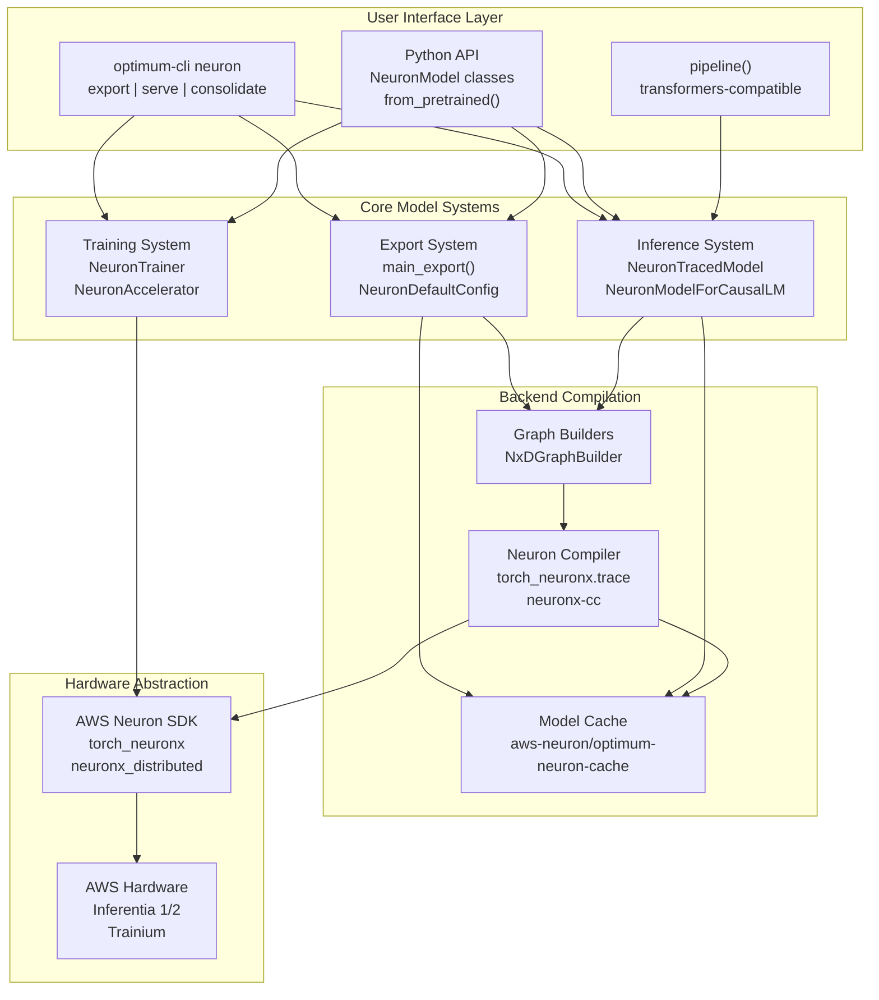
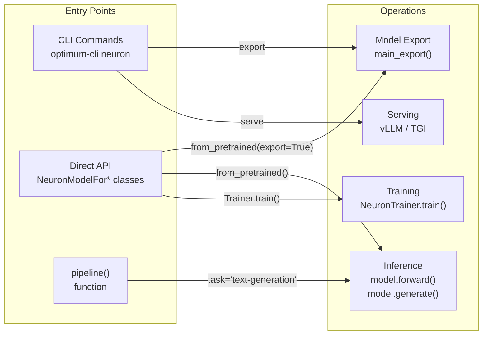
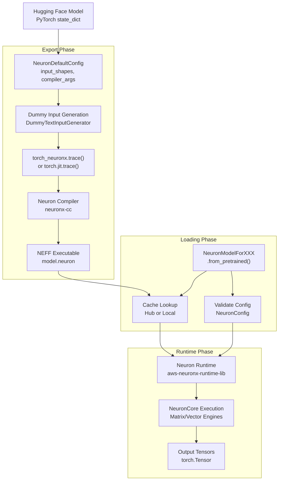
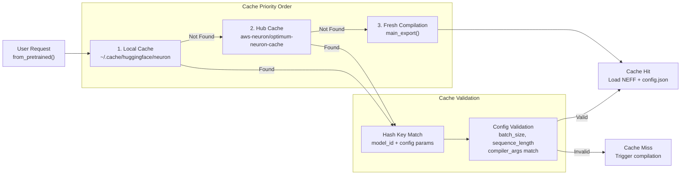
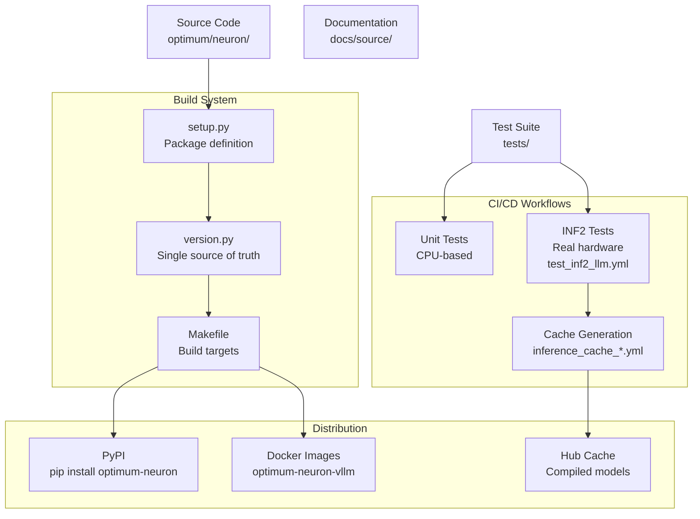

<!-- source: DeepWiki mcp.deepwiki.com · repo huggingface/optimum-neuron · page 1 Overview · fetched 2026-10-26 -->

# Overview

Relevant source files

The following files were used as context for generating this wiki page:

- [docs/source/_toctree.yml](docs/source/_toctree.yml)
- [optimum/neuron/__init__.py](optimum/neuron/__init__.py)
- [optimum/neuron/modeling.py](optimum/neuron/modeling.py)
- [optimum/neuron/modeling_base.py](optimum/neuron/modeling_base.py)
- [optimum/neuron/pipelines/transformers/base.py](optimum/neuron/pipelines/transformers/base.py)
- [optimum/neuron/utils/__init__.py](optimum/neuron/utils/__init__.py)

This document provides a high-level introduction to the **optimum-neuron** library, its architecture, and core systems. Optimum-neuron enables the use of Hugging Face Transformers models on AWS Neuron accelerators (Inferentia 1/2 for inference and Trainium for training) through model compilation, distributed training frameworks, and optimized inference engines.

For detailed information on specific subsystems:
- Model export configurations and compilation: see [Model Export System](#4)
- Training workflows and distributed strategies: see [Training on AWS Neuron](#5)
- Inference patterns and serving: see [Inference with Neuron Models](#6)
- Pre-compiled model management: see [Model Cache System](#8)
- Production deployment options: see [Deployment Guide](#9)

## Purpose and Scope

Optimum-neuron serves as the bridge between the PyTorch/Transformers ecosystem and AWS Neuron hardware. It provides:

1. **Model Export**: Ahead-of-time (AOT) compilation of standard Hugging Face models to Neuron-optimized format (`.neuron` files)
2. **Training**: Distributed fine-tuning on Trainium with tensor parallelism, pipeline parallelism, and ZeRO-1 optimization
3. **Inference**: Low-latency serving on Inferentia with batching strategies and generation features
4. **Caching**: Repository system for sharing pre-compiled models to eliminate redundant compilation
5. **Integration**: Drop-in compatibility with Transformers API, pipelines, vLLM, and Text Generation Inference (TGI)

The library supports encoder models (BERT, DistilBERT), decoder models (Llama, Qwen, Granite), encoder-decoder models (T5, BART), diffusion models (Stable Diffusion, SDXL, Flux), audio models (Whisper, Wav2Vec2), and vision models (ViT, YOLOS).

Sources: [docs/source/_toctree.yml:1-150](), [optimum/neuron/__init__.py:1-179]()

## System Architecture

The following diagram shows the layered architecture of optimum-neuron, from user-facing interfaces to hardware execution:

The architecture is organized into four primary layers:

| Layer | Components | Responsibility |
|-------|-----------|----------------|
| **User Interface** | CLI tools, Python API, pipeline function | Provide accessible entry points for model operations |
| **Core Systems** | Export, Training, Inference | Implement the three main workflows with model-specific logic |
| **Backend** | Graph builders, compiler, cache | Handle low-level compilation and artifact management |
| **Hardware** | Neuron SDK, Devices | Bridge to AWS Neuron accelerators through runtime libraries |

Sources: [optimum/neuron/__init__.py:35-88](), [optimum/neuron/pipelines/transformers/base.py:69-136]()

## Core Components

### Model Classes Hierarchy

The library provides a hierarchy of model classes that mirror Transformers' API:

```mermaid
graph TB
    NeuronModel["NeuronModel<br/>(modeling_base.py)<br/>Base abstract class"]
    NeuronTracedModel["NeuronTracedModel<br/>(modeling_traced.py)<br/>Base for traced models"]
    NeuronModelForCausalLM["NeuronModelForCausalLM<br/>(models.inference.modeling_utils)<br/>LLM generation"]
    
    NeuronModelForFeatureExtraction["NeuronModelForFeatureExtraction"]
    NeuronModelForSequenceClassification["NeuronModelForSequenceClassification"]
    NeuronModelForTokenClassification["NeuronModelForTokenClassification"]
    NeuronModelForQuestionAnswering["NeuronModelForQuestionAnswering"]
    NeuronModelForMaskedLM["NeuronModelForMaskedLM"]
    
    NeuronModelForImageClassification["NeuronModelForImageClassification"]
    NeuronModelForSemanticSegmentation["NeuronModelForSemanticSegmentation"]
    NeuronModelForObjectDetection["NeuronModelForObjectDetection"]
    
    NeuronModelForAudioClassification["NeuronModelForAudioClassification"]
    NeuronModelForCTC["NeuronModelForCTC"]
    
    DiffusionPipelines["NeuronStableDiffusionPipeline<br/>NeuronStableDiffusionXLPipeline<br/>NeuronFluxPipeline"]
    
    NeuronModel --> NeuronTracedModel
    NeuronModel --> NeuronModelForCausalLM
    NeuronModel --> DiffusionPipelines
    
    NeuronTracedModel --> NeuronModelForFeatureExtraction
    NeuronTracedModel --> NeuronModelForSequenceClassification
    NeuronTracedModel --> NeuronModelForTokenClassification
    NeuronTracedModel --> NeuronModelForQuestionAnswering
    NeuronTracedModel --> NeuronModelForMaskedLM
    
    NeuronTracedModel --> NeuronModelForImageClassification
    NeuronTracedModel --> NeuronModelForSemanticSegmentation
    NeuronTracedModel --> NeuronModelForObjectDetection
    
    NeuronTracedModel --> NeuronModelForAudioClassification
    NeuronTracedModel --> NeuronModelForCTC
```

All model classes inherit from `NeuronModel` base class and implement:
- `from_pretrained()`: Load compiled models from local storage or Hugging Face Hub
- `forward()`: Execute model inference on Neuron hardware
- `export()`: Compile PyTorch models to Neuron format (for applicable classes)

The separation between `NeuronTracedModel` (for traced/static models) and `NeuronModelForCausalLM` (for dynamic generation models) reflects different compilation strategies for encoder vs decoder architectures.

Sources: [optimum/neuron/modeling_base.py:21-44](), [optimum/neuron/modeling.py:79-671](), [optimum/neuron/__init__.py:43-103]()

### Entry Points and Interfaces

Users interact with optimum-neuron through three primary interfaces:

**CLI Interface** (`optimum-cli neuron`):
- `export`: Compile models to Neuron format with specified input shapes
- `serve`: Launch vLLM server for model serving
- `consolidate`: Merge distributed training checkpoints

**Direct API**:
- Model classes provide `from_pretrained()` for loading and `export()` for compilation
- Training uses `NeuronTrainer` and `NeuronSFTTrainer` classes
- Generation uses `model.generate()` method

**Pipeline Function**:
- High-level API compatible with `transformers.pipeline()`
- Supports 60+ tasks with automatic model export if needed
- Defined in [optimum/neuron/pipelines/transformers/base.py:225-405]()

Sources: [optimum/neuron/pipelines/transformers/base.py:225-405](), [optimum/neuron/__init__.py:36-88]()

## Model Support Matrix

Optimum-neuron supports multiple model categories, each with different levels of export, inference, and training support:

| Model Category | Examples | Export | Inference | Training | Key Classes |
|----------------|----------|--------|-----------|----------|-------------|
| **Text Encoders** | BERT, DistilBERT, RoBERTa | ✓ | ✓ | Limited | `NeuronModelForSequenceClassification`, `NeuronModelForTokenClassification` |
| **Text Decoders** | Llama, Qwen, Granite, Phi, Mistral | ✓ | ✓ | ✓ | `NeuronModelForCausalLM` |
| **Encoder-Decoders** | T5, BART | ✓ | ✓ | - | `NeuronModelForSeq2SeqLM` |
| **Vision Models** | ViT, MobileViT, YOLOS | ✓ | ✓ | - | `NeuronModelForImageClassification`, `NeuronModelForObjectDetection` |
| **Audio Models** | Whisper, Wav2Vec2 | ✓ | ✓ | - | `NeuronModelForCTC`, `NeuronWhisperForConditionalGeneration` |
| **Diffusion Models** | Stable Diffusion, SDXL, Flux | ✓ | ✓ | - | `NeuronStableDiffusionPipeline`, `NeuronFluxPipeline` |
| **MultiModal** | CLIP | ✓ | ✓ | - | `NeuronCLIPModel` |

**Training Support**: Decoder models have custom implementations with distributed training capabilities including tensor parallelism, pipeline parallelism, and ZeRO-1 optimizer sharding. Custom implementations are located in `optimum/neuron/models/training/` and include specialized parallel layers.

**Export Configurations**: Each model category has a corresponding `NeuronDefaultConfig` subclass that defines dummy input generators, validation strategies, and compilation parameters.

Sources: [optimum/neuron/__init__.py:43-103](), [optimum/neuron/pipelines/transformers/base.py:69-136]()

## Compilation and Execution Flow

The following diagram traces how models flow from PyTorch format through compilation to hardware execution:

**Compilation Requirements**:
- **Static Shapes**: All input dimensions must be specified at compile time (batch_size, sequence_length, image dimensions)
- **Graph Tracing**: Models are traced with example inputs to create a static computation graph
- **NEFF Format**: Neuron Executable File Format is the compiled artifact that runs on hardware

**Runtime Constraints**:
- Models can only execute with the exact input shapes used during compilation
- Dynamic batching requires pre-compilation of multiple batch sizes
- Sequence length padding is handled automatically by `NeuronTracedModel.neuron_padding_manager`

Sources: [optimum/neuron/pipelines/transformers/base.py:146-223](), [optimum/neuron/modeling.py:79-130]()

## Training vs Inference Paths

Training and inference follow fundamentally different execution paths with distinct requirements:

```mermaid
graph TB
    subgraph TrainingPath["Training Path (Trainium)"]
        TrainEntry["NeuronTrainer.train()"]
        Accelerator["NeuronAccelerator<br/>Distributed state setup"]
        CustomModels["Custom Model Implementations<br/>NeuronLlama, NeuronQwen<br/>Parallel layers"]
        TrainLoop["Training Loop<br/>Forward + Backward<br/>xm.mark_step()"]
        ZeroOpt["ZeRO-1 Sharding<br/>Optimizer state distribution"]
        Checkpoints["Sharded Checkpoints<br/>Per TP/PP rank"]
    end
    
    subgraph InferencePath["Inference Path (Inferentia)"]
        InfEntry["model.from_pretrained()"]
        CacheLoad["Cache Lookup<br/>Pre-compiled NEFF"]
        GraphExec["Graph Execution<br/>Prefill → Decode<br/>KV cache management"]
        BatchOps["Batching<br/>Continuous/Dynamic<br/>batching"]
    end
    
    TrainEntry --> Accelerator
    Accelerator --> CustomModels
    CustomModels --> TrainLoop
    TrainLoop --> ZeroOpt
    ZeroOpt --> Checkpoints
    
    InfEntry --> CacheLoad
    CacheLoad --> GraphExec
    GraphExec --> BatchOps
```

**Training Path Characteristics**:
- Requires custom model implementations with `NeuronModelMixin` for distributed layers
- Uses `neuronx_distributed` for tensor/pipeline parallelism coordination
- Employs `xm.mark_step()` for explicit gradient synchronization across NeuronCores
- Produces sharded checkpoints that must be consolidated for inference

**Inference Path Characteristics**:
- Uses pre-compiled NEFF files loaded from cache
- Optimized for low latency with prefill/decode separation for autoregressive models
- Supports advanced serving features like continuous batching (vLLM) and speculative decoding
- Fixed computation graph with no weight updates

The separation allows specialized optimizations for each use case while maintaining a unified model format after checkpoint consolidation.

Sources: [optimum/neuron/__init__.py:37-42](), [optimum/neuron/pipelines/transformers/base.py:100-105]()

## Cache System Architecture

The cache system eliminates redundant compilation by storing and retrieving pre-compiled models:

**Cache Key Components**:
- Model identifier (e.g., `meta-llama/Llama-3.1-8B`)
- Input shape parameters (batch_size, sequence_length, num_channels, height, width)
- Compiler arguments (optimization level, precision mode)
- Tensor parallel size (for distributed inference)

**Cache Population**:
- GitHub Actions workflows build cache periodically: `inference_cache_llm.yml`, `inference_cache_diffusion.yml`
- Scripts `auto_fill_llm_cache.py` and `auto_fill_diffusion_cache.py` compile popular configurations
- Users can push custom models to private cache repositories on Hugging Face Hub

The Hub cache (`aws-neuron/optimum-neuron-cache`) provides centralized access to pre-compiled models, significantly reducing first-run latency for common configurations.

Sources: [docs/source/_toctree.yml:13-14]()

## Configuration System

The configuration system manages compilation and runtime parameters through dataclasses:

| Configuration Class | Purpose | Key Parameters | Used In |
|--------------------|---------|----------------|---------|
| `NeuronDefaultConfig` | Base export configuration | `batch_size`, `sequence_length`, `compiler_type`, `compiler_args` | Model export |
| `NeuronTrainingArguments` | Training hyperparameters | `tensor_parallel_size`, `pipeline_parallel_size`, `gradient_accumulation_steps` | Training |
| `NeuronSFTConfig` | Supervised fine-tuning config | Extends `SFTConfig` with Neuron-specific parameters | SFT training |
| `TrainingNeuronConfig` | Model parallelism settings | `tensor_parallel_size`, `pipeline_parallel_size`, `sequence_parallel_enabled` | Custom models |
| `NxDNeuronConfig` | Backend inference config | `batch_size`, `tp_degree`, `n_positions`, `attention_layout` | Low-level inference |

**Configuration Flow**:
1. Export: `NeuronDefaultConfig` → stored in `config.json` alongside compiled model
2. Training: `NeuronTrainingArguments` + `TrainingNeuronConfig` → configure distributed training
3. Inference: Restore `NeuronConfig` from `config.json` during `from_pretrained()`
4. Validation: Runtime checks ensure loaded model matches required input shapes

Each model class has a specialized config class (e.g., `TextEncoderNeuronConfig`, `TextDecoderNeuronConfig`) that inherits from `NeuronDefaultConfig` and adds task-specific parameters.

Sources: [optimum/neuron/__init__.py:36-42](), [optimum/neuron/pipelines/transformers/base.py:269-279]()

## Hardware Targets

Optimum-neuron targets two AWS Neuron device families:

| Device Family | Hardware | Primary Use Case | Key Features | SDK |
|---------------|----------|------------------|--------------|-----|
| **Inferentia 1** | AWS Inf1 instances | Inference | 4 NeuronCores per chip, 128 TOPS INT8 | neuron-cc, torch-neuron |
| **Inferentia 2** | AWS Inf2 instances | Inference | 2 NeuronCores per chip, 380 TOPS FP16 | neuronx-cc, torch-neuronx |
| **Trainium** | AWS Trn1/Trn1n instances | Training & Inference | 2 NeuronCores per chip, 210 TFLOPS FP16 | neuronx-cc, torch-neuronx |

**NeuronCore Architecture**:
- Each NeuronCore contains matrix multiply engines and vector compute engines
- Supports data types: INT8, FP16, BF16, FP32 (with varying performance characteristics)
- Hardware-accelerated attention mechanisms including Flash Attention support

**SDK Components**:
- `torch-neuronx` / `torch-neuron`: PyTorch extensions for Neuron compilation
- `neuronx-cc` / `neuron-cc`: Ahead-of-time compilers
- `neuronx-distributed`: Distributed training primitives (tensor/pipeline parallelism)
- `aws-neuronx-runtime-lib`: Runtime library for loading and executing compiled models

Instance types like `inf2.xlarge` (1 Neuron device), `inf2.48xlarge` (12 devices), and `trn1.32xlarge` (16 devices) provide different scales of compute capacity.

Sources: [optimum/neuron/__init__.py:26-32]()

## Development Workflow

The repository follows standard Python packaging with optimum-neuron-specific tooling:

**Key Development Files**:
- [setup.py](): Defines package dependencies, entry points for CLI
- [version.py](): Centralized version string (`__version__`)
- [Makefile](): Build targets for Docker images, distribution, linting
- [.github/workflows/](): CI/CD pipeline definitions

**Testing Infrastructure**:
- Unit tests run on CPU using mocked Neuron components
- Integration tests run on `aws-inf2-8xlarge` runners with real Neuron hardware
- `@is_inferentia_test` decorator marks tests requiring Neuron devices
- Parametrized tests validate multiple model architectures in parallel

**Release Process**:
1. Version bump in `version.py`
2. Git tag creation triggers CI workflows
3. PyPI upload via `make release`
4. Docker image build and push to container registry
5. Cache population workflows refresh pre-compiled models

Sources: [docs/source/_toctree.yml:67-74]()

---

