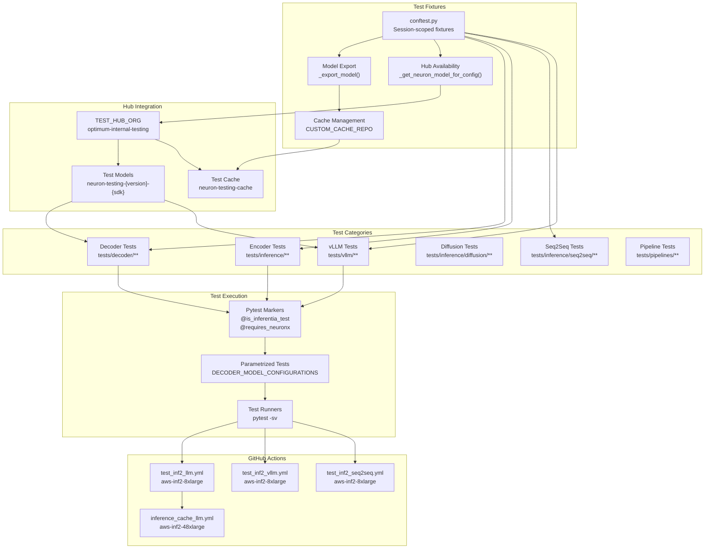
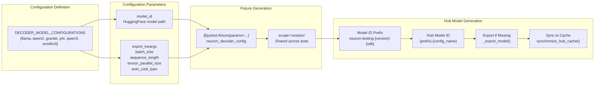
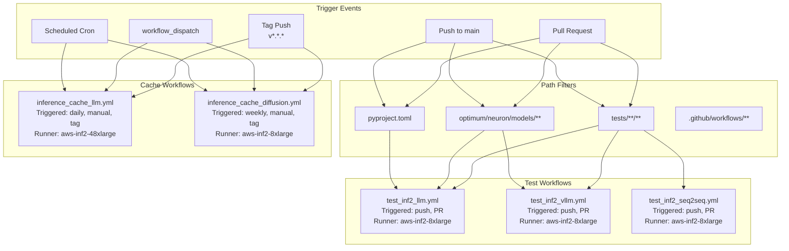
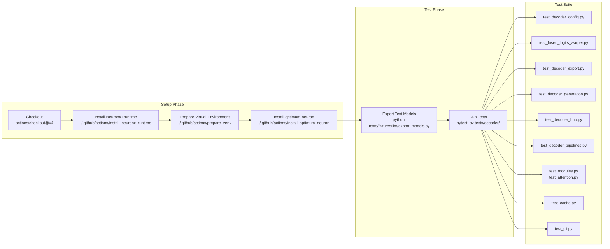
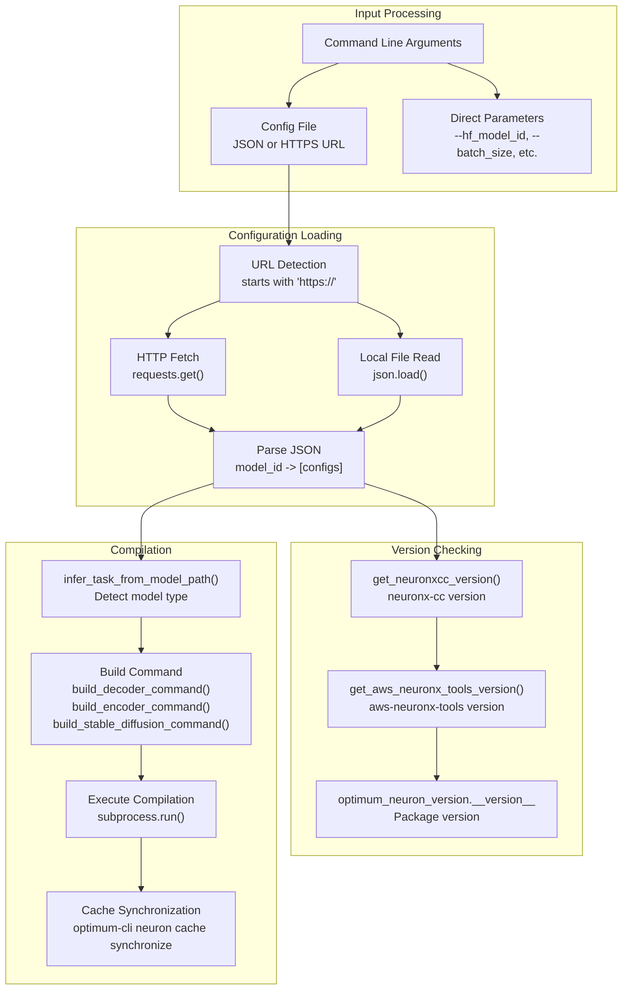
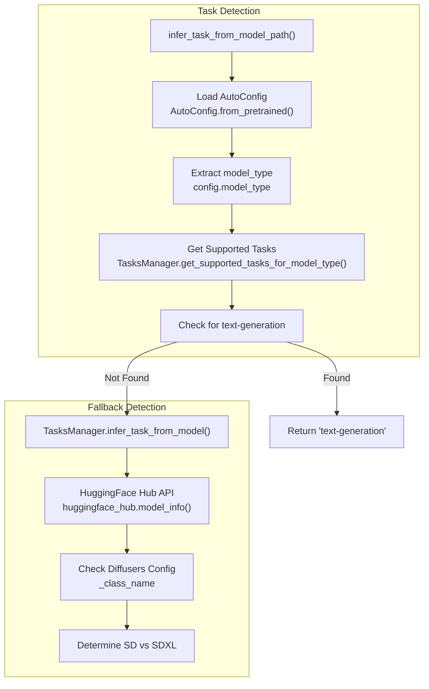
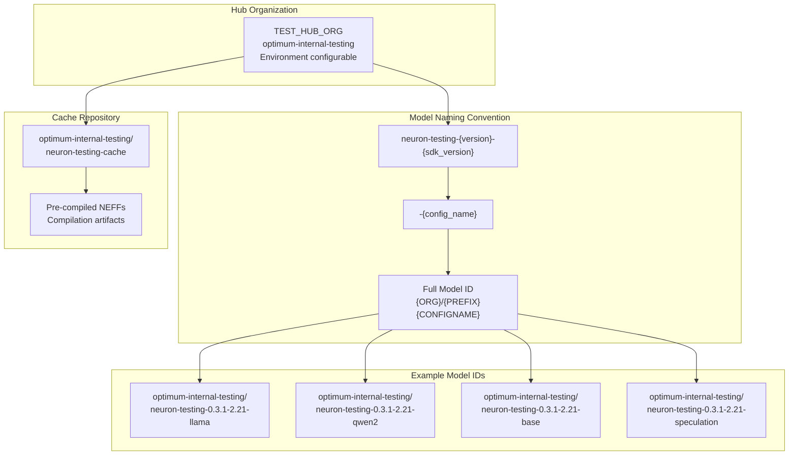
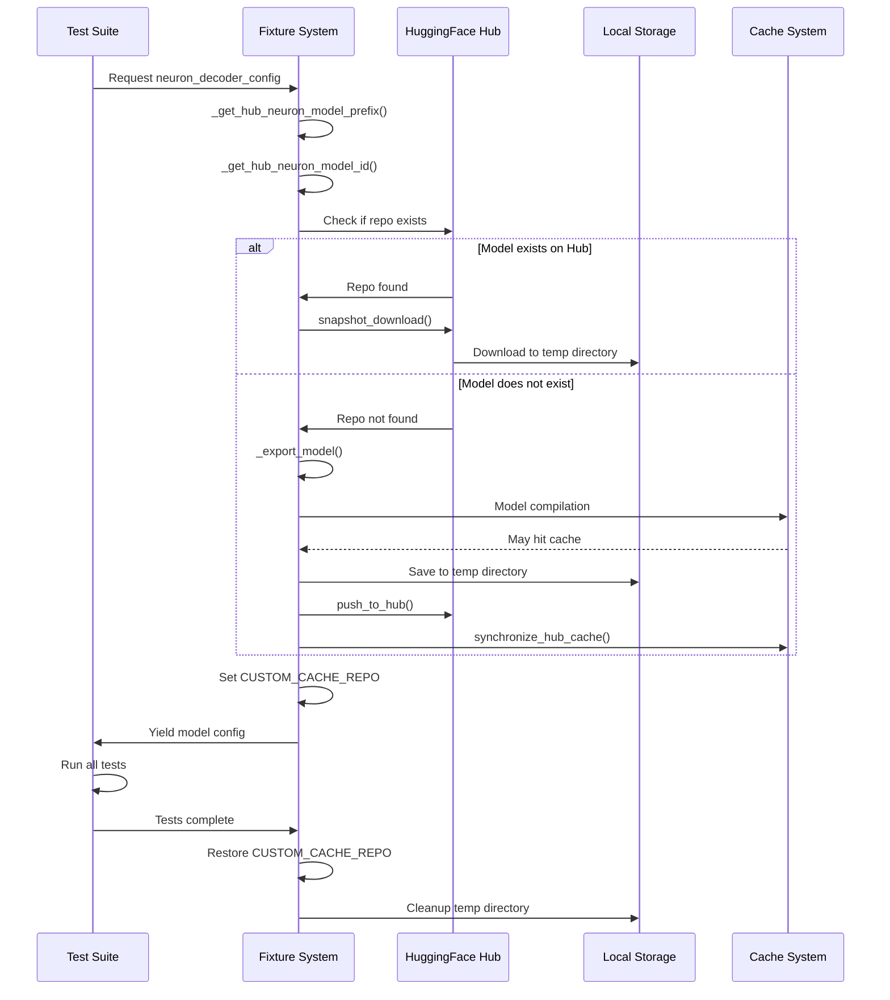

<!-- source: DeepWiki mcp.deepwiki.com · repo huggingface/optimum-neuron · page 10 Testing and CI/CD · fetched 2026-10-26 -->

# Testing and CI/CD

<details>
<summary>Relevant source files</summary>

The following files were used as context for generating this wiki page:

- [.github/actions/install_neuronx_runtime/action.yml](.github/actions/install_neuronx_runtime/action.yml)
- [.github/actions/install_optimum_neuron/action.yml](.github/actions/install_optimum_neuron/action.yml)
- [.github/actions/prepare_venv/action.yml](.github/actions/prepare_venv/action.yml)
- [.github/workflows/inference_cache_diffusion.yml](.github/workflows/inference_cache_diffusion.yml)
- [.github/workflows/inference_cache_llm.yml](.github/workflows/inference_cache_llm.yml)
- [.github/workflows/test_inf2_llm.yml](.github/workflows/test_inf2_llm.yml)
- [.github/workflows/test_inf2_vllm.yml](.github/workflows/test_inf2_vllm.yml)
- [benchmark/text-generation/performance/benchmark.py](benchmark/text-generation/performance/benchmark.py)
- [benchmark/text-generation/performance/llama3.1-8b.py](benchmark/text-generation/performance/llama3.1-8b.py)
- [benchmark/text-generation/performance/llama3.3-70b.py](benchmark/text-generation/performance/llama3.3-70b.py)
- [tests/decoder/test_decoder_embedding.py](tests/decoder/test_decoder_embedding.py)
- [tests/pipelines/conftest.py](tests/pipelines/conftest.py)
- [tests/pipelines/test_encoder_pipelines.py](tests/pipelines/test_encoder_pipelines.py)

</details>


**Purpose**: This document describes the testing infrastructure and CI/CD system for optimum-neuron. It covers test organization, pytest fixtures, GitHub Actions workflows, and the automated cache population system that pre-compiles models for common configurations.

For information about the cache system itself (cache hierarchy, Hub repositories, CLI commands), see [Cache System](#7). For details on development workflows and build tools, see [Development Guide](#11).

---

## Overview

The optimum-neuron testing infrastructure serves three primary functions:

1. **Quality Assurance**: Validates model export, inference, and training functionality across hardware generations
2. **Cache Population**: Automatically compiles and uploads pre-compiled model artifacts to the Hub cache
3. **Regression Detection**: Ensures code changes don't break existing model support or introduce performance degradation

Tests run on self-hosted AWS Inferentia/Trainium instances and are triggered by code changes or scheduled workflows. The system uses pytest for test execution and GitHub Actions for CI/CD orchestration.

**Sources**: [.github/workflows/test_inf2_llm.yml:1-93](), [tests/decoder/conftest.py:1-271]()

---

## Test Infrastructure Architecture



**Description**: The testing infrastructure uses pytest fixtures defined in `conftest.py` to manage model export, Hub availability checking, and cache configuration. Tests are organized by model category and use hardware-specific markers. GitHub Actions workflows orchestrate test execution on self-hosted runners, with integration to Hub repositories for artifact storage.

**Sources**: [tests/decoder/conftest.py:1-271](), [.github/workflows/test_inf2_llm.yml:1-93](), [.github/workflows/test_inf2_vllm.yml:1-103]()

---

## Test Configuration System

### Model Configuration Matrix

Tests use predefined model configurations to ensure consistent coverage across model families:



**Description**: The configuration system defines a matrix of model families with specific export parameters. Session-scoped fixtures generate versioned Hub model IDs and ensure models are exported and cached before tests run.

**Configuration Example**:

| Config Name | Model ID | Batch Size | Sequence Length | TP Size | Cast Type |
|-------------|----------|------------|-----------------|---------|-----------|
| llama | unsloth/Llama-3.2-1B-Instruct | 4 | 4096 | 2 | fp16 |
| qwen2 | Qwen/Qwen2.5-0.5B | 4 | 4096 | 2 | fp16 |
| granite | ibm-granite/granite-3.1-2b-instruct | 4 | 4096 | 2 | bf16 |
| phi | microsoft/Phi-3-mini-4k-instruct | 4 | 4096 | 2 | bf16 |

**Sources**: [tests/decoder/conftest.py:30-85](), [tests/decoder/conftest.py:88-94]()

### Fixture Hierarchy

The fixture system provides a layered approach to test setup:

| Fixture Name | Scope | Purpose | Returns |
|--------------|-------|---------|---------|
| `neuron_decoder_config` | session | Primary fixture, exports and validates one model per configuration | `dict` with model_id, export_kwargs, neuron_model_path, neuron_model_id, name |
| `neuron_decoder_path` | module | Simplified access to model path | `str` path to local model directory |
| `base_neuron_decoder_config` | module | Single base model for generic tests | `dict` with Qwen2.5-0.5B configuration |
| `base_neuron_decoder_path` | module | Path to base model | `str` path |
| `speculation` | module | Speculation-specific models (target + draft) | `tuple[str, str]` of model paths |

**Sources**: [tests/decoder/conftest.py:153-175](), [tests/decoder/conftest.py:177-208](), [tests/decoder/conftest.py:210-271]()

### Test Organization Conventions

Tests follow a consistent naming and organization pattern:

```
tests/
├── decoder/
│   ├── conftest.py                    # Decoder-specific fixtures
│   ├── test_decoder_config.py         # NeuronConfig validation
│   ├── test_decoder_export.py         # Export functionality
│   ├── test_decoder_generation.py     # Generation and sampling
│   ├── test_decoder_hub.py            # Hub push/pull operations
│   ├── test_decoder_pipelines.py      # Pipeline integration
│   ├── test_cache.py                  # Cache operations
│   └── test_cli.py                    # CLI commands
├── inference/
│   ├── seq2seq/                       # Seq2seq model tests
│   └── diffusion/                     # Diffusion model tests
├── vllm/
│   ├── engine/                        # vLLM engine tests
│   ├── service/                       # vLLM service tests
│   └── docker/                        # Docker integration tests
├── pipelines/
│   ├── conftest.py                    # Pipeline fixtures
│   └── test_encoder_pipelines.py      # Encoder pipeline tests
└── fixtures/
    └── llm/
        └── export_models.py           # Export script for CI
```

**Sources**: [.github/workflows/test_inf2_llm.yml:84-92](), [.github/workflows/test_inf2_vllm.yml:84-102]()

---

## Pytest Markers and Hardware Detection

### Marker System

The test suite uses custom markers to control test execution based on hardware availability:

| Marker | Purpose | Usage |
|--------|---------|-------|
| `@is_inferentia_test` | Marks tests requiring Inferentia/Trainium hardware | Applied to all hardware-dependent tests |
| `@requires_neuronx` | Requires NeuronX SDK (Inf2/Trn1) | Applied to tests using NeuronX-specific features |

**Example Usage**:

```python
@is_inferentia_test
@requires_neuronx
def test_decoder_generation_base(model_and_tokenizer, gen_kwargs):
    model = model_and_tokenizer[0]
    _test_generation(model, model.neuron_config.batch_size, 10, **gen_kwargs)
```

**Sources**: [tests/decoder/test_decoder_generation.py:52-56](), [optimum/neuron/utils/testing_utils.py]()

### Parametrized Test Patterns

Tests use pytest parametrization to validate multiple scenarios efficiently:

**Generation Strategy Testing**:
```python
@pytest.mark.parametrize(
    "gen_kwargs",
    [
        {"do_sample": True},
        {"do_sample": True, "temperature": 0.7},
        {"do_sample": False},
        {"do_sample": False, "repetition_penalty": 1.2},
    ],
    ids=["sample", "sample-with-temp", "greedy", "greedy_no-repeat"],
)
```

**Export Configuration Testing**:
```python
@pytest.mark.parametrize("is_local", [True, False], ids=["local", "from_hub"])
@pytest.mark.parametrize("load_weights", [True, False], ids=["with-weights", "without-weights"])
```

**Sources**: [tests/decoder/test_decoder_generation.py:42-51](), [tests/decoder/test_decoder_export.py:78-79]()

---

## GitHub Actions Workflows

### Workflow Trigger System



**Description**: Workflows are triggered by different events with path-based filtering to minimize unnecessary runs. Test workflows run on push/PR for relevant code changes, while cache population runs on schedules or manual triggers.

**Sources**: [.github/workflows/test_inf2_llm.yml:3-53](), [.github/workflows/inference_cache_llm.yml:3-11](), [.github/workflows/inference_cache_diffusion.yml:3-11]()

### Test Workflow Structure

Each test workflow follows a consistent pattern:

**Workflow: test_inf2_llm.yml**



**Description**: The workflow installs dependencies, prepares the environment, exports test models (which may hit the cache), then runs the full test suite sequentially. Each test file validates a specific aspect of the system.

**Sources**: [.github/workflows/test_inf2_llm.yml:59-93]()

### Runner Configuration

Self-hosted runners are organized by instance type:

| Runner Group | Instance Type | vCPUs | Memory | Neuron Cores | Workload |
|--------------|---------------|-------|--------|--------------|----------|
| aws-inf2-8xlarge | inf2.8xlarge | 32 | 128 GB | 2 | Standard tests, weekly cache |
| aws-inf2-48xlarge | inf2.48xlarge | 192 | 768 GB | 12 | Daily cache population |

**Environment Variables**:
- `HF_HUB_ENABLE_HF_TRANSFER=1`: Enables fast Hub transfers
- `HF_TOKEN`: Authentication for Hub operations (from secrets)
- `AWS_REGION=us-east-1`: AWS region for operations

**Sources**: [.github/workflows/test_inf2_llm.yml:60-65](), [.github/workflows/inference_cache_llm.yml:16-22]()

### Concurrency Control

Workflows implement concurrency groups to prevent duplicate runs:

```yaml
concurrency:
  group: ${{ github.workflow }}-${{ github.head_ref || github.run_id }}
  cancel-in-progress: true
```

This ensures:
- Only one run per PR branch
- Automatic cancellation of outdated runs when new commits are pushed
- Isolated runs for different branches

**Sources**: [.github/workflows/test_inf2_llm.yml:55-57]()

---

## Cache Population Automation

### Cache Build Matrix

The cache population system uses matrix strategies to parallelize compilation:

**LLM Cache Matrix** (Daily):
```yaml
matrix:
  config: [
    llama,
    llama4,
    qwen,
    qwen-moe,
    qwen2.5,
    granite,
    phi4,
    llama3.1-70b,
    qwen2.5-large,
    llama-variants,
    smollm3,
  ]
```

**Diffusion Cache Matrix** (Weekly):
```yaml
matrix:
  config: [
    pixart-alpha-xl-512x512,
    pixart-sigma-xl-512x512,
    sdxl-turbo,
    stable-diffusion-2-1,
    stable-diffusion-v1-5,
    stable-diffusion-xl-base-1.0,
    stable-diffusion-xl-refiner-1.0,
  ]
```

**Sources**: [.github/workflows/inference_cache_llm.yml:23-38](), [.github/workflows/inference_cache_diffusion.yml:25-34]()

### auto_fill_inference_cache.py Architecture



**Description**: The auto_fill_inference_cache.py script accepts configuration files (local or remote) or direct CLI parameters, validates versions, then compiles models in a loop and synchronizes artifacts to the Hub cache.

**Sources**: [tools/auto_fill_inference_cache.py:1-360]()

### Configuration File Format

Cache population uses JSON configuration files stored in the Hub:

**Configuration Structure**:
```json
{
  "meta-llama/Llama-2-7b-chat-hf": [
    {
      "batch_size": 1,
      "sequence_length": 2048,
      "tensor_parallel_size": 2,
      "auto_cast_type": "fp16"
    },
    {
      "batch_size": 2,
      "sequence_length": 2048,
      "tensor_parallel_size": 2,
      "auto_cast_type": "bf16"
    }
  ]
}
```

**Configuration Sources**:
- Base URL: `https://huggingface.co/aws-neuron/optimum-neuron-cache/raw/main/inference-cache-config`
- Files: `llama.json`, `qwen.json`, `granite.json`, etc.

**Sources**: [tools/auto_fill_inference_cache.py:37-47](), [.github/workflows/inference_cache_llm.yml:48-53]()

### Compilation Command Generation

The script generates appropriate CLI commands based on model type:

**Decoder Models** (text-generation):
```python
def build_decoder_command(hf_model_id, batch_size, sequence_length, 
                          tensor_parallel_size, auto_cast_type, output_dir):
    return [
        "optimum-cli", "export", "neuron",
        "-m", hf_model_id,
        "--batch_size", str(batch_size),
        "--sequence_length", str(sequence_length),
        "--tensor_parallel_size", str(tensor_parallel_size),
        "--auto_cast_type", auto_cast_type,
        "--task", "text-generation",
        output_dir,
    ]
```

**Encoder Models**:
```python
def build_encoder_command(hf_model_id, task, batch_size, sequence_length,
                          auto_cast, auto_cast_type, output_dir):
    return [
        "optimum-cli", "export", "neuron",
        "-m", hf_model_id,
        "--task", task,
        "--batch_size", str(batch_size),
        "--sequence_length", str(sequence_length),
        "--auto_cast", auto_cast,
        "--auto_cast_type", auto_cast_type,
        output_dir,
    ]
```

**Sources**: [tools/auto_fill_inference_cache.py:65-88](), [tools/auto_fill_inference_cache.py:91-114]()

### Task Inference

The script automatically detects model task when not explicitly specified:



**Description**: Task inference first tries the standard Transformers approach, then falls back to library-specific detection for diffusers models, automatically determining stable-diffusion vs stable-diffusion-xl variants.

**Sources**: [tools/auto_fill_inference_cache.py:241-266]()

---

## Test Model Management

### Hub Organization Structure

Test artifacts are organized under a dedicated Hub organization:



**Description**: Test models use versioned naming to isolate artifacts by optimum-neuron and SDK versions. The cache repository stores pre-compiled artifacts shared across all test models.

**Sources**: [tests/decoder/conftest.py:26-27](), [tests/decoder/conftest.py:88-94]()

### Test Model Lifecycle



**Description**: The fixture system checks Hub availability before exporting models. If a versioned model exists, it's downloaded; otherwise, it's exported, pushed to Hub, and synchronized to the cache. The temporary directory persists for the session, then is cleaned up.

**Sources**: [tests/decoder/conftest.py:107-151](), [tests/decoder/conftest.py:153-175]()

### Model Pruning

Old test models can be pruned using a dedicated script:

**Tool**: `tools/prune_test_models.py`

**Usage**:
```bash
# Interactive mode
python tools/prune_test_models.py --version "0.3.0-2.20"

# Automatic mode
python tools/prune_test_models.py --version "0.3.0-2.20" --yes
```

**Functionality**:
- Lists all models matching version prefix
- Provides interactive confirmation
- Deletes obsolete test models from Hub
- Useful when SDK versions change

**Sources**: [tools/prune_test_models.py:1-34]()

---

## Test Execution Patterns

### Generation Testing

Generation tests validate text generation across multiple dimensions:

**Test Dimensions**:

| Dimension | Variants | Test IDs |
|-----------|----------|----------|
| Sampling Strategy | `do_sample=True`, `do_sample=False` | sample, greedy |
| Temperature | `0.7`, default | sample-with-temp |
| Repetition Penalty | `1.2`, default | greedy_no-repeat |

**Validation Checks**:
1. Output shape matches batch size
2. Input validation (batch size, sequence length)
3. Custom stopping criteria support
4. Multiple EOS token handling
5. Stop strings functionality
6. Continuous batching with multiple requests

**Example Test**:
```python
def _test_generation(model, batch_size, input_length, **gen_kwargs):
    input_ids = torch.ones((batch_size, input_length), dtype=torch.int64)
    sample_output = model.generate(input_ids, **gen_kwargs)
    assert sample_output.shape[0] == batch_size
```

**Sources**: [tests/decoder/test_decoder_generation.py:36-56](), [tests/decoder/test_decoder_generation.py:161-244]()

### Export Testing

Export tests validate model compilation with various configurations:

**Test Matrix**:
```python
DECODER_MODEL_ARCHITECTURES = [
    "llama", "llama4_text", "granite", "qwen2", 
    "qwen3-moe", "phi3", "mixtral"
]

@pytest.mark.parametrize("is_local", [True, False])
@pytest.mark.parametrize("load_weights", [True, False])
```

**Validation Steps**:
1. Export from Hub or local checkpoint
2. Verify NeuronConfig parameters
3. Test model forward pass
4. Save and reload model
5. Verify reloaded model functionality

**Helper Functions**:
```python
def check_neuron_config(neuron_config, **kwargs):
    # Validates configuration parameters with aliasing
    # Maps tensor_parallel_size -> tp_degree, etc.
    
def check_neuron_model(neuron_model):
    # Runs forward pass with dummy inputs
    # Validates outputs are not None
```

**Sources**: [tests/decoder/test_decoder_export.py:25-107]()

### Pipeline Testing

Pipeline tests validate integration with the Transformers pipeline API:

**Test Scenarios**:
1. Export with default parameters
2. Export with custom parameters
3. Load from local path
4. Load from Hub
5. Create from model and tokenizer
6. Error handling (already exported, needs export)

**Validation**:
```python
def _test_generation(p):
    # Test various input sizes and batch sizes
    input_sizes = [model_batch_size, model_batch_size * 2]
    batch_sizes = [model_batch_size, model_batch_size // 2]
    
    for input_size, batch_size, return_tensors in product(...):
        outputs = p(prompts, return_tensors=return_tensors, 
                   batch_size=batch_size, ...)
        # Validate output structure and content
```

**Sources**: [tests/decoder/test_decoder_pipelines.py:13-111]()

### vLLM Integration Testing

vLLM tests validate the OptimumNeuronPlatform and engine functionality:

**Test Categories**:
1. **Platform Tests**: Verify OptimumNeuronPlatform is registered
2. **Engine Tests**: Test LLM generation with various sampling parameters
3. **Greedy Expectations**: Validate deterministic outputs across model types
4. **Service Tests**: Test vLLM server API
5. **Docker Tests**: Validate containerized deployment

**Generation Validation**:
```python
def _test_vllm_generation(llm):
    # Test greedy sampling determinism
    outputs_1 = llm.generate(prompts, SamplingParams(top_k=1, max_tokens=10))
    outputs_2 = llm.generate(prompts, SamplingParams(top_k=1, max_tokens=10))
    assert outputs_1[0].outputs[0].token_ids == outputs_2[0].outputs[0].token_ids
    
    # Test stochastic sampling diversity
    outputs_3 = llm.generate(prompts, SamplingParams(top_k=10, max_tokens=10))
    assert outputs_1[0].outputs[0].token_ids != outputs_3[0].outputs[0].token_ids
```

**Sources**: [tests/vllm/engine/test_vllm_engine_generate.py:19-148]()

---

## Best Practices

### Writing New Tests

When adding tests for new model types or features:

1. **Add Configuration**: Update `DECODER_MODEL_CONFIGURATIONS` or equivalent in `conftest.py`
2. **Use Fixtures**: Leverage existing fixtures (`neuron_decoder_config`, etc.)
3. **Apply Markers**: Add `@is_inferentia_test` and `@requires_neuronx` as appropriate
4. **Parametrize**: Use `@pytest.mark.parametrize` for variant testing
5. **Validate Expectations**: Include model-specific validation with expected outputs
6. **Document**: Add clear docstrings explaining test purpose

**Sources**: [tests/decoder/conftest.py:30-85]()

### Cache Management in Tests

Tests should use the test cache repository:

```python
# In conftest.py fixtures
OPTIMUM_CACHE_REPO_ID = f"{TEST_HUB_ORG}/neuron-testing-cache"

# Temporarily override cache repository
cache_repo_id = os.environ.get("CUSTOM_CACHE_REPO", None)
os.environ["CUSTOM_CACHE_REPO"] = OPTIMUM_CACHE_REPO_ID
yield model_config
if cache_repo_id is not None:
    os.environ["CUSTOM_CACHE_REPO"] = cache_repo_id
```

This ensures:
- Tests use isolated cache
- Production cache not polluted
- Consistent behavior across runs

**Sources**: [tests/decoder/conftest.py:26-27](), [tests/decoder/conftest.py:169-174]()

### Continuous Integration Best Practices

1. **Path Filtering**: Only trigger workflows for relevant file changes
2. **Matrix Strategy**: Parallelize independent compilations
3. **Concurrency Control**: Cancel outdated runs automatically
4. **Cache First**: Always attempt cache lookup before compilation
5. **Cleanup**: Delete temporary artifacts after tests
6. **Versioning**: Use versioned Hub model IDs to prevent conflicts

**Sources**: [.github/workflows/test_inf2_llm.yml:3-57](), [.github/workflows/inference_cache_llm.yml:23-38]()

---

