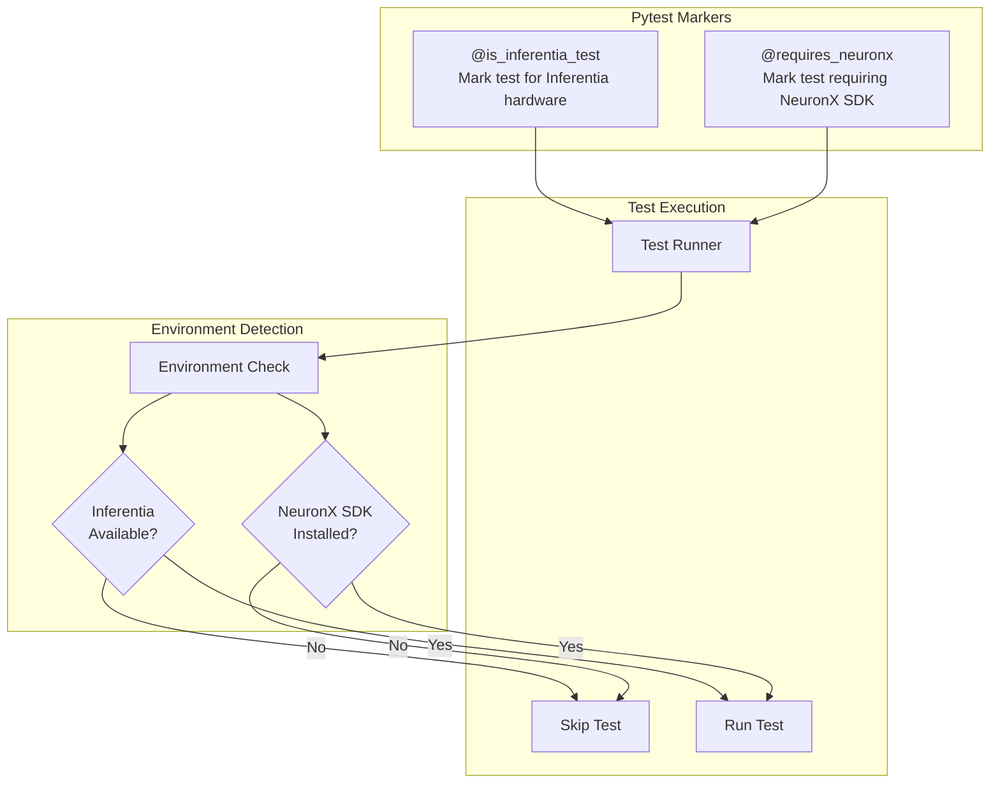
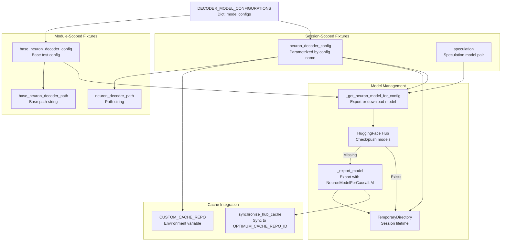
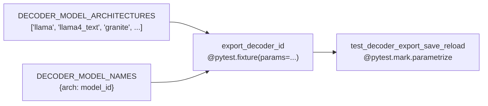
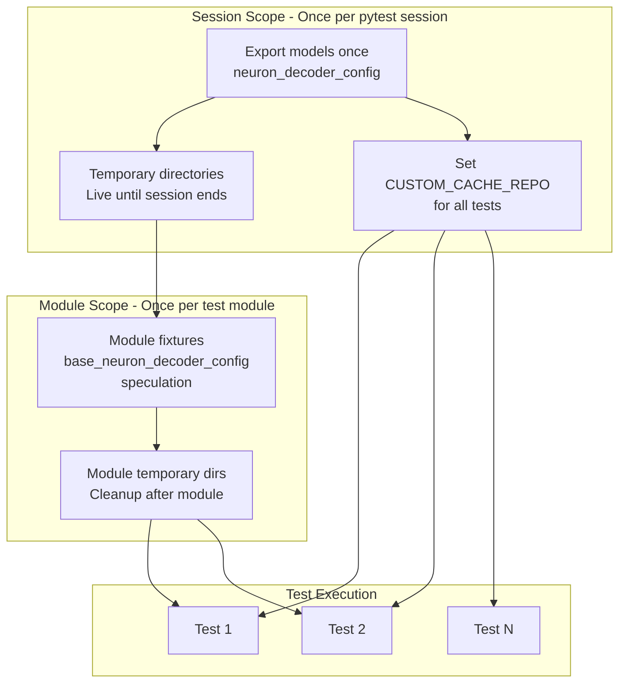

<!-- source: DeepWiki mcp.deepwiki.com · repo huggingface/optimum-neuron · page 10.1 Test Organization and Fixtures · fetched 2026-10-26 -->

# Test Organization

<details>
<summary>Relevant source files</summary>

The following files were used as context for generating this wiki page:

- [optimum/neuron/models/inference/auto_models.py](optimum/neuron/models/inference/auto_models.py)
- [tests/decoder/test_cli.py](tests/decoder/test_cli.py)
- [tests/decoder/test_decoder_export.py](tests/decoder/test_decoder_export.py)
- [tests/decoder/test_decoder_generation.py](tests/decoder/test_decoder_generation.py)
- [tests/decoder/test_decoder_hub.py](tests/decoder/test_decoder_hub.py)
- [tests/decoder/test_decoder_pipelines.py](tests/decoder/test_decoder_pipelines.py)
- [tests/fixtures/llm/export_models.py](tests/fixtures/llm/export_models.py)
- [tests/pipelines/conftest.py](tests/pipelines/conftest.py)
- [tests/pipelines/test_encoder_pipelines.py](tests/pipelines/test_encoder_pipelines.py)
- [tests/vllm/engine/test_vllm_engine_generate.py](tests/vllm/engine/test_vllm_engine_generate.py)

</details>


This document explains the test structure in the optimum-neuron repository, covering pytest fixtures, hardware-specific markers, model configuration systems, and test patterns. Understanding this organization is essential for writing new tests or debugging existing ones.

For information about the CI/CD workflows that execute these tests, see [CI/CD Workflows](#10.2). For details on automated cache population, see [Cache Population System](#10.3).

---

## Test Directory Structure

The test suite is organized by model modality and functionality:

```
tests/
├── decoder/              # Decoder model tests (LLMs)
│   ├── conftest.py      # Decoder test fixtures
│   ├── test_decoder_generation.py
│   ├── test_decoder_export.py
│   ├── test_decoder_pipelines.py
│   └── test_decoder_hub.py
├── pipelines/           # Pipeline abstraction tests
│   ├── conftest.py     # Pipeline test fixtures
│   └── test_encoder_pipelines.py
└── ...                  # Other test directories
```

Each test directory contains a `conftest.py` file that defines pytest fixtures shared across tests in that directory and its subdirectories. The fixtures follow pytest's scope hierarchy (function, module, session) to minimize redundant model exports and compilations.

**Sources:** Directory structure inferred from [tests/decoder/conftest.py](), [tests/pipelines/conftest.py]()

---

## Hardware-Specific Markers

Tests use pytest markers to indicate hardware requirements and control test execution:



### Common Marker Usage

The `@is_inferentia_test` marker indicates that a test requires Inferentia hardware. The `@requires_neuronx` marker specifies that the NeuronX SDK (for Inferentia2/Trainium) is required:

```python
@is_inferentia_test
@requires_neuronx
def test_decoder_generation_base(model_and_tokenizer, gen_kwargs):
    model = model_and_tokenizer[0]
    _test_generation(model, model.neuron_config.batch_size, 10, **gen_kwargs)
```

These markers work together to ensure tests run only in appropriate environments, preventing failures on incompatible hardware or SDK configurations.

**Sources:** [tests/decoder/test_decoder_generation.py:52-57](), [tests/decoder/test_decoder_pipelines.py:46](), [tests/pipelines/test_encoder_pipelines.py:6]()

---

## Decoder Test Fixtures

The decoder test suite uses a sophisticated fixture system to manage model exports, Hub synchronization, and temporary storage:



### Model Configuration Registry

The test suite defines a registry of model configurations in [tests/decoder/conftest.py:30-85]():

| Config Name | Model ID | Batch Size | Sequence Length | TP Size | Auto Cast |
|------------|----------|------------|-----------------|---------|-----------|
| llama | unsloth/Llama-3.2-1B-Instruct | 4 | 4096 | 2 | fp16 |
| qwen2 | Qwen/Qwen2.5-0.5B | 4 | 4096 | 2 | fp16 |
| granite | ibm-granite/granite-3.1-2b-instruct | 4 | 4096 | 2 | bf16 |
| phi | microsoft/Phi-3-mini-4k-instruct | 4 | 4096 | 2 | bf16 |
| qwen3 | Qwen/Qwen3-0.6B | 4 | 4096 | 2 | bf16 |
| smollm3 | HuggingFaceTB/SmolLM3-3B | 4 | 4096 | 2 | bf16 |

Each configuration in `DECODER_MODEL_CONFIGURATIONS` specifies a model ID and export parameters. The test fixtures use this registry to parameterize tests across multiple model architectures.

**Sources:** [tests/decoder/conftest.py:30-85]()

### The neuron_decoder_config Fixture

The `neuron_decoder_config` fixture is the primary entry point for decoder tests. It:

1. **Parameterizes** across all configurations in `DECODER_MODEL_CONFIGURATIONS`
2. **Checks Hub** for existing neuron model at `{TEST_HUB_ORG}/neuron-testing-{version}-{sdk_version}-{config_name}`
3. **Exports if missing** using `NeuronModelForCausalLM.export()` with `load_weights=False` for speed
4. **Pushes to Hub** and synchronizes with cache repository
5. **Yields config dict** with added fields: `neuron_model_path`, `neuron_model_id`, `name`
6. **Manages cache environment** by temporarily setting `CUSTOM_CACHE_REPO` to `OPTIMUM_CACHE_REPO_ID`

The fixture maintains session scope, ensuring models are exported only once per test session. The temporary directory is kept alive for the entire session via Python's context manager semantics.

**Sources:** [tests/decoder/conftest.py:153-174]()

### Hub Naming Convention

Test models use a versioned naming scheme:

```python
def _get_hub_neuron_model_prefix():
    """Get the prefix for the neuron model id on the hub"""
    return f"{TEST_HUB_ORG}/neuron-testing-{version}-{sdk_version}"

def _get_hub_neuron_model_id(config_name: str, model_config: dict[str, str]):
    return f"{_get_hub_neuron_model_prefix()}-{config_name}"
```

This creates model IDs like `optimum-internal-testing/neuron-testing-0.3.1.dev7-2.8.0-llama`, ensuring test models for different optimum-neuron and SDK versions coexist without conflicts.

**Sources:** [tests/decoder/conftest.py:88-94]()

### Base Fixtures for Ad-Hoc Testing

The `base_neuron_decoder_config` fixture provides a simpler alternative for tests that need a single model without parameterization:

- **Scope:** Module-level (one per test module)
- **Model:** Qwen/Qwen2.5-0.5B with `batch_size=1`, `sequence_length=4096`, `tp_degree=2`, `bf16`
- **Purpose:** Quick testing without Hub sync requirements

The `base_neuron_decoder_path` fixture extracts just the path string for convenience.

**Sources:** [tests/decoder/conftest.py:182-208]()

### Speculation Model Fixtures

The `speculation` fixture manages models for assisted decoding tests, creating both a main model with `speculation_length=5` and a draft model:

```python
@pytest.fixture(scope="module")
def speculation():
    model_id = "unsloth/Llama-3.2-1B-Instruct"
    neuron_model_id = f"{_get_hub_neuron_model_prefix()}-speculation"
    draft_neuron_model_id = f"{_get_hub_neuron_model_prefix()}-speculation-draft"
    # ... exports both models using LlamaNxDModelForCausalLM
    yield neuron_model_path, draft_neuron_model_path
```

This fixture uses `LlamaNxDModelForCausalLM` directly with `NxDNeuronConfig` for fine-grained control over speculation parameters.

**Sources:** [tests/decoder/conftest.py:210-270]()

---

## Model Export Fixtures

Export tests use a different fixture pattern focused on model architecture coverage:



The `export_decoder_id` fixture parameterizes tests across model architectures:

| Architecture | Model ID |
|-------------|----------|
| llama | llamafactory/tiny-random-Llama-3 |
| llama4_text | tiny-random/llama-4 |
| qwen2 | yujiepan/qwen2.5-128k-tiny-random |
| qwen3-moe | optimum-internal-testing/tiny-random-qwen3_moe |
| granite | hf-internal-testing/tiny-random-GraniteForCausalLM |
| phi3 | yujiepan/phi-4-tiny-random |
| mixtral | dacorvo/Mixtral-tiny |
| smollm3 | HuggingFaceTB/SmolLM3-3B |

These tiny random models enable fast export testing without large downloads.

**Sources:** [tests/decoder/test_decoder_export.py:25-44]()

---

## Pipeline Test Fixtures

Pipeline tests use a simpler fixture structure focused on task coverage:

```python
STD_TEXT_TASKS = [
    "feature-extraction",
    "fill-mask",
    "question-answering",
    "text-classification",
    "token-classification",
]

@pytest.fixture(scope="module", params=STD_TEXT_TASKS)
def std_text_task(request):
    return request.param
```

The `std_text_task` fixture parameterizes tests across standard text tasks, ensuring pipeline functionality works consistently across different task types.

**Sources:** [tests/pipelines/conftest.py:19-30]()

---

## Parametrized Testing Patterns

### Inline Parametrization

Tests frequently use `@pytest.mark.parametrize` for inline parameter variations:

```python
@pytest.mark.parametrize(
    "gen_kwargs",
    [
        {"do_sample": True},
        {"do_sample": True, "temperature": 0.7},
        {"do_sample": False},
        {"do_sample": False, "repetition_penalty": 1.2},
    ],
    ids=["sample", "sample-with-temp", "greedy", "greedy_no-repeat"],
)
@is_inferentia_test
@requires_neuronx
def test_decoder_generation_base(model_and_tokenizer, gen_kwargs):
    # Test implementation
```

The `ids` parameter provides readable test names in pytest output, essential for diagnosing failures in CI.

**Sources:** [tests/decoder/test_decoder_generation.py:42-56]()

### Fixture Parametrization

Fixture-level parametrization enables combinatorial testing:

```python
@pytest.mark.parametrize("is_local", [True, False], ids=["local", "from_hub"])
@pytest.mark.parametrize("load_weights", [True, False], ids=["with-weights", "without-weights"])
def test_decoder_export_save_reload(export_decoder_id: str, is_local: bool, load_weights: bool):
    # This creates 2 x 2 = 4 test cases per architecture
```

Combined with the `export_decoder_id` fixture's 8 architectures, this creates 32 test variations from a single test function.

**Sources:** [tests/decoder/test_decoder_export.py:78-106]()

---

## Helper Functions and Validation

### Configuration Validation

The `check_neuron_config` helper validates exported model configurations:

```python
def check_neuron_config(neuron_config, **kwargs):
    for key, value in kwargs.items():
        aliases = {
            "num_cores": "tp_degree",
            "tensor_parallel_size": "tp_degree",
            "auto_cast_type": "torch_dtype",
        }
        if key in aliases:
            key = aliases[key]
        if value is not None:
            if key == "torch_dtype" and isinstance(value, str):
                value = DTYPE_MAPPER.pt(value)
            assert getattr(neuron_config, key) == value
```

This handles parameter name aliases between public API and internal configuration, ensuring tests work correctly as APIs evolve.

**Sources:** [tests/decoder/test_decoder_export.py:47-61]()

### Model Inference Validation

The `check_neuron_model` helper validates exported models can perform inference:

```python
def check_neuron_model(neuron_model):
    batch_size = neuron_model.neuron_config.batch_size
    input_shape = (batch_size, min(10, neuron_model.neuron_config.sequence_length))
    input_ids = torch.ones(input_shape, dtype=torch.int64)
    attention_mask = torch.ones(input_shape, dtype=torch.int64)
    on_device_sampling = getattr(neuron_model.neuron_config, "on_device_sampling", False)
    sampling_params = torch.ones((batch_size, 3)) if on_device_sampling else None
    model_inputs = neuron_model.prepare_inputs_for_prefill(
        input_ids=input_ids, attention_mask=attention_mask, sampling_params=sampling_params
    )
    outputs = neuron_model(**model_inputs)
    assert outputs is not None
```

This performs a minimal forward pass, catching common export issues like shape mismatches or missing operations.

**Sources:** [tests/decoder/test_decoder_export.py:64-76]()

---

## Test Fixture Lifecycle

The fixture system carefully manages resource lifecycles to optimize test execution:



**Session-scoped fixtures** (`neuron_decoder_config`):
- Export models once per configuration
- Push to Hub if missing
- Maintain temporary directories until all tests complete
- Enable parallel test execution with cached models

**Module-scoped fixtures** (`base_neuron_decoder_config`, `speculation`):
- Create resources once per test module
- Clean up after module completes
- Balance between reuse and resource cleanup

This hierarchy minimizes expensive model compilation while ensuring proper cleanup.

**Sources:** [tests/decoder/conftest.py:153-174](), [tests/decoder/conftest.py:182-208]()

---

## Test Model Pruning

The `tools/prune_test_models.py` utility helps clean up old test models from the Hub:

```python
TEST_HUB_ORG = os.getenv("TEST_HUB_ORG", "optimum-internal-testing")

def main():
    api = HfApi()
    model_prefix = f"{TEST_HUB_ORG}/neuron-testing-{args.version}"
    models = api.list_models(search=model_prefix)
    for model in models:
        if model.id.startswith(model_prefix):
            # Delete after confirmation
```

Usage:
```bash
# List models for version 0.3.0
python tools/prune_test_models.py --version 0.3.0

# Delete without confirmation
python tools/prune_test_models.py --version 0.3.0 --yes
```

This is essential for managing Hub storage as optimum-neuron versions accumulate test artifacts.

**Sources:** [tools/prune_test_models.py:1-33]()

---

## Common Test Patterns

### Generation Test Pattern

```python
def _test_generation(model, batch_size, input_length, **gen_kwargs):
    input_ids = torch.ones((batch_size, input_length), dtype=torch.int64)
    sample_output = model.generate(input_ids, **gen_kwargs)
    assert sample_output.shape[0] == batch_size
```

This pattern appears throughout tests, providing a reusable validation function that:
1. Creates dummy input tensors
2. Calls `model.generate()` with test parameters
3. Validates output shape matches input batch size

**Sources:** [tests/decoder/test_decoder_generation.py:36-40]()

### Pipeline Test Pattern

```python
def _test_generation(p):
    assert p.task == "text-generation"
    assert isinstance(p.model, NeuronModelForCausalLM)
    model_batch_size = p.model.neuron_config.batch_size
    # Test with multiple input/batch size combinations
    for input_size, batch_size, return_tensors in itertools.product(input_sizes, batch_sizes, [True, None]):
        outputs = p(prompts, return_tensors=return_tensors, batch_size=batch_size, ...)
        assert len(outputs) == input_size
```

Pipeline tests validate the abstraction layer works correctly with different batching configurations.

**Sources:** [tests/decoder/test_decoder_pipelines.py:13-43]()

### Expected Output Pattern

```python
def test_decoder_generation_greedy_expectations(neuron_llm_config):
    outputs = model.generate(**inputs, do_sample=False, max_new_tokens=17)
    expectations = {
        "llama": " and how does it work?\nDeep learning is a subset...",
        "qwen2": "Deep Learning is a subset of Machine Learning...",
        # ... per-model expectations
    }
    config_name = neuron_llm_config["name"]
    generated_text = tokenizer.decode(outputs[0])
    expected_text = expectations[config_name]
    assert generated_text.endswith(expected_text)
```

This pattern verifies deterministic outputs for greedy generation, catching regressions in generation quality or model behavior.

**Sources:** [tests/decoder/test_decoder_generation.py:95-113]()

---

## Summary

The optimum-neuron test organization provides:

| Component | Purpose | Key Files |
|-----------|---------|-----------|
| **Fixtures** | Reusable model exports and configurations | `conftest.py` files |
| **Markers** | Hardware and SDK requirements | `@is_inferentia_test`, `@requires_neuronx` |
| **Configuration Registry** | Parameterized model testing | `DECODER_MODEL_CONFIGURATIONS` |
| **Helper Functions** | Validation and common patterns | `check_neuron_config`, `check_neuron_model` |
| **Hub Integration** | Persistent test artifacts | `_get_neuron_model_for_config` |
| **Cache Management** | Compilation speedup | `CUSTOM_CACHE_REPO`, `synchronize_hub_cache` |

This architecture minimizes test execution time through caching while maintaining comprehensive coverage across model architectures, hardware types, and SDK versions.

---

