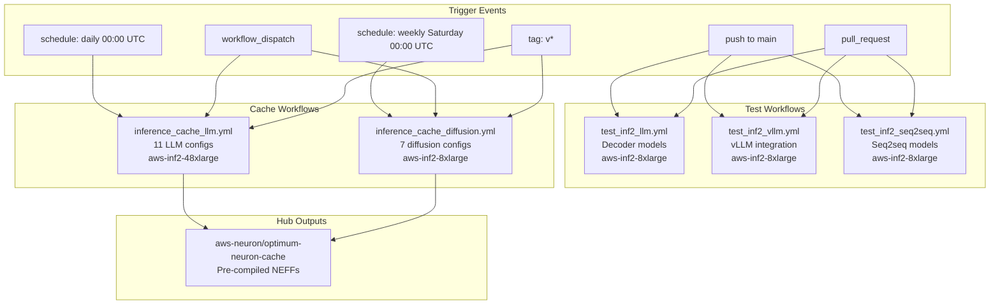
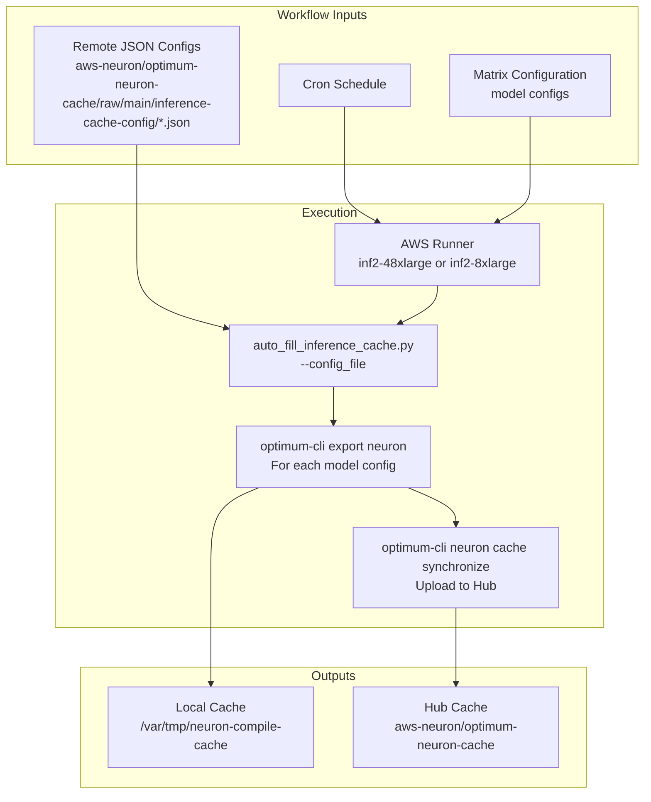
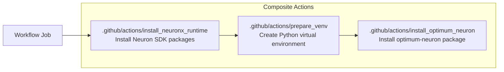

<!-- source: DeepWiki mcp.deepwiki.com · repo huggingface/optimum-neuron · page 10.2 CI/CD Workflows · fetched 2026-10-26 -->

# CI/CD Workflows

<details>
<summary>Relevant source files</summary>

The following files were used as context for generating this wiki page:

- [.github/actions/install_neuronx_runtime/action.yml](.github/actions/install_neuronx_runtime/action.yml)
- [.github/actions/install_optimum_neuron/action.yml](.github/actions/install_optimum_neuron/action.yml)
- [.github/actions/prepare_venv/action.yml](.github/actions/prepare_venv/action.yml)
- [.github/workflows/inference_cache_diffusion.yml](.github/workflows/inference_cache_diffusion.yml)
- [.github/workflows/inference_cache_llm.yml](.github/workflows/inference_cache_llm.yml)
- [.github/workflows/test_inf2_llm.yml](.github/workflows/test_inf2_llm.yml)
- [.github/workflows/test_inf2_vllm.yml](.github/workflows/test_inf2_vllm.yml)
- [benchmark/text-generation/performance/benchmark.py](benchmark/text-generation/performance/benchmark.py)
- [benchmark/text-generation/performance/llama3.1-8b.py](benchmark/text-generation/performance/llama3.1-8b.py)
- [benchmark/text-generation/performance/llama3.3-70b.py](benchmark/text-generation/performance/llama3.3-70b.py)
- [tests/decoder/test_decoder_embedding.py](tests/decoder/test_decoder_embedding.py)

</details>


This document describes the GitHub Actions workflows that provide continuous integration and deployment for optimum-neuron. These workflows run automated tests on Inferentia hardware and populate the Hub cache repository with pre-compiled model artifacts.

For information about the test organization and pytest markers, see [Test Organization](#10.1). For details on cache population scripts and configuration, see [Cache Population System](#10.3).

## Overview

The optimum-neuron project uses GitHub Actions to automate quality assurance and cache management across two primary categories:

1. **Test Workflows**: Run on push/pull request events to validate functionality on real Inferentia/Trainium hardware
2. **Cache Building Workflows**: Run on scheduled intervals to pre-compile models and upload artifacts to the Hub cache repository

All workflows execute on self-hosted AWS runners with Neuron hardware access, ensuring tests run in production-like environments.



**Sources:** [.github/workflows/test_inf2_llm.yml:1-93](), [.github/workflows/inference_cache_llm.yml:1-54](), [.github/workflows/inference_cache_diffusion.yml:1-50]()

## Test Workflows

Test workflows validate code changes by running test suites on actual Neuron hardware. They trigger on code changes to relevant files and execute pytest with hardware-specific markers.

### Common Test Workflow Pattern

All test workflows follow a consistent structure with reusable GitHub Actions:

```mermaid
flowchart LR
    START["Workflow Triggered"]
    CHECKOUT["Checkout Code<br/>actions/checkout@v4"]
    RUNTIME["Install Neuronx Runtime<br/>.github/actions/install_neuronx_runtime"]
    VENV["Prepare Virtual Environment<br/>.github/actions/prepare_venv"]
    INSTALL["Install optimum-neuron<br/>.github/actions/install_optimum_neuron"]
    EXPORT["Export Test Models<br/>tests/fixtures/llm/export_models.py"]
    TEST["Run pytest Tests<br/>HF_TOKEN from secrets"]
    END["Workflow Complete"]
    
    START --> CHECKOUT
    CHECKOUT --> RUNTIME
    RUNTIME --> VENV
    VENV --> INSTALL
    INSTALL --> EXPORT
    EXPORT --> TEST
    TEST --> END
```



**Sources:** [.github/workflows/test_inf2_llm.yml:66-93](), [.github/workflows/test_inf2_vllm.yml:66-103]()

### test_inf2_llm.yml

This workflow tests decoder (causal LM) models on Inferentia2 hardware. It monitors changes to decoder-related code paths and runs comprehensive LLM tests.

| Property | Value |
|----------|-------|
| **Runner** | `aws-inf2-8xlarge` (32 NeuronCores) |
| **Trigger Files** | Model inference backends, decoder tests, configuration utils |
| **Environment** | `HF_HUB_ENABLE_HF_TRANSFER=1` |
| **Test Command** | Multiple pytest invocations in sequence |

The workflow watches changes to specific paths [.github/workflows/test_inf2_llm.yml:6-28]():
- `optimum/neuron/modeling_decoder.py`
- `optimum/neuron/models/inference/{llama,llama4,mixtral,phi3,qwen2,qwen3,qwen3_moe,granite}/**`
- `tests/decoder/**`

Test execution steps [.github/workflows/test_inf2_llm.yml:75-92]():
1. Export test models using `tests/fixtures/llm/export_models.py`
2. Run base LLM tests sequentially:
   - `test_decoder_config.py` - Configuration system tests
   - `test_fused_logits_warper.py` - Logits processing tests
   - `test_decoder_export.py` - Model export tests
   - `test_decoder_generation.py` - Text generation tests
   - `test_decoder_hub.py` - Hub integration tests
   - `test_decoder_pipelines.py` - Pipeline tests
   - `test_modules.py`, `test_attention.py` - Component tests
   - `test_cache.py` - Cache functionality tests
   - `test_cli.py` - CLI tests

The workflow uses concurrency control to cancel in-progress runs when new commits arrive [.github/workflows/test_inf2_llm.yml:55-57]():
```yaml
concurrency:
  group: ${{ github.workflow }}-${{ github.head_ref || github.run_id }}
  cancel-in-progress: true
```

**Sources:** [.github/workflows/test_inf2_llm.yml:1-93]()

### test_inf2_vllm.yml

This workflow tests vLLM integration, including engine tests, service tests, and Docker container builds.

| Property | Value |
|----------|-------|
| **Runner** | `aws-inf2-8xlarge` |
| **Additional Setup** | Install vLLM extras: `pip install .[vllm,vllm-tests]` |
| **Docker Build** | Builds `optimum-neuron-vllm` image |
| **Test Suites** | Engine, service, and Docker tests |

The workflow has three distinct test phases [.github/workflows/test_inf2_vllm.yml:75-102]():

1. **Export Models**: Uses shared fixture `tests/fixtures/llm/export_models.py`
2. **vLLM Engine Tests**: `pytest -sv tests/vllm/engine` - Tests core vLLM engine functionality
3. **vLLM Service Tests**: `pytest -sv tests/vllm/service` - Tests service layer
4. **Docker Image Build**: `make optimum-neuron-vllm` - Builds container image
5. **Docker Tests**: `pytest -sv tests/vllm/docker` - Tests containerized deployment

Unlike other test workflows, this includes a container build step requiring `gawk` [.github/workflows/test_inf2_vllm.yml:94-97]():
```yaml
- name: Build docker image
  run: |
    sudo apt-get install -y gawk
    make optimum-neuron-vllm
```

**Sources:** [.github/workflows/test_inf2_vllm.yml:1-103](), [tests/vllm/engine/test_vllm_engine_generate.py:1-148]()

### test_inf2_seq2seq.yml

This workflow tests encoder-decoder (seq2seq) models like T5 on Inferentia2.

| Property | Value |
|----------|-------|
| **Runner** | `aws-inf2-8xlarge` |
| **Test Marker** | `-m is_inferentia_test` |
| **Model Types** | T5 and other seq2seq architectures |
| **Test Files** | `tests/inference/seq2seq/**` |

Test execution phases [.github/workflows/test_inf2_seq2seq.yml:49-63]():
1. **Export CLI tests**: `tests/inference/seq2seq/test_export_cli.py`
2. **Single core tests**: Export, generation, and Hub tests
3. **Parallel tests**: `test_parallel.py` for multi-core inference

All tests use the `is_inferentia_test` marker to ensure proper hardware gating.

**Sources:** [.github/workflows/test_inf2_seq2seq.yml:1-64](), [tests/pipelines/conftest.py:1-31](), [tests/pipelines/test_encoder_pipelines.py:1-11]()

## Cache Building Workflows

Cache workflows run on scheduled intervals to pre-compile popular model configurations and upload them to the Hub cache repository. This dramatically reduces compilation time for users.

### Workflow Architecture



**Sources:** [.github/workflows/inference_cache_llm.yml:1-54](), [tools/auto_fill_inference_cache.py:1-360]()

### inference_cache_llm.yml

This workflow builds cache for large language models, running daily and using the largest available instance type.

| Property | Value |
|----------|-------|
| **Schedule** | Daily at 00:00 UTC (`0 0 * * *`) |
| **Runner** | `aws-inf2-48xlarge` (192 NeuronCores) |
| **Triggers** | Schedule, workflow_dispatch, version tags |
| **Strategy** | Matrix with 11 model configurations |

Matrix configurations [.github/workflows/inference_cache_llm.yml:26-38]():
- `llama` - Base Llama models
- `llama4` - Llama 4 models
- `qwen` - Qwen models
- `qwen-moe` - Qwen MoE variants
- `qwen2.5` - Qwen 2.5 models
- `granite` - IBM Granite models
- `phi4` - Microsoft Phi-4
- `llama3.1-70b` - Large Llama 3.1 70B
- `qwen2.5-large` - Large Qwen 2.5
- `llama-variants` - Llama architecture variants
- `smollm3` - Small language models

Each matrix job executes [.github/workflows/inference_cache_llm.yml:48-53]():
```yaml
- name: Create cache for ${{matrix.config}} models
  run: |
    source aws_neuron_venv_pytorch/bin/activate
    config_prefix_url=https://huggingface.co/aws-neuron/optimum-neuron-cache/raw/main/inference-cache-config
    HF_TOKEN=${{secrets.HF_TOKEN_OPTIMUM_NEURON_CACHE}} \
      python tools/auto_fill_inference_cache.py --config_file ${config_prefix_url}/${{matrix.config}}.json
```

The workflow downloads JSON configuration files from the Hub that specify model IDs and compilation parameters. Each configuration file contains entries like [tools/auto_fill_inference_cache.py:38-43]():
```json
{
   "meta-llama/Llama-2-7b-chat-hf": [
       {  "batch_size": 1, "sequence_length": 2048, "tensor_parallel_size": 2, "auto_cast_type": "fp16" },
       {  "batch_size": 2, "sequence_length": 2048, "tensor_parallel_size": 2, "auto_cast_type": "bf16" }
   ]
}
```

**Sources:** [.github/workflows/inference_cache_llm.yml:1-54]()

### inference_cache_diffusion.yml

This workflow builds cache for Stable Diffusion and PixArt models, running weekly on Saturdays.

| Property | Value |
|----------|-------|
| **Schedule** | Weekly Saturday 00:00 UTC (`0 0 * * 6`) |
| **Runner** | `aws-inf2-8xlarge` (32 NeuronCores) |
| **Strategy** | Matrix with 7 diffusion configurations |

Matrix configurations [.github/workflows/inference_cache_diffusion.yml:26-34]():
- `pixart-alpha-xl-512x512`
- `pixart-sigma-xl-512x512`
- `sdxl-turbo`
- `stable-diffusion-2-1`
- `stable-diffusion-v1-5`
- `stable-diffusion-xl-base-1.0`
- `stable-diffusion-xl-refiner-1.0`

The workflow structure mirrors `inference_cache_llm.yml` but runs less frequently since diffusion models change less often than LLMs. The smaller instance type (`inf2-8xlarge`) is sufficient for diffusion model compilation.

**Sources:** [.github/workflows/inference_cache_diffusion.yml:1-50]()

### auto_fill_inference_cache.py Integration

All cache workflows delegate to `tools/auto_fill_inference_cache.py`, which provides the compilation and synchronization logic.

Key functions in the script [tools/auto_fill_inference_cache.py:177-239]():

1. **compile_and_cache_model()**: Main orchestration function
   - Creates temporary directory for compilation
   - Infers task from model architecture
   - Builds appropriate export command based on model type
   - Executes `optimum-cli export neuron`
   - Runs `optimum-cli neuron cache synchronize` to upload

2. **Command builders** for different model types:
   - `build_decoder_command()` [tools/auto_fill_inference_cache.py:65-88]()
   - `build_encoder_command()` [tools/auto_fill_inference_cache.py:91-114]()
   - `build_stable_diffusion_command()` [tools/auto_fill_inference_cache.py:117-144]()
   - `build_pixart_command()` [tools/auto_fill_inference_cache.py:147-174]()

The script logs version information for reproducibility [tools/auto_fill_inference_cache.py:306-311]():
- NeuronX CC compiler version
- Neuron SDK version
- Optimum-neuron version

**Sources:** [tools/auto_fill_inference_cache.py:1-360]()

## Workflow Triggers and Scheduling

The workflows use different trigger strategies based on their purpose:

### Test Workflow Triggers

Test workflows trigger on code changes to relevant paths [.github/workflows/test_inf2_llm.yml:3-53]():

```yaml
on:
  push:
    branches: [ main ]
    paths:
      - "optimum/neuron/modeling_decoder.py"
      - "tests/decoder/**.py"
      # ... other paths
  pull_request:
    branches: [ main ]
    paths:
      # Same paths as push
```

This path-based triggering ensures:
- Tests run only when relevant code changes
- CI time is minimized
- Pull requests are validated before merge

### Cache Workflow Triggers

Cache workflows use multiple trigger types [.github/workflows/inference_cache_llm.yml:3-10]():

```yaml
on:
  workflow_dispatch:  # Manual trigger
  schedule:
    - cron: '0 0 * * *'  # Daily at midnight UTC
  push:
    tags:
      - 'v[0-9]+.[0-9]+.[0-9]+'  # Version tags
```

Trigger purposes:
- **schedule**: Automated daily/weekly cache updates
- **workflow_dispatch**: Manual trigger for testing or urgent updates
- **push tags**: Rebuild cache on releases to match package versions

**Sources:** [.github/workflows/inference_cache_llm.yml:3-11](), [.github/workflows/test_inf2_llm.yml:3-53]()

## Runner Configuration

All workflows execute on self-hosted GitHub Actions runners with Neuron hardware. The runner groups are configured in AWS and registered with GitHub.

### Runner Group Mapping

| Runner Group | Instance Type | NeuronCores | Primary Use |
|--------------|--------------|-------------|-------------|
| `aws-inf2-8xlarge` | inf2.8xlarge | 2 × 16 = 32 | Standard tests, diffusion cache |
| `aws-inf2-48xlarge` | inf2.48xlarge | 12 × 16 = 192 | LLM cache building (parallel compilation) |

Workflows specify runners using [.github/workflows/test_inf2_llm.yml:62-63]():
```yaml
runs-on:
  group: aws-inf2-8xlarge
```

The larger `inf2-48xlarge` instances are used exclusively for LLM cache building because:
1. Multiple tensor parallel compilations can run simultaneously
2. Matrix jobs may execute in parallel
3. Large models (70B parameters) require more memory

**Sources:** [.github/workflows/test_inf2_llm.yml:62-63](), [.github/workflows/inference_cache_llm.yml:18-19]()

## Common Workflow Patterns

### Reusable GitHub Actions

The workflows use custom composite actions for common setup steps:



These actions are invoked consistently across all workflows [.github/workflows/test_inf2_llm.yml:69-74]():
```yaml
- name: Install Neuronx runtime
  uses: ./.github/actions/install_neuronx_runtime
- name: Prepare virtual environment
  uses: ./.github/actions/prepare_venv
- name: Install optimum-neuron
  uses: ./.github/actions/install_optimum_neuron
```

**Sources:** [.github/workflows/test_inf2_llm.yml:69-74]()

### Environment Variables and Secrets

Workflows configure the environment with:

1. **HF_HUB_ENABLE_HF_TRANSFER=1**: Enables fast Hub downloads [.github/workflows/test_inf2_llm.yml:64-65]()
2. **HF_TOKEN**: Authentication for Hub access [.github/workflows/test_inf2_llm.yml:78]()
   - `HF_TOKEN_OPTIMUM_NEURON_CI` - Read access for test models
   - `HF_TOKEN_OPTIMUM_NEURON_CACHE` - Write access for cache uploads
3. **AWS_REGION**: Set to `us-east-1` for cache workflows [.github/workflows/inference_cache_llm.yml:21]()

Token usage pattern [.github/workflows/test_inf2_llm.yml:77-79]():
```yaml
run: |
  source aws_neuron_venv_pytorch/bin/activate
  export HF_TOKEN=${{ secrets.HF_TOKEN_OPTIMUM_NEURON_CI }}
```

**Sources:** [.github/workflows/test_inf2_llm.yml:64-78](), [.github/workflows/inference_cache_llm.yml:20-22]()

### Concurrency Control

Test workflows implement concurrency control to avoid wasting runner time on outdated commits [.github/workflows/test_inf2_llm.yml:55-57]():

```yaml
concurrency:
  group: ${{ github.workflow }}-${{ github.head_ref || github.run_id }}
  cancel-in-progress: true
```

This configuration:
- Groups runs by workflow name and branch/PR
- Cancels in-progress runs when new commits arrive
- Applies only to test workflows (not cache workflows)

Cache workflows use a simpler concurrency group without cancellation [.github/workflows/inference_cache_llm.yml:12-13]():
```yaml
concurrency:
  group: ${{ github.workflow }}-${{ github.head_ref || github.run_id }}
```

**Sources:** [.github/workflows/test_inf2_llm.yml:55-57](), [.github/workflows/inference_cache_llm.yml:12-13]()

## Workflow Failure Strategies

Cache workflows use `fail-fast: false` in their matrix strategy [.github/workflows/inference_cache_llm.yml:23-25]():
```yaml
strategy:
  fail-fast: false
  matrix:
    # configurations...
```

This ensures that if one model configuration fails to compile (e.g., due to a model-specific bug or memory issue), other configurations continue building. This is critical for cache workflows since each matrix job represents a different model family.

Test workflows do not specify `fail-fast`, defaulting to `true`, which terminates all matrix jobs on first failure. This is appropriate for tests where any failure indicates a problem requiring investigation.

**Sources:** [.github/workflows/inference_cache_llm.yml:23-38]()

---

