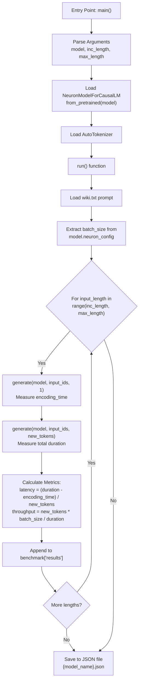
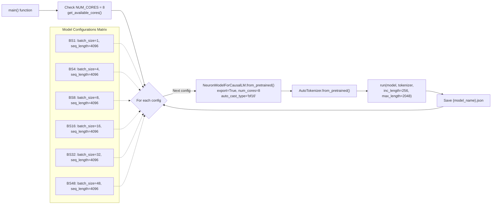
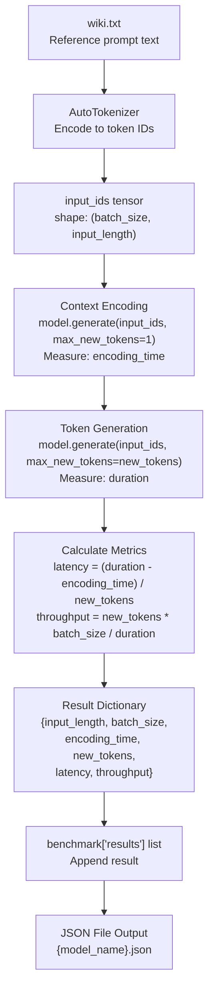
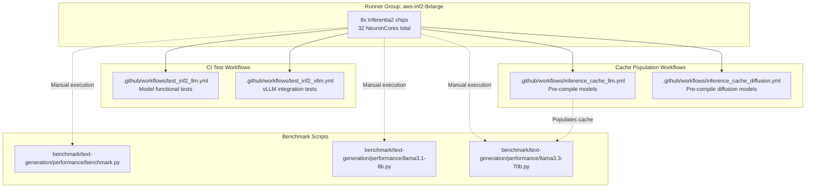

<!-- source: DeepWiki mcp.deepwiki.com · repo huggingface/optimum-neuron · page 10.3 Benchmarking System · fetched 2026-10-26 -->

# Benchmarking System

<details>
<summary>Relevant source files</summary>

The following files were used as context for generating this wiki page:

- [.github/actions/install_neuronx_runtime/action.yml](.github/actions/install_neuronx_runtime/action.yml)
- [.github/actions/install_optimum_neuron/action.yml](.github/actions/install_optimum_neuron/action.yml)
- [.github/actions/prepare_venv/action.yml](.github/actions/prepare_venv/action.yml)
- [.github/workflows/inference_cache_diffusion.yml](.github/workflows/inference_cache_diffusion.yml)
- [.github/workflows/inference_cache_llm.yml](.github/workflows/inference_cache_llm.yml)
- [.github/workflows/test_inf2_llm.yml](.github/workflows/test_inf2_llm.yml)
- [.github/workflows/test_inf2_vllm.yml](.github/workflows/test_inf2_vllm.yml)
- [benchmark/text-generation/performance/benchmark.py](benchmark/text-generation/performance/benchmark.py)
- [benchmark/text-generation/performance/llama3.1-8b.py](benchmark/text-generation/performance/llama3.1-8b.py)
- [benchmark/text-generation/performance/llama3.3-70b.py](benchmark/text-generation/performance/llama3.3-70b.py)
- [tests/decoder/test_decoder_embedding.py](tests/decoder/test_decoder_embedding.py)

</details>


## Purpose and Scope

The benchmarking system provides standardized performance measurement tools for evaluating Neuron-compiled models on AWS Inferentia hardware. It focuses on text generation models, measuring key metrics including latency, throughput, encoding time, and token generation speed across different batch sizes and sequence lengths. The system consists of reusable benchmark scripts, model-specific configuration runners, and utilities for collecting and exporting performance data.

For information about functional testing of models, see [Test Organization and Fixtures](#10.1). For CI/CD workflows that run tests on hardware, see [CI/CD Workflows](#10.2). For serving-level performance optimization, see [Performance Optimization and Benchmarking](#7.3).

## Benchmark Script Architecture

The core benchmarking functionality is implemented in [benchmark/text-generation/performance/benchmark.py:1-78](), which provides a reusable framework for measuring text generation performance.

### Core Benchmark Workflow



**Sources:** [benchmark/text-generation/performance/benchmark.py:1-78]()

### Key Functions and Data Structures

The benchmark script exposes three primary functions:

| Function | Parameters | Returns | Purpose |
|----------|-----------|---------|---------|
| `generate()` | `model`, `input_ids`, `max_new_tokens` | `output_tokens`, `duration` | Runs model generation with timing |
| `run()` | `model`, `tokenizer`, `inc_length`, `max_length`, `json_path` | `benchmark` dict | Executes full benchmark suite |
| `main()` | Command-line args | None | Entry point for CLI usage |

The `benchmark` dictionary structure returned by `run()`:

```python
{
    "neuron_config": {
        "batch_size": int,
        "sequence_length": int,
        # ... other config parameters from model.neuron_config.to_dict()
    },
    "results": [
        {
            "input_length": int,      # Context tokens
            "batch_size": int,         # Batch size used
            "encoding_time": float,    # Context encoding time (seconds)
            "new_tokens": int,         # Tokens generated
            "latency": float,          # Per-token latency (milliseconds)
            "throughput": float        # Tokens/second across batch
        },
        # ... one entry per input_length
    ]
}
```

**Sources:** [benchmark/text-generation/performance/benchmark.py:12-57]()

### Metric Calculation

The benchmark distinguishes between two phases of inference:

1. **Context Encoding** ([benchmark/text-generation/performance/benchmark.py:38-40]()): A single-token generation is run to measure pure encoding time without token generation overhead.

2. **Token Generation** ([benchmark/text-generation/performance/benchmark.py:42-43]()): Full generation with `new_tokens = inc_length` to measure steady-state generation performance.

Latency is calculated as per-token generation time excluding encoding:
```
latency = (duration - encoding_time) / new_tokens * 1000  # milliseconds
```

Throughput accounts for parallel batch processing:
```
throughput = new_tokens * batch_size / duration  # tokens/second
```

**Sources:** [benchmark/text-generation/performance/benchmark.py:43-44]()

## Model-Specific Benchmark Configurations

The system includes pre-configured benchmark runners for specific model architectures that demonstrate typical usage patterns.

### Llama 3.1 8B Benchmark Configuration



**Sources:** [benchmark/text-generation/performance/llama3.1-8b.py:1-42]()

The Llama 3.1 8B benchmark ([benchmark/text-generation/performance/llama3.1-8b.py:8-37]()) defines six configurations that test scaling behavior across batch sizes from 1 to 48, all using 8 NeuronCores with tensor parallelism. Each configuration triggers model export with `export=True`, compiles with `auto_cast_type="bf16"`, and benchmarks input lengths from 256 to 2048 tokens in 256-token increments.

### Llama 3.3 70B Benchmark Configuration

The 70B benchmark ([benchmark/text-generation/performance/llama3.3-70b.py:1-53]()) demonstrates benchmarking larger models with higher core counts:

| Configuration | Batch Size | Sequence Length | Cores (TP Degree) |
|---------------|-----------|-----------------|-------------------|
| Llama-3.3-70B-BS1 | 1 | 4096 | 24 |
| Llama-3.3-70B-BS4 | 4 | 4096 | 24 |
| Llama-3.3-70B-BS8 | 8 | 4096 | 24 |

The script includes cache-aware loading logic ([benchmark/text-generation/performance/llama3.3-70b.py:26-46]()):

1. **First attempt**: Load from cache with `NeuronModelForCausalLM.from_pretrained(model_id)`
2. **Validation**: Check that cached model's `neuron_config` matches expected batch size, TP degree, sequence length, and dtype
3. **Fallback**: If cache miss or mismatch, export fresh with `export=True` and specified configuration

This pattern demonstrates production usage where pre-compiled models from the cache are preferred but on-demand compilation provides fallback.

**Sources:** [benchmark/text-generation/performance/llama3.3-70b.py:1-53]()

## Performance Metrics Collection

### Metrics Definitions

The benchmark system collects five key metrics per configuration:

**Timing Metrics:**
- `encoding_time` (seconds): Time to process input context through prefill graph
- `duration` (seconds): Total time for context encoding + token generation
- `latency` (milliseconds): Per-token generation time, calculated as `(duration - encoding_time) / new_tokens * 1000`

**Throughput Metrics:**
- `throughput` (tokens/second): Total tokens generated across batch, calculated as `new_tokens * batch_size / duration`

**Configuration Metadata:**
- `input_length`: Number of input tokens (varies by sweep)
- `batch_size`: Batch size from `model.neuron_config`
- `new_tokens`: Number of tokens generated (typically equals `inc_length`)

**Sources:** [benchmark/text-generation/performance/benchmark.py:45-52]()

### Benchmark Data Flow



**Sources:** [benchmark/text-generation/performance/benchmark.py:24-56]()

### Reference Prompt

Benchmarks use a consistent input prompt loaded from [benchmark/text-generation/performance/wiki.txt]() to ensure reproducible results. The prompt is tokenized once, then truncated to various `input_length` values and repeated across the batch dimension:

```python
input_ids = tokens.input_ids[0, :input_length].repeat((batch_size, 1))
```

This creates a tensor of shape `(batch_size, input_length)` where all batch entries contain identical content, isolating model performance from input content variability.

**Sources:** [benchmark/text-generation/performance/benchmark.py:26-34]()

## Integration with CI/CD

While the benchmarking scripts themselves run independently, they integrate with the CI/CD system through shared infrastructure and model availability.

### Shared Hardware Environment

Benchmarks run on the same `aws-inf2-8xlarge` runner group used by CI workflows:



**Sources:** [.github/workflows/test_inf2_llm.yml:62-63](), [.github/workflows/test_inf2_vllm.yml:62-63](), [.github/workflows/inference_cache_llm.yml:23-24]()

### Environment Setup Dependencies

Benchmark execution requires the same environment as CI tests:

| Component | Installation | Purpose |
|-----------|-------------|---------|
| Neuronx Runtime | [.github/actions/install_neuronx_runtime/action.yml:1-22]() | System packages: `aws-neuronx-tools`, `aws-neuronx-runtime-lib`, `aws-neuronx-collectives` |
| Python Virtual Environment | [.github/actions/prepare_venv/action.yml:1-45]() | PyTorch, torchvision, pip configuration for Neuron repos |
| Optimum-Neuron | [.github/actions/install_optimum_neuron/action.yml:1-11]() | Install with `[neuronx,tests]` extras |

This shared setup ensures benchmark results reflect the same software stack validated by CI tests.

**Sources:** [.github/actions/install_neuronx_runtime/action.yml:1-22](), [.github/actions/prepare_venv/action.yml:1-45](), [.github/actions/install_optimum_neuron/action.yml:1-11]()

## Running Benchmarks

### Command-Line Interface

The base benchmark script accepts the following arguments ([benchmark/text-generation/performance/benchmark.py:61-67]()):

```bash
python benchmark.py <model_path> \
    --inc-length 512 \          # Token increment for length sweep
    --max-length 4096 \         # Maximum input length to test
    --seed 42 \                 # Optional seed for reproducibility
    --name "custom-name"        # Optional custom name for output file
```

The `<model_path>` should point to a local directory containing a Neuron-compiled model with `model.neuron` and `config.json` files.

**Sources:** [benchmark/text-generation/performance/benchmark.py:60-73]()

### Model-Specific Runners

Execute pre-configured benchmark suites directly:

```bash
# Llama 3.1 8B with 6 batch size configurations
python benchmark/text-generation/performance/llama3.1-8b.py

# Llama 3.3 70B with 3 batch size configurations
python benchmark/text-generation/performance/llama3.3-70b.py
```

These scripts handle model export, configuration sweeps, and automatic result collection. Each generates multiple JSON files named by configuration (e.g., `Llama-3.1-8B-BS1.json`, `Llama-3.1-8B-BS4.json`).

**Sources:** [benchmark/text-generation/performance/llama3.1-8b.py:40-42](), [benchmark/text-generation/performance/llama3.3-70b.py:51-53]()

### Output Format

Each benchmark run produces a JSON file with the following structure:

```json
{
    "neuron_config": {
        "batch_size": 4,
        "sequence_length": 4096,
        "checkpoint_id": "unsloth/Llama-3.1-8B-Instruct",
        "tp_degree": 8,
        "torch_dtype": "bfloat16"
        // ... other configuration parameters
    },
    "results": [
        {
            "input_length": 256,
            "batch_size": 4,
            "encoding_time": 0.123,
            "new_tokens": 256,
            "latency": 12.34,
            "throughput": 82.96
        },
        {
            "input_length": 512,
            "batch_size": 4,
            "encoding_time": 0.145,
            "new_tokens": 256,
            "latency": 13.21,
            "throughput": 77.48
        }
        // ... additional input_length sweeps
    ]
}
```

The `neuron_config` section captures the exact compilation configuration via `model.neuron_config.to_dict()` ([benchmark/text-generation/performance/benchmark.py:36]()), enabling reproducibility and correlation of performance with configuration parameters.

**Sources:** [benchmark/text-generation/performance/benchmark.py:36-56]()

### Hardware Requirements

Model-specific benchmarks enforce minimum core counts ([benchmark/text-generation/performance/llama3.1-8b.py:9-12](), [benchmark/text-generation/performance/llama3.3-70b.py:11-14]()):

- **Llama 3.1 8B**: Requires 8 NeuronCores minimum (e.g., inf2.8xlarge, inf2.24xlarge, inf2.48xlarge)
- **Llama 3.3 70B**: Requires 24 NeuronCores minimum (e.g., inf2.24xlarge, inf2.48xlarge)

The `get_available_cores()` utility from [optimum.neuron.utils.system]() detects available cores and raises `ValueError` if requirements are not met.

**Sources:** [benchmark/text-generation/performance/llama3.1-8b.py:9-12](), [benchmark/text-generation/performance/llama3.3-70b.py:11-14]()

---

