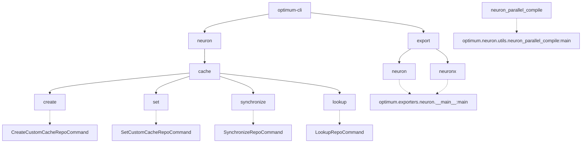
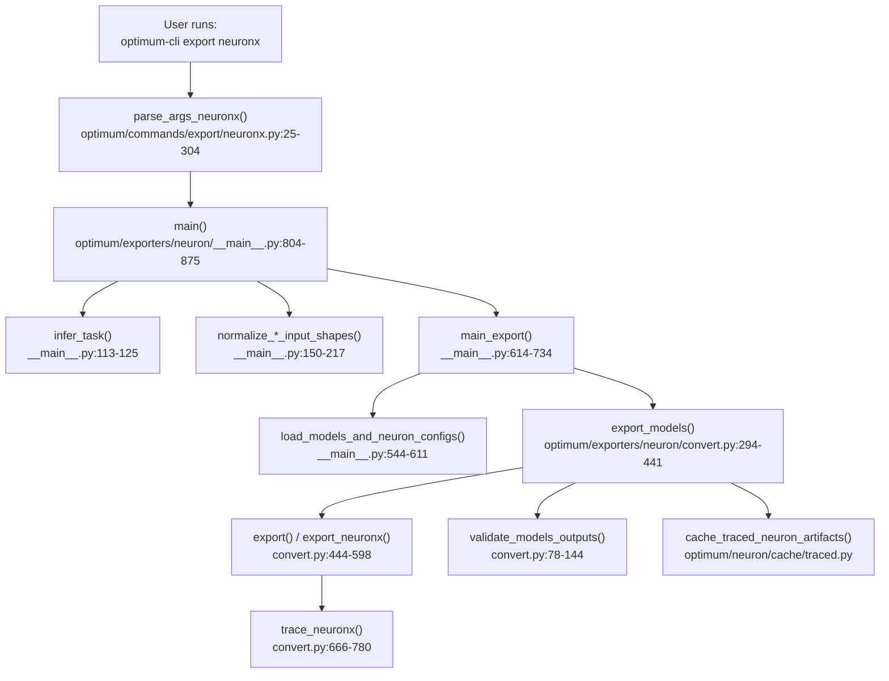
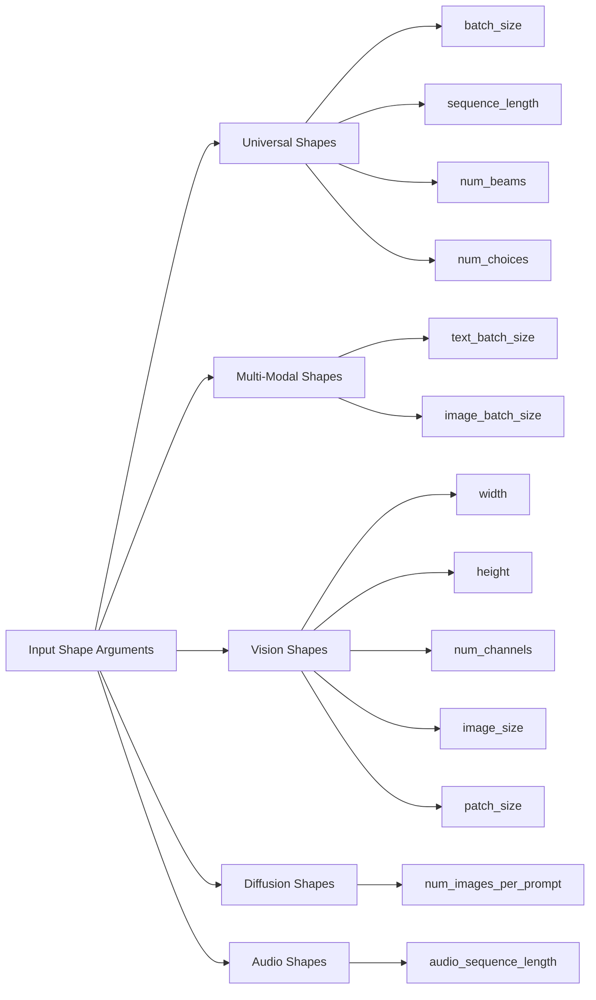
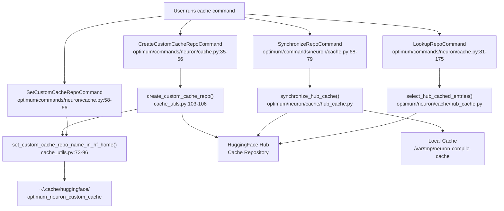
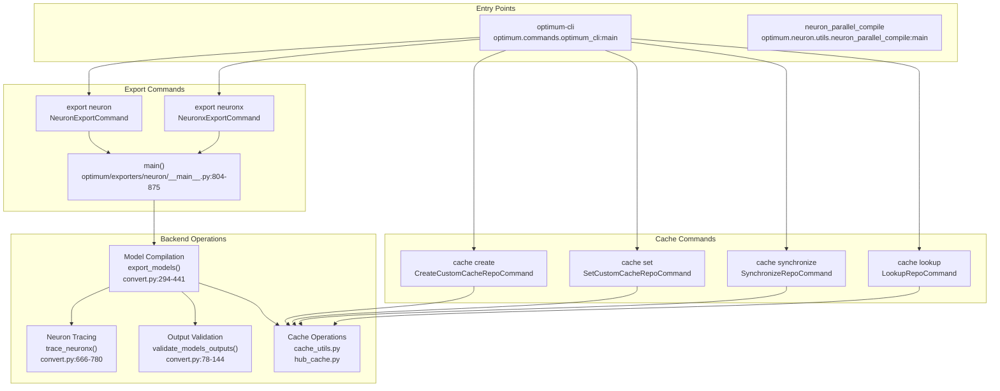

<!-- source: DeepWiki mcp.deepwiki.com · repo huggingface/optimum-neuron · page 11 CLI Reference · fetched 2026-10-26 -->

# CLI Reference

<details>
<summary>Relevant source files</summary>

The following files were used as context for generating this wiki page:

- [Makefile](Makefile)
- [optimum/commands/export/neuron.py](optimum/commands/export/neuron.py)
- [optimum/commands/export/neuronx.py](optimum/commands/export/neuronx.py)
- [optimum/exporters/neuron/__main__.py](optimum/exporters/neuron/__main__.py)
- [optimum/exporters/neuron/base.py](optimum/exporters/neuron/base.py)
- [optimum/exporters/neuron/convert.py](optimum/exporters/neuron/convert.py)
- [optimum/exporters/neuron/model_configs.py](optimum/exporters/neuron/model_configs.py)
- [optimum/exporters/neuron/utils.py](optimum/exporters/neuron/utils.py)
- [optimum/neuron/modeling_diffusion.py](optimum/neuron/modeling_diffusion.py)
- [optimum/neuron/modeling_seq2seq.py](optimum/neuron/modeling_seq2seq.py)
- [optimum/neuron/modeling_traced.py](optimum/neuron/modeling_traced.py)
- [optimum/neuron/utils/argument_utils.py](optimum/neuron/utils/argument_utils.py)
- [optimum/neuron/utils/optimization_utils.py](optimum/neuron/utils/optimization_utils.py)
- [optimum/neuron/version.py](optimum/neuron/version.py)
- [tests/exporters/exporters_utils.py](tests/exporters/exporters_utils.py)
- [tests/inference/inference_utils.py](tests/inference/inference_utils.py)

</details>


This page documents the command-line interface (CLI) tools provided by `optimum-neuron` for model export, cache management, and parallel compilation. For general installation and setup information, see [Installation and Setup](#2). For detailed information about the cache system architecture and concepts, see [Cache System](#7).

## Command Overview

The `optimum-neuron` package provides two main CLI entry points:

| Command | Entry Point | Purpose |
|---------|-------------|---------|
| `optimum-cli` | `optimum.commands.optimum_cli:main` | Main CLI interface for export and cache management |
| `neuron_parallel_compile` | `optimum.neuron.utils.neuron_parallel_compile:main` | Utility for parallel model compilation |

The `optimum-cli` command provides two subcommand groups:
- **Export subcommands**: `optimum-cli export neuron` / `neuronx` - Convert models to Neuron format
- **Cache subcommands**: `optimum-cli neuron cache` - Manage compilation cache repositories



**Sources**: [pyproject.toml:119-121](), [optimum/commands/export/neuron.py:1-162](), [optimum/commands/export/neuronx.py:1-329](), [optimum/commands/neuron/cache.py:1-175]()

---

## Export Commands

### Command Syntax

The export commands compile PyTorch models to Neuron format using either the `neuron-cc` compiler (Inferentia1) or `neuronx-cc` compiler (Inferentia2/Trainium):

```bash
# For Inferentia2 / Trainium (recommended)
optimum-cli export neuronx -m MODEL_ID OUTPUT_DIR [OPTIONS]

# For Inferentia1 (legacy)
optimum-cli export neuron -m MODEL_ID OUTPUT_DIR [OPTIONS]
```

Both commands share most arguments and internally delegate to the same export logic in [optimum/exporters/neuron/__main__.py]().

### Export Command Flow



**Sources**: [optimum/exporters/neuron/__main__.py:804-875](), [optimum/commands/export/neuronx.py:306-329](), [optimum/exporters/neuron/convert.py:294-598]()

---

### Required Arguments

| Argument | Type | Description |
|----------|------|-------------|
| `-m, --model` | `str` | Model ID on HuggingFace Hub or local path |
| `output` | `Path` | Directory to store compiled TorchScript model |

**Example**:
```bash
optimum-cli export neuronx -m gpt2 ./compiled_model
```

### Optional Arguments

#### Model Configuration

| Argument | Type | Default | Description |
|----------|------|---------|-------------|
| `--task` | `str` | `"auto"` | Task for export (auto-inferred if not specified). See [optimum/exporters/neuron/__main__.py:113-125]() for task inference logic |
| `--subfolder` | `str` | `""` | Subfolder within model repository |
| `--trust-remote-code` | flag | `False` | Allow custom modeling code execution |
| `--torch_dtype` | `str` | `"float32"` | Model dtype: `bfloat16`, `float16`, `float32` |

#### Compilation Settings

| Argument | Type | Default | Description |
|----------|------|---------|-------------|
| `--cache_dir` | `str` | `None` | Directory for cached pretrained weights |
| `--disable_neuron_cache` | flag | `False` | Disable automatic caching of compiled artifacts |
| `--compiler_workdir` | `Path` | `None` | Directory for compiler intermediate files |
| `--inline-weights-neff` | flag | `True` (default) | Inline weights to NEFF graph. Set to `False` to enable weight replacement |

#### Casting and Optimization

| Argument | Type | Default | Description |
|----------|------|---------|-------------|
| `--auto_cast` | `str` | `None` | FP32 to lower precision casting: `none`, `matmul`, `all` |
| `--auto_cast_type` | `str` | `"bf16"` | Cast target type: `bf16`, `fp16`, `tf32` |
| `-O1` / `-O2` / `-O3` | flag | `-O2` | Optimization level (see section below) |

**NeuronX-specific** ([optimum/commands/export/neuronx.py:91-103]()):
- `--auto_cast_type` supports `"mixed"` in addition to `bf16`, `fp16`, `tf32`

**Neuron-specific** ([optimum/commands/export/neuron.py:99-108]()):
- `--disable-fast-relayout`: Disable fast relayout optimization
- `--disable-fallback`: Disable CPU partitioning fallback

#### Parallelism and Batch Size

| Argument | Type | Default | Description |
|----------|------|---------|-------------|
| `--tensor_parallel_size` | `int` | `1` | Number of NeuronCores for tensor parallelism. Replaces deprecated `--num_cores` |
| `--dynamic-batch-size` | flag | `False` | Enable dynamic batch size support (with potential latency tradeoff) |

#### Validation

| Argument | Type | Default | Description |
|----------|------|---------|-------------|
| `--disable-validation` | flag | `False` | Skip output validation against original PyTorch model |
| `--atol` | `float` | `None` | Absolute tolerance for validation (model-specific default used if not set) |

#### Model-Specific Options

| Argument | Type | Description |
|----------|------|-------------|
| `--output_attentions` | flag | Return attention tensors (transformers only) |
| `--output_hidden_states` | flag | Return hidden states (transformers only) |
| `--unet` | `str` | Custom UNet model ID (Stable Diffusion only) |
| `--controlnet_ids` | `str[]` | ControlNet model IDs (Stable Diffusion only) |

**LoRA Adapter Arguments** ([optimum/commands/export/neuronx.py:143-171]()):

| Argument | Type | Description |
|----------|------|-------------|
| `--lora_model_ids` | `str[]` | Hub IDs or local paths for LoRA adapters |
| `--lora_weight_names` | `str[]` | Weight file names for LoRA adapters |
| `--lora_adapter_names` | `str[]` | Reference names for loaded adapters |
| `--lora_scales` | `float[]` | Scaling factors for each adapter |

**IP-Adapter Arguments** ([optimum/commands/export/neuronx.py:186-216]()):

| Argument | Type | Description |
|----------|------|-------------|
| `--ip_adapter_id` | `str[]` | Hub IDs or local paths for IP-Adapters |
| `--ip_adapter_subfolder` | `str[]` | Subfolders within IP-Adapter repos |
| `--ip_adapter_weight_name` | `str[]` | Weight file names for IP-Adapters |
| `--ip_adapter_scale` | `float[]` | Scaling factors for IP-Adapters |

**Sources**: [optimum/commands/export/neuronx.py:25-304](), [optimum/commands/export/neuron.py:25-133]()

---

### Input Shape Arguments

Input shapes define the dimensions that the compiled model will support. These are **mandatory** for most models and must be specified at compile time due to Neuron's static compilation model.



#### Universal Arguments

| Argument | Description | Example |
|----------|-------------|---------|
| `--batch_size` | Batch size for model input | `--batch_size 1` |
| `--sequence_length` | Sequence length for text input | `--sequence_length 128` |
| `--num_beams` | Number of beams for beam search (seq2seq) | `--num_beams 4` |
| `--num_choices` | Number of choices (multiple-choice task) | `--num_choices 4` |

#### Multi-Modal Arguments

| Argument | Description | Example |
|----------|-------------|---------|
| `--text_batch_size` | Batch size for text inputs (CLIP-like models) | `--text_batch_size 1` |
| `--image_batch_size` | Batch size for image inputs (CLIP-like models) | `--image_batch_size 1` |

#### Vision Arguments

| Argument | Description | Example |
|----------|-------------|---------|
| `--width` | Image width | `--width 512` |
| `--height` | Image height | `--height 512` |
| `--num_channels` | Number of image channels | `--num_channels 3` |
| `--image_size` | Image resolution (square images) | `--image_size 224` |
| `--patch_size` | Patch size for vision transformers | `--patch_size 16` |

#### Diffusion Arguments

| Argument | Description | Example |
|----------|-------------|---------|
| `--num_images_per_prompt` | Images generated per prompt | `--num_images_per_prompt 1` |

#### Audio Arguments

| Argument | Description | Example |
|----------|-------------|---------|
| `--audio_sequence_length` | Audio sequence length | `--audio_sequence_length 16000` |

The shape normalization logic is implemented in [optimum/exporters/neuron/__main__.py:150-217]() with different functions for different library types:
- `normalize_diffusers_input_shapes()` - for diffusion models
- `normalize_sentence_transformers_input_shapes()` - for sentence transformers
- `get_input_shapes()` - for standard transformers models

**Sources**: [optimum/commands/export/neuronx.py:218-286](), [optimum/exporters/neuron/__main__.py:128-163]()

---

### Optimization Levels

The `-O1`, `-O2`, and `-O3` flags control the Neuron compiler's optimization level. These are **mutually exclusive** options.

| Level | Flag | Compile Time | Performance | Use Case |
|-------|------|--------------|-------------|----------|
| **O1** | `-O1` | Fastest | Basic | Development, fast iteration |
| **O2** | `-O2` | Balanced | Optimal | **Default**, production recommended |
| **O3** | `-O3` | Slowest | Best possible | Maximum performance optimization |

The optimization level is parsed in [optimum/exporters/neuron/__main__.py:177-192]() and passed to the compiler in [optimum/exporters/neuron/convert.py:630]().

```bash
# Fast compilation for development
optimum-cli export neuronx -m gpt2 ./out -O1 --batch_size 1 --sequence_length 128

# Production deployment (default)
optimum-cli export neuronx -m gpt2 ./out -O2 --batch_size 1 --sequence_length 128

# Maximum performance
optimum-cli export neuronx -m gpt2 ./out -O3 --batch_size 1 --sequence_length 128
```

**Sources**: [optimum/commands/export/neuronx.py:288-303](), [optimum/exporters/neuron/__main__.py:177-192]()

---

### Export Examples

#### Basic Text Model Export

```bash
# Export BERT for sequence classification
optimum-cli export neuronx \
  -m bert-base-uncased \
  ./bert_neuron \
  --task text-classification \
  --batch_size 1 \
  --sequence_length 128
```

#### Causal Language Model with Tensor Parallelism

```bash
# Export Llama-2-7B across 8 NeuronCores
optimum-cli export neuronx \
  -m meta-llama/Llama-2-7b-hf \
  ./llama2_neuron \
  --task text-generation \
  --batch_size 1 \
  --sequence_length 2048 \
  --tensor_parallel_size 8 \
  --auto_cast matmul \
  --auto_cast_type bf16
```

#### Vision Model Export

```bash
# Export ViT for image classification
optimum-cli export neuronx \
  -m google/vit-base-patch16-224 \
  ./vit_neuron \
  --task image-classification \
  --batch_size 1 \
  --image_size 224
```

#### Stable Diffusion Pipeline Export

```bash
# Export Stable Diffusion XL
optimum-cli export neuronx \
  -m stabilityai/stable-diffusion-xl-base-1.0 \
  ./sdxl_neuron \
  --task stable-diffusion-xl \
  --batch_size 1 \
  --height 1024 \
  --width 1024 \
  --num_images_per_prompt 1
```

#### With LoRA Adapters

```bash
# Export Stable Diffusion with LoRA
optimum-cli export neuronx \
  -m stabilityai/stable-diffusion-2-1 \
  ./sd_lora_neuron \
  --task stable-diffusion \
  --batch_size 1 \
  --height 512 \
  --width 512 \
  --lora_model_ids "user/lora-model" \
  --lora_weight_names "pytorch_lora_weights.safetensors" \
  --lora_scales 0.8
```

**Sources**: [optimum/exporters/neuron/__main__.py:847-871]()

---

## Cache Commands

The cache commands manage Neuron compilation cache repositories on the HuggingFace Hub. For detailed information about the cache system architecture, see [Cache System](#7).

### cache create

Creates a new cache repository on HuggingFace Hub and sets it as the default cache.

```bash
optimum-cli neuron cache create [-n NAME] [--public]
```

**Arguments**:

| Argument | Type | Default | Description |
|----------|------|---------|-------------|
| `-n, --name` | `str` | `optimum-neuron-cache` | Repository name |
| `--public` | flag | `False` | Make repository public (default: private) |

**Implementation**: The command creates the repository via `create_custom_cache_repo()` in [optimum/neuron/utils/cache_utils.py:103-106]() and saves the repo ID to `~/.cache/huggingface/optimum_neuron_custom_cache` via `set_custom_cache_repo_name_in_hf_home()` in [optimum/neuron/utils/cache_utils.py:73-96]().

**Example**:
```bash
# Create private cache repository
optimum-cli neuron cache create -n my-org/my-neuron-cache

# Create public cache repository
optimum-cli neuron cache create -n my-org/my-public-cache --public
```

**Sources**: [optimum/commands/neuron/cache.py:35-56](), [optimum/neuron/utils/cache_utils.py:103-106]()

---

### cache set

Sets an existing HuggingFace Hub repository as the default cache location.

```bash
optimum-cli neuron cache set REPO_NAME
```

**Arguments**:

| Argument | Type | Description |
|----------|------|-------------|
| `REPO_NAME` | `str` | Repository ID (e.g., `user/repo-name`) |

**Implementation**: Saves the repository name to `~/.cache/huggingface/optimum_neuron_custom_cache` via [optimum/neuron/utils/cache_utils.py:73-96]().

**Example**:
```bash
# Set existing repository as default cache
optimum-cli neuron cache set my-org/my-neuron-cache
```

**Sources**: [optimum/commands/neuron/cache.py:58-66](), [optimum/neuron/utils/cache_utils.py:73-96]()

---

### cache synchronize

Uploads local compilation artifacts to the Hub cache repository.

```bash
optimum-cli neuron cache synchronize [--repo_id REPO_ID] [--cache_dir CACHE_DIR]
```

**Arguments**:

| Argument | Type | Default | Description |
|----------|------|---------|-------------|
| `--repo_id` | `str` | Default cache repo | Target repository ID |
| `--cache_dir` | `str` | `/var/tmp/neuron-compile-cache` | Local cache directory to sync |

**Implementation**: The synchronization logic is in `synchronize_hub_cache()` at [optimum/neuron/cache/hub_cache.py](), which:
1. Scans the local cache directory for compiled artifacts
2. Creates cache entries for each model configuration
3. Uploads to the Hub repository

**Example**:
```bash
# Sync default local cache to default Hub repo
optimum-cli neuron cache synchronize

# Sync specific directory to specific repo
optimum-cli neuron cache synchronize \
  --cache_dir /custom/cache/path \
  --repo_id my-org/my-cache
```

**Sources**: [optimum/commands/neuron/cache.py:68-79]()

---

### cache lookup

Searches for cached compiled models matching specified criteria.

```bash
optimum-cli neuron cache lookup MODEL_ID [OPTIONS]
```

**Arguments**:

| Argument | Type | Description |
|----------|------|-------------|
| `MODEL_ID` | `str` | Model identifier to search for |
| `--task` | `str` | Filter by task (for multi-task models) |
| `--dtype` | `str` | Filter by dtype: `bfloat16`, `float16` |
| `--tensor_parallel_size` | `int` | Filter by tensor parallel size |
| `--batch_size` | `int` | Filter by minimum batch size |
| `--sequence_length` | `int` | Filter by minimum sequence length |
| `--repo_id` | `str` | Search in specific cache repository |

**Implementation**: Uses `select_hub_cached_entries()` from [optimum/neuron/cache/hub_cache.py]() to query the cache repository and filter results based on criteria.

**Example**:
```bash
# Find all cached versions of a model
optimum-cli neuron cache lookup meta-llama/Llama-2-7b-hf

# Find cached versions with specific configuration
optimum-cli neuron cache lookup meta-llama/Llama-2-7b-hf \
  --dtype bfloat16 \
  --tensor_parallel_size 8 \
  --batch_size 1 \
  --sequence_length 2048
```

**Sources**: [optimum/commands/neuron/cache.py:81-175]()

---

### Cache Command Flow



**Sources**: [optimum/commands/neuron/cache.py:1-175](), [optimum/neuron/utils/cache_utils.py:1-300]()

---

## Parallel Compilation Command

The `neuron_parallel_compile` command is a utility for compiling multiple model configurations in parallel.

### Command Syntax

```bash
neuron_parallel_compile --command "COMPILE_COMMAND" [OPTIONS]
```

This command is defined in [optimum/neuron/utils/neuron_parallel_compile.py]() and is primarily used internally by the training system to pre-compile multiple model configurations efficiently.

**Entry Point**: [pyproject.toml:121]() defines the entry point as `optimum.neuron.utils.neuron_parallel_compile:main`.

**Use Case**: When training with tensor parallelism or multiple sequence lengths, multiple compilation configurations may be needed. This command parallelizes the compilation process across available CPU cores.

**Example**:
```bash
# Parallel compilation of multiple configurations
neuron_parallel_compile \
  --command "python compile_script.py" \
  --num_workers 4
```

**Sources**: [pyproject.toml:121]()

---

## Command Execution Summary



**Sources**: [pyproject.toml:119-121](), [optimum/commands/export/neuron.py:134-162](), [optimum/commands/export/neuronx.py:306-329](), [optimum/commands/neuron/cache.py:1-175]()

---

