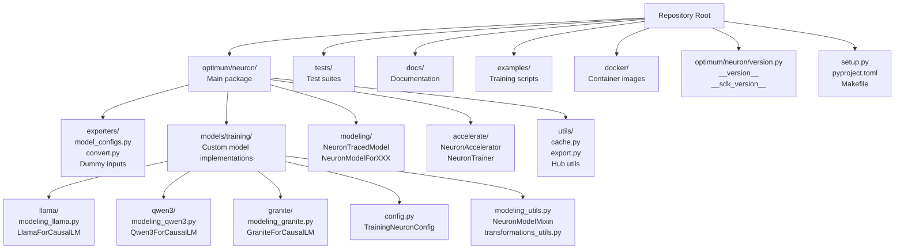
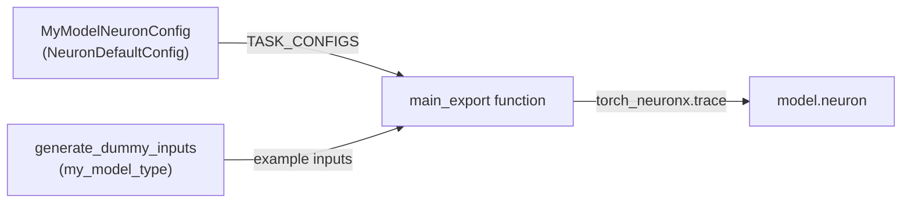
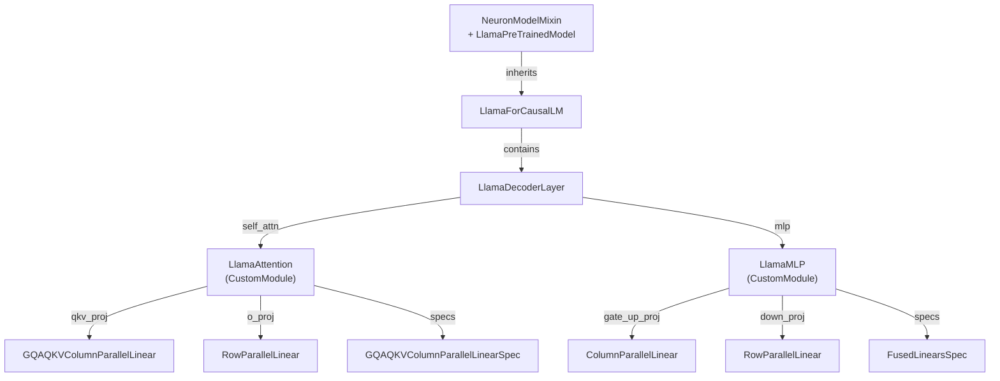
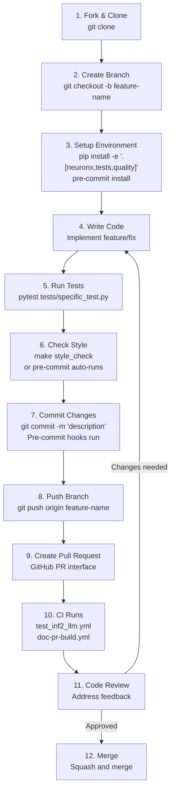

<!-- source: DeepWiki mcp.deepwiki.com · repo huggingface/optimum-neuron · page 12 Development Guide · fetched 2026-10-26 -->

# Development Guide

<details>
<summary>Relevant source files</summary>

The following files were used as context for generating this wiki page:

- [Makefile](Makefile)
- [docs/source/guides/distributed_training.mdx](docs/source/guides/distributed_training.mdx)
- [optimum/neuron/models/training/config.py](optimum/neuron/models/training/config.py)
- [optimum/neuron/models/training/granite/modeling_granite.py](optimum/neuron/models/training/granite/modeling_granite.py)
- [optimum/neuron/models/training/llama/modeling_llama.py](optimum/neuron/models/training/llama/modeling_llama.py)
- [optimum/neuron/models/training/modeling_utils.py](optimum/neuron/models/training/modeling_utils.py)
- [optimum/neuron/models/training/qwen3/modeling_qwen3.py](optimum/neuron/models/training/qwen3/modeling_qwen3.py)
- [optimum/neuron/version.py](optimum/neuron/version.py)
- [tests/training/test_custom_modeling.py](tests/training/test_custom_modeling.py)

</details>


This guide is for contributors who want to extend optimum-neuron by adding support for new models, fixing bugs, or improving the codebase. It covers the repository structure, build system, and workflows for contributing new features.

The main contribution areas are:
- **Adding model export support** (page 12.2): Implementing `NeuronDefaultConfig` subclasses for new architectures
- **Adding custom training models** (page 12.3): Creating `NeuronModelMixin` implementations with parallel layers
- **Build and release** (page 12.1): Understanding version management and release processes
- **Documentation** (page 12.4): Writing MDX guides and updating the documentation structure

For testing infrastructure details, see page 10. For understanding the model cache system, see page 8.

## Repository Structure

The optimum-neuron repository is organized into several key directories:



**Key directories for contributors:**

- `optimum/neuron/exporters/`: Model export configurations (`NeuronDefaultConfig` subclasses), dummy input generators, and conversion logic
- `optimum/neuron/models/training/`: Custom model implementations for training with parallel layers (`NeuronModelMixin` subclasses)
- `optimum/neuron/modeling/`: Inference model wrappers (`NeuronTracedModel`, `NeuronModelForCausalLM`, etc.)
- `tests/`: Unit and integration tests, including `test_custom_modeling.py` for training models
- `docs/source/`: MDX documentation files and `_toctree.yml` structure

**Sources:** [optimum/neuron/version.py:1-18](), [optimum/neuron/models/training/llama/modeling_llama.py:1-15](), [optimum/neuron/models/training/granite/modeling_granite.py:1-16](), [optimum/neuron/models/training/qwen3/modeling_qwen3.py:1-15](), [optimum/neuron/models/training/modeling_utils.py:1-104]()

### Core Configuration Files

| File | Purpose | Key Contents |
|------|---------|--------------|
| `optimum/neuron/version.py` | Single source of truth for versioning | `__version__ = "0.4.2.dev0"`, `__sdk_version__ = "2.26.0"` |
| `setup.py` | Package build configuration | Reads version from `version.py`, defines package structure |
| `pyproject.toml` | Modern build metadata | Build system, dependencies, entry points, ruff configuration |
| `Makefile` | Build automation | `build_dist`, `pypi_upload`, `optimum-neuron-vllm` targets |
| `.pre-commit-config.yaml` | Git hooks for code quality | Ruff linting/formatting on commit |

**Sources:** [optimum/neuron/version.py:15-17](), [Makefile:1-81](), [.pre-commit-config.yaml:1-19]()

## Development Environment Setup

### Installation

Clone the repository and install in editable mode with development dependencies:

```bash
git clone https://github.com/huggingface/optimum-neuron.git
cd optimum-neuron

# For Inferentia2/Trainium development
pip install -e ".[neuronx,tests,quality,training]"

# Install pre-commit hooks
pre-commit install
```

**Note:** Use `[neuron]` instead of `[neuronx]` for Inferentia1 (legacy) development. These are mutually exclusive due to PyTorch version conflicts.

**Sources:** [.pre-commit-config.yaml:1-19]()

## Contributing New Model Support

There are two main ways to add support for new models in optimum-neuron:

### 1. Export Support for Inference

Add a new model to the export system by creating a `NeuronDefaultConfig` subclass. This enables compilation for inference on Inferentia.

**Key components:**
- Subclass in `optimum/neuron/exporters/model_configs.py`
- Dummy input generator in `optimum/neuron/exporters/dummy_inputs.py`
- Task-specific configurations

**See page 12.2 for detailed guidance on contributing export support.**

**Example configuration structure:**



**Sources:** [optimum/neuron/models/training/modeling_utils.py:177-245]()

### 2. Custom Training Model Implementation

Add a new model for training by implementing `NeuronModelMixin` with parallel layers from `neuronx_distributed`.

**Key components:**
- Model class in `optimum/neuron/models/training/<model_name>/modeling_<model_name>.py`
- Use `NeuronModelMixin` base class
- Parallel layers: `ParallelEmbedding`, `ColumnParallelLinear`, `RowParallelLinear`, `GQAQKVColumnParallelLinear`
- Weight transformation specs in `CustomModule` classes
- Pipeline parallelism support via `SUPPORTS_PIPELINE_PARALLELISM`, `PIPELINE_TRANSFORMER_LAYER_CLS`

**See page 12.3 for detailed guidance on contributing custom training models.**

**Example custom model structure:**



**Sources:** [optimum/neuron/models/training/llama/modeling_llama.py:16-54](), [optimum/neuron/models/training/modeling_utils.py:177-245]()

## Code Quality and Testing

### Code Quality Tools

The project uses Ruff for linting and formatting. Pre-commit hooks automatically run checks before each commit.

```bash
# Check code style
make style_check

# Auto-fix code style issues
make style

# Run pre-commit hooks manually
pre-commit run --all-files
```

Pre-commit hooks (defined in [.pre-commit-config.yaml:1-19]()):
- YAML validation
- End-of-file fixing
- Trailing whitespace removal
- Ruff linting with auto-fix
- Ruff formatting

**Sources:** [Makefile:50-56](), [.pre-commit-config.yaml:1-19]()

### Testing Your Contribution

When adding new models, you must add tests:

**For export support:**
- Add parametrized test cases to `tests/exporters/test_exporters.py`
- Test validation against PyTorch CPU reference outputs

**For custom training models:**
- Add test cases to `tests/training/test_custom_modeling.py`
- Test that custom model outputs match original transformers implementation
- Test with various parallelism configurations (TP, PP, sequence parallel)

**Example test pattern from [tests/training/test_custom_modeling.py:61-65]():**

```python
CUSTOM_MODELINGS_TO_TEST = [
    ("LlamaForCausalLM", "michaelbenayoun/llama-2-tiny-4kv-heads-4layers-random"),
    ("GraniteForCausalLM", "michaelbenayoun/granite-tiny-4kv-heads-4layers-random"),
    ("Qwen3ForCausalLM", "michaelbenayoun/qwen3-tiny-4kv-heads-4layers-random"),
]
```

**Sources:** [tests/training/test_custom_modeling.py:61-65]()

## Build System and Versioning

**See page 12.1 for comprehensive build system documentation.**

### Version Management

Version is defined in [optimum/neuron/version.py:15-17]():

```python
__version__ = "0.4.2.dev0"
__sdk_version__ = "2.26.0"
```

This single source of truth is used by:
- `setup.py` for package building
- `Makefile` for Docker image tagging
- GitHub Actions for documentation versioning

**Versioning scheme:**
- Development: `X.Y.Z.devN` (e.g., `0.4.2.dev0`)
- Release: `X.Y.Z` (e.g., `0.4.2`)

**Sources:** [optimum/neuron/version.py:15-17](), [Makefile:27-30]()

### Key Makefile Targets

| Target | Purpose |
|--------|---------|
| `make version` | Print current version |
| `make build_dist` | Build source and wheel distributions |
| `make style` / `make style_check` | Format code / check formatting |
| `make pypi_upload` | Upload to PyPI (maintainers only) |
| `make optimum-neuron-vllm` | Build vLLM Docker image |

**Sources:** [Makefile:22-81]()

## Documentation

**See page 12.4 for comprehensive documentation system details.**

Documentation is written in MDX format and built using `doc-builder`. To preview documentation locally:

```bash
# Install doc-builder
pip install "git+https://github.com/huggingface/doc-builder.git" watchdog

# Preview documentation
doc-builder preview optimum.neuron docs/source/
```

**Key documentation files:**
- `docs/source/_toctree.yml`: Documentation structure and navigation
- `docs/source/**/*.mdx`: Individual documentation pages
- `notebooks/`: Jupyter notebooks that can be converted to MDX with `doc-builder notebook-to-mdx`

**Sources:** [docs/README.md:1-30]()


## Contributing Workflow

The typical development workflow for contributors follows this pattern:



**Sources:** [.pre-commit-config.yaml:1-19](), [Makefile:50-56](), [pyproject.toml:52-76]()

### Testing During Development

Run specific test categories using pytest markers defined in [pyproject.toml:155-162]():

```bash
# Run Inferentia tests only
pytest -m is_inferentia_test tests/

# Run Trainium tests only
pytest -m is_trainium_test tests/

# Run specific test file
pytest tests/test_modeling.py

# Run with verbose output
pytest -v tests/test_export.py
```

For comprehensive testing documentation, see [Testing and CI/CD](#10).

**Sources:** [pyproject.toml:155-162]()

### Pre-commit Hook Execution

When pre-commit hooks are installed, they automatically run on `git commit`:

1. **YAML validation** - Checks all YAML files for syntax errors
2. **End-of-file fixer** - Ensures files end with newline
3. **Trailing whitespace** - Removes trailing whitespace
4. **Ruff check** - Runs linter with `--fix` flag
5. **Ruff format** - Auto-formats code

If any hook fails, the commit is aborted and you must fix issues before committing again.

**Sources:** [.pre-commit-config.yaml:1-19]()

## Package Distribution Details

The package metadata and distribution configuration is defined in [pyproject.toml:18-46]():

```toml
[project]
name = "optimum-neuron"
dynamic = ["version"]
description = "Optimum Neuron serves as the bridge..."
readme = "README.md"
requires-python = ">=3.10"
license = {text = "Apache-2.0"}
authors = [
    {name = "HuggingFace Inc. Special Ops Team", email = "hardware@huggingface.co"},
]
keywords = ["transformers", "diffusers", "mixed-precision training", 
            "fine-tuning", "inference", "trainium", "inferentia", "aws"]
```

**Core dependencies** ([pyproject.toml:39-46]()):
- `transformers ~= 4.55.4` - Model architectures
- `accelerate == 1.8.1` - Training orchestration
- `optimum ~= 1.24.0` - Base optimization library
- `huggingface_hub >= 0.29.0` - Hub integration
- `numpy>=1.22.2, <=1.26.4` - Numerical computing
- `protobuf>=3.20.3, <4` - Serialization

**Package discovery** is configured in [pyproject.toml:129-133]():

```toml
[tool.setuptools.packages.find]
include = ["optimum*"]

[tool.setuptools.package-data]
"*" = ["*"]
```

This includes all packages starting with `optimum` and includes all non-Python files as package data.

**Sources:** [pyproject.toml:18-46](), [pyproject.toml:129-133]()

## Development Dependencies and Isolation

The project supports two mutually exclusive hardware backends:

**Inferentia1 (legacy)** - [pyproject.toml:82-90]()
```bash
pip install -e ".[neuron]"
```
- PyTorch 1.13.1
- torch-neuron 1.13.1.2.9.74.0
- neuron-cc 1.22.0.0

**Inferentia2/Trainium** - [pyproject.toml:91-99]()
```bash
pip install -e ".[neuronx]"
```
- PyTorch 2.8.0
- torch-neuronx 2.8.0.2.10.13553
- neuronx-cc 2.21.18209.0
- neuronx_distributed 0.15.22404

**Important:** These cannot be installed together due to PyTorch version conflicts. Choose the appropriate extra based on your target hardware.

**Sources:** [pyproject.toml:82-99]()

This Development Guide provides the foundation for contributing to optimum-neuron. For specialized topics, refer to:
- [Build System and Makefile](#11.1) for detailed build automation
- [Documentation System](#11.2) for documentation workflows
- [Testing and CI/CD](#10) for testing infrastructure
- [Cache System](#7) for understanding compilation cache management

---

