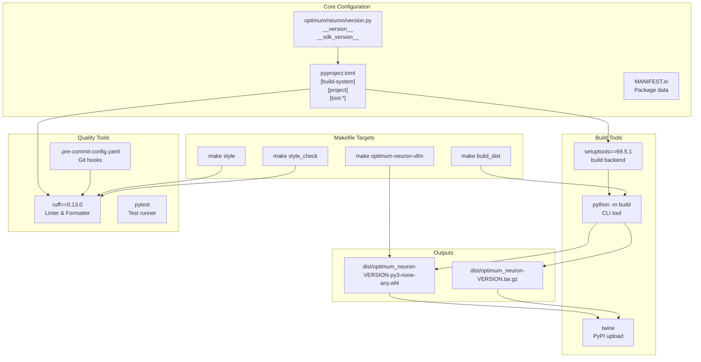
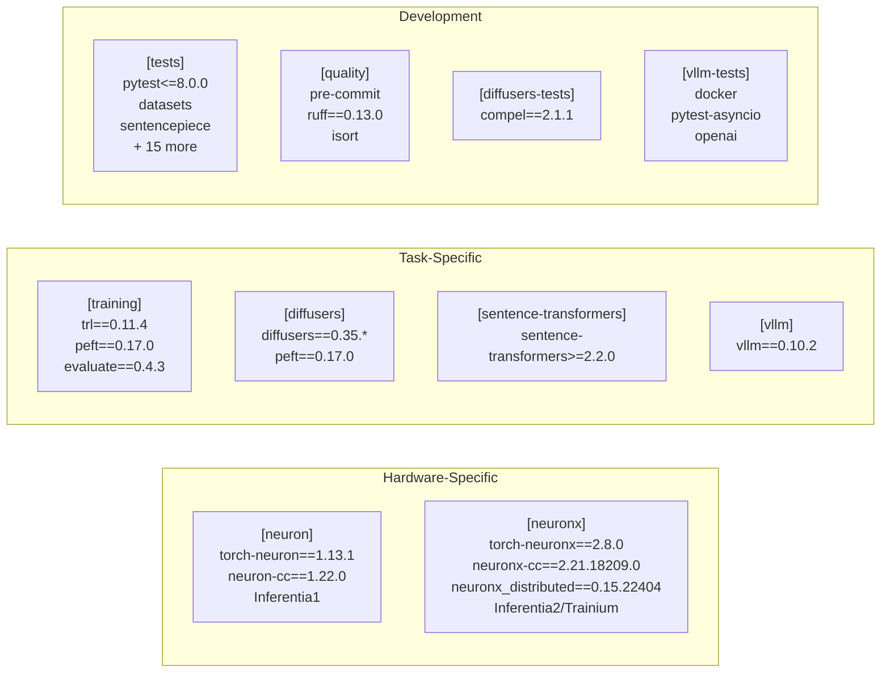
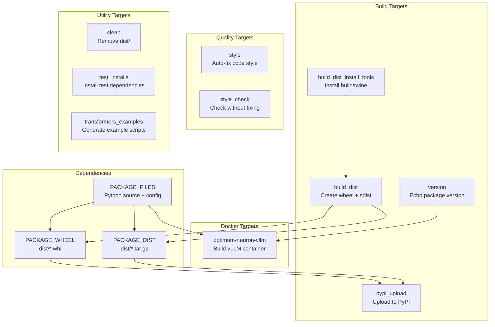
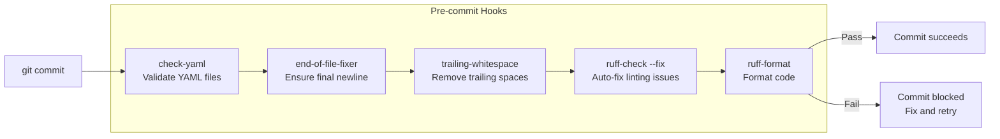
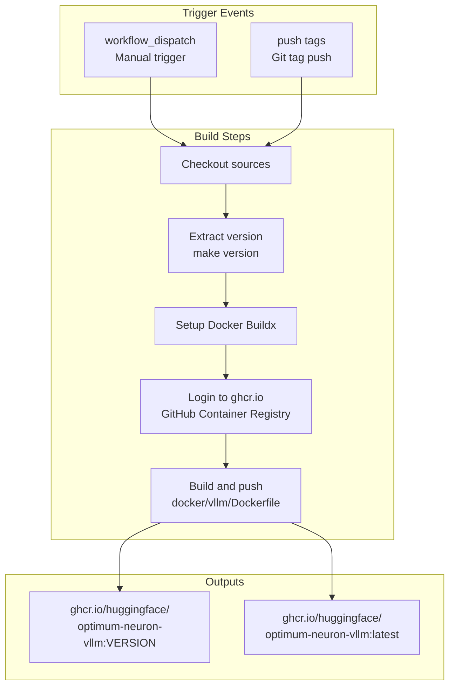
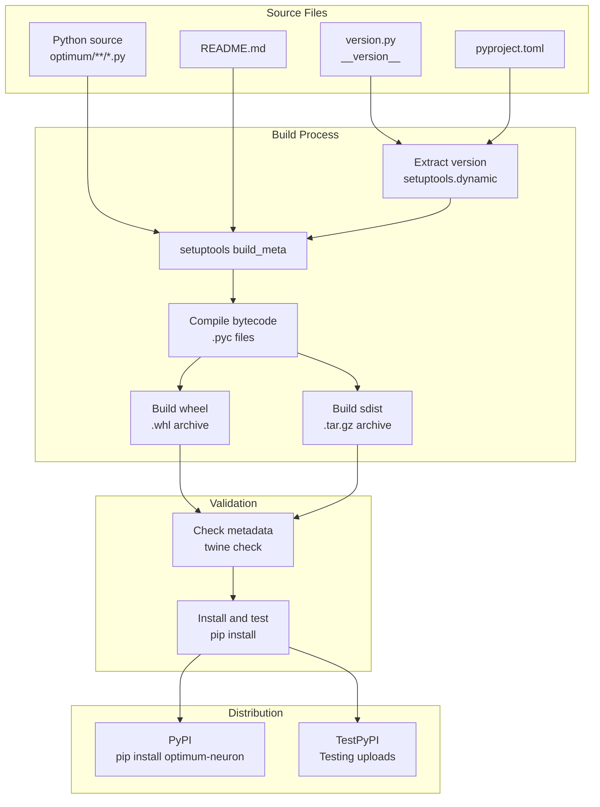
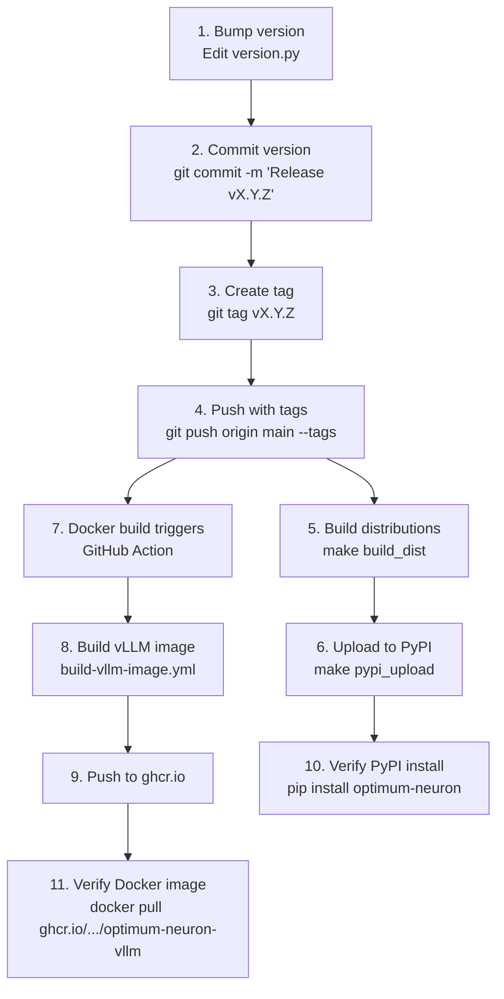

<!-- source: DeepWiki mcp.deepwiki.com · repo huggingface/optimum-neuron · page 12.1 Build System and Versioning · fetched 2026-10-26 -->

# Build System and Makefile

<details>
<summary>Relevant source files</summary>

The following files were used as context for generating this wiki page:

- [Makefile](Makefile)
- [optimum/neuron/version.py](optimum/neuron/version.py)

</details>


This page documents the build system and Makefile infrastructure for optimum-neuron, covering package building, code quality tools, Docker image creation, and release workflows. This includes the configuration files that define the package structure, dependency management, and automated build processes.

For information about the CI/CD workflows that use these build tools, see [CI/CD Workflows](#10.2). For general development practices, see [Development Guide](#11). For documentation building, see [Documentation System](#11.2).

---

## Build Configuration Architecture

The optimum-neuron build system uses modern Python packaging standards with `pyproject.toml` as the primary configuration file, supplemented by a Makefile for common development tasks.



**Sources:** [Makefile:1-81](), [pyproject.toml:1-163](), [optimum/neuron/version.py:1-18]()

---

## Package Configuration (pyproject.toml)

The [pyproject.toml:1-163]() file defines the complete package specification following PEP 517/518 standards.

### Build System

```toml
[build-system]
requires = ["setuptools==69.5.1", "wheel"]
build-backend = "setuptools.build_meta"
```

The build system uses **setuptools 69.5.1** with the modern `build_meta` backend. This pins setuptools to ensure reproducible builds across environments.

**Sources:** [pyproject.toml:14-16]()

### Project Metadata

The `[project]` section defines core package information:

| Field | Value | Notes |
|-------|-------|-------|
| `name` | `optimum-neuron` | PyPI package name |
| `version` | Dynamic | Extracted from `optimum.neuron.version.__version__` |
| `requires-python` | `>=3.10` | Minimum Python version |
| `description` | Bridge between HF libraries and AWS accelerators | Package purpose |
| `license` | Apache-2.0 | Open source license |

**Sources:** [pyproject.toml:18-46]()

### Core Dependencies

The core dependencies required for all installations:

```python
dependencies = [
    "transformers ~= 4.55.4",      # Model architectures
    "accelerate == 1.8.1",          # Training orchestration
    "optimum ~= 1.24.0",            # Base Optimum library
    "huggingface_hub >= 0.29.0",    # Hub integration
    "numpy>=1.22.2, <=1.26.4",      # Array operations
    "protobuf>=3.20.3, <4",         # Serialization
]
```

**Sources:** [pyproject.toml:39-46]()

### Optional Dependencies

The package provides several optional dependency groups that users can install based on their needs:



**Key Points:**
- **Mutually Exclusive Hardware Groups**: `[neuron]` and `[neuronx]` install different PyTorch versions (1.13 vs 2.8) and cannot coexist
- **Test Dependencies**: Separated into `[tests]`, `[diffusers-tests]`, and `[vllm-tests]` for targeted testing
- **Training Stack**: `[training]` includes TRL for RLHF/SFT and PEFT for LoRA fine-tuning

**Sources:** [pyproject.toml:51-118]()

### Entry Points

The package defines two types of entry points:

#### Console Scripts

```python
[project.scripts]
optimum-cli = "optimum.commands.optimum_cli:main"
neuron_parallel_compile = "optimum.neuron.utils.neuron_parallel_compile:main"
```

These create executable commands:
- **`optimum-cli`**: Main CLI for export, cache management (see [CLI Reference](#9))
- **`neuron_parallel_compile`**: Parallel compilation utility

**Sources:** [pyproject.toml:119-121]()

#### Plugin Entry Points

```python
[project.entry-points."vllm.platform_plugins"]
optimum_neuron = "optimum.neuron.vllm.plugin:register"
```

Registers `OptimumNeuronPlatform` as a vLLM platform plugin for high-throughput serving (see [vLLM Integration](#6.5)).

**Sources:** [pyproject.toml:123-124]()

### Package Discovery

```python
[tool.setuptools.packages.find]
include = ["optimum*"]

[tool.setuptools.package-data]
"*" = ["*"]
```

- **Package Include Pattern**: Finds all packages starting with `optimum`
- **Package Data**: Includes all files (configuration files, compiled models, etc.)

**Sources:** [pyproject.toml:129-133]()

---

## Version Management

Version information is centrally managed in [optimum/neuron/version.py:1-18]().

```python
__version__ = "0.3.1.dev7"
__sdk_version__ = "2.26.0"
```

### Version Variables

| Variable | Purpose | Example |
|----------|---------|---------|
| `__version__` | Package version following SemVer | `0.3.1.dev7` |
| `__sdk_version__` | Compatible Neuron SDK version | `2.26.0` |

### Version Extraction in Build System

The Makefile extracts the version using `gawk`:

```makefile
VERSION := $(shell gawk 'match($$0, /__version__ = "(.*)"/, a) {print a[1]}' optimum/neuron/version.py)
```

This regex pattern matches `__version__ = "X.Y.Z"` and extracts the version string for use in:
- Package filenames: `optimum_neuron-0.3.1.dev7.tar.gz`
- Docker tags: `optimum-neuron-vllm:0.3.1.dev7`
- GitHub releases

**Sources:** [Makefile:27-30](), [optimum/neuron/version.py:15-17]()

---

## Makefile Targets

The [Makefile:1-81]() provides convenient targets for common development tasks.



**Sources:** [Makefile:1-81]()

### Build Targets

#### `make version`

Prints the current package version:

```bash
$ make version
0.3.1.dev7
```

**Implementation:** [Makefile:29-30]()

#### `make build_dist`

Builds both wheel and source distribution:

```bash
$ make build_dist
python -m build
# Creates:
# dist/optimum_neuron-0.3.1.dev7-py3-none-any.whl
# dist/optimum_neuron-0.3.1.dev7.tar.gz
```

**Dependencies:**
- All Python files in `optimum/`
- `pyproject.toml`, `README.md`, `MANIFEST.in`

**Implementation:** [Makefile:40-42]()

#### `make pypi_upload`

Uploads built distributions to PyPI using twine:

```bash
$ make pypi_upload
python -m twine upload dist/optimum_neuron-0.3.1.dev7.tar.gz \
                      dist/optimum_neuron-0.3.1.dev7-py3-none-any.whl
```

**Prerequisites:** Requires `build_dist_install_tools` to install twine.

**Implementation:** [Makefile:65-66]()

**Sources:** [Makefile:59-66]()

### Code Quality Targets

#### `make style_check`

Checks code quality without modifying files:

```bash
$ make style_check
ruff check .
ruff format . --diff
```

Returns non-zero exit code if issues found. Used in CI/CD pipelines.

**Implementation:** [Makefile:50-52]()

#### `make style`

Auto-fixes code style issues:

```bash
$ make style
ruff check . --fix
ruff format .
```

Applies:
- Import sorting
- Line length adjustments (119 chars max)
- Code formatting

**Implementation:** [Makefile:54-56]()

**Sources:** [Makefile:49-56]()

### Docker Targets

#### `make optimum-neuron-vllm`

Builds the vLLM Docker image:

```bash
$ make optimum-neuron-vllm
docker build --rm \
    -f docker/vllm/Dockerfile \
    -t optimum-neuron-vllm:0.3.1.dev7 .
docker tag optimum-neuron-vllm:0.3.1.dev7 optimum-neuron-vllm:latest
```

Creates two tags:
- Version-specific: `optimum-neuron-vllm:0.3.1.dev7`
- Latest: `optimum-neuron-vllm:latest`

**Implementation:** [Makefile:76-80]()

**Sources:** [Makefile:74-81]()

### Utility Targets

#### `make clean`

Removes build artifacts:

```bash
$ make clean
rm -rf dist
```

**Implementation:** [Makefile:22-23]()

#### `make test_installs`

Installs test dependencies:

```bash
$ make test_installs
python -m pip install .[tests]
python -m pip install git+https://github.com/huggingface/transformers.git
```

Installs the latest development version of transformers from GitHub.

**Implementation:** [Makefile:70-72]()

#### `make transformers_examples`

Generates example scripts adapted from Transformers:

```bash
$ make transformers_examples
rm -f examples/**/*.py
python tools/create_examples_from_transformers.py --version 0.3.1.dev7 examples
```

**Implementation:** [Makefile:44-47]()

**Sources:** [Makefile:20-72]()

---

## Code Quality Configuration

### Ruff Configuration

Ruff is configured in [pyproject.toml:135-154]() as both linter and formatter.

#### Linter Settings

```toml
[tool.ruff]
line-length = 119

[tool.ruff.lint]
ignore = ["C901", "E501", "E741", "W605"]
select = ["C", "E", "F", "I", "W"]
exclude = ["*.ipynb"]
```

| Rule Category | Description | Status |
|---------------|-------------|--------|
| C | McCabe complexity | Enabled (except C901) |
| E | pycodestyle errors | Enabled (except E501, E741) |
| F | Pyflakes errors | Enabled |
| I | isort import sorting | Enabled |
| W | pycodestyle warnings | Enabled (except W605) |

**Ignored Rules:**
- `C901`: Complex functions (too strict for ML code)
- `E501`: Line too long (handled by formatter)
- `E741`: Ambiguous variable names
- `W605`: Invalid escape sequence

**Sources:** [pyproject.toml:135-146]()

#### Import Sorting

```toml
[tool.ruff.lint.isort]
lines-after-imports = 2
known-first-party = ["optimum.neuron"]
```

Ensures consistent import organization with optimum.neuron treated as first-party code.

**Sources:** [pyproject.toml:151-153]()

#### Per-File Ignores

```toml
[tool.ruff.lint.per-file-ignores]
"__init__.py" = ["E402", "F401", "F403", "F811"]
```

Relaxes rules for `__init__.py` files to allow:
- `E402`: Module level import not at top
- `F401`: Imported but unused
- `F403`: `import *` used
- `F811`: Redefinition of unused name

**Sources:** [pyproject.toml:148-149]()

### Pre-commit Hooks

The [.pre-commit-config.yaml:1-19]() configures Git hooks that run before commits.

```yaml
repos:
- repo: https://github.com/pre-commit/pre-commit-hooks
  rev: v4.5.0
  hooks:
  - id: check-yaml
  - id: end-of-file-fixer
  - id: trailing-whitespace

- repo: https://github.com/astral-sh/ruff-pre-commit
  rev: v0.13.0
  hooks:
  - id: ruff-check
    args: [ --fix ]
  - id: ruff-format
```

#### Hook Execution Flow



**Installation:**
```bash
pip install pre-commit
pre-commit install
```

**Sources:** [.pre-commit-config.yaml:1-19]()

---

## Docker Image Building

### Local Building

The Makefile target builds the vLLM container locally:

```bash
make optimum-neuron-vllm
```

This executes:
1. Reads version from [optimum/neuron/version.py:15]()
2. Builds image with [docker/vllm/Dockerfile]()
3. Tags with version and `latest`

**Sources:** [Makefile:76-80]()

### CI/CD Building

The [.github/workflows/build-vllm-image.yml:1-44]() workflow automates Docker image building and publishing.



#### Workflow Configuration

| Setting | Value | Notes |
|---------|-------|-------|
| Runner | `aws-general-8-plus` | Self-hosted AWS runner |
| Registry | `ghcr.io` | GitHub Container Registry |
| Authentication | `GITHUB_TOKEN` | Automatic GitHub token |
| Image naming | `ghcr.io/huggingface/optimum-neuron-vllm` | Public container |

#### Tagging Strategy

When a tag `v0.3.1` is pushed:
1. Workflow extracts version: `0.3.1`
2. Builds image with context `.` and dockerfile `docker/vllm/Dockerfile`
3. Pushes two tags:
   - `ghcr.io/huggingface/optimum-neuron-vllm:0.3.1`
   - `ghcr.io/huggingface/optimum-neuron-vllm:latest`

**Sources:** [.github/workflows/build-vllm-image.yml:1-44]()

---

## Package Building Process

The complete flow from source to distribution:



### Build Command

Modern Python packages use the `build` module:

```bash
python -m build
```

This is equivalent to the Makefile recipe in [Makefile:41-42](). The build process:

1. **Version Resolution**: Reads `__version__` from [optimum/neuron/version.py:15]() via `setuptools.dynamic` configuration
2. **Metadata Generation**: Constructs package metadata from [pyproject.toml:18-46]()
3. **File Collection**: Gathers all files matching `include = ["optimum*"]` pattern
4. **Wheel Creation**: Builds pure Python wheel with all package data
5. **Source Distribution**: Creates `.tar.gz` with source files and metadata

### Output Files

| File | Purpose | Size |
|------|---------|------|
| `optimum_neuron-VERSION-py3-none-any.whl` | Wheel distribution (fast install) | ~500 KB |
| `optimum_neuron-VERSION.tar.gz` | Source distribution (build from source) | ~400 KB |

The `py3-none-any` tag indicates:
- `py3`: Python 3 compatible
- `none`: No ABI requirements
- `any`: Platform independent

**Sources:** [Makefile:32-42](), [pyproject.toml:126-133]()

---

## Release Workflow

The typical release process combining build tools:



### Pre-release Checklist

Before releasing:

1. **Run Quality Checks**: `make style_check`
2. **Test Locally**: `make test_installs && pytest tests/`
3. **Verify Build**: `make build_dist`
4. **Check Package**: `twine check dist/*`
5. **Test Installation**: `pip install dist/*.whl`

### Version Bump Strategy

optimum-neuron follows semantic versioning:

- **Major** (X.0.0): Breaking changes in API
- **Minor** (0.X.0): New features, backward compatible
- **Patch** (0.0.X): Bug fixes
- **Dev** (0.0.X.devY): Development releases

Examples:
- `0.3.1.dev7`: Development version 7 towards 0.3.1
- `0.3.1`: Stable release
- `0.4.0`: Minor version bump with new features

**Sources:** [optimum/neuron/version.py:15]()

---

## Testing Build System

The build system can be tested without publishing:

### Test Local Build

```bash
# Clean previous builds
make clean

# Build distributions
make build_dist

# Verify outputs exist
ls -lh dist/
# Should show .whl and .tar.gz files
```

### Test Wheel Installation

```bash
# Create virtual environment
python -m venv test-env
source test-env/bin/activate

# Install from wheel
pip install dist/optimum_neuron-*.whl

# Verify installation
python -c "import optimum.neuron; print(optimum.neuron.__version__)"
```

### Test Docker Build

```bash
# Build vLLM image
make optimum-neuron-vllm

# Verify image exists
docker images | grep optimum-neuron-vllm

# Test image
docker run --rm optimum-neuron-vllm:latest python -c "import optimum.neuron; print(optimum.neuron.__version__)"
```

**Sources:** [Makefile:22-23](), [Makefile:40-42](), [Makefile:76-80]()

---

## Pytest Configuration

The [pyproject.toml:155-162]() defines pytest markers for hardware-specific testing:

```toml
[tool.pytest.ini_options]
markers = [
    "is_staging_test",
    "is_trainium_test",
    "is_inferentia_test",
    "neuron_parallel_compile",
    "flagship_model",
]
```

These markers enable selective test execution:

```bash
# Run only Inferentia tests
pytest -m is_inferentia_test

# Run only Trainium tests
pytest -m is_trainium_test

# Skip parallel compile tests
pytest -m "not neuron_parallel_compile"
```

**Sources:** [pyproject.toml:155-162]()

---

## Summary

The optimum-neuron build system provides:

| Component | Tool | Purpose |
|-----------|------|---------|
| **Configuration** | pyproject.toml | Package metadata, dependencies, tool settings |
| **Version Management** | version.py | Single source of truth for versions |
| **Build Automation** | Makefile | Common development tasks |
| **Code Quality** | Ruff + pre-commit | Consistent code style |
| **Distribution** | setuptools + build | Wheel and sdist creation |
| **Container Build** | Docker + GitHub Actions | vLLM image publishing |

Key features:
- **Modern Standards**: Uses PEP 517/518 with pyproject.toml
- **Flexible Dependencies**: Optional extras for different use cases
- **Automated Quality**: Pre-commit hooks and CI/CD checks
- **Multi-Target**: PyPI packages and Docker images
- **Version Consistency**: Single version source across build artifacts

**Sources:** [Makefile:1-81](), [pyproject.toml:1-163](), [optimum/neuron/version.py:1-18](), [.pre-commit-config.yaml:1-19](), [.github/workflows/build-vllm-image.yml:1-44]()

---

