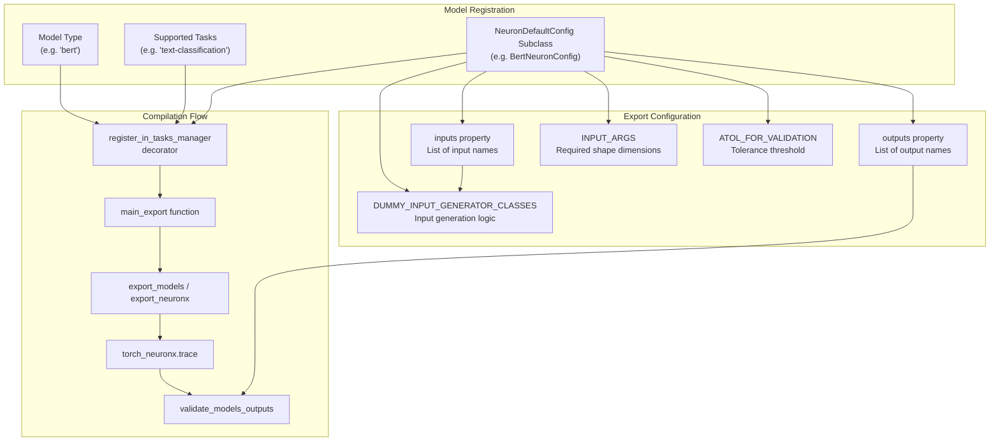
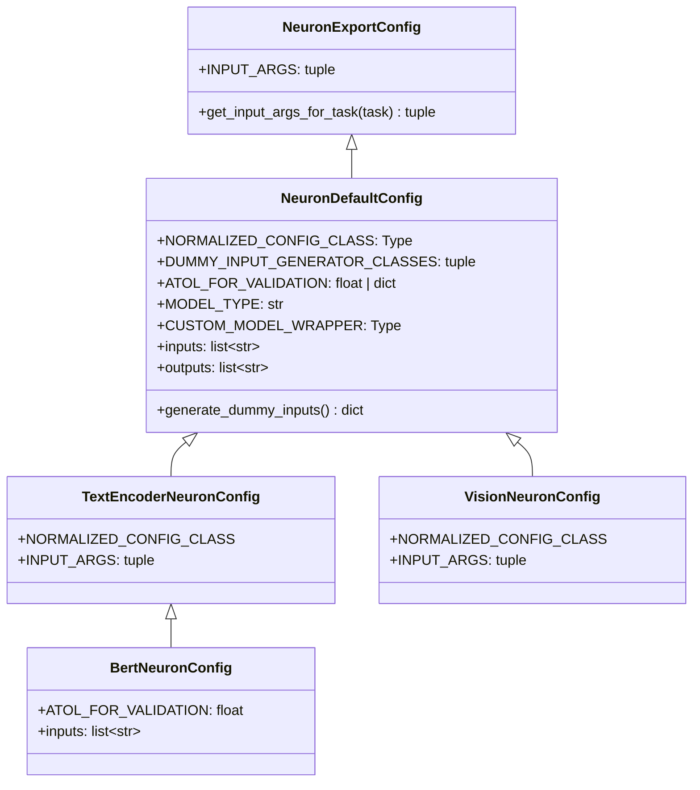
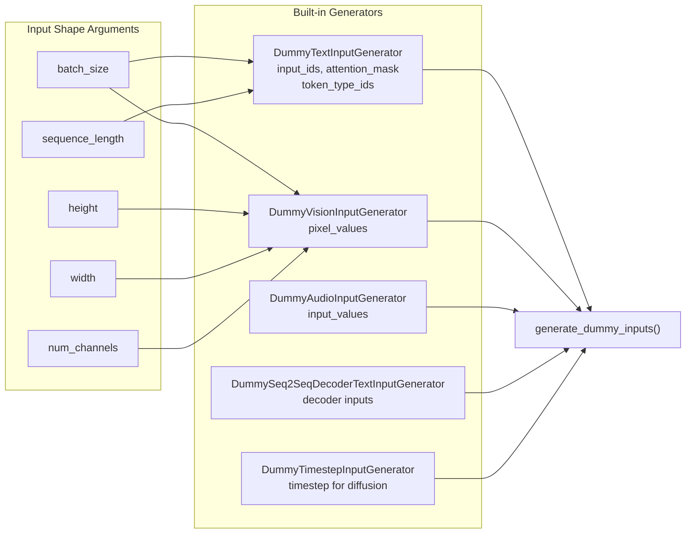
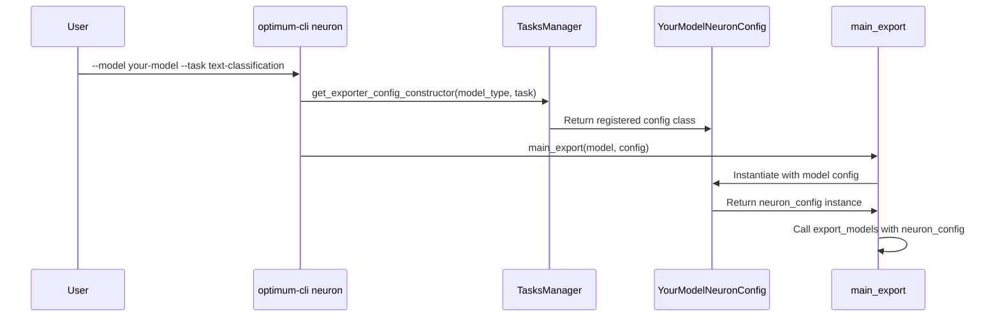
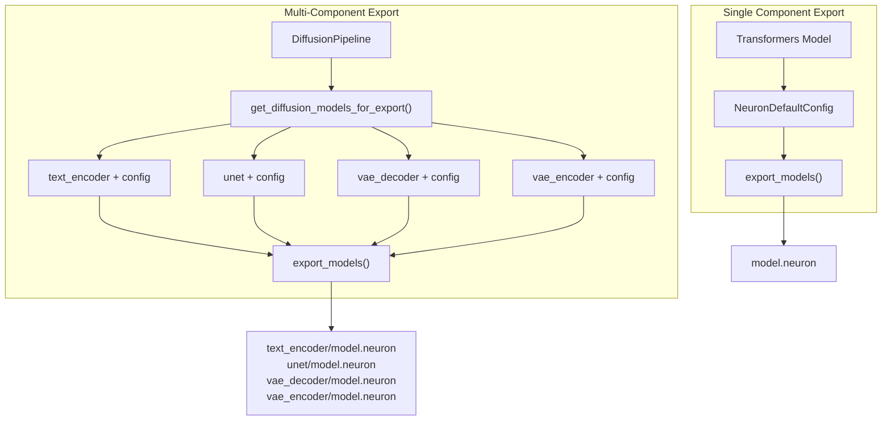
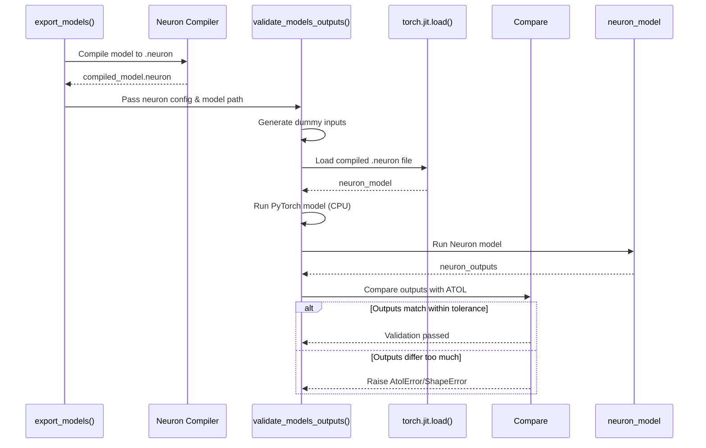

<!-- source: DeepWiki mcp.deepwiki.com · repo huggingface/optimum-neuron · page 12.2 Contributing Model Export Support · fetched 2026-10-26 -->

# Contributing Model Export Support

<details>
<summary>Relevant source files</summary>

The following files were used as context for generating this wiki page:

- [optimum/commands/export/neuron.py](optimum/commands/export/neuron.py)
- [optimum/commands/export/neuronx.py](optimum/commands/export/neuronx.py)
- [optimum/exporters/neuron/__main__.py](optimum/exporters/neuron/__main__.py)
- [optimum/exporters/neuron/base.py](optimum/exporters/neuron/base.py)
- [optimum/exporters/neuron/convert.py](optimum/exporters/neuron/convert.py)
- [optimum/exporters/neuron/model_configs.py](optimum/exporters/neuron/model_configs.py)
- [optimum/exporters/neuron/utils.py](optimum/exporters/neuron/utils.py)
- [optimum/neuron/modeling_diffusion.py](optimum/neuron/modeling_diffusion.py)
- [optimum/neuron/modeling_seq2seq.py](optimum/neuron/modeling_seq2seq.py)
- [optimum/neuron/modeling_traced.py](optimum/neuron/modeling_traced.py)
- [optimum/neuron/utils/argument_utils.py](optimum/neuron/utils/argument_utils.py)
- [optimum/neuron/utils/optimization_utils.py](optimum/neuron/utils/optimization_utils.py)
- [tests/exporters/exporters_utils.py](tests/exporters/exporters_utils.py)
- [tests/inference/inference_utils.py](tests/inference/inference_utils.py)

</details>


This guide explains how to add support for exporting new model architectures to AWS Neuron in optimum-neuron. By following these steps, you will enable a model type to be compiled for Inferentia/Trainium hardware using the `optimum-cli neuron` command or the `main_export` function.

For information about using the export system (as opposed to extending it), see [Model Export System](#4). For contributing custom training model implementations, see [Contributing Custom Training Models](#12.3).

## Overview of Export Support Architecture

The export system is built around **NeuronDefaultConfig** subclasses that define how each model architecture should be compiled for Neuron. When you add export support for a new model, you create a configuration class that specifies:

- **Input/output specifications**: Which tensor names the model expects and produces
- **Input shape requirements**: Which dimensions (batch_size, sequence_length, etc.) are mandatory
- **Dummy input generation**: How to create example inputs for compilation
- **Validation criteria**: Acceptable tolerance when comparing Neuron vs CPU outputs



**Sources**: [optimum/exporters/neuron/model_configs.py:1-100](), [optimum/exporters/neuron/base.py:41-76]()

## Step 1: Create a NeuronDefaultConfig Subclass

All model export configurations inherit from `NeuronDefaultConfig` and must be placed in [optimum/exporters/neuron/model_configs.py](). The base class structure:



**Sources**: [optimum/exporters/neuron/base.py:78-142](), [optimum/exporters/neuron/model_configs.py:103-111]()

### Minimum Implementation

Here's a minimal example for a text encoder model:

```python
from .config import TextEncoderNeuronConfig

@register_in_tasks_manager("your-model-type", "text-classification", "feature-extraction")
class YourModelNeuronConfig(TextEncoderNeuronConfig):
    NORMALIZED_CONFIG_CLASS = NormalizedConfigManager.get_normalized_config_class("your-model-type")
    ATOL_FOR_VALIDATION = 1e-3
    
    @property
    def inputs(self) -> list[str]:
        return ["input_ids", "attention_mask", "token_type_ids"]
```

**Sources**: [optimum/exporters/neuron/model_configs.py:103-111]()

### Class Attributes to Define

| Attribute | Type | Required | Description |
|-----------|------|----------|-------------|
| `NORMALIZED_CONFIG_CLASS` | `Type` | Yes | Class for normalizing model config, from `NormalizedConfigManager` |
| `ATOL_FOR_VALIDATION` | `float` or `dict[str, float]` | Yes | Absolute tolerance for output validation |
| `INPUT_ARGS` | `tuple[str]` | Yes (inherited) | Required input shape dimension names |
| `DUMMY_INPUT_GENERATOR_CLASSES` | `tuple[Type]` | No | Custom dummy input generators if needed |
| `MODEL_TYPE` | `str` | No | Model type identifier (for diffusion models) |
| `CUSTOM_MODEL_WRAPPER` | `Type` | No | Custom wrapper class for model modifications |

**Sources**: [optimum/exporters/neuron/base.py:117-122]()

## Step 2: Define Input and Output Specifications

### Inputs Property

The `inputs` property returns a list of tensor names that will be passed to the compiled model. These must match the forward signature of your model:

```python
@property
def inputs(self) -> list[str]:
    # Basic text model
    return ["input_ids", "attention_mask"]
    
    # Model with token type ids
    return ["input_ids", "attention_mask", "token_type_ids"]
    
    # Vision model
    return ["pixel_values"]
    
    # Multi-modal model
    return ["input_ids", "pixel_values", "attention_mask"]
```

**Sources**: [optimum/exporters/neuron/model_configs.py:109-110](), [optimum/exporters/neuron/model_configs.py:144-145](), [optimum/exporters/neuron/model_configs.py:281-282]()

### Outputs Property

The `outputs` property returns a list of output tensor names. The base class provides defaults via `_TASK_TO_COMMON_OUTPUTS`:

```python
@property
def outputs(self) -> list[str]:
    # Use default for task
    return self._TASK_TO_COMMON_OUTPUTS[self.task]
    
    # Or override with custom outputs
    if self.task == "feature-extraction":
        return ["last_hidden_state"]
    return ["logits"]
```

Common output patterns:
- Classification: `["logits"]`
- Feature extraction: `["last_hidden_state", "pooler_output"]`
- Token classification: `["logits"]`
- Question answering: `["start_logits", "end_logits"]`

**Sources**: [optimum/exporters/neuron/base.py:124-142](), [optimum/exporters/neuron/model_configs.py:123-126]()

## Step 3: Configure Dummy Input Generation

Dummy inputs are used during compilation to determine tensor shapes and trace the model graph. The system provides several built-in generators:



**Sources**: [optimum/exporters/neuron/base.py:268-272](), [optimum/exporters/neuron/base.py:306-340]()

### Using Default Generators

Most models can use the default generators from their base config class:

```python
# TextEncoderNeuronConfig uses DummyTextInputGenerator by default
class MyTextModelConfig(TextEncoderNeuronConfig):
    pass  # DummyTextInputGenerator automatically used

# VisionNeuronConfig uses DummyVisionInputGenerator and DummyMaskedPosGenerator
class MyVisionModelConfig(VisionNeuronConfig):
    pass  # Generators inherited
```

**Sources**: [optimum/exporters/neuron/model_configs.py:395-396]()

### Custom Dummy Input Generators

For models with unique inputs, create a custom generator by subclassing `DummyInputGenerator`:

```python
from optimum.utils import DummyInputGenerator

class CustomDummyGenerator(DummyInputGenerator):
    SUPPORTED_INPUT_NAMES = ("custom_input",)
    
    def generate(self, input_name: str, framework: str = "pt", int_dtype: str = "int64", float_dtype: str = "fp32"):
        # Return appropriate dummy tensor based on input_name
        if input_name == "custom_input":
            return torch.zeros((self.batch_size, self.custom_dim), dtype=getattr(torch, float_dtype))

class MyModelConfig(NeuronDefaultConfig):
    DUMMY_INPUT_GENERATOR_CLASSES = (DummyTextInputGenerator, CustomDummyGenerator)
    INPUT_ARGS = ("batch_size", "sequence_length", "custom_dim")
```

**Sources**: [optimum/exporters/neuron/model_configs.py:519-527]()

## Step 4: Register with TasksManager

The `@register_in_tasks_manager` decorator registers your config class with the export system. This makes it discoverable when users specify a model type and task:

```python
# Single task
@register_in_tasks_manager("bert", "text-classification")
class BertNeuronConfig(TextEncoderNeuronConfig):
    pass

# Multiple tasks
@register_in_tasks_manager("bert", "feature-extraction", "fill-mask", "text-classification")
class BertNeuronConfig(TextEncoderNeuronConfig):
    pass

# With library specification
@register_in_tasks_manager("clip", "feature-extraction", library_name="sentence_transformers")
class SentenceTransformersCLIPNeuronConfig(CLIPNeuronConfig):
    pass
```

The registration flow:



**Sources**: [optimum/exporters/neuron/model_configs.py:100](), [optimum/exporters/neuron/model_configs.py:103]()

## Step 5: Set Validation Tolerance

The `ATOL_FOR_VALIDATION` attribute specifies the absolute tolerance when comparing Neuron outputs to PyTorch CPU outputs. This is crucial because Neuron compilation involves precision changes:

```python
# Single tolerance for all tasks
class MyModelConfig(TextEncoderNeuronConfig):
    ATOL_FOR_VALIDATION = 1e-3  # More lenient

# Task-specific tolerances
class MyModelConfig(TextEncoderNeuronConfig):
    ATOL_FOR_VALIDATION = {
        "feature-extraction": 1e-4,
        "text-classification": 1e-3,
        "token-classification": 1e-3,
    }
```

Typical tolerance values:
- `1e-5`: Very strict, for models requiring high precision
- `1e-4`: Standard for most models
- `1e-3`: Lenient, for models with natural precision loss
- `1e-1`: Very lenient, use only if model architecture naturally differs

**Sources**: [optimum/exporters/neuron/base.py:119](), [optimum/exporters/neuron/model_configs.py:106](), [optimum/exporters/neuron/convert.py:173-177]()

## Step 6: Testing Your Configuration

### Manual Export Test

Test the export manually using the CLI or Python API:

```bash
# CLI export
optimum-cli export neuron \
    --model your-model-id \
    --task text-classification \
    --batch_size 1 \
    --sequence_length 128 \
    output_dir/
```

```python
# Python API export
from optimum.exporters.neuron import main_export

main_export(
    model_name_or_path="your-model-id",
    output="output_dir/",
    task="text-classification",
    batch_size=1,
    sequence_length=128,
)
```

**Sources**: [optimum/exporters/neuron/__main__.py:618-739]()

### Automated Testing

Add your model to the test suite in [tests/exporters/exporters_utils.py:31-72]():

```python
EXPORT_MODELS_TINY = {
    "your-model-type": "hf-internal-testing/tiny-random-YourModel",
}
```

The test framework will automatically:
1. Export the model for all registered tasks
2. Validate outputs against PyTorch CPU
3. Check shape consistency
4. Verify value tolerance

**Sources**: [tests/exporters/exporters_utils.py:31-72](), [tests/exporters/exporters_utils.py:105-146]()

## Advanced Topics

### Custom Model Wrappers

Some models require modifications before tracing. Use `CUSTOM_MODEL_WRAPPER` to wrap the model:

```python
from .model_wrappers import CustomWrapper

class MyModelConfig(TextEncoderNeuronConfig):
    CUSTOM_MODEL_WRAPPER = CustomWrapper
```

Common use cases:
- `NoCacheModelWrapper`: Disable KV caching for models that don't support it
- `T5EncoderWrapper`: Special handling for T5 encoder
- `UnetNeuronWrapper`: Flatten nested inputs for diffusion UNet

**Sources**: [optimum/exporters/neuron/model_configs.py:175](), [optimum/exporters/neuron/model_configs.py:653]()

### Multi-Component Models

For models with multiple components (e.g., diffusion pipelines, encoder-decoder):



**Sources**: [optimum/exporters/neuron/utils.py:115-292](), [optimum/exporters/neuron/__main__.py:315-398]()

### Diffusion Models Configuration

Diffusion models require additional configuration for multiple sub-components:

```python
@register_in_tasks_manager("unet", "semantic-segmentation", library_name="diffusers")
class UNetNeuronConfig(VisionNeuronConfig):
    INPUT_ARGS = ("batch_size", "sequence_length", "num_channels", "width", "height", "vae_scale_factor")
    MODEL_TYPE = "unet"
    CUSTOM_MODEL_WRAPPER = UnetNeuronWrapper
    
    @property
    def inputs(self) -> list[str]:
        common_inputs = ["sample", "timestep", "encoder_hidden_states"]
        
        # SDXL additional inputs
        if getattr(self._normalized_config, "addition_embed_type", None) == "text_time":
            common_inputs.append("text_embeds")
            common_inputs.append("time_ids")
        
        return common_inputs
```

**Sources**: [optimum/exporters/neuron/model_configs.py:648-724]()

## Validation and Debugging

### Understanding the Validation Process

The export system validates compiled models by comparing their outputs to PyTorch CPU:



**Sources**: [optimum/exporters/neuron/convert.py:80-146](), [optimum/exporters/neuron/convert.py:148-294]()

### Common Validation Errors

| Error Type | Cause | Solution |
|------------|-------|----------|
| `ShapeError` | Output shapes don't match | Check `inputs` and `outputs` properties match model signature |
| `AtolError` | Values differ beyond tolerance | Increase `ATOL_FOR_VALIDATION` or fix numerical instability |
| `OutputMatchError` | Output names don't match | Verify `outputs` property lists correct tensor names |
| `MissingMandatoryAxisDimension` | Required shape not provided | Add missing dimension to `INPUT_ARGS` |

**Sources**: [optimum/exporters/neuron/base.py:37-38](), [optimum/exporters/neuron/convert.py:285-293]()

### Debugging Tips

1. **Enable verbose logging**:
```python
import logging
logging.basicConfig(level=logging.INFO)
```

2. **Inspect generated dummy inputs**:
```python
config = YourModelNeuronConfig(model.config, task="text-classification", batch_size=1, sequence_length=128)
dummy_inputs = config.generate_dummy_inputs()
print(dummy_inputs)
```

3. **Compare outputs manually**:
```python
# Get reference outputs
model.eval()
with torch.no_grad():
    ref_outputs = model(**dummy_inputs)

# Get neuron outputs
neuron_model = torch.jit.load("output/model.neuron")
neuron_outputs = neuron_model(*dummy_inputs.values())

# Compare
print(torch.allclose(ref_outputs[0], neuron_outputs[0], atol=1e-3))
```

4. **Check compiler logs**: If compilation fails, examine logs in `--compiler_workdir`:
```bash
optimum-cli export neuron \
    --model your-model \
    --compiler_workdir ./compiler_logs \
    output_dir/
```

**Sources**: [optimum/exporters/neuron/convert.py:186-210]()

## Complete Example: Adding Support for a New Model

Here's a complete example adding support for a hypothetical `MyAwesomeModel`:

```python
# In optimum/exporters/neuron/model_configs.py

from optimum.utils import NormalizedConfigManager
from .config import TextEncoderNeuronConfig

@register_in_tasks_manager(
    "my-awesome-model",
    "feature-extraction",
    "text-classification", 
    "token-classification"
)
class MyAwesomeModelNeuronConfig(TextEncoderNeuronConfig):
    """
    Export configuration for MyAwesomeModel to AWS Neuron.
    """
    NORMALIZED_CONFIG_CLASS = NormalizedConfigManager.get_normalized_config_class("bert")
    ATOL_FOR_VALIDATION = 1e-3
    
    @property
    def inputs(self) -> list[str]:
        # MyAwesomeModel doesn't use token_type_ids
        return ["input_ids", "attention_mask"]
    
    @property
    def outputs(self) -> list[str]:
        if self.task == "feature-extraction":
            return ["last_hidden_state"]
        return self._TASK_TO_COMMON_OUTPUTS[self.task]
```

Test it:
```python
from optimum.exporters.neuron import main_export

main_export(
    model_name_or_path="org/my-awesome-model",
    output="./exported_model",
    task="text-classification",
    batch_size=1,
    sequence_length=128,
    compiler_kwargs={"auto_cast": "matmul", "auto_cast_type": "bf16"},
)
```

**Sources**: [optimum/exporters/neuron/model_configs.py:103-205]()

## Summary Checklist

When adding export support for a new model architecture:

- [ ] Create `YourModelNeuronConfig` class in `model_configs.py`
- [ ] Inherit from appropriate base class (`TextEncoderNeuronConfig`, `VisionNeuronConfig`, etc.)
- [ ] Set `NORMALIZED_CONFIG_CLASS` 
- [ ] Set `ATOL_FOR_VALIDATION` tolerance
- [ ] Implement `inputs` property
- [ ] Implement `outputs` property (or use defaults)
- [ ] Define `INPUT_ARGS` if needed (or inherit)
- [ ] Set `DUMMY_INPUT_GENERATOR_CLASSES` if custom inputs needed
- [ ] Register with `@register_in_tasks_manager` decorator
- [ ] Test export manually with CLI or Python API
- [ ] Add to test suite in `tests/exporters/exporters_utils.py`
- [ ] Verify validation passes for all tasks
- [ ] Document any special requirements or limitations

**Sources**: [optimum/exporters/neuron/model_configs.py:1-646](), [optimum/exporters/neuron/base.py:41-375]()

---

