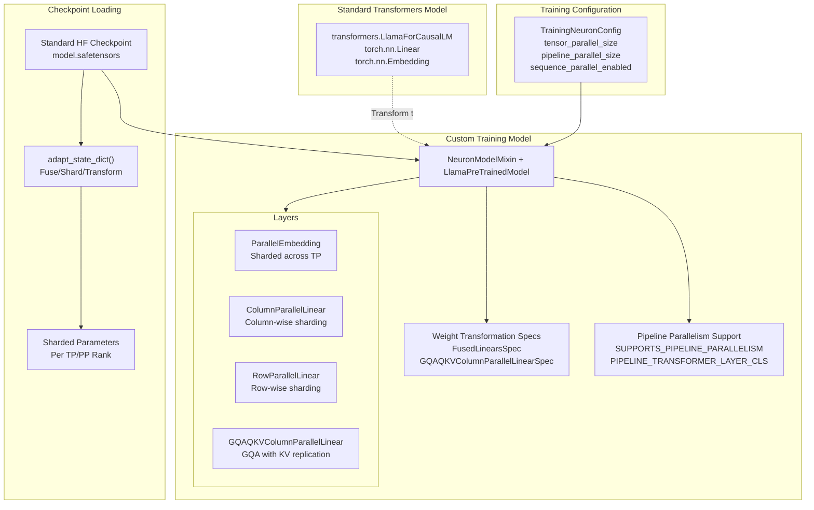
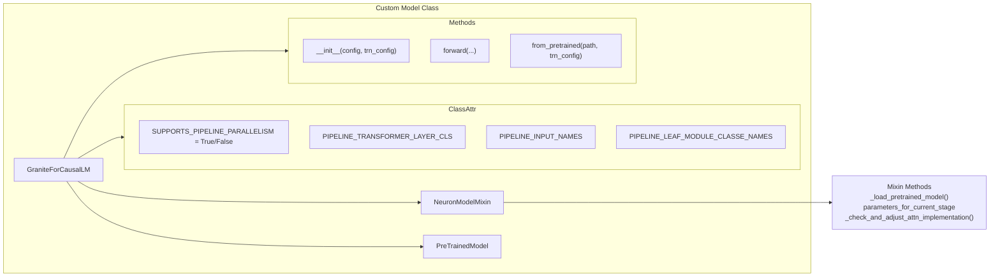
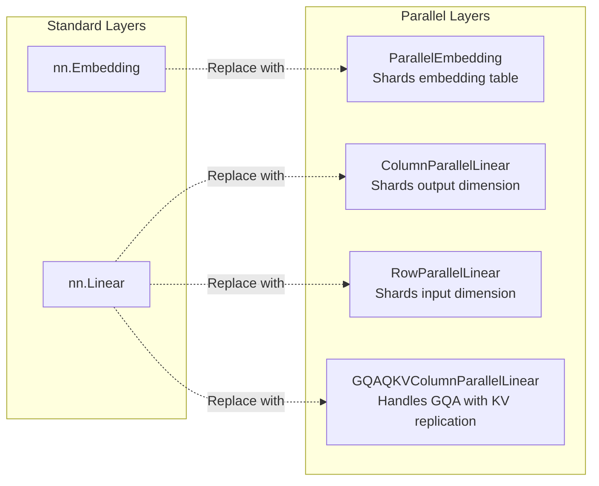
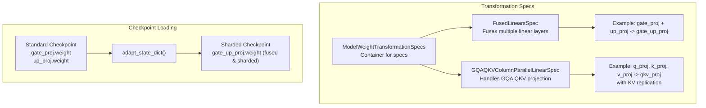
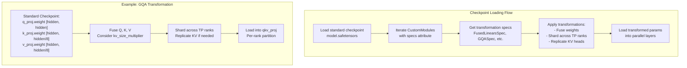

<!-- source: DeepWiki mcp.deepwiki.com · repo huggingface/optimum-neuron · page 12.3 Contributing Custom Training Models · fetched 2026-10-26 -->

# Contributing Custom Training Models

<details>
<summary>Relevant source files</summary>

The following files were used as context for generating this wiki page:

- [docs/source/guides/distributed_training.mdx](docs/source/guides/distributed_training.mdx)
- [optimum/neuron/models/training/config.py](optimum/neuron/models/training/config.py)
- [optimum/neuron/models/training/granite/modeling_granite.py](optimum/neuron/models/training/granite/modeling_granite.py)
- [optimum/neuron/models/training/llama/modeling_llama.py](optimum/neuron/models/training/llama/modeling_llama.py)
- [optimum/neuron/models/training/modeling_utils.py](optimum/neuron/models/training/modeling_utils.py)
- [optimum/neuron/models/training/qwen3/modeling_qwen3.py](optimum/neuron/models/training/qwen3/modeling_qwen3.py)
- [tests/training/test_custom_modeling.py](tests/training/test_custom_modeling.py)

</details>


## Purpose and Scope

This guide explains how to implement custom model classes in `optimum-neuron` that support distributed training with Tensor Parallelism (TP), Pipeline Parallelism (PP), and Sequence Parallelism (SP). Custom training models use parallel layers from `neuronx_distributed` and handle weight transformations to load standard Hugging Face checkpoints into sharded configurations.

For information about training with these models, see [Training on AWS Neuron](#5). For information about adding export support for new models, see [Contributing Model Export Support](#12.2).

## Why Custom Training Models Are Needed

Standard Transformers models cannot directly use distributed parallelism because they:
- Use standard `torch.nn` layers instead of parallel layers
- Lack weight transformation logic to shard/fuse parameters
- Cannot split across pipeline stages
- Do not support sequence parallelism

Custom training models in `optimum.neuron.models.training` solve this by replacing standard layers with `neuronx_distributed` parallel layers and implementing the necessary transformation logic.

Sources: [docs/source/guides/distributed_training.mdx:156-157](), [optimum/neuron/models/training/modeling_utils.py:177-181]()

## Custom Training Model Architecture



**Custom Training Model Flow**: A standard Transformers model is reimplemented using parallel layers from `neuronx_distributed`. The `NeuronModelMixin` provides loading infrastructure that transforms standard checkpoints into sharded parameters using transformation specs. The model can optionally support pipeline parallelism by declaring required attributes.

Sources: [optimum/neuron/models/training/modeling_utils.py:177-703](), [optimum/neuron/models/training/config.py:11-74](), [optimum/neuron/models/training/llama/modeling_llama.py:1-753]()

## The NeuronModelMixin Interface

Custom training models must inherit from `NeuronModelMixin`, which provides distributed training support and checkpoint loading.

### Core Class Structure



**NeuronModelMixin Structure**: Models inherit both `NeuronModelMixin` and a Transformers base class. Pipeline parallelism support requires specific class attributes. The mixin provides checkpoint loading and device placement logic.

### Required Pipeline Parallelism Attributes

For models supporting pipeline parallelism, these class attributes must be set:

| Attribute | Type | Description |
|-----------|------|-------------|
| `SUPPORTS_PIPELINE_PARALLELISM` | `bool` | Set to `True` to enable PP support |
| `PIPELINE_TRANSFORMER_LAYER_CLS` | `Type` | The transformer layer class (e.g., `LlamaDecoderLayer`) |
| `PIPELINE_INPUT_NAMES` | `list[str]` | Input names for forward pass (e.g., `["input_ids", "attention_mask", "labels"]`) |
| `PIPELINE_LEAF_MODULE_CLASSE_NAMES` | `list[str]` | Module class names that should not be split (e.g., `["LlamaRMSNorm", "LlamaRotaryEmbedding"]`) |

Sources: [optimum/neuron/models/training/modeling_utils.py:177-195](), [optimum/neuron/models/training/llama/modeling_llama.py:699-702](), [optimum/neuron/models/training/granite/modeling_granite.py:204-207]()

### Key Properties and Methods

The `parameters_for_current_stage` property returns parameter names for the current pipeline stage:

```python
@property
def parameters_for_current_stage(self) -> set[str]:
    """Returns names of parameters in current pipeline stage."""
    if getattr(self, "_parameter_names_for_current_pp_rank", None) is None:
        self._parameter_names_for_current_pp_rank = get_pipeline_parameters_for_current_stage(self)
    return self._parameter_names_for_current_pp_rank
```

The `_check_and_adjust_attn_implementation` method validates attention implementations (e.g., `flash_attention_2` vs `eager`).

Sources: [optimum/neuron/models/training/modeling_utils.py:197-212]()

## Using Parallel Layers

Custom training models replace standard PyTorch layers with parallel layers from `neuronx_distributed.parallel_layers`.

### Layer Mapping



### ParallelEmbedding

Used for token embeddings, sharding the vocabulary dimension across tensor parallel ranks:

```python
from neuronx_distributed.parallel_layers.layers import ParallelEmbedding

self.embed_tokens = ParallelEmbedding(
    config.vocab_size,
    config.hidden_size,
    padding_idx,
    init_method=init_method,
    sequence_parallel_enabled=trn_config.sequence_parallel_enabled,
    dtype=config.dtype,
)
```

Sources: [optimum/neuron/models/training/llama/modeling_llama.py:603-610]()

### ColumnParallelLinear

Shards the output dimension (columns) across tensor parallel ranks. Used for projections that expand dimensions:

```python
from neuronx_distributed.parallel_layers.layers import ColumnParallelLinear

self.gate_up_proj = ColumnParallelLinear(
    self.hidden_size,
    2 * self.intermediate_size,
    stride=2,  # For fused linears
    bias=False,
    gather_output=False,
    init_method=init_method,
    sequence_parallel_enabled=self.trn_config.sequence_parallel_enabled,
    sequence_dimension=0,
    dtype=self.config.dtype,
)
```

The `gather_output=False` keeps output distributed across TP ranks. `stride=2` splits the output into two parts for fused gate/up projections.

Sources: [optimum/neuron/models/training/llama/modeling_llama.py:204-214]()

### RowParallelLinear

Shards the input dimension (rows) across tensor parallel ranks and reduces output across ranks. Used for projections that reduce dimensions:

```python
from neuronx_distributed.parallel_layers.layers import RowParallelLinear

self.down_proj = RowParallelLinear(
    self.intermediate_size,
    self.hidden_size,
    bias=False,
    input_is_parallel=True,  # Input already sharded
    init_method=init_method,
    sequence_parallel_enabled=self.trn_config.sequence_parallel_enabled,
    sequence_dimension=0,
    dtype=self.config.dtype,
)
```

The `input_is_parallel=True` indicates the input is already distributed from a previous `ColumnParallelLinear`.

Sources: [optimum/neuron/models/training/llama/modeling_llama.py:215-224]()

### GQAQKVColumnParallelLinear

Specialized layer for Grouped Query Attention (GQA) that handles KV head replication when `num_key_value_heads < tensor_parallel_size`:

```python
from neuronx_distributed.modules.qkv_linear import GQAQKVColumnParallelLinear

self.qkv_proj = GQAQKVColumnParallelLinear(
    self.hidden_size,
    [self.num_heads * self.head_dim, self.num_key_value_heads * self.head_dim],
    bias=False,
    gather_output=False,
    init_method=init_method,
    sequence_parallel_enabled=trn_config.sequence_parallel_enabled,
    kv_size_multiplier=self.kv_size_multiplier,
    fuse_qkv=trn_config.fuse_qkv,
    dtype=self.config.dtype,
)
```

The `kv_size_multiplier` replicates KV heads across ranks when there are fewer KV heads than TP ranks.

Sources: [optimum/neuron/models/training/llama/modeling_llama.py:327-337]()

## Weight Transformation System

Custom models must define how to transform standard Hugging Face checkpoints into sharded parameters. This is done through the `CustomModule` interface and transformation specs.

### CustomModule Interface

Modules that need custom weight transformations inherit from `CustomModule` and define a `specs` attribute:

```python
from optimum.neuron.models.training.transformations_utils import (
    CustomModule,
    ModelWeightTransformationSpecs,
    FusedLinearsSpec,
)

class LlamaMLP(nn.Module, CustomModule):
    def __init__(self, config, trn_config: TrainingNeuronConfig):
        nn.Module.__init__(self)
        # ... initialization ...
        
        # Define transformation specs
        self.specs = ModelWeightTransformationSpecs(
            specs=FusedLinearsSpec(
                fused_linear_name="gate_up_proj",
                linear_names=["gate_proj", "up_proj"],
                bias=False,
                fuse_axis="column",
                original_dims=[self.intermediate_size] * 2,
            )
        )
```

Sources: [optimum/neuron/models/training/llama/modeling_llama.py:175-203]()

### Transformation Spec Types



### FusedLinearsSpec

Used to fuse multiple linear layers into a single parallel layer:

```python
from optimum.neuron.models.training.transformations_utils import FusedLinearsSpec

self.specs = ModelWeightTransformationSpecs(
    specs=FusedLinearsSpec(
        fused_linear_name="gate_up_proj",           # Name in custom model
        linear_names=["gate_proj", "up_proj"],      # Names in checkpoint
        bias=False,
        fuse_axis="column",                          # Fuse along output dimension
        original_dims=[self.intermediate_size] * 2,  # Original sizes
    )
)
```

During checkpoint loading, `gate_proj.weight` and `up_proj.weight` are concatenated and then sharded across TP ranks.

Sources: [optimum/neuron/models/training/llama/modeling_llama.py:195-203]()

### GQAQKVColumnParallelLinearSpec

Used for GQA attention when KV heads need replication:

```python
from optimum.neuron.models.training.transformations_utils import GQAQKVColumnParallelLinearSpec

gqa_qkv_specs = GQAQKVColumnParallelLinearSpec(
    gqa_qkv_projection_name="qkv_proj",
    query_projection_name="q_proj",
    key_projection_name="k_proj",
    value_projection_name="v_proj",
    output_projection_name="o_proj",
    num_attention_heads=self.num_heads,
    num_key_value_heads=self.num_key_value_heads,
    kv_size_multiplier=self.kv_size_multiplier,
    q_output_size_per_partition=self.qkv_proj.q_output_size_per_partition,
    kv_output_size_per_partition=self.qkv_proj.kv_output_size_per_partition,
    fuse_qkv=trn_config.fuse_qkv,
    bias=False,
)
self.specs.add_spec(gqa_qkv_specs)
```

This spec handles loading standard `q_proj`, `k_proj`, `v_proj` weights and transforming them into the fused `qkv_proj` with proper KV head replication across TP ranks.

Sources: [optimum/neuron/models/training/llama/modeling_llama.py:339-353]()

## Step-by-Step Implementation Guide

### Step 1: Create Model File Structure

Create a new directory under `optimum/neuron/models/training/` for your model:

```
optimum/neuron/models/training/
└── your_model/
    ├── __init__.py
    └── modeling_your_model.py
```

### Step 2: Implement the Base Model Class

Start by creating the model class inheriting from both `NeuronModelMixin` and the Transformers base class:

```python
from transformers import PreTrainedModel
from optimum.neuron.models.training.modeling_utils import NeuronModelMixin
from optimum.neuron.models.training.config import TrainingNeuronConfig

class YourModelForCausalLM(NeuronModelMixin, PreTrainedModel):
    _tied_weights_keys = ["lm_head.weight"]  # If embeddings are tied
    
    # Pipeline parallelism support (optional)
    SUPPORTS_PIPELINE_PARALLELISM = True
    PIPELINE_TRANSFORMER_LAYER_CLS = YourDecoderLayer
    PIPELINE_INPUT_NAMES = ["input_ids", "attention_mask", "labels"]
    PIPELINE_LEAF_MODULE_CLASSE_NAMES = ["YourRMSNorm", "YourRotaryEmbedding"]
    
    def __init__(self, config, trn_config: TrainingNeuronConfig):
        PreTrainedModel.__init__(self, config)
        self.trn_config = trn_config
        self.model = YourModel(config, trn_config)
        self.lm_head = ColumnParallelLinear(...)
        self.post_init()
```

Sources: [optimum/neuron/models/training/llama/modeling_llama.py:696-724](), [optimum/neuron/models/training/granite/modeling_granite.py:201-217]()

### Step 3: Implement Attention with Parallel Layers

Create the attention module using parallel layers and add transformation specs:

```python
from neuronx_distributed.modules.qkv_linear import GQAQKVColumnParallelLinear
from neuronx_distributed.parallel_layers.layers import RowParallelLinear
from optimum.neuron.models.training.transformations_utils import (
    CustomModule,
    ModelWeightTransformationSpecs,
    GQAQKVColumnParallelLinearSpec,
)

class YourAttention(nn.Module, CustomModule):
    def __init__(self, config, trn_config: TrainingNeuronConfig, layer_idx: int):
        super().__init__()
        self.config = config
        self.trn_config = trn_config
        
        # Initialize specs container
        self.specs = ModelWeightTransformationSpecs()
        
        # Determine if GQA is used
        tp_size = get_tensor_model_parallel_size()
        self.qkv_linear = (self.num_key_value_heads < tp_size) or \
                          (self.num_key_value_heads % tp_size != 0)
        
        if self.qkv_linear:
            # Use GQAQKVColumnParallelLinear for GQA
            self.kv_size_multiplier = trn_config.auto_kv_size_multiplier(
                self.num_key_value_heads
            )
            
            self.qkv_proj = GQAQKVColumnParallelLinear(
                self.hidden_size,
                [self.num_heads * self.head_dim, self.num_key_value_heads * self.head_dim],
                bias=False,
                gather_output=False,
                init_method=init_method,
                sequence_parallel_enabled=trn_config.sequence_parallel_enabled,
                kv_size_multiplier=self.kv_size_multiplier,
                fuse_qkv=trn_config.fuse_qkv,
                dtype=self.config.dtype,
            )
            
            # Add GQA transformation spec
            gqa_spec = GQAQKVColumnParallelLinearSpec(
                gqa_qkv_projection_name="qkv_proj",
                query_projection_name="q_proj",
                key_projection_name="k_proj",
                value_projection_name="v_proj",
                output_projection_name="o_proj",
                num_attention_heads=self.num_heads,
                num_key_value_heads=self.num_key_value_heads,
                kv_size_multiplier=self.kv_size_multiplier,
                q_output_size_per_partition=self.qkv_proj.q_output_size_per_partition,
                kv_output_size_per_partition=self.qkv_proj.kv_output_size_per_partition,
                fuse_qkv=trn_config.fuse_qkv,
                bias=False,
            )
            self.specs.add_spec(gqa_spec)
        
        # Output projection
        self.o_proj = RowParallelLinear(
            self.num_heads * self.head_dim,
            self.hidden_size,
            bias=False,
            input_is_parallel=True,
            init_method=init_method,
            sequence_parallel_enabled=trn_config.sequence_parallel_enabled,
            sequence_dimension=0,
            dtype=self.config.dtype,
        )
```

Sources: [optimum/neuron/models/training/llama/modeling_llama.py:289-416]()

### Step 4: Implement MLP with Fused Linears

Create the MLP module with fused projections:

```python
from neuronx_distributed.parallel_layers.layers import (
    ColumnParallelLinear,
    RowParallelLinear,
)
from optimum.neuron.models.training.transformations_utils import FusedLinearsSpec

class YourMLP(nn.Module, CustomModule):
    def __init__(self, config, trn_config: TrainingNeuronConfig):
        nn.Module.__init__(self)
        self.config = config
        self.trn_config = trn_config
        
        tp_size = get_tensor_model_parallel_size()
        self.split_size = self.intermediate_size // tp_size
        
        # Define fused linear transformation spec
        self.specs = ModelWeightTransformationSpecs(
            specs=FusedLinearsSpec(
                fused_linear_name="gate_up_proj",
                linear_names=["gate_proj", "up_proj"],
                bias=False,
                fuse_axis="column",
                original_dims=[self.intermediate_size] * 2,
            )
        )
        
        # Fused gate and up projection
        self.gate_up_proj = ColumnParallelLinear(
            self.hidden_size,
            2 * self.intermediate_size,
            stride=2,
            bias=False,
            gather_output=False,
            init_method=init_method,
            sequence_parallel_enabled=self.trn_config.sequence_parallel_enabled,
            sequence_dimension=0,
            dtype=self.config.dtype,
        )
        
        # Down projection
        self.down_proj = RowParallelLinear(
            self.intermediate_size,
            self.hidden_size,
            bias=False,
            input_is_parallel=True,
            init_method=init_method,
            sequence_parallel_enabled=self.trn_config.sequence_parallel_enabled,
            sequence_dimension=0,
            dtype=self.config.dtype,
        )
    
    def forward(self, x):
        gate_proj, up_proj = self.gate_up_proj(x).split(self.split_size, dim=2)
        intermediate = self.act_fn(gate_proj) * up_proj
        return self.down_proj(intermediate)
```

Sources: [optimum/neuron/models/training/llama/modeling_llama.py:175-241]()

### Step 5: Implement the Decoder Layer

Combine attention and MLP into a decoder layer:

```python
class YourDecoderLayer(nn.Module):
    def __init__(self, config, trn_config: TrainingNeuronConfig, layer_idx: int):
        super().__init__()
        self.self_attn = YourAttention(config, trn_config, layer_idx)
        self.mlp = YourMLP(config, trn_config)
        self.input_layernorm = YourRMSNorm(
            config.hidden_size,
            eps=config.rms_norm_eps,
            sequence_parallel_enabled=trn_config.sequence_parallel_enabled
        )
        self.post_attention_layernorm = YourRMSNorm(
            config.hidden_size,
            eps=config.rms_norm_eps,
            sequence_parallel_enabled=trn_config.sequence_parallel_enabled
        )
    
    def forward(
        self,
        hidden_states: torch.Tensor,
        attention_mask: torch.Tensor | None = None,
        position_ids: torch.LongTensor | None = None,
        position_embeddings: tuple[torch.Tensor, torch.Tensor] | None = None,
        **kwargs,
    ) -> torch.Tensor:
        residual = hidden_states
        hidden_states = self.input_layernorm(hidden_states)
        hidden_states, _ = self.self_attn(
            hidden_states, position_embeddings, attention_mask, **kwargs
        )
        hidden_states = residual + hidden_states
        
        residual = hidden_states
        hidden_states = self.post_attention_layernorm(hidden_states)
        hidden_states = self.mlp(hidden_states)
        hidden_states = residual + hidden_states
        
        return hidden_states
```

Sources: [optimum/neuron/models/training/llama/modeling_llama.py:533-575]()

### Step 6: Implement Sequence Parallelism Support

For sequence parallelism, handle scatter/gather operations in the model's forward pass:

```python
from neuronx_distributed.parallel_layers.mappings import (
    gather_from_sequence_parallel_region,
    scatter_to_sequence_parallel_region,
)

# Wrap functions for torch.fx tracing
gather_from_sequence_parallel_region = torch.fx.wrap(gather_from_sequence_parallel_region)
scatter_to_sequence_parallel_region = torch.fx.wrap(scatter_to_sequence_parallel_region)

class YourModel(NeuronModelMixin, PreTrainedModel):
    def forward(self, input_ids, attention_mask=None, **kwargs):
        inputs_embeds = self.embed_tokens(input_ids)
        
        # Scatter for sequence parallelism
        if self.trn_config.sequence_parallel_enabled:
            inputs_embeds = inputs_embeds.transpose(0, 1).contiguous()
            inputs_embeds = scatter_to_sequence_parallel_region(inputs_embeds)
        
        # ... process through layers ...
        
        logits = self.lm_head(hidden_states)
        
        # Gather for sequence parallelism
        if self.trn_config.sequence_parallel_enabled:
            logits = gather_from_sequence_parallel_region(logits)
            logits = logits.transpose(0, 1).contiguous()
        
        return CausalLMOutputWithPast(logits=logits, ...)
```

Sources: [optimum/neuron/models/training/granite/modeling_granite.py:18-47](), [optimum/neuron/models/training/granite/modeling_granite.py:136-254]()

### Step 7: Handle Model Variants

If your model has architecture-specific differences (like Granite's multipliers), inherit from a base implementation:

```python
# For Granite, which is similar to Llama but with multipliers
from ..llama.modeling_llama import (
    LlamaAttention,
    LlamaDecoderLayer,
    LlamaForCausalLM,
    LlamaModel,
)

class GraniteAttention(LlamaAttention):
    def __init__(self, config: GraniteConfig, trn_config: TrainingNeuronConfig, layer_idx: int):
        super().__init__(config, trn_config, layer_idx)
        # Override attention scaling
        self.scaling = config.attention_multiplier

class GraniteDecoderLayer(LlamaDecoderLayer):
    def __init__(self, config: GraniteConfig, trn_config: TrainingNeuronConfig, layer_idx: int):
        super().__init__(config, trn_config, layer_idx)
        self.residual_multiplier = config.residual_multiplier
        self.self_attn = GraniteAttention(config=config, trn_config=trn_config, layer_idx=layer_idx)
    
    def forward(self, hidden_states, **kwargs):
        residual = hidden_states
        hidden_states = self.input_layernorm(hidden_states)
        hidden_states, _ = self.self_attn(hidden_states, **kwargs)
        # Apply residual multiplier
        hidden_states = residual + hidden_states * self.residual_multiplier
        # ... rest of forward pass with multipliers ...
```

Sources: [optimum/neuron/models/training/granite/modeling_granite.py:52-92](), [optimum/neuron/models/training/qwen3/modeling_qwen3.py:77-167]()

### Step 8: Register the Model

Add your model to the `__init__.py` file:

```python
# optimum/neuron/models/training/__init__.py
from .your_model.modeling_your_model import (
    YourModel,
    YourForCausalLM,
)

__all__ = [
    # ... existing models ...
    "YourModel",
    "YourForCausalLM",
]
```

And register it in `modeling_auto.py` if you want it to work with `NeuronModelForCausalLM.from_pretrained()`.

Sources: [optimum/neuron/models/training/llama/modeling_llama.py:1-15](), [tests/training/test_custom_modeling.py:61-66]()

## Testing Custom Models

### Unit Tests

Create tests to verify your model matches the original Transformers implementation:

```python
import pytest
from optimum.neuron.models.training import YourForCausalLM
from optimum.neuron.models.training.config import TrainingNeuronConfig
from transformers import AutoConfig, YourForCausalLM as OriginalYourForCausalLM

@pytest.mark.parametrize("tp_size", [1, 2, 4, 8])
def test_your_model_matches_original(tp_size):
    config = AutoConfig.from_pretrained("your-org/your-model")
    trn_config = TrainingNeuronConfig(
        tensor_parallel_size=tp_size,
        sequence_parallel_enabled=True,
    )
    
    # Load original model
    orig_model = OriginalYourForCausalLM.from_pretrained(
        "your-org/your-model",
        attn_implementation="eager"
    )
    
    # Load custom model
    custom_model = YourForCausalLM.from_pretrained(
        "your-org/your-model",
        trn_config=trn_config,
        attn_implementation="eager"
    )
    
    # Compare outputs
    # ... test logic ...
```

Sources: [tests/training/test_custom_modeling.py:112-231]()

### Test Transformation Specs

Test that weight transformations correctly handle sharding and fusion:

```python
def test_gqa_weight_transformation():
    # Test that GQA spec correctly computes query indices
    tp_size = 8
    num_attention_heads = 32
    num_key_value_heads = 4
    kv_size_multiplier = 2
    
    for tp_rank in range(tp_size):
        indices = GQAQKVColumnParallelLinearSpec.compute_query_indices_for_rank(
            tp_size, tp_rank, num_attention_heads, num_key_value_heads, kv_size_multiplier
        )
        # Verify indices are correct
        assert indices.shape[0] == expected_num_heads_per_rank
```

Sources: [tests/training/test_custom_modeling.py:400-412]()

### Test Pipeline Parallelism

Verify that models supporting pipeline parallelism correctly partition layers:

```python
@distributed_test(world_size=32, tp_size=2, pp_size=4)
def test_pipeline_parallelism():
    trn_config = TrainingNeuronConfig(
        tensor_parallel_size=2,
        pipeline_parallel_size=4,
    )
    
    model = YourForCausalLM.from_pretrained(
        "your-org/your-model",
        trn_config=trn_config
    )
    
    # Verify only current stage parameters are on CPU
    parameters_on_cpu = {n for n, p in model.named_parameters() if p.device == torch.device("cpu")}
    parameters_on_meta = {n for n, p in model.named_parameters() if p.device == torch.device("meta")}
    
    # Current stage parameters should be on CPU
    assert len(parameters_on_cpu) > 0
    # Other stages should be on meta device
    assert len(parameters_on_meta) > 0
```

Sources: [tests/training/test_custom_modeling.py:582-609]()

## Loading and Consolidation

### Loading Checkpoints

Custom models support loading standard Hugging Face checkpoints using `from_pretrained`:

```python
from optimum.neuron.models.training import YourForCausalLM
from optimum.neuron.models.training.config import TrainingNeuronConfig

trn_config = TrainingNeuronConfig(
    tensor_parallel_size=8,
    pipeline_parallel_size=2,
    sequence_parallel_enabled=True,
)

model = YourForCausalLM.from_pretrained(
    "your-org/your-model",
    trn_config=trn_config,
    torch_dtype=torch.bfloat16,
)
```

The `from_pretrained` method:
1. Loads the standard checkpoint weights
2. Calls `adapt_state_dict` to transform weights using defined specs
3. Shards parameters across TP/PP ranks
4. Only loads parameters needed for the current PP stage

Sources: [optimum/neuron/models/training/modeling_utils.py:704-1058]()

### The adapt_state_dict Function

The transformation happens in `adapt_state_dict`, which:
1. Iterates through custom modules with `CustomModule` interface
2. Retrieves transformation specs from `module.specs`
3. Applies transformations (fusion, sharding, replication)
4. Returns transformed state dict ready for loading



Sources: [optimum/neuron/models/training/modeling_utils.py:604-609](), [optimum/neuron/models/training/transformations_utils.py:1-1123]()

### Checkpoint Consolidation

After training with distributed parallelism, consolidate sharded checkpoints back to standard format using the CLI:

```bash
optimum-cli neuron consolidate my_training/shards my_training_consolidated
```

This creates a standard Hugging Face checkpoint that can be:
- Loaded with standard Transformers
- Shared on the Hub
- Used for inference or further training

The consolidation process:
1. Reads sharded checkpoints from all TP/PP ranks
2. Reverses transformations (unfuses, gathers shards)
3. Writes standard checkpoint format

Sources: [docs/source/guides/distributed_training.mdx:378-449]()

## Common Pitfalls and Best Practices

### Pitfall 1: Forgetting to Initialize Parallel State

Custom models require `TrainingNeuronConfig` to initialize parallel state. Always pass `trn_config` to `__init__`:

```python
# Correct
model = YourForCausalLM(config, trn_config)

# Wrong - will fail
model = YourForCausalLM(config)
```

Sources: [optimum/neuron/models/training/config.py:30-58]()

### Pitfall 2: Not Wrapping Sequence Parallel Functions

Sequence parallel functions must be wrapped with `torch.fx.wrap` for tracing:

```python
# Correct
from neuronx_distributed.parallel_layers.mappings import scatter_to_sequence_parallel_region
scatter_to_sequence_parallel_region = torch.fx.wrap(scatter_to_sequence_parallel_region)

# Wrong - will fail during compilation
# Just import without wrapping
```

Sources: [optimum/neuron/models/training/granite/modeling_granite.py:45-47]()

### Pitfall 3: Incorrect KV Size Multiplier

When using GQA with fewer KV heads than TP ranks, use `auto_kv_size_multiplier`:

```python
# Correct
if trn_config.kv_size_multiplier is None:
    self.kv_size_multiplier = trn_config.auto_kv_size_multiplier(
        self.num_key_value_heads
    )
else:
    self.kv_size_multiplier = trn_config.kv_size_multiplier

# Wrong - may cause shape mismatches
self.kv_size_multiplier = 1
```

Sources: [optimum/neuron/models/training/llama/modeling_llama.py:316-322](), [optimum/neuron/models/training/config.py:62-69]()

### Best Practice 1: Inherit from Existing Models

If your model is similar to an existing one (e.g., Granite ≈ Llama), inherit and override:

```python
from ..llama.modeling_llama import LlamaAttention, LlamaDecoderLayer

class YourAttention(LlamaAttention):
    def __init__(self, config, trn_config, layer_idx):
        super().__init__(config, trn_config, layer_idx)
        # Override specific attributes
        self.scaling = config.your_custom_scaling
```

Sources: [optimum/neuron/models/training/granite/modeling_granite.py:52-55](), [optimum/neuron/models/training/qwen3/modeling_qwen3.py:77-90]()

### Best Practice 2: Add Comprehensive Tests

Test various configurations:
- Different TP sizes (1, 2, 4, 8)
- With and without sequence parallelism
- With and without pipeline parallelism
- Different attention implementations (eager, flash_attention_2)
- Model variants (tied embeddings, different QKV implementations)

Sources: [tests/training/test_custom_modeling.py:233-298]()

### Best Practice 3: Document PP Support Requirements

Clearly document if your model supports pipeline parallelism and any limitations:

```python
class YourForCausalLM(NeuronModelMixin, PreTrainedModel):
    # Pipeline parallelism is supported
    SUPPORTS_PIPELINE_PARALLELISM = True
    
    # But note any limitations in docstring
    """
    Custom implementation supporting TP, PP, SP.
    
    Note: Pipeline parallelism requires batch_size > num_microbatches.
    """
```

Sources: [optimum/neuron/models/training/llama/modeling_llama.py:699-702]()

---

