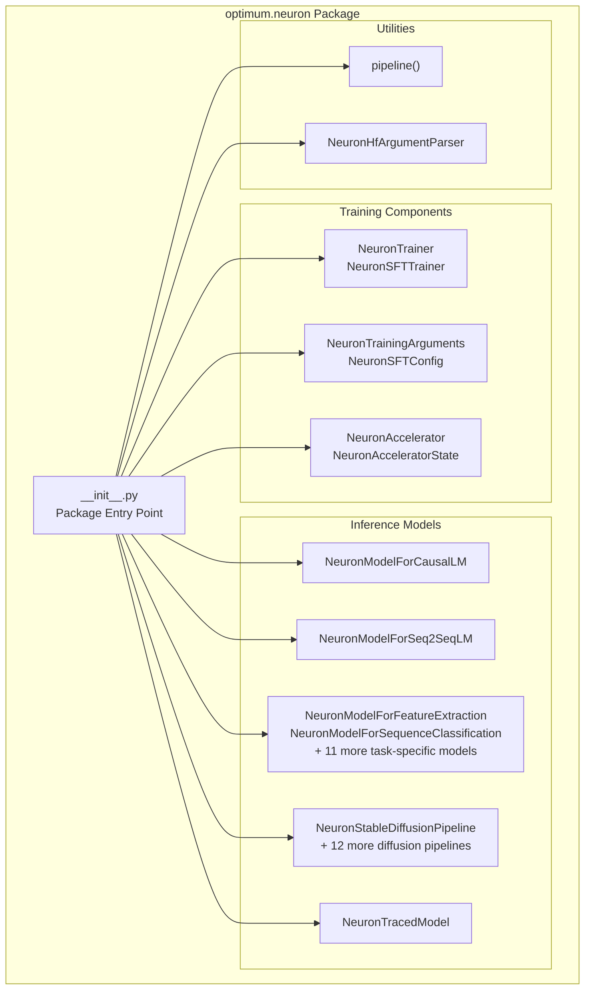
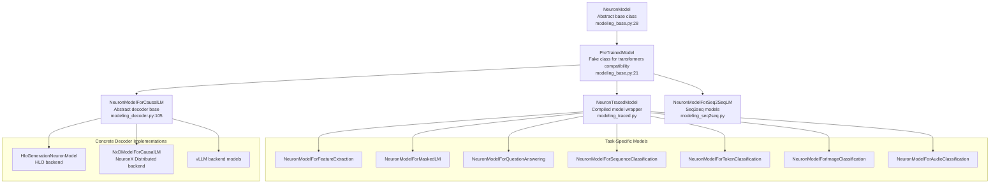
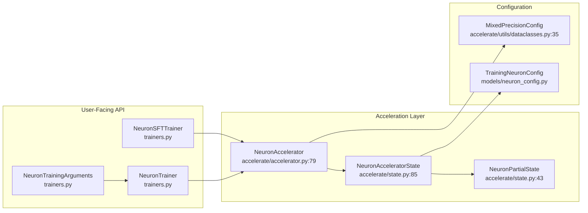
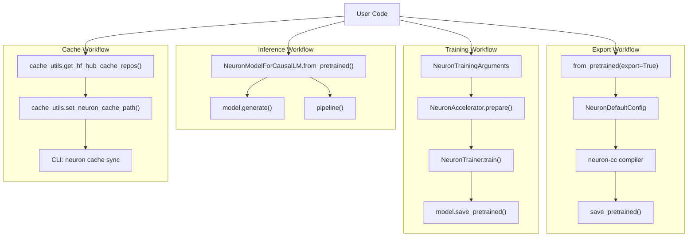
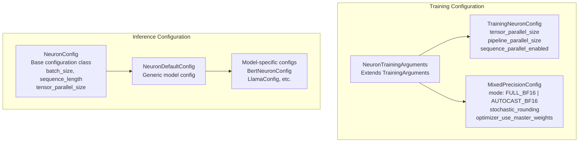

<!-- source: DeepWiki mcp.deepwiki.com · repo huggingface/optimum-neuron · page 13 API Reference · fetched 2026-10-26 -->

# API Reference

<details>
<summary>Relevant source files</summary>

The following files were used as context for generating this wiki page:

- [optimum/neuron/__init__.py](optimum/neuron/__init__.py)
- [optimum/neuron/modeling.py](optimum/neuron/modeling.py)
- [optimum/neuron/modeling_base.py](optimum/neuron/modeling_base.py)
- [optimum/neuron/pipelines/transformers/base.py](optimum/neuron/pipelines/transformers/base.py)
- [optimum/neuron/utils/__init__.py](optimum/neuron/utils/__init__.py)

</details>


This document provides an overview of the optimum-neuron API structure and serves as an index to detailed API reference pages. The optimum-neuron library exposes four main API categories: Training, Inference, Export, and Cache management. Each category is documented in detail in its respective sub-page.

For practical usage examples and tutorials, see [Quick Start Guide](#3). For conceptual explanations of the training system, see [Training on AWS Neuron](#5). For inference system concepts, see [Inference with Neuron Models](#6).

## API Organization

The optimum-neuron API is organized into four primary categories:

| Category | Purpose | Key Classes | Reference Page |
|----------|---------|-------------|----------------|
| **Training** | Fine-tuning and training models on Trainium | `NeuronTrainer`, `NeuronAccelerator`, `NeuronTrainingArguments` | [Training API](#12.1) |
| **Inference** | Running pre-compiled or exported models for prediction | `NeuronModelForCausalLM`, `NeuronModelForFeatureExtraction`, diffusion pipelines | [Inference API](#12.2) |
| **Export** | Converting standard models to Neuron format | `NeuronDefaultConfig`, model-specific export configs | [Export API](#12.3) |
| **Cache** | Managing compilation artifacts | Cache utility functions, Hub repository management | [Cache API](#12.4) |

Sources: [optimum/neuron/__init__.py:34-88]()

## Package Entry Points



**Package Entry Points Diagram**: Shows all classes and functions exported by the `optimum.neuron` package namespace, organized by functional category.

Sources: [optimum/neuron/__init__.py:34-88](), [optimum/neuron/__init__.py:103-162]()

## Model Class Hierarchy

The inference API uses an inheritance-based architecture where all Neuron models derive from common base classes:



**Model Class Inheritance Hierarchy**: All Neuron models inherit from `NeuronModel` base class. Task-specific encoder models inherit from `NeuronTracedModel`, while decoder models inherit from the abstract `NeuronModelForCausalLM` class with multiple backend implementations.

Sources: [optimum/neuron/modeling_base.py:28-44](), [optimum/neuron/modeling_decoder.py:105-368](), [optimum/neuron/modeling.py:92-743]()

## Training System Components



**Training API Component Relationships**: The `NeuronTrainer` uses `NeuronAccelerator` which manages state through `NeuronAcceleratorState` and applies configurations via `MixedPrecisionConfig` and `TrainingNeuronConfig`.

Sources: [optimum/neuron/accelerate/accelerator.py:79-597](), [optimum/neuron/accelerate/state.py:43-177](), [optimum/neuron/accelerate/utils/dataclasses.py:35-70]()

## Typical API Usage Patterns

The following diagram illustrates common workflows and which API components are involved at each stage:



**Common API Usage Patterns**: Four typical workflows showing which API functions and classes are invoked for export, training, inference, and cache management tasks.

Sources: [optimum/neuron/modeling_decoder.py:198-248](), [optimum/neuron/accelerate/accelerator.py:79-597]()

## Training API

The training API enables distributed fine-tuning on Trainium devices with support for tensor parallelism, pipeline parallelism, and ZeRO-1 optimization. Key components:

- **`NeuronTrainer`**: Drop-in replacement for Hugging Face `Trainer` with Neuron-specific optimizations
- **`NeuronSFTTrainer`**: Specialized trainer for supervised fine-tuning with integration to TRL library
- **`NeuronAccelerator`**: Extends `accelerate.Accelerator` with Neuron hardware support
- **`NeuronTrainingArguments`**: Configuration dataclass extending `TrainingArguments`
- **`TrainingNeuronConfig`**: Neuron-specific training parameters (tensor/pipeline parallelism sizes)
- **`MixedPrecisionConfig`**: Controls BF16 training modes and optimizer precision settings

For detailed documentation of all training classes and methods, see [Training API](#12.1).

Sources: [optimum/neuron/__init__.py:36-41](), [optimum/neuron/accelerate/accelerator.py:79-597]()

## Inference API

The inference API provides pre-compiled model classes organized by task modality. All inference models support:

- Loading from pre-compiled Neuron models via `from_pretrained()`
- Exporting standard models via `from_pretrained(export=True)`
- Saving compiled artifacts via `save_pretrained()`
- Standard transformers-compatible interfaces

**Model Categories:**

| Category | Base Class | Example Tasks |
|----------|-----------|---------------|
| **Decoder Models** | `NeuronModelForCausalLM` | Text generation, chat, instruction following |
| **Encoder Models** | `NeuronTracedModel` | Feature extraction, classification, NER, Q&A |
| **Seq2Seq Models** | `NeuronModelForSeq2SeqLM` | Translation, summarization |
| **Vision Models** | `NeuronTracedModel` | Image classification, object detection, segmentation |
| **Audio Models** | `NeuronTracedModel` | Audio classification, CTC, speaker verification |
| **Diffusion Models** | `NeuronDiffusionPipelineBase` | Image generation, inpainting, ControlNet |

For detailed documentation of all inference classes and methods, see [Inference API](#12.2).

Sources: [optimum/neuron/modeling.py:92-743](), [optimum/neuron/modeling_decoder.py:105-368](), [optimum/neuron/__init__.py:43-80]()

## Export API

The export API handles conversion of standard PyTorch/Hugging Face models to Neuron-compiled format. Key components:

- **`NeuronDefaultConfig`**: Base configuration class specifying batch size, sequence length, tensor parallelism
- **Model-specific configs**: Specialized configurations for different architectures (e.g., `BertNeuronConfig`)
- **Export functions**: `export_neuronx()`, `export_models()` for batch compilation
- **Compiler argument builders**: Functions to construct `neuron-cc` and `neuronx-cc` flags

The export process:
1. Load standard model from Hub or local path
2. Apply `NeuronConfig` to determine compilation parameters
3. Generate dummy inputs matching target shapes
4. Invoke Neuron compiler to create NEFF (Neuron Executable File Format)
5. Validate outputs match PyTorch reference
6. Save compiled artifacts with configuration

For detailed documentation of export configurations and functions, see [Export API](#12.3).

Sources: [optimum/neuron/utils/__init__.py:21-89]()

## Cache API

The cache API manages compilation artifacts to avoid redundant compilations. The cache system operates at three levels:

1. **Local cache**: `/var/tmp/neuron-compile-cache` (instant lookup)
2. **Hub cache**: Pre-compiled models on Hugging Face Hub (download in seconds)
3. **Compile on miss**: Full compilation when no cache hit (30-60 minutes)

**Key Functions:**

- **`get_hf_hub_cache_repos()`**: Retrieve list of cache repositories (official + custom)
- **`set_neuron_cache_path()`**: Configure custom cache repository
- **`synchronize_hub_cache()`**: Upload local compilations to Hub
- **`lookup_in_cache()`**: Check if compilation exists in cache hierarchy

**Environment Variables:**

- `CUSTOM_CACHE_REPO`: Override default cache repository
- `NEURON_CC_FLAGS`: Pass flags to Neuron compiler (affects cache keys)

For detailed documentation of cache functions and CLI commands, see [Cache API](#12.4) and [Cache CLI Commands](#7.3).

Sources: [optimum/neuron/utils/__init__.py:21-89]()

## Configuration Classes



**Configuration Class Hierarchy**: Training configurations control distributed training parameters, while inference configurations specify model compilation shapes and parallelism.

Sources: [optimum/neuron/accelerate/utils/dataclasses.py:35-70](), [optimum/neuron/__init__.py:36-41]()

## Method Signatures Overview

The following table summarizes key methods across all API categories:

| Class | Key Methods | Purpose |
|-------|-------------|---------|
| **`NeuronModelForCausalLM`** | `from_pretrained()`, `export()`, `generate()`, `save_pretrained()` | Load, export, run inference, save |
| **`NeuronTracedModel`** | `from_pretrained()`, `forward()`, `save_pretrained()` | Load traced model, run forward pass |
| **`NeuronTrainer`** | `train()`, `evaluate()`, `save_model()` | Execute training loop |
| **`NeuronAccelerator`** | `prepare()`, `prepare_model()`, `prepare_optimizer()`, `backward()` | Setup distributed training |
| **`NeuronConfig`** | `from_pretrained()`, `save_pretrained()` | Load/save configuration |

For complete method signatures with parameters and return types, see the detailed API reference pages for each category.

Sources: [optimum/neuron/modeling_decoder.py:105-368](), [optimum/neuron/accelerate/accelerator.py:79-597]()

## Import Patterns

Common import statements for each API category:

```python
# Training API
from optimum.neuron import NeuronTrainer, NeuronTrainingArguments
from optimum.neuron import NeuronAccelerator
from optimum.neuron.accelerate.utils import MixedPrecisionConfig

# Inference API - Decoder models
from optimum.neuron import NeuronModelForCausalLM

# Inference API - Encoder models
from optimum.neuron import (
    NeuronModelForFeatureExtraction,
    NeuronModelForSequenceClassification,
    NeuronModelForTokenClassification,
)

# Inference API - Vision models
from optimum.neuron import (
    NeuronModelForImageClassification,
    NeuronModelForSemanticSegmentation,
    NeuronModelForObjectDetection,
)

# Inference API - Diffusion models
from optimum.neuron import (
    NeuronStableDiffusionPipeline,
    NeuronStableDiffusionXLPipeline,
)

# Pipeline abstraction
from optimum.neuron import pipeline

# Cache utilities
from optimum.neuron.utils.cache_utils import (
    get_hf_hub_cache_repos,
    set_neuron_cache_path,
)
```

Sources: [optimum/neuron/__init__.py:103-162]()

## Next Steps

- For Training API details: [Training API](#12.1)
- For Inference API details: [Inference API](#12.2)
- For Export API details: [Export API](#12.3)
- For Cache API details: [Cache API](#12.4)
- For CLI reference: [CLI Reference](#9)

---

