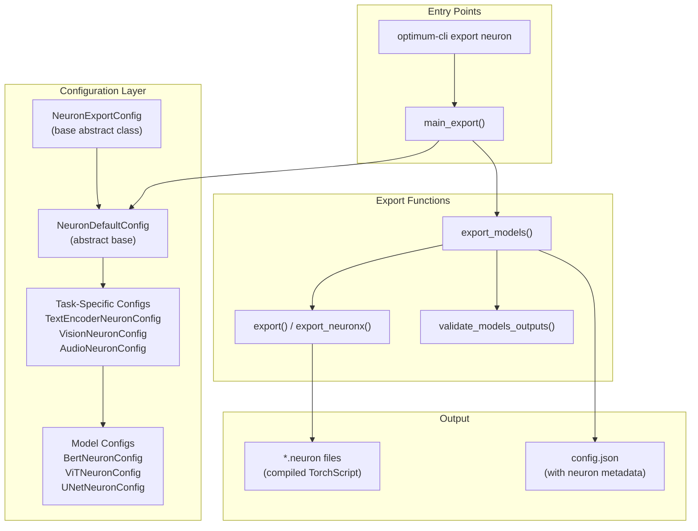
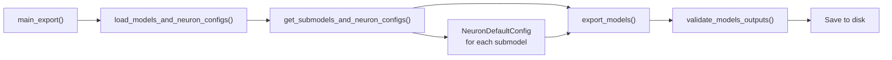
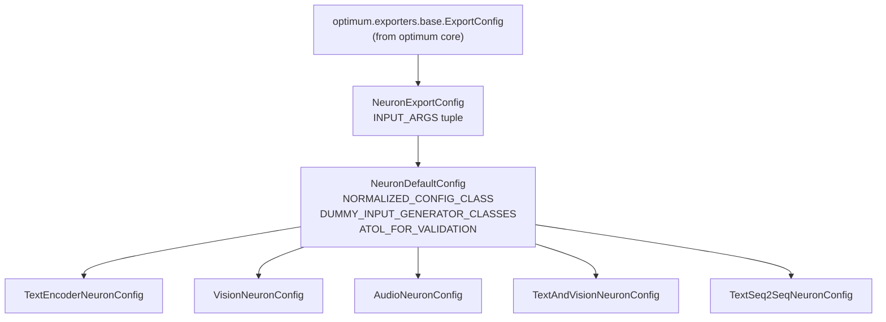
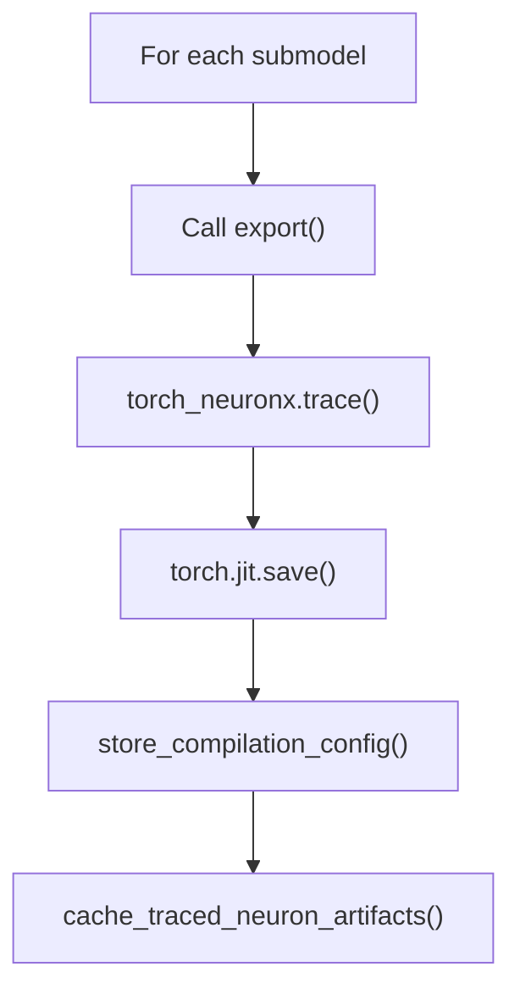
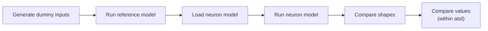

<!-- source: DeepWiki mcp.deepwiki.com · repo huggingface/optimum-neuron · page 13.1 Export API · fetched 2026-10-26 -->

# Export API

<details>
<summary>Relevant source files</summary>

The following files were used as context for generating this wiki page:

- [optimum/commands/export/neuron.py](optimum/commands/export/neuron.py)
- [optimum/commands/export/neuronx.py](optimum/commands/export/neuronx.py)
- [optimum/exporters/neuron/__main__.py](optimum/exporters/neuron/__main__.py)
- [optimum/exporters/neuron/base.py](optimum/exporters/neuron/base.py)
- [optimum/exporters/neuron/convert.py](optimum/exporters/neuron/convert.py)
- [optimum/exporters/neuron/model_configs.py](optimum/exporters/neuron/model_configs.py)
- [optimum/exporters/neuron/utils.py](optimum/exporters/neuron/utils.py)
- [optimum/neuron/modeling_diffusion.py](optimum/neuron/modeling_diffusion.py)
- [optimum/neuron/modeling_seq2seq.py](optimum/neuron/modeling_seq2seq.py)
- [optimum/neuron/modeling_traced.py](optimum/neuron/modeling_traced.py)
- [optimum/neuron/utils/argument_utils.py](optimum/neuron/utils/argument_utils.py)
- [optimum/neuron/utils/optimization_utils.py](optimum/neuron/utils/optimization_utils.py)
- [tests/exporters/exporters_utils.py](tests/exporters/exporters_utils.py)
- [tests/inference/inference_utils.py](tests/inference/inference_utils.py)

</details>


This page documents the Export API for converting Hugging Face models to Neuron-compiled TorchScript modules. This API is the programmatic interface to the model export pipeline covered in [Export Architecture and Workflow](#4.1). For CLI usage, see [CLI Reference](#11). For training-specific configurations, see [Training API](#13.2).

## Overview

The Export API provides classes and functions to compile PyTorch models for AWS Neuron hardware. The system consists of three main layers:



**Sources:** [optimum/exporters/neuron/__main__.py:618-740](), [optimum/exporters/neuron/base.py:41-77](), [optimum/exporters/neuron/convert.py:296-441]()

## Main Export Function

### `main_export`

The primary entry point for programmatic model export.

```python
def main_export(
    model_name_or_path: str,
    output: str | Path,
    compiler_kwargs: dict[str, Any],
    torch_dtype: str | torch.dtype = torch.float32,
    tensor_parallel_size: int = 1,
    model: PreTrainedModel | ModelMixin | None = None,
    task: str = "auto",
    dynamic_batch_size: bool = False,
    atol: float | None = None,
    cache_dir: str | None = None,
    disable_neuron_cache: bool | None = False,
    compiler_workdir: str | Path | None = None,
    inline_weights_to_neff: bool = True,
    optlevel: str = "2",
    trust_remote_code: bool = False,
    subfolder: str = "",
    revision: str = "main",
    force_download: bool = False,
    local_files_only: bool = False,
    token: bool | str | None = None,
    do_validation: bool = True,
    submodels: dict[str, Path | str] | None = None,
    output_attentions: bool = False,
    output_hidden_states: bool = False,
    library_name: str | None = None,
    controlnet_ids: str | list[str] | None = None,
    lora_args: LoRAAdapterArguments | None = None,
    ip_adapter_args: IPAdapterArguments | None = None,
    **input_shapes,
) -> None
```

**Parameters:**

| Parameter | Type | Description |
|-----------|------|-------------|
| `model_name_or_path` | `str` | Model ID on Hugging Face Hub or local path |
| `output` | `str \| Path` | Directory to save compiled model |
| `compiler_kwargs` | `dict[str, Any]` | Compiler-specific arguments (auto_cast, instance_type) |
| `torch_dtype` | `str \| torch.dtype` | Data type for model weights |
| `tensor_parallel_size` | `int` | Number of NeuronCores for tensor parallelism (default: 1) |
| `task` | `str` | Task to export for (e.g., "feature-extraction", "text-generation") |
| `dynamic_batch_size` | `bool` | Enable dynamic batch size support |
| `atol` | `float \| None` | Absolute tolerance for validation |
| `disable_neuron_cache` | `bool` | Skip automatic caching of compiled models |
| `inline_weights_to_neff` | `bool` | Inline weights into NEFF file (default: True) |
| `optlevel` | `str` | Optimization level: "1", "2", or "3" (default: "2") |
| `do_validation` | `bool` | Validate outputs against PyTorch reference |
| `**input_shapes` | `kwargs` | Static input shapes (batch_size, sequence_length, etc.) |

**Workflow:**



**Sources:** [optimum/exporters/neuron/__main__.py:618-740]()

## Configuration Class Hierarchy

### Base Classes



**Sources:** [optimum/exporters/neuron/base.py:41-78]()

### `NeuronExportConfig`

Abstract base class defining input argument patterns for export.

**Key Attributes:**

| Attribute | Type | Description |
|-----------|------|-------------|
| `INPUT_ARGS` | `tuple` | Defines required/optional input shape arguments |

**Methods:**

- `get_input_args_for_task(cls, task: str) -> tuple[str]`: Returns input arguments required for a specific task

**Sources:** [optimum/exporters/neuron/base.py:41-76]()

### `NeuronDefaultConfig`

Abstract base class for all Neuron model configurations. Subclasses define model-specific export behavior.

**Key Class Attributes:**

| Attribute | Type | Description |
|-----------|------|-------------|
| `NORMALIZED_CONFIG_CLASS` | `Type` | Config normalization class from optimum.utils |
| `DUMMY_INPUT_GENERATOR_CLASSES` | `tuple[Type]` | Classes to generate dummy inputs for tracing |
| `ATOL_FOR_VALIDATION` | `float \| dict` | Absolute tolerance for output validation |
| `MODEL_TYPE` | `str \| None` | Model type identifier |
| `CUSTOM_MODEL_WRAPPER` | `Type \| None` | Optional wrapper class for model patching |

**Instance Attributes:**

| Attribute | Type | Description |
|-----------|------|-------------|
| `_config` | `PretrainedConfig` | Original model configuration |
| `_normalized_config` | `NormalizedConfig` | Normalized configuration |
| `task` | `str` | Export task |
| `mandatory_axes` | `tuple[str]` | Required input shape dimensions |
| `tensor_parallel_size` | `int` | Tensor parallelism degree |
| `dynamic_batch_size` | `bool` | Whether batch size is dynamic |
| `int_dtype` | `str \| torch.dtype` | Integer tensor data type |
| `float_dtype` | `str \| torch.dtype` | Float tensor data type |

**Key Methods:**

```python
def generate_dummy_inputs(
    self, 
    return_tuple: bool = False, 
    **kwargs
) -> dict[str, torch.Tensor] | tuple[torch.Tensor]
```
Generates dummy inputs for model tracing based on specified shapes.

```python
@property
@abstractmethod
def inputs(self) -> list[str]
```
List of input names the exported model should accept.

```python
@property
def outputs(self) -> list[str]
```
List of output names the exported model produces.

```python
@property
def values_override(self) -> dict[str, Any] | None
```
Configuration values to override before export.

**Sources:** [optimum/exporters/neuron/base.py:78-400]()

## Task-Specific Configuration Classes

### `TextEncoderNeuronConfig`

Base configuration for encoder-only text models (BERT, RoBERTa, etc.).

**Key Attributes:**
- `INPUT_ARGS = ("batch_size", "sequence_length")`
- Default inputs: `["input_ids", "attention_mask"]`

**Sources:** [optimum/exporters/neuron/config.py:17-89]()

### `VisionNeuronConfig`

Base configuration for vision models (ViT, ConvNeXt, etc.).

**Key Attributes:**
- `INPUT_ARGS = ("batch_size", "num_channels", "height", "width")`
- Default inputs: `["pixel_values"]`

**Sources:** [optimum/exporters/neuron/config.py:92-154]()

### `AudioNeuronConfig`

Base configuration for audio models (Wav2Vec2, Hubert, etc.).

**Key Attributes:**
- `INPUT_ARGS = ("batch_size", "sequence_length", "feature_size", "nb_max_frames")`
- Default inputs: `["input_values"]`

**Sources:** [optimum/exporters/neuron/config.py:157-184]()

### `TextSeq2SeqNeuronConfig`

Configuration for sequence-to-sequence models (T5, BART, etc.).

**Key Attributes:**
- Separate encoder and decoder configurations
- Supports beam search (`num_beams` parameter)

**Sources:** [optimum/exporters/neuron/config.py:187-278]()

## Model-Specific Configurations

Model-specific configurations are registered using the `@register_in_tasks_manager` decorator. Each configuration inherits from a task-specific base class.

### Text Model Configurations

| Model Type | Class Name | Supported Tasks |
|------------|------------|-----------------|
| BERT | `BertNeuronConfig` | feature-extraction, fill-mask, multiple-choice, question-answering, text-classification, token-classification |
| DistilBERT | `DistilBertNeuronConfig` | All BERT tasks |
| RoBERTa | `RobertaNeuronConfig` | All BERT tasks |
| ALBERT | `AlbertNeuronConfig` | All BERT tasks |

**Example Configuration:**

```python
@register_in_tasks_manager("bert", *COMMON_TEXT_TASKS)
class BertNeuronConfig(TextEncoderNeuronConfig):
    NORMALIZED_CONFIG_CLASS = NormalizedConfigManager.get_normalized_config_class("bert")
    ATOL_FOR_VALIDATION = 1e-3

    @property
    def inputs(self) -> list[str]:
        return ["input_ids", "attention_mask", "token_type_ids"]
```

**Sources:** [optimum/exporters/neuron/model_configs.py:103-111]()

### Vision Model Configurations

| Model Type | Class Name | Supported Tasks |
|------------|------------|-----------------|
| ViT | `ViTNeuronConfig` | feature-extraction, image-classification |
| BEiT | `BeitNeuronConfig` | feature-extraction, image-classification |
| ConvNeXt | `ConvNextNeuronConfig` | feature-extraction, image-classification |
| Swin | `SwinNeuronConfig` | feature-extraction, image-classification |

**Sources:** [optimum/exporters/neuron/model_configs.py:391-471]()

### Diffusion Model Configurations

| Component | Class Name | Purpose |
|-----------|------------|---------|
| UNet | `UNetNeuronConfig` | Denoising diffusion model |
| VAE Encoder | Part of pipeline config | Image encoding |
| VAE Decoder | Part of pipeline config | Latent decoding |
| Text Encoder | `CLIPTextNeuronConfig` | Text conditioning |
| ControlNet | `ControlNetNeuronConfig` | Additional conditioning |

**Sources:** [optimum/exporters/neuron/model_configs.py:648-952]()

## Export and Validation Functions

### `export_models`

Exports multiple model components (e.g., for diffusion pipelines or encoder-decoder models).

```python
def export_models(
    models_and_neuron_configs: dict[str, tuple[PreTrainedModel | ModelMixin, NeuronDefaultConfig]],
    task: str,
    output_dir: Path,
    disable_neuron_cache: bool | None = False,
    compiler_workdir: Path | None = None,
    inline_weights_to_neff: bool = True,
    optlevel: str = "2",
    output_file_names: dict[str, str] | None = None,
    compiler_kwargs: dict[str, Any] | None = {},
    model_name_or_path: str | None = None,
) -> tuple[dict[str, list[str]], dict[str, list[str]]]
```

**Returns:** Tuple of (input_names_dict, output_names_dict) for each submodel.

**Workflow:**



**Sources:** [optimum/exporters/neuron/convert.py:296-441]()

### `export` / `export_neuronx`

Core export function that traces and compiles a single model component.

```python
def export_neuronx(
    model_or_path: PreTrainedModel | str | Path,
    config: NeuronDefaultConfig,
    output: Path,
    instance_type: Literal["trn1", "inf2", "trn1n", "trn2"] | None = None,
    compiler_workdir: Path | None = None,
    inline_weights_to_neff: bool = True,
    optlevel: str = "2",
    auto_cast: str | None = None,
    auto_cast_type: str = "bf16",
) -> tuple[list[str], list[str]]
```

**Key Operations:**

1. Generate dummy inputs via `config.generate_dummy_inputs()`
2. Apply model patching if `CUSTOM_MODEL_WRAPPER` specified
3. Trace model with `torch_neuronx.trace()` or `neuronx_distributed.trace.parallel_model_trace()`
4. Save traced model with `torch.jit.save()`
5. Return input/output names

**Compilation Options:**

| Option | Values | Description |
|--------|--------|-------------|
| `optlevel` | "1", "2", "3" | Optimization level (default: "2") |
| `auto_cast` | None, "matmul", "all" | FP32→lower precision casting |
| `auto_cast_type` | "bf16", "fp16", "tf32" | Target precision for auto_cast |
| `inline_weights_to_neff` | bool | Inline weights into NEFF or separate |

**Sources:** [optimum/exporters/neuron/convert.py:486-652]()

### `validate_models_outputs`

Validates compiled model outputs against PyTorch reference model.

```python
def validate_models_outputs(
    models_and_neuron_configs: dict[str, tuple[PreTrainedModel | ModelMixin, NeuronDefaultConfig]],
    neuron_named_outputs: dict[str, list[str]],
    output_dir: Path,
    atol: float | None = None,
    neuron_files_subpaths: dict[str, str] | None = None,
) -> None
```

**Validation Steps:**



**Raises:**
- `ShapeError`: Output shapes don't match
- `AtolError`: Value differences exceed tolerance
- `OutputMatchError`: Output names don't match

**Sources:** [optimum/exporters/neuron/convert.py:80-294]()

## Compiler Arguments

Compiler-specific arguments are passed through the `compiler_kwargs` dictionary. These are constructed by helper functions:

### `infer_compiler_kwargs`

Constructs compiler arguments from parsed CLI arguments.

```python
def infer_compiler_kwargs(args: argparse.Namespace) -> dict[str, Any]:
    instance_type = args.instance_type
    auto_cast = None if args.auto_cast == "none" else args.auto_cast
    auto_cast_type = None if auto_cast is None else args.auto_cast_type
    compiler_kwargs = {
        "auto_cast": auto_cast, 
        "auto_cast_type": auto_cast_type, 
        "instance_type": instance_type
    }
    # Inf1-specific args
    if hasattr(args, "disable_fast_relayout"):
        compiler_kwargs["disable_fast_relayout"] = getattr(args, "disable_fast_relayout")
    if hasattr(args, "disable_fallback"):
        compiler_kwargs["disable_fallback"] = getattr(args, "disable_fallback")
    return compiler_kwargs
```

**Sources:** [optimum/exporters/neuron/__main__.py:102-114]()

### Common Compiler Options

| Argument | Type | INF1 | INF2/TRN1 | Description |
|----------|------|------|-----------|-------------|
| `instance_type` | str | Optional | Required (no HW) | Target instance: "inf1", "inf2", "trn1", "trn1n", "trn2" |
| `auto_cast` | str | ✓ | ✓ | Cast operations: None, "matmul", "all" |
| `auto_cast_type` | str | ✓ | ✓ | Cast target: "bf16", "fp16", "tf32", "mixed" |
| `disable_fast_relayout` | bool | ✓ | - | Disable matrix-multiplier-based transpose |
| `disable_fallback` | bool | ✓ | - | Force all ops to Neuron (no CPU fallback) |

**Sources:** [optimum/exporters/neuron/__main__.py:102-114](), [optimum/neuron/utils/argument_utils.py:204-244]()

## Input Shape Arguments

Static input shapes are specified through the `input_shapes` parameter, which is unpacked from `**kwargs`. The `InputShapesArguments` dataclass defines all possible shape parameters:

| Parameter | Type | Models | Description |
|-----------|------|--------|-------------|
| `batch_size` | int | All | Batch size |
| `sequence_length` | int | Text | Token sequence length |
| `num_channels` | int | Vision | Number of image channels |
| `height` | int | Vision | Image height |
| `width` | int | Vision | Image width |
| `num_beams` | int | Seq2Seq | Beam search width |
| `audio_sequence_length` | int | Audio | Audio input length |
| `vae_scale_factor` | int | Diffusion | VAE downsampling factor |
| `encoder_hidden_size` | int | Diffusion | Text encoder hidden dimension |

**Sources:** [optimum/neuron/utils/argument_utils.py:78-101]()

## Utility Functions

### `get_submodels_and_neuron_configs`

Prepares models and configurations for export, handling multi-component models (diffusion pipelines, encoder-decoder).

**For Diffusion Models:**
- Calls `_get_submodels_and_neuron_configs_for_diffusion()`
- Returns configs for: text_encoder, text_encoder_2, unet/transformer, vae_encoder, vae_decoder, controlnet(s)

**For Encoder-Decoder Models:**
- Calls `_get_submodels_and_neuron_configs_for_encoder_decoder()`
- Returns configs for: encoder, decoder

**For Single Models:**
- Creates single `NeuronDefaultConfig` from `TasksManager`

**Sources:** [optimum/exporters/neuron/__main__.py:315-399]()

### `check_mandatory_input_shapes`

Validates that all required input shape dimensions are provided for a given model and task.

**Sources:** [optimum/exporters/neuron/utils.py:74-112]()

### `store_compilation_config`

Adds Neuron-specific metadata to model config for loading validation.

```python
def store_compilation_config(
    config: PretrainedConfig | dict,
    input_shapes: dict[str, int],
    compiler_kwargs: dict[str, Any],
    float_dtype: str | torch.dtype,
    dynamic_batch_size: bool,
    compiler_type: str,
    compiler_version: str,
    inline_weights_to_neff: bool,
    optlevel: str,
    **kwargs,
) -> PretrainedConfig | dict
```

Stores in `config.neuron`:
- Compiler type and version
- Static input shapes (prefixed with "static_")
- Compilation flags (optlevel, auto_cast, etc.)
- Data types (int_dtype, float_dtype)
- Parallelism settings (tensor_parallel_size)

**Sources:** [optimum/neuron/utils/argument_utils.py:259-327]()

---

