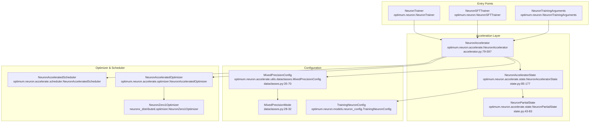
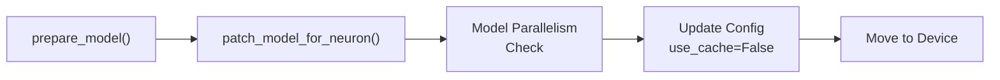
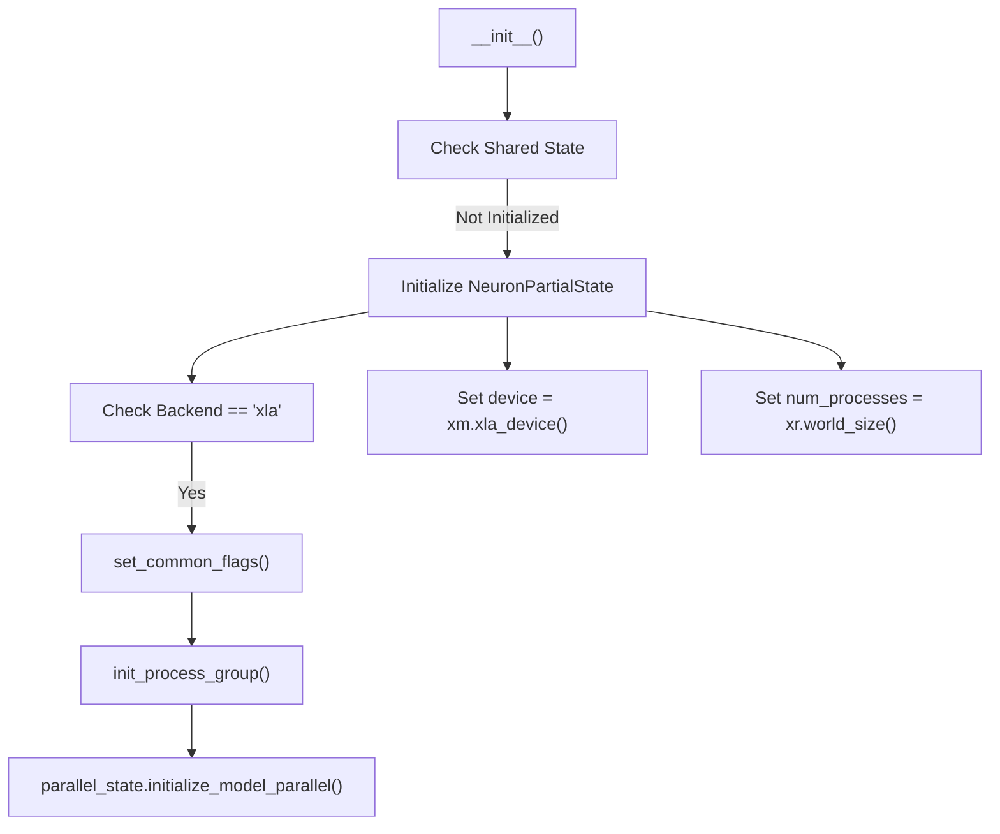
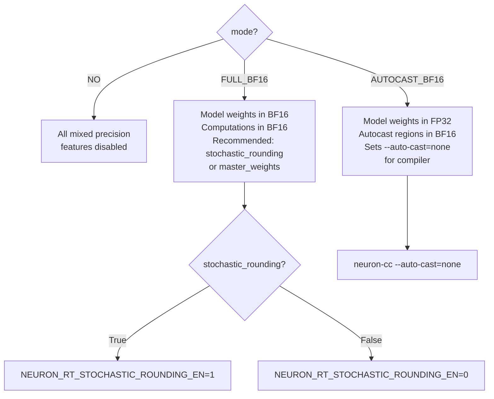
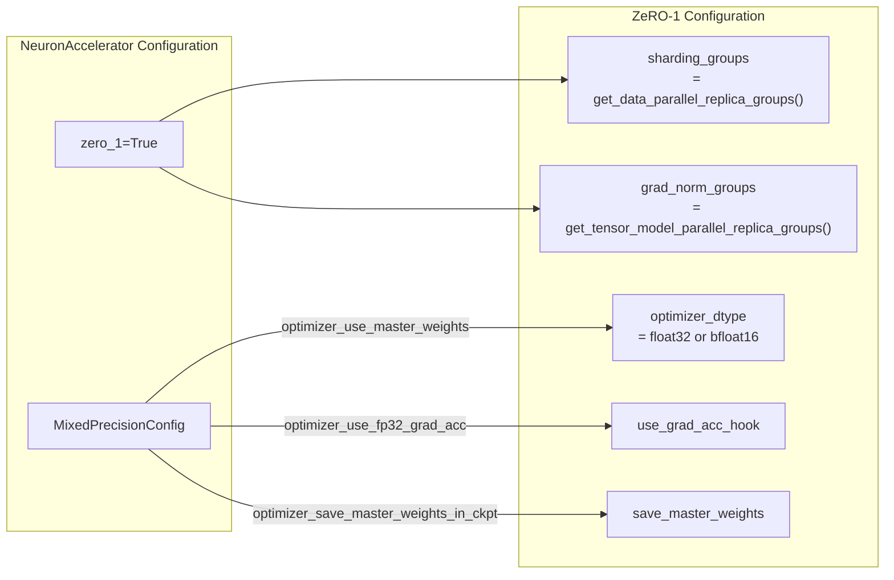
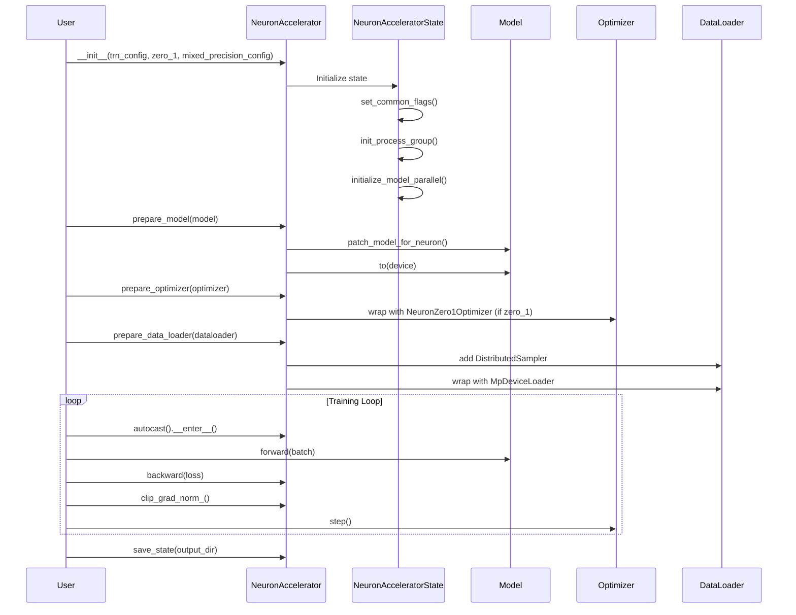

<!-- source: DeepWiki mcp.deepwiki.com · repo huggingface/optimum-neuron · page 13.2 Training API · fetched 2026-10-26 -->

# Training API

<details>
<summary>Relevant source files</summary>

The following files were used as context for generating this wiki page:

- [docs/source/training_tutorials/finetune_llama.mdx](docs/source/training_tutorials/finetune_llama.mdx)
- [docs/source/training_tutorials/finetune_qwen3.mdx](docs/source/training_tutorials/finetune_qwen3.mdx)
- [examples/training/llama/finetune_llama.py](examples/training/llama/finetune_llama.py)
- [examples/training/qwen3/finetune_qwen3.py](examples/training/qwen3/finetune_qwen3.py)
- [optimum/neuron/accelerate/accelerator.py](optimum/neuron/accelerate/accelerator.py)
- [optimum/neuron/accelerate/state.py](optimum/neuron/accelerate/state.py)
- [optimum/neuron/accelerate/utils/dataclasses.py](optimum/neuron/accelerate/utils/dataclasses.py)
- [optimum/neuron/trainers/sft_config.py](optimum/neuron/trainers/sft_config.py)
- [optimum/neuron/trainers/sft_trainer.py](optimum/neuron/trainers/sft_trainer.py)
- [optimum/neuron/trainers/training_args.py](optimum/neuron/trainers/training_args.py)
- [optimum/neuron/trainers/transformers.py](optimum/neuron/trainers/transformers.py)
- [optimum/neuron/trainers/trl_utils.py](optimum/neuron/trainers/trl_utils.py)
- [pyproject.toml](pyproject.toml)
- [tests/training/test_neuron_sft_trainer.py](tests/training/test_neuron_sft_trainer.py)

</details>


This page provides comprehensive API reference documentation for training-related classes and functions in optimum-neuron. The Training API includes the `NeuronAccelerator` class, state management classes, mixed precision configuration, and trainer implementations that enable distributed training on AWS Neuron hardware.

For conceptual information about using these APIs for training, see [Training on AWS Neuron](#5). For details on distributed training strategies (ZeRO-1, Tensor Parallelism, etc.), see [Distributed Training Strategies](#5.2). For custom model architectures, see [Custom Model Architectures](#5.4).

---

## Core Training Classes

The Training API is organized around several key classes that work together to enable training on Neuron hardware:



**Sources:** [optimum/neuron/accelerate/accelerator.py:1-597](), [optimum/neuron/accelerate/state.py:1-177](), [optimum/neuron/accelerate/utils/dataclasses.py:1-70]()

---

## NeuronAccelerator

`NeuronAccelerator` is the core class that extends `accelerate.Accelerator` with Neuron-specific functionality. It manages distributed training setup, model preparation, optimizer configuration, and mixed precision training.

### Class Signature

```python
class NeuronAccelerator(Accelerator):
    def __init__(
        self,
        *args,
        trn_config: TrainingNeuronConfig | None = None,
        zero_1: bool = False,
        mixed_precision_config: MixedPrecisionConfig | str | None = None,
        **kwargs,
    )
```

**Location:** [optimum/neuron/accelerate/accelerator.py:79-597]()

### Initialization Parameters

| Parameter | Type | Default | Description |
|-----------|------|---------|-------------|
| `trn_config` | `TrainingNeuronConfig \| None` | `None` | Configuration for Neuron-specific training settings (tensor parallelism, pipeline parallelism, etc.) |
| `zero_1` | `bool` | `False` | Enable ZeRO-1 optimizer state sharding across data parallel ranks |
| `mixed_precision_config` | `MixedPrecisionConfig \| str \| None` | `None` | Mixed precision configuration; accepts string ("NO", "FULL_BF16", "AUTOCAST_BF16") or `MixedPrecisionConfig` instance |
| `*args, **kwargs` | | | Standard `Accelerator` arguments (inherited from `accelerate.Accelerator`) |

### Unsupported Plugins

The following plugins are explicitly not supported and will raise `NotImplementedError`:

- `dynamo_plugin` / `dynamo_backend` - [accelerator.py:95-103]()
- `deepspeed_plugin` / `deepspeed_plugins` - [accelerator.py:104-112]()
- `fsdp_plugin` - [accelerator.py:114-118]()
- `torch_tp_plugin` - [accelerator.py:120-123]()
- `megatron_lm_plugin` - [accelerator.py:125-129]()

**Sources:** [optimum/neuron/accelerate/accelerator.py:79-157]()

### Key Methods

#### Model Preparation



**`prepare_model(model, device_placement=None, evaluation_mode=False)`**

Prepares a model for Neuron training by applying patches, updating configuration, and moving to device.

- Patches model with `patch_model_for_neuron()` to disable `layerdrop`, replace `no_sync`, and patch `save_pretrained` - [accelerator.py:312-336]()
- Sets `use_cache=False`, `output_attentions=False`, `output_hidden_states=False` - [accelerator.py:357-359]()
- For custom modeling models with pipeline parallelism: creates NxD PP model via `create_nxdpp_model()` - [accelerator.py:364-368]()
- For standard models: applies activation checkpointing if gradient checkpointing was enabled, disables SDPA - [accelerator.py:375-387]()
- Applies full BF16 casting if configured - [accelerator.py:361, 366, 371, 389]()
- Moves model to XLA device - [accelerator.py:372, 390]()

**Location:** [optimum/neuron/accelerate/accelerator.py:338-398]()

#### Optimizer Preparation

**`prepare_optimizer(optimizer, device_placement=None)`**

Wraps the optimizer with `NeuronAcceleratedOptimizer` or `NeuronZero1Optimizer` if ZeRO-1 is enabled.

- If `zero_1=True`, calls `_prepare_optimizer_for_zero_1()` - [accelerator.py:304-305]()
- Configures ZeRO-1 with sharding groups, bucket sizes, master weights - [accelerator.py:253-300]()
- Wraps in `NeuronAcceleratedOptimizer` - [accelerator.py:302-306]()

**Location:** [optimum/neuron/accelerate/accelerator.py:302-306](), [accelerator.py:253-300]()

#### Data Loader Preparation

**`prepare_data_loader(data_loader, device_placement=None, slice_fn_for_dispatch=None, use_mp_device_loader=False, batches_per_execution=1)`**

Prepares data loader for distributed training with proper sampling and device loading.

- Creates `DistributedSampler` for data parallel training - [accelerator.py:194, 238-239]()
- Wraps in `MpDeviceLoader` if `use_mp_device_loader=True` (except for pipeline parallelism) - [accelerator.py:242-249]()
- Forces `drop_last=True` for pipeline parallelism to avoid incomplete batches - [accelerator.py:224-228]()

**Location:** [optimum/neuron/accelerate/accelerator.py:208-251]()

#### Training Operations

**`backward(loss, **kwargs)`**

Performs backward pass with gradient scaling for accumulation.

- Divides loss by `gradient_accumulation_steps` - [accelerator.py:402]()
- Applies gradient scaling if scaler is configured - [accelerator.py:404]()

**Location:** [optimum/neuron/accelerate/accelerator.py:400-406]()

**`autocast(autocast_handler=None)`**

Context manager for mixed precision training.

- Enables `torch.autocast(dtype=torch.bfloat16, device_type="xla")` when AUTOCAST_BF16 mode is active - [accelerator.py:414-416]()
- Returns `nullcontext()` otherwise - [accelerator.py:418]()

**Location:** [optimum/neuron/accelerate/accelerator.py:408-422]()

**`clip_grad_norm_(parameters, max_norm, norm_type=2, postpone_clipping_to_optimizer_step=False)`**

Clips gradient norms with optional postponement to optimizer step.

- If `postpone_clipping_to_optimizer_step=True`, delegates to optimizer's `prepare_clip_grad_norm()` - [accelerator.py:425-432]()
- Otherwise uses standard clipping - [accelerator.py:434]()

**Location:** [optimum/neuron/accelerate/accelerator.py:424-434]()

#### Checkpointing

**`save_state(output_dir=None, safe_serialization=True, **save_model_func_kwargs)`**

Saves training state including models, optimizers, schedulers, and dataloaders.

- For model parallelism: calls `save_state_for_mp()` which saves parallel model and optimizer together - [accelerator.py:523-539, 544-545]()
- For standard training: uses default `Accelerator.save_state()` - [accelerator.py:546-548]()
- Manages checkpoint rotation based on `total_limit` - [accelerator.py:455-467]()
- Calls `xm.mark_step()` before saving - [accelerator.py:477]()

**Location:** [optimum/neuron/accelerate/accelerator.py:541-548](), [accelerator.py:523-539](), [accelerator.py:436-521]()

#### Gather Operations

**`gather(tensor, out_of_graph=False)`**

Gathers tensors across all processes using XLA-specific gather.

**`gather_for_metrics(input_data, use_gather_object=False)`**

Gathers data for metric computation with proper handling of remainder batches.

- Uses `gather_object()` for non-tensor data - [accelerator.py:563]()
- Uses out-of-graph gather for tensors to avoid recompilation - [accelerator.py:566]()
- Truncates to remainder size at end of dataloader - [accelerator.py:577-582]()

**Location:** [optimum/neuron/accelerate/accelerator.py:550-591]()

**Sources:** [optimum/neuron/accelerate/accelerator.py:79-597]()

---

## NeuronAcceleratorState

`NeuronAcceleratorState` is a singleton class that maintains information about the current training environment, including device, distributed configuration, and Neuron-specific settings.

### Class Signature

```python
class NeuronAcceleratorState(AcceleratorState):
    def __init__(
        self,
        mixed_precision: str | None = None,
        cpu: bool = False,
        dynamo_plugin=None,
        deepspeed_plugin=None,
        fsdp_plugin=None,
        torch_tp_plugin=None,
        megatron_lm_plugin=None,
        trn_config: TrainingNeuronConfig | None = None,
        _from_accelerator: bool = False,
        **kwargs,
    )
```

**Location:** [optimum/neuron/accelerate/state.py:85-177]()

### Key Attributes

| Attribute | Type | Description |
|-----------|------|-------------|
| `device` | `torch.device` | The XLA device to use for training |
| `distributed_type` | `DistributedType` | Type of distributed environment (XLA or NO) |
| `num_processes` | `int` | Number of processes in parallel training |
| `process_index` | `int` | Global index of current process |
| `local_process_index` | `int` | Local index on current server |
| `trn_config` | `TrainingNeuronConfig` | Neuron-specific training configuration |
| `mixed_precision` | `str` | Mixed precision mode ("bf16" or "no") |

### Initialization Behavior



**Initialization Steps:**

1. Checks if `NeuronPartialState` is initialized, initializes if needed - [state.py:122-124]()
2. Validates that only XLA backend is used - [state.py:66-67]()
3. Sets common Neuron compiler flags via `set_common_flags()` - [state.py:70]()
4. Initializes torch distributed process group - [state.py:71-72]()
5. Sets up XLA device and world size - [state.py:73-76]()
6. Initializes model parallelism if distributed and `trn_config` provided - [state.py:153-157]()

**Sources:** [optimum/neuron/accelerate/state.py:85-177](), [state.py:43-83]()

---

## MixedPrecisionConfig

`MixedPrecisionConfig` configures mixed precision training behavior including precision mode, stochastic rounding, and optimizer master weights.

### Class Definition

```python
@dataclass
class MixedPrecisionConfig:
    mode: MixedPrecisionMode | str
    stochastic_rounding: bool = True
    optimizer_use_master_weights: bool = False
    optimizer_use_fp32_grad_acc: bool = False
    optimizer_save_master_weights_in_ckpt: bool = False
```

**Location:** [optimum/neuron/accelerate/utils/dataclasses.py:35-70]()

### MixedPrecisionMode Enum

```python
class MixedPrecisionMode(str, enum.Enum):
    NO = "NO"
    FULL_BF16 = "FULL_BF16"
    AUTOCAST_BF16 = "AUTOCAST_BF16"
```

**Location:** [optimum/neuron/accelerate/utils/dataclasses.py:28-32]()

### Configuration Options

| Field | Type | Default | Description |
|-------|------|---------|-------------|
| `mode` | `MixedPrecisionMode \| str` | (required) | Precision mode: `"NO"`, `"FULL_BF16"`, or `"AUTOCAST_BF16"` |
| `stochastic_rounding` | `bool` | `True` | Enable stochastic rounding for BF16 computations |
| `optimizer_use_master_weights` | `bool` | `False` | Store optimizer state in FP32 for better numerical stability |
| `optimizer_use_fp32_grad_acc` | `bool` | `False` | Accumulate gradients in FP32 (requires `optimizer_use_master_weights=True`) |
| `optimizer_save_master_weights_in_ckpt` | `bool` | `False` | Save master weights to checkpoint (requires `optimizer_use_master_weights=True`) |

### Mode Behavior



**Mode Details:**

- **NO**: Disables all mixed precision features, all training in FP32 - [dataclasses.py:55-58]()
- **FULL_BF16**: Converts entire model to BF16, all computations in BF16; warns if neither stochastic rounding nor master weights enabled - [dataclasses.py:46-51]()
- **AUTOCAST_BF16**: Keeps model in FP32, uses `torch.autocast` for BF16 regions; sets compiler flag `--auto-cast=none` - [dataclasses.py:52-53]()

### Validation Rules

- `optimizer_use_fp32_grad_acc` requires `optimizer_use_master_weights=True` - [dataclasses.py:60-61]()
- `optimizer_save_master_weights_in_ckpt` requires `optimizer_use_master_weights=True` - [dataclasses.py:63-64]()

### Environment Variable Effects

- Sets `NEURON_RT_STOCHASTIC_ROUNDING_EN` based on `stochastic_rounding` - [dataclasses.py:66-69]()

**Sources:** [optimum/neuron/accelerate/utils/dataclasses.py:1-70]()

---

## Integration with NeuronZero1Optimizer

When `zero_1=True` is passed to `NeuronAccelerator`, the optimizer is wrapped with `NeuronZero1Optimizer` from `neuronx_distributed`. The configuration mapping is as follows:



### ZeRO-1 Configuration Mapping

| MixedPrecisionConfig Field | ZeRO-1 Config Field | Mapping |
|---------------------------|---------------------|---------|
| `optimizer_use_master_weights=True` | `optimizer_dtype` | `torch.float32` |
| `optimizer_use_master_weights=False` | `optimizer_dtype` | `torch.bfloat16` |
| `optimizer_use_fp32_grad_acc` | `use_grad_acc_hook` | Direct mapping |
| `optimizer_use_fp32_grad_acc` | `higher_cc_precision` | Direct mapping |
| `optimizer_save_master_weights_in_ckpt` | `save_master_weights` | Direct mapping |

### Bucket Configuration

The ZeRO-1 optimizer uses bucket sizes for communication efficiency:

- `ALL_GATHER_REDUCE_SCATTER_BUCKET_CAP_MB` environment variable (default: 130 MB) - [accelerator.py:272-274]()
- `bucket_cap_mb_reduce_scatter` = bucket cap - [accelerator.py:275]()
- `bucket_cap_mb_all_gather` = max(1, bucket cap / data_parallel_size) - [accelerator.py:276-277]()

**Sources:** [optimum/neuron/accelerate/accelerator.py:253-300]()

---

## Method Reference Summary

### NeuronAccelerator Methods

| Method | Purpose | Key Parameters |
|--------|---------|----------------|
| `__init__()` | Initialize accelerator | `trn_config`, `zero_1`, `mixed_precision_config` |
| `prepare_model()` | Prepare model for training | `model`, `device_placement`, `evaluation_mode` |
| `prepare_optimizer()` | Prepare optimizer with ZeRO-1 | `optimizer`, `device_placement` |
| `prepare_scheduler()` | Prepare learning rate scheduler | `scheduler` |
| `prepare_data_loader()` | Prepare distributed data loader | `data_loader`, `use_mp_device_loader`, `batches_per_execution` |
| `backward()` | Perform backward pass | `loss` |
| `autocast()` | Mixed precision context manager | `autocast_handler` |
| `clip_grad_norm_()` | Clip gradient norms | `parameters`, `max_norm`, `norm_type`, `postpone_clipping_to_optimizer_step` |
| `save_state()` | Save training checkpoint | `output_dir`, `safe_serialization` |
| `gather()` | Gather tensors across processes | `tensor`, `out_of_graph` |
| `gather_for_metrics()` | Gather data for metrics | `input_data`, `use_gather_object` |
| `accumulate()` | Context manager for gradient accumulation | None |

### Key Internal Methods

| Method | Purpose | Location |
|--------|---------|----------|
| `patch_model_for_neuron()` | Apply Neuron-specific patches | [accelerator.py:312-336]() |
| `_prepare_optimizer_for_zero_1()` | Create ZeRO-1 optimizer | [accelerator.py:253-300]() |
| `_prepare_data_loader_for_distributed()` | Add DistributedSampler | [accelerator.py:171-206]() |
| `_custom_save_state()` | Custom checkpoint saving | [accelerator.py:436-521]() |
| `save_state_for_mp()` | Save model parallel checkpoint | [accelerator.py:523-539]() |

**Sources:** [optimum/neuron/accelerate/accelerator.py:79-597]()

---

## Typical Usage Pattern



**Sources:** [optimum/neuron/accelerate/accelerator.py:79-597](), [optimum/neuron/accelerate/state.py:85-177]()

---

## Related Classes

While not fully detailed in this API reference, the following classes work in conjunction with the core training API:

- **`NeuronTrainer`**: High-level trainer class that uses `NeuronAccelerator` internally
- **`NeuronSFTTrainer`**: Supervised fine-tuning trainer extending `NeuronTrainer`
- **`NeuronTrainingArguments`**: Training arguments specific to Neuron
- **`TrainingNeuronConfig`**: Configuration for model parallelism settings (tensor parallel, pipeline parallel, etc.)
- **`NeuronAcceleratedOptimizer`**: Wrapper for optimizers prepared by `NeuronAccelerator`
- **`NeuronAcceleratedScheduler`**: Wrapper for schedulers prepared by `NeuronAccelerator`

For conceptual details on these classes, see [NeuronTrainer and NeuronAccelerator](#5.1).

**Sources:** [optimum/neuron/accelerate/accelerator.py:1-597]()

---

