<!-- source: DeepWiki mcp.deepwiki.com · repo huggingface/optimum-neuron · page 13.3 Inference API · fetched 2026-10-26 -->

# Inference API

<details>
<summary>Relevant source files</summary>

The following files were used as context for generating this wiki page:

- [optimum/neuron/__init__.py](optimum/neuron/__init__.py)
- [optimum/neuron/modeling.py](optimum/neuron/modeling.py)
- [optimum/neuron/modeling_base.py](optimum/neuron/modeling_base.py)
- [optimum/neuron/models/inference/auto_models.py](optimum/neuron/models/inference/auto_models.py)
- [optimum/neuron/pipelines/transformers/base.py](optimum/neuron/pipelines/transformers/base.py)
- [optimum/neuron/utils/__init__.py](optimum/neuron/utils/__init__.py)
- [tests/decoder/test_cli.py](tests/decoder/test_cli.py)
- [tests/decoder/test_decoder_export.py](tests/decoder/test_decoder_export.py)
- [tests/decoder/test_decoder_generation.py](tests/decoder/test_decoder_generation.py)
- [tests/decoder/test_decoder_hub.py](tests/decoder/test_decoder_hub.py)
- [tests/decoder/test_decoder_pipelines.py](tests/decoder/test_decoder_pipelines.py)
- [tests/fixtures/llm/export_models.py](tests/fixtures/llm/export_models.py)
- [tests/vllm/engine/test_vllm_engine_generate.py](tests/vllm/engine/test_vllm_engine_generate.py)

</details>


This page provides comprehensive API reference documentation for the optimum-neuron inference classes and methods. It covers all `NeuronModel` classes for different tasks, their initialization methods (`from_pretrained`, `export`), inference methods (`forward`, `generate`), and persistence methods (`save_pretrained`).

For information about the training API, see [Training API](#12.1). For export configuration details, see [Export API](#12.3). For deployment patterns, see [Deployment Guide](#8).

---

## Overview

The inference API provides a unified interface for loading, running, and saving Neuron-compiled models across multiple modalities (NLP, vision, audio) and tasks (classification, generation, detection, etc.). All model classes inherit from `NeuronModel` and follow Hugging Face Transformers conventions, making them drop-in replacements for standard PyTorch models.

**Key Capabilities:**
- Load pre-compiled Neuron models from Hub or local directories
- Export PyTorch models to Neuron format
- Run inference with automatic padding management
- Support for multiple backends (HLO, NxD, vLLM)
- Compatible with Transformers pipelines

Sources: [optimum/neuron/__init__.py:42-88](), [optimum/neuron/modeling_base.py:1-44]()

---

## Class Hierarchy

The inference system uses a multi-level inheritance structure where task-specific classes inherit from base classes that provide common functionality.

```mermaid
graph TB
    PreTrainedModel["PreTrainedModel<br/>(Fake class for pipeline compatibility)"]
    NeuronModel["NeuronModel<br/>(Abstract base)<br/>optimum/neuron/modeling_base.py:28"]
    NeuronTracedModel["NeuronTracedModel<br/>(Traced model wrapper)<br/>optimum/neuron/modeling_traced.py"]
    NeuronModelForCausalLM["NeuronModelForCausalLM<br/>(Abstract decoder base)<br/>optimum/neuron/modeling_decoder.py:105"]
    
    subgraph "NLP Models"
        FeatureExtraction["NeuronModelForFeatureExtraction<br/>modeling.py:92"]
        SentenceTransformers["NeuronModelForSentenceTransformers<br/>modeling.py:144"]
        MaskedLM["NeuronModelForMaskedLM<br/>modeling.py:210"]
        QA["NeuronModelForQuestionAnswering<br/>modeling.py:256"]
        SeqClass["NeuronModelForSequenceClassification<br/>modeling.py:304"]
        TokenClass["NeuronModelForTokenClassification<br/>modeling.py:351"]
        MultipleChoice["NeuronModelForMultipleChoice<br/>modeling.py:399"]
        Seq2Seq["NeuronModelForSeq2SeqLM<br/>modeling_seq2seq.py"]
    end
    
    subgraph "Vision Models"
        ImageClass["NeuronModelForImageClassification<br/>modeling.py:446"]
        SemanticSeg["NeuronModelForSemanticSegmentation<br/>modeling.py:493"]
        ObjectDet["NeuronModelForObjectDetection<br/>modeling.py:540"]
    end
    
    subgraph "Audio Models"
        AudioClass["NeuronModelForAudioClassification<br/>modeling.py:589"]
        AudioFrame["NeuronModelForAudioFrameClassification<br/>modeling.py:630"]
        CTC["NeuronModelForCTC<br/>modeling.py:670"]
        XVector["NeuronModelForXVector<br/>modeling.py:711"]
    end
    
    subgraph "Diffusion Models"
        DiffusionBase["NeuronDiffusionPipelineBase<br/>modeling_diffusion.py"]
        SD["NeuronStableDiffusionPipeline"]
        SDXL["NeuronStableDiffusionXLPipeline"]
        Flux["NeuronFluxPipeline"]
    end
    
    PreTrainedModel --> NeuronModel
    NeuronModel --> NeuronTracedModel
    NeuronModel --> NeuronModelForCausalLM
    
    NeuronTracedModel --> FeatureExtraction
    NeuronTracedModel --> SentenceTransformers
    NeuronTracedModel --> MaskedLM
    NeuronTracedModel --> QA
    NeuronTracedModel --> SeqClass
    NeuronTracedModel --> TokenClass
    NeuronTracedModel --> MultipleChoice
    NeuronTracedModel --> ImageClass
    NeuronTracedModel --> SemanticSeg
    NeuronTracedModel --> ObjectDet
    NeuronTracedModel --> AudioClass
    NeuronTracedModel --> AudioFrame
    NeuronTracedModel --> CTC
    NeuronTracedModel --> XVector
    
    NeuronModel --> Seq2Seq
    
    NeuronModel --> DiffusionBase
    DiffusionBase --> SD
    DiffusionBase --> SDXL
    DiffusionBase --> Flux
```



Sources: [optimum/neuron/modeling_base.py:21-44](), [optimum/neuron/modeling_traced.py](), [optimum/neuron/modeling_decoder.py:99-105](), [optimum/neuron/modeling.py:86-744]()

---

## Base Classes

### NeuronModel

The abstract base class for all Neuron models. Provides minimal interface for device management and forward pass.

**Class Definition:** [optimum/neuron/modeling_base.py:28-44]()

**Attributes:**

| Attribute | Type | Description |
|-----------|------|-------------|
| `device` | `torch.device` | Device where model is loaded (always `cpu` for Neuron) |

**Methods:**

| Method | Description |
|--------|-------------|
| `__call__(*args, **kwargs)` | Alias for `forward()` method |
| `to(device)` | Validates device type (must be CPU) |
| `forward(*args, **kwargs)` | Abstract method for inference, implemented by subclasses |

Sources: [optimum/neuron/modeling_base.py:28-44]()

---

### NeuronTracedModel

Wrapper class for traced Neuron models that handles padding, device management, and output post-processing. Most encoder-based models inherit from this class.

**Class Definition:** [optimum/neuron/modeling_traced.py]()

**Key Features:**
- Automatic padding management via `neuron_padding_manager` context manager
- Batch size and sequence length padding to compiled dimensions
- Output trimming via `remove_padding()` method
- Integration with Transformers `AutoModel` classes

**Common Methods:**

```python
@classmethod
def from_pretrained(cls, model_id, export=False, **kwargs)
```

Load a pre-compiled Neuron model or export a PyTorch model.

**Parameters:**

| Parameter | Type | Default | Description |
|-----------|------|---------|-------------|
| `model_id` | `str | Path` | Required | HuggingFace Hub model ID or local path |
| `export` | `bool` | `False` | If `True`, export PyTorch model to Neuron format |
| `batch_size` | `int` | `None` | Static batch size for compilation |
| `sequence_length` | `int` | `None` | Static sequence length for compilation |
| `dynamic_batch_size` | `bool` | `False` | Enable dynamic batch size support |
| `**kwargs` | | | Additional arguments passed to export/load |

**Returns:** Instance of the model class

Sources: [optimum/neuron/modeling_traced.py]()

---

## NLP Models

### NeuronModelForCausalLM

Abstract base class for causal language models (decoder-only architectures like GPT, Llama, etc.). Provides text generation capabilities.

**Class Definition:** [optimum/neuron/modeling_decoder.py:105-368]()

#### Class Methods

##### get_neuron_config()

Retrieve or create Neuron configuration for the model.

```python
@classmethod
def get_neuron_config(
    cls,
    model_name_or_path: str | Path,
    config: PretrainedConfig | None = None,
    token: bool | str | None = None,
    revision: str | None = None,
    batch_size: int | None = None,
    sequence_length: int | None = None,
    tensor_parallel_size: int | None = None,
    auto_cast_type: str | None = None,
) -> NeuronConfig
```

**Parameters:**

| Parameter | Type | Default | Description |
|-----------|------|---------|-------------|
| `model_name_or_path` | `str | Path` | Required | Model ID or path |
| `config` | `PretrainedConfig` | `None` | Model configuration object |
| `token` | `bool | str` | `None` | HuggingFace Hub authentication token |
| `revision` | `str` | `None` | Model revision (commit SHA or branch) |
| `batch_size` | `int` | `None` | Batch size (defaults to 1) |
| `sequence_length` | `int` | `None` | Sequence length (defaults to model max, capped at 4096) |
| `tensor_parallel_size` | `int` | `None` | Number of cores for tensor parallelism (defaults to all available) |
| `auto_cast_type` | `str` | `None` | Precision: "fp32", "fp16", or "bf16" (defaults to model's dtype) |

**Returns:** `NeuronConfig` instance with compilation settings

**Implementation Details:**
- Automatically detects model type from config when called on base class
- Retrieves exact checkpoint SHA for cache identification
- Applies sensible defaults for sequence length and tensor parallelism
- Calls subclass `_get_neuron_config()` for model-specific logic

Sources: [optimum/neuron/modeling_decoder.py:106-196]()

---

##### export()

Export a PyTorch model to Neuron format.

```python
@classmethod
def export(
    cls,
    model_id: str,
    neuron_config: NeuronConfig,
    config: PretrainedConfig | None = None,
    token: bool | str | None = None,
    revision: str | None = None,
    load_weights: bool | None = False,
    **kwargs,
) -> "NeuronModelForCausalLM"
```

**Parameters:**

| Parameter | Type | Default | Description |
|-----------|------|---------|-------------|
| `model_id` | `str` | Required | Model ID or path to export |
| `neuron_config` | `NeuronConfig` | Required | Neuron configuration (from `get_neuron_config()`) |
| `config` | `PretrainedConfig` | `None` | Model configuration |
| `token` | `bool | str` | `None` | Hub authentication token |
| `revision` | `str` | `None` | Model revision to export |
| `load_weights` | `bool` | `False` | Whether to load weights after export |
| `**kwargs` | | | Additional export arguments |

**Returns:** Exported `NeuronModelForCausalLM` instance

**Usage Pattern:**

```python
from optimum.neuron import NeuronModelForCausalLM

# Get configuration
config = NeuronModelForCausalLM.get_neuron_config(
    "meta-llama/Llama-2-7b-hf",
    batch_size=1,
    sequence_length=2048,
    tensor_parallel_size=2,
)

# Export model
model = NeuronModelForCausalLM.export(
    "meta-llama/Llama-2-7b-hf",
    neuron_config=config,
    load_weights=True,
)
```

Sources: [optimum/neuron/modeling_decoder.py:198-248]()

---

##### from_pretrained()

Load a pre-compiled Neuron model.

```python
@classmethod
def from_pretrained(
    cls,
    model_id: str | Path,
    **kwargs,
) -> "NeuronModelForCausalLM"
```

**Parameters:**

| Parameter | Type | Description |
|-----------|------|-------------|
| `model_id` | `str | Path` | Hub model ID or local directory containing Neuron model |
| `**kwargs` | | Additional loading arguments (revision, token, etc.) |

**Returns:** Loaded `NeuronModelForCausalLM` instance

**Implementation:**
- Automatically detects model architecture from config
- Delegates to subclass `_from_pretrained()` method
- Loads compiled artifacts and model configuration

Sources: [optimum/neuron/modeling_decoder.py:250-260]()

---

#### Instance Methods

##### generate()

Generate text sequences using the model.

```python
def generate(
    self,
    input_ids: torch.Tensor,
    attention_mask: torch.Tensor | None = None,
    generation_config: GenerationConfig | None = None,
    stopping_criteria: StoppingCriteriaList | None = None,
    **kwargs,
) -> torch.LongTensor
```

**Parameters:**

| Parameter | Type | Description |
|-----------|------|-------------|
| `input_ids` | `torch.Tensor` | Input token IDs, shape `(batch_size, sequence_length)` |
| `attention_mask` | `torch.Tensor` | Attention mask, shape `(batch_size, sequence_length)` |
| `generation_config` | `GenerationConfig` | Generation parameters (temperature, top_p, max_length, etc.) |
| `stopping_criteria` | `StoppingCriteriaList` | Custom stopping criteria |
| `**kwargs` | | Additional generation parameters |

**Returns:** Generated token IDs, shape `(batch_size, generated_length)`

**Features:**
- Supports greedy decoding and sampling
- Compatible with Transformers `GenerationConfig`
- Uses same logits processors/warpers as Transformers
- Simplified API compared to full Transformers `generate()`

**Example:**

```python
from transformers import AutoTokenizer
from optimum.neuron import NeuronModelForCausalLM

tokenizer = AutoTokenizer.from_pretrained("Qwen/Qwen2.5-0.5B-Instruct")
model = NeuronModelForCausalLM.from_pretrained("Qwen/Qwen2.5-0.5B-Instruct", export=True)

inputs = tokenizer("My favorite moment of the day is", return_tensors="pt")
gen_tokens = model.generate(**inputs, do_sample=True, temperature=0.9, max_length=20)
print(tokenizer.batch_decode(gen_tokens))
```

Sources: [optimum/neuron/modeling_decoder.py:271-287](), [optimum/neuron/modeling_decoder.py:42-89]()

---

##### save_pretrained()

Save the Neuron model and configuration to a directory.

```python
def save_pretrained(self, save_directory: str, **kwargs)
```

**Parameters:**

| Parameter | Type | Description |
|-----------|------|-------------|
| `save_directory` | `str` | Directory path where model will be saved |
| `**kwargs` | | Additional saving arguments |

**Saves:**
- Neuron configuration (`neuron_config.json`)
- Model configuration (`config.json`)
- Compiled model artifacts (implementation-specific)

**Usage:**

```python
model.save_pretrained("./my-neuron-model")
# Creates:
# - ./my-neuron-model/neuron_config.json
# - ./my-neuron-model/config.json
# - ./my-neuron-model/<model artifacts>
```

Sources: [optimum/neuron/modeling_decoder.py:340-368]()

---

### NeuronModelForFeatureExtraction

Extract embeddings and hidden states from encoder models (BERT, RoBERTa, etc.).

**Class Definition:** [optimum/neuron/modeling.py:92-136]()

**Auto Model Class:** `AutoModel`

**Forward Method:**

```python
def forward(
    self,
    input_ids: torch.Tensor,
    attention_mask: torch.Tensor,
    token_type_ids: torch.Tensor | None = None,
    **kwargs,
) -> BaseModelOutputWithPooling
```

**Returns:** `BaseModelOutputWithPooling` with:
- `last_hidden_state`: Token embeddings, shape `(batch_size, sequence_length, hidden_size)`
- `pooler_output`: Pooled output (e.g., [CLS] token), shape `(batch_size, hidden_size)`

**Example:**

```python
from transformers import AutoTokenizer
from optimum.neuron import NeuronModelForFeatureExtraction

tokenizer = AutoTokenizer.from_pretrained("optimum/all-MiniLM-L6-v2-neuronx")
model = NeuronModelForFeatureExtraction.from_pretrained("optimum/all-MiniLM-L6-v2-neuronx")

inputs = tokenizer("This is a test sentence", return_tensors="pt")
outputs = model(**inputs)
embeddings = outputs.last_hidden_state
```

Sources: [optimum/neuron/modeling.py:86-136]()

---

### NeuronModelForSentenceTransformers

Sentence transformers for semantic similarity and embedding tasks.

**Class Definition:** [optimum/neuron/modeling.py:144-202]()

**Library:** `sentence_transformers`

**Forward Method:**

```python
def forward(
    self,
    input_ids: torch.Tensor,
    attention_mask: torch.Tensor,
    pixel_values: torch.Tensor | None = None,
    token_type_ids: torch.Tensor | None = None,
    **kwargs,
) -> ModelOutput
```

**Returns:** `ModelOutput` with:
- For text models: `token_embeddings`, `sentence_embedding`
- For CLIP models: `text_embeds`, `image_embeds`

Sources: [optimum/neuron/modeling.py:138-202]()

---

### Additional NLP Models

The following models follow similar patterns with task-specific outputs:

| Class | Task | Output Type | File Reference |
|-------|------|-------------|----------------|
| `NeuronModelForMaskedLM` | Masked language modeling | `MaskedLMOutput` | [modeling.py:210-248]() |
| `NeuronModelForQuestionAnswering` | Extractive QA | `QuestionAnsweringModelOutput` | [modeling.py:256-295]() |
| `NeuronModelForSequenceClassification` | Text classification | `SequenceClassifierOutput` | [modeling.py:304-342]() |
| `NeuronModelForTokenClassification` | Token classification (NER) | `TokenClassifierOutput` | [modeling.py:351-390]() |
| `NeuronModelForMultipleChoice` | Multiple choice tasks | `MultipleChoiceModelOutput` | [modeling.py:399-438]() |
| `NeuronModelForSeq2SeqLM` | Sequence-to-sequence | `Seq2SeqLMOutput` | [modeling_seq2seq.py]() |

All models follow the same initialization pattern:

```python
model = NeuronModelForXXX.from_pretrained(model_id, export=True, **export_args)
outputs = model(**inputs)
```

Sources: [optimum/neuron/modeling.py:204-438](), [optimum/neuron/__init__.py:43-80]()

---

## Vision Models

### NeuronModelForImageClassification

Image classification with CNNs and vision transformers.

**Class Definition:** [optimum/neuron/modeling.py:446-485]()

**Supported Architectures:** ViT, BEiT, ConvNeXt, DeiT, LeViT, MobileNet-V2, MobileViT

**Forward Method:**

```python
def forward(
    self,
    pixel_values: torch.Tensor,
    **kwargs,
) -> ImageClassifierOutput
```

**Input Shape:** `(batch_size, num_channels, height, width)`

**Returns:** `ImageClassifierOutput` with:
- `logits`: Classification scores, shape `(batch_size, num_labels)`

**Example:**

```python
from transformers import AutoImageProcessor
from optimum.neuron import NeuronModelForImageClassification
from PIL import Image

processor = AutoImageProcessor.from_pretrained("optimum/vit-base-patch16-224-neuronx")
model = NeuronModelForImageClassification.from_pretrained("optimum/vit-base-patch16-224-neuronx")

image = Image.open("cat.jpg")
inputs = processor(image, return_tensors="pt")
outputs = model(**inputs)
predicted_class = outputs.logits.argmax(-1).item()
```

Sources: [optimum/neuron/modeling.py:440-485]()

---

### NeuronModelForSemanticSegmentation

Pixel-wise classification for semantic segmentation.

**Class Definition:** [optimum/neuron/modeling.py:493-532]()

**Supported Architectures:** MobileViT, MobileNet-V2

**Forward Method:**

```python
def forward(
    self,
    pixel_values: torch.Tensor,
    **kwargs,
) -> SemanticSegmenterOutput
```

**Returns:** `SemanticSegmenterOutput` with:
- `logits`: Segmentation masks, shape `(batch_size, num_classes, height, width)`

Sources: [optimum/neuron/modeling.py:487-532]()

---

### NeuronModelForObjectDetection

Object detection for tasks like COCO.

**Class Definition:** [optimum/neuron/modeling.py:540-581]()

**Supported Architectures:** YOLOS

**Forward Method:**

```python
def forward(
    self,
    pixel_values: torch.Tensor,
    **kwargs,
) -> ModelOutput
```

**Returns:** `ModelOutput` with:
- `logits`: Detection scores
- `pred_boxes`: Bounding box predictions
- `last_hidden_state`: Feature maps

Sources: [optimum/neuron/modeling.py:534-581]()

---

## Audio Models

### NeuronModelForAudioClassification

Audio classification (e.g., keyword spotting).

**Class Definition:** [optimum/neuron/modeling.py:589-622]()

**Forward Method:**

```python
def forward(
    self,
    input_values: torch.Tensor,
    **kwargs,
) -> SequenceClassifierOutput
```

**Input:** `input_values` of shape `(batch_size, sequence_length)`

Sources: [optimum/neuron/modeling.py:583-622]()

---

### NeuronModelForCTC

Connectionist Temporal Classification for speech recognition.

**Class Definition:** [optimum/neuron/modeling.py:670-703]()

**Forward Method:**

```python
def forward(
    self,
    input_values: torch.Tensor,
    **kwargs,
) -> CausalLMOutput
```

**Example:**

```python
from transformers import AutoProcessor
from optimum.neuron import NeuronModelForCTC

processor = AutoProcessor.from_pretrained("Jingya/wav2vec2-large-960h-lv60-self-neuronx-ctc")
model = NeuronModelForCTC.from_pretrained("Jingya/wav2vec2-large-960h-lv60-self-neuronx-ctc")

# Process audio
inputs = processor(audio_array, sampling_rate=16000, return_tensors="pt")
logits = model(**inputs).logits
predicted_ids = torch.argmax(logits, dim=-1)
transcription = processor.decode(predicted_ids[0])
```

Sources: [optimum/neuron/modeling.py:664-703]()

---

### Additional Audio Models

| Class | Task | Output Type | File Reference |
|-------|------|-------------|----------------|
| `NeuronModelForAudioFrameClassification` | Frame-level classification | `TokenClassifierOutput` | [modeling.py:630-662]() |
| `NeuronModelForXVector` | Speaker verification | `XVectorOutput` | [modeling.py:711-744]() |

Sources: [optimum/neuron/modeling.py:624-744]()

---

## Diffusion Models

Diffusion models inherit from `NeuronDiffusionPipelineBase` and support various image generation tasks.

**Available Pipeline Classes:**

| Class | Purpose | File Reference |
|-------|---------|----------------|
| `NeuronStableDiffusionPipeline` | Text-to-image generation | modeling_diffusion.py |
| `NeuronStableDiffusionImg2ImgPipeline` | Image-to-image | modeling_diffusion.py |
| `NeuronStableDiffusionInpaintPipeline` | Image inpainting | modeling_diffusion.py |
| `NeuronStableDiffusionXLPipeline` | SDXL text-to-image | modeling_diffusion.py |
| `NeuronStableDiffusionControlNetPipeline` | ControlNet conditioning | modeling_diffusion.py |
| `NeuronPixArtAlphaPipeline` | PixArt Alpha | modeling_diffusion.py |
| `NeuronPixArtSigmaPipeline` | PixArt Sigma | modeling_diffusion.py |
| `NeuronFluxPipeline` | Flux generation | modeling_diffusion.py |
| `NeuronFluxKontextPipeline` | Flux with context | modeling_diffusion.py |
| `NeuronFluxInpaintPipeline` | Flux inpainting | modeling_diffusion.py |

**Common Usage Pattern:**

```python
from optimum.neuron import NeuronStableDiffusionPipeline

# Load or export pipeline
pipe = NeuronStableDiffusionPipeline.from_pretrained(
    "stabilityai/stable-diffusion-2-1",
    export=True,
    batch_size=1,
    height=512,
    width=512,
    num_images_per_prompt=1,
)

# Generate images
image = pipe(
    prompt="A photo of an astronaut riding a horse on mars",
    num_inference_steps=50,
).images[0]

# Save compiled pipeline
pipe.save_pretrained("./sd-neuron")
```

**Multi-Component Architecture:**

Diffusion pipelines consist of multiple compiled sub-models:
- Text encoder(s)
- U-Net or Transformer
- VAE decoder
- VAE encoder (for img2img)
- ControlNet (optional)
- Image encoder (optional)

Each component is compiled separately and loaded together as a pipeline.

Sources: [optimum/neuron/__init__.py:59-76](), [optimum/neuron/modeling_diffusion.py]()

---

## Common Method Patterns

### Loading Pattern

All model classes support the same loading pattern:

```python
# Load pre-compiled model
model = NeuronModelForXXX.from_pretrained("optimum/model-neuronx")

# Export and load PyTorch model
model = NeuronModelForXXX.from_pretrained(
    "bert-base-uncased",
    export=True,
    batch_size=1,
    sequence_length=128,
)
```

**Key Parameters:**

| Parameter | Type | Description |
|-----------|------|-------------|
| `export` | `bool` | Export PyTorch model to Neuron format |
| `batch_size` | `int` | Static batch size for compilation |
| `sequence_length` | `int` | Static sequence length for compilation |
| `dynamic_batch_size` | `bool` | Enable dynamic batch size (encoder models only) |
| `token` | `str` | Hub authentication token |
| `revision` | `str` | Model revision/commit SHA |

Sources: [optimum/neuron/modeling_traced.py](), [optimum/neuron/modeling_decoder.py:250-269]()

---

### Forward Pass Pattern

All models use the `forward()` method or `__call__()` for inference:

```python
# Encoder models
outputs = model(
    input_ids=input_ids,
    attention_mask=attention_mask,
    token_type_ids=token_type_ids,  # Optional
)

# Vision models
outputs = model(pixel_values=pixel_values)

# Audio models
outputs = model(input_values=input_values)
```

**Automatic Padding:**

Models compiled with static shapes automatically pad inputs to the compiled dimensions and trim outputs:

```python
# Compiled for batch_size=4, sequence_length=128
model = NeuronModelForSequenceClassification.from_pretrained(
    "bert-base-uncased",
    export=True,
    batch_size=4,
    sequence_length=128,
)

# Input with batch_size=2, sequence_length=50
inputs = tokenizer("Hello world", return_tensors="pt")
# Automatically padded to (4, 128), then trimmed to (2, 50) in output
outputs = model(**inputs)
```

Sources: [optimum/neuron/modeling_traced.py]()

---

### Saving Pattern

Save models for later use or Hub sharing:

```python
# Save to local directory
model.save_pretrained("./my-neuron-model")

# Push to Hub
model.push_to_hub("username/my-neuron-model", token=token)
```

**Saved Files:**
- `config.json` - Model configuration
- `neuron_config.json` - Compilation configuration
- Model artifacts (NEFF files, weights, etc.)

Sources: [optimum/neuron/modeling_decoder.py:340-368]()

---

## Pipeline Integration

All `NeuronModel` classes are compatible with Transformers pipelines:

```python
from optimum.neuron import pipeline

# Create pipeline with automatic model loading
pipe = pipeline(
    "text-classification",
    model="optimum/distilbert-base-uncased-finetuned-sst-2-english-neuronx",
)

result = pipe("This movie is great!")
# [{'label': 'POSITIVE', 'score': 0.9998}]
```

**Supported Tasks:**

| Task | Model Class | Pipeline Type |
|------|-------------|---------------|
| `text-classification` | `NeuronModelForSequenceClassification` | Text |
| `token-classification` | `NeuronModelForTokenClassification` | Text |
| `question-answering` | `NeuronModelForQuestionAnswering` | Text |
| `feature-extraction` | `NeuronModelForFeatureExtraction` | Text |
| `text-generation` | `NeuronModelForCausalLM` | Text |
| `image-classification` | `NeuronModelForImageClassification` | Vision |
| `audio-classification` | `NeuronModelForAudioClassification` | Audio |
| `automatic-speech-recognition` | `NeuronModelForCTC` | Audio |

Sources: [optimum/neuron/pipelines.py](), [optimum/neuron/__init__.py:87]()

---

## Model-Specific Implementations

Different model architectures have specialized implementations:

### BERT and Encoder Models

Specific implementations for BERT family models provide optimized inference:

| Class | Purpose | File Reference |
|-------|---------|----------------|
| `NeuronBertModel` | Base BERT model | models/inference/bert.py |
| `NeuronBertForMaskedLM` | Masked LM | models/inference/bert.py |
| `NeuronBertForSequenceClassification` | Classification | models/inference/bert.py |
| `NeuronBertForQuestionAnswering` | QA | models/inference/bert.py |
| `NeuronBertForTokenClassification` | Token classification | models/inference/bert.py |
| `NeuronBertForMultipleChoice` | Multiple choice | models/inference/bert.py |

Sources: [optimum/neuron/__init__.py:91-98]()

---

### Vision Models

Specialized vision model implementations:

| Class | Purpose | File Reference |
|-------|---------|----------------|
| `NeuronCLIPModel` | CLIP base model | models/inference/clip.py |
| `NeuronCLIPForImageClassification` | CLIP classification | models/inference/clip.py |
| `NeuronYolosForObjectDetection` | YOLOS detection | models/inference/yolos.py |

Sources: [optimum/neuron/__init__.py:99-101]()

---

### Audio Models

| Class | Purpose | File Reference |
|-------|---------|----------------|
| `NeuronWhisperForConditionalGeneration` | Whisper ASR | models/inference/whisper.py |

Sources: [optimum/neuron/__init__.py:100]()

---

## Usage Examples

### Example 1: Text Classification

```python
from transformers import AutoTokenizer
from optimum.neuron import NeuronModelForSequenceClassification

# Load tokenizer and model
tokenizer = AutoTokenizer.from_pretrained("distilbert-base-uncased-finetuned-sst-2-english")
model = NeuronModelForSequenceClassification.from_pretrained(
    "distilbert-base-uncased-finetuned-sst-2-english",
    export=True,
    batch_size=1,
    sequence_length=128,
)

# Run inference
inputs = tokenizer("I love this movie!", return_tensors="pt")
outputs = model(**inputs)
predicted_class = outputs.logits.argmax(-1).item()
print(f"Predicted class: {predicted_class}")

# Save for reuse
model.save_pretrained("./distilbert-neuron")
```

---

### Example 2: Text Generation

```python
from transformers import AutoTokenizer
from optimum.neuron import NeuronModelForCausalLM

# Get configuration
config = NeuronModelForCausalLM.get_neuron_config(
    "gpt2",
    batch_size=1,
    sequence_length=512,
)

# Export model
tokenizer = AutoTokenizer.from_pretrained("gpt2")
model = NeuronModelForCausalLM.export("gpt2", neuron_config=config)

# Generate text
prompt = "Once upon a time"
inputs = tokenizer(prompt, return_tensors="pt")
outputs = model.generate(**inputs, max_length=50, do_sample=True, temperature=0.8)
text = tokenizer.decode(outputs[0])
print(text)
```

---

### Example 3: Image Classification

```python
from transformers import AutoImageProcessor
from optimum.neuron import NeuronModelForImageClassification
from PIL import Image

# Load model
processor = AutoImageProcessor.from_pretrained("google/vit-base-patch16-224")
model = NeuronModelForImageClassification.from_pretrained(
    "google/vit-base-patch16-224",
    export=True,
    batch_size=1,
)

# Process image
image = Image.open("cat.jpg")
inputs = processor(image, return_tensors="pt")
outputs = model(**inputs)

# Get prediction
predicted_label = outputs.logits.argmax(-1).item()
print(f"Predicted: {model.config.id2label[predicted_label]}")
```

---

### Example 4: Question Answering

```python
from transformers import AutoTokenizer
from optimum.neuron import NeuronModelForQuestionAnswering

# Load model
tokenizer = AutoTokenizer.from_pretrained("deepset/roberta-base-squad2")
model = NeuronModelForQuestionAnswering.from_pretrained(
    "deepset/roberta-base-squad2",
    export=True,
    batch_size=1,
    sequence_length=384,
)

# Ask question
question = "What is Neuron?"
context = "AWS Neuron is a software development kit (SDK) for machine learning inference and training on AWS Inferentia and Trainium."

inputs = tokenizer(question, context, return_tensors="pt")
outputs = model(**inputs)

# Extract answer
answer_start = outputs.start_logits.argmax()
answer_end = outputs.end_logits.argmax() + 1
answer = tokenizer.decode(inputs["input_ids"][0][answer_start:answer_end])
print(f"Answer: {answer}")
```

Sources: [tests/inference/inference_utils.py:29-157](), [optimum/neuron/modeling_decoder.py:73-89]()

---

## API Method Summary

### Common Methods Across All Classes

| Method | Class Level | Description |
|--------|-------------|-------------|
| `from_pretrained()` | ✓ | Load pre-compiled model or export PyTorch model |
| `save_pretrained()` | | Save model and configuration to directory |
| `push_to_hub()` | | Upload model to HuggingFace Hub |
| `forward()` | | Run inference on inputs |
| `__call__()` | | Alias for `forward()` |
| `to()` | | Device management (validates CPU-only) |

### Decoder-Specific Methods

| Method | Class Level | Description |
|--------|-------------|-------------|
| `get_neuron_config()` | ✓ | Create `NeuronConfig` for model |
| `export()` | ✓ | Export PyTorch model to Neuron format |
| `generate()` | | Generate text sequences |
| `_get_neuron_config()` | ✓ | Subclass-specific config creation (abstract) |
| `_export()` | ✓ | Subclass-specific export logic (abstract) |
| `_from_pretrained()` | ✓ | Subclass-specific loading logic (abstract) |
| `_save_pretrained()` | | Subclass-specific saving logic (abstract) |

Sources: [optimum/neuron/modeling_base.py:28-44](), [optimum/neuron/modeling_decoder.py:105-368]()

---

## Return Types Reference

All output types are from `transformers.modeling_outputs`:

| Output Type | Fields | Used By |
|-------------|--------|---------|
| `BaseModelOutputWithPooling` | `last_hidden_state`, `pooler_output` | Feature extraction |
| `MaskedLMOutput` | `logits` | Masked LM |
| `SequenceClassifierOutput` | `logits` | Sequence/audio classification |
| `TokenClassifierOutput` | `logits` | Token/frame classification |
| `QuestionAnsweringModelOutput` | `start_logits`, `end_logits` | Question answering |
| `MultipleChoiceModelOutput` | `logits` | Multiple choice |
| `ImageClassifierOutput` | `logits` | Image classification |
| `SemanticSegmenterOutput` | `logits` | Semantic segmentation |
| `CausalLMOutput` | `logits` | CTC |
| `XVectorOutput` | `logits`, `embeddings` | XVector |
| `ModelOutput` | Custom fields | Object detection, sentence transformers |

Sources: [optimum/neuron/modeling.py:36-48]()

---

