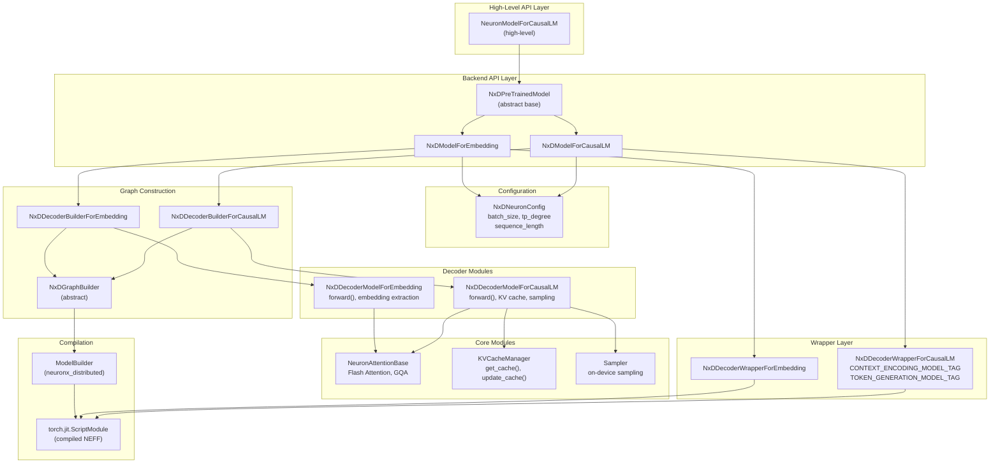
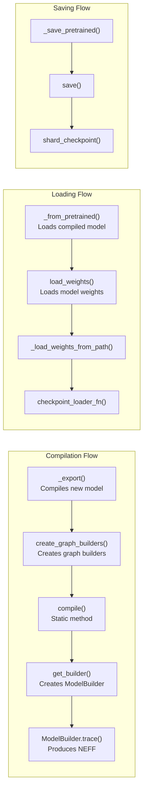
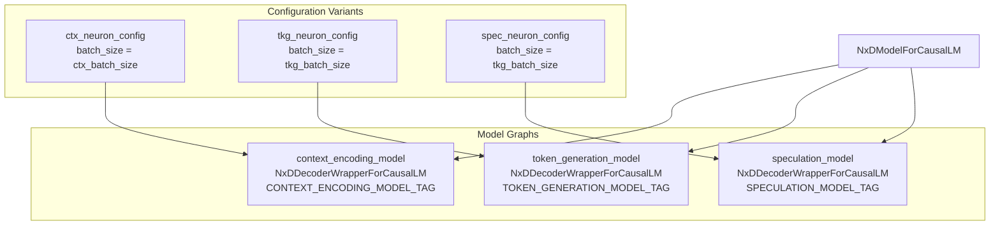
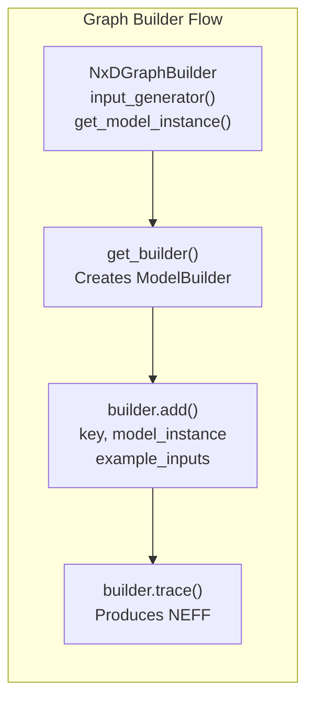
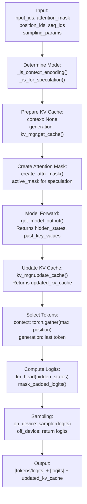
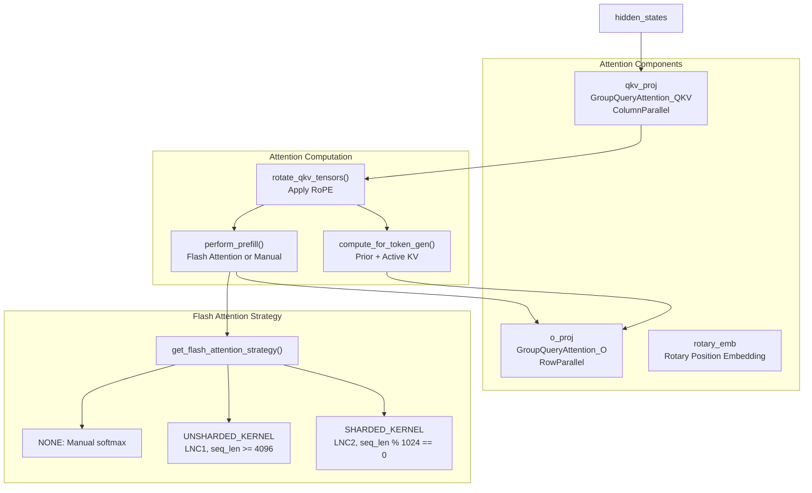
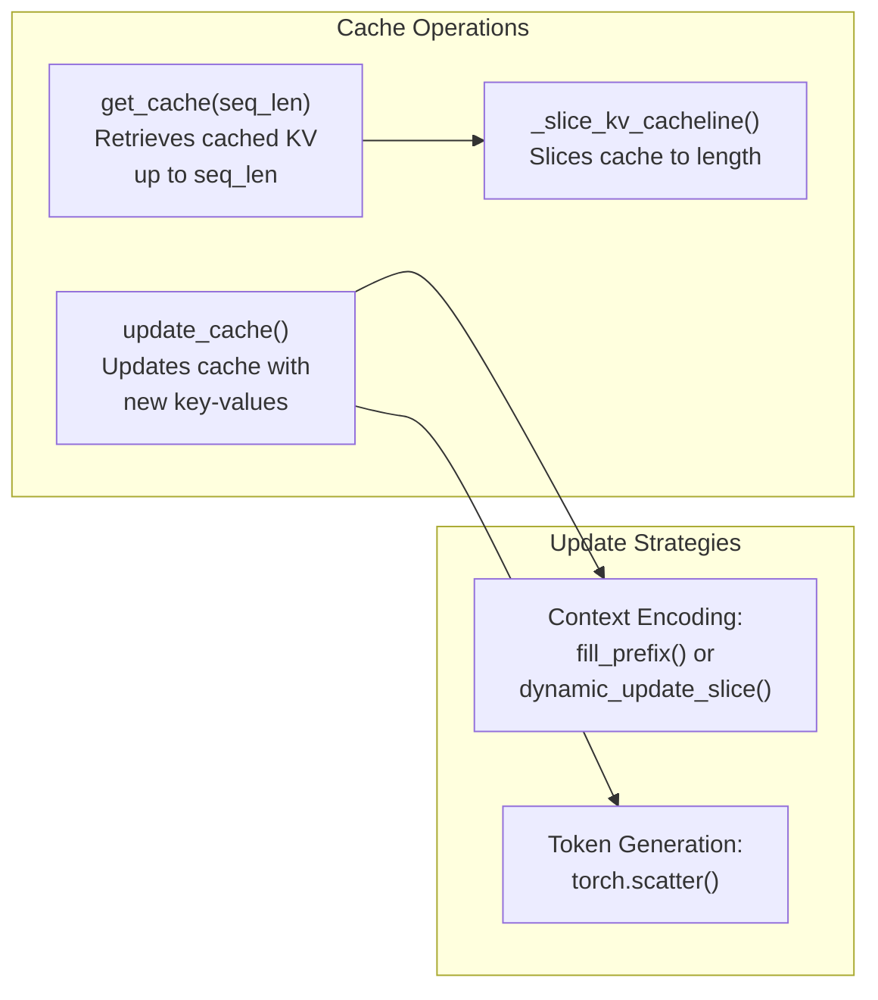
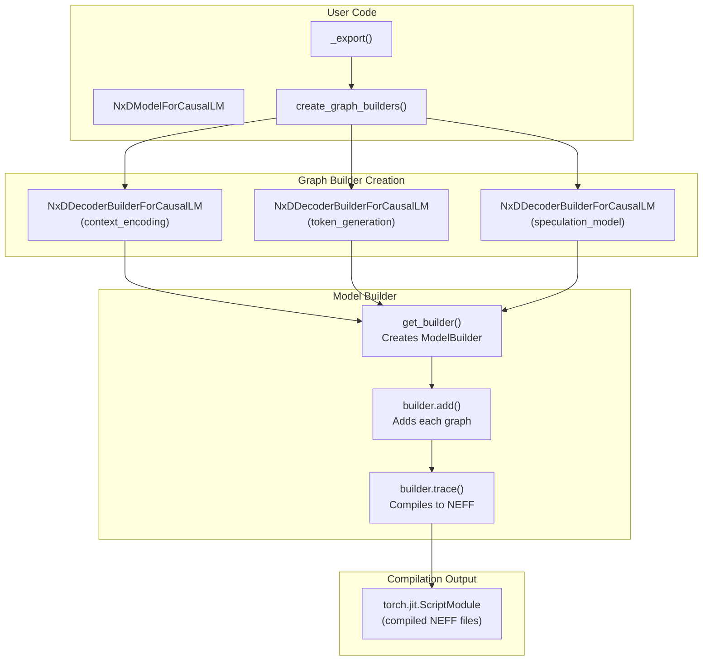
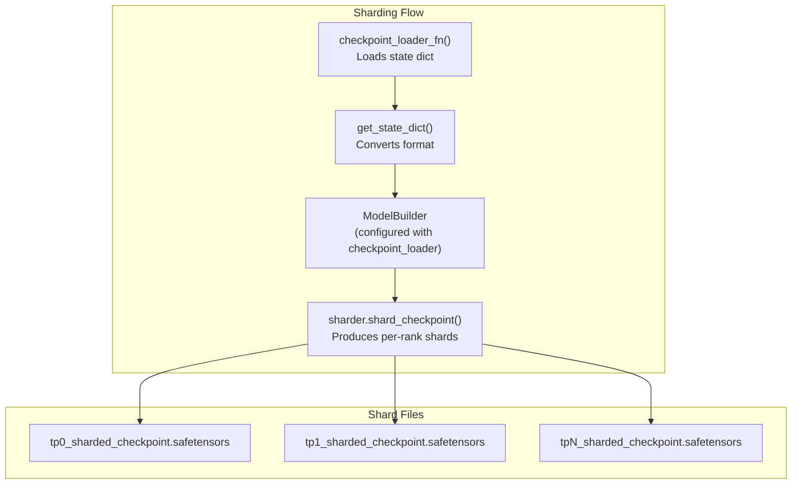

<!-- source: DeepWiki mcp.deepwiki.com · repo huggingface/optimum-neuron · page 13.4 Backend Inference API · fetched 2026-10-26 -->

# Backend Inference API

<details>
<summary>Relevant source files</summary>

The following files were used as context for generating this wiki page:

- [optimum/neuron/models/inference/backend/config.py](optimum/neuron/models/inference/backend/config.py)
- [optimum/neuron/models/inference/backend/graph_builder.py](optimum/neuron/models/inference/backend/graph_builder.py)
- [optimum/neuron/models/inference/backend/modules/attention/attention_base.py](optimum/neuron/models/inference/backend/modules/attention/attention_base.py)
- [optimum/neuron/models/inference/backend/modules/decoder/modeling_decoder.py](optimum/neuron/models/inference/backend/modules/decoder/modeling_decoder.py)
- [optimum/neuron/models/inference/backend/modules/kvcache/kv_cache_manager.py](optimum/neuron/models/inference/backend/modules/kvcache/kv_cache_manager.py)
- [optimum/neuron/models/inference/backend/pretrained_model.py](optimum/neuron/models/inference/backend/pretrained_model.py)

</details>


## Purpose and Scope

This document covers the low-level backend inference API used for compiling and running models on AWS Neuron hardware. This API is primarily for advanced users who need fine-grained control over model compilation, weight management, and graph construction. For high-level inference operations, see [Inference API](#13.3).

The backend API consists of:
- `NxDPreTrainedModel`: Abstract base class for all backend models
- `NxDModelForCausalLM` and `NxDModelForEmbedding`: Task-specific model classes
- `NxDNeuronConfig`: Configuration class for backend parameters
- `NxDGraphBuilder`: Abstract class for building computation graphs
- Backend modules for attention, KV cache, and decoder implementations

## Architecture Overview



**Sources:** [optimum/neuron/models/inference/backend/pretrained_model.py:103-478](), [optimum/neuron/models/inference/backend/modules/decoder/modeling_decoder.py:59-741]()

## Core Backend Classes

### NxDPreTrainedModel

`NxDPreTrainedModel` is the abstract base class for all backend models. It provides the compilation, loading, and weight management infrastructure.

**Key Attributes:**
- `config`: `PretrainedConfig` - Model architecture configuration
- `neuron_config`: `NxDNeuronConfig` - Neuron-specific compilation parameters
- `_traced_model`: `torch.jit.ScriptModule` - Compiled model graph
- `graph_builders`: Dictionary of `NxDGraphBuilder` instances

**Abstract Methods:**

| Method | Purpose |
|--------|---------|
| `forward()` | Model forward pass (must be implemented by subclass) |
| `get_compiler_args()` | Returns Neuron compiler arguments string |
| `create_graph_builders()` | Creates graph builders for model compilation |

**Key Methods:**



**Sources:** [optimum/neuron/models/inference/backend/pretrained_model.py:103-310]()

**Compilation:** The `_export()` class method orchestrates model compilation. It validates the compilation target, creates graph builders, and invokes the `compile()` static method which uses `neuronx_distributed.trace.model_builder.ModelBuilder` to trace and compile the model:

```python
# Example compilation flow
traced_model = NxDPreTrainedModel.compile(
    neuron_config=neuron_config,
    graph_builders=graph_builders,
    compiler_args=cls.get_compiler_args(neuron_config),
)
```

**Sources:** [optimum/neuron/models/inference/backend/pretrained_model.py:312-382]()

**Weight Management:** The class provides checkpoint loading and sharding functionality. Weights can be loaded from:
1. Pre-sharded checkpoints in the `checkpoint/weights/` directory
2. Standard model weights (automatically sharded at load time)
3. HuggingFace Hub via `checkpoint_id` in `NxDNeuronConfig`

**Sources:** [optimum/neuron/models/inference/backend/pretrained_model.py:215-249](), [optimum/neuron/models/inference/backend/pretrained_model.py:163-177]()

### NxDModelForCausalLM

`NxDModelForCausalLM` extends `NxDPreTrainedModel` for causal language modeling tasks. It manages separate compiled graphs for different inference phases.

**Architecture:**



**Sources:** [optimum/neuron/models/inference/backend/modules/decoder/modeling_decoder.py:345-403]()

**Forward Pass Routing:** The `forward()` method routes to the appropriate model based on input characteristics:

| Condition | Model Used | Purpose |
|-----------|------------|---------|
| `input_ids.shape[-1] > 1` and `position_ids.min() == 0` | `context_encoding_model` | Initial prompt encoding |
| `input_ids.shape[-1] == speculation_length` | `speculation_model` | Speculative decoding |
| Otherwise | `token_generation_model` | Single token generation |

**Sources:** [optimum/neuron/models/inference/backend/modules/decoder/modeling_decoder.py:438-554]()

**Graph Builder Creation:** The class method `create_graph_builders()` creates three builder instances:

```python
graph_builders = {
    "context_encoding": NxDDecoderBuilderForCausalLM(
        config=config,
        neuron_config=ctx_neuron_config,
        max_tokens=ctx_neuron_config.max_context_length,
        active_tokens=ctx_neuron_config.max_context_length,
        model_cls=cls._model_cls,
    ),
    "token_generation": NxDDecoderBuilderForCausalLM(...),
    "speculation_model": NxDDecoderBuilderForCausalLM(...),  # if speculation_length > 0
}
```

**Sources:** [optimum/neuron/models/inference/backend/modules/decoder/modeling_decoder.py:404-436]()

**Compiler Arguments:** The `get_compiler_args()` method returns Neuron compiler flags:
- `--auto-cast=none` - Disables automatic casting
- `--model-type=transformer` - Optimizes for transformer models
- `--tensorizer-options` - Enables compute/memory overlap optimizations
- `-O2` - Optimization level 2
- `--lnc` - Logical NeuronCore configuration

**Sources:** [optimum/neuron/models/inference/backend/modules/decoder/modeling_decoder.py:580-594]()

### NxDModelForEmbedding

`NxDModelForEmbedding` is designed for feature extraction tasks (text embeddings, ranking). Unlike causal LM, it uses a single graph for encoding.

**Key Differences from NxDModelForCausalLM:**
- Single `encoding_model` instead of three separate graphs
- No KV cache management
- No sampling logic
- Returns hidden states instead of logits/tokens

**Forward Pass:** Takes `input_ids` and `attention_mask`, creates `position_ids` from the attention mask, and returns embeddings:

```python
def forward(self, input_ids, attention_mask):
    position_ids = attention_mask.long().cumsum(-1) - 1
    position_ids.masked_fill_(attention_mask == 0, 1)
    return self.encoding_model(input_ids, attention_mask, position_ids)
```

**Sources:** [optimum/neuron/models/inference/backend/modules/decoder/modeling_decoder.py:669-741]()

## NxDNeuronConfig

`NxDNeuronConfig` is a dataclass that specifies all Neuron-specific compilation and runtime parameters.

**Core Parameters:**

| Parameter | Type | Default | Description |
|-----------|------|---------|-------------|
| `batch_size` | `int` | 1 | Batch size for inference |
| `sequence_length` | `int` | 128 | Maximum sequence length |
| `tp_degree` | `int` | 1 | Tensor parallelism degree |
| `pp_degree` | `int` | 1 | Pipeline parallelism degree |
| `ep_degree` | `int` | 1 | Expert parallelism degree (for MoE) |
| `torch_dtype` | `torch.dtype` | `torch.bfloat16` | Model weight dtype |
| `max_context_length` | `int` | `sequence_length` | Maximum context encoding length |
| `continuous_batching` | `bool` | False | Enable continuous batching |
| `on_device_sampling` | `bool` | False | Enable on-device sampling |
| `speculation_length` | `int` | 0 | Speculation tokens (0 = disabled) |
| `output_logits` | `bool` | False | Return logits in addition to tokens |
| `fused_qkv` | `bool` | False | Fuse QKV projections |
| `target` | `str` | None | Target hardware ("trn2" for Trainium) |

**Sources:** [optimum/neuron/models/inference/backend/config.py:44-159]()

**Computed Properties:**

```python
@property
def ctx_batch_size(self) -> int:
    return 1 if self.continuous_batching else self.batch_size

@property
def tkg_batch_size(self) -> int:
    return self.batch_size

@property
def world_size(self) -> int:
    return self.tp_degree * self.pp_degree * self.ep_degree

@property
def logical_nc_config(self) -> int:
    return 2 if self.target == "trn2" else 1
```

**Sources:** [optimum/neuron/models/inference/backend/config.py:132-159]()

**Checkpoint Management:** The config includes optional `checkpoint_id` and `checkpoint_revision` fields for loading weights from HuggingFace Hub:

```python
neuron_config = NxDNeuronConfig(
    checkpoint_id="meta-llama/Llama-2-7b-hf",
    checkpoint_revision="main",
    # ... other parameters
)
```

**Sources:** [optimum/neuron/models/inference/backend/config.py:54-81]()

## Graph Building System

### NxDGraphBuilder

`NxDGraphBuilder` is an abstract base class for creating computation graphs. Each graph builder produces a model instance and example inputs for tracing.

**Abstract Methods:**

```python
@abstractmethod
def input_generator(self) -> list[torch.Tensor]:
    """Return list of model input tensors for tracing"""
    raise NotImplementedError

@abstractmethod
def get_model_instance(self) -> BaseModelInstance:
    """Return the underlying ModelInstance for compilation"""
    raise NotImplementedError
```

**Sources:** [optimum/neuron/models/inference/backend/graph_builder.py:21-41]()

**Usage in ModelBuilder:**



**Sources:** [optimum/neuron/models/inference/backend/pretrained_model.py:53-100]()

The `get_builder()` function iterates over graph builders and adds each to the `ModelBuilder`:

```python
for tag, graph_builder in graph_builders.items():
    builder.add(
        key=tag,
        model_instance=graph_builder.get_model_instance(),
        example_inputs=graph_builder.input_generator(),
        compiler_args=compiler_args,
        priority_model_idx=graph_builder.priority_model_idx,
    )
```

**Sources:** [optimum/neuron/models/inference/backend/pretrained_model.py:92-99]()

## Backend Decoder Modules

### NxDDecoderModelForCausalLM

`NxDDecoderModelForCausalLM` is the core decoder implementation that gets traced and compiled. It implements the complete forward pass including KV cache management and sampling.

**Initialization:**

```python
def __init__(self, config: PretrainedConfig, neuron_config: NxDNeuronConfig):
    self.config = config
    self.neuron_config = neuron_config
    self.batch_size = neuron_config.batch_size
    self.n_positions = neuron_config.sequence_length
    self.vocab_size = config.vocab_size
    self.speculation_length = neuron_config.speculation_length
    
    if neuron_config.on_device_sampling:
        self.sampler = Sampler(neuron_config, do_sample=True)
    
    self.kv_mgr = KVCacheManager(config, neuron_config, num_kv_head=config.num_key_value_heads)
```

**Sources:** [optimum/neuron/models/inference/backend/modules/decoder/modeling_decoder.py:71-88]()

**Forward Pass Flow:**



**Sources:** [optimum/neuron/models/inference/backend/modules/decoder/modeling_decoder.py:148-267]()

**Context Encoding vs Token Generation:** The model adapts its behavior based on input shape:

```python
def _is_context_encoding(self, input_ids: torch.Tensor):
    return input_ids.shape[-1] > 1 and input_ids.shape[-1] != self.speculation_length

def _is_for_speculation(self, input_ids: torch.Tensor):
    return input_ids.shape[-1] == self.speculation_length
```

**Sources:** [optimum/neuron/models/inference/backend/modules/decoder/modeling_decoder.py:107-111]()

**Attention Mask Creation:** Different mask patterns for different phases:

| Phase | Mask Type | Shape | Description |
|-------|-----------|-------|-------------|
| Context Encoding | Causal (lower triangular) | `[B, 1, S, S]` | Full causal mask for prompt |
| Token Generation | Simple (1D attention) | `[B, 1, 1, S]` | Attend to all previous tokens |
| Speculation | Speculation (causal + attention) | `[B, 1, K, S]` | K speculation tokens |

**Sources:** [optimum/neuron/models/inference/backend/modules/decoder/modeling_decoder.py:113-135]()

### NxDDecoderModelForEmbedding

`NxDDecoderModelForEmbedding` is a simpler decoder for embedding extraction. It forwards through decoder layers and extracts embeddings at the last token position.

**Forward Pass:**

```python
def forward(self, input_ids, attention_mask, position_ids):
    # Create causal attention mask
    attention_mask = torch.full((self.n_positions, self.n_positions), True).tril(diagonal=0)
    attention_mask = attention_mask[None, None, :, :].expand(self.batch_size, 1, self.n_positions, self.n_positions)
    
    hidden_states = self.embed_tokens(input_ids)
    
    # Forward through decoder layers
    for decoder_layer in self.layers:
        hidden_states, _, cos_cache, sin_cache = decoder_layer(
            hidden_states, attention_mask=attention_mask, position_ids=position_ids,
            cos_cache=cos_cache, sin_cache=sin_cache
        )
    
    hidden_states = self.norm(hidden_states)
    
    # Extract embeddings at last position
    index = torch.max(position_ids, dim=1, keepdim=True).indices
    index = index.unsqueeze(1).expand(batch_size, 1, hidden_size)
    hidden_states = torch.gather(hidden_states, dim=1, index=index)
    
    return hidden_states
```

**Sources:** [optimum/neuron/models/inference/backend/modules/decoder/modeling_decoder.py:632-666]()

## Backend Attention Module

### NeuronAttentionBase

`NeuronAttentionBase` implements tensor-parallel attention with Flash Attention support and GQA (Grouped Query Attention).

**Architecture:**



**Sources:** [optimum/neuron/models/inference/backend/modules/attention/attention_base.py:60-376]()

**Tensor Parallelism:** The attention module splits heads across TP ranks:

```python
self.num_heads = utils.divide(self.qkv_proj.get_num_attention_heads(), neuron_config.tp_degree)
self.num_key_value_heads = utils.divide(self.qkv_proj.get_num_key_value_heads(), neuron_config.tp_degree)
self.num_key_value_groups = self.num_heads // self.num_key_value_heads
```

**Sources:** [optimum/neuron/models/inference/backend/modules/attention/attention_base.py:135-137]()

**Flash Attention Strategy:** The attention module selects the optimal Flash Attention strategy based on hardware and sequence length:

```python
def get_flash_attention_strategy(self, q_len) -> FlashAttentionStrategy:
    if self._qk_scale is not None:
        return FlashAttentionStrategy.NONE
    
    if int(self.logical_nc_config) > 1:  # LNC2 (Trainium)
        if q_len < 1024:
            return FlashAttentionStrategy.NONE
        if q_len % 1024 == 0:
            return FlashAttentionStrategy.SHARDED_KERNEL
        return FlashAttentionStrategy.NONE
    
    # LNC1 (Inferentia)
    if q_len >= 4096:
        return FlashAttentionStrategy.UNSHARDED_KERNEL
    
    return FlashAttentionStrategy.NONE
```

**Sources:** [optimum/neuron/models/inference/backend/modules/attention/attention_base.py:255-287]()

**Prefill vs Token Generation:**

| Phase | Method | Approach |
|-------|--------|----------|
| Prefill (context encoding) | `perform_prefill()` | Flash Attention kernel or manual QK^T/√d softmax |
| Token Generation | `compute_for_token_gen()` | Split attention: prior KV + active KV, manual softmax |

**Sources:** [optimum/neuron/models/inference/backend/modules/attention/attention_base.py:185-318]()

## KV Cache Management

### KVCacheManager

`KVCacheManager` manages the key-value cache for autoregressive decoding. It maintains cache as model parameters and provides read/write operations.

**Cache Structure:**

```python
# KV cache layout: BHSD (Batch, Heads, Sequence, head_Dim)
self.kv_shape = (
    max_batch_size,
    num_kv_heads_per_rank,
    max_len,
    hidden_dim_per_head,
)

# Stored as parameter list (2 per layer: K and V)
self.past_key_values = nn.ParameterList([
    nn.Parameter(torch.zeros(self.kv_shape, dtype=dtype), requires_grad=False)
    for _ in range(num_layer * 2)
])
```

**Sources:** [optimum/neuron/models/inference/backend/modules/kvcache/kv_cache_manager.py:67-79](), [optimum/neuron/models/inference/backend/modules/kvcache/kv_cache_manager.py:51-53]()

**Key Operations:**



**Sources:** [optimum/neuron/models/inference/backend/modules/kvcache/kv_cache_manager.py:92-184]()

**Cache Update Logic:**

```python
def update_cache(self, is_for_context_encoding, seq_ids, position_ids, 
                 new_key_values, seq_len, scatter_index=None, ...):
    updated_kv_cache = []
    for idx, kv_per_layer in enumerate(new_key_values):
        latest_k, latest_v = kv_per_layer[0], kv_per_layer[1]
        k_cache, v_cache = self._fetch_cache(idx, kvcache_buffer)
        
        if is_for_context_encoding:
            if self.is_continuous_batching:
                # Use dynamic_update_slice for continuous batching
                k_cache = dynamic_update_slice(k_cache, latest_k, indices)
                v_cache = dynamic_update_slice(v_cache, latest_v, indices)
            else:
                # Fill prefix for standard batching
                k_cache = fill_prefix(k_cache, latest_k)
                v_cache = fill_prefix(v_cache, latest_v)
        else:
            # Token generation: scatter at position_ids
            k_cache = torch.scatter(input=k_cache, dim=2, index=scatter_index_new, src=latest_k)
            v_cache = torch.scatter(input=v_cache, dim=2, index=scatter_index_new, src=latest_v)
        
        updated_kv_cache.append(k_cache)
        updated_kv_cache.append(v_cache)
    
    return updated_kv_cache
```

**Sources:** [optimum/neuron/models/inference/backend/modules/kvcache/kv_cache_manager.py:115-179]()

## Compilation and Model Building

### ModelBuilder Integration

The backend API integrates with `neuronx_distributed.trace.model_builder.ModelBuilder` for compilation:



**Sources:** [optimum/neuron/models/inference/backend/pretrained_model.py:53-100](), [optimum/neuron/models/inference/backend/pretrained_model.py:145-149]()

**Compilation Process:**

1. **Create Graph Builders:** Each builder specifies a model instance and input generator
2. **Initialize ModelBuilder:** With TP/PP/EP configuration and checkpoint loader
3. **Add Graphs:** Each graph builder is added with its key, model instance, and example inputs
4. **Trace:** `ModelBuilder.trace()` compiles all graphs to NEFF format
5. **Save:** The traced model is saved as `model.pt` using `torch.jit.save()`

**Sources:** [optimum/neuron/models/inference/backend/pretrained_model.py:146-162]()

## Weight Management and Checkpoint Loading

### State Dictionary Conversion

`NxDPreTrainedModel` provides hooks for converting between HuggingFace and Neuron state dictionary formats:

```python
@classmethod
def get_state_dict(cls, model_path, config, neuron_config):
    model_sd = load_state_dict(model_path)
    
    # Remove "model." prefix if present
    for param_name in list(model_sd.keys()):
        if param_name.startswith(cls._STATE_DICT_MODEL_PREFIX):
            updated_param_name = param_name.replace(
                cls._STATE_DICT_MODEL_PREFIX, cls._NEW_STATE_DICT_MODEL_PREFIX, 1
            )
            model_sd[updated_param_name] = model_sd[param_name]
            del model_sd[param_name]
    
    # Apply model-specific conversions
    model_sd = cls.convert_hf_to_neuron_state_dict(model_sd, config, neuron_config)
    
    # Handle tied weights
    if getattr(config, "tie_word_embeddings", False):
        cls.update_state_dict_for_tied_weights(model_sd)
    
    return model_sd
```

**Sources:** [optimum/neuron/models/inference/backend/pretrained_model.py:262-283]()

### Checkpoint Sharding

Checkpoints are sharded for distributed inference:



**Sources:** [optimum/neuron/models/inference/backend/pretrained_model.py:163-176](), [optimum/neuron/models/inference/backend/pretrained_model.py:251-260]()

**Shard Layout:** Each TP rank gets a separate shard file in `checkpoint/weights/`:
- `tp0_sharded_checkpoint.safetensors`
- `tp1_sharded_checkpoint.safetensors`
- ... for each TP rank

The sharding respects tensor parallelism strategy (column vs row parallel layers) and applies weight layout optimizations when `HLO_LAYOUT_TRANSFORMATION_OPTIONS` is set.

**Sources:** [optimum/neuron/models/inference/backend/pretrained_model.py:175-177](), [optimum/neuron/models/inference/backend/pretrained_model.py:190-213]()

### Loading Weights at Runtime

When loading a model, weights are initialized on Neuron devices:

```python
def _load_weights_from_path(self, weights_path):
    start_rank_id = self.neuron_config.start_rank_id
    local_ranks_size = self.neuron_config.local_ranks_size
    
    weights = []
    shards_path = get_shards_path(weights_path)
    
    if os.path.exists(get_shard_name(start_rank_id)):
        # Load pre-sharded checkpoints
        for rank in range(start_rank_id, start_rank_id + local_ranks_size):
            ckpt = load_file(get_shard_name(rank))
            weights.append(ckpt)
    else:
        # Shard on-the-fly
        checkpoint_loader = partial(self.checkpoint_loader_fn, weights_path, self.config, self.neuron_config)
        sharder = get_builder(...)
        weights = sharder.shard_checkpoint()
    
    # Initialize model with weights
    start_rank_tensor = torch.tensor([start_rank_id], dtype=torch.int32, device="cpu")
    self._traced_model.nxd_model.initialize(weights, start_rank_tensor)
```

**Sources:** [optimum/neuron/models/inference/backend/pretrained_model.py:178-213]()

This design allows weights to be either:
1. Pre-sharded and saved with the model (faster loading)
2. Sharded on-demand from standard checkpoints (more flexible)

The `start_rank_id` and `local_ranks_size` parameters support multi-node inference where different processes load different weight shards.

**Sources:** [optimum/neuron/models/inference/backend/pretrained_model.py:118-124](), [optimum/neuron/models/inference/backend/config.py:119-124]()

---

