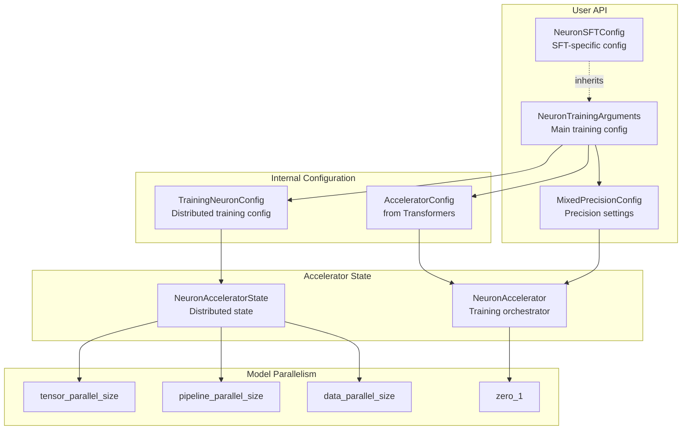
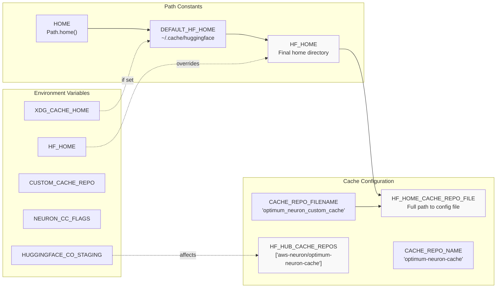

<!-- source: DeepWiki mcp.deepwiki.com · repo huggingface/optimum-neuron · page 13.5 Configuration Classes · fetched 2026-10-26 -->

# Configuration Classes

<details>
<summary>Relevant source files</summary>

The following files were used as context for generating this wiki page:

- [docs/source/training_tutorials/finetune_llama.mdx](docs/source/training_tutorials/finetune_llama.mdx)
- [docs/source/training_tutorials/finetune_qwen3.mdx](docs/source/training_tutorials/finetune_qwen3.mdx)
- [examples/training/llama/finetune_llama.py](examples/training/llama/finetune_llama.py)
- [examples/training/qwen3/finetune_qwen3.py](examples/training/qwen3/finetune_qwen3.py)
- [optimum/neuron/accelerate/accelerator.py](optimum/neuron/accelerate/accelerator.py)
- [optimum/neuron/accelerate/state.py](optimum/neuron/accelerate/state.py)
- [optimum/neuron/accelerate/utils/dataclasses.py](optimum/neuron/accelerate/utils/dataclasses.py)
- [optimum/neuron/trainers/sft_config.py](optimum/neuron/trainers/sft_config.py)
- [optimum/neuron/trainers/sft_trainer.py](optimum/neuron/trainers/sft_trainer.py)
- [optimum/neuron/trainers/training_args.py](optimum/neuron/trainers/training_args.py)
- [optimum/neuron/trainers/transformers.py](optimum/neuron/trainers/transformers.py)
- [optimum/neuron/trainers/trl_utils.py](optimum/neuron/trainers/trl_utils.py)
- [pyproject.toml](pyproject.toml)
- [tests/training/test_neuron_sft_trainer.py](tests/training/test_neuron_sft_trainer.py)

</details>


This page documents all configuration dataclasses used in `optimum-neuron` for training, inference, and distributed execution on AWS Neuron hardware.

## Overview

Configuration classes in `optimum-neuron` provide type-safe, validated configuration for:
- **Training Configuration**: `NeuronTrainingArguments`, `TrainingNeuronConfig`, and `NeuronSFTConfig`
- **Mixed Precision**: `MixedPrecisionConfig` for controlling precision modes and optimizer behavior
- **Distributed Training**: Tensor parallelism, pipeline parallelism, and ZeRO-1 settings
- **Inference Configuration**: `NeuronConfig` for exported models

All configuration classes are dataclasses that perform validation in `__post_init__` and integrate with the Hugging Face Transformers ecosystem.

Sources: [optimum/neuron/trainers/training_args.py:48-810](), [optimum/neuron/accelerate/utils/dataclasses.py:34-70](), [optimum/neuron/trainers/sft_config.py:33-56]()
</thinking>

## Configuration Architecture
</old_str>
<new_str>
## Configuration Architecture

## Cache Architecture



**Configuration Flow**

Configuration classes flow through the training system in this order:

1. **User Configuration**: `NeuronTrainingArguments` or `NeuronSFTConfig` defines all training parameters
2. **Internal Config Creation**: `TrainingNeuronConfig` is automatically created from training args in `__post_init__`
3. **Accelerator Setup**: `NeuronAccelerator` consumes configs to initialize distributed state and mixed precision
4. **Model Preparation**: Configs determine how models are sharded, precision modes, and optimization strategies

Sources: [optimum/neuron/trainers/training_args.py:48-810](), [optimum/neuron/accelerate/accelerator.py:79-597](), [optimum/neuron/accelerate/state.py:85-177]()

## Hub Cache Repository Functions

### get_hf_hub_cache_repos

```python
def get_hf_hub_cache_repos(log_warnings: bool = False) -> list[str]
```

Returns the ordered list of Hub cache repositories to check, from highest to lowest priority.

**Priority Order**:
1. Repository specified in `CUSTOM_CACHE_REPO` environment variable
2. Repository saved locally via `set_custom_cache_repo_name_in_hf_home()`
3. Default repository: `aws-neuron/optimum-neuron-cache`

**Parameters**:
- `log_warnings` (bool): If `True`, logs warnings when no custom cache is configured or when write access is unavailable

**Returns**: List of repository IDs in priority order

**Example**:
```python
from optimum.neuron.utils.cache_utils import get_hf_hub_cache_repos

# Get all cache repos in priority order
repos = get_hf_hub_cache_repos(log_warnings=True)
# ['my-org/my-cache', 'aws-neuron/optimum-neuron-cache']
```

Sources: [optimum/neuron/utils/cache_utils.py:165-201]()

---

### get_hf_hub_cache_repo

```python
def get_hf_hub_cache_repo(log_warnings: bool = False) -> str
```

Returns the highest-priority Hub cache repository.

**Parameters**:
- `log_warnings` (bool): If `True`, logs warnings about cache configuration

**Returns**: The repository ID with highest priority

**Example**:
```python
from optimum.neuron.utils.cache_utils import get_hf_hub_cache_repo

repo = get_hf_hub_cache_repo()
# 'my-org/my-cache' or 'aws-neuron/optimum-neuron-cache'
```

Sources: [optimum/neuron/utils/cache_utils.py:204-205]()

---

### load_custom_cache_repo_name_from_hf_home

```python
def load_custom_cache_repo_name_from_hf_home(
    hf_home_cache_repo_file: str | Path = HF_HOME_CACHE_REPO_FILE
) -> str | None
```

Loads the saved custom cache repository name from disk.

**Parameters**:
- `hf_home_cache_repo_file` (str | Path): Path to the file containing the saved cache repo name (default: `~/.cache/huggingface/optimum_neuron_custom_cache`)

**Returns**: Repository ID if saved, `None` otherwise

Sources: [optimum/neuron/utils/cache_utils.py:63-70]()

---

### set_custom_cache_repo_name_in_hf_home

```python
def set_custom_cache_repo_name_in_hf_home(
    repo_id: str,
    hf_home: str = HF_HOME,
    check_repo: bool = True,
    api: HfApi | None = None
)
```

Saves a custom cache repository name to disk for persistent use across sessions.

**Parameters**:
- `repo_id` (str): The Hub repository ID to save (e.g., `"my-org/my-cache"`)
- `hf_home` (str): HuggingFace home directory (default: from `HF_HOME` environment variable)
- `check_repo` (bool): If `True`, verifies the repository exists and is accessible
- `api` (HfApi | None): HuggingFace Hub API client (created if not provided)

**Raises**:
- `ValueError`: If `check_repo=True` and the repository doesn't exist or is inaccessible

**Example**:
```python
from optimum.neuron.utils.cache_utils import set_custom_cache_repo_name_in_hf_home

set_custom_cache_repo_name_in_hf_home("my-org/my-cache")
# Saves to ~/.cache/huggingface/optimum_neuron_custom_cache
```

Sources: [optimum/neuron/utils/cache_utils.py:73-96]()

---

### delete_custom_cache_repo_name_from_hf_home

```python
def delete_custom_cache_repo_name_from_hf_home(
    hf_home_cache_repo_file: str = HF_HOME_CACHE_REPO_FILE
)
```

Deletes the saved custom cache repository configuration.

**Parameters**:
- `hf_home_cache_repo_file` (str): Path to the cache repo file to delete

Sources: [optimum/neuron/utils/cache_utils.py:99-100]()

---

### create_custom_cache_repo

```python
def create_custom_cache_repo(
    repo_id: str = CACHE_REPO_NAME,
    private: bool = True
) -> RepoUrl
```

Creates a new cache repository on the Hugging Face Hub and saves it as the default.

**Parameters**:
- `repo_id` (str): Repository name (default: `"optimum-neuron-cache"`)
- `private` (bool): Whether to create a private repository (default: `True`)

**Returns**: `RepoUrl` object containing the created repository information

**Example**:
```python
from optimum.neuron.utils.cache_utils import create_custom_cache_repo

repo_url = create_custom_cache_repo("my-cache", private=True)
# Creates my-username/my-cache and saves it locally
```

Sources: [optimum/neuron/utils/cache_utils.py:103-106]()

## Local Cache Path Functions

### get_neuron_cache_path

```python
def get_neuron_cache_path() -> Path | None
```

Returns the current Neuron compiler cache directory path.

The function inspects the `NEURON_CC_FLAGS` environment variable to find the `--cache_dir` setting. If not specified, returns the default path `/var/tmp/neuron-compile-cache`.

**Returns**: 
- `Path` object pointing to the cache directory
- `None` if `--no-cache` is set in `NEURON_CC_FLAGS`

**Example**:
```python
from optimum.neuron.utils.cache_utils import get_neuron_cache_path

cache_path = get_neuron_cache_path()
# Path('/var/tmp/neuron-compile-cache')
```

Sources: [optimum/neuron/utils/cache_utils.py:208-221]()

---

### set_neuron_cache_path

```python
def set_neuron_cache_path(
    neuron_cache_path: str | Path,
    ignore_no_cache: bool = False
)
```

Sets the Neuron compiler cache directory by modifying the `NEURON_CC_FLAGS` environment variable.

**Parameters**:
- `neuron_cache_path` (str | Path): The directory path to use for caching
- `ignore_no_cache` (bool): If `True`, removes `--no-cache` flag if present; if `False`, raises error when `--no-cache` is set

**Raises**:
- `ValueError`: If `--no-cache` is in `NEURON_CC_FLAGS` and `ignore_no_cache=False`

**Example**:
```python
from optimum.neuron.utils.cache_utils import set_neuron_cache_path
from pathlib import Path

set_neuron_cache_path(Path("/custom/cache/dir"))
# Sets NEURON_CC_FLAGS="... --cache_dir=/custom/cache/dir"
```

Sources: [optimum/neuron/utils/cache_utils.py:224-245]()

## Repository Access Functions

### is_private_repo

```python
def is_private_repo(repo_id: str) -> bool
```

Checks whether a Hub repository is private.

The function attempts to access the repository both with and without authentication to determine privacy status.

**Parameters**:
- `repo_id` (str): The Hub repository ID to check

**Returns**: `True` if the repository is private, `False` if public

**Note**: Can be disabled for testing via `OPTIMUM_NEURON_DISABLE_IS_PRIVATE_REPO_CHECK` environment variable.

Sources: [optimum/neuron/utils/cache_utils.py:109-126]()

---

### has_write_access_to_repo

```python
def has_write_access_to_repo(repo_id: str) -> bool
```

Checks whether the current user has write access to a Hub repository.

The function attempts to delete a non-existent branch to test write permissions. Results are cached to avoid repeated API calls.

**Parameters**:
- `repo_id` (str): The Hub repository ID to check

**Returns**: `True` if the user has write access, `False` otherwise

**Example**:
```python
from optimum.neuron.utils.cache_utils import has_write_access_to_repo

if has_write_access_to_repo("my-org/my-cache"):
    print("Can upload to cache")
```

Sources: [optimum/neuron/utils/cache_utils.py:132-162]()

## Cache Inspection Functions

### list_files_in_neuron_cache

```python
def list_files_in_neuron_cache(
    neuron_cache_path: str | Path,
    only_relevant_files: bool = False
) -> list[Path]
```

Lists all files in the specified Neuron cache directory.

**Parameters**:
- `neuron_cache_path` (str | Path): Path to the cache directory
- `only_relevant_files` (bool): If `True`, filters to only `.neff`, `.pb`, and `.txt` files

**Returns**: List of `Path` objects for files in the cache

**Example**:
```python
from optimum.neuron.utils.cache_utils import (
    get_neuron_cache_path,
    list_files_in_neuron_cache
)

cache_path = get_neuron_cache_path()
files = list_files_in_neuron_cache(cache_path, only_relevant_files=True)
# [Path('/var/tmp/neuron-compile-cache/model.neff'), ...]
```

Sources: [optimum/neuron/utils/cache_utils.py:261-267]()

---

### get_num_neuron_cores

```python
def get_num_neuron_cores() -> int
```

Returns the total number of Neuron cores available on the system.

The function inspects `/sys/class/neuron_device/` to count available Neuron devices, multiplying by 2 since each device has 2 cores.

**Returns**: Total number of Neuron cores (0 if not on a Neuron instance)

Sources: [optimum/neuron/utils/cache_utils.py:248-254]()

---

### get_num_neuron_cores_used

```python
def get_num_neuron_cores_used() -> int
```

Returns the number of Neuron cores currently in use by the distributed training setup.

**Returns**: Number of cores in use (from `WORLD_SIZE` environment variable, defaults to 1)

Sources: [optimum/neuron/utils/cache_utils.py:257-258]()

---

### get_model_name_or_path

```python
def get_model_name_or_path(config: PretrainedConfig) -> str | None
```

Extracts the model name or path from a PretrainedConfig object.

The function checks multiple attribute names (`_model_name_or_path`, `_name_or_path`) to find the model identifier.

**Parameters**:
- `config` (PretrainedConfig): The configuration object to extract from

**Returns**: Model name/path string, or `None` if not found

Sources: [optimum/neuron/utils/cache_utils.py:270-280]()

## Constants and Configuration



### Module-Level Constants

| Constant | Value | Description |
|----------|-------|-------------|
| `HOME` | `Path.home()` | User's home directory |
| `DEFAULT_HF_HOME` | `~/.cache/huggingface` or `$XDG_CACHE_HOME/huggingface` | Default HuggingFace cache directory |
| `HF_HOME` | From `HF_HOME` env var or `DEFAULT_HF_HOME` | HuggingFace home directory |
| `CACHE_REPO_FILENAME` | `"optimum_neuron_custom_cache"` | Filename for storing custom cache repo configuration |
| `HF_HOME_CACHE_REPO_FILE` | `"{HF_HOME}/optimum_neuron_custom_cache"` | Full path to cache configuration file |
| `CACHE_REPO_NAME` | `"optimum-neuron-cache"` | Default cache repository name |
| `HF_HUB_CACHE_REPOS` | `["aws-neuron/optimum-neuron-cache"]` | List of default Hub cache repositories |

Sources: [optimum/neuron/utils/cache_utils.py:36-50]()

### Environment Variables

The cache system respects the following environment variables:

| Variable | Purpose | Used By |
|----------|---------|---------|
| `HF_HOME` | Override HuggingFace home directory | Path resolution |
| `XDG_CACHE_HOME` | Override default cache directory (XDG standard) | Path resolution |
| `CUSTOM_CACHE_REPO` | Override cache repository (highest priority) | `get_hf_hub_cache_repos()` |
| `NEURON_CC_FLAGS` | Neuron compiler flags including `--cache_dir` | `get_neuron_cache_path()`, `set_neuron_cache_path()` |
| `WORLD_SIZE` | Number of distributed training processes | `get_num_neuron_cores_used()` |
| `HUGGINGFACE_CO_STAGING` | Use staging Hub (testing only) | Hub repository resolution |
| `OPTIMUM_NEURON_DISABLE_IS_PRIVATE_REPO_CHECK` | Disable private repo checks (testing only) | `is_private_repo()` |

Sources: [optimum/neuron/utils/cache_utils.py:36-60]()

## Function Reference Summary

### Repository Management

| Function | Purpose | Returns |
|----------|---------|---------|
| `get_hf_hub_cache_repos()` | Get ordered list of cache repositories | `list[str]` |
| `get_hf_hub_cache_repo()` | Get highest-priority cache repository | `str` |
| `load_custom_cache_repo_name_from_hf_home()` | Load saved cache repo from disk | `str \| None` |
| `set_custom_cache_repo_name_in_hf_home()` | Save cache repo to disk | `None` |
| `delete_custom_cache_repo_name_from_hf_home()` | Delete saved cache repo | `None` |
| `create_custom_cache_repo()` | Create new Hub cache repository | `RepoUrl` |

### Local Cache Management

| Function | Purpose | Returns |
|----------|---------|---------|
| `get_neuron_cache_path()` | Get local cache directory path | `Path \| None` |
| `set_neuron_cache_path()` | Set local cache directory path | `None` |
| `list_files_in_neuron_cache()` | List files in cache directory | `list[Path]` |

### Access Control

| Function | Purpose | Returns |
|----------|---------|---------|
| `is_private_repo()` | Check if repository is private | `bool` |
| `has_write_access_to_repo()` | Check write access to repository | `bool` |

### System Information

| Function | Purpose | Returns |
|----------|---------|---------|
| `get_num_neuron_cores()` | Get total available Neuron cores | `int` |
| `get_num_neuron_cores_used()` | Get number of cores in use | `int` |
| `get_model_name_or_path()` | Extract model identifier from config | `str \| None` |

Sources: [optimum/neuron/utils/cache_utils.py:1-281]()

## Usage Patterns

### Setting Up Custom Cache

```python
from optimum.neuron.utils.cache_utils import (
    create_custom_cache_repo,
    get_hf_hub_cache_repos
)

# Create and configure cache repository
repo_url = create_custom_cache_repo("my-team-cache", private=True)
print(f"Created cache: {repo_url.repo_id}")

# Verify configuration
repos = get_hf_hub_cache_repos()
print(f"Cache priority: {repos}")
# ['my-username/my-team-cache', 'aws-neuron/optimum-neuron-cache']
```

### Inspecting Local Cache

```python
from optimum.neuron.utils.cache_utils import (
    get_neuron_cache_path,
    list_files_in_neuron_cache
)

# Get cache location
cache_path = get_neuron_cache_path()
print(f"Cache directory: {cache_path}")

# List compiled artifacts
neff_files = list_files_in_neuron_cache(cache_path, only_relevant_files=True)
print(f"Found {len(neff_files)} cached files")
for file in neff_files:
    if file.suffix == ".neff":
        print(f"  NEFF: {file.name}")
```

### Checking Repository Access

```python
from optimum.neuron.utils.cache_utils import (
    is_private_repo,
    has_write_access_to_repo
)

repo_id = "my-org/my-cache"

# Check repository status
if is_private_repo(repo_id):
    print(f"{repo_id} is private")

# Check write access
if has_write_access_to_repo(repo_id):
    print("Can upload compiled models")
else:
    print("Read-only access")
```

Sources: [optimum/neuron/utils/cache_utils.py:63-280]()

## Related APIs

For higher-level cache operations used during training and inference:

- **Training Cache**: `optimum.neuron.cache.training` module provides `hub_neuronx_cache()` context manager and `patch_neuron_cc_wrapper()` for training workflows
- **Hub Cache**: `optimum.neuron.cache.hub_cache` module provides `synchronize_hub_cache()` and `select_hub_cached_entries()` for Hub synchronization
- **Cache Entries**: `optimum.neuron.cache.entries` module provides `SingleModelCacheEntry` and related classes for cache metadata management

For command-line usage of these APIs, see [Cache CLI Commands](#7.3).

Sources: [optimum/commands/neuron/cache.py:19-25](), [docs/source/guides/cache_system.mdx:146-162]()