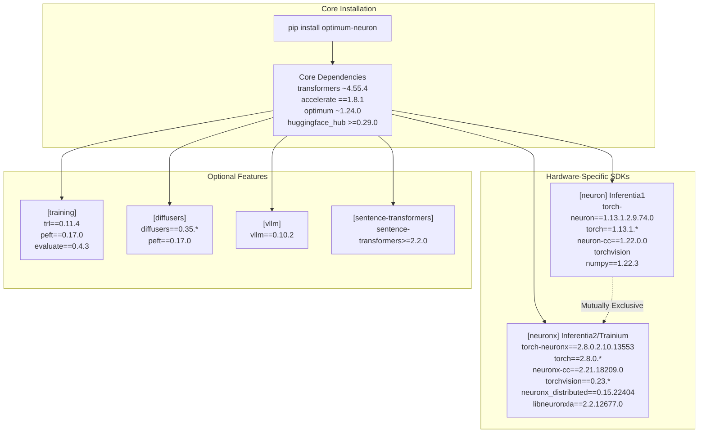
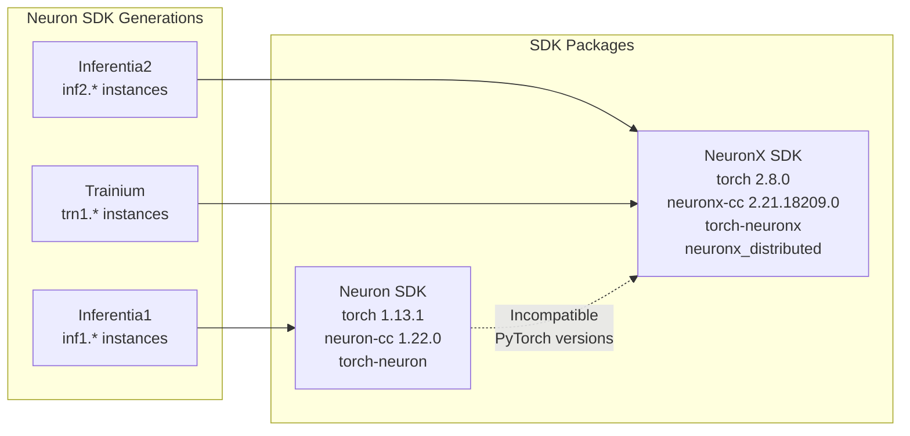
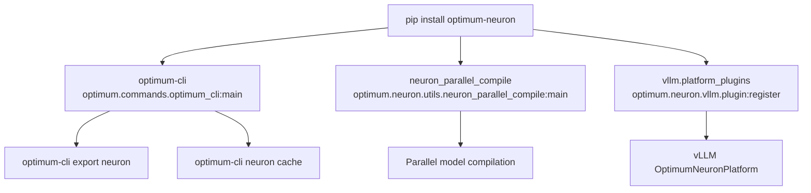
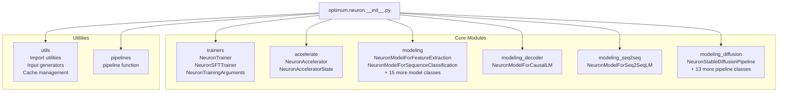

<!-- source: DeepWiki mcp.deepwiki.com · repo huggingface/optimum-neuron · page 2 Installation and Setup · fetched 2026-10-26 -->

# Installation and Setup

<details>
<summary>Relevant source files</summary>

The following files were used as context for generating this wiki page:

- [Makefile](Makefile)
- [docs/source/guides/benchmark.mdx](docs/source/guides/benchmark.mdx)
- [docs/source/guides/export_model.mdx](docs/source/guides/export_model.mdx)
- [docs/source/guides/vllm_plugin.mdx](docs/source/guides/vllm_plugin.mdx)
- [docs/source/index.mdx](docs/source/index.mdx)
- [docs/source/inference_tutorials/llama2-13b-chatbot.mdx](docs/source/inference_tutorials/llama2-13b-chatbot.mdx)
- [docs/source/inference_tutorials/notebooks.mdx](docs/source/inference_tutorials/notebooks.mdx)
- [optimum/neuron/version.py](optimum/neuron/version.py)

</details>


This document provides comprehensive instructions for installing and configuring optimum-neuron, the bridge between Hugging Face libraries and AWS Neuron accelerators. It covers package installation, dependency management, hardware-specific SDK setup, and environment configuration.

For information about using optimum-neuron after installation, see the [Quick Start Guide](#3). For detailed export and inference workflows, refer to the [Model Export System](#4) and [Inference with Neuron Models](#6).

## Prerequisites

Before installing optimum-neuron, ensure your environment meets the following requirements:

**Python Version**: Python 3.10 or higher is required [pyproject.toml:23]().

**Hardware**: Depending on your use case, you will need access to:
- AWS Inferentia1 (`inf1.*` instances) for the legacy Neuron SDK
- AWS Inferentia2 (`inf2.*` instances) or AWS Trainium (`trn1.*` instances) for the NeuronX SDK

**Note**: The Neuron and NeuronX SDKs are mutually exclusive and require different PyTorch versions. Choose the appropriate installation path based on your target hardware.

Sources: [pyproject.toml:23](), [pyproject.toml:82-99]()

## Core Dependencies

The optimum-neuron package has the following core dependencies that are always installed:

| Package | Version | Purpose |
|---------|---------|---------|
| `transformers` | ~4.55.4 | Model architectures and utilities |
| `accelerate` | ==1.8.1 | Training orchestration and distributed execution |
| `optimum` | ~1.24.0 | Base optimization utilities |
| `huggingface_hub` | >=0.29.0 | Model and cache repository management |
| `numpy` | >=1.22.2, <=1.26.4 | Numerical operations |
| `protobuf` | >=3.20.3, <4 | Data serialization |

Sources: [pyproject.toml:39-46]()

## Installation Paths

### Dependency Resolution Hierarchy

The following diagram illustrates how optimum-neuron resolves dependencies based on the installation profile:



Sources: [pyproject.toml:39-112]()

### Basic Installation

To install optimum-neuron with only core dependencies (no hardware-specific SDK):

```bash
pip install optimum-neuron
```

This installs the package structure and utilities but does not include the Neuron compilation toolchain. This is useful for development environments or when running on CPU-only machines for testing purposes.

**Note**: When running on a CPU-only machine, optimum-neuron automatically sets `NEURON_PLATFORM_TARGET_OVERRIDE=trn1` to prevent import errors [optimum/neuron/__init__.py:25-31]().

Sources: [optimum/neuron/__init__.py:25-31]()

### Hardware-Specific Installation

#### Inferentia1 Installation

For AWS Inferentia1 instances (`inf1.*`), install the legacy Neuron SDK:

```bash
pip install optimum-neuron[neuron]
```

This installs:
- PyTorch 1.13.1
- `torch-neuron` 1.13.1.2.9.74.0
- `neuron-cc` 1.22.0.0 (Neuron compiler)
- Compatible torchvision and numpy versions

**PyTorch Version Constraint**: The neuron extra pins PyTorch to 1.13.1.* [pyproject.toml:84-90]().

Sources: [pyproject.toml:82-90]()

#### Inferentia2/Trainium Installation

For AWS Inferentia2 (`inf2.*`) or Trainium (`trn1.*`) instances, install the NeuronX SDK:

```bash
pip install optimum-neuron[neuronx]
```

This installs:
- PyTorch 2.8.0
- `torch-neuronx` 2.8.0.2.10.13553
- `neuronx-cc` 2.21.18209.0 (NeuronX compiler)
- `neuronx_distributed` 0.15.22404 (distributed training library)
- `libneuronxla` 2.2.12677.0 (XLA backend)
- Compatible torchvision (0.23.*)

**PyTorch Version Constraint**: The neuronx extra pins PyTorch to 2.8.0.* [pyproject.toml:94-99]().

**Important**: The `neuron` and `neuronx` extras are mutually exclusive due to incompatible PyTorch versions. Installing both will result in dependency conflicts.

Sources: [pyproject.toml:91-99]()

### Feature-Specific Installations

#### Training Capabilities

To enable training functionality (NeuronTrainer, NeuronSFTTrainer):

```bash
pip install optimum-neuron[neuronx,training]
```

The `training` extra adds:
- `trl` 0.11.4 (Transformer Reinforcement Learning)
- `peft` 0.17.0 (Parameter-Efficient Fine-Tuning)
- `evaluate` 0.4.3 (evaluation metrics)

Sources: [pyproject.toml:77-81]()

#### Diffusion Models

To enable Stable Diffusion and other diffusion pipelines:

```bash
pip install optimum-neuron[neuronx,diffusers]
```

The `diffusers` extra adds:
- `diffusers` 0.35.*
- `peft` 0.17.0 (for LoRA adapters)

Sources: [pyproject.toml:100-103]()

#### vLLM Integration

To enable high-throughput serving via vLLM:

```bash
pip install optimum-neuron[neuronx,vllm]
```

The `vllm` extra adds:
- `vllm` 0.10.2

The package registers a vLLM platform plugin via entry points [pyproject.toml:123-124]().

Sources: [pyproject.toml:110-112](), [pyproject.toml:123-124]()

#### Sentence Transformers

For embedding models and sentence transformers:

```bash
pip install optimum-neuron[neuronx,sentence-transformers]
```

Sources: [pyproject.toml:107-109]()

#### Development and Testing

For development with all test dependencies:

```bash
pip install optimum-neuron[neuronx,tests,quality]
```

The `tests` extra includes pytest, datasets, and model-specific dependencies. The `quality` extra includes linting tools (ruff, isort, pre-commit).

Sources: [pyproject.toml:52-76]()

## Installation Combinations

### Installation Matrix

The following table summarizes common installation combinations:

| Use Case | Command | Hardware | Key Packages |
|----------|---------|----------|--------------|
| Inferentia1 Inference | `pip install optimum-neuron[neuron]` | inf1.* | torch 1.13.1, neuron-cc |
| Inferentia2 Inference | `pip install optimum-neuron[neuronx]` | inf2.*, trn1.* | torch 2.8.0, neuronx-cc |
| Trainium Training | `pip install optimum-neuron[neuronx,training]` | trn1.* | torch 2.8.0, trl, peft |
| Diffusion Inference | `pip install optimum-neuron[neuronx,diffusers]` | inf2.* | diffusers, peft |
| vLLM Serving | `pip install optimum-neuron[neuronx,vllm]` | inf2.* | vllm 0.10.2 |
| Full Development | `pip install optimum-neuron[neuronx,training,diffusers,vllm,tests,quality]` | inf2.*, trn1.* | All optional deps |

Sources: [pyproject.toml:51-118]()

### SDK Version Compatibility



Sources: [pyproject.toml:82-99]()

## Package Entry Points

The installation creates the following command-line tools:

### CLI Commands



**Command Registration**: The `optimum-cli` and `neuron_parallel_compile` commands are registered via `[project.scripts]` [pyproject.toml:119-122]().

**vLLM Plugin**: The vLLM platform plugin is automatically registered via `[project.entry-points."vllm.platform_plugins"]` [pyproject.toml:123-124]().

Sources: [pyproject.toml:119-124]()

## Environment Configuration

### Required Environment Variables

After installation, certain environment variables control Neuron behavior:

| Variable | Purpose | Default | Example |
|----------|---------|---------|---------|
| `NEURON_CC_FLAGS` | Compiler flags for neuron-cc/neuronx-cc | None | `"--model-type=transformer"` |
| `NEURON_COMPILE_CACHE_URL` | Local cache directory | `/var/tmp/neuron-compile-cache` | Custom path |
| `CUSTOM_CACHE_REPO` | Custom Hub cache repository | None | `"myorg/my-cache"` |
| `NEURON_PLATFORM_TARGET_OVERRIDE` | Override target platform | Auto-detected | `"trn1"` |

**Automatic Override**: On CPU-only machines, optimum-neuron sets `NEURON_PLATFORM_TARGET_OVERRIDE=trn1` automatically to prevent import errors when loading `torch_neuronx` [optimum/neuron/__init__.py:25-31]().

Sources: [optimum/neuron/__init__.py:25-31]()

### Cache Directory Configuration

The Neuron compiler cache is critical for performance. By default, compiled models are cached in `/var/tmp/neuron-compile-cache`. 

For cache management details, see the [Cache System](#7) documentation.

## Verification

### Import Check

After installation, verify the package is correctly installed:

```python
import optimum.neuron
print(optimum.neuron.__version__)  # Should print: "0.3.1.dev7"
```

The version is defined in [optimum/neuron/version.py:15]().

Sources: [optimum/neuron/version.py:15]()

### SDK Detection

Verify SDK availability using utility functions:

```python
from optimum.neuron.utils import is_neuron_available, is_neuronx_available

print(f"Neuron SDK available: {is_neuron_available()}")
print(f"NeuronX SDK available: {is_neuronx_available()}")
```

These functions are defined in [optimum/neuron/utils/__init__.py:46-52]() and check for the presence of `torch_neuron` or `torch_neuronx` packages.

Sources: [optimum/neuron/utils/__init__.py:46-52](), [optimum/neuron/__init__.py:175-176]()

### CLI Availability

Verify CLI tools are installed:

```bash
optimum-cli --help
optimum-cli export neuron --help
optimum-cli neuron cache --help
neuron_parallel_compile --help
```

Sources: [pyproject.toml:119-122]()

### Hardware Detection

Check Neuron hardware availability:

```python
from optimum.neuron.utils.system import get_neuron_major

neuron_major = get_neuron_major()
if neuron_major == -1:
    print("No Neuron hardware detected (CPU-only)")
elif neuron_major == 1:
    print("Inferentia1 detected")
elif neuron_major == 2:
    print("Inferentia2/Trainium detected")
```

The `get_neuron_major()` function is imported in [optimum/neuron/__init__.py:22]() and used to detect the hardware generation.

Sources: [optimum/neuron/__init__.py:22-31]()

## Package Structure

### Module Initialization

The package uses lazy loading for efficient imports:



The package defines an import structure using `_LazyModule` for deferred loading [optimum/neuron/__init__.py:34-172]().

Sources: [optimum/neuron/__init__.py:34-172]()

## Troubleshooting

### Common Installation Issues

#### Issue: Dependency Conflict Between neuron and neuronx

**Symptom**: Pip reports conflicts between PyTorch 1.13.1 and 2.8.0.

**Solution**: Never install both `[neuron]` and `[neuronx]` extras. Choose one based on your hardware:
- Use `[neuron]` for Inferentia1 only
- Use `[neuronx]` for Inferentia2 or Trainium

**Resolution**: Create separate virtual environments for each SDK generation.

Sources: [pyproject.toml:82-99]()

#### Issue: Import Error on CPU-Only Machine

**Symptom**: `ImportError` when importing `torch_neuronx` on a machine without Neuron hardware.

**Solution**: The package automatically sets `NEURON_PLATFORM_TARGET_OVERRIDE=trn1` [optimum/neuron/__init__.py:31](). If this doesn't resolve the issue, manually set the environment variable:

```bash
export NEURON_PLATFORM_TARGET_OVERRIDE=trn1
```

Sources: [optimum/neuron/__init__.py:25-31]()

#### Issue: Wrong NumPy Version

**Symptom**: Incompatibility errors related to NumPy.

**Solution**: The `[neuron]` extra pins NumPy to 1.22.3 for compatibility with PyTorch 1.13.1 [pyproject.toml:89](). The core package allows NumPy >=1.22.2, <=1.26.4 [pyproject.toml:44](). Ensure you're using the correct version for your installation profile.

Sources: [pyproject.toml:44](), [pyproject.toml:89]()

#### Issue: vLLM Not Registering Plugin

**Symptom**: vLLM doesn't detect the OptimumNeuronPlatform.

**Solution**: Ensure vLLM is installed with the `[vllm]` extra. The plugin is registered via entry points [pyproject.toml:123-124](). Verify registration:

```python
from importlib.metadata import entry_points
plugins = entry_points(group='vllm.platform_plugins')
print(list(plugins))
```

Sources: [pyproject.toml:123-124]()

### Build System Issues

The package uses `setuptools` 69.5.1 as the build backend [pyproject.toml:15-16]().

If encountering build issues, ensure your pip is up-to-date:

```bash
pip install --upgrade pip setuptools wheel
```

Sources: [pyproject.toml:14-16]()

## Next Steps

After successful installation:

1. **Quick Start**: Follow the [Quick Start Guide](#3) for your first model export and inference
2. **Model Export**: Learn about the [Model Export System](#4) for converting models
3. **Training**: See [Training on AWS Neuron](#5) for distributed training setup
4. **Cache Management**: Configure the [Cache System](#7) for faster compilation
5. **Deployment**: Review [Deployment Guide](#8) for production deployments

Sources: [pyproject.toml:1-163](), [optimum/neuron/version.py:1-18](), [optimum/neuron/__init__.py:1-177]()

---

