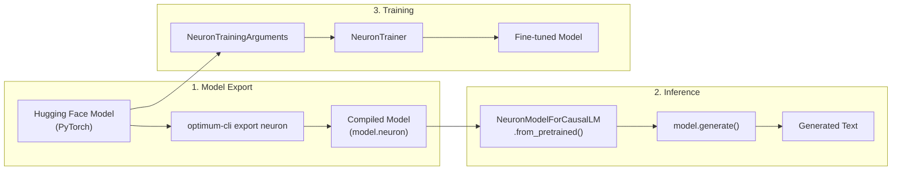
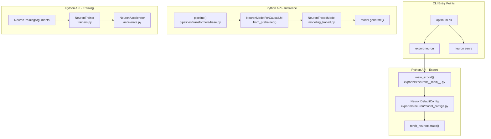

<!-- source: DeepWiki mcp.deepwiki.com · repo huggingface/optimum-neuron · page 3 Quick Start Guide · fetched 2026-10-26 -->

# Quick Start Guide

<details>
<summary>Relevant source files</summary>

The following files were used as context for generating this wiki page:

- [docs/source/guides/benchmark.mdx](docs/source/guides/benchmark.mdx)
- [docs/source/guides/export_model.mdx](docs/source/guides/export_model.mdx)
- [docs/source/guides/vllm_plugin.mdx](docs/source/guides/vllm_plugin.mdx)
- [docs/source/index.mdx](docs/source/index.mdx)
- [docs/source/inference_tutorials/llama2-13b-chatbot.mdx](docs/source/inference_tutorials/llama2-13b-chatbot.mdx)
- [docs/source/inference_tutorials/notebooks.mdx](docs/source/inference_tutorials/notebooks.mdx)
- [optimum/neuron/__init__.py](optimum/neuron/__init__.py)
- [optimum/neuron/modeling.py](optimum/neuron/modeling.py)
- [optimum/neuron/modeling_base.py](optimum/neuron/modeling_base.py)
- [optimum/neuron/pipelines/transformers/base.py](optimum/neuron/pipelines/transformers/base.py)
- [optimum/neuron/utils/__init__.py](optimum/neuron/utils/__init__.py)

</details>


This guide provides hands-on examples to quickly get started with optimum-neuron. You will learn how to export a model to Neuron format, run inference on AWS Inferentia, and perform basic fine-tuning on AWS Trainium. Each section includes working code examples you can run immediately.

**Prerequisites**: This guide assumes you have installed optimum-neuron and have access to AWS Inferentia or Trainium instances. For installation instructions, see [Installation and Setup](#2). For comprehensive documentation on each workflow, see [Model Export System](#4), [Inference with Neuron Models](#6), and [Training on AWS Neuron](#5).

## Overview: Three Core Workflows



**Workflow Connections**: The diagram shows how models flow through optimum-neuron. Models begin as PyTorch checkpoints, are compiled via the CLI or export API, and can be loaded for inference or training. All three workflows use standard Hugging Face APIs extended with Neuron capabilities.

Sources: [optimum/neuron/__init__.py:36-88](), [docs/source/guides/export_model.mdx:17-51]()

---

## Quick Start 1: Export a Model

### Export a Text Classification Model

The simplest way to export a model is using the `optimum-cli` command-line tool. This example exports a BERT model for sequence classification:

```bash
optimum-cli export neuron \
  --model distilbert-base-uncased-finetuned-sst-2-english \
  --task text-classification \
  --batch_size 1 \
  --sequence_length 128 \
  distilbert_neuron/
```

**Parameters Explained**:
- `--model`: Hugging Face model ID or local path
- `--task`: Task type (automatically detected for Hub models)
- `--batch_size`: Static batch size for compilation (must match inference)
- `--sequence_length`: Maximum sequence length (must match inference)
- Output directory: Where compiled model is saved

After export, the directory contains:
- `model.neuron`: Compiled Neuron executable
- `config.json`: Model configuration with Neuron settings
- Tokenizer files copied from source model

### Export a Large Language Model

LLMs require additional parameters for tensor parallelism:

```bash
optimum-cli export neuron \
  --model meta-llama/Llama-3.2-1B \
  --batch_size 1 \
  --sequence_length 4096 \
  --tensor_parallel_size 2 \
  llama_neuron/
```

**Tensor Parallelism**: The `--tensor_parallel_size` splits the model across multiple NeuronCores (each core has 16GB memory). A 2B parameter model typically requires 2-4 cores.

**Compilation Time**: Standard models export in seconds, but LLMs can take 15-60+ minutes. Pre-compiled models are available in the [Neuron model cache](#8) to avoid this wait.

Sources: [docs/source/guides/export_model.mdx:78-162](), [docs/source/guides/export_model.mdx:252-314]()

---

## Quick Start 2: Run Inference

### Inference with Encoder Models

Load and use an exported encoder model for classification:

```python
from transformers import AutoTokenizer
from optimum.neuron import NeuronModelForSequenceClassification

# Load compiled model
model = NeuronModelForSequenceClassification.from_pretrained(
    "distilbert_neuron/"
)
tokenizer = AutoTokenizer.from_pretrained(
    "distilbert-base-uncased-finetuned-sst-2-english"
)

# Run inference
inputs = tokenizer("This movie is fantastic!", return_tensors="pt")
outputs = model(**inputs)
predicted_class = outputs.logits.argmax().item()
print(f"Sentiment: {model.config.id2label[predicted_class]}")
```

**Key Classes**: 
- `NeuronModelForSequenceClassification`: Wrapper for classification models
- Other classes: `NeuronModelForQuestionAnswering`, `NeuronModelForTokenClassification`, `NeuronModelForMaskedLM`

**Input Padding**: Inputs are automatically padded to the static shapes used during export. The model handles padding internally via the `neuron_padding_manager` context manager.

### Inference with Large Language Models

```python
from transformers import AutoTokenizer
from optimum.neuron import NeuronModelForCausalLM

# Load compiled LLM
model = NeuronModelForCausalLM.from_pretrained("llama_neuron/")
tokenizer = AutoTokenizer.from_pretrained("meta-llama/Llama-3.2-1B")

# Generate text
inputs = tokenizer("The future of AI is", return_tensors="pt")
outputs = model.generate(
    **inputs,
    max_new_tokens=50,
    do_sample=True,
    temperature=0.7,
    top_k=50
)
print(tokenizer.decode(outputs[0], skip_special_tokens=True))
```

**Generation Methods**: The `generate()` method supports greedy search, sampling with temperature/top-k/top-p, and beam search. All standard transformers generation parameters are supported.

### Using the Pipeline API

The `pipeline` function provides a high-level interface for common tasks:

```python
from optimum.neuron import pipeline

# Create pipeline (exports model if needed)
classifier = pipeline(
    "text-classification",
    model="distilbert-base-uncased-finetuned-sst-2-english",
    export=True,
    input_shapes={"batch_size": 1, "sequence_length": 128}
)

# Run inference
result = classifier("I love using AWS Inferentia!")
print(result)
# [{'label': 'POSITIVE', 'score': 0.9998}]
```

**Pipeline Benefits**:
- Automatically handles tokenization and post-processing
- Supports 60+ tasks via `NEURONX_SUPPORTED_TASKS`
- Can export models on-the-fly with `export=True`

Sources: [optimum/neuron/modeling.py:85-128](), [optimum/neuron/pipelines/transformers/base.py:225-406](), [docs/source/guides/export_model.mdx:164-177]()

---

## Quick Start 3: Basic Fine-tuning

### Fine-tune a Text Classification Model

```python
from transformers import AutoTokenizer, AutoModelForSequenceClassification
from optimum.neuron import NeuronTrainer, NeuronTrainingArguments
from datasets import load_dataset

# Load model and tokenizer
model = AutoModelForSequenceClassification.from_pretrained(
    "bert-base-uncased",
    num_labels=2
)
tokenizer = AutoTokenizer.from_pretrained("bert-base-uncased")

# Prepare dataset
dataset = load_dataset("imdb", split="train[:1000]")
def tokenize(batch):
    return tokenizer(batch["text"], truncation=True, padding="max_length", max_length=128)
dataset = dataset.map(tokenize, batched=True)

# Configure training
training_args = NeuronTrainingArguments(
    output_dir="./bert_finetuned",
    num_train_epochs=3,
    per_device_train_batch_size=8,
    learning_rate=5e-5,
)

# Train
trainer = NeuronTrainer(
    model=model,
    args=training_args,
    train_dataset=dataset,
    tokenizer=tokenizer,
)
trainer.train()
```

**NeuronTrainer vs Trainer**: `NeuronTrainer` extends `transformers.Trainer` with Neuron-specific features like `NeuronAccelerator` for distributed training and automatic `xm.mark_step()` synchronization.

### Supervised Fine-tuning for Chat Models

For instruction-tuning LLMs, use `NeuronSFTTrainer`:

```python
from transformers import AutoTokenizer, AutoModelForCausalLM
from optimum.neuron import NeuronSFTTrainer, NeuronSFTConfig
from datasets import load_dataset

# Load base model
model = AutoModelForCausalLM.from_pretrained("meta-llama/Llama-3.2-1B")
tokenizer = AutoTokenizer.from_pretrained("meta-llama/Llama-3.2-1B")

# Prepare chat dataset
dataset = load_dataset("HuggingFaceH4/ultrachat_200k", split="train_sft[:1000]")

# Configure SFT training
sft_config = NeuronSFTConfig(
    output_dir="./llama_sft",
    num_train_epochs=1,
    per_device_train_batch_size=1,
    learning_rate=2e-5,
    max_seq_length=2048,
    tensor_parallel_size=2,  # Split across 2 cores
)

# Train
trainer = NeuronSFTTrainer(
    model=model,
    args=sft_config,
    train_dataset=dataset,
    tokenizer=tokenizer,
)
trainer.train()
```

**SFT Features**:
- Automatic chat template formatting
- Fixed-length padding via `NeuronDataCollatorForLanguageModeling`
- Supports LoRA/QLoRA for parameter-efficient fine-tuning

Sources: [optimum/neuron/__init__.py:37-42](), [docs/source/guides/export_model.mdx:283-314]()

---

## Class and Command Reference

### Key Commands

| Command | Purpose | Common Options |
|---------|---------|----------------|
| `optimum-cli export neuron` | Compile model to Neuron format | `--model`, `--batch_size`, `--sequence_length`, `--tensor_parallel_size` |
| `optimum-cli neuron serve` | Serve model with vLLM | `--model`, `--batch_size`, `--tensor_parallel_size` |

### Key Classes for Inference

| Class | Purpose | Source |
|-------|---------|--------|
| `NeuronModelForCausalLM` | LLM inference with generate() | [optimum/neuron/__init__.py:102]() |
| `NeuronModelForSequenceClassification` | Text classification | [optimum/neuron/modeling.py:231-268]() |
| `NeuronModelForQuestionAnswering` | Extractive QA | [optimum/neuron/modeling.py:183-221]() |
| `NeuronModelForTokenClassification` | NER, token-level tasks | [optimum/neuron/modeling.py:278-316]() |
| `NeuronTracedModel` | Base class for all traced models | [optimum/neuron/__init__.py:43]() |
| `pipeline` | High-level task interface | [optimum/neuron/pipelines/transformers/base.py:225-406]() |

### Key Classes for Training

| Class | Purpose | Source |
|-------|---------|--------|
| `NeuronTrainer` | Standard training on Trainium | [optimum/neuron/__init__.py:38]() |
| `NeuronSFTTrainer` | Supervised fine-tuning for chat models | [optimum/neuron/__init__.py:39]() |
| `NeuronTrainingArguments` | Training configuration | [optimum/neuron/__init__.py:40]() |
| `NeuronSFTConfig` | SFT-specific configuration | [optimum/neuron/__init__.py:41]() |
| `NeuronAccelerator` | Distributed training coordinator | [optimum/neuron/__init__.py:83]() |

Sources: [optimum/neuron/__init__.py:35-88]()

---

## Code Path Diagram



**Navigation Guide**: This diagram maps user-facing commands and classes to their implementations. Use it to find the source code for each workflow component.

Sources: [optimum/neuron/__init__.py:35-88](), [optimum/neuron/modeling.py:1-44]()

---

## Next Steps

After completing these quick start examples:

1. **Learn export options**: See [Model Export System](#4) for advanced export configurations, compiler arguments, and multi-component models
2. **Deploy for production**: See [vLLM and TGI Integration](#7) for serving models at scale with continuous batching
3. **Optimize training**: See [Training on AWS Neuron](#5) for distributed training strategies, mixed precision, and PEFT techniques
4. **Use pre-compiled models**: See [Model Cache System](#8) to avoid compilation time by using cached model artifacts
5. **Deploy on AWS**: See [Deployment Guide](#9) for EC2, SageMaker, and container-based deployments

Sources: [docs/source/index.mdx:1-69]()

---

