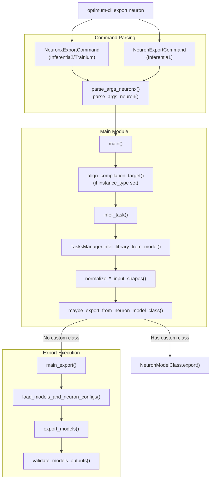
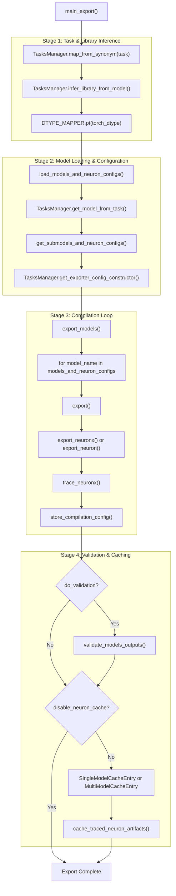
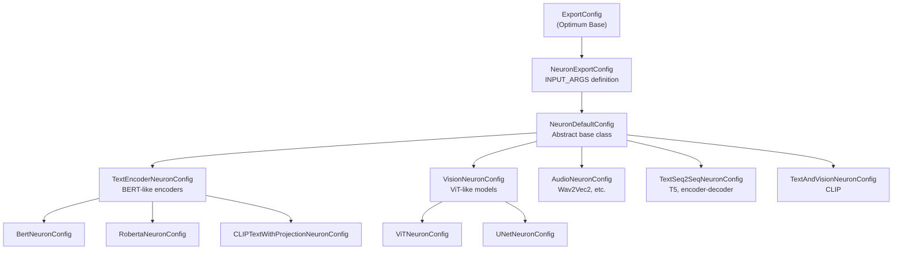
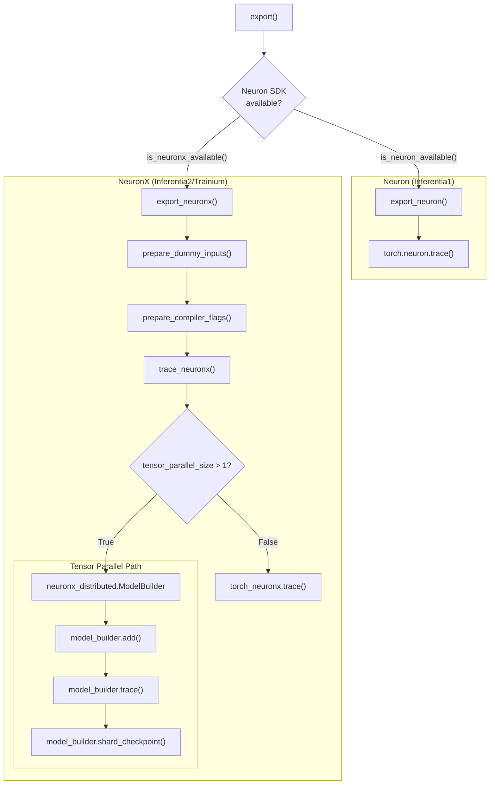
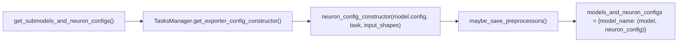
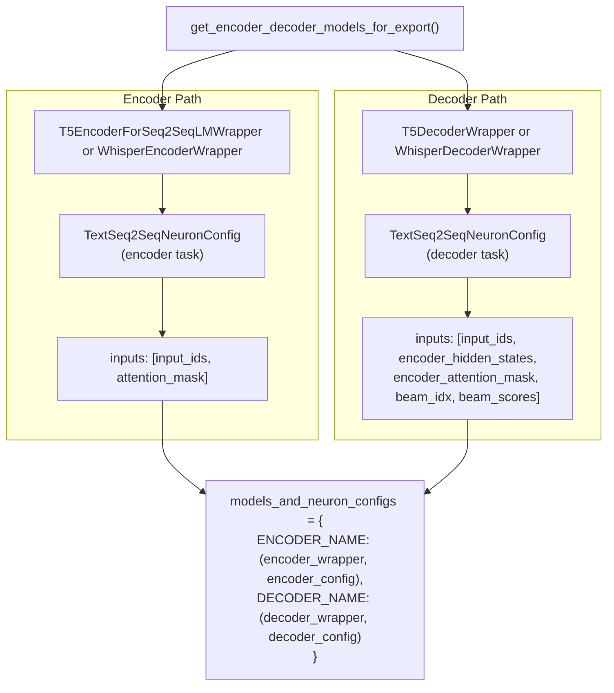
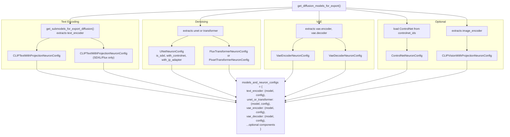
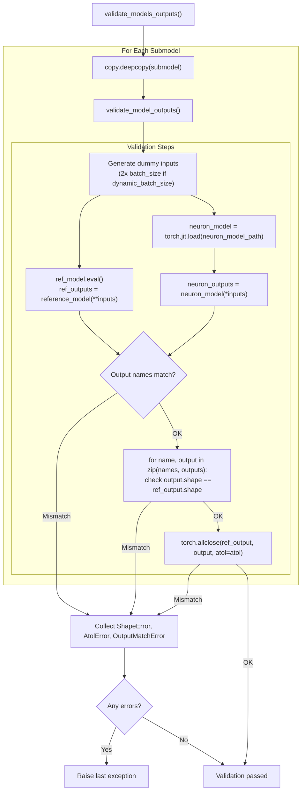
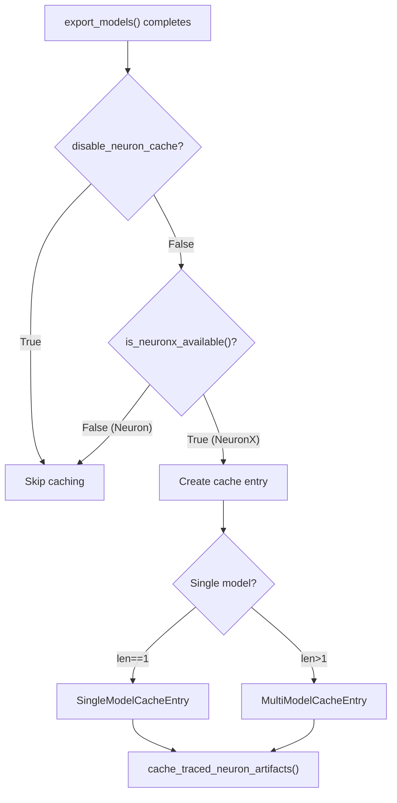

<!-- source: DeepWiki mcp.deepwiki.com · repo huggingface/optimum-neuron · page 4 Model Export System · fetched 2026-10-26 -->

# Model Export System

<details>
<summary>Relevant source files</summary>

The following files were used as context for generating this wiki page:

- [optimum/commands/export/neuron.py](optimum/commands/export/neuron.py)
- [optimum/commands/export/neuronx.py](optimum/commands/export/neuronx.py)
- [optimum/exporters/neuron/__main__.py](optimum/exporters/neuron/__main__.py)
- [optimum/exporters/neuron/base.py](optimum/exporters/neuron/base.py)
- [optimum/exporters/neuron/convert.py](optimum/exporters/neuron/convert.py)
- [optimum/exporters/neuron/model_configs.py](optimum/exporters/neuron/model_configs.py)
- [optimum/exporters/neuron/utils.py](optimum/exporters/neuron/utils.py)
- [optimum/neuron/modeling_diffusion.py](optimum/neuron/modeling_diffusion.py)
- [optimum/neuron/modeling_seq2seq.py](optimum/neuron/modeling_seq2seq.py)
- [optimum/neuron/modeling_traced.py](optimum/neuron/modeling_traced.py)
- [optimum/neuron/utils/argument_utils.py](optimum/neuron/utils/argument_utils.py)
- [optimum/neuron/utils/optimization_utils.py](optimum/neuron/utils/optimization_utils.py)
- [tests/exporters/exporters_utils.py](tests/exporters/exporters_utils.py)
- [tests/inference/inference_utils.py](tests/inference/inference_utils.py)

</details>


The Model Export System converts PyTorch models from Hugging Face libraries (transformers, diffusers, sentence-transformers) into Neuron-compiled TorchScript modules (`.neuron` files) optimized for AWS Inferentia and Trainium hardware. The system orchestrates model loading, configuration creation, ahead-of-time (AOT) compilation via neuron(x)-cc, output validation, and automatic caching.

**Key responsibilities:**
- Task and library inference from model identifiers
- Static shape configuration and dummy input generation
- Multi-component model decomposition (diffusers pipelines, encoder-decoder models)
- Compilation parameter management (auto-casting, optimization level, tensor parallelism)
- Output validation against PyTorch CPU reference
- Compiled artifact caching to Hub

Related pages: [Inference with Neuron Models](page 6) for loading exported models, [Model Cache System](page 8) for cache details, [Training on AWS Neuron](page 5) for training-specific compilation.

---

## Export Entry Points

The export system provides two primary interfaces: a command-line interface via `optimum-cli` and a programmatic Python API.

### CLI Interface

The `optimum-cli export neuron` command serves as the primary user interface:

```bash
optimum-cli export neuron \
  --model bert-base-uncased \
  --task text-classification \
  --batch_size 1 \
  --sequence_length 128 \
  --auto_cast matmul \
  --auto_cast_type bf16 \
  output/
```

**CLI Execution Flow**



The CLI dispatches to [optimum/exporters/neuron/__main__.py:806-905]() which handles argument normalization, task inference, and invokes `main_export()`. For models with registered custom classes (e.g., LLMs with NxD backend), the system uses `maybe_export_from_neuron_model_class()` at [optimum/exporters/neuron/__main__.py:741-804]() instead of the standard export path.

**Sources:** [optimum/commands/export/neuronx.py:28-336](), [optimum/commands/export/neuron.py:25-157](), [optimum/exporters/neuron/__main__.py:806-905]()

### Programmatic API

The `main_export()` function at [optimum/exporters/neuron/__main__.py:618-739]() provides direct programmatic access:

```python
from optimum.exporters.neuron import main_export

main_export(
    model_name_or_path="bert-base-uncased",
    output="./compiled_model",
    task="text-classification",
    batch_size=1,
    sequence_length=128,
    compiler_kwargs={"auto_cast": "matmul", "auto_cast_type": "bf16"},
    torch_dtype="float32",
    inline_weights_to_neff=True,
    optlevel="2",
    do_validation=True,
)
```

**Key Parameters:**
- `model_name_or_path`: Model ID or local path
- `output`: Directory for compiled `.neuron` files
- `task`: Task type (auto-inferred if `"auto"`)
- `compiler_kwargs`: Dictionary of compiler flags (auto_cast, instance_type, etc.)
- `tensor_parallel_size`: Number of NeuronCores for sharding (default: 1)
- `dynamic_batch_size`: Enable variable batch sizes (default: False)
- `input_shapes`: Keyword arguments for static shapes (batch_size, sequence_length, etc.)

**Sources:** [optimum/exporters/neuron/__main__.py:618-739]()

---

## Export Process Flow

The export system executes a multi-stage pipeline from model loading through compilation to validation and caching:

**High-Level Export Pipeline**



**Sources:** [optimum/exporters/neuron/__main__.py:618-739](), [optimum/exporters/neuron/convert.py:296-441]()

### Stage Details

**Stage 1 - Task & Library Inference**

The system determines the library (transformers/diffusers/sentence-transformers) and task from the model configuration:

```python
# At optimum/exporters/neuron/__main__.py:654-658
task = TasksManager.map_from_synonym(task)
library_name = TasksManager.infer_library_from_model(
    model_name_or_path, revision=revision, cache_dir=cache_dir, token=token
)
```

For transformers models, tasks include `text-classification`, `token-classification`, `feature-extraction`, `question-answering`, etc. For diffusers models, tasks are `text-to-image` or related variants. For sentence-transformers, tasks are `feature-extraction` or `sentence-similarity`.

**Stage 2 - Model Loading & Configuration**

Models are loaded from Hub or local path via `load_models_and_neuron_configs()` at [optimum/exporters/neuron/__main__.py:548-616]():

1. **Load PyTorch model:** `TasksManager.get_model_from_task()` instantiates the model
2. **Decompose if needed:** `get_submodels_and_neuron_configs()` splits multi-component models:
   - Diffusers pipelines → text_encoder, unet/transformer, vae_encoder, vae_decoder
   - Encoder-decoder models → encoder, decoder
   - Single models → one component
3. **Create configurations:** Each component gets a `NeuronDefaultConfig` instance from `TasksManager.get_exporter_config_constructor()`

**Stage 3 - Compilation Loop**

`export_models()` at [optimum/exporters/neuron/convert.py:296-441]() iterates over submodels:

1. **Export each component:** `export()` → `export_neuronx()` → `trace_neuronx()`
2. **Generate dummy inputs:** Configuration's `generate_dummy_inputs()` creates sample tensors
3. **Compile:** Either `torch_neuronx.trace()` for single-device or `neuronx_distributed.trace.ModelBuilder` for tensor-parallel
4. **Save configuration:** `store_compilation_config()` embeds compilation metadata in config.json

**Stage 4 - Validation & Caching**

Post-compilation checks at [optimum/exporters/neuron/__main__.py:699-739]():

1. **Validate outputs:** `validate_models_outputs()` compares Neuron vs PyTorch CPU outputs
2. **Check tolerance:** Uses `torch.allclose()` with model-specific `ATOL_FOR_VALIDATION`
3. **Cache artifacts:** If not disabled, creates cache entry and calls `cache_traced_neuron_artifacts()`

**Sources:** [optimum/exporters/neuron/__main__.py:618-739](), [optimum/exporters/neuron/convert.py:296-441](), [optimum/exporters/neuron/convert.py:486-597]()

---

## Configuration System

The configuration system defines how models should be compiled for Neuron hardware through a hierarchy of configuration classes.



**Sources:** [optimum/exporters/neuron/base.py:41-76](), [optimum/exporters/neuron/base.py:78-487](), [optimum/exporters/neuron/model_configs.py:103-375]()

### NeuronDefaultConfig Attributes

The `NeuronDefaultConfig` class is instantiated with compilation-specific parameters:

| Attribute | Type | Description |
|-----------|------|-------------|
| `config` | `PretrainedConfig` | Original model configuration |
| `task` | `str` | Task type (e.g., "text-classification") |
| `input_shapes` | `InputShapesArguments` | Static input dimensions |
| `tensor_parallel_size` | `int` | Number of NeuronCores for sharding (default: 1) |
| `dynamic_batch_size` | `bool` | Enable dynamic batching (default: False) |
| `int_dtype` | `str` | Integer tensor dtype ("int64", "int32", "int8") |
| `float_dtype` | `str` | Float tensor dtype ("fp32", "fp16", "bf16") |
| `output_attentions` | `bool` | Include attention tensors in outputs |
| `output_hidden_states` | `bool` | Include hidden states in outputs |

**Sources:** [optimum/exporters/neuron/base.py:144-222]()

### Model-Specific Configurations

Each model architecture has a specialized configuration class registered with `TasksManager`:

```python
@register_in_tasks_manager("bert", *COMMON_TEXT_TASKS)
class BertNeuronConfig(TextEncoderNeuronConfig):
    NORMALIZED_CONFIG_CLASS = NormalizedConfigManager.get_normalized_config_class("bert")
    ATOL_FOR_VALIDATION = 1e-3
    
    @property
    def inputs(self) -> list[str]:
        return ["input_ids", "attention_mask", "token_type_ids"]
```

The `@register_in_tasks_manager` decorator makes the configuration discoverable for automatic export. The `inputs` property defines which tensors the compiled model accepts.

**Sources:** [optimum/exporters/neuron/model_configs.py:103-111]()

### Input Shape Arguments

The `InputShapesArguments` dataclass specifies static compilation dimensions:

```python
@dataclass
class InputShapesArguments:
    batch_size: int | None = None
    sequence_length: int | None = None
    num_choices: int | None = None
    width: int | None = None
    height: int | None = None
    num_channels: int | None = None
    # ... additional shape parameters
```

For transformers models, `batch_size` and `sequence_length` are typically mandatory. For vision models, `width`, `height`, and `num_channels` are required. For diffusers models, additional parameters like `vae_scale_factor` and `encoder_hidden_size` may be needed.

**Sources:** [optimum/neuron/utils/argument_utils.py:77-99]()

---

## Compilation Pipeline

The compilation pipeline transforms PyTorch models into Neuron Executable File Format (NEFF) artifacts through tracing and graph optimization.



**Sources:** [optimum/exporters/neuron/convert.py:444-486](), [optimum/exporters/neuron/convert.py:489-597](), [optimum/exporters/neuron/convert.py:666-724]()

### Dummy Input Generation

Each `NeuronDefaultConfig` implements `generate_dummy_inputs()` at [optimum/exporters/neuron/base.py:306-340]() to create sample tensors:

```python
def generate_dummy_inputs(self, return_tuple=False, **kwargs):
    dummy_inputs_generators = self._create_dummy_input_generator_classes(**kwargs)
    dummy_inputs = {}
    
    for input_name in self.inputs:
        input_was_inserted = False
        for dummy_input_gen in dummy_inputs_generators:
            if dummy_input_gen.supports_input(input_name):
                dummy_inputs[input_name] = dummy_input_gen.generate(
                    input_name,
                    framework="pt",
                    int_dtype=DTYPE_MAPPER.str(self.int_dtype),
                    float_dtype=DTYPE_MAPPER.str(self.float_dtype),
                )
                input_was_inserted = True
                break
        if not input_was_inserted:
            raise RuntimeError(f'Could not generate dummy inputs for "{input_name}".')
    
    return tuple(dummy_inputs.values()) if return_tuple else dummy_inputs
```

**Generator Classes:** Configurations specify `DUMMY_INPUT_GENERATOR_CLASSES` tuples:
- `DummyTextInputGenerator`: Produces `input_ids`, `attention_mask`, `token_type_ids`
- `DummyVisionInputGenerator`: Produces `pixel_values` with shape `[batch, channels, height, width]`
- `DummySeq2SeqDecoderTextInputGenerator`: Produces `decoder_input_ids`, `encoder_hidden_states`
- `DummyTimestepInputGenerator`: Produces `timestep` for diffusion models
- `DummyBeamValuesGenerator`: Produces `beam_idx`, `beam_scores` for beam search

**Sources:** [optimum/exporters/neuron/base.py:306-340](), [optimum/neuron/utils/input_generators.py]()

### Compiler Flags

The `prepare_compiler_flags()` function constructs the compiler argument string passed to `neuronx-cc`:

```python
def prepare_compiler_flags(config, auto_cast, auto_cast_type, optlevel, instance_type):
    compiler_args = []
    
    if auto_cast is not None:
        auto_cast = "matmult" if auto_cast == "matmul" else auto_cast
        compiler_args.extend(["--auto-cast", auto_cast])
        compiler_args.extend(["--auto-cast-type", auto_cast_type])
    else:
        compiler_args.extend(["--auto-cast", "none"])
    
    compiler_args.extend(["--optlevel", optlevel])
    
    if instance_type == "trn2":
        compiler_args.extend(["--target", "trn2"])
    elif instance_type == "trn1":
        compiler_args.extend(["--target", "trn1"])
    
    # Model-type specific flags
    if config.MODEL_TYPE not in exception_models:
        compiler_args.extend(["--model-type", "transformer"])
    
    return " ".join(compiler_args)
```

Key flags:
- `--auto-cast`: Controls precision casting (`none`, `matmul`, `all`)
- `--auto-cast-type`: Target dtype for casting (`bf16`, `fp16`, `tf32`)
- `--optlevel`: Optimization level (`1`, `2`, `3`)
- `--target`: Hardware target (`trn1`, `trn2`)
- `--model-type`: Model architecture hint (`transformer`, `unet-inference`)

**Sources:** [optimum/exporters/neuron/convert.py:613-663]()

### Tracing Process

The `trace_neuronx()` function at [optimum/exporters/neuron/convert.py:666-724]() compiles models using either single-device or tensor-parallel paths:

**Single-Device Tracing (tensor_parallel_size == 1):**

```python
with torch.no_grad():
    traced_model = torch_neuronx.trace(
        model,
        dummy_inputs,
        compiler_workdir=compiler_workdir,
        compiler_args=compiler_args,
        inline_weights_to_neff=inline_weights_to_neff,
    )
torch.jit.save(traced_model, output)
```

`torch_neuronx.trace()` invokes the neuronx-cc compiler, which:
1. Captures the PyTorch computational graph via JIT tracing
2. Converts operations to Neuron-optimized HLO (High-Level Operations)
3. Applies graph-level optimizations (fusion, layout, precision casting)
4. Generates NEFF (Neuron Executable File Format) binary
5. Wraps NEFF in TorchScript module

**Tensor-Parallel Tracing (tensor_parallel_size > 1):**

```python
model_builder = neuronx_distributed.trace.ModelBuilder(
    router=None,
    debug=False,
    tp_degree=tensor_parallel_size,
    checkpoint_loader=config.get_checkpoint_loader_fn,
    compiler_workdir=compiler_workdir,
)

model_builder.add(
    key=subfolder,
    model_instance=base_model_instance,
    example_inputs=[dummy_inputs],
    priority_model_idx=0,
    compiler_args=compiler_args,
)

neuron_model = model_builder.trace(initialize_model_weights=False)
model_builder.shard_checkpoint(serialize_path=output.parent / "weights/")
torch.jit.save(neuron_model, output)
```

`ModelBuilder` orchestrates parallel tracing:
1. Distributes layers across `tensor_parallel_size` NeuronCores
2. Inserts collective communication ops (all-reduce, all-gather)
3. Compiles each shard separately
4. Saves sharded weights to `weights/` directory

**Custom Model Handling:** Some models use `BaseModelInstance` wrappers from configurations' `patch_model_and_prepare_aliases()` method to enable tracing with custom input/output aliases.

**Sources:** [optimum/exporters/neuron/convert.py:666-724](), [optimum/exporters/neuron/convert.py:598-664]()

---

## Model Type Support

The export system supports three major model categories through specialized decomposition logic.

### Transformers Encoders

Single-component architectures (BERT, RoBERTa, ViT, etc.) export directly without decomposition:

**Encoder Export Flow**



The configuration defines:
- `inputs`: List of input tensor names (e.g., `["input_ids", "attention_mask"]`)
- `outputs`: List of output tensor names (e.g., `["last_hidden_state", "logits"]`)
- `INPUT_ARGS`: Mandatory shape parameters (e.g., `("batch_size", "sequence_length")`)

Example: `BertNeuronConfig` at [optimum/exporters/neuron/model_configs.py:103-111]() requires `batch_size` and `sequence_length`, accepts inputs `["input_ids", "attention_mask", "token_type_ids"]`, and returns task-specific outputs.

**Sources:** [optimum/exporters/neuron/__main__.py:373-395](), [optimum/exporters/neuron/model_configs.py:103-111]()

### Encoder-Decoder Models

Seq2seq models (T5, BART, Whisper) decompose into encoder and decoder via `get_encoder_decoder_models_for_export()` at [optimum/exporters/neuron/utils.py:783-863]():

**Encoder-Decoder Decomposition**



**Component Details:**

| Component | Model Wrapper | Inputs | Outputs |
|-----------|---------------|--------|---------|
| Encoder | `T5EncoderForSeq2SeqLMWrapper` | `input_ids`, `attention_mask` | `decoder_input_ids`, `encoder_hidden_states`, `encoder_attention_mask` |
| Decoder | `T5DecoderWrapper` | `input_ids`, `decoder_attention_mask`, `encoder_hidden_states`, `encoder_attention_mask`, `beam_idx`, `beam_scores` | `logits`, `past_key_values` |

The encoder is actually a monolith of encoder+decoder_without_cache to handle T5's complex control flow. The decoder contains the KV-cached decoding logic. Both export to separate subdirectories: `encoder/model.neuron` and `decoder/model.neuron`.

**Sources:** [optimum/exporters/neuron/__main__.py:509-545](), [optimum/exporters/neuron/utils.py:783-863](), [optimum/exporters/neuron/model_wrappers.py:69-83]()

### Diffusers Pipelines

Stable Diffusion, SDXL, Flux, and PixArt pipelines decompose into components via `get_diffusion_models_for_export()` at [optimum/exporters/neuron/utils.py:115-273]():

**Diffusion Pipeline Decomposition**



**Component Input/Output Specifications:**

| Component | Configuration | Key Inputs | Notes |
|-----------|---------------|------------|-------|
| `text_encoder` | `CLIPTextWithProjectionNeuronConfig` | `input_ids` | Returns `text_embeds`, `last_hidden_state` |
| `text_encoder_2` | `CLIPTextWithProjectionNeuronConfig` | `input_ids` | SDXL/Flux only |
| `unet` | `UNetNeuronConfig` | `sample`, `timestep`, `encoder_hidden_states`, optional `down_block_additional_residuals_*` (ControlNet), optional `image_embeds` (IP-Adapter) | Returns `sample` |
| `transformer` | `FluxTransformerNeuronConfig` | `hidden_states`, `encoder_hidden_states`, `pooled_projections`, `timestep`, `image_rotary_emb` | Flux/PixArt only |
| `vae_encoder` | `VaeEncoderNeuronConfig` | `sample` | Returns `latent_sample` |
| `vae_decoder` | `VaeDecoderNeuronConfig` | `latent_sample` | Returns `sample` |
| `controlnet_0` | `ControlNetNeuronConfig` | Same as UNet | Returns `down_block_res_samples`, `mid_block_res_sample` |
| `image_encoder` | `CLIPVisionWithProjectionNeuronConfig` | `pixel_values` | IP-Adapter only |

Each component exports to its own subdirectory with `config.json` containing compilation metadata (shapes, dtype, compiler version).

**Sources:** [optimum/exporters/neuron/__main__.py:423-506](), [optimum/exporters/neuron/utils.py:115-273](), [optimum/exporters/neuron/model_configs.py:648-951]()

---

## Validation System

The validation system at [optimum/exporters/neuron/convert.py:80-294]() compares compiled Neuron outputs against PyTorch CPU reference to verify correctness.

**Validation Flow**



**Sources:** [optimum/exporters/neuron/convert.py:80-146](), [optimum/exporters/neuron/convert.py:148-294]()

### Validation Steps

`validate_model_outputs()` at [optimum/exporters/neuron/convert.py:148-294]() executes:

**1. Generate Dummy Inputs**

```python
input_shapes = {}
for axis in config.mandatory_axes:
    input_shapes[axis] = getattr(config, axis)
if config.dynamic_batch_size is True and "batch_size" in input_shapes:
    input_shapes["batch_size"] *= 2  # Test with larger batch
```

**2. Reference Forward Pass**

```python
with torch.no_grad():
    reference_model.eval()
    inputs = config.generate_dummy_inputs(return_tuple=False, **input_shapes)
    ref_inputs = config.unflatten_inputs(inputs)
    ref_outputs = reference_model(**ref_inputs)
```

**3. Neuron Forward Pass**

```python
neuron_model = torch.jit.load(neuron_model_path)
neuron_inputs = tuple(config.flatten_inputs(inputs).values())
neuron_outputs = neuron_model(*neuron_inputs)
```

**4. Output Name Validation**

```python
neuron_output_names_set = set(neuron_named_outputs)
ref_output_names_set = set(ref_outputs.keys())
if not neuron_output_names_set.issubset(ref_output_names_set):
    raise OutputMatchError(...)
```

**5. Shape & Value Validation**

```python
for name, neuron_output in zip(neuron_output_names_list, neuron_outputs):
    ref_output = ref_outputs[name]
    
    # Shape check
    if not output.shape == ref_output.shape:
        shape_failures.append((name, ref_output.shape, output.shape))
    
    # Value check
    if not torch.allclose(ref_output, output.to(ref_output.dtype), atol=atol):
        max_diff = torch.max(torch.abs(ref_output - output))
        value_failures.append((name, max_diff))
```

**Tolerance Lookup:** The `atol` parameter defaults to `config.ATOL_FOR_VALIDATION`, which is model-type specific:
- Most models: `1e-5`
- BERT/CLIP: `1e-3`
- ConvBERT: `1e-1`

**Error Handling:**

| Error Type | Condition | Behavior |
|------------|-----------|----------|
| `ShapeError` | Output shapes mismatch | Export fails |
| `AtolError` | Value difference > atol | Export succeeds with warning |
| `OutputMatchError` | Output names mismatch | Export succeeds with warning |
| Success | All checks pass | Export completes |

Validation is skippable via `--disable-validation` CLI flag or `do_validation=False` parameter. It's automatically disabled for tensor-parallel models (validation not yet supported) and when no NeuronCores are detected.

**Sources:** [optimum/exporters/neuron/convert.py:148-294](), [optimum/exporters/neuron/__main__.py:699-739]()

---

## Compiler Arguments

The compilation process accepts numerous arguments controlling optimization behavior.

### Auto-Casting Arguments

| Argument | Values | Description |
|----------|--------|-------------|
| `auto_cast` | `"none"`, `"matmul"`, `"all"` | Which operations to cast from FP32 |
| `auto_cast_type` | `"bf16"`, `"fp16"`, `"tf32"` | Target dtype for casted operations |

- `auto_cast="none"`: No automatic casting (full FP32 precision)
- `auto_cast="matmul"`: Cast matrix multiplications only
- `auto_cast="all"`: Cast all compatible FP32 operations

**Sources:** [optimum/exporters/neuron/__main__.py:100-110]()

### Optimization Level

| Level | Description | Compile Time | Performance |
|-------|-------------|--------------|-------------|
| `-O1` | Core optimizations, minimal compile time | Fastest | Baseline |
| `-O2` | Balanced optimization (default) | Moderate | Good |
| `-O3` | Maximum optimization | Slowest | Best |

Higher optimization levels may increase compilation time and host memory usage during compilation.

**Sources:** [optimum/commands/export/neuronx.py:289-303]()

### Instance-Specific Arguments

| Argument | Values | Description |
|----------|--------|-------------|
| `instance_type` | `"trn1"`, `"trn2"`, `"inf2"` | Target hardware instance |
| `tensor_parallel_size` | Integer | Number of NeuronCores for model sharding |
| `dynamic_batch_size` | Boolean | Enable dynamic batching |

Tensor parallelism (`tensor_parallel_size > 1`) splits model layers across multiple NeuronCores within a device for memory scaling. Dynamic batching allows variable batch sizes at inference (in multiples of the compilation batch size) with potential latency tradeoff.

**Sources:** [optimum/commands/export/neuronx.py:111-129]()

### Weight Management

| Argument | Description |
|----------|-------------|
| `inline_weights_to_neff` | Whether to embed weights in the NEFF file (default: True) |
| `compiler_workdir` | Directory for compiler intermediate files |

When `inline_weights_to_neff=False`, weights are stored separately from the NEFF graph, enabling weight replacement without recompilation. However, this disables caching and is incompatible with dynamic batching.

**Sources:** [optimum/exporters/neuron/convert.py:575-579]()

---

## Special Model Handling

Certain architectures require specialized export logic implemented in utility functions and wrappers.

### ControlNet Export

ControlNet adds spatial conditioning to diffusion U-Nets. The export system at [optimum/exporters/neuron/utils.py:330-354]() handles ControlNet integration:

**ControlNet Loading:**

```python
if controlnet_ids:
    if isinstance(controlnet_ids, str):
        controlnet_ids = [controlnet_ids]
    
    controlnets = []
    for controlnet_id in controlnet_ids:
        controlnet = ControlNetModel.from_pretrained(controlnet_id)
        controlnets.append(controlnet)
    
    models_for_export["controlnet"] = controlnets if len(controlnets) > 1 else controlnets[0]
```

**U-Net Modification:**

```python
unet_neuron_config.with_controlnet = True
```

This sets the U-Net configuration to expect additional inputs. The `UnetNeuronWrapper` at [optimum/exporters/neuron/model_wrappers.py:169-239]() flattens ControlNet outputs:

```python
# ControlNet returns tuple of down_block_residuals + mid_block_residual
# Flatten to individual inputs: down_block_additional_residuals_0, ..., mid_block_additional_residual
```

Each ControlNet exports separately to `controlnet_0/model.neuron`, `controlnet_1/model.neuron`, etc.

**Sources:** [optimum/exporters/neuron/utils.py:330-354](), [optimum/exporters/neuron/model_wrappers.py:169-239]()

### LoRA Adapter Fusion

LoRA (Low-Rank Adaptation) adapters can be fused into diffusion models during export via `_load_lora_weights_to_pipeline()` at [optimum/exporters/neuron/utils.py:460-553]():

**LoRA Fusion Process:**

```python
lora_args = LoRAAdapterArguments(
    model_ids=["ostris/super-cereal-sdxl-lora"],
    weight_names=["super-cereal-sdxl-lora.safetensors"],
    adapter_names=["super_cereal"],
    scales=[0.8],
)

# In _load_lora_weights_to_pipeline:
for model_id, weight_name, adapter_name, scale in zip(...):
    pipeline.load_lora_weights(
        model_id,
        weight_name=weight_name,
        adapter_name=adapter_name,
    )
    pipeline.set_adapters([adapter_name], [scale])
    
    # Fuse LoRA weights into base model
    pipeline.fuse_lora(adapter_names=[adapter_name], lora_scale=scale)
    pipeline.unload_lora_weights()
```

After fusion, the modified U-Net/Transformer is compiled with LoRA weights baked in. Multiple LoRA adapters can be fused sequentially with different scales. The fused model has no runtime LoRA overhead.

**Sources:** [optimum/exporters/neuron/utils.py:460-553]()

### IP-Adapter Integration

IP-Adapters (Image Prompt Adapters) add image-based conditioning to diffusion U-Nets. The system detects IP-Adapter support at [optimum/exporters/neuron/utils.py:248-263]():

**IP-Adapter Detection:**

```python
# Check if U-Net has IP-Adapter projection layer
if getattr(unet.config, "encoder_hid_dim_type", None) == "ip_image_proj":
    unet_neuron_config.with_ip_adapter = True
    unet_neuron_config.image_encoder_shapes = ImageEncoderArguments(
        sequence_length=model.image_encoder.vision_model.embeddings.position_embedding.weight.shape[0],
        hidden_size=model.image_encoder.vision_model.embeddings.position_embedding.weight.shape[1],
        projection_dim=model.image_encoder.config.projection_dim,
    )
```

**Component Export:**

1. **Image Encoder:** CLIP Vision model exports to `image_encoder/model.neuron` with `CLIPVisionWithProjectionNeuronConfig`
2. **U-Net Modification:** U-Net configuration adds `image_encoder_shapes` to its mandatory axes, enabling `image_embeds` or `image_enc_hidden_states` inputs depending on projection type

At inference, the pipeline encodes image prompts through the image encoder, projects embeddings, and passes them to the U-Net for cross-attention conditioning.

**Sources:** [optimum/exporters/neuron/utils.py:248-263](), [optimum/exporters/neuron/model_configs.py:687-692]()

### Custom Model Wrappers

Some architectures require wrapper classes from [optimum/exporters/neuron/model_wrappers.py]() to enable compilation. Configurations specify wrappers via `CUSTOM_MODEL_WRAPPER` attribute:

**Common Wrappers:**

| Wrapper Class | Purpose | Applied To |
|---------------|---------|------------|
| `NoCacheModelWrapper` | Disables KV-cache for non-causal models | Phi (for classification/feature-extraction) |
| `T5EncoderForSeq2SeqLMWrapper` | Combines encoder + decoder-without-cache | T5 encoder component |
| `T5DecoderWrapper` | Adds beam search inputs, wraps outputs | T5 decoder component |
| `WhisperEncoderWrapper` | Handles Whisper-specific encoder inputs | Whisper encoder |
| `WhisperDecoderWrapper` | Handles Whisper-specific decoder inputs | Whisper decoder |
| `UnetNeuronWrapper` | Flattens nested inputs (added_cond_kwargs, ControlNet residuals) | Stable Diffusion U-Net |
| `ControlNetNeuronWrapper` | Flattens ControlNet output tuple to list | ControlNet |
| `PixartTransformerNeuronWrapper` | Handles PixArt-specific inputs | PixArt Transformer |
| `FluxTransformerNeuronWrapper` | Handles Flux-specific inputs, rotary embeddings | Flux Transformer |
| `SentenceTransformersTransformerNeuronWrapper` | Handles sentence-transformers output format | Sentence-Transformers models |
| `SentenceTransformersCLIPNeuronWrapper` | Handles CLIP dual-encoder output | Sentence-Transformers CLIP |
| `CLIPVisionWithProjectionNeuronWrapper` | Handles CLIP vision projection | CLIP image encoder |

**Wrapper Application:**

Wrappers are applied in `export_neuronx()` at [optimum/exporters/neuron/convert.py:534-544]():

```python
if config.CUSTOM_MODEL_WRAPPER is not None:
    model = config.CUSTOM_MODEL_WRAPPER(model)
```

Wrappers typically:
1. Modify `forward()` signature to match neuronx-cc expectations (flat inputs, no nested dicts)
2. Pre/post-process tensors (e.g., splitting/concatenating)
3. Add or remove outputs based on task requirements

**Sources:** [optimum/exporters/neuron/model_wrappers.py](), [optimum/exporters/neuron/convert.py:534-544](), [optimum/exporters/neuron/base.py:122]()

---

## Integration with Cache System

Successful exports are automatically cached to avoid recompilation. The caching process:



Cache entries store:
- Compiled NEFF files (`.neuron` TorchScript modules)
- Configuration files with compilation parameters
- Model weights (if not inlined)
- Metadata (compiler version, shapes, dtype, etc.)

The cache is identified by a hash of compilation parameters, enabling automatic cache hits for identical export configurations.

**Sources:** [optimum/exporters/neuron/convert.py:426-434]()

For detailed cache management, see [Cache System](#7).

---

