<!-- source: DeepWiki mcp.deepwiki.com · repo huggingface/optimum-neuron · page 4.1 Export Architecture and Workflow · fetched 2026-10-26 -->

# Export Architecture and Workflow

<details>
<summary>Relevant source files</summary>

The following files were used as context for generating this wiki page:

- [optimum/commands/export/neuron.py](optimum/commands/export/neuron.py)
- [optimum/commands/export/neuronx.py](optimum/commands/export/neuronx.py)
- [optimum/exporters/neuron/__main__.py](optimum/exporters/neuron/__main__.py)
- [optimum/exporters/neuron/base.py](optimum/exporters/neuron/base.py)
- [optimum/exporters/neuron/convert.py](optimum/exporters/neuron/convert.py)
- [optimum/exporters/neuron/model_configs.py](optimum/exporters/neuron/model_configs.py)
- [optimum/exporters/neuron/utils.py](optimum/exporters/neuron/utils.py)
- [optimum/neuron/modeling_diffusion.py](optimum/neuron/modeling_diffusion.py)
- [optimum/neuron/modeling_seq2seq.py](optimum/neuron/modeling_seq2seq.py)
- [optimum/neuron/modeling_traced.py](optimum/neuron/modeling_traced.py)
- [optimum/neuron/utils/argument_utils.py](optimum/neuron/utils/argument_utils.py)
- [optimum/neuron/utils/optimization_utils.py](optimum/neuron/utils/optimization_utils.py)
- [tests/exporters/exporters_utils.py](tests/exporters/exporters_utils.py)
- [tests/inference/inference_utils.py](tests/inference/inference_utils.py)

</details>


The export system transforms PyTorch models into Neuron-compiled artifacts through a multi-stage pipeline. The `main_export` function orchestrates this process, coordinating configuration construction, model loading, dummy input generation, tracing, compilation, and validation. This page explains how models flow through the export pipeline from CLI invocation to compiled `.neuron` files.

For details on model-specific configurations, see [Model Type Configurations](#4.2). For input shape handling, see [Input Shape Handling and Compilation Parameters](#4.3).

## Export System Overview

The export pipeline consists of multiple coordinated stages that transform a Hugging Face model into a Neuron-compiled artifact:

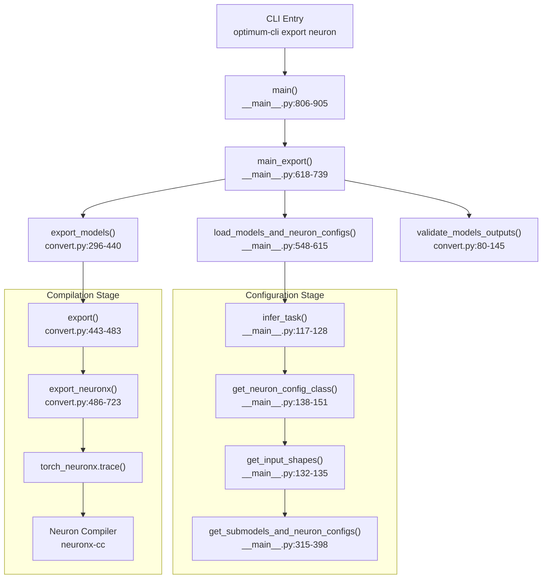

**Sources:** [optimum/exporters/neuron/__main__.py:1-906](), [optimum/exporters/neuron/convert.py:1-723]()

## CLI Entry Point

The export process begins through the CLI command `optimum-cli export neuron` which invokes the main entry point:

**Title:** CLI to main() Flow

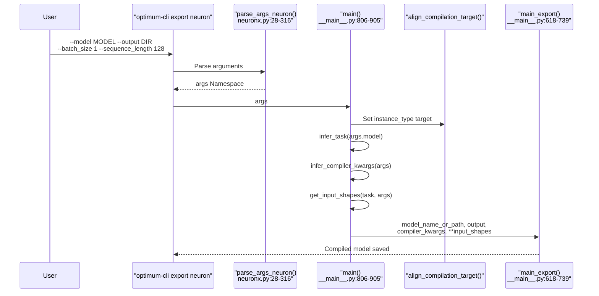

The `main()` function at [optimum/exporters/neuron/__main__.py:806-905]() performs initial setup including:
- Parsing CLI arguments via `parse_args_neuron()` at [optimum/commands/export/neuronx.py:28-316]()
- Setting compilation target with `align_compilation_target()` at [optimum/exporters/neuron/__main__.py:816]()
- Inferring task from model via `infer_task()` at [optimum/exporters/neuron/__main__.py:818]()
- Building compiler kwargs via `infer_compiler_kwargs()` at [optimum/exporters/neuron/__main__.py:860]()
- Extracting input shapes via `get_input_shapes()` at [optimum/exporters/neuron/__main__.py:856]()

**Sources:** [optimum/exporters/neuron/__main__.py:806-905](), [optimum/commands/export/neuronx.py:28-316]()

## The main_export Function

The `main_export()` function at [optimum/exporters/neuron/__main__.py:618-739]() is the core orchestrator of the export pipeline:

**Title:** main_export Workflow

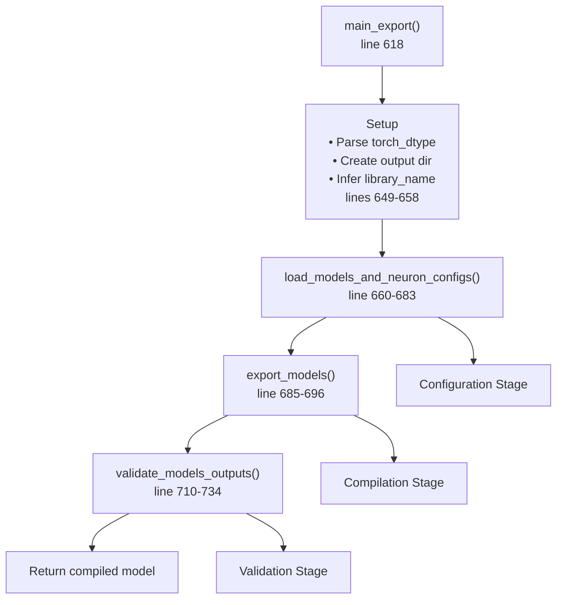

| Stage | Function | Line Range | Purpose |
|-------|----------|------------|---------|
| Setup | `main_export` | 649-658 | Parse dtype, create dirs, infer library |
| Load | `load_models_and_neuron_configs` | 660-683 | Construct configs and load models |
| Export | `export_models` | 685-696 | Trace and compile models |
| Validate | `validate_models_outputs` | 710-734 | Compare Neuron vs CPU outputs |

**Sources:** [optimum/exporters/neuron/__main__.py:618-739]()

## Configuration Construction Pipeline

The `load_models_and_neuron_configs()` function at [optimum/exporters/neuron/__main__.py:548-615]() builds the configuration objects that guide compilation:

**Title:** Configuration Construction Flow

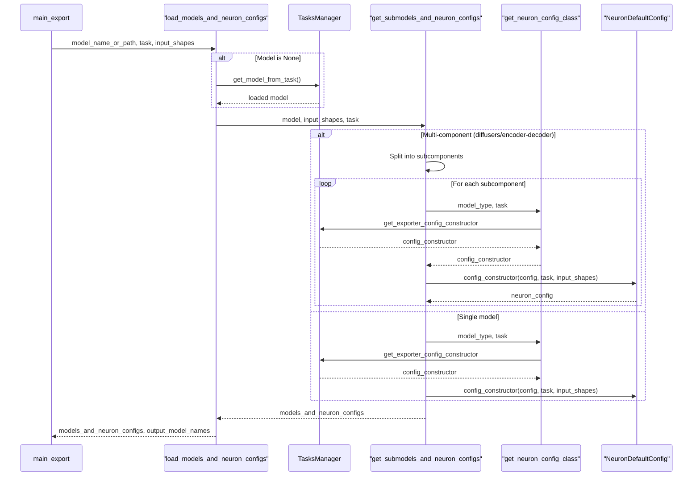

The configuration construction involves:

1. **Task Inference**: `infer_task()` at [optimum/exporters/neuron/__main__.py:117-128]() determines the task from model config
2. **Config Constructor**: `get_neuron_config_class()` at [optimum/exporters/neuron/__main__.py:138-151]() retrieves the appropriate config class
3. **Input Shapes**: `get_input_shapes()` at [optimum/exporters/neuron/__main__.py:132-135]() extracts mandatory shape parameters
4. **Config Instantiation**: `NeuronDefaultConfig.__init__()` at [optimum/exporters/neuron/base.py:144-223]() validates shapes and creates config

**Sources:** [optimum/exporters/neuron/__main__.py:548-615](), [optimum/exporters/neuron/__main__.py:315-398](), [optimum/exporters/neuron/__main__.py:138-151]()

## NeuronDefaultConfig System

The `NeuronDefaultConfig` class hierarchy at [optimum/exporters/neuron/base.py:78-305]() provides the blueprint for export:

**Title:** NeuronDefaultConfig Class Structure

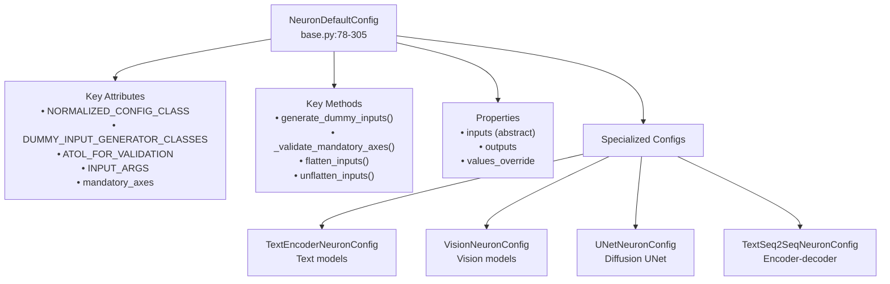

The configuration system serves three primary functions:

1. **Shape Management**: Validates that all mandatory input dimensions are specified
2. **Dummy Input Generation**: Creates sample tensors for model tracing
3. **Output Specification**: Defines expected output tensor names for validation

**Sources:** [optimum/exporters/neuron/base.py:78-305](), [optimum/exporters/neuron/model_configs.py:1-100]()

## Model and Submodel Handling

The `get_submodels_and_neuron_configs()` function at [optimum/exporters/neuron/__main__.py:315-398]() handles single models and multi-component pipelines:

**Title:** Submodel Configuration Strategy

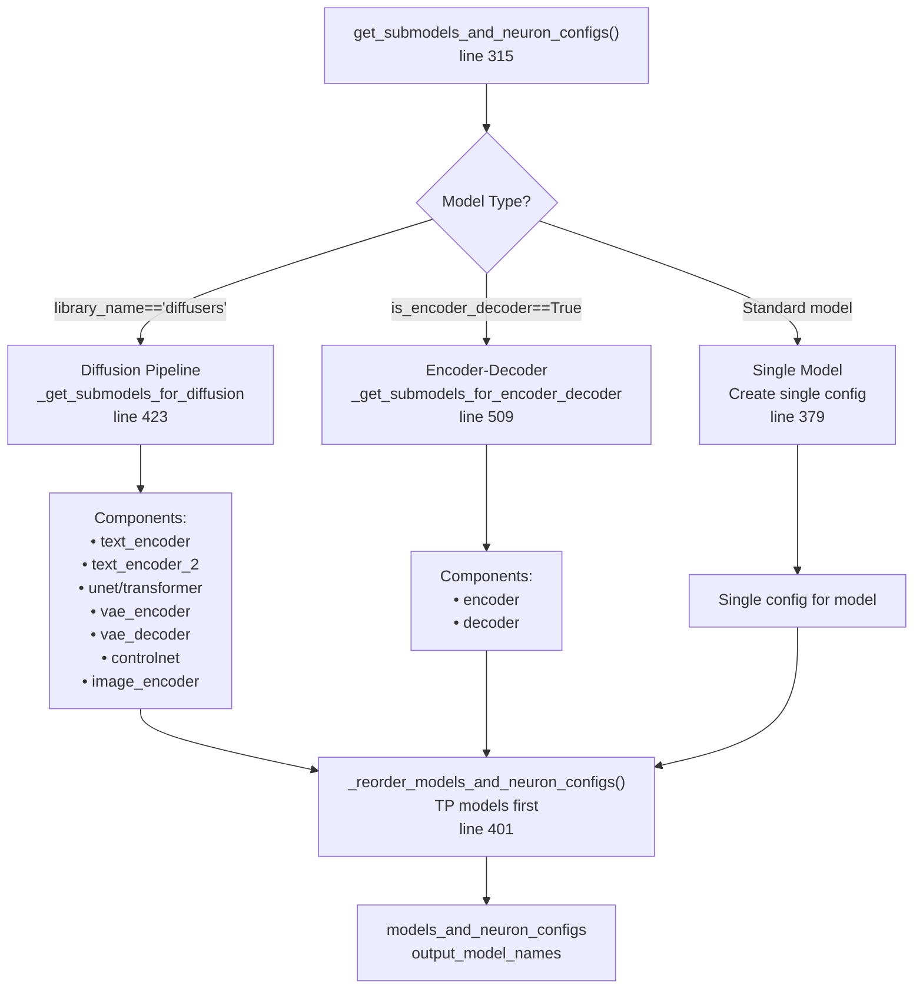

The function branches based on model type:

| Model Type | Handler Function | Line Range | Components |
|------------|------------------|------------|------------|
| Diffusion | `_get_submodels_and_neuron_configs_for_diffusion` | 423-506 | text_encoder, unet/transformer, vae_encoder, vae_decoder, controlnet |
| Encoder-Decoder | `_get_submodels_and_neuron_configs_for_encoder_decoder` | 509-545 | encoder, decoder |
| Standard | Direct config creation | 379-394 | Single model |

**Sources:** [optimum/exporters/neuron/__main__.py:315-398](), [optimum/exporters/neuron/__main__.py:423-506](), [optimum/exporters/neuron/__main__.py:509-545]()

## Compilation Pipeline

The `export_models()` function at [optimum/exporters/neuron/convert.py:296-440]() coordinates the compilation of all model components:

**Title:** export_models Compilation Loop

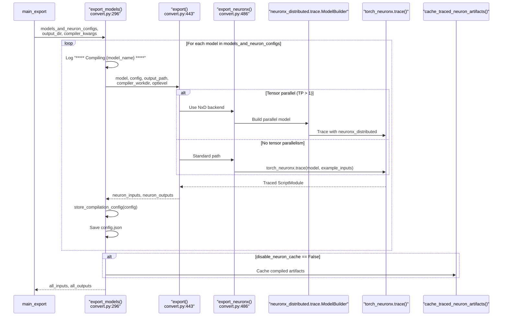

Key compilation steps:

1. **Iteration**: Loop through each model component (lines 355-419)
2. **Export Call**: Invoke `export()` which dispatches to `export_neuronx()` (lines 373-381)
3. **Tracing**: Use `torch_neuronx.trace()` or `ModelBuilder` for TP models (lines 568-617)
4. **Config Storage**: Save compilation metadata via `store_compilation_config()` (lines 401-418)
5. **Caching**: Optionally cache artifacts to Hub (lines 424-433)

**Sources:** [optimum/exporters/neuron/convert.py:296-440](), [optimum/exporters/neuron/convert.py:443-483](), [optimum/exporters/neuron/convert.py:486-723]()

## Graph Building and Tracing

The `export_neuronx()` function at [optimum/exporters/neuron/convert.py:486-723]() performs the actual model tracing and compilation:

**Title:** Tracing and Compilation Process

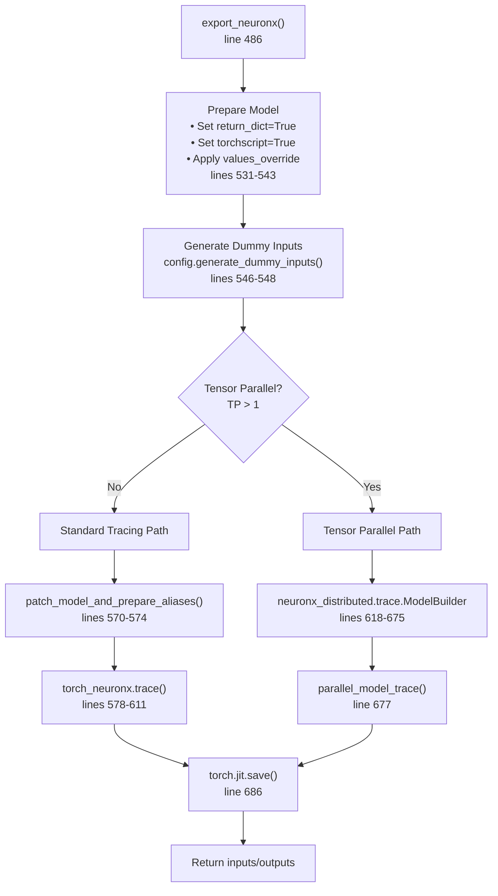

The tracing process differs based on tensor parallelism:

| Path | Condition | Tracing Method | Line Range |
|------|-----------|----------------|------------|
| Standard | `tensor_parallel_size == 1` | `torch_neuronx.trace(model, example_inputs)` | 578-611 |
| Tensor Parallel | `tensor_parallel_size > 1` | `ModelBuilder` + `parallel_model_trace()` | 618-677 |

For tensor parallel models, the `ModelBuilder` from `neuronx_distributed.trace` at [optimum/exporters/neuron/convert.py:618-675]() coordinates:
- Creating parallel model wrapper via `config.patch_model_and_prepare_aliases()`
- Generating parallel-aware dummy inputs
- Tracing with distributed context

**Sources:** [optimum/exporters/neuron/convert.py:486-723](), [optimum/exporters/neuron/convert.py:568-617](), [optimum/exporters/neuron/convert.py:618-677]()

## Dummy Input Generation

The `NeuronDefaultConfig.generate_dummy_inputs()` method at [optimum/exporters/neuron/base.py:306-341]() creates sample tensors for tracing:

**Title:** Dummy Input Generation Flow

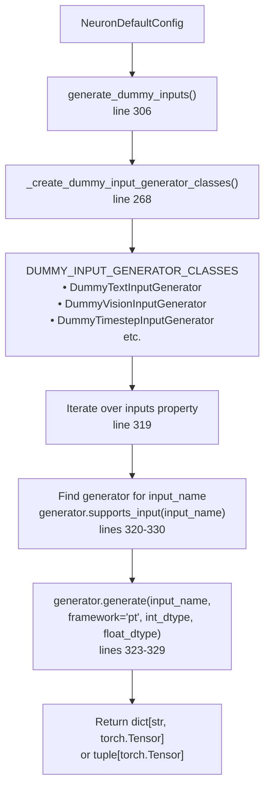

The generation process:

1. Instantiate generator classes from `DUMMY_INPUT_GENERATOR_CLASSES` (line 272)
2. Loop through required inputs from `config.inputs` property (line 319)
3. Find a generator that supports each input name (lines 320-330)
4. Generate tensor with correct dtype and shape (lines 323-329)
5. Return flattened dict or tuple (lines 337-340)

**Sources:** [optimum/exporters/neuron/base.py:306-341](), [optimum/exporters/neuron/base.py:268-272]()

## Validation Stage

The `validate_models_outputs()` function at [optimum/exporters/neuron/convert.py:80-145]() compares compiled model outputs against PyTorch CPU references:

**Title:** Validation Process

```mermaid
sequenceDiagram
    participant main_export
    participant validate as "validate_models_outputs()<br/>convert.py:80"
    participant validate_model as "validate_model_outputs()<br/>convert.py:148"
    participant ref_model as "Reference PyTorch Model<br/>CPU"
    participant neuron_model as "Compiled Neuron Model<br/>torch.jit.load()"
    
    main_export->>validate: models_and_neuron_configs,<br/>neuron_named_outputs, output_dir
    
    loop For each model
        validate->>validate->>validate: Create ref_submodel copy
        validate->>validate_model: config, ref_submodel,<br/>neuron_model_path, neuron_named_outputs
        
        validate_model->>ref_model: Generate dummy inputs<br/>config.generate_dummy_inputs()
        ref_model->>validate_model: reference_outputs
        
        validate_model->>neuron_model: torch.jit.load(neuron_model_path)
        neuron_model->>validate_model: neuron_outputs
        
        validate_model->>validate_model: Compare shapes<br/>Check output.shape == ref_output.shape
        validate_model->>validate_model: Compare values<br/>torch.allclose(ref, output, atol)
        
        alt Validation passes
            validate_model-->>validate: Success
        else Shape mismatch
            validate_model-->>validate: Raise ShapeError
        else Value mismatch
            validate_model-->>validate: Raise AtolError
        end
    end
    
    validate-->>main_export: All validations complete
```

Validation checks performed at [optimum/exporters/neuron/convert.py:248-283]():

1. **Output Names**: Verify Neuron outputs match reference (lines 221-235)
2. **Output Shapes**: Compare tensor dimensions (lines 264-274)
3. **Output Values**: Check numerical accuracy with `torch.allclose()` (lines 276-282)

| Check | Criterion | Error Type |
|-------|-----------|------------|
| Names | `neuron_outputs.keys() ⊆ ref_outputs.keys()` | `OutputMatchError` |
| Shapes | `output.shape == ref_output.shape` | `ShapeError` |
| Values | `torch.allclose(ref, output, atol=config.ATOL_FOR_VALIDATION)` | `AtolError` (warning) |

**Sources:** [optimum/exporters/neuron/convert.py:80-145](), [optimum/exporters/neuron/convert.py:148-294]()

## Multi-Component Export Workflows

For complex models, the export system handles multiple subcomponents:

**Title:** Multi-Component Export Strategies

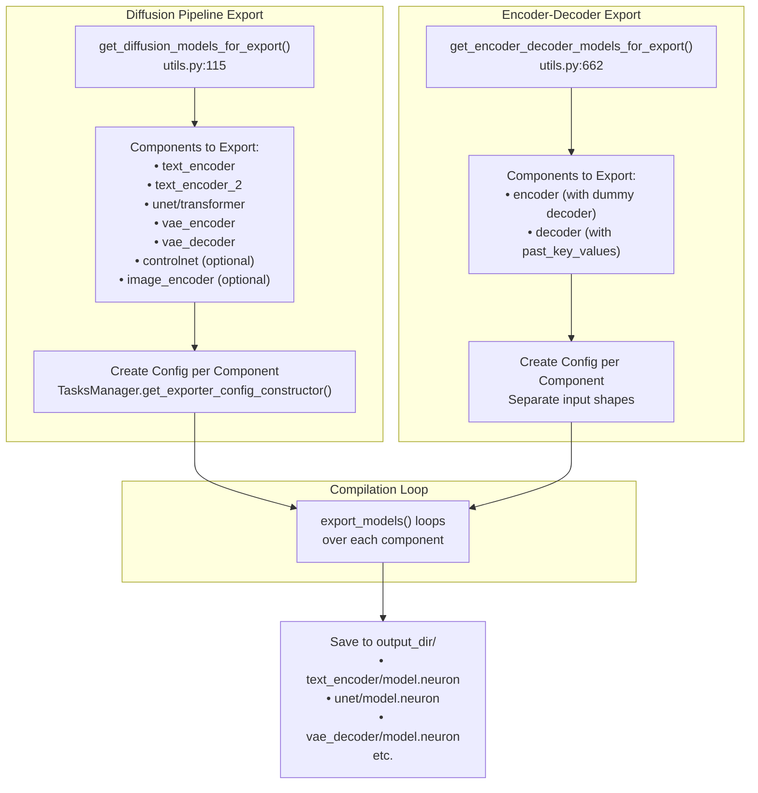

Diffusion pipeline export at [optimum/exporters/neuron/utils.py:115-390]():
- Creates separate configs for text_encoder, unet/transformer, vae components
- Infers component-specific shapes (e.g., VAE latent dimensions)
- Handles conditional components (ControlNet, IP-Adapter)

Encoder-decoder export at [optimum/exporters/neuron/utils.py:662-774]():
- Splits into encoder (first pass) and decoder (autoregressive) components
- Configures separate beam search and sequence length parameters
- Manages past_key_values for decoder caching

**Sources:** [optimum/exporters/neuron/utils.py:115-390](), [optimum/exporters/neuron/utils.py:662-774](), [optimum/exporters/neuron/__main__.py:423-506]()

## Compilation Output and Caching

After successful compilation, the system saves artifacts and optionally caches them:

**Title:** Output Saving and Caching

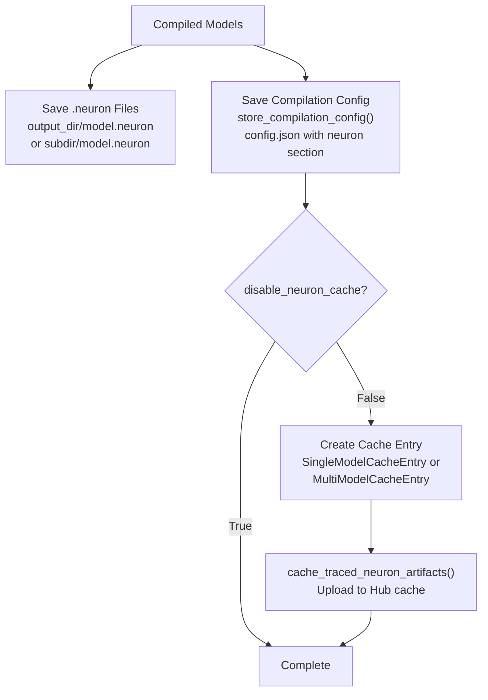

The compilation output includes:

1. **Neuron Files**: TorchScript `.neuron` files containing traced graphs and (optionally) weights
2. **Configuration Files**: `config.json` with compilation metadata in `neuron` section
3. **Preprocessors**: Tokenizers and feature extractors if applicable
4. **Cache Entry**: Optional upload to `aws-neuron/optimum-neuron-cache` Hub repository

The `store_compilation_config()` function at [optimum/neuron/utils/argument_utils.py:258-328]() adds metadata:
- Compiler type and version
- Input shapes (static_batch_size, static_sequence_length, etc.)
- Compiler flags (optlevel, auto_cast, auto_cast_type)
- Data types (int_dtype, float_dtype)
- Parallelism settings (tensor_parallel_size)

**Sources:** [optimum/exporters/neuron/convert.py:400-433](), [optimum/neuron/utils/argument_utils.py:258-328]()

## Configuration Construction Flow

The export process constructs configurations through a multi-step pipeline:

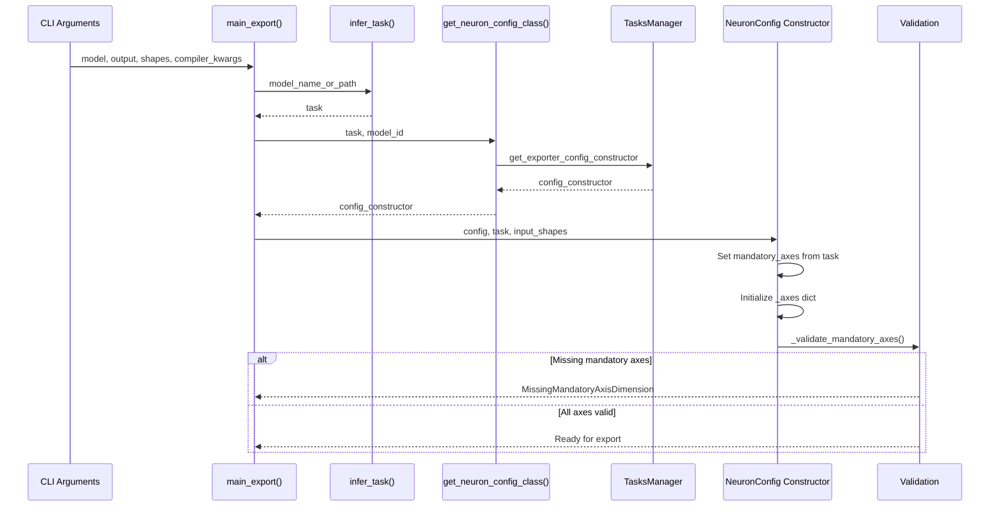

**Sources:** [optimum/exporters/neuron/__main__.py:614-681](), [optimum/exporters/neuron/__main__.py:134-148]()

## Dummy Input Generation

Configurations generate dummy inputs for model tracing using specialized generator classes:

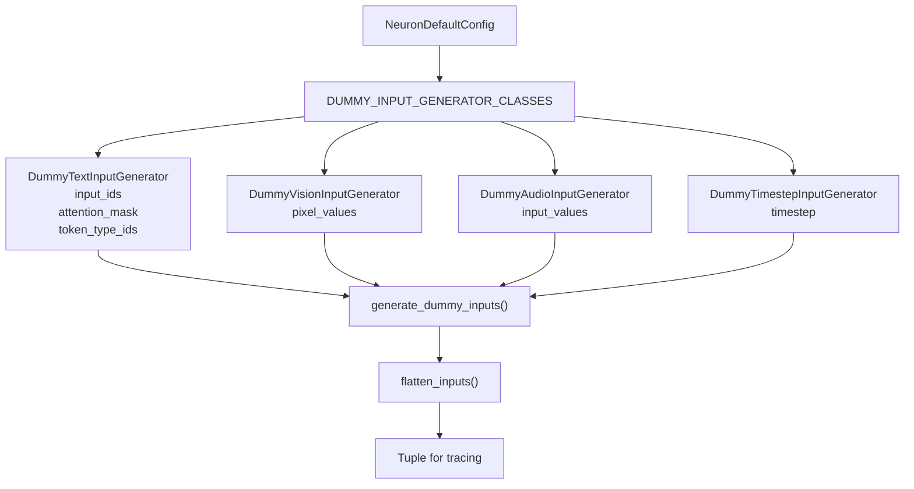

The `generate_dummy_inputs()` method iterates through configured generators to create tensors matching the expected input specification:

**Sources:** [optimum/exporters/neuron/base.py:306-341](), [optimum/exporters/neuron/base.py:268-272]()

## Configuration Serialization

After compilation, configuration metadata is stored in the model's config for reproducibility:

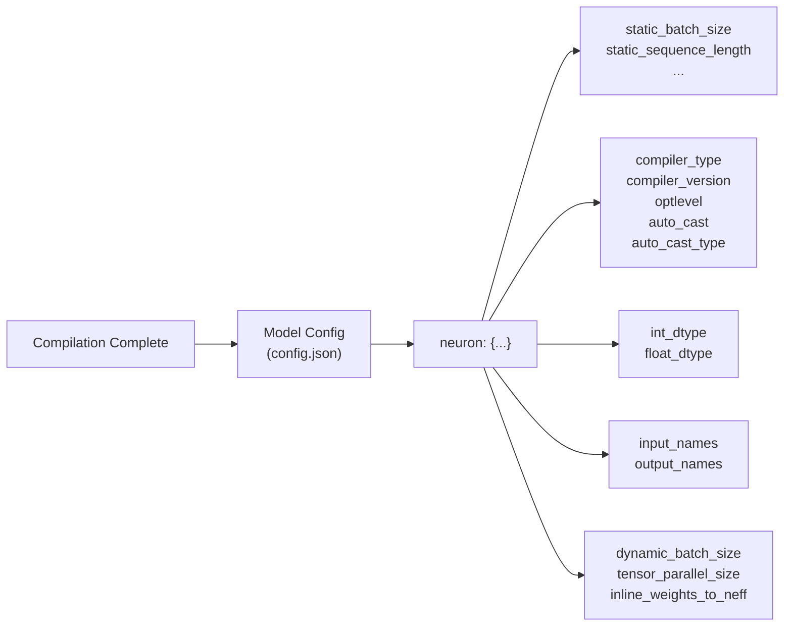

The `store_compilation_config()` function adds the `neuron` section to the model config:

**Sources:** [optimum/neuron/utils/argument_utils.py:258-332](), [optimum/exporters/neuron/convert.py:400-421]()

## Key Configuration Files Reference

| File | Purpose |
|------|---------|
| [optimum/exporters/neuron/base.py]() | `NeuronExportConfig`, `NeuronDefaultConfig` base classes |
| [optimum/exporters/neuron/model_configs.py]() | Model-specific configuration implementations |
| [optimum/exporters/neuron/__main__.py]() | Configuration construction in export pipeline |
| [optimum/neuron/utils/argument_utils.py]() | `InputShapesArguments`, `store_compilation_config()` |
| [optimum/commands/export/neuronx.py]() | CLI argument definitions |
| [optimum/exporters/neuron/utils.py]() | Diffusion model configuration helpers |

---

