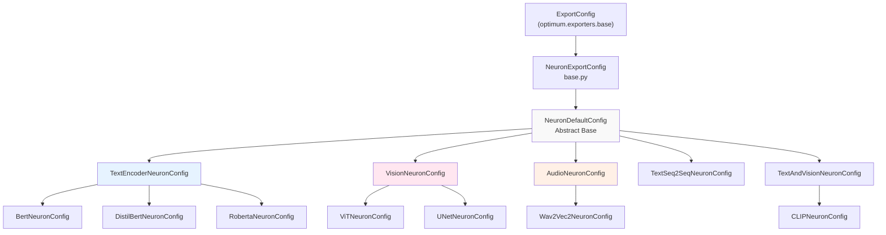
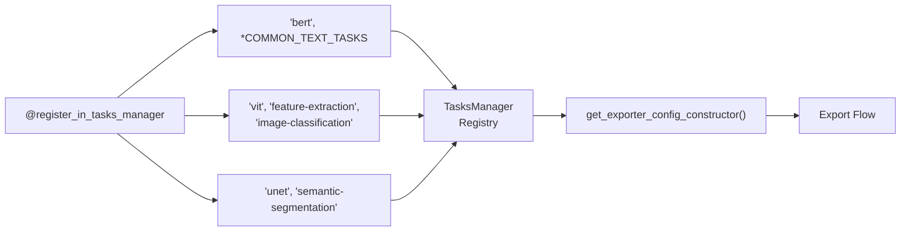
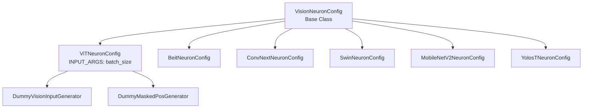
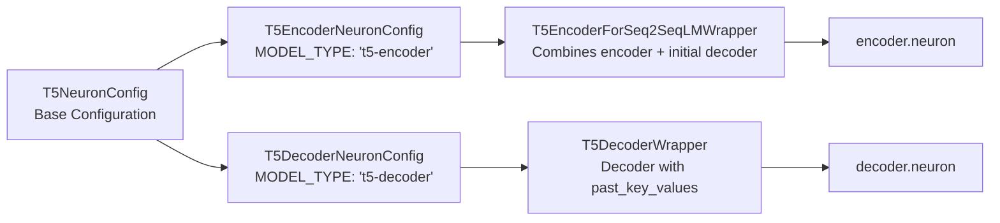
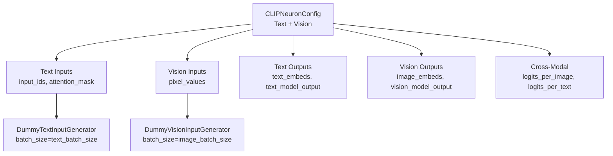
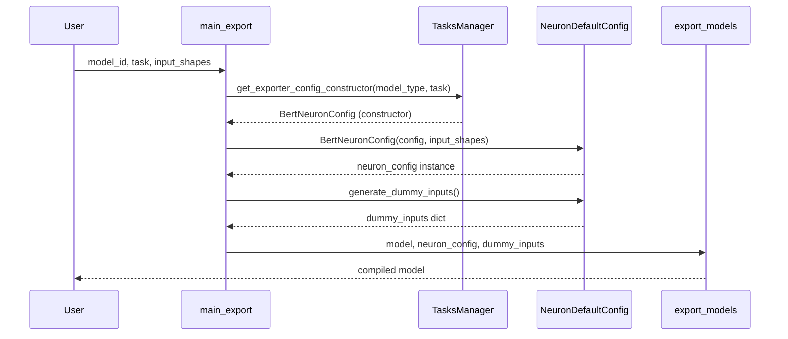

<!-- source: DeepWiki mcp.deepwiki.com · repo huggingface/optimum-neuron · page 4.2 Model Type Configurations · fetched 2026-10-26 -->

# Model Type Configurations

<details>
<summary>Relevant source files</summary>

The following files were used as context for generating this wiki page:

- [optimum/commands/export/neuron.py](optimum/commands/export/neuron.py)
- [optimum/commands/export/neuronx.py](optimum/commands/export/neuronx.py)
- [optimum/exporters/neuron/__main__.py](optimum/exporters/neuron/__main__.py)
- [optimum/exporters/neuron/base.py](optimum/exporters/neuron/base.py)
- [optimum/exporters/neuron/convert.py](optimum/exporters/neuron/convert.py)
- [optimum/exporters/neuron/model_configs.py](optimum/exporters/neuron/model_configs.py)
- [optimum/exporters/neuron/utils.py](optimum/exporters/neuron/utils.py)
- [optimum/neuron/modeling_diffusion.py](optimum/neuron/modeling_diffusion.py)
- [optimum/neuron/modeling_seq2seq.py](optimum/neuron/modeling_seq2seq.py)
- [optimum/neuron/modeling_traced.py](optimum/neuron/modeling_traced.py)
- [optimum/neuron/utils/argument_utils.py](optimum/neuron/utils/argument_utils.py)
- [optimum/neuron/utils/optimization_utils.py](optimum/neuron/utils/optimization_utils.py)
- [tests/exporters/exporters_utils.py](tests/exporters/exporters_utils.py)
- [tests/inference/inference_utils.py](tests/inference/inference_utils.py)

</details>


This document explains the model type configuration system in optimum-neuron's export pipeline. Model type configurations define how specific architectures (BERT, ViT, UNet, etc.) are exported to Neuron format, including their input/output specifications and how to generate dummy inputs for tracing.

For information about the export workflow and compilation process, see [Export Architecture and Workflow](#4.1). For details on input shape handling, see [Input Shape Handling and Compilation Parameters](#4.3).

## Overview and Purpose

Each model architecture supported by optimum-neuron requires a specialized configuration class that extends `NeuronDefaultConfig`. These configurations serve three primary purposes:

1. **Define Model Interface**: Specify the exact input and output names the compiled model will accept/produce
2. **Generate Dummy Inputs**: Provide logic to create example inputs for the tracing process with correct shapes and dtypes
3. **Task Registration**: Map model types to supported tasks in the `TasksManager` registry

The configuration system is located primarily in [optimum/exporters/neuron/model_configs.py:1-1473]() and uses a registration pattern to associate model types with export configurations.

Sources: [optimum/exporters/neuron/model_configs.py:1-100](), [optimum/exporters/neuron/base.py:78-123]()

## Configuration Class Hierarchy



**Configuration Class Hierarchy**

The hierarchy provides progressively specialized configurations. `NeuronDefaultConfig` at [optimum/exporters/neuron/base.py:78-305]() defines the abstract interface, while intermediate classes like `TextEncoderNeuronConfig` add modality-specific defaults, and concrete classes like `BertNeuronConfig` implement architecture-specific details.

Sources: [optimum/exporters/neuron/base.py:78-143](), [optimum/exporters/neuron/config.py:1-100](), [optimum/exporters/neuron/model_configs.py:103-116]()

## Task Registration System

Model configurations are registered with the `TasksManager` using the `@register_in_tasks_manager` decorator, which maps model types to tasks they support:



**Task Registration Flow**

The registration pattern at [optimum/exporters/neuron/model_configs.py:100-103]() allows the export system to look up the correct configuration class for any model type and task combination. `COMMON_TEXT_TASKS` is defined at [optimum/exporters/neuron/model_configs.py:92-99]() as `["feature-extraction", "fill-mask", "multiple-choice", "question-answering", "text-classification", "token-classification"]`.

Sources: [optimum/exporters/neuron/model_configs.py:92-103](), [optimum/exporters/neuron/__main__.py:133-151]()

## Text Encoder Configurations

Text encoder configurations handle BERT-style models and their variants. The base configuration is `TextEncoderNeuronConfig` at [optimum/exporters/neuron/config.py](), with specific implementations for different architectures.

### Common Text Encoder Configurations

| Configuration Class | Model Type | Inputs | Special Features |
|-------------------|------------|--------|------------------|
| `BertNeuronConfig` | bert, albert, mobilebert | input_ids, attention_mask, token_type_ids | Standard BERT interface |
| `DistilBertNeuronConfig` | distilbert | input_ids, attention_mask | No token_type_ids |
| `RobertaNeuronConfig` | roberta, camembert, xlm-roberta | input_ids, attention_mask | No token_type_ids |
| `ElectraNeuronConfig` | electra, flaubert, xlm | input_ids, attention_mask, token_type_ids | feature-extraction returns last_hidden_state only |
| `DebertaNeuronConfig` | deberta | input_ids, attention_mask, (optional token_type_ids) | Conditionally includes token_type_ids |
| `ModernBertNeuronConfig` | modernbert | input_ids, attention_mask | No token_type_ids |
| `PhiNeuronConfig` | phi | input_ids, attention_mask | Uses `NoCacheModelWrapper` |

**Example: BertNeuronConfig**

```python
@register_in_tasks_manager("bert", *COMMON_TEXT_TASKS)
class BertNeuronConfig(TextEncoderNeuronConfig):
    NORMALIZED_CONFIG_CLASS = NormalizedConfigManager.get_normalized_config_class("bert")
    ATOL_FOR_VALIDATION = 1e-3

    @property
    def inputs(self) -> list[str]:
        return ["input_ids", "attention_mask", "token_type_ids"]
```

The configuration at [optimum/exporters/neuron/model_configs.py:103-111]() defines BERT's input interface and validation tolerance. Subclasses may override `inputs` to modify the interface (e.g., DistilBERT removes `token_type_ids`).

Sources: [optimum/exporters/neuron/model_configs.py:103-248](), [optimum/exporters/neuron/config.py:1-100]()

## Vision Model Configurations

Vision configurations handle image processing models, extending `VisionNeuronConfig` with image-specific input shapes.

### Vision Configuration Details



**Vision Model Configuration Relationships**

**ViTNeuronConfig Example**

The ViT configuration at [optimum/exporters/neuron/model_configs.py:391-404]() demonstrates vision model patterns:

```python
@register_in_tasks_manager("vit", *["feature-extraction", "image-classification"])
class ViTNeuronConfig(VisionNeuronConfig):
    ATOL_FOR_VALIDATION = 1e-3
    NORMALIZED_CONFIG_CLASS = NormalizedVisionConfig
    DUMMY_INPUT_GENERATOR_CLASSES = (DummyVisionInputGenerator, DummyMaskedPosGenerator)
    INPUT_ARGS = ("batch_size",)  # num_channels and image_size inferred from config

    @property
    def inputs(self) -> list[str]:
        common_inputs = ["pixel_values"]
        if self.task == "masked-im":
            common_inputs.append("bool_masked_pos")
        return common_inputs
```

Note that `INPUT_ARGS = ("batch_size",)` because `num_channels` and `image_size` are automatically inferred from the model's config. The inputs vary by task, adding `bool_masked_pos` for masked image modeling.

**YOLOS Special Case**

YOLOS at [optimum/exporters/neuron/model_configs.py:474-482]() adds `last_hidden_state` to outputs for object detection:

```python
@property
def outputs(self) -> list[str]:
    common_outputs = super().outputs
    if self.task == "object-detection":
        common_outputs.append("last_hidden_state")
    return common_outputs
```

Sources: [optimum/exporters/neuron/model_configs.py:391-482](), [optimum/exporters/neuron/config.py]()

## Audio Model Configurations

Audio configurations handle speech and audio processing models, extending `AudioNeuronConfig`.

| Configuration Class | Model Type | Primary Input | Output Variations |
|-------------------|------------|---------------|-------------------|
| `Wav2Vec2NeuronConfig` | wav2vec2 | input_values | Adds `embeddings` for audio-xvector |
| `HubertNeuronConfig` | hubert | input_values | Returns only last_hidden_state for feature-extraction |
| `ASTNeuronConfig` | audio-spectrogram-transformer | input_values | Uses `ASTDummyAudioInputGenerator` |
| `UniSpeechNeuronConfig` | unispeech | input_values | Standard wav2vec2 interface |
| `UniSpeechSATNeuronConfig` | unispeech-sat | input_values | Supports all audio tasks |
| `WavLMNeuronConfig` | wavlm | input_values | Standard wav2vec2 interface |

**Wav2Vec2NeuronConfig Details**

At [optimum/exporters/neuron/model_configs.py:494-510](), the configuration shows task-specific output handling:

```python
@register_in_tasks_manager(
    "wav2vec2",
    *["feature-extraction", "automatic-speech-recognition", 
      "audio-classification", "audio-frame-classification", "audio-xvector"],
)
class Wav2Vec2NeuronConfig(AudioNeuronConfig):
    NORMALIZED_CONFIG_CLASS = NormalizedConfig
    MODEL_TYPE = "wav2vec2"

    @property
    def outputs(self) -> list[str]:
        common_outputs = super().outputs
        if self.task == "feature-extraction":
            common_outputs = ["last_hidden_state", "extract_features"]
        if self.task == "audio-xvector":
            common_outputs.append("embeddings")
        return common_outputs
```

The outputs property demonstrates how configurations adapt to different tasks, adding task-specific outputs like `embeddings` for speaker recognition tasks.

Sources: [optimum/exporters/neuron/model_configs.py:494-646]()

## Diffusion Model Configurations

Diffusion models require specialized configurations for their unique components: text encoders, UNet/Transformer, VAE encoder/decoder, and optional ControlNet.

### Diffusion Component Configurations

```mermaid
graph TB
    subgraph "Text Components"
        CLIPTE["CLIPTextWithProjectionNeuronConfig<br/>DIFFUSION_MODEL_TEXT_ENCODER_NAME"]
        CLIPTE2["CLIPTextNeuronConfig<br/>DIFFUSION_MODEL_TEXT_ENCODER_2_NAME"]
    end
    
    subgraph "Denoising Components"
        UNet["UNetNeuronConfig<br/>DIFFUSION_MODEL_UNET_NAME"]
        Transformer["FluxTransformerNeuronConfig<br/>DIFFUSION_MODEL_TRANSFORMER_NAME"]
        ControlNet["ControlNetNeuronConfig<br/>DIFFUSION_MODEL_CONTROLNET_NAME"]
    end
    
    subgraph "VAE Components"
        VAEEnc["VAE Encoder Config<br/>DIFFUSION_MODEL_VAE_ENCODER_NAME"]
        VAEDec["VAE Decoder Config<br/>DIFFUSION_MODEL_VAE_DECODER_NAME"]
    end
    
    subgraph "Optional Components"
        ImgEnc["CLIPVisionWithProjectionNeuronConfig<br/>DIFFUSION_MODEL_IMAGE_ENCODER_NAME"]
    end
    
    Pipeline["DiffusionPipeline<br/>(SD, SDXL, Flux)"]
    
    Pipeline --> CLIPTE
    Pipeline --> CLIPTE2
    Pipeline --> UNet
    Pipeline --> Transformer
    Pipeline --> VAEEnc
    Pipeline --> VAEDec
    Pipeline --> ControlNet
    Pipeline --> ImgEnc
```



**Diffusion Pipeline Component Configurations**

### UNet Configuration

The UNet configuration at [optimum/exporters/neuron/model_configs.py:648-751]() is complex due to its many conditional inputs:

```python
@register_in_tasks_manager("unet", *["semantic-segmentation"], library_name="diffusers")
class UNetNeuronConfig(VisionNeuronConfig):
    INPUT_ARGS = ("batch_size", "sequence_length", "num_channels", 
                  "width", "height", "vae_scale_factor")
    CUSTOM_MODEL_WRAPPER = UnetNeuronWrapper
    
    @property
    def inputs(self) -> list[str]:
        common_inputs = ["sample", "timestep", "encoder_hidden_states"]
        
        # SDXL additions
        if getattr(self._normalized_config, "addition_embed_type", None) == "text_time":
            common_inputs.append("text_embeds")
            common_inputs.append("time_ids")
        
        # ControlNet outputs
        if self.with_controlnet:
            common_inputs += ["down_block_additional_residuals", 
                            "mid_block_additional_residual"]
        
        # IP-Adapter inputs
        if self.with_ip_adapter:
            if self.image_encoder_output_hidden_states:
                common_inputs += ["image_enc_hidden_states"]
            else:
                common_inputs += ["image_embeds"]
        
        return common_inputs
```

The configuration has properties `is_sdxl`, `with_controlnet`, and `with_ip_adapter` that modify its behavior. These are set by the export system at [optimum/exporters/neuron/utils.py:245-250]().

### Flux Transformer Configuration

Flux transformers use a different architecture, configured at [optimum/exporters/neuron/model_configs.py:794-938]():

```python
@register_in_tasks_manager("flux-transformer-2d", *["semantic-segmentation"], 
                          library_name="diffusers")
class FluxTransformerNeuronConfig(VisionNeuronConfig):
    INPUT_ARGS = ("batch_size", "sequence_length", "num_channels", 
                  "width", "height", "vae_scale_factor", 
                  "encoder_hidden_size", "rotary_axes_dim")
    CUSTOM_MODEL_WRAPPER = FluxTransformerNeuronWrapper
    
    @property
    def inputs(self) -> list[str]:
        common_inputs = [
            "hidden_states",
            "encoder_hidden_states",
            "pooled_projections",
            "timestep",
            "image_rotary_emb",  # Pre-computed on CPU to save Neuron memory
        ]
        if getattr(self._config, "guidance_embeds", False):
            common_inputs.append("guidance")
        return common_inputs
```

Note the use of `image_rotary_emb` instead of computing it on device - this is a memory optimization. The configuration also provides custom methods like `patch_model_and_prepare_aliases()` at [optimum/exporters/neuron/model_configs.py:845-850]() and `get_checkpoint_loader_fn()` at [optimum/exporters/neuron/model_configs.py:866-909]() for NxD backend integration.

### ControlNet Configuration

ControlNet at [optimum/exporters/neuron/model_configs.py:940-1038]() outputs residual blocks:

```python
@property
def inputs(self) -> list[str]:
    common_inputs = [
        "sample",
        "timestep",
        "encoder_hidden_states",
        "controlnet_cond",
    ]
    if getattr(self._normalized_config, "addition_embed_type", None) == "text_time":
        common_inputs.append("text_embeds")
        common_inputs.append("time_ids")
    return common_inputs

@property
def outputs(self) -> list[str]:
    return ["down_block_res_samples", "mid_block_res_sample"]
```

The outputs are then consumed by the UNet configuration.

Sources: [optimum/exporters/neuron/model_configs.py:648-1038](), [optimum/exporters/neuron/utils.py:115-280]()

## Encoder-Decoder Configurations

Encoder-decoder models like T5 and BART require separate configurations for encoder and decoder components, handled by `TextSeq2SeqNeuronConfig`.

### T5 Configuration Structure



**T5 Encoder-Decoder Configuration**

The T5 configuration at [optimum/exporters/neuron/model_configs.py:1040-1166]() splits the model:

```python
@register_in_tasks_manager(
    "t5",
    *["text2text-generation", "automatic-speech-recognition"],
)
class T5NeuronConfig(TextSeq2SeqNeuronConfig):
    NORMALIZED_CONFIG_CLASS = NormalizedSeq2SeqConfig.with_args(
        num_layers="num_layers",
        num_attention_heads="num_heads",
        hidden_size="d_model",
        allow_new=True,
    )
    ATOL_FOR_VALIDATION = 1e-4
```

**T5 Encoder Configuration**

At [optimum/exporters/neuron/model_configs.py:1107-1139]():

```python
class T5EncoderNeuronConfig(T5NeuronConfig):
    MODEL_TYPE = "t5-encoder"
    CUSTOM_MODEL_WRAPPER = T5EncoderForSeq2SeqLMWrapper
    
    @property
    def inputs(self) -> list[str]:
        return ["input_ids", "attention_mask"]
    
    @property
    def outputs(self) -> list[str]:
        return [
            "logits",
            "encoder_hidden_states",
            *[f"decoder_past_key_values_{i}" for i in range(self._num_layers)],
        ]
```

The encoder actually includes the first decoder pass (without past) to handle control flow. It outputs both logits and all the past key values for the decoder.

**T5 Decoder Configuration**

At [optimum/exporters/neuron/model_configs.py:1142-1166]():

```python
class T5DecoderNeuronConfig(T5NeuronConfig):
    MODEL_TYPE = "t5-decoder"
    CUSTOM_MODEL_WRAPPER = T5DecoderWrapper
    
    @property
    def inputs(self) -> list[str]:
        return [
            "input_ids",
            "encoder_hidden_states",
            "encoder_attention_mask",
            *[f"past_key_values_{i}" for i in range(self._num_layers)],
        ]
```

The decoder takes the encoder outputs and past key values as inputs.

**Whisper Configuration**

Similar pattern at [optimum/exporters/neuron/model_configs.py:1169-1302]() with `WhisperEncoderWrapper` and `WhisperDecoderWrapper`.

Sources: [optimum/exporters/neuron/model_configs.py:1040-1302](), [optimum/exporters/neuron/model_wrappers.py]()

## Multi-Modal Configurations

Multi-modal models like CLIP combine text and vision processing, using `TextAndVisionNeuronConfig`.

### CLIP Configuration



**CLIP Configuration Architecture**

The CLIP configuration at [optimum/exporters/neuron/model_configs.py:268-331]() handles dual input streams:

```python
@register_in_tasks_manager("clip", 
    *["feature-extraction", "zero-shot-image-classification", "image-classification"])
class CLIPNeuronConfig(TextAndVisionNeuronConfig):
    NORMALIZED_CONFIG_CLASS = CLIPNormalizedConfig
    INPUT_ARGS = ("text_batch_size", "image_batch_size", "sequence_length", 
                  "num_channels", "width", "height")
    
    @property
    def inputs(self) -> list[str]:
        if self.task == "image-classification":
            return ["pixel_values"]
        else:
            return ["input_ids", "pixel_values", "attention_mask"]
    
    def _create_dummy_input_generator_classes(self, **kwargs) -> list[DummyInputGenerator]:
        # Separate batch sizes for text and vision
        text_batch_size = self._axes.pop("text_batch_size")
        images_batch_size = self._axes.pop("image_batch_size")
        
        return [
            DummyTextInputGenerator(self.task, self._normalized_config, 
                                   batch_size=text_batch_size, **other_axes),
            DummyVisionInputGenerator(self.task, self._normalized_config, 
                                     batch_size=images_batch_size, **other_axes),
        ]
```

Note the separate `text_batch_size` and `image_batch_size` parameters, allowing different batch sizes for each modality.

**CLIP Components for Diffusion**

CLIP components used in diffusion pipelines have simpler configurations:

- `CLIPTextWithProjectionNeuronConfig` at [optimum/exporters/neuron/model_configs.py:333-361]()
- `CLIPTextNeuronConfig` at [optimum/exporters/neuron/model_configs.py:363-375]()
- `CLIPVisionWithProjectionNeuronConfig` at [optimum/exporters/neuron/model_configs.py:273-289]()

Sources: [optimum/exporters/neuron/model_configs.py:268-390]()

## Dummy Input Generation

Each configuration specifies `DUMMY_INPUT_GENERATOR_CLASSES` that create example inputs for tracing. The base generation process is in `NeuronDefaultConfig.generate_dummy_inputs()` at [optimum/exporters/neuron/base.py:306-340]().

### Input Generator Mapping

```mermaid
graph TB
    subgraph "Text Generators"
        DummyTextInput["DummyTextInputGenerator<br/>input_ids, attention_mask"]
        WhisperTextInput["WhisperDummyTextInputGenerator<br/>decoder_input_ids"]
    end
    
    subgraph "Vision Generators"
        DummyVisionInput["DummyVisionInputGenerator<br/>pixel_values"]
        DummyMaskedPos["DummyMaskedPosGenerator<br/>bool_masked_pos"]
    end
    
    subgraph "Audio Generators"
        DummyAudioInput["DummyAudioInputGenerator<br/>input_values"]
        ASTAudioInput["ASTDummyAudioInputGenerator<br/>Custom audio inputs"]
    end
    
    subgraph "Diffusion Generators"
        DummyTimestep["DummyTimestepInputGenerator<br/>timestep"]
        DummyControlNet["DummyControNetInputGenerator<br/>controlnet_cond"]
        DummyIPAdapter["DummyIPAdapterInputGenerator<br/>image_embeds"]
        FluxRotary["DummyFluxTransformerRotaryEmbGenerator<br/>image_rotary_emb"]
    end
    
    subgraph "Seq2Seq Generators"
        DummySeq2SeqDecoder["DummySeq2SeqDecoderTextInputGenerator<br/>decoder inputs"]
        DummyBeamValues["DummyBeamValuesGenerator<br/>beam_idx, beam_scores"]
    end
    
    GenerateMethod["generate_dummy_inputs()"]
    
    GenerateMethod --> DummyTextInput
    GenerateMethod --> WhisperTextInput
    GenerateMethod --> DummyVisionInput
    GenerateMethod --> DummyAudioInput
    GenerateMethod --> DummyTimestep
    GenerateMethod --> DummySeq2SeqDecoder
```



**Dummy Input Generator Types**

### Text Input Generation

`DummyTextInputGenerator` creates standard transformer text inputs:

```python
# From optimum.utils
class DummyTextInputGenerator(DummyInputGenerator):
    def generate(self, input_name: str, framework: str = "pt", 
                 int_dtype: str = "int64", float_dtype: str = "fp32"):
        if input_name == "input_ids":
            return self.random_int_tensor(
                shape=[self.batch_size, self.sequence_length],
                max_value=self.vocab_size,
                framework=framework,
                dtype=int_dtype,
            )
        elif input_name == "attention_mask":
            return self.random_mask(
                shape=[self.batch_size, self.sequence_length],
                framework=framework,
            )
        elif input_name == "token_type_ids":
            return self.random_int_tensor(
                shape=[self.batch_size, self.sequence_length],
                max_value=self.type_vocab_size,
                framework=framework,
                dtype=int_dtype,
            )
```

### Vision Input Generation

`DummyVisionInputGenerator` creates image tensors with proper channel ordering:

```python
class DummyVisionInputGenerator(DummyInputGenerator):
    def generate(self, input_name: str, framework: str = "pt", 
                 int_dtype: str = "int64", float_dtype: str = "fp32"):
        if input_name == "pixel_values":
            return self.random_float_tensor(
                shape=[self.batch_size, self.num_channels, 
                       self.height, self.width],
                min_value=0.0,
                max_value=1.0,
                framework=framework,
                dtype=float_dtype,
            )
```

### Diffusion-Specific Generators

Diffusion models use specialized generators defined in [optimum/neuron/utils/input_generators.py]():

- `DummyTimestepInputGenerator`: Creates timestep scalars
- `DummyControNetInputGenerator`: Creates controlnet conditioning images
- `DummyIPAdapterInputGenerator`: Creates IP-Adapter image embeddings
- `DummyFluxTransformerRotaryEmbGenerator`: Creates pre-computed rotary embeddings for Flux

### Generator Assignment Example

At [optimum/exporters/neuron/model_configs.py:662-669](), UNet assigns multiple generators:

```python
DUMMY_INPUT_GENERATOR_CLASSES = (
    DummyVisionInputGenerator,
    DummySeq2SeqDecoderTextInputGenerator,
    DummyTimestepInputGenerator,
    DummyControNetInputGenerator,
    DummyIPAdapterInputGenerator,
)
```

The generation process iterates through these classes to handle all input types defined in the `inputs` property.

Sources: [optimum/exporters/neuron/base.py:306-340](), [optimum/neuron/utils/input_generators.py](), [optimum/exporters/neuron/model_configs.py:662-669]()

## Configuration Lookup and Usage

The export system uses `TasksManager` to look up configurations. The flow is:



**Configuration Lookup and Usage Flow**

### Key Methods

**1. Configuration Constructor Lookup**

At [optimum/exporters/neuron/__main__.py:138-151]():

```python
def get_neuron_config_class(task: str, model_id: str) -> NeuronExportConfig:
    config = AutoConfig.from_pretrained(model_id)
    
    model_type = config.model_type
    if config.is_encoder_decoder:
        model_type = model_type + "-encoder"
    
    neuron_config_constructor = TasksManager.get_exporter_config_constructor(
        model_type=model_type,
        exporter="neuron",
        task=task,
        library_name="transformers",
    )
    return neuron_config_constructor
```

**2. Configuration Instantiation**

At [optimum/exporters/neuron/__main__.py:385-393]():

```python
input_shapes = check_mandatory_input_shapes(neuron_config_constructor, task, input_shapes)
input_shapes = InputShapesArguments(**input_shapes)
neuron_config = neuron_config_constructor(
    model.config, 
    dynamic_batch_size=dynamic_batch_size, 
    input_shapes=input_shapes
)
```

**3. Input Generation for Export**

At [optimum/exporters/neuron/convert.py:546-549]():

```python
input_shapes = {}
for axis in config.mandatory_axes:
    input_shapes[axis] = getattr(config, axis)

dummy_inputs = config.generate_dummy_inputs(return_tuple=False, **input_shapes)
```

**4. Model Tracing**

The dummy inputs are used for tracing at [optimum/exporters/neuron/convert.py:550-600](), either with standard PyTorch tracing or NxD backend for tensor parallelism.

Sources: [optimum/exporters/neuron/__main__.py:138-393](), [optimum/exporters/neuron/convert.py:486-600]()

## Configuration Attributes Reference

Each `NeuronDefaultConfig` subclass can define:

| Attribute | Type | Purpose | Example |
|-----------|------|---------|---------|
| `MODEL_TYPE` | str | Override model type name | `"t5-encoder"`, `"unet"` |
| `NORMALIZED_CONFIG_CLASS` | Type | Config normalization class | `NormalizedTextConfig` |
| `DUMMY_INPUT_GENERATOR_CLASSES` | tuple | Input generator classes | `(DummyTextInputGenerator,)` |
| `ATOL_FOR_VALIDATION` | float \| dict | Validation tolerance | `1e-3` or `{"task": 1e-3}` |
| `INPUT_ARGS` | tuple | Mandatory shape arguments | `("batch_size", "sequence_length")` |
| `CUSTOM_MODEL_WRAPPER` | Type | Model wrapper class | `UnetNeuronWrapper` |
| `LIBRARY_NAME` | str | Source library | `"transformers"`, `"diffusers"` |
| `_TASK_TO_COMMON_OUTPUTS` | dict | Default outputs per task | Defined in base class |

### Properties to Implement

Required properties:
- `inputs` (property): List of input names
- `outputs` (property): List of output names (has default implementation)

Optional properties:
- `values_override` (property): Config values to override before export
- Task-specific customization (e.g., `is_sdxl` for UNet)

### Configuration Initialization

At [optimum/exporters/neuron/base.py:144-223](), the base `__init__` method:

1. Stores the pretrained config and creates normalized config
2. Extracts mandatory axes from `INPUT_ARGS` based on task
3. Stores input shape arguments (batch_size, sequence_length, etc.)
4. Sets dtype for int and float tensors
5. Validates that all mandatory axes have values

Sources: [optimum/exporters/neuron/base.py:41-305](), [optimum/exporters/neuron/model_configs.py:1-1473]()

## Adding New Model Type Support

To add support for a new model architecture:

1. **Create Configuration Class**: Extend appropriate base config (`TextEncoderNeuronConfig`, `VisionNeuronConfig`, etc.)

2. **Register with TasksManager**: Use `@register_in_tasks_manager` decorator with model type and supported tasks

3. **Define Inputs**: Implement `inputs` property returning list of input names

4. **Define Outputs** (optional): Override `outputs` if default task outputs aren't sufficient

5. **Specify Input Generators**: Set `DUMMY_INPUT_GENERATOR_CLASSES` tuple with appropriate generator classes

6. **Set Validation Tolerance**: Define `ATOL_FOR_VALIDATION` based on model precision

7. **Add Model Wrapper** (if needed): Create wrapper in `model_wrappers.py` for models needing preprocessing

**Example Skeleton**:

```python
@register_in_tasks_manager("my-model", *["feature-extraction", "text-classification"])
class MyModelNeuronConfig(TextEncoderNeuronConfig):
    NORMALIZED_CONFIG_CLASS = NormalizedConfigManager.get_normalized_config_class("my-model")
    ATOL_FOR_VALIDATION = 1e-3
    INPUT_ARGS = ("batch_size", "sequence_length")
    
    @property
    def inputs(self) -> list[str]:
        return ["input_ids", "attention_mask"]
    
    @property
    def outputs(self) -> list[str]:
        if self.task == "feature-extraction":
            return ["last_hidden_state"]
        return self._TASK_TO_COMMON_OUTPUTS[self.task]
```

Sources: [optimum/exporters/neuron/model_configs.py:103-1473]()

---

