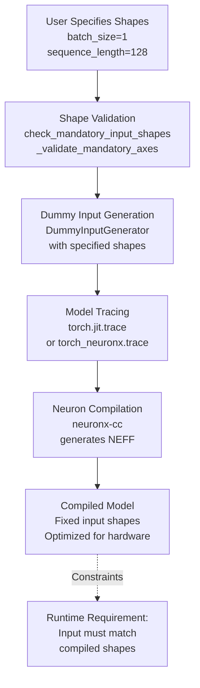
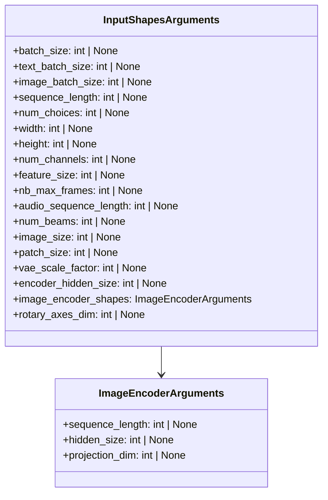
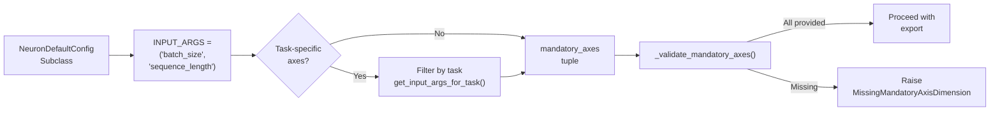
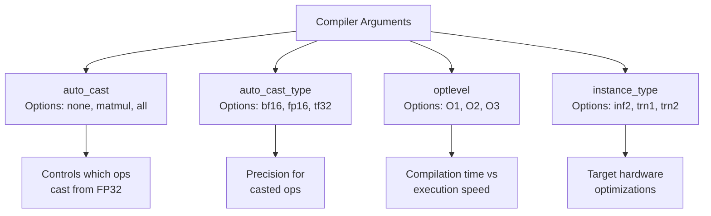
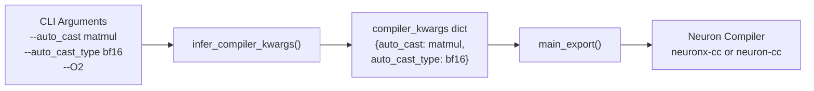
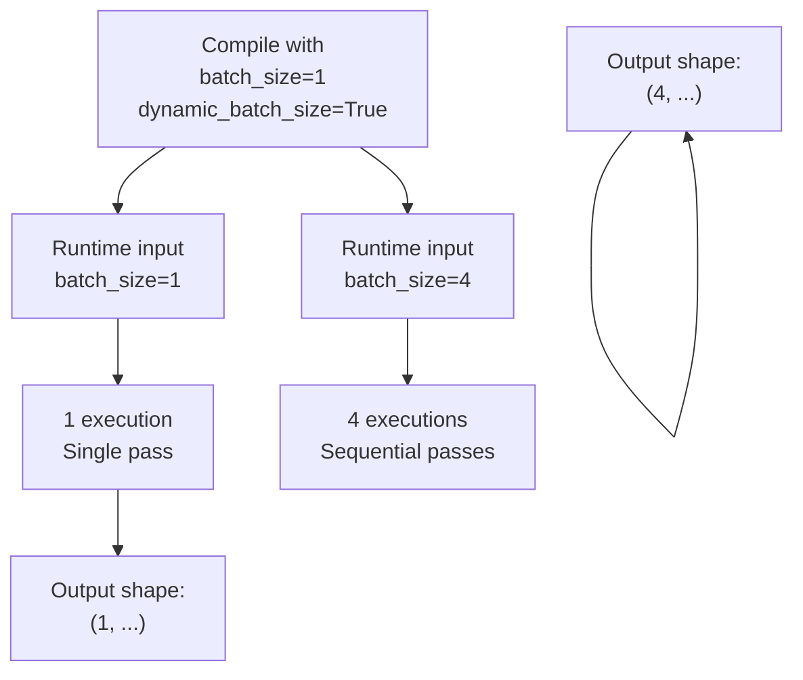
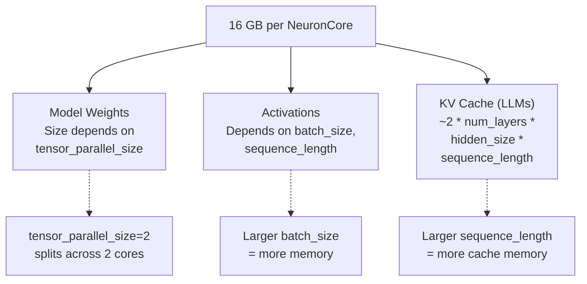
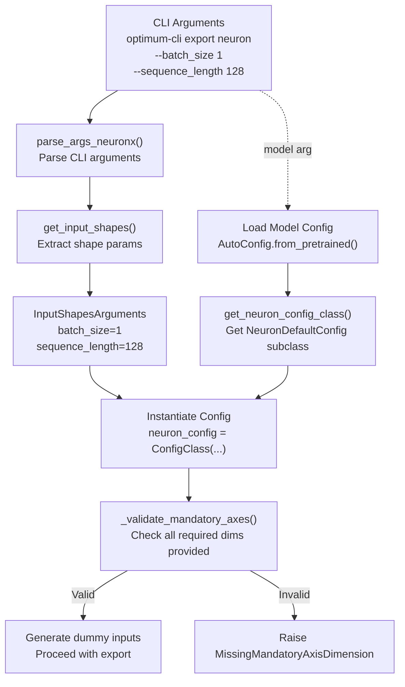

<!-- source: DeepWiki mcp.deepwiki.com · repo huggingface/optimum-neuron · page 4.3 Input Shape Handling and Compilation Parameters · fetched 2026-10-26 -->

# Input Shape Handling and Compilation Parameters

<details>
<summary>Relevant source files</summary>

The following files were used as context for generating this wiki page:

- [docs/source/guides/benchmark.mdx](docs/source/guides/benchmark.mdx)
- [docs/source/guides/export_model.mdx](docs/source/guides/export_model.mdx)
- [docs/source/guides/vllm_plugin.mdx](docs/source/guides/vllm_plugin.mdx)
- [docs/source/index.mdx](docs/source/index.mdx)
- [docs/source/inference_tutorials/llama2-13b-chatbot.mdx](docs/source/inference_tutorials/llama2-13b-chatbot.mdx)
- [docs/source/inference_tutorials/notebooks.mdx](docs/source/inference_tutorials/notebooks.mdx)
- [optimum/commands/export/neuron.py](optimum/commands/export/neuron.py)
- [optimum/commands/export/neuronx.py](optimum/commands/export/neuronx.py)
- [optimum/exporters/neuron/__main__.py](optimum/exporters/neuron/__main__.py)
- [optimum/exporters/neuron/base.py](optimum/exporters/neuron/base.py)
- [optimum/exporters/neuron/convert.py](optimum/exporters/neuron/convert.py)
- [optimum/exporters/neuron/model_configs.py](optimum/exporters/neuron/model_configs.py)
- [optimum/exporters/neuron/utils.py](optimum/exporters/neuron/utils.py)
- [optimum/neuron/modeling_diffusion.py](optimum/neuron/modeling_diffusion.py)
- [optimum/neuron/modeling_seq2seq.py](optimum/neuron/modeling_seq2seq.py)
- [optimum/neuron/modeling_traced.py](optimum/neuron/modeling_traced.py)
- [optimum/neuron/utils/argument_utils.py](optimum/neuron/utils/argument_utils.py)
- [optimum/neuron/utils/optimization_utils.py](optimum/neuron/utils/optimization_utils.py)
- [tests/exporters/exporters_utils.py](tests/exporters/exporters_utils.py)
- [tests/inference/inference_utils.py](tests/inference/inference_utils.py)

</details>


## Purpose and Scope

This page explains how input shapes are specified, validated, and used during the Neuron model export process, and how compilation parameters control the trade-offs between performance and accuracy. Input shapes are critical because Neuron compilation requires static dimensions that cannot be changed after compilation. This document covers the shape specification system, mandatory axes validation, compiler arguments, and their relationship to hardware constraints.

For information about the overall export workflow and how shapes fit into the compilation pipeline, see [Export Architecture and Workflow](#4.1). For model-specific shape requirements, see [Model Type Configurations](#4.2).

---

## Static Shape Requirement

Neuron compilation uses Ahead-Of-Time (AOT) compilation with static shapes. Unlike dynamic frameworks that adapt to varying input sizes at runtime, Neuron models are optimized for specific, fixed input dimensions specified at compilation time.



**Why Static Shapes?**

The compiled model contains hardware-specific optimizations that depend on knowing tensor dimensions in advance. Padding, memory allocation, and kernel selection are all determined at compile time. This enables maximum performance but requires that inference inputs match the compiled dimensions.

**Sources:** [optimum/exporters/neuron/__main__.py:44-48](), [optimum/exporters/neuron/convert.py:546-549](), [docs/source/guides/export_model.mdx:43-48]()

---

## Input Shape Parameters

The `InputShapesArguments` dataclass defines all possible shape parameters that can be specified during export. Different model types require different subsets of these parameters.

### Core Shape Parameters

| Parameter | Description | Applicable Models |
|-----------|-------------|-------------------|
| `batch_size` | Number of samples processed together | All models |
| `sequence_length` | Maximum token length for text models | Text models |
| `num_channels` | Image channel count (e.g., 3 for RGB) | Vision models |
| `height` | Image height in pixels | Vision, diffusion models |
| `width` | Image width in pixels | Vision, diffusion models |
| `audio_sequence_length` | Audio sample length | Audio models |
| `num_beams` | Beam search width | Seq2seq models |

### Multi-Modal Shape Parameters

For models processing multiple input types (e.g., CLIP):

| Parameter | Description |
|-----------|-------------|
| `text_batch_size` | Batch size for text inputs |
| `image_batch_size` | Batch size for image inputs |

### Diffusion-Specific Parameters

| Parameter | Description |
|-----------|-------------|
| `num_images_per_prompt` | Images generated per prompt |
| `vae_scale_factor` | VAE downsampling factor |
| `encoder_hidden_size` | Text encoder output dimension |

**InputShapesArguments Structure:**



**Sources:** [optimum/neuron/utils/argument_utils.py:78-101](), [optimum/exporters/neuron/base.py:183-208]()

---

## Mandatory Axes System

Each model configuration defines which shape parameters are mandatory for compilation via the `INPUT_ARGS` class attribute. The system validates that all required dimensions are provided before export begins.

### How Mandatory Axes Work



### Task-Specific Axes

Some axes are only required for certain tasks. The `INPUT_ARGS` tuple can specify conditional requirements:

```python
# From model_configs.py concept
INPUT_ARGS = (
    "batch_size",           # Always required
    "sequence_length",      # Always required
    ("multiple-choice", "num_choices")  # Only for multiple-choice task
)
```

The `get_input_args_for_task()` method filters axes based on the task.

### Common Mandatory Axes Patterns

| Model Type | Mandatory Axes |
|------------|----------------|
| Text Encoders (BERT, RoBERTa) | `batch_size`, `sequence_length` |
| Vision Models (ViT, ResNet) | `batch_size`, (`num_channels`, `height`, `width` inferred from config) |
| Diffusion UNet | `batch_size`, `sequence_length`, `num_channels`, `height`, `width`, `vae_scale_factor` |
| Audio Models (Wav2Vec2) | `batch_size`, `audio_sequence_length` |
| Multi-modal (CLIP) | `text_batch_size`, `image_batch_size`, `sequence_length`, `num_channels`, `width`, `height` |

**Sources:** [optimum/exporters/neuron/base.py:46-75](), [optimum/exporters/neuron/base.py:224-236](), [optimum/exporters/neuron/base.py:261-266](), [optimum/exporters/neuron/model_configs.py:294-295]()

---

## Compiler Arguments

Compiler arguments control how the Neuron compiler optimizes the model, trading off between inference speed and numerical accuracy. These are separate from input shapes but equally important for model behavior.

### Key Compiler Parameters



### Auto-Cast Configuration

Auto-casting reduces precision for certain operations to improve performance:

| `auto_cast` | `auto_cast_type` | Behavior |
|-------------|------------------|----------|
| `none` | N/A | No automatic casting, full FP32 |
| `matmul` | `bf16` | Cast matrix multiplications to BF16 |
| `matmul` | `fp16` | Cast matrix multiplications to FP16 |
| `all` | `bf16` | Cast all FP32 operations to BF16 |

**Default Recommendation:** `auto_cast=matmul` with `auto_cast_type=bf16` provides a good balance between speed and accuracy for most models.

### Optimization Levels

| Level | Description | Use Case |
|-------|-------------|----------|
| `-O1` | Fast compilation, basic optimizations | Development, quick iterations |
| `-O2` | Balanced (default) | Production deployment |
| `-O3` | Maximum optimization, slow compilation | Critical performance paths |

### INF1-Specific Arguments (Legacy)

For Inferentia 1 (`neuron-cc`), additional arguments exist:

- `disable_fast_relayout`: Disables matrix multiplier-based transpose optimization
- `disable_fallback`: Prevents CPU fallback for unsupported operations

**Compiler Argument Construction:**



**Sources:** [optimum/exporters/neuron/__main__.py:102-114](), [optimum/commands/export/neuronx.py:103-115](), [optimum/commands/export/neuronx.py:299-315](), [optimum/exporters/neuron/convert.py:513-522]()

---

## Dynamic Batch Size

While input shapes are generally static, Neuron supports **dynamic batch size** where the runtime batch can be a multiple of the compiled batch size.

### How Dynamic Batch Size Works

When `dynamic_batch_size=True`:
- The model is compiled with `batch_size=1`
- At runtime, inputs can have batch sizes of 1, 2, 3, 4, etc.
- The Neuron runtime executes multiple passes for batch > 1
- There is a latency tradeoff: larger batches process more samples but take longer



### Limitations

- Only available on **Inferentia 2** (neuronx-cc), not Inferentia 1
- The batch dimension must be the first dimension
- Performance degrades linearly with batch size (4x batch = ~4x latency)
- Not all operations support dynamic batching efficiently

**CLI Usage:**

```bash
optimum-cli export neuron \
  --model bert-base-uncased \
  --sequence_length 128 \
  --batch_size 1 \
  --dynamic-batch-size \
  output/
```

**Sources:** [optimum/exporters/neuron/base.py:169-173](), [optimum/commands/export/neuronx.py:130-133](), [optimum/exporters/neuron/convert.py:182-183]()

---

## Hardware Constraints

Input shapes interact with hardware memory and core constraints. Understanding these relationships helps choose optimal compilation parameters.

### NeuronCore Memory

Each NeuronCore has **16 GB** of memory. The model weights, activations, and KV cache must fit within this limit.



### Tensor Parallelism and Shapes

For large models that don't fit on a single core, tensor parallelism shards the model across multiple cores:

| Model Size | Recommended `tensor_parallel_size` | Total Cores Used |
|------------|-------------------------------------|------------------|
| < 7B parameters | 1 | 1 |
| 7B - 13B | 2 | 2 |
| 13B - 30B | 4 | 4 |
| 30B - 70B | 8-12 | 8-12 |
| 70B+ | 24 | 24 |

**Important:** `tensor_parallel_size` affects compilation but not input shapes. Shapes remain the same regardless of parallelism.

### Sequence Length Constraints

For causal language models:
- `sequence_length` constrains both input tokens and generated tokens
- Total tokens (input + output) cannot exceed `sequence_length`
- KV cache grows with `sequence_length`, consuming memory

**Example Memory Calculation for Llama 2 13B:**

```
# Assumptions
num_layers = 40
hidden_size = 5120
sequence_length = 4096
batch_size = 1
tensor_parallel_size = 2

# KV cache per layer (key + value)
kv_per_layer = 2 * hidden_size * sequence_length * 2 bytes (fp16)
            = 2 * 5120 * 4096 * 2
            = ~84 MB per layer

# Total KV cache
total_kv = 40 * 84 MB = 3.36 GB

# Split across 2 cores = 1.68 GB per core
```

**Sources:** [docs/source/guides/export_model.mdx:254-267](), [optimum/exporters/neuron/__main__.py:753-755](), [optimum/commands/export/neuronx.py:124-128]()

---

## Practical Examples

### Example 1: BERT for Sequence Classification

```bash
optimum-cli export neuron \
  --model bert-base-uncased \
  --task text-classification \
  --batch_size 1 \
  --sequence_length 128 \
  --auto_cast matmul \
  --auto_cast_type bf16 \
  bert_neuron/
```

**Shape Parameters:**
- `batch_size=1`: Process one input at a time
- `sequence_length=128`: Maximum 128 tokens per input

**Compiler Parameters:**
- `auto_cast=matmul`: Cast matrix ops to lower precision
- `auto_cast_type=bf16`: Use bfloat16 for better numerical stability

### Example 2: Stable Diffusion 2.1

```bash
optimum-cli export neuron \
  --model stabilityai/stable-diffusion-2-1-base \
  --task stable-diffusion \
  --batch_size 1 \
  --height 512 \
  --width 512 \
  --num_images_per_prompt 4 \
  --auto_cast matmul \
  --auto_cast_type bf16 \
  sd_neuron/
```

**Shape Parameters:**
- `batch_size=1`: One prompt at a time
- `height=512`, `width=512`: Generate 512x512 images
- `num_images_per_prompt=4`: Generate 4 variations per prompt

This compiles multiple components with inferred shapes:
- Text encoder: `(1, max_length)`
- UNet: `(4, 4, 64, 64)` (latent space)
- VAE decoder: `(4, 4, 64, 64)` → `(4, 3, 512, 512)`

### Example 3: Llama 2 7B with Tensor Parallelism

```bash
optimum-cli export neuron \
  --model meta-llama/Llama-2-7b-hf \
  --batch_size 1 \
  --sequence_length 4096 \
  --tensor_parallel_size 2 \
  llama_neuron/
```

**Shape Parameters:**
- `batch_size=1`: Single input
- `sequence_length=4096`: Max context + generation length

**Compiler Parameters:**
- `tensor_parallel_size=2`: Split across 2 NeuronCores (32 GB total)

### Example 4: Dynamic Batch Size for DistilBERT

```bash
optimum-cli export neuron \
  --model distilbert-base-uncased \
  --task text-classification \
  --batch_size 1 \
  --sequence_length 128 \
  --dynamic-batch-size \
  distilbert_neuron/
```

At runtime, this model accepts any batch size:

```python
from optimum.neuron import NeuronModelForSequenceClassification
from transformers import AutoTokenizer

model = NeuronModelForSequenceClassification.from_pretrained("distilbert_neuron/")
tokenizer = AutoTokenizer.from_pretrained("distilbert-base-uncased")

# Works with batch_size=1
inputs = tokenizer("Hello world", return_tensors="pt", padding="max_length", max_length=128)
outputs = model(**inputs)

# Also works with batch_size=3
inputs = tokenizer(["Hello", "World", "Test"], return_tensors="pt", padding="max_length", max_length=128)
outputs = model(**inputs)  # Sequential execution: 3 passes
```

**Sources:** [docs/source/guides/export_model.mdx:106-116](), [docs/source/guides/export_model.mdx:207-218](), [docs/source/guides/export_model.mdx:254-267](), [docs/source/guides/export_model.mdx:145-147]()

---

## Shape Validation Flow

The complete flow from user input to validated shapes:



**Key Functions:**

1. **`parse_args_neuronx()`** [optimum/commands/export/neuronx.py:28-316]() - Parses CLI arguments including all shape parameters

2. **`get_input_shapes()`** [optimum/exporters/neuron/__main__.py:132-135]() - Extracts shape values relevant to the task

3. **`check_mandatory_input_shapes()`** [optimum/exporters/neuron/utils.py:360-388]() - Validates required shapes are present

4. **`_validate_mandatory_axes()`** [optimum/exporters/neuron/base.py:261-266]() - Checks no mandatory axis is None

**Sources:** [optimum/exporters/neuron/__main__.py:132-135](), [optimum/exporters/neuron/__main__.py:138-151](), [optimum/exporters/neuron/base.py:261-266](), [optimum/commands/export/neuronx.py:230-297]()

---

## Configuration Storage

After successful compilation, both input shapes and compiler arguments are stored in the model's `config.json` for later reference:

```json
{
  "neuron": {
    "static_batch_size": 1,
    "static_sequence_length": 128,
    "dynamic_batch_size": false,
    "compiler_type": "neuronx-cc",
    "compiler_version": "2.15.0.0",
    "auto_cast": "matmul",
    "auto_cast_type": "bf16",
    "optlevel": "2",
    "instance_type": "inf2",
    "tensor_parallel_size": 1
  }
}
```

This allows `NeuronModelForXXX.from_pretrained()` to restore the exact compilation configuration and validate that runtime inputs are compatible.

**Storage Function:**

The `store_compilation_config()` function [optimum/neuron/utils/argument_utils.py:259-301]() serializes all compilation metadata into the config.

**Sources:** [optimum/neuron/utils/argument_utils.py:259-301](), [optimum/exporters/neuron/convert.py:401-417]()

---

