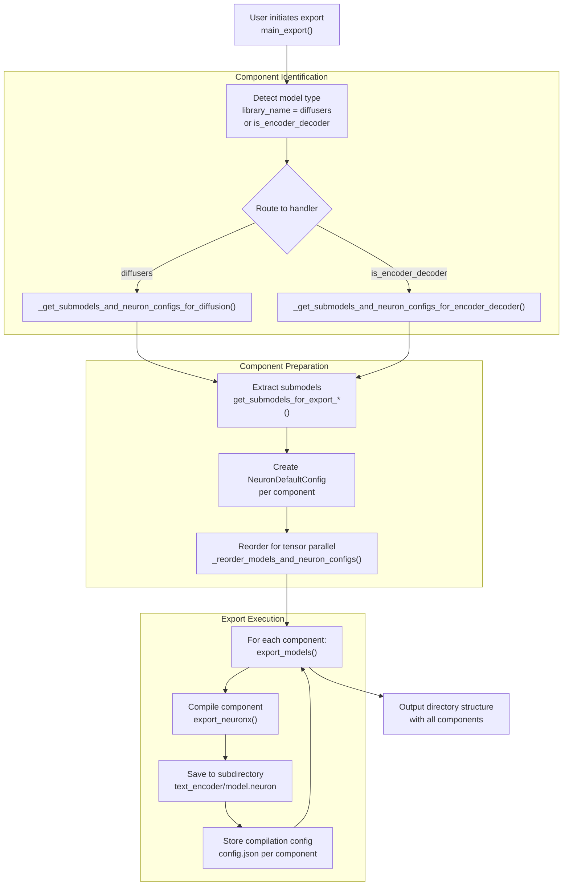
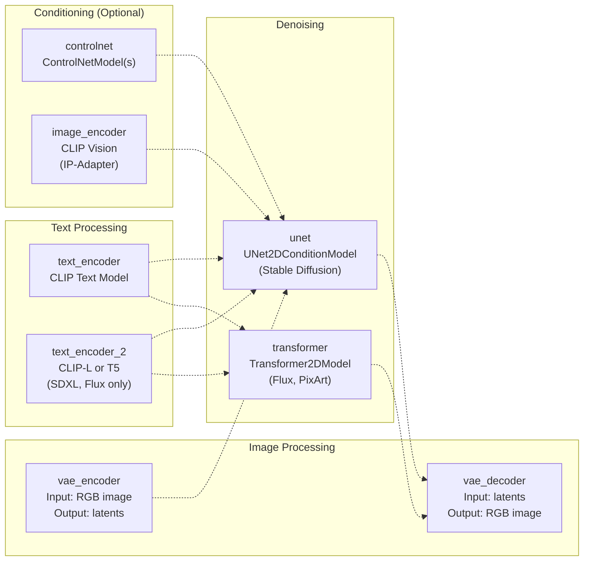
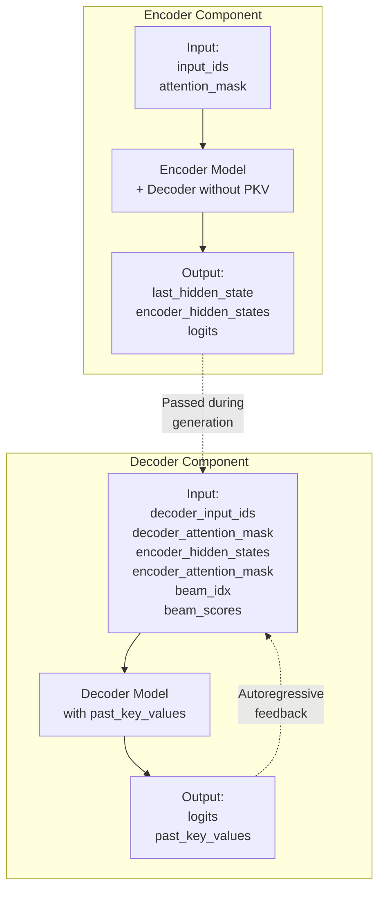
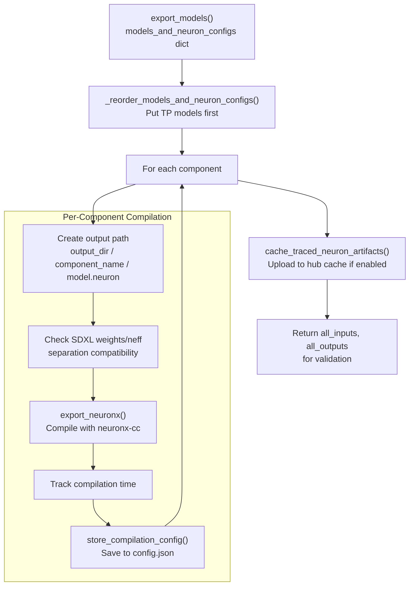
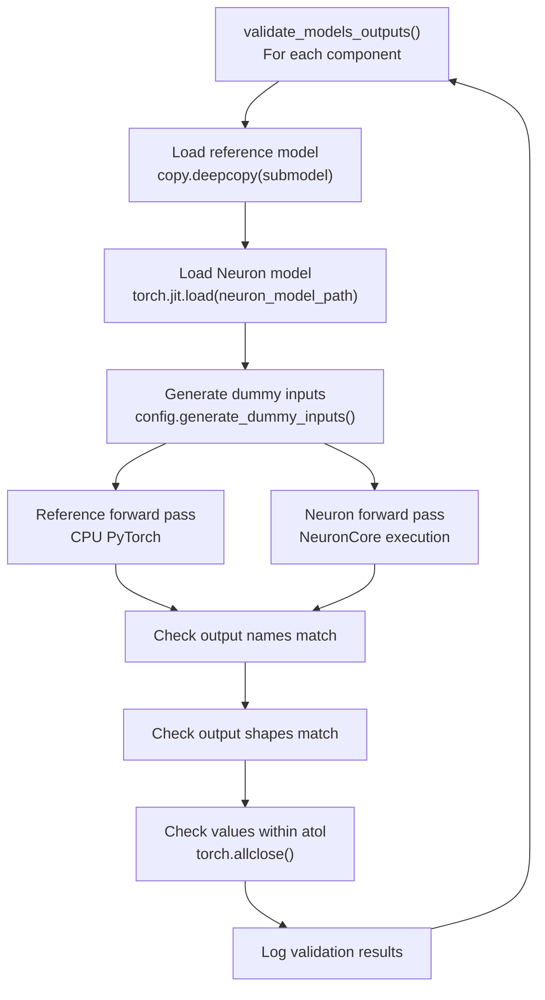

<!-- source: DeepWiki mcp.deepwiki.com · repo huggingface/optimum-neuron · page 4.4 Multi-Component Model Export · fetched 2026-10-26 -->

# Multi-Component Model Export

<details>
<summary>Relevant source files</summary>

The following files were used as context for generating this wiki page:

- [optimum/commands/export/neuron.py](optimum/commands/export/neuron.py)
- [optimum/commands/export/neuronx.py](optimum/commands/export/neuronx.py)
- [optimum/exporters/neuron/__main__.py](optimum/exporters/neuron/__main__.py)
- [optimum/exporters/neuron/base.py](optimum/exporters/neuron/base.py)
- [optimum/exporters/neuron/convert.py](optimum/exporters/neuron/convert.py)
- [optimum/exporters/neuron/model_configs.py](optimum/exporters/neuron/model_configs.py)
- [optimum/exporters/neuron/utils.py](optimum/exporters/neuron/utils.py)
- [optimum/neuron/modeling_diffusion.py](optimum/neuron/modeling_diffusion.py)
- [optimum/neuron/modeling_seq2seq.py](optimum/neuron/modeling_seq2seq.py)
- [optimum/neuron/modeling_traced.py](optimum/neuron/modeling_traced.py)
- [optimum/neuron/utils/argument_utils.py](optimum/neuron/utils/argument_utils.py)
- [optimum/neuron/utils/optimization_utils.py](optimum/neuron/utils/optimization_utils.py)
- [tests/exporters/exporters_utils.py](tests/exporters/exporters_utils.py)
- [tests/inference/inference_utils.py](tests/inference/inference_utils.py)

</details>


This page details the export process for complex models that require multiple sub-components to be compiled separately. Multi-component export is necessary for diffusion pipelines (Stable Diffusion, SDXL, Flux) and encoder-decoder models (T5, BART) where different architectural components have distinct compilation requirements, memory constraints, and reusability patterns.

For information about exporting single-component models, see [Model Export System](#4). For configuration of individual components, see [Model Type Configurations](#4.2).

---

## Overview of Multi-Component Models

Optimum-Neuron supports two primary categories of multi-component models:

| Model Category | Components | Use Case |
|----------------|------------|----------|
| **Diffusion Pipelines** | text_encoder, text_encoder_2, unet/transformer, vae_encoder, vae_decoder, controlnet, image_encoder | Image generation (Stable Diffusion, SDXL, Flux, PixArt) |
| **Encoder-Decoder** | encoder, decoder | Sequence-to-sequence tasks (T5, BART, Whisper) |

Each component is compiled into a separate `.neuron` file with its own configuration, allowing:
- **Independent optimization**: Different components can use different compiler settings
- **Memory efficiency**: Components can be loaded on different NeuronCores
- **Reusability**: Pre-compiled components can be shared across model variants
- **Tensor parallelism**: Large components (like SDXL UNet) can be sharded across multiple cores

**Multi-Component Export Workflow**



Sources: [optimum/exporters/neuron/__main__.py:315-398](), [optimum/exporters/neuron/__main__.py:423-545](), [optimum/exporters/neuron/convert.py:296-440]()

---

## Export Entry Point

The `main_export()` function orchestrates multi-component export by detecting the model type and routing to the appropriate handler:

```python
# Key parameters for multi-component export
main_export(
    model_name_or_path="stabilityai/stable-diffusion-xl-base-1.0",
    output="./sdxl_neuron",
    task="stable-diffusion-xl",
    library_name="diffusers",  # Auto-detected
    # Component-specific shapes
    batch_size=1,
    height=1024,
    width=1024,
    num_images_per_prompt=1,
    # ...
)
```

The function calls `get_submodels_and_neuron_configs()` [optimum/exporters/neuron/__main__.py:315-398]() which determines whether to use the diffusion or encoder-decoder export path based on `library_name` and model configuration.

Sources: [optimum/exporters/neuron/__main__.py:618-739](), [optimum/exporters/neuron/__main__.py:315-398]()

---

## Diffusion Model Export

### Component Extraction

Diffusion models are decomposed into up to 8 separate components:

**Diffusion Pipeline Components**



Sources: [optimum/exporters/neuron/utils.py:115-285](), [optimum/exporters/neuron/__main__.py:423-506]()

### Diffusion Export Process

The export process is handled by `_get_submodels_and_neuron_configs_for_diffusion()` [optimum/exporters/neuron/__main__.py:423-506]():

1. **Replace submodels** if custom components provided via `--unet` argument [optimum/exporters/neuron/__main__.py:436]()

2. **Infer component shapes** based on pipeline configuration [optimum/exporters/neuron/__main__.py:441-445]():
   ```python
   input_shapes = infer_shapes_of_diffusers(
       input_shapes=input_shapes,
       model=model,
       has_controlnets=controlnet_ids is not None,
   )
   ```

3. **Extract submodels** via `get_diffusion_models_for_export()` [optimum/exporters/neuron/utils.py:115-285]():
   - Fetches each component from the pipeline
   - Creates appropriate `NeuronDefaultConfig` for each
   - Handles SDXL-specific configurations
   - Configures ControlNet and IP-Adapter if present

4. **Build output paths** [optimum/exporters/neuron/__main__.py:475-502]():
   ```python
   output_model_names = {
       DIFFUSION_MODEL_TEXT_ENCODER_NAME: "text_encoder/model.neuron",
       DIFFUSION_MODEL_UNET_NAME: "unet/model.neuron",
       DIFFUSION_MODEL_VAE_ENCODER_NAME: "vae_encoder/model.neuron",
       DIFFUSION_MODEL_VAE_DECODER_NAME: "vae_decoder/model.neuron",
       # ...
   }
   ```

### Component-Specific Configurations

Each diffusion component gets a specialized `NeuronDefaultConfig`:

| Component | Config Class | Key Parameters |
|-----------|--------------|----------------|
| `text_encoder` | `CLIPTextNeuronConfig` | `batch_size`, `sequence_length` |
| `text_encoder_2` | `CLIPTextWithProjectionNeuronConfig` | `batch_size`, `sequence_length` |
| `unet` | `UNetNeuronConfig` | `batch_size`, `height`, `width`, `num_channels`, `sequence_length`, `is_sdxl`, `with_controlnet` |
| `transformer` | `FluxTransformerNeuronConfig` | `batch_size`, `height`, `width`, `encoder_hidden_size`, `rotary_axes_dim` |
| `vae_encoder` | `VaeEncoderNeuronConfig` | `batch_size`, `height`, `width`, `num_channels` |
| `vae_decoder` | `VaeDecoderNeuronConfig` | `batch_size`, `height//8`, `width//8`, `num_channels` |
| `controlnet` | `ControlNetNeuronConfig` | Matches UNet dimensions |
| `image_encoder` | `CLIPVisionWithProjectionNeuronConfig` | `batch_size`, `num_channels`, `height`, `width` |

The UNet configuration includes special flags like `is_sdxl`, `with_controlnet`, and `with_ip_adapter` [optimum/exporters/neuron/utils.py:248-250]() that modify the input signature and compilation behavior.

Sources: [optimum/exporters/neuron/utils.py:183-252](), [optimum/exporters/neuron/model_configs.py:648-751](), [optimum/exporters/neuron/model_configs.py:794-937]()

---

## Encoder-Decoder Model Export

### Component Decomposition

Encoder-decoder models (T5, BART, Whisper) are split into two components:

**Encoder-Decoder Architecture**



Sources: [optimum/exporters/neuron/utils.py:287-377](), [optimum/neuron/modeling_seq2seq.py:68-155]()

### Encoder-Decoder Export Process

The `_get_submodels_and_neuron_configs_for_encoder_decoder()` function [optimum/exporters/neuron/__main__.py:509-545]() handles this:

1. **Check Neuron compatibility** - encoder-decoder export requires INF2/TRN1 [optimum/exporters/neuron/__main__.py:521-524]()

2. **Extract encoder and decoder** via `get_encoder_decoder_models_for_export()` [optimum/exporters/neuron/utils.py:287-377]():
   - Wraps encoder and decoder with custom model wrappers
   - Creates separate configs for each component
   - Handles beam search parameters

3. **Build output structure** [optimum/exporters/neuron/__main__.py:537-540]():
   ```python
   output_model_names = {
       ENCODER_NAME: "encoder/model.neuron",
       DECODER_NAME: "decoder/model.neuron",
   }
   ```

4. **Save shared configurations** [optimum/exporters/neuron/__main__.py:541-543]():
   - Main model `config.json`
   - `generation_config.json`
   - Preprocessors (tokenizer)

### Encoder-Decoder Component Shapes

The encoder and decoder have different input shape requirements:

| Component | Required Shapes | Purpose |
|-----------|-----------------|---------|
| **Encoder** | `batch_size`, `sequence_length` | Context encoding, first decoder pass |
| **Decoder** | `batch_size`, `sequence_length`, `num_beams` | Autoregressive decoding with KV cache |

The encoder component actually includes both the encoder and an initial decoder pass without past key values [optimum/neuron/modeling_seq2seq.py:97-119]() to handle the first token generation.

Sources: [optimum/exporters/neuron/__main__.py:509-545](), [optimum/exporters/neuron/utils.py:287-377]()

---

## Export Execution Flow

Once components are identified and configured, the `export_models()` function [optimum/exporters/neuron/convert.py:296-440]() compiles each component:

**Component Export Loop**



Sources: [optimum/exporters/neuron/convert.py:296-440](), [optimum/exporters/neuron/convert.py:401-420]()

### Tensor Parallel Reordering

Before compilation, components are reordered to ensure tensor parallel models compile first [optimum/exporters/neuron/__main__.py:401-420]():

```python
def _reorder_models_and_neuron_configs(models_and_neuron_configs):
    """
    Reorder to ensure that the export starts with NxD backend in case of TP
    (otherwise, runtime error).
    """
    tp_model = next(
        (
            model_name
            for model_name, (_, config) in models_and_neuron_configs.items()
            if getattr(config, "tensor_parallel_size", 1) > 1
        ),
        None,
    )
    
    if tp_model:
        models_and_neuron_configs = {
            tp_model: models_and_neuron_configs[tp_model],
            **{k: v for k, v in models_and_neuron_configs.items() if k != tp_model},
        }
    
    return models_and_neuron_configs
```

This is critical for models like SDXL where the text encoder or transformer may use tensor parallelism.

Sources: [optimum/exporters/neuron/__main__.py:401-420]()

---

## Output Directory Structure

After export, the output directory contains separate subdirectories for each component:

### Diffusion Model Structure

```
sdxl_neuron/
├── model_index.json              # Pipeline configuration
├── scheduler/
│   └── scheduler_config.json     # Scheduler settings
├── tokenizer/
│   ├── tokenizer_config.json
│   └── vocab.json
├── tokenizer_2/
│   └── ...
├── text_encoder/
│   ├── model.neuron              # Compiled text encoder
│   └── config.json               # Component config with neuron metadata
├── text_encoder_2/
│   ├── model.neuron
│   └── config.json
├── unet/
│   ├── model.neuron
│   └── config.json
├── vae_encoder/
│   ├── model.neuron
│   └── config.json
└── vae_decoder/
    ├── model.neuron
    └── config.json
```

### Encoder-Decoder Structure

```
t5_neuron/
├── config.json                   # Main model config
├── generation_config.json        # Generation parameters
├── tokenizer/
│   └── ...
├── encoder/
│   ├── model.neuron              # Compiled encoder
│   └── config.json               # Encoder config with shapes
└── decoder/
    ├── model.neuron              # Compiled decoder
    └── config.json               # Decoder config with shapes
```

Each `config.json` contains a `neuron` section with compilation metadata:

```json
{
  "neuron": {
    "static_batch_size": 1,
    "static_sequence_length": 77,
    "compiler_type": "neuronx-cc",
    "compiler_version": "2.15.0",
    "dynamic_batch_size": false,
    "tensor_parallel_size": 1,
    "inline_weights_to_neff": false,
    "optlevel": "2",
    "model_type": "clip-text-model",
    "task": "feature-extraction"
  }
}
```

Sources: [optimum/exporters/neuron/convert.py:388-419](), [optimum/neuron/utils/argument_utils.py:259-327]()

---

## Component Loading and Reassembly

Multi-component models are loaded back together through specialized model classes:

### Diffusion Pipeline Loading

The `NeuronDiffusionPipelineBase` class [optimum/neuron/modeling_diffusion.py:125-390]() reconstructs the pipeline:

```python
# Load all components
components = NeuronDiffusionPipelineBase.load_model(
    data_parallel_mode="unet",
    tensor_parallel_size=1,
    text_encoder_path=model_dir / "text_encoder/model.neuron",
    text_encoder_2_path=model_dir / "text_encoder_2/model.neuron",
    unet_path=model_dir / "unet/model.neuron",
    vae_encoder_path=model_dir / "vae_encoder/model.neuron",
    vae_decoder_path=model_dir / "vae_decoder/model.neuron",
    dynamic_batch_size=False,
    to_neuron=False,
)

# Wrap components in helper classes
self.text_encoder = NeuronModelTextEncoder(text_encoder, ...)
self.unet = NeuronModelUnet(unet, ...)
self.vae = NeuronModelVae(vae_encoder, vae_decoder)
```

Each component is wrapped in a helper class (`NeuronModelTextEncoder`, `NeuronModelUnet`, etc.) that provides the appropriate forward signature and manages input/output transformations.

Sources: [optimum/neuron/modeling_diffusion.py:399-445](), [optimum/neuron/modeling_diffusion.py:238-295]()

### Encoder-Decoder Loading

The `NeuronModelForConditionalGeneration` class [optimum/neuron/modeling_seq2seq.py:157-324]() loads both components:

```python
encoder, decoder = cls.load_model(
    encoder_path=model_dir / "encoder/model.neuron",
    decoder_path=model_dir / "decoder/model.neuron",
    tensor_parallel_size=1,
)

# Wrap in specialized classes
self.encoder = NeuronEncoder(encoder, self, encoder_config, encoder_neuron_config)
self.decoder = NeuronDecoder(decoder, self, decoder_config, decoder_neuron_config)
```

The `NeuronEncoder` and `NeuronDecoder` classes [optimum/neuron/modeling_seq2seq.py:97-154]() handle the specific input/output signatures required for beam search generation.

Sources: [optimum/neuron/modeling_seq2seq.py:219-236](), [optimum/neuron/modeling_seq2seq.py:97-154](), [optimum/neuron/modeling_seq2seq.py:238-324]()

---

## Component Validation

Each component is validated independently by `validate_models_outputs()` [optimum/exporters/neuron/convert.py:80-145]():

**Per-Component Validation Flow**



Validation ensures each component produces outputs matching the original PyTorch implementation within the specified tolerance (default `atol=1e-5`, configurable per model type).

Sources: [optimum/exporters/neuron/convert.py:80-145](), [optimum/exporters/neuron/convert.py:148-293](), [optimum/exporters/neuron/__main__.py:699-738]()

---

## CLI Usage Examples

### Exporting Stable Diffusion XL

```bash
optimum-cli export neuron \
  --model stabilityai/stable-diffusion-xl-base-1.0 \
  --task stable-diffusion-xl \
  --batch_size 1 \
  --height 1024 \
  --width 1024 \
  --num_images_per_prompt 1 \
  --auto_cast matmul \
  --auto_cast_type bf16 \
  sdxl_neuron/
```

This exports 7 components: `text_encoder`, `text_encoder_2`, `unet`, `vae_encoder`, `vae_decoder`.

### Exporting with ControlNet

```bash
optimum-cli export neuron \
  --model stabilityai/stable-diffusion-xl-base-1.0 \
  --controlnet_ids diffusers/controlnet-canny-sdxl-1.0 \
  --batch_size 1 \
  --height 1024 \
  --width 1024 \
  sdxl_controlnet_neuron/
```

Adds `controlnet_0` component to the export.

### Exporting T5

```bash
optimum-cli export neuron \
  --model t5-small \
  --task text2text-generation \
  --batch_size 1 \
  --sequence_length 128 \
  --num_beams 4 \
  t5_neuron/
```

This exports 2 components: `encoder`, `decoder`.

Sources: [optimum/commands/export/neuronx.py:28-316](), [optimum/exporters/neuron/__main__.py:806-901]()

---

